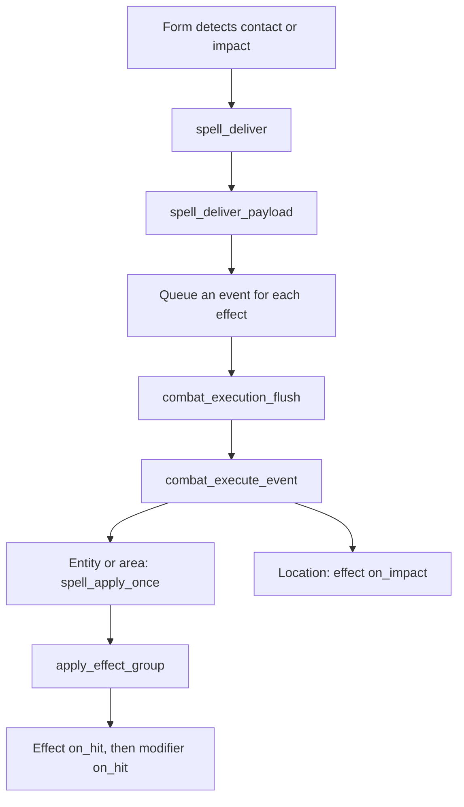

# Check branch commit history

[Back to archive index](README.md)

Chat ID: `01a18375-1954-7a03-a075-dd144b1c2ddb`  
Conversation: 2026-10-29 01:01:13+08:00 to 2026-10-29 04:45:31+08:00  
Timezone: Asia/Singapore (UTC+08:00)  
Exported: 2026-11-15 18:57:04+08:00  
Messages: 7 user, 15 assistant; 2 recorded edit operations.

This file preserves user and assistant messages, including progress updates and code examples. Tool inputs and saved outputs are expandable beside the messages where they occurred. Instructions, internal reasoning, token telemetry, and empty UI context records are excluded. Any truncation already present in a tool result is preserved; it is not reconstructed.

## Contents

- [Recorded code changes](#recorded-code-changes)
- [Recovered Git changes](#recovered-git-changes)
- [Conversation](#conversation)
- [Source records](#source-records)

## Recorded code changes

These are the per-operation diffs saved by the editor, in completion order. They preserve intermediate edits, later corrections, deletions, and new files. They are historical changes, not a patch against today's HEAD. Raw patch requests and failed attempts remain with the tool records in the transcript.

### Edit 1 — 2026-10-29 02:34:19+08:00

Completed/recorded: 2026-10-29 02:34:19+08:00  
Status: `completed`  
Source thread: `01a18375-1954-7a03-a075-dd144b1c2ddb`  
Record ID: `exec-ed30d9bd-fec0-4963-a090-27a310a5d920`

#### `objects/obj_mook/Create_0.gml`

Operation: update; repository.

```diff
@@ -40,3 +40,3 @@
 // The defeated enemy to spawn if the enemy is moving sideways
-defeat_side_object = spr_enemy_mook;
+defeat_side_object = obj_zombie_defeat_side;
 
```


### Edit 2 — 2026-10-29 04:45:29+08:00

Completed/recorded: 2026-10-29 04:45:29+08:00  
Status: `completed`  
Source thread: `01a18375-1954-7a03-a075-dd144b1c2ddb`  
Record ID: `exec-0cfbd9d6-195d-4ee2-bdd1-765a245c8af7`

#### `scripts/EffectGlyphs/EffectGlyphs.gml`

Operation: update; repository.

```diff
@@ -180,2 +180,3 @@
 	col = #331C00;
+	delivery_kind = "location";
 	allowed_forms = ["projectile", "strike", "rune"];
@@ -183,13 +184,10 @@
 	desc = "Create a barrier of earth to stop enemies from attacking";
-	on_impact = function(spell, enemy, fx) {
-		var _x = spell.x;
-		var _y = spell.y;
-		if (spell.compiled.form_id == "projectile") _x -= TILE_W; // Offset earth to one tile before if form is projectile
-		var _g = world_to_grid(_x, _y);
-		var _xy = grid_to_world_center(_g.col, _g.row)
-		_x = _xy.x;
-		_y = _xy.y;
+	on_impact = function(spell, fx, col, lane) {
+		if (spell.compiled.form_id == "projectile") col -= 1;
+		col = clamp(col, 0, GRID_COLS - 1);
+		if (lane < 0 || lane >= LANE_COUNT) return;
+		var _xy = grid_to_world_center(col, lane * ROWS_PER_LANE);
 		var _hp = tune_params("effects", "earth", "hp", 20);
 		var _duration = tune_params("effects", "earth", "duration", 20);
-		instance_create_layer(_x, _y, "Instances", obj_rock, {
+		instance_create_layer(_xy.x, _xy.y, "Instances", obj_rock, {
 			hp: _hp,
```


### Repository files involved

- `objects/obj_mook/Create_0.gml`
- `scripts/EffectGlyphs/EffectGlyphs.gml`

## Recovered Git changes

Edit attribution comes from the recorded diffs above. Git commits below are supporting repository history: a matching commit can also contain manual edits or work from other conversations. Matching uses literal added/deleted lines and a bounded later commit date. When a matching block appears in another object/event file involved in the chat, both paths are shown; dates alone are never treated as proof.

### `522542083c64` — Fix Delay behavior and add repeating effects

<details>
<summary>Show recovered Git changes</summary>

Explicitly discussed/cited in the conversation.

Full textual commit diff; Git reports binary assets by filename.

```diff
commit 522542083c64008c0c0455a4750519e658eab65a
Author:     yytelliot <yytelliot@gmail.com>
AuthorDate: Tue Oct 27 23:27:15 2026 +0800
Commit:     yytelliot <yytelliot@gmail.com>
CommitDate: Tue Oct 27 23:27:15 2026 +0800

    Fix Delay behavior and add repeating effects
---
 README.md                                          |  15 +++
 objects/obj_enemy_parent/Step_0.gml                |   5 +-
 objects/obj_gameplay_manager/Create_0.gml          |   4 +-
 objects/obj_gameplay_manager/Step_0.gml            |  10 ++
 objects/obj_spellbook/Draw_64.gml                  |  21 +++-
 objects/obj_spells/Create_0.gml                    |   8 ++
 scripts/GlyphAccessScripts/GlyphAccessScripts.gml  |   1 +
 scripts/ModifierGlyphs/ModifierGlyphs.gml          |   3 +-
 .../SpellCatalogScripts/SpellCatalogScripts.gml    |  14 ++-
 .../SpellbookHelperScripts.gml                     |  32 +++++-
 tools/test-delay.cjs                               | 124 +++++++++++++++++++++
 11 files changed, 225 insertions(+), 12 deletions(-)

diff --git a/README.md b/README.md
index c4e627b..fbf2e7d 100644
--- a/README.md
+++ b/README.md
@@ -28,6 +28,21 @@ In GameMaker, check all three slots with both keyboard sections, tile targeting,
 tap versus hold behavior, channel release and exhaustion, pause/resume, spellbook
 naming, mouse-operated buttons, and the slot highlights and control hint.
 
+## Delay in spell sequences
+
+Attach Delay to an effect group to postpone the effects after that group.
+For example, add Harm, attach Delay to Harm, then add Harm again: the first
+Harm happens on contact and the second happens one second later by default.
+All following effects keep that delay; another Delay adds another second.
+Stacking Delay on a group also adds more time. Adjust the seconds per stack
+with `modifiers.delay.delay_increase` in `datafiles/tune.json`.
+
+An effect can appear only once between Delay boundaries. Harm → Harm and
+Harm → Fire → Harm are rejected; Harm → Delay → Harm is allowed. Removing a
+Delay or a group that would leave invalid repeats is rejected with a message.
+Remove the repeated effect first. Every effect occurrence and Delay stack
+adds its normal mana cost. A trailing Delay has no following effect to postpone.
+
 ## Standard wave generation
 
 Levels define a threat curve and an enemy roster instead of manually repeating
diff --git a/objects/obj_enemy_parent/Step_0.gml b/objects/obj_enemy_parent/Step_0.gml
index 1496dd4..5a8d4b8 100644
--- a/objects/obj_enemy_parent/Step_0.gml
+++ b/objects/obj_enemy_parent/Step_0.gml
@@ -38,12 +38,13 @@ if (hex_timer > 0) hex_timer--;
 if (stun_immune_timer > 0) stun_immune_timer--;
 
 // Delay Handler
-for (var i = array_length(pending_effects) - 1; i >= 0; i--) {
+// Process ties in insertion order so same-time effects keep their sequence order.
+for (var i = 0; i < array_length(pending_effects);) {
 	var _p = pending_effects[i];
 	if (--_p.timer <= 0) {
 		apply_effect_group(_p.spell, id, _p.fx);
 		array_delete(pending_effects, i, 1);
-	}
+	} else i++;
 }
 
 
diff --git a/objects/obj_gameplay_manager/Create_0.gml b/objects/obj_gameplay_manager/Create_0.gml
index 31aaff2..3121b52 100644
--- a/objects/obj_gameplay_manager/Create_0.gml
+++ b/objects/obj_gameplay_manager/Create_0.gml
@@ -29,6 +29,8 @@ village_flash_color = c_red;
 
 // This variable tells whether the game is currently paused.
 paused = false;
+// Room-owned queue survives projectile destruction and clears on room changes.
+pending_spell_impacts = [];
 
 // This variable stores the id of the pause sequence if one exists, otherwise it stores negative 1.
 pause_sequence = -1;
@@ -45,4 +47,4 @@ global.menu_lock = false
 global.screen_shot_id = -1;
 
 // This variable tells whether the game is currently over.
-game_over = false;
\ No newline at end of file
+game_over = false;
diff --git a/objects/obj_gameplay_manager/Step_0.gml b/objects/obj_gameplay_manager/Step_0.gml
index ae536d4..ad7a315 100644
--- a/objects/obj_gameplay_manager/Step_0.gml
+++ b/objects/obj_gameplay_manager/Step_0.gml
@@ -19,6 +19,16 @@ if (money_flash_alpha > 0)
 // Check if the game is over, and if so, exit this event
 if (game_over) exit;
 
+if (!paused) {
+	for (var i = 0; i < array_length(pending_spell_impacts);) {
+		var _pending = pending_spell_impacts[i];
+		if (--_pending.timer <= 0) {
+			_pending.fx.effect.on_impact(_pending.spell, _pending.fx, _pending.col, _pending.lane);
+			array_delete(pending_spell_impacts, i, 1);
+		} else i++;
+	}
+}
+
 // Check if the village's hp is less than zero
 if (get_village_hp() <= 0) 
 {
diff --git a/objects/obj_spellbook/Draw_64.gml b/objects/obj_spellbook/Draw_64.gml
index a243215..304aad1 100644
--- a/objects/obj_spellbook/Draw_64.gml
+++ b/objects/obj_spellbook/Draw_64.gml
@@ -93,7 +93,14 @@ for (var e = 0; e < MAX_EFFECTS; e++) {
         if (_gr.hover != "") hover_text = _gr.hover;
         if (_gr.main.clicked)  active_group = e;
         if (_gr.main.rclicked) _rm_effect = e;
-        if (_gr.mod_r >= 0)    array_delete(_fx.mods, _gr.mod_r, 1);
+        if (_gr.mod_r >= 0) {
+            if (spell_sequence_valid(_spell, -1, e, _gr.mod_r)) {
+                array_delete(_fx.mods, _gr.mod_r, 1);
+            } else {
+                notice = "Remove the repeated effect before removing its Delay";
+                notice_timer = 120;
+            }
+        }
     } else if (_has_form && e == _count) {
         draw_set_alpha(0.4);
         draw_circle(_gx, _gy, 45, true);
@@ -104,8 +111,13 @@ for (var e = 0; e < MAX_EFFECTS; e++) {
     }
 }
 if (_rm_effect >= 0) {
-    array_delete(_spell.effects, _rm_effect, 1);   // its modifiers go with it
-    active_group = -1;
+    if (spell_sequence_valid(_spell, _rm_effect)) {
+        array_delete(_spell.effects, _rm_effect, 1);   // its modifiers go with it
+        active_group = -1;
+    } else {
+        notice = "This group contains the Delay separating repeated effects";
+        notice_timer = 120;
+    }
 }
 
 // ---- Clear button ----
@@ -117,6 +129,9 @@ _spell = spell_prune(sel);   // (name-only spells stay; empty ones free the slot
 
 // ---- Mana / cost ----
 draw_text(960, 97, "Cost: " + string(spell_cost(_spell)));
+if (notice_timer > 0 && notice != "") {
+    draw_text_ext(960, 180, notice, 26, 500);
+}
 if (_spell != undefined && _spell.form == undefined) {
     draw_set_color(c_red);
     draw_text(960, 140, "Needs a form to be usable");
diff --git a/objects/obj_spells/Create_0.gml b/objects/obj_spells/Create_0.gml
index 0f49bc1..0b02bca 100644
--- a/objects/obj_spells/Create_0.gml
+++ b/objects/obj_spells/Create_0.gml
@@ -27,6 +27,14 @@ for (var e = 0; e < array_length(effects); e++) {
 	for (var i = 0; i < array_length(_fx.mods); i++) _fx.mods[i].on_cast(self, _fx);
 }
 
+// Delays are cumulative boundaries: Harm + Delay, Fire + Delay, Harm
+// activates at 0, 1, and 2 seconds (with the default one-second Delay).
+var _sequence_delay = 0;
+for (var e = 0; e < array_length(effects); e++) {
+	effects[e].delay = _sequence_delay;
+	_sequence_delay += effects[e].delay_after;
+}
+
 col = c_white;
 if (array_length(effects) > 0) {
 	col = effects[0].effect.col;
diff --git a/scripts/GlyphAccessScripts/GlyphAccessScripts.gml b/scripts/GlyphAccessScripts/GlyphAccessScripts.gml
index fed7cbf..13ab901 100644
--- a/scripts/GlyphAccessScripts/GlyphAccessScripts.gml
+++ b/scripts/GlyphAccessScripts/GlyphAccessScripts.gml
@@ -62,6 +62,7 @@ function unlock_glyph(_type, _id) {
 ///@returns {bool} if the spell is valid
 function is_spell_usable(_s) {
 	if (_s == undefined || _s.form == undefined) return false;
+	if (!spell_sequence_valid(_s)) return false;
 	if(!is_glyph_available("form", _s.form)) return false;
 	for (var i = 0; i < array_length(_s.form_mods); i++) 
 		if (!is_glyph_available("modifier", _s.form_mods[i])) return false;
diff --git a/scripts/ModifierGlyphs/ModifierGlyphs.gml b/scripts/ModifierGlyphs/ModifierGlyphs.gml
index b1b34f1..95b1425 100644
--- a/scripts/ModifierGlyphs/ModifierGlyphs.gml
+++ b/scripts/ModifierGlyphs/ModifierGlyphs.gml
@@ -66,8 +66,9 @@ function Mod_Delay(): ModifierGlyph("Delay", DELAY_COST) constructor {
 	cost = tune_params("modifiers", "delay", "cost", DELAY_COST);
 	is_stacks = true;
 	scope = "effect";
+	desc = "Delays the effects after this group. Allows an effect to repeat after the delay. Stacks add more time.";
 	on_cast = function(spell, fx) {
-		fx.delay += tune_params("modifiers", "delay", "delay_increase", DELAY_AMT);
+		fx.delay_after += tune_params("modifiers", "delay", "delay_increase", DELAY_AMT);
 	}
 }
 
diff --git a/scripts/SpellCatalogScripts/SpellCatalogScripts.gml b/scripts/SpellCatalogScripts/SpellCatalogScripts.gml
index e280deb..a0d40f7 100644
--- a/scripts/SpellCatalogScripts/SpellCatalogScripts.gml
+++ b/scripts/SpellCatalogScripts/SpellCatalogScripts.gml
@@ -105,7 +105,17 @@ function spell_hit(spell, target) {
 function spell_impact(spell, col, lane) {
 	for (var e = 0; e < array_length(spell.effects); e++) {
 		var _fx = spell.effects[e];
-		_fx.effect.on_impact(spell, _fx, col, lane);
+		if (_fx.delay > 0) {
+			var _manager = instance_find(obj_gameplay_manager, 0);
+			if (instance_exists(_manager)) {
+				array_push(_manager.pending_spell_impacts, {
+					timer: max(1, round(_fx.delay * TARGET_ROOM_SPEED)),
+					spell: spell_snapshot(spell), fx: _fx, col: col, lane: lane
+				});
+			}
+		} else {
+			_fx.effect.on_impact(spell, _fx, col, lane);
+		}
 	}
 }
 
@@ -160,7 +170,7 @@ function cast_spell(_caster, _loadout, _col, _row) {
 			}
 		}
 
-		array_push(_effects, {effect: _el, mods: _mods, effect_multiplier: 1, duration: 1, delay: 0});
+		array_push(_effects, {effect: _el, mods: _mods, effect_multiplier: 1, duration: 1, delay: 0, delay_after: 0});
 	}
 	
 	if (_f.name == "Rune") {
diff --git a/scripts/SpellbookHelperScripts/SpellbookHelperScripts.gml b/scripts/SpellbookHelperScripts/SpellbookHelperScripts.gml
index 2186de2..03b1c37 100644
--- a/scripts/SpellbookHelperScripts/SpellbookHelperScripts.gml
+++ b/scripts/SpellbookHelperScripts/SpellbookHelperScripts.gml
@@ -37,6 +37,33 @@ function effect_valid_for_form(_effect_id, _form_id) {
     return _e.allowed_forms == undefined || array_contains(_m.allowed_forms, _form_id);
 }
 
+// Delay satellites mark a boundary AFTER their effect group.
+// Optional skips let the editor validate a removal before changing the spell.
+function spell_sequence_valid(_s, _skip_effect = -1, _skip_group = -1, _skip_mod = -1) {
+    var _seen = [];
+    for (var e = 0; e < array_length(_s.effects); e++) {
+        if (e == _skip_effect) continue;
+        var _fx = _s.effects[e];
+        if (array_contains(_seen, _fx.effect)) return false;
+        array_push(_seen, _fx.effect);
+        for (var i = 0; i < array_length(_fx.mods); i++) {
+            if (e == _skip_group && i == _skip_mod) continue;
+            if (_fx.mods[i] == "delay") _seen = [];
+        }
+    }
+    return true;
+}
+
+function spell_can_append_effect(_s, _id) {
+    var _seen = [];
+    for (var e = 0; e < array_length(_s.effects); e++) {
+        var _fx = _s.effects[e];
+        array_push(_seen, _fx.effect);
+        if (array_contains(_fx.mods, "delay")) _seen = [];
+    }
+    return !array_contains(_seen, _id);
+}
+
 function spell_clear(_s) {
     _s.form = undefined; _s.form_mods = []; _s.effects = [];
 }
@@ -59,8 +86,7 @@ function spell_add_glyph(_s, _type, _id, _active) {
 
     if (_type == "effect") {
         if (array_length(_s.effects) >= MAX_EFFECTS) return "Too many effects";
-        for (var e = 0; e < array_length(_s.effects); e++)
-            if (_s.effects[e].effect== _id) return "Effect already added";
+        if (!spell_can_append_effect(_s, _id)) return "Add Delay between repeated effects";
         array_push(_s.effects, { effect: _id, mods: [] });
         return "";
     }
@@ -179,4 +205,4 @@ function draw_glyph_group(_x, _y, _r, _glyph, _mod_ids, _base, _spread, _selecte
     if (_out.main.hover) _out.hover = _glyph.name + "\n" + _glyph.desc
                                     + "\n(click: select group, right-click: remove)";
     return _out;
-}
\ No newline at end of file
+}
diff --git a/tools/test-delay.cjs b/tools/test-delay.cjs
new file mode 100644
index 0000000..8fb96db
--- /dev/null
+++ b/tools/test-delay.cjs
@@ -0,0 +1,124 @@
+// Runs the project's GML builder and scheduling logic with mocked engine calls.
+const assert = require('node:assert/strict');
+const fs = require('node:fs');
+const path = require('node:path');
+const vm = require('node:vm');
+const read = p => fs.readFileSync(path.join(__dirname, '..', p), 'utf8');
+const helpers = read('scripts/SpellbookHelperScripts/SpellbookHelperScripts.gml');
+const catalog = read('scripts/SpellCatalogScripts/SpellCatalogScripts.gml');
+function extract(source, name) {
+    const start = source.indexOf(`function ${name}(`);
+    assert.ok(start >= 0, name);
+    const open = source.indexOf('{', start);
+    let depth = 1, end = open + 1;
+    while (depth) { if (source[end] === '{') depth++; if (source[end] === '}') depth--; end++; }
+    return source.slice(start, end);
+}
+// Translate only the GML dynamic-struct accessor and one integer division.
+const translate = s => s.replace(/\[\$\s*([^\]]+)\]/g, '[$1]')
+    .replace('_row div ROWS_PER_LANE', 'Math.floor(_row / ROWS_PER_LANE)')
+    .replace('_existing.lane = _lane', '_existing.lane == _lane');
+const log = [];
+const manager = {pending_spell_impacts: []};
+const ctx = {
+    MAX_EFFECTS: 5, MAX_MODS: 5, TARGET_ROOM_SPEED: 60, ROWS_PER_LANE: 1,
+    DELAY_COST: 5, DELAY_AMT: 1, noone: null, obj_gameplay_manager: 1, obj_spells: 2,
+    array_length: a => a.length, array_contains: (a, x) => a.includes(x),
+    array_push: (a, x) => a.push(x), array_delete: (a, i, n) => a.splice(i, n),
+    is_struct: x => !!x && typeof x === 'object',
+    min: Math.min, max: Math.max, round: Math.round,
+    is_glyph_available: () => true, mod_valid_for_form: () => true,
+    is_instanceof: () => false, Mod_Amplify: function(){}, Form_Beam: function(){},
+    instance_exists: x => !!x && !x.destroyed,
+    instance_find: () => manager, instance_number: () => 0,
+    json_stringify: JSON.stringify, tune_params: (_, __, ___, value) => value,
+    global: {spell_glyphs: {form: {}, modifier: {}, effect: {}}},
+};
+vm.createContext(ctx);
+for (const name of ['spell_sequence_valid', 'spell_can_append_effect', 'spell_add_glyph', 'spell_cost'])
+    vm.runInContext(translate(extract(helpers, name)), ctx);
+vm.runInContext(translate(extract(read('scripts/GlyphAccessScripts/GlyphAccessScripts.gml'), 'is_spell_usable')), ctx);
+for (const name of ['apply_effect_group', 'schedule_effect', 'spell_snapshot', 'spell_hit', 'spell_impact', 'cast_spell'])
+    vm.runInContext(translate(extract(catalog, name)), ctx);
+const modifierSource = read('scripts/ModifierGlyphs/ModifierGlyphs.gml');
+const delayBody = extract(modifierSource, 'Mod_Delay');
+const delayCallback = delayBody.slice(delayBody.indexOf('function(spell, fx)'), delayBody.lastIndexOf('}') - 1).trim().replace(/;$/, '');
+const delay = {cost: 5, scope: 'effect', is_stacks: true, on_cast: vm.runInContext(`(${delayCallback})`, ctx)};
+ctx.global.spell_glyphs.modifier.delay = delay;
+ctx.global.spell_glyphs.form.projectile = {cost: 5, name: 'Projectile', on_cast: () => {}};
+for (const name of ['harm', 'fire', 'ice', 'pull']) ctx.global.spell_glyphs.effect[name] = {
+    cost: 10, on_cast: () => {},
+    on_hit: () => log.push(name), on_impact: () => log.push(`impact:${name}`),
+};
+const creation = read('objects/obj_spells/Create_0.gml');
+const init = creation.slice(creation.indexOf('form.on_cast(self);'), creation.indexOf('col = c_white;', creation.indexOf('form.on_cast(self);')));
+ctx.instance_create_layer = (_, __, ___, ____, data) => {
+    Object.assign(ctx, {self: data, form: data.form, form_mods: data.form_mods, effects: data.effects});
+    vm.runInContext(init, ctx);
+    return data;
+};
+const fresh = () => ({name: '', form: 'projectile', form_mods: [], effects: []});
+const add = (s, type, id, active = -1) => ctx.spell_add_glyph(s, type, id, active);
+let s = fresh();
+assert.equal(add(s, 'effect', 'harm'), '');
+assert.notEqual(add(s, 'effect', 'harm'), '');
+assert.equal(add(s, 'effect', 'fire'), '');
+assert.notEqual(add(s, 'effect', 'harm'), '');
+assert.equal(add(s, 'modifier', 'delay', 0), '');
+assert.equal(add(s, 'effect', 'harm'), '');
+assert.equal(ctx.spell_sequence_valid(s), true);
+assert.equal(ctx.spell_sequence_valid(s, -1, 0, 0), false);
+assert.equal(ctx.spell_sequence_valid(s, 1), true);
+assert.equal(ctx.spell_sequence_valid(s, 2), true);
+assert.equal(add(s, 'modifier', 'delay', 1), '');
+assert.equal(ctx.spell_sequence_valid(s, 1), true); // the earlier boundary still separates Harm
+const removal = fresh();
+removal.effects = [{effect: 'harm', mods: []}, {effect: 'fire', mods: ['delay']}, {effect: 'harm', mods: []}];
+assert.equal(ctx.spell_sequence_valid(removal, 1), false);
+assert.equal(add(s, 'modifier', 'delay', 0), ''); // stacked boundary: 2 seconds
+assert.equal(ctx.spell_cost(s), 50);
+const caster = {mana: 100, mana_exhausted: false, x: 0, y: 0};
+const result = ctx.cast_spell(caster, s, 2, 0);
+assert.equal(result.cost, ctx.spell_cost(s));
+assert.equal(caster.mana, 50);
+assert.deepEqual(Array.from(result.spell.effects, fx => fx.delay), [0, 2, 3]);
+const target = {is_targetable: true, pending_effects: []};
+Object.assign(result.spell, {hit_list: [], x: 0, y: 0});
+ctx.spell_hit(result.spell, target);
+assert.deepEqual(log, ['harm']);
+assert.deepEqual(Array.from(target.pending_effects, p => p.timer), [120, 180]);
+ctx.pending_effects = target.pending_effects; ctx.id = target;
+const step = read('objects/obj_enemy_parent/Step_0.gml');
+const handler = step.slice(step.indexOf('// Delay Handler'), step.indexOf('// Save'));
+for (let i = 0; i < 119; i++) vm.runInContext(handler, ctx);
+assert.deepEqual(log, ['harm']);
+vm.runInContext(handler, ctx); assert.deepEqual(log, ['harm', 'fire']);
+for (let i = 0; i < 60; i++) vm.runInContext(handler, ctx);
+assert.deepEqual(log, ['harm', 'fire', 'harm']);
+// Same-time delayed effects keep their authored order.
+s = fresh(); add(s, 'effect', 'harm'); add(s, 'modifier', 'delay');
+add(s, 'effect', 'fire'); add(s, 'effect', 'ice');
+const second = ctx.cast_spell({...caster, mana: 100}, s, 2, 0).spell;
+Object.assign(second, {hit_list: [], x: 0, y: 0});
+log.length = 0; target.pending_effects = []; ctx.spell_hit(second, target);
+ctx.pending_effects = target.pending_effects;
+for (let i = 0; i < 60; i++) vm.runInContext(handler, ctx);
+assert.deepEqual(log, ['harm', 'fire', 'ice']);
+// Invalid manually edited sequences cannot cast or spend mana.
+const bad = fresh(); bad.effects = [{effect: 'harm', mods: []}, {effect: 'harm', mods: []}];
+const payer = {...caster, mana: 100};
+assert.equal(ctx.cast_spell(payer, bad, 0, 0).spell, null); assert.equal(payer.mana, 100);
+// Delayed impact effects survive the projectile and freeze while paused.
+log.length = 0; ctx.spell_impact(second, 2, 0);
+assert.deepEqual(log, ['impact:harm']);
+second.destroyed = true;
+ctx.pending_spell_impacts = manager.pending_spell_impacts; ctx.paused = true;
+const managerStep = read('objects/obj_gameplay_manager/Step_0.gml');
+const impactHandler = managerStep.slice(managerStep.indexOf('if (!paused)'), managerStep.indexOf("// Check if the village"));
+vm.runInContext(impactHandler, ctx);
+assert.equal(manager.pending_spell_impacts[0].timer, 60);
+ctx.paused = false;
+for (let i = 0; i < 60; i++) vm.runInContext(impactHandler, ctx);
+assert.deepEqual(log, ['impact:harm', 'impact:fire', 'impact:ice']);
+assert.equal(manager.pending_spell_impacts.length, 0);
+console.log('Delay checks passed: builder rules, boundary removal, cumulative/stacked timing, stable order, mana, invalid casts and delayed impacts.');
```

</details>

### `89796deebd85` — refactor: share spell compilation and mana calculation

<details>
<summary>Show recovered Git changes</summary>

Explicitly discussed/cited in the conversation.

Full textual commit diff; Git reports binary assets by filename.

```diff
commit 89796deebd859a3164a3375831bd12f53e49df8e
Author:     yytelliot <yytelliot@gmail.com>
AuthorDate: Wed Oct 28 14:21:03 2026 +0800
Commit:     yytelliot <yytelliot@gmail.com>
CommitDate: Wed Oct 28 14:21:03 2026 +0800

    refactor: share spell compilation and mana calculation
---
 objects/obj_spells/Create_0.gml                    | 12 ++----
 scripts/FormGlyphs/FormGlyphs.gml                  |  1 -
 .../SpellCatalogScripts/SpellCatalogScripts.gml    | 50 +++++++++++++++++-----
 .../SpellbookHelperScripts.gml                     | 20 +--------
 tools/construction-test-context.cjs                |  9 +++-
 tools/test-delay.cjs                               |  2 +-
 tools/test-mana-preview.cjs                        |  2 +
 tools/test-spell-compilation.cjs                   | 16 +++++++
 8 files changed, 71 insertions(+), 41 deletions(-)

diff --git a/objects/obj_spells/Create_0.gml b/objects/obj_spells/Create_0.gml
index 0b02bca..db8ba97 100644
--- a/objects/obj_spells/Create_0.gml
+++ b/objects/obj_spells/Create_0.gml
@@ -1,11 +1,11 @@
 //obj_spell Create
 
-spd = 4; dmg = 1; lifetime = 60; pierce = 0; dir = 0;
+spd = 4; dmg = 1; lifetime = 60; pierce = compiled.pierce; dir = 0;
 col = c_white
 landed = false;
 lane = 0;
 target_x = 0; target_y = 0;
-area = false; // If area glyph is used
+area = compiled.area;
 hit_list = [];
 beam_lanes = [];
 
@@ -20,20 +20,14 @@ beam_lanes = [];
 
 
 form.on_cast(self);
-for (var i = 0; i < array_length(form_mods); i++) form_mods[i].on_cast(self, undefined);
 for (var e = 0; e < array_length(effects); e++) {
 	var _fx = effects[e];
 	_fx.effect.on_cast(self, _fx);
-	for (var i = 0; i < array_length(_fx.mods); i++) _fx.mods[i].on_cast(self, _fx);
 }
 
 // Delays are cumulative boundaries: Harm + Delay, Fire + Delay, Harm
 // activates at 0, 1, and 2 seconds (with the default one-second Delay).
-var _sequence_delay = 0;
-for (var e = 0; e < array_length(effects); e++) {
-	effects[e].delay = _sequence_delay;
-	_sequence_delay += effects[e].delay_after;
-}
+// Modifier values and cumulative delays are already resolved by compile_spell().
 
 col = c_white;
 if (array_length(effects) > 0) {
diff --git a/scripts/FormGlyphs/FormGlyphs.gml b/scripts/FormGlyphs/FormGlyphs.gml
index a7db0f8..25a885a 100644
--- a/scripts/FormGlyphs/FormGlyphs.gml
+++ b/scripts/FormGlyphs/FormGlyphs.gml
@@ -197,7 +197,6 @@ function Form_Rune() : FormGlyph("Rune", RUNE_COST) constructor {
 	on_step = function(spell) {
 		if (!spell.armed && --spell.arm_timer <= 0) {
 			spell.armed = true;
-			sprite = spr_vfx_rune_complete;
 			spell.mask_index = spr_vfx_rune_complete;
 		}
 	};
diff --git a/scripts/SpellCatalogScripts/SpellCatalogScripts.gml b/scripts/SpellCatalogScripts/SpellCatalogScripts.gml
index 840e58b..231af85 100644
--- a/scripts/SpellCatalogScripts/SpellCatalogScripts.gml
+++ b/scripts/SpellCatalogScripts/SpellCatalogScripts.gml
@@ -143,12 +143,12 @@ function rune_trim_to_limit(_key, _limit) {
 	for (var i = 0; i < array_length(_runes) - _limit; i++) instance_destroy(_runes[i]);
 }
 
-function cast_spell(_caster, _loadout, _col, _row) {
-	if (_caster.mana_exhausted || !is_spell_usable(_loadout)) return { spell: noone, cost: 0 };
-
+// Read-only by convention after compilation. Delivery instances own mutable hit state.
+function compile_spell(_loadout) {
+	if (_loadout == undefined || _loadout.form == undefined) return undefined;
 	var _g = global.spell_glyphs;
 	var _f = _g.form[$ _loadout.form];
-	if (!is_struct(_f)) return { spell: noone, cost: 0 };
+	if (!is_struct(_f)) return undefined;
 
 	var _cost = _f.cost;
 
@@ -156,7 +156,7 @@ function cast_spell(_caster, _loadout, _col, _row) {
 
 	for (var i = 0; i < array_length(_loadout.form_mods); i++) {
 		var _m = _g.modifier[$ _loadout.form_mods[i]];
-		if (!is_struct(_m)) return { spell: noone, cost: 0 };
+		if (!is_struct(_m)) return undefined;
 		array_push(_fmods, _m);
 		_cost += _m.cost;
 	}
@@ -164,25 +164,52 @@ function cast_spell(_caster, _loadout, _col, _row) {
 	var _effects = [];
 	for (var e = 0; e < array_length(_loadout.effects); e++) {
 		var _el = _g.effect[$ _loadout.effects[e].effect];
-		if (!is_struct(_el)) return { spell: noone, cost: 0 };
+		if (!is_struct(_el)) return undefined;
 		_cost += _el.cost;
 
 		var _mods = [];
 		var _amp_count = 0;
 		for (var i = 0; i < array_length(_loadout.effects[e].mods); i++) {
 			var _m = _g.modifier[$ _loadout.effects[e].mods[i]];
-			if (!is_struct(_m)) return { spell: noone, cost: 0 };
+			if (!is_struct(_m)) return undefined;
 			array_push(_mods, _m);
 			_cost += _m.cost;
-			if (is_instanceof(_m, Mod_Amplify)) { // Handles Multiple Amplifies on one effect
+			if (_loadout.effects[e].mods[i] == "amplify") {
 				var _amp_cost = tune_params("modifiers", "amplify", "cost_increase_per_stack", 5);
 				_cost += (_amp_count * _amp_cost);
 				_amp_count++;
 			}
 		}
 
-		array_push(_effects, {effect: _el, mods: _mods, effect_multiplier: 1, duration: 0, delay: 0, delay_after: 0});
+		array_push(_effects, {index: e, id: _loadout.effects[e].effect, effect: _el, mods: _mods, effect_multiplier: 1, duration: 0, delay: 0, delay_after: 0});
+	}
+	var _compiled = {cost: _cost, form: _f, form_id: _loadout.form,
+		form_mods: _fmods, effects: _effects, area: false, pierce: 0};
+	for (var i = 0; i < array_length(_fmods); i++) {
+		var _fn = _fmods[i][$ "on_cast"];
+		if (_fn != undefined) _fn(_compiled, undefined);
+	}
+	var _delay = 0;
+	for (var e = 0; e < array_length(_effects); e++) {
+		var _fx = _effects[e];
+		for (var i = 0; i < array_length(_fx.mods); i++) {
+			var _fn = _fx.mods[i][$ "on_cast"];
+			if (_fn != undefined) _fn(_compiled, _fx);
+		}
+		_fx.delay = _delay;
+		_delay += _fx.delay_after;
+		_fx.target_policy = (_fx.id == "pull") ? "location" :
+			((_compiled.form_id == "strike" || _compiled.form_id == "rune" || _compiled.area) && _compiled.form_id != "beam" ? "area" : "entity");
 	}
+	return _compiled;
+}
+
+function cast_spell(_caster, _loadout, _col, _row) {
+	if (_caster.mana_exhausted || !is_spell_usable(_loadout)) return { spell: noone, cost: 0 };
+	var _compiled = compile_spell(_loadout);
+	if (!is_struct(_compiled)) return { spell: noone, cost: 0 };
+	var _f = _compiled.form;
+	var _cost = _compiled.cost;
 	
 	var _rune_limit = 0;
 	if (_f.name == "Rune") {
@@ -226,10 +253,11 @@ function cast_spell(_caster, _loadout, _col, _row) {
 	}
 
 	var _spell = instance_create_layer(_caster.x, _caster.y, "Instances", obj_spells, {
+			compiled    : _compiled,
 			caster		: _caster,
 			form		: _f,
-			form_mods	: _fmods,
-			effects		: _effects,
+			form_mods	: _compiled.form_mods,
+			effects		: _compiled.effects,
 			target_col	: _col,
 			target_row	: _row,
 			rune_spell_key: _rune_spell_key,
diff --git a/scripts/SpellbookHelperScripts/SpellbookHelperScripts.gml b/scripts/SpellbookHelperScripts/SpellbookHelperScripts.gml
index 24b9cc5..99ff53e 100644
--- a/scripts/SpellbookHelperScripts/SpellbookHelperScripts.gml
+++ b/scripts/SpellbookHelperScripts/SpellbookHelperScripts.gml
@@ -189,24 +189,8 @@ function spell_add_glyph(_s, _type, _id, _active) {
 }
 
 function spell_cost(_s) {
-    if (_s == undefined || _s.form == undefined) return 0;
-    var _g = global.spell_glyphs;
-    var _c = _g.form[$ _s.form].cost;
-    for (var i = 0; i < array_length(_s.form_mods); i++) _c += _g.modifier[$ _s.form_mods[i]].cost;
-    for (var e = 0; e < array_length(_s.effects); e++) {
-        _c += _g.effect[$ _s.effects[e].effect].cost;
-		var _amp_count = 0;
-        for (var i = 0; i < array_length(_s.effects[e].mods); i++) {
-			var _m = _g.modifier[$ _s.effects[e].mods[i]];
-            _c += _m.cost;
-			if (is_instanceof(_m, Mod_Amplify)) { // Handles Multiple Amplifies on one effect
-				var _amp_cost = tune_params("modifiers", "amplify", "cost_increase_per_stack", 5);
-				_c += (_amp_count * _amp_cost);
-				_amp_count++;
-			}
-		}
-    }
-    return _c;
+    var _compiled = compile_spell(_s);
+    return is_struct(_compiled) ? _compiled.cost : 0;
 }
 
 // Compare against capacity, not the player's temporarily depleted mana.
diff --git a/tools/construction-test-context.cjs b/tools/construction-test-context.cjs
index 37aaa5e..d452073 100644
--- a/tools/construction-test-context.cjs
+++ b/tools/construction-test-context.cjs
@@ -1,5 +1,5 @@
 const vm = require('node:vm');
-const {read, load} = require('./gml-test-utils.cjs');
+const {read, extract, load} = require('./gml-test-utils.cjs');
 function makeContext(limit = 8) {
     const glyphs = {form: {}, effect: {}, modifier: {}};
     for (const id of ['projectile','strike','beam','rune']) glyphs.form[id] = {cost: 5};
@@ -33,8 +33,15 @@ function makeContext(limit = 8) {
         is_struct:x=>!!x && typeof x==='object', variable_struct_exists:(s,k)=>Object.hasOwn(s,k),
         string:String,clamp:(v,a,b)=>Math.max(a,Math.min(b,v)),
         is_glyph_available:()=>true, is_instanceof:()=>false, Mod_Amplify:function(){},
+        tune_params:(_,__,___,v)=>v,AMPLIFY_ADD_MULT:1,PIERCE_AMT:2,EXTEND_TIME_ADD:5,DELAY_AMT:1,
     });
     const helper = 'scripts/SpellbookHelperScripts/SpellbookHelperScripts.gml';
+    for (const [id,name] of Object.entries({area:'Area',pierce:'Pierce',amplify:'Amplify',extend_time:'Extend_Time',delay:'Delay'})) {
+        const body=extract(modifiers,`Mod_${name}`);
+        const part=body.slice(body.indexOf('on_cast = function')).replace('function(','function callback(');
+        glyphs.modifier[id].on_cast=vm.runInContext(`(${extract(part,'callback')})`,ctx);
+    }
+    load(ctx,'scripts/SpellCatalogScripts/SpellCatalogScripts.gml',['compile_spell']);
     load(ctx,helper,['spell_max_glyphs','spell_glyph_count','spell_catalog_entry','mod_valid_for_form','mod_valid_for_effect','effect_valid_for_form','spell_sequence_valid','spell_can_append_effect','spell_validation_message','spell_addition_message','spell_add_glyph','spell_cost','spell_mana_preview','spellbook_expensive_slots','spellbook_start_message']);
     load(ctx,'scripts/GlyphAccessScripts/GlyphAccessScripts.gml',['is_spell_usable','sanitize_owned']);
     return ctx;
diff --git a/tools/test-delay.cjs b/tools/test-delay.cjs
index fce7d7a..d9e87c3 100644
--- a/tools/test-delay.cjs
+++ b/tools/test-delay.cjs
@@ -40,7 +40,7 @@ vm.createContext(ctx);
 for (const name of ['spell_catalog_entry', 'mod_valid_for_form', 'mod_valid_for_effect', 'effect_valid_for_form', 'spell_sequence_valid', 'spell_can_append_effect', 'spell_validation_message', 'spell_addition_message', 'spell_add_glyph', 'spell_cost'])
     vm.runInContext(translate(extract(helpers, name)), ctx);
 vm.runInContext(translate(extract(read('scripts/GlyphAccessScripts/GlyphAccessScripts.gml'), 'is_spell_usable')), ctx);
-for (const name of ['apply_effect_group', 'schedule_effect', 'spell_snapshot', 'spell_hit', 'spell_impact', 'cast_spell'])
+for (const name of ['compile_spell', 'apply_effect_group', 'schedule_effect', 'spell_snapshot', 'spell_hit', 'spell_impact', 'cast_spell'])
     vm.runInContext(translate(extract(catalog, name)), ctx);
 const modifierSource = read('scripts/ModifierGlyphs/ModifierGlyphs.gml');
 const delayBody = extract(modifierSource, 'Mod_Delay');
diff --git a/tools/test-mana-preview.cjs b/tools/test-mana-preview.cjs
index f2c29a9..11e6ad8 100644
--- a/tools/test-mana-preview.cjs
+++ b/tools/test-mana-preview.cjs
@@ -17,12 +17,14 @@ const ctx = {
         modifier: {amplify, delay: {cost: 5}, pierce: {cost: 15}}
     }},
     array_length: a => a.length,
+    array_push:(a,v)=>a.push(v),is_struct:x=>!!x&&typeof x==='object',
     clamp: (v, a, b) => Math.max(a, Math.min(b, v)),
     string: String, is_instanceof: m => !!m.amplify, Mod_Amplify: function(){},
     tune_params: (_, __, ___, fallback) => fallback,
 };
 vm.createContext(ctx);
 const source = read('scripts/SpellbookHelperScripts/SpellbookHelperScripts.gml');
+vm.runInContext(extract(read('scripts/SpellCatalogScripts/SpellCatalogScripts.gml'),'compile_spell'),ctx);
 for (const name of ['spell_cost', 'spell_mana_preview', 'spellbook_expensive_slots'])
     vm.runInContext(extract(source, name), ctx);
 const spell = (mods = []) => ({form: 'projectile', form_mods: [], effects: [{effect: 'harm', mods}]});
diff --git a/tools/test-spell-compilation.cjs b/tools/test-spell-compilation.cjs
new file mode 100644
index 0000000..3437436
--- /dev/null
+++ b/tools/test-spell-compilation.cjs
@@ -0,0 +1,16 @@
+const assert=require('node:assert/strict');
+const {makeContext}=require('./construction-test-context.cjs');
+const ctx=makeContext(12);
+const s={form:'projectile',form_mods:['area','pierce'],effects:[{effect:'fire',mods:['amplify','extend_time','delay']},{effect:'harm',mods:['amplify','amplify']}]};
+const before=JSON.stringify(s);
+const a=ctx.compile_spell(s),b=ctx.compile_spell(s);
+assert.equal(a.cost,ctx.spell_cost(s));assert.equal(a.area,true);assert.equal(a.pierce,2);
+assert.equal(a.effects[0].duration,5);assert.equal(a.effects[0].effect_multiplier,2);
+assert.equal(a.effects[1].delay,1);assert.equal(a.effects[1].effect_multiplier,3);
+assert.equal(a.effects[0].target_policy,'area');
+assert.notEqual(a,b);assert.notEqual(a.effects[0],b.effects[0]);
+assert.equal(JSON.stringify(s),before);
+assert.equal(ctx.global.spell_glyphs.modifier.amplify.effect_multiplier,undefined);
+const direct=ctx.compile_spell({form:'projectile',form_mods:[],effects:[{effect:'harm',mods:[]},{effect:'pull',mods:[]}]});
+assert.equal(direct.effects[0].target_policy,'entity');assert.equal(direct.effects[1].target_policy,'location');
+console.log('Spell compilation checks passed: shared cost, modifier values, independent plans and target policies.');
```

</details>

### `312aeb8b74ea` — refactor: identify casts deliveries and enemy continuations

<details>
<summary>Show recovered Git changes</summary>

Explicitly discussed/cited in the conversation.

Full textual commit diff; Git reports binary assets by filename.

```diff
commit 312aeb8b74ea71bd1552e87e40ad64d8e4b62ca9
Author:     yytelliot <yytelliot@gmail.com>
AuthorDate: Wed Oct 28 14:22:27 2026 +0800
Commit:     yytelliot <yytelliot@gmail.com>
CommitDate: Wed Oct 28 14:22:27 2026 +0800

    refactor: identify casts deliveries and enemy continuations
---
 objects/obj_enemy_parent/Create_0.gml               |  2 ++
 objects/obj_enemy_parent/Destroy_0.gml              |  4 ++++
 objects/obj_revive_manager/Alarm_0.gml              |  1 +
 objects/obj_revive_manager/Alarm_1.gml              |  2 ++
 objects/obj_spells/Create_0.gml                     |  1 +
 scripts/EnemyHelper/EnemyHelper.gml                 | 13 +++++++++++++
 scripts/MutationScripts/MutationScripts.gml         |  4 ++++
 scripts/SpellCatalogScripts/SpellCatalogScripts.gml | 13 +++++++++++++
 tools/construction-test-context.cjs                 |  3 ++-
 tools/test-combat-identities.cjs                    | 16 ++++++++++++++++
 tools/test-delay.cjs                                |  3 ++-
 tools/test-skeletal-status.cjs                      |  6 ++++--
 12 files changed, 64 insertions(+), 4 deletions(-)

diff --git a/objects/obj_enemy_parent/Create_0.gml b/objects/obj_enemy_parent/Create_0.gml
index 2b5208b..f6b664a 100644
--- a/objects/obj_enemy_parent/Create_0.gml
+++ b/objects/obj_enemy_parent/Create_0.gml
@@ -96,6 +96,8 @@ mutation = undefined;
 
 // Delayed Effects
 pending_effects = [];
+combat_lineage = undefined;
+enemy_get_lineage(self);
 
 // offsets for overlapping tiles
 hit_x = 0;
diff --git a/objects/obj_enemy_parent/Destroy_0.gml b/objects/obj_enemy_parent/Destroy_0.gml
index b59d2a9..15aa6ff 100644
--- a/objects/obj_enemy_parent/Destroy_0.gml
+++ b/objects/obj_enemy_parent/Destroy_0.gml
@@ -2,6 +2,10 @@
 
 var _is_dead = hp <= 0;
 var _is_skeletal = is_instanceof(mutation, SkeletalMut);
+if (combat_lineage != undefined && !combat_lineage.gap && combat_lineage.target == id) {
+	combat_lineage.alive = false;
+	combat_lineage.target = noone;
+}
 
 // Always notify the spawning manager, including when this enemy reaches a base.
 // Skeletal deaths are excluded because their replacement is still active.
diff --git a/objects/obj_revive_manager/Alarm_0.gml b/objects/obj_revive_manager/Alarm_0.gml
index 1370ad9..c03e2a5 100644
--- a/objects/obj_revive_manager/Alarm_0.gml
+++ b/objects/obj_revive_manager/Alarm_0.gml
@@ -3,6 +3,7 @@
 enemy_age_status(status_state, round(spawn_delay * TARGET_ROOM_SPEED));
 _bones = instance_create_layer(ex, ey, "Instances", obj_bonepile);
 _bones.wave_owner = wave_owner;
+enemy_bind_lineage(_bones, lineage);
 bones_spawned = true;
 enemy_restore_status(_bones, status_state);
 enemy_apply_overdue_effects(_bones);
diff --git a/objects/obj_revive_manager/Alarm_1.gml b/objects/obj_revive_manager/Alarm_1.gml
index 53aec70..3ad2ba1 100644
--- a/objects/obj_revive_manager/Alarm_1.gml
+++ b/objects/obj_revive_manager/Alarm_1.gml
@@ -15,8 +15,10 @@ if (_bones.hp <= 0)
 var _status = enemy_capture_status(_bones);
 // Hand the same active-enemy slot to the replacement instead of counting a death.
 _bones.wave_owner = noone;
+_bones.combat_lineage = undefined;
 instance_destroy(_bones);
 var _enemy = instance_create_layer(ex, ey, "Instances", held_enemy);
+enemy_bind_lineage(_enemy, lineage);
 enemy_restore_status(_enemy, _status);
 
 // The revived enemy is no longer skeletal and must not create another revive.
diff --git a/objects/obj_spells/Create_0.gml b/objects/obj_spells/Create_0.gml
index db8ba97..97f5c66 100644
--- a/objects/obj_spells/Create_0.gml
+++ b/objects/obj_spells/Create_0.gml
@@ -7,6 +7,7 @@ lane = 0;
 target_x = 0; target_y = 0;
 area = compiled.area;
 hit_list = [];
+delivery_index = 0;
 beam_lanes = [];
 
 // This stores the form of the spell
diff --git a/scripts/EnemyHelper/EnemyHelper.gml b/scripts/EnemyHelper/EnemyHelper.gml
index 7e0859a..a6d08bb 100644
--- a/scripts/EnemyHelper/EnemyHelper.gml
+++ b/scripts/EnemyHelper/EnemyHelper.gml
@@ -1,5 +1,18 @@
 
 // Advance the same stun/charged clock for live enemies and skeletal spawn gaps.
+function enemy_get_lineage(_enemy) {
+	if (!variable_instance_exists(_enemy, "combat_lineage") || _enemy.combat_lineage == undefined) {
+		_enemy.combat_lineage = {id: combat_next_id(), target: _enemy, alive: true, gap: false};
+	}
+	return _enemy.combat_lineage;
+}
+
+function enemy_bind_lineage(_enemy, _lineage) {
+	_enemy.combat_lineage = _lineage;
+	_lineage.target = _enemy;
+	_lineage.gap = false;
+}
+
 function enemy_advance_lightning(_state, _frames) {
 	_frames = max(0, _frames);
 	var _stun = max(0, _state.stun_timer);
diff --git a/scripts/MutationScripts/MutationScripts.gml b/scripts/MutationScripts/MutationScripts.gml
index 25a97c6..646bf5a 100644
--- a/scripts/MutationScripts/MutationScripts.gml
+++ b/scripts/MutationScripts/MutationScripts.gml
@@ -139,7 +139,11 @@ function enemy_apply_overdue_effects(_enemy) {
 function SkeletalMut() : EnemyMutation("skeletal", "Skeletal", SKELETAL_COST) constructor {
 	tint = c_gray;
 	on_death = function(enemy) {
+		var _lineage = enemy_get_lineage(enemy);
+		_lineage.gap = true;
+		_lineage.target = noone;
 		var _e_struct = {
+			lineage: _lineage,
 			e_path_index : enemy.path_index,
 			e_path_position : enemy.path_position,
 			ex : enemy.x,
diff --git a/scripts/SpellCatalogScripts/SpellCatalogScripts.gml b/scripts/SpellCatalogScripts/SpellCatalogScripts.gml
index 231af85..02e6155 100644
--- a/scripts/SpellCatalogScripts/SpellCatalogScripts.gml
+++ b/scripts/SpellCatalogScripts/SpellCatalogScripts.gml
@@ -55,6 +55,17 @@ function validate_glyphs() {
 /// @param {Struct|Asset.GMObject} _spell A snapshot of a spell
 /// @param {Asset.GMObject} _target Enemy targetted
 /// @param {Struct} _fx effects being passed
+function combat_next_id() {
+	if (!variable_global_exists("combat_id")) global.combat_id = 0;
+	global.combat_id += 1;
+	return global.combat_id;
+}
+
+function spell_new_delivery(_spell) {
+	_spell.delivery_index += 1;
+	return {cast_id: _spell.cast_id, id: combat_next_id(), index: _spell.delivery_index};
+}
+
 function apply_effect_group(_spell, _target, _fx) {
 	_fx.effect.on_hit(_spell, _target, _fx);
 	for (var i = 0; i < array_length(_fx.mods); i++)
@@ -78,6 +89,7 @@ function schedule_effect(_spell, _target, _fx) {
 /// @description Creates a spell snapshot struct
 function spell_snapshot(_spell) {
 	return {
+		cast_id: _spell.cast_id,
 		caster: _spell.caster,
 		form: { is_channel: _spell.form.is_channel },
 		col: _spell.col,
@@ -253,6 +265,7 @@ function cast_spell(_caster, _loadout, _col, _row) {
 	}
 
 	var _spell = instance_create_layer(_caster.x, _caster.y, "Instances", obj_spells, {
+			cast_id     : combat_next_id(),
 			compiled    : _compiled,
 			caster		: _caster,
 			form		: _f,
diff --git a/tools/construction-test-context.cjs b/tools/construction-test-context.cjs
index d452073..8322f64 100644
--- a/tools/construction-test-context.cjs
+++ b/tools/construction-test-context.cjs
@@ -31,6 +31,7 @@ function makeContext(limit = 8) {
         global:{spell_glyphs:glyphs,level_config:{rm_test:{max_glyphs:limit}},spellbook:[]},
         array_length:a=>a.length,array_contains:(a,v)=>a.includes(v),array_push:(a,v)=>a.push(v),array_delete:(a,i,n)=>a.splice(i,n),
         is_struct:x=>!!x && typeof x==='object', variable_struct_exists:(s,k)=>Object.hasOwn(s,k),
+        variable_global_exists:k=>Object.hasOwn(ctx.global,k),
         string:String,clamp:(v,a,b)=>Math.max(a,Math.min(b,v)),
         is_glyph_available:()=>true, is_instanceof:()=>false, Mod_Amplify:function(){},
         tune_params:(_,__,___,v)=>v,AMPLIFY_ADD_MULT:1,PIERCE_AMT:2,EXTEND_TIME_ADD:5,DELAY_AMT:1,
@@ -41,7 +42,7 @@ function makeContext(limit = 8) {
         const part=body.slice(body.indexOf('on_cast = function')).replace('function(','function callback(');
         glyphs.modifier[id].on_cast=vm.runInContext(`(${extract(part,'callback')})`,ctx);
     }
-    load(ctx,'scripts/SpellCatalogScripts/SpellCatalogScripts.gml',['compile_spell']);
+    load(ctx,'scripts/SpellCatalogScripts/SpellCatalogScripts.gml',['compile_spell','combat_next_id','spell_new_delivery']);
     load(ctx,helper,['spell_max_glyphs','spell_glyph_count','spell_catalog_entry','mod_valid_for_form','mod_valid_for_effect','effect_valid_for_form','spell_sequence_valid','spell_can_append_effect','spell_validation_message','spell_addition_message','spell_add_glyph','spell_cost','spell_mana_preview','spellbook_expensive_slots','spellbook_start_message']);
     load(ctx,'scripts/GlyphAccessScripts/GlyphAccessScripts.gml',['is_spell_usable','sanitize_owned']);
     return ctx;
diff --git a/tools/test-combat-identities.cjs b/tools/test-combat-identities.cjs
new file mode 100644
index 0000000..229c420
--- /dev/null
+++ b/tools/test-combat-identities.cjs
@@ -0,0 +1,16 @@
+const assert=require('node:assert/strict');
+const {load}=require('./gml-test-utils.cjs');
+const {makeContext}=require('./construction-test-context.cjs');
+const ctx=makeContext();ctx.variable_instance_exists=(o,k)=>Object.hasOwn(o,k);
+load(ctx,'scripts/EnemyHelper/EnemyHelper.gml',['enemy_get_lineage','enemy_bind_lineage']);
+const enemy={},pile={},revived={};
+const lineage=ctx.enemy_get_lineage(enemy);
+assert.equal(ctx.enemy_get_lineage(enemy),lineage);
+lineage.gap=true;lineage.target=null;
+ctx.enemy_bind_lineage(pile,lineage);assert.equal(lineage.target,pile);
+ctx.enemy_bind_lineage(revived,lineage);assert.equal(lineage.target,revived);
+const spell={cast_id:ctx.combat_next_id(),delivery_index:0};
+const a=ctx.spell_new_delivery(spell),b=ctx.spell_new_delivery(spell);
+assert.equal(a.cast_id,b.cast_id);assert.notEqual(a.id,b.id);assert.equal(b.index,2);
+assert.notEqual(ctx.enemy_get_lineage({}).id,lineage.id);
+console.log('Combat identity checks passed: stable skeletal lineage, unique casts and independent delivery events.');
diff --git a/tools/test-delay.cjs b/tools/test-delay.cjs
index d9e87c3..aec6c98 100644
--- a/tools/test-delay.cjs
+++ b/tools/test-delay.cjs
@@ -28,6 +28,7 @@ const ctx = {
     array_length: a => a.length, array_contains: (a, x) => a.includes(x),
     array_push: (a, x) => a.push(x), array_delete: (a, i, n) => a.splice(i, n),
     is_struct: x => !!x && typeof x === 'object', variable_struct_exists: (s,k) => Object.hasOwn(s,k),
+    variable_global_exists:k=>Object.hasOwn(ctx.global,k),
     min: Math.min, max: Math.max, round: Math.round,
     is_glyph_available: () => true, mod_valid_for_form: () => true,
     is_instanceof: () => false, Mod_Amplify: function(){}, Form_Beam: function(){},
@@ -40,7 +41,7 @@ vm.createContext(ctx);
 for (const name of ['spell_catalog_entry', 'mod_valid_for_form', 'mod_valid_for_effect', 'effect_valid_for_form', 'spell_sequence_valid', 'spell_can_append_effect', 'spell_validation_message', 'spell_addition_message', 'spell_add_glyph', 'spell_cost'])
     vm.runInContext(translate(extract(helpers, name)), ctx);
 vm.runInContext(translate(extract(read('scripts/GlyphAccessScripts/GlyphAccessScripts.gml'), 'is_spell_usable')), ctx);
-for (const name of ['compile_spell', 'apply_effect_group', 'schedule_effect', 'spell_snapshot', 'spell_hit', 'spell_impact', 'cast_spell'])
+for (const name of ['combat_next_id','spell_new_delivery','compile_spell', 'apply_effect_group', 'schedule_effect', 'spell_snapshot', 'spell_hit', 'spell_impact', 'cast_spell'])
     vm.runInContext(translate(extract(catalog, name)), ctx);
 const modifierSource = read('scripts/ModifierGlyphs/ModifierGlyphs.gml');
 const delayBody = extract(modifierSource, 'Mod_Delay');
diff --git a/tools/test-skeletal-status.cjs b/tools/test-skeletal-status.cjs
index 5d4d4b6..56e42a0 100644
--- a/tools/test-skeletal-status.cjs
+++ b/tools/test-skeletal-status.cjs
@@ -7,8 +7,10 @@ const ctx = vm.createContext({
     max:Math.max,round:Math.round,TARGET_ROOM_SPEED:60,
     tune_params:(_,__,___,fallback)=>fallback,
     noone:null,obj_bonepile:'bone',obj_revive_manager:'manager',path_action_stop:0,
+    global:{},variable_global_exists:k=>Object.hasOwn(ctx.global,k),variable_instance_exists:(o,k)=>Object.hasOwn(o,k),
 });
-load(ctx,'scripts/EnemyHelper/EnemyHelper.gml',['enemy_advance_lightning']);
+load(ctx,'scripts/SpellCatalogScripts/SpellCatalogScripts.gml',['combat_next_id']);
+load(ctx,'scripts/EnemyHelper/EnemyHelper.gml',['enemy_advance_lightning','enemy_get_lineage','enemy_bind_lineage']);
 load(ctx,'scripts/MutationScripts/MutationScripts.gml',[
     'enemy_capture_status','enemy_age_status','enemy_restore_status','enemy_apply_overdue_effects'
 ]);
@@ -67,7 +69,7 @@ function runAlarm(file, manager) {
     vm.runInContext(`(function(){with(manager){${event}\n}})()`,ctx);
 }
 function managerFor(source) {
-    const m={status_state:ctx.enemy_capture_status(source),spawn_delay:1,revive_delay:3,
+    const m={lineage:ctx.enemy_get_lineage(source),status_state:ctx.enemy_capture_status(source),spawn_delay:1,revive_delay:3,
         ex:source.x,ey:source.y,held_enemy:'brute',wave_owner:source.wave_owner,
         e_path_index:source.path_index,e_path_position:source.path_position,alarm:[],_bones:null,bones_spawned:false};
     m.id=m;
```

</details>

### `1e1f9fd62440` — refactor: unify ordered effect execution and scheduling

<details>
<summary>Show recovered Git changes</summary>

Explicitly discussed/cited in the conversation.

Full textual commit diff; Git reports binary assets by filename.

```diff
commit 1e1f9fd62440e0d448f3c7ece593b8832c31b0d9
Author:     yytelliot <yytelliot@gmail.com>
AuthorDate: Wed Oct 28 14:33:19 2026 +0800
Commit:     yytelliot <yytelliot@gmail.com>
CommitDate: Wed Oct 28 14:33:19 2026 +0800

    refactor: unify ordered effect execution and scheduling
---
 Spell.yyp                                          |   3 +-
 objects/obj_enemy_parent/Create_0.gml              |   1 -
 objects/obj_enemy_parent/Step_0.gml                |  10 --
 objects/obj_gameplay_manager/Create_0.gml          |   2 +-
 objects/obj_gameplay_manager/Step_0.gml            |  10 --
 objects/obj_gameplay_manager/Step_1.gml            |   2 +
 objects/obj_gameplay_manager/Step_2.gml            |   1 +
 .../obj_gameplay_manager/obj_gameplay_manager.yy   |   4 +-
 objects/obj_revive_manager/Alarm_0.gml             |   2 +-
 objects/obj_spells/Create_0.gml                    |   2 +-
 scripts/EffectGlyphs/EffectGlyphs.gml              |   2 +
 scripts/FormGlyphs/FormGlyphs.gml                  |  43 ++---
 scripts/MutationScripts/MutationScripts.gml        |  42 +----
 .../SpellCatalogScripts/SpellCatalogScripts.gml    |  76 +--------
 scripts/SpellExecution/SpellExecution.gml          | 109 +++++++++++++
 scripts/SpellExecution/SpellExecution.yy           |  10 ++
 tools/construction-test-context.cjs                |   2 +
 tools/execution-test-context.cjs                   |  69 ++++++++
 tools/gml-test-utils.cjs                           |   2 +-
 tools/test-delay.cjs                               | 154 ++++--------------
 tools/test-pierce.cjs                              | 106 ++++---------
 tools/test-skeletal-status.cjs                     | 173 +++++----------------
 tools/test-spell-execution.cjs                     |  68 ++++++++
 23 files changed, 389 insertions(+), 504 deletions(-)

diff --git a/Spell.yyp b/Spell.yyp
index 364aef0..7202143 100644
--- a/Spell.yyp
+++ b/Spell.yyp
@@ -184,6 +184,7 @@
     {"id":{"name":"MutationScripts","path":"scripts/MutationScripts/MutationScripts.yy",},},
     {"id":{"name":"SpellbookHelperScripts","path":"scripts/SpellbookHelperScripts/SpellbookHelperScripts.yy",},},
     {"id":{"name":"SpellCatalogScripts","path":"scripts/SpellCatalogScripts/SpellCatalogScripts.yy",},},
+    {"id":{"name":"SpellExecution","path":"scripts/SpellExecution/SpellExecution.yy",},},
     {"id":{"name":"TuneScript","path":"scripts/TuneScript/TuneScript.yy",},},
     {"id":{"name":"WaveGeneration","path":"scripts/WaveGeneration/WaveGeneration.yy",},},
     {"id":{"name":"WaveRuntime","path":"scripts/WaveRuntime/WaveRuntime.yy",},},
@@ -371,4 +372,4 @@
   "TextureGroups":[
     {"$GMTextureGroup":"","%Name":"Default","autocrop":true,"border":2,"compressFormat":"bz2","customOptions":"","directory":"","groupParent":null,"isScaled":true,"loadType":"default","mipsToGenerate":0,"name":"Default","resourceType":"GMTextureGroup","resourceVersion":"2.0","targets":-1,},
   ],
-}
\ No newline at end of file
+}
diff --git a/objects/obj_enemy_parent/Create_0.gml b/objects/obj_enemy_parent/Create_0.gml
index f6b664a..4b03be5 100644
--- a/objects/obj_enemy_parent/Create_0.gml
+++ b/objects/obj_enemy_parent/Create_0.gml
@@ -95,7 +95,6 @@ notes = "";
 mutation = undefined;
 
 // Delayed Effects
-pending_effects = [];
 combat_lineage = undefined;
 enemy_get_lineage(self);
 
diff --git a/objects/obj_enemy_parent/Step_0.gml b/objects/obj_enemy_parent/Step_0.gml
index 59bf5cc..61bf84f 100644
--- a/objects/obj_enemy_parent/Step_0.gml
+++ b/objects/obj_enemy_parent/Step_0.gml
@@ -8,16 +8,6 @@ if (pull != undefined) enemy_update_pull(id);
 
 combat_status_advance(self, 1);
 
-// Delay Handler
-// Process ties in insertion order so same-time effects keep their sequence order.
-for (var i = 0; i < array_length(pending_effects);) {
-	var _p = pending_effects[i];
-	if (--_p.timer <= 0) {
-		apply_effect_group(_p.spell, id, _p.fx);
-		array_delete(pending_effects, i, 1);
-	} else i++;
-}
-
 
 enemy_update_movement(self);
 
diff --git a/objects/obj_gameplay_manager/Create_0.gml b/objects/obj_gameplay_manager/Create_0.gml
index 64d9f66..073d1a7 100644
--- a/objects/obj_gameplay_manager/Create_0.gml
+++ b/objects/obj_gameplay_manager/Create_0.gml
@@ -29,7 +29,7 @@ village_flash_color = c_red;
 // This variable tells whether the game is currently paused.
 paused = false;
 // Room-owned queue survives projectile destruction and clears on room changes.
-pending_spell_impacts = [];
+combat_execution = combat_execution_create();
 
 // This variable stores the id of the pause sequence if one exists, otherwise it stores negative 1.
 pause_sequence = -1;
diff --git a/objects/obj_gameplay_manager/Step_0.gml b/objects/obj_gameplay_manager/Step_0.gml
index ad7a315..ae536d4 100644
--- a/objects/obj_gameplay_manager/Step_0.gml
+++ b/objects/obj_gameplay_manager/Step_0.gml
@@ -19,16 +19,6 @@ if (money_flash_alpha > 0)
 // Check if the game is over, and if so, exit this event
 if (game_over) exit;
 
-if (!paused) {
-	for (var i = 0; i < array_length(pending_spell_impacts);) {
-		var _pending = pending_spell_impacts[i];
-		if (--_pending.timer <= 0) {
-			_pending.fx.effect.on_impact(_pending.spell, _pending.fx, _pending.col, _pending.lane);
-			array_delete(pending_spell_impacts, i, 1);
-		} else i++;
-	}
-}
-
 // Check if the village's hp is less than zero
 if (get_village_hp() <= 0) 
 {
diff --git a/objects/obj_gameplay_manager/Step_1.gml b/objects/obj_gameplay_manager/Step_1.gml
new file mode 100644
index 0000000..6d9c788
--- /dev/null
+++ b/objects/obj_gameplay_manager/Step_1.gml
@@ -0,0 +1,2 @@
+// Stable time for all deliveries regardless of normal Step object ordering.
+if (!paused && !game_over) combat_execution.clock += 1;
diff --git a/objects/obj_gameplay_manager/Step_2.gml b/objects/obj_gameplay_manager/Step_2.gml
new file mode 100644
index 0000000..02466eb
--- /dev/null
+++ b/objects/obj_gameplay_manager/Step_2.gml
@@ -0,0 +1 @@
+if (!paused && !game_over) combat_execution_flush(combat_execution);
diff --git a/objects/obj_gameplay_manager/obj_gameplay_manager.yy b/objects/obj_gameplay_manager/obj_gameplay_manager.yy
index 66bacb9..413fc9a 100644
--- a/objects/obj_gameplay_manager/obj_gameplay_manager.yy
+++ b/objects/obj_gameplay_manager/obj_gameplay_manager.yy
@@ -2,6 +2,8 @@
   "$GMObject":"",
   "%Name":"obj_gameplay_manager",
   "eventList":[
+    {"$GMEvent":"v1","%Name":"","collisionObjectId":null,"eventNum":1,"eventType":3,"isDnD":false,"name":"","resourceType":"GMEvent","resourceVersion":"2.0",},
+    {"$GMEvent":"v1","%Name":"","collisionObjectId":null,"eventNum":2,"eventType":3,"isDnD":false,"name":"","resourceType":"GMEvent","resourceVersion":"2.0",},
     {"$GMEvent":"v1","%Name":"","collisionObjectId":null,"eventNum":0,"eventType":0,"isDnD":false,"name":"","resourceType":"GMEvent","resourceVersion":"2.0",},
     {"$GMEvent":"v1","%Name":"","collisionObjectId":null,"eventNum":0,"eventType":2,"isDnD":false,"name":"","resourceType":"GMEvent","resourceVersion":"2.0",},
     {"$GMEvent":"v1","%Name":"","collisionObjectId":null,"eventNum":0,"eventType":3,"isDnD":false,"name":"","resourceType":"GMEvent","resourceVersion":"2.0",},
@@ -36,4 +38,4 @@
   "spriteId":null,
   "spriteMaskId":null,
   "visible":true,
-}
\ No newline at end of file
+}
diff --git a/objects/obj_revive_manager/Alarm_0.gml b/objects/obj_revive_manager/Alarm_0.gml
index c03e2a5..3f700e2 100644
--- a/objects/obj_revive_manager/Alarm_0.gml
+++ b/objects/obj_revive_manager/Alarm_0.gml
@@ -6,7 +6,7 @@ _bones.wave_owner = wave_owner;
 enemy_bind_lineage(_bones, lineage);
 bones_spawned = true;
 enemy_restore_status(_bones, status_state);
-enemy_apply_overdue_effects(_bones);
+combat_flush_lineage(lineage);
 // A delayed killing blow can destroy the pile immediately on appearance.
 if (_bones.hp <= 0) {
 	instance_destroy(_bones);
diff --git a/objects/obj_spells/Create_0.gml b/objects/obj_spells/Create_0.gml
index 97f5c66..cabc986 100644
--- a/objects/obj_spells/Create_0.gml
+++ b/objects/obj_spells/Create_0.gml
@@ -6,7 +6,7 @@ landed = false;
 lane = 0;
 target_x = 0; target_y = 0;
 area = compiled.area;
-hit_list = [];
+hit_state = {contacts: [], applications: {}, epoch: 0};
 delivery_index = 0;
 beam_lanes = [];
 
diff --git a/scripts/EffectGlyphs/EffectGlyphs.gml b/scripts/EffectGlyphs/EffectGlyphs.gml
index 81d75a7..b40f52a 100644
--- a/scripts/EffectGlyphs/EffectGlyphs.gml
+++ b/scripts/EffectGlyphs/EffectGlyphs.gml
@@ -18,6 +18,7 @@ function EffectGlyph(_name, _cost) constructor {
 	col = c_white
 	desc = "";
 	allowed_forms = undefined;
+	delivery_kind = "target";
 	on_cast = function(spell, fx) {};
 	on_hit = function(spell, target, fx) {};
 	on_impact = function(spell, fx, col, lane) {};
@@ -85,6 +86,7 @@ function Elem_Pull() : EffectGlyph("Pull", PULL_COST) constructor {
 	icon = spr_glyph_pull;
 	col = c_ltgray;
 	allowed_forms = ["projectile", "strike", "rune"];
+	delivery_kind = "location";
 	desc = "Pulls enemies in a 3x3 area. Form AoE does not enlarge Pull.";
 	pull_sec = tune_params("effects", "pull", "pull_sec", 0.4); // travel time
 	hold_sec = tune_params("effects", "pull", "hold_sec", 1.0); // time held
diff --git a/scripts/FormGlyphs/FormGlyphs.gml b/scripts/FormGlyphs/FormGlyphs.gml
index 25a885a..c3dc3f2 100644
--- a/scripts/FormGlyphs/FormGlyphs.gml
+++ b/scripts/FormGlyphs/FormGlyphs.gml
@@ -49,19 +49,9 @@ function Form_Projectile() : FormGlyph("Projectile", PROJECTILE_COST) constructo
 		// Overlap events repeat each frame, including for enemies hit by an earlier blast.
 		// Only a new, targetable contact consumes one penetration.
 		if (!instance_exists(target) || !target.is_targetable) return;
-		if (array_contains(spell.hit_list, target)) return;
+		if (spell_contacted(spell, target)) return;
 		var _col = floor((target.x - GRID_X0) / TILE_W);
-		if (!array_contains(spell.hit_list, target)) {
-			if (spell.area) {
-				var _t = world_to_grid(target.x, target.y);
-				var _lane = (_t != undefined) ? _t.lane : floor(spell.target_row / ROWS_PER_LANE);
-				spell_impact(spell, _col, _lane);
-				spell_hit_area(spell, _col - 1, _col + 1, _lane - 1, _lane + 1);
-			} else {
-				spell_impact(spell, _col, enemy_lane(target));
-				spell_hit(spell, target);
-			}
-		}
+		spell_deliver(spell, target, _col, enemy_lane(target), spell.area ? 1 : 0);
 		if (spell.pierce-- <= 0) {
 			instance_destroy(spell);
 		}
@@ -95,7 +85,10 @@ function Form_Beam() : FormGlyph("Beam", BEAM_COST) constructor {
 		_first = max(_first, 0);
 		_last  = min(_last, LANE_COUNT - 1);
 
-		if (++spell.tick mod (TARGET_ROOM_SPEED * 0.25) == 0) spell.hit_list = [];
+		if (++spell.tick mod (TARGET_ROOM_SPEED * 0.25) == 0) {
+			spell.hit_state.contacts = [];
+			spell.hit_state.epoch += 1;
+		}
 
 		spell.beam_lanes = [];
 		for (var l = _first; l <= _last; l++) { // iterate from 1st lane to last lane
@@ -114,7 +107,7 @@ function Form_Beam() : FormGlyph("Beam", BEAM_COST) constructor {
 			var _len = max(0, _end - spell.x);
 			array_push(spell.beam_lanes, { lane: l, len: _len });
 			for (var i = 0; i < _hit_count; i++) {
-				spell_hit(spell, _targets[i]);
+				spell_deliver(spell, _targets[i], floor((_targets[i].x - GRID_X0) / TILE_W), l);
 			}
 		}
 	};
@@ -151,14 +144,7 @@ function Form_Strike() : FormGlyph("Strike", STRIKE_COST) constructor {
 			
 			var _c = spell.target_col;
 			var _l = spell.target_row div ROWS_PER_LANE;
-			if (spell.area) {
-				spell_impact(spell, spell.target_col, _l)
-				spell_hit_area(spell, _c -1, _c + 1, _l -1, _l + 1); // Handles AOE vs non-AOE
-			}
-			else {
-				spell_impact(spell, spell.target_col, _l)
-				spell_hit_area(spell, _c, _c, _l, _l);
-			}
+			spell_deliver(spell, noone, _c, _l, spell.area ? 1 : 0);
 		}	
 	};
 	on_draw = function(spell) {
@@ -205,18 +191,7 @@ function Form_Rune() : FormGlyph("Rune", RUNE_COST) constructor {
 		if (enemy_lane(target) != spell.lane) return; //ignore sprites poking from neighbouring lanes
 		var _c = spell.target_col;
 		var _l = spell.lane;
-		show_debug_message($"{_c}, {_l}, {enemy_lane(target)}");
-		if (spell.area) {
-			spell_impact(spell, _c, _l);
-			spell_hit_area(spell, _c -1, _c + 1, _l -1, _l + 1); // Handles AOE vs non-AOE
-		}
-		else {
-			spell_impact(spell, _c, _l);
-			spell_hit_area(spell, _c, _c, _l, _l);
-		}
-		if (array_length(spell.hit_list) > 0)
-			spell.charges--;
-		spell.hit_list = [];
+		if (spell_deliver(spell, target, _c, _l, spell.area ? 1 : 0)) spell.charges--;
 		if (spell.charges <= 0) instance_destroy(spell);
 	};
 	on_draw = function(spell) {
diff --git a/scripts/MutationScripts/MutationScripts.gml b/scripts/MutationScripts/MutationScripts.gml
index e8bf734..54a9145 100644
--- a/scripts/MutationScripts/MutationScripts.gml
+++ b/scripts/MutationScripts/MutationScripts.gml
@@ -78,50 +78,14 @@ function LightningWardedMut() : EnemyMutation("lightning-warded", "Lightning-War
 	};
 }
 
-// Copy mutable timers so each stage owns its queue without retaining a dead instance.
-function enemy_capture_status(_enemy) {
-	var _pending = [];
-	for (var i = 0; i < array_length(_enemy.pending_effects); i++) {
-		var _p = _enemy.pending_effects[i];
-		array_push(_pending, { timer: _p.timer, fx: _p.fx, spell: _p.spell });
-	}
-	var _state = combat_status_capture(_enemy);
-	_state.pending_effects = _pending;
-	return _state;
-}
-
-// Time passes while no target exists. Burn ticks in this gap deal no damage.
-function enemy_age_status(_state, _frames) {
-	_frames = max(0, _frames);
-	combat_status_advance(_state, _frames, false);
-	for (var i = 0; i < array_length(_state.pending_effects); i++) {
-		// Negative values preserve which effects became due first during the gap.
-		_state.pending_effects[i].timer -= _frames;
-	}
-}
-
+// Status state is independent from scheduled work; the room queue follows lineage.
+function enemy_capture_status(_enemy) { return combat_status_capture(_enemy); }
+function enemy_age_status(_state, _frames) { combat_status_advance(_state, _frames, false); }
 function enemy_restore_status(_enemy, _state) {
 	combat_status_restore(_enemy, _state);
-	_enemy.pending_effects = _state.pending_effects;
 	_enemy.my_speed = _enemy.base_speed * (1 - _enemy.slow_amt);
 }
 
-// Apply overdue effects once to the new pile, earliest due first; ties keep insertion order.
-function enemy_apply_overdue_effects(_enemy) {
-	while (true) {
-		var _first = -1;
-		for (var i = 0; i < array_length(_enemy.pending_effects); i++) {
-			var _p = _enemy.pending_effects[i];
-			if (_p.timer > 0) continue;
-			if (_first < 0 || _p.timer < _enemy.pending_effects[_first].timer) _first = i;
-		}
-		if (_first < 0) break;
-		var _p = _enemy.pending_effects[_first];
-		array_delete(_enemy.pending_effects, _first, 1);
-		apply_effect_group(_p.spell, _enemy, _p.fx);
-	}
-}
-
 function SkeletalMut() : EnemyMutation("skeletal", "Skeletal", SKELETAL_COST) constructor {
 	tint = c_gray;
 	on_death = function(enemy) {
diff --git a/scripts/SpellCatalogScripts/SpellCatalogScripts.gml b/scripts/SpellCatalogScripts/SpellCatalogScripts.gml
index 02e6155..2cd9871 100644
--- a/scripts/SpellCatalogScripts/SpellCatalogScripts.gml
+++ b/scripts/SpellCatalogScripts/SpellCatalogScripts.gml
@@ -72,76 +72,14 @@ function apply_effect_group(_spell, _target, _fx) {
 		if (_fx.mods[i].on_hit != undefined) _fx.mods[i].on_hit(_spell, _target, _fx);
 }
 
-/// @description Applies a scheduled effect on an enemy
-/// @param {Struct} _spell A snapshot of a spell
-/// @param {Asset.GMObject} _target Enemy targetted
-/// @param {Struct} _fx effects being passed
-function schedule_effect(_spell, _target, _fx) {
-	for (var i = 0; i < array_length(_target.pending_effects); i++)
-		if (_target.pending_effects[i].fx == _fx) return;
-	array_push(_target.pending_effects, {
-		timer: max(1, round(_fx.delay * TARGET_ROOM_SPEED)),
-		fx: _fx,
-		spell: _spell
-	})
-}
-
-/// @description Creates a spell snapshot struct
+// Snapshots retain immutable compiled values and shared cast hit records, never a projectile.
 function spell_snapshot(_spell) {
 	return {
-		cast_id: _spell.cast_id,
-		caster: _spell.caster,
-		form: { is_channel: _spell.form.is_channel },
-		col: _spell.col,
-		x: _spell.x, y: _spell.y,
-		target_col: _spell.target_col, target_row: _spell.target_row
-	}
-}
-
-function spell_hit(spell, target) {
-	if (!instance_exists(target)) return false;
-	if (array_contains(spell.hit_list, target)) return false;
-	if (!target.is_targetable) return false;
-	array_push(spell.hit_list, target);
-	for (var e = 0; e < array_length(spell.effects); e++) {
-		var _fx = spell.effects[e];
-		if (_fx.delay > 0) {
-			schedule_effect(spell_snapshot(spell), target, _fx);
-		} else {
-			apply_effect_group(spell, target, _fx);
-		}
-	}
-	return true;
-}
-
-function spell_impact(spell, col, lane) {
-	for (var e = 0; e < array_length(spell.effects); e++) {
-		var _fx = spell.effects[e];
-		if (_fx.delay > 0) {
-			var _manager = instance_find(obj_gameplay_manager, 0);
-			if (instance_exists(_manager)) {
-				array_push(_manager.pending_spell_impacts, {
-					timer: max(1, round(_fx.delay * TARGET_ROOM_SPEED)),
-					spell: spell_snapshot(spell), fx: _fx, col: col, lane: lane
-				});
-			}
-		} else {
-			_fx.effect.on_impact(spell, _fx, col, lane);
-		}
-	}
-}
-
-function spell_hit_area(_spell, _col1, _col2, _lane1, _lane2) {
-	_col1 = max(_col1, 0); _col2  = min(_col2, GRID_COLS - 1);
-	_lane1 = max(_lane1, 0); _lane2 = min(_lane2, LANE_COUNT - 1);
-
-	with (obj_enemy_parent) {
-		var _l = enemy_lane(id);
-		var _c = (x - GRID_X0) div TILE_W;
-		if (enemy_overlaps_region(id, _col1, _col2, _lane1, _lane2)) {
-			spell_hit(_spell, id);
-		}
-	}
+		cast_id: _spell.cast_id, caster: _spell.caster,
+		form: {is_channel: _spell.form.is_channel}, col: _spell.col,
+		x: _spell.x, y: _spell.y, target_col: _spell.target_col, target_row: _spell.target_row,
+		hit_state: _spell.hit_state
+	};
 }
 
 // The limit belongs to one exact Rune configuration, across all prepared slots.
@@ -210,7 +148,7 @@ function compile_spell(_loadout) {
 		}
 		_fx.delay = _delay;
 		_delay += _fx.delay_after;
-		_fx.target_policy = (_fx.id == "pull") ? "location" :
+		_fx.target_policy = (_fx.effect[$ "delivery_kind"] == "location") ? "location" :
 			((_compiled.form_id == "strike" || _compiled.form_id == "rune" || _compiled.area) && _compiled.form_id != "beam" ? "area" : "entity");
 	}
 	return _compiled;
diff --git a/scripts/SpellExecution/SpellExecution.gml b/scripts/SpellExecution/SpellExecution.gml
new file mode 100644
index 0000000..f1925cc
--- /dev/null
+++ b/scripts/SpellExecution/SpellExecution.gml
@@ -0,0 +1,109 @@
+// A room-owned clock and queue. Begin Step advances time; End Step drains due work.
+function combat_execution_create() {
+	return {clock: 0, events: [], processing: false};
+}
+
+function combat_execution_state() {
+	var _manager = instance_find(obj_gameplay_manager, 0);
+	return instance_exists(_manager) ? _manager.combat_execution : undefined;
+}
+
+function spell_contacted(_spell, _enemy) {
+	return array_contains(_spell.hit_state.contacts, enemy_get_lineage(_enemy).id);
+}
+
+function spell_record_contact(_spell, _enemy) {
+	var _id = enemy_get_lineage(_enemy).id;
+	if (!array_contains(_spell.hit_state.contacts, _id)) array_push(_spell.hit_state.contacts, _id);
+}
+
+function spell_apply_once(_event, _enemy) {
+	if (!instance_exists(_enemy) || !_enemy.is_targetable) return;
+	var _lineage = enemy_get_lineage(_enemy);
+	var _key = string(_event.fx.index) + ":" + string(_event.epoch) + ":" + string(_lineage.id);
+	if (variable_struct_exists(_event.spell.hit_state.applications, _key)) return;
+	_event.spell.hit_state.applications[$ _key] = true;
+	// An old delayed Beam tick must not claim a contact in the current tick.
+	if (!_event.spell.form.is_channel || _event.epoch == _event.spell.hit_state.epoch) spell_record_contact(_event.spell, _enemy);
+	apply_effect_group(_event.spell, _enemy, _event.fx);
+}
+
+function combat_execute_event(_event) {
+	switch (_event.policy) {
+		case "location":
+			_event.fx.effect.on_impact(_event.spell, _event.fx, _event.col, _event.lane);
+			break;
+		case "area":
+			var _r = _event.radius;
+			var _targets = enemies_in_region_list(_event.col - _r, _event.col + _r, _event.lane - _r, _event.lane + _r);
+			for (var i = 0; i < array_length(_targets); i++) spell_apply_once(_event, _targets[i]);
+			break;
+		case "entity":
+			if (_event.lineage.alive && !_event.lineage.gap) spell_apply_once(_event, _event.lineage.target);
+			break;
+	}
+}
+
+function combat_event_before(_a, _b) {
+	return (_a.due == _b.due) ? _a.order - _b.order : _a.due - _b.due;
+}
+
+// A lineage flush runs gap-overdue work when the pile first becomes available.
+function combat_execution_flush(_state, _lineage = undefined) {
+	if (_state.processing) return;
+	_state.processing = true;
+	while (true) {
+	var _ready = [];
+	var _waiting = [];
+	for (var i = 0; i < array_length(_state.events); i++) {
+		var _event = _state.events[i];
+		if (_event.policy == "entity" && !_event.lineage.alive) continue;
+		var _eligible = _event.due <= _state.clock;
+		if (_lineage != undefined && _event.lineage != _lineage) _eligible = false;
+		if (_event.policy == "entity" && (_event.lineage.gap || !instance_exists(_event.lineage.target))) _eligible = false;
+		if (_eligible) array_push(_ready, _event); else array_push(_waiting, _event);
+	}
+	_state.events = _waiting;
+	if (array_length(_ready) == 0) break;
+	array_sort(_ready, combat_event_before);
+	for (var i = 0; i < array_length(_ready); i++) {
+		var _event = _ready[i];
+		if (_event.policy == "entity") {
+			if (!_event.lineage.alive) continue;
+			if (_event.lineage.gap) { array_push(_state.events, _event); continue; }
+		}
+		combat_execute_event(_event);
+	}
+	}
+	_state.processing = false;
+}
+
+function combat_flush_lineage(_lineage) {
+	var _state = combat_execution_state();
+	if (is_struct(_state)) combat_execution_flush(_state, _lineage);
+}
+
+// A delivery starts all Effects in written order. Delay schedules activation;
+// it never waits implicitly for Pull movement to finish.
+function spell_deliver(_spell, _target, _col, _lane, _radius = 0) {
+	var _state = combat_execution_state();
+	if (!is_struct(_state)) return false;
+	if (instance_exists(_target)) {
+		if (!_target.is_targetable || spell_contacted(_spell, _target)) return false;
+		spell_record_contact(_spell, _target);
+	}
+	var _delivery = spell_new_delivery(_spell);
+	var _snapshot = spell_snapshot(_spell);
+	for (var e = 0; e < array_length(_spell.effects); e++) {
+		var _fx = _spell.effects[e];
+		var _lineage = (_fx.target_policy == "entity" && instance_exists(_target)) ? enemy_get_lineage(_target) : undefined;
+		if (_fx.target_policy == "entity" && _lineage == undefined) continue;
+		var _event = {due: _state.clock + max(0, round(_fx.delay * TARGET_ROOM_SPEED)), order: combat_next_id(),
+			cast_id: _delivery.cast_id, delivery_id: _delivery.id, fx: _fx, policy: _fx.target_policy,
+			lineage: _lineage, col: _col, lane: _lane, radius: _radius,
+			epoch: _spell.hit_state.epoch, spell: _snapshot};
+		array_push(_state.events, _event);
+	}
+	combat_execution_flush(_state);
+	return true;
+}
diff --git a/scripts/SpellExecution/SpellExecution.yy b/scripts/SpellExecution/SpellExecution.yy
new file mode 100644
index 0000000..59cd18a
--- /dev/null
+++ b/scripts/SpellExecution/SpellExecution.yy
@@ -0,0 +1,10 @@
+{
+  "$GMScript":"v1",
+  "%Name":"SpellExecution",
+  "isCompatibility":false,
+  "isDnD":false,
+  "name":"SpellExecution",
+  "parent":{"name":"Scripts","path":"folders/Scripts.yy",},
+  "resourceType":"GMScript",
+  "resourceVersion":"2.0",
+}
diff --git a/tools/construction-test-context.cjs b/tools/construction-test-context.cjs
index 8322f64..975d3d4 100644
--- a/tools/construction-test-context.cjs
+++ b/tools/construction-test-context.cjs
@@ -11,6 +11,8 @@ function makeContext(limit = 8) {
         const body = effectSource.slice(start,next<0?undefined:next);
         const match = body.match(/allowed_forms = (\[[^\]]*\])/);
         if (match) glyphs.effect[id].allowed_forms=JSON.parse(match[1]);
+        const delivery=body.match(/delivery_kind = "(\w+)"/);
+        glyphs.effect[id].delivery_kind=delivery?delivery[1]:'target';
     }
     const modifiers = read('scripts/ModifierGlyphs/ModifierGlyphs.gml');
     for (const [id, name] of Object.entries({area:'Area',pierce:'Pierce',amplify:'Amplify',extend_time:'Extend_Time',delay:'Delay'})) {
diff --git a/tools/execution-test-context.cjs b/tools/execution-test-context.cjs
new file mode 100644
index 0000000..c18c3ad
--- /dev/null
+++ b/tools/execution-test-context.cjs
@@ -0,0 +1,69 @@
+const vm=require('node:vm');
+const {read,extract,load,loadStatuses}=require('./gml-test-utils.cjs');
+const {makeContext}=require('./construction-test-context.cjs');
+function callback(ctx,file,name,event) {
+    const body=extract(read(file),name);
+    const part=body.slice(body.indexOf(`${event} = function`)).replace('function(','function callback(');
+    return vm.runInContext(`(${extract(part,'callback').replace(/([\w.]+) div (\w+)/g,'Math.floor($1 / $2)').replace(/\bexit;/g,'return;')})`,ctx);
+}
+function makeExecutionContext() {
+    const ctx=makeContext(30);loadStatuses(ctx);
+    const enemies=[],spells=[],log=[];
+    Object.assign(ctx,{
+        variable_instance_exists:(o,k)=>Object.hasOwn(o,k),array_sort:(a,f)=>a.sort(f),
+        noone:null,obj_enemy_parent:'enemy',obj_gameplay_manager:'manager',obj_spells:'spell',
+        GRID_X0:0,GRID_COLS:20,TILE_W:100,LANE_H:100,LANE_COUNT:3,ROWS_PER_LANE:1,TILE_H:50,
+        BASE_DAMAGE:100,FIRE_MULT:0.4,FIRE_DURATION:3,FROST_DURATION:3,FROST_SLOW:0.2,LIGHTNING_DURATION:1,HEX_DURATION:5,
+        max:Math.max,min:Math.min,floor:Math.floor,round:Math.round,
+        tune_value:(_,__,fallback)=>fallback,show_debug_message(){},random:()=>0,
+        lengthdir_x:(r,a)=>r*Math.cos(a*Math.PI/180),lengthdir_y:(r,a)=>-r*Math.sin(a*Math.PI/180),
+        pull_sec:0.4,hold_sec:0.2,
+        enemy_lane:e=>e.lane,
+        instance_exists:o=>!!o&&!o.destroyed,
+        instance_number:type=>(type==='spell'?spells:enemies).filter(o=>!o.destroyed).length,
+        instance_find:(type,i)=>type==='manager'?ctx.manager:(type==='spell'?spells:enemies).filter(o=>!o.destroyed)[i],
+        instance_destroy:o=>{o.destroyed=true;if(o.combat_lineage&&!o.combat_lineage.gap){o.combat_lineage.alive=false;o.combat_lineage.target=null;}},
+        enemies_in_region_list:(a,b,c,d)=>enemies.filter(e=>!e.destroyed&&Math.floor(e.x/100)>=a&&Math.floor(e.x/100)<=b&&e.lane>=c&&e.lane<=d),
+        enemy_begin_pull:(e,x,y,lane,frames,hold)=>{if(!e.pull)e.pull={tx:x,ty:y,lane,frames,hold};},
+        json_stringify:JSON.stringify,Form_Beam:function(){},
+        deal_damage:(e,amount)=>{e.hp-=amount;},
+        spr_vfx_rune_complete:1,PROJECTILE_SPD:15,
+    });
+    ctx.global.lane_top=[0,100,200];
+    load(ctx,'scripts/EnemyHelper/EnemyHelper.gml',['enemy_get_lineage','enemy_bind_lineage']);
+    load(ctx,'scripts/SpellCatalogScripts/SpellCatalogScripts.gml',['apply_effect_group','spell_snapshot','cast_spell','rune_trim_to_limit']);
+    const execution=read('scripts/SpellExecution/SpellExecution.gml');
+    const names=[...execution.matchAll(/function (\w+)\(/g)].map(m=>m[1]);
+    load(ctx,'scripts/SpellExecution/SpellExecution.gml',names);
+    ctx.manager={combat_execution:ctx.combat_execution_create()};
+    ctx.forms={};
+    for(const [id,name] of Object.entries({projectile:'Projectile',beam:'Beam',strike:'Strike',rune:'Rune'})) {
+        const form=ctx.global.spell_glyphs.form[id];form.name=name;form.is_channel=id==='beam';
+        for(const event of ['on_cast','on_step','on_hit']) {
+            const body=extract(read('scripts/FormGlyphs/FormGlyphs.gml'),`Form_${name}`);
+            if(body.includes(`${event} = function`))form[event]=callback(ctx,'scripts/FormGlyphs/FormGlyphs.gml',`Form_${name}`,event);
+        }
+        ctx.forms[id]=form;
+    }
+    for(const [id,name]of Object.entries({harm:'Harm',fire:'Fire',ice:'Ice',lightning:'Lightning',hex:'Hex',pull:'Pull'})) {
+        const fx=ctx.global.spell_glyphs.effect[id];fx.on_cast=()=>{};
+        fx.on_hit=(spell,e,group)=>{log.push(id);if(id!=='pull')callback(ctx,'scripts/EffectGlyphs/EffectGlyphs.gml',`Elem_${name}`,'on_hit')(spell,e,group);};
+        fx.on_impact=(spell,group,col,lane)=>{log.push(id);if(id==='pull')callback(ctx,'scripts/EffectGlyphs/EffectGlyphs.gml','Elem_Pull','on_impact')(spell,group,col,lane);};
+    }
+    function enemy(col=2,lane=0,extra={}) {
+        const e={x:col*100+50,y:lane*100,lane,hp:100000,base_speed:1,my_speed:1,is_targetable:true,
+            burn_timer:0,burn_dmg:0,slow_timer:0,slow_amt:0,stun_timer:0,stun_immune_timer:0,hex_timer:0,pull:undefined,...extra};
+        enemies.push(e);ctx.enemy_get_lineage(e);return e;
+    }
+    function spell(form,effects,mods=[]) {
+        const compiled=ctx.compile_spell({form,form_mods:mods,effects});
+        const s={compiled,form:compiled.form,effects:compiled.effects,form_mods:compiled.form_mods,
+            area:compiled.area,pierce:compiled.pierce,cast_id:ctx.combat_next_id(),delivery_index:0,
+            hit_state:{contacts:[],applications:{},epoch:0},x:0,y:0,col:0,target_col:2,target_row:0,caster:{}};
+        spells.push(s);return s;
+    }
+    function tick(n=1,paused=false){for(let i=0;i<n;i++)if(!paused){ctx.manager.combat_execution.clock++;ctx.combat_execution_flush(ctx.manager.combat_execution);}}
+    function finishPull(e){if(e.pull){Object.assign(e,{x:e.pull.tx,y:e.pull.ty,lane:e.pull.lane,pull:undefined});}}
+    return {ctx,enemies,spells,log,enemy,spell,tick,finishPull};
+}
+module.exports={makeExecutionContext,callback};
diff --git a/tools/gml-test-utils.cjs b/tools/gml-test-utils.cjs
index e236baa..2729224 100644
--- a/tools/gml-test-utils.cjs
+++ b/tools/gml-test-utils.cjs
@@ -13,7 +13,7 @@ function extract(source, name) {
         end++;
         assert.ok(end <= source.length, `Unclosed function ${name}`);
     }
-    return source.slice(start, end).replace(/\[\$\s*([^\]]+)\]/g, '[$1]').replace(/\bmod\b/g,'%');
+    return source.slice(start, end).replace(/\[\$\s*([^\]]+)\]/g, '[$1]').replace(/\bmod\b/g,'%').replace(/([\w.]+) div (\w+)/g,'Math.floor($1 / $2)');
 }
 function load(ctx, file, names) {
     for (const name of names) vm.runInContext(extract(read(file), name), ctx);
diff --git a/tools/test-delay.cjs b/tools/test-delay.cjs
index aec6c98..575bdd8 100644
--- a/tools/test-delay.cjs
+++ b/tools/test-delay.cjs
@@ -1,127 +1,27 @@
-// Runs the project's GML builder and scheduling logic with mocked engine calls.
-const assert = require('node:assert/strict');
-const fs = require('node:fs');
-const path = require('node:path');
-const vm = require('node:vm');
-const read = p => fs.readFileSync(path.join(__dirname, '..', p), 'utf8');
-const helpers = read('scripts/SpellbookHelperScripts/SpellbookHelperScripts.gml');
-const catalog = read('scripts/SpellCatalogScripts/SpellCatalogScripts.gml');
-function extract(source, name) {
-    const start = source.indexOf(`function ${name}(`);
-    assert.ok(start >= 0, name);
-    const open = source.indexOf('{', start);
-    let depth = 1, end = open + 1;
-    while (depth) { if (source[end] === '{') depth++; if (source[end] === '}') depth--; end++; }
-    return source.slice(start, end);
-}
-// Translate only the GML dynamic-struct accessor and one integer division.
-const translate = s => s.replace(/\[\$\s*([^\]]+)\]/g, '[$1]')
-    .replace('_row div ROWS_PER_LANE', 'Math.floor(_row / ROWS_PER_LANE)')
-    .replace('_existing.lane = _lane', '_existing.lane == _lane');
-const log = [];
-const manager = {pending_spell_impacts: []};
-const ctx = {
-    spell_max_glyphs: () => 40,
-    spell_glyph_count: s => s == undefined || s.form == undefined ? 0 : 1 + s.form_mods.length + s.effects.reduce((n,e)=>n+1+e.mods.length,0),
-    MAX_EFFECTS: 5, MAX_MODS: 5, TARGET_ROOM_SPEED: 60, ROWS_PER_LANE: 1,
-    DELAY_COST: 5, DELAY_AMT: 1, noone: null, obj_gameplay_manager: 1, obj_spells: 2,
-    array_length: a => a.length, array_contains: (a, x) => a.includes(x),
-    array_push: (a, x) => a.push(x), array_delete: (a, i, n) => a.splice(i, n),
-    is_struct: x => !!x && typeof x === 'object', variable_struct_exists: (s,k) => Object.hasOwn(s,k),
-    variable_global_exists:k=>Object.hasOwn(ctx.global,k),
-    min: Math.min, max: Math.max, round: Math.round,
-    is_glyph_available: () => true, mod_valid_for_form: () => true,
-    is_instanceof: () => false, Mod_Amplify: function(){}, Form_Beam: function(){},
-    instance_exists: x => !!x && !x.destroyed,
-    instance_find: () => manager, instance_number: () => 0,
-    json_stringify: JSON.stringify, tune_params: (_, __, ___, value) => value,
-    global: {spell_glyphs: {form: {}, modifier: {}, effect: {}}},
-};
-vm.createContext(ctx);
-for (const name of ['spell_catalog_entry', 'mod_valid_for_form', 'mod_valid_for_effect', 'effect_valid_for_form', 'spell_sequence_valid', 'spell_can_append_effect', 'spell_validation_message', 'spell_addition_message', 'spell_add_glyph', 'spell_cost'])
-    vm.runInContext(translate(extract(helpers, name)), ctx);
-vm.runInContext(translate(extract(read('scripts/GlyphAccessScripts/GlyphAccessScripts.gml'), 'is_spell_usable')), ctx);
-for (const name of ['combat_next_id','spell_new_delivery','compile_spell', 'apply_effect_group', 'schedule_effect', 'spell_snapshot', 'spell_hit', 'spell_impact', 'cast_spell'])
-    vm.runInContext(translate(extract(catalog, name)), ctx);
-const modifierSource = read('scripts/ModifierGlyphs/ModifierGlyphs.gml');
-const delayBody = extract(modifierSource, 'Mod_Delay');
-const delayCallback = delayBody.slice(delayBody.indexOf('function(spell, fx)'), delayBody.lastIndexOf('}') - 1).trim().replace(/;$/, '');
-const delay = {cost: 5, scope: 'effect', is_stacks: true, on_cast: vm.runInContext(`(${delayCallback})`, ctx)};
-ctx.global.spell_glyphs.modifier.delay = delay;
-ctx.global.spell_glyphs.form.projectile = {cost: 5, name: 'Projectile', on_cast: () => {}};
-for (const name of ['harm', 'fire', 'ice', 'pull']) ctx.global.spell_glyphs.effect[name] = {
-    cost: 10, on_cast: () => {},
-    on_hit: () => log.push(name), on_impact: () => log.push(`impact:${name}`),
-};
-const creation = read('objects/obj_spells/Create_0.gml');
-const init = creation.slice(creation.indexOf('form.on_cast(self);'), creation.indexOf('col = c_white;', creation.indexOf('form.on_cast(self);')));
-ctx.instance_create_layer = (_, __, ___, ____, data) => {
-    Object.assign(ctx, {self: data, form: data.form, form_mods: data.form_mods, effects: data.effects});
-    vm.runInContext(init, ctx);
-    return data;
-};
-const fresh = () => ({name: '', form: 'projectile', form_mods: [], effects: []});
-const add = (s, type, id, active = -1) => ctx.spell_add_glyph(s, type, id, active);
-let s = fresh();
-assert.equal(add(s, 'effect', 'harm'), '');
-assert.notEqual(add(s, 'effect', 'harm'), '');
-assert.equal(add(s, 'effect', 'fire'), '');
-assert.notEqual(add(s, 'effect', 'harm'), '');
-assert.equal(add(s, 'modifier', 'delay', 0), '');
-assert.equal(add(s, 'effect', 'harm'), '');
-assert.equal(ctx.spell_sequence_valid(s), true);
-assert.equal(ctx.spell_sequence_valid(s, -1, 0, 0), false);
-assert.equal(ctx.spell_sequence_valid(s, 1), true);
-assert.equal(ctx.spell_sequence_valid(s, 2), true);
-assert.equal(add(s, 'modifier', 'delay', 1), '');
-assert.equal(ctx.spell_sequence_valid(s, 1), true); // the earlier boundary still separates Harm
-const removal = fresh();
-removal.effects = [{effect: 'harm', mods: []}, {effect: 'fire', mods: ['delay']}, {effect: 'harm', mods: []}];
-assert.equal(ctx.spell_sequence_valid(removal, 1), false);
-assert.equal(add(s, 'modifier', 'delay', 0), ''); // stacked boundary: 2 seconds
-assert.equal(ctx.spell_cost(s), 50);
-const caster = {mana: 100, mana_exhausted: false, x: 0, y: 0};
-const result = ctx.cast_spell(caster, s, 2, 0);
-assert.equal(result.cost, ctx.spell_cost(s));
-assert.equal(caster.mana, 50);
-assert.deepEqual(Array.from(result.spell.effects, fx => fx.delay), [0, 2, 3]);
-const target = {is_targetable: true, pending_effects: []};
-Object.assign(result.spell, {hit_list: [], x: 0, y: 0});
-ctx.spell_hit(result.spell, target);
-assert.deepEqual(log, ['harm']);
-assert.deepEqual(Array.from(target.pending_effects, p => p.timer), [120, 180]);
-ctx.pending_effects = target.pending_effects; ctx.id = target;
-const step = read('objects/obj_enemy_parent/Step_0.gml');
-const handler = step.slice(step.indexOf('// Delay Handler'), step.indexOf('enemy_update_movement(self);'));
-for (let i = 0; i < 119; i++) vm.runInContext(handler, ctx);
-assert.deepEqual(log, ['harm']);
-vm.runInContext(handler, ctx); assert.deepEqual(log, ['harm', 'fire']);
-for (let i = 0; i < 60; i++) vm.runInContext(handler, ctx);
-assert.deepEqual(log, ['harm', 'fire', 'harm']);
-// Same-time delayed effects keep their authored order.
-s = fresh(); add(s, 'effect', 'harm'); add(s, 'modifier', 'delay');
-add(s, 'effect', 'fire'); add(s, 'effect', 'ice');
-const second = ctx.cast_spell({...caster, mana: 100}, s, 2, 0).spell;
-Object.assign(second, {hit_list: [], x: 0, y: 0});
-log.length = 0; target.pending_effects = []; ctx.spell_hit(second, target);
-ctx.pending_effects = target.pending_effects;
-for (let i = 0; i < 60; i++) vm.runInContext(handler, ctx);
-assert.deepEqual(log, ['harm', 'fire', 'ice']);
-// Invalid manually edited sequences cannot cast or spend mana.
-const bad = fresh(); bad.effects = [{effect: 'harm', mods: []}, {effect: 'harm', mods: []}];
-const payer = {...caster, mana: 100};
-assert.equal(ctx.cast_spell(payer, bad, 0, 0).spell, null); assert.equal(payer.mana, 100);
-// Delayed impact effects survive the projectile and freeze while paused.
-log.length = 0; ctx.spell_impact(second, 2, 0);
-assert.deepEqual(log, ['impact:harm']);
-second.destroyed = true;
-ctx.pending_spell_impacts = manager.pending_spell_impacts; ctx.paused = true;
-const managerStep = read('objects/obj_gameplay_manager/Step_0.gml');
-const impactHandler = managerStep.slice(managerStep.indexOf('if (!paused)'), managerStep.indexOf("// Check if the village"));
-vm.runInContext(impactHandler, ctx);
-assert.equal(manager.pending_spell_impacts[0].timer, 60);
-ctx.paused = false;
-for (let i = 0; i < 60; i++) vm.runInContext(impactHandler, ctx);
-assert.deepEqual(log, ['impact:harm', 'impact:fire', 'impact:ice']);
-assert.equal(manager.pending_spell_impacts.length, 0);
-console.log('Delay checks passed: builder rules, boundary removal, cumulative/stacked timing, stable order, mana, invalid casts and delayed impacts.');
+const assert=require('node:assert/strict');
+const {makeExecutionContext}=require('./execution-test-context.cjs');
+const fx=(effect,mods=[])=>({effect,mods});
+const h=makeExecutionContext();
+const s=h.spell('projectile',[fx('fire',['delay']),fx('ice',['delay']),fx('harm')]);
+assert.deepEqual(Array.from(s.effects,e=>e.delay),[0,1,2]);
+const e=h.enemy();h.ctx.spell_deliver(s,e,2,0);
+assert.deepEqual(h.log,['fire']);h.tick(59);assert.deepEqual(h.log,['fire']);
+h.tick(1);assert.deepEqual(h.log,['fire','ice']);h.tick(60);
+assert.deepEqual(h.log,['fire','ice','harm']);
+assert.equal(h.ctx.manager.combat_execution.events.length,0);
+const t=makeExecutionContext();const target=t.enemy();
+const tied=t.spell('projectile',[fx('fire',['delay']),fx('ice'),fx('hex')]);
+t.ctx.spell_deliver(tied,target,2,0);t.log.length=0;t.tick(60);
+assert.deepEqual(t.log,['ice','hex']);
+const stacked=t.spell('projectile',[fx('fire',['delay','delay']),fx('harm')]);
+assert.equal(stacked.effects[1].delay,2);
+assert.equal(stacked.compiled.cost,t.ctx.spell_cost({form:'projectile',form_mods:[],effects:[fx('fire',['delay','delay']),fx('harm')]}));
+const paused=makeExecutionContext();const p=paused.enemy();
+paused.ctx.spell_deliver(paused.spell('projectile',[fx('fire',['delay']),fx('harm')]),p,2,0);
+paused.tick(100,true);assert.equal(p.hp,100000);paused.tick(60);assert.equal(p.hp,99900);
+const spell={form:'projectile',form_mods:[],effects:[fx('harm')]};
+assert.notEqual(t.ctx.spell_add_glyph(spell,'effect','harm',-1),'');
+assert.equal(t.ctx.spell_add_glyph(spell,'modifier','delay',0),'');
+assert.equal(t.ctx.spell_add_glyph(spell,'effect','harm',-1),'');
+assert.equal(t.ctx.spell_sequence_valid(spell,-1,0,0),false);
+console.log('Delay checks passed: cumulative/stacked timing, stable order, pause, cost and repeated-effect boundaries.');
diff --git a/tools/test-pierce.cjs b/tools/test-pierce.cjs
index acb199d..55b609e 100644
--- a/tools/test-pierce.cjs
+++ b/tools/test-pierce.cjs
@@ -1,77 +1,29 @@
-// Exercise the actual GML callbacks with mocked engine calls; no GameMaker runtime required.
-const assert = require('node:assert/strict');
-const fs = require('node:fs');
-const vm = require('node:vm');
-const path = require('node:path');
-const source = fs.readFileSync(path.join(__dirname, '../scripts/FormGlyphs/FormGlyphs.gml'), 'utf8');
-function callback(form, event) {
-    const start = source.indexOf(`function Form_${form}()`);
-    const bodyStart = source.indexOf(`${event} = function(spell, target) {`, start);
-    const singleStart = source.indexOf(`${event} = function(spell) {`, start);
-    const offset = bodyStart >= 0 && (singleStart < 0 || bodyStart < singleStart) ? bodyStart : singleStart;
-    assert.ok(offset >= start);
-    const open = source.indexOf('{', offset);
-    let depth = 1, end = open + 1;
-    while (depth) { if (source[end] === '{') depth++; if (source[end] === '}') depth--; end++; }
-    return source.slice(source.indexOf('function', offset), end).replace(/\bmod\b/g, '%');
-}
-let enemies = [], applied = [], impacts = 0;
-const ctx = {
-    GRID_X0: 0, TILE_W: 100, ROWS_PER_LANE: 1, GRID_COLS: 20,
-    LANE_COUNT: 3, TARGET_ROOM_SPEED: 60, obj_enemy_parent: 1,
-    global: { lane_top: [0, 100, 200] },
-    floor: Math.floor, min: Math.min, max: Math.max,
-    array_contains: (a, v) => a.includes(v), array_length: a => a.length,
-    array_push: (a, v) => a.push(v), array_sort: (a, f) => a.sort(f),
-    instance_exists: e => !!e && !e.destroyed,
-    instance_destroy: s => { s.destroyed = true; },
-    instance_number: () => enemies.length, instance_find: (_, i) => enemies[i],
-    enemy_lane: e => e.lane, world_to_grid: (_, y) => ({lane: Math.floor(y / 100)}),
-    spell_impact: () => { impacts++; },
-    spell_hit: (s, e) => {
-        if (!e.is_targetable || s.hit_list.includes(e)) return false;
-        s.hit_list.push(e);
-        for (const effect of s.effects) applied.push([e, effect]);
-        return true;
-    },
-};
-ctx.spell_hit_area = s => { for (const e of enemies) ctx.spell_hit(s, e); };
-vm.createContext(ctx);
-const projectile = vm.runInContext(`(${callback('Projectile', 'on_hit')})`, ctx);
-const beam = vm.runInContext(`(${callback('Beam', 'on_step')})`, ctx);
-const enemy = (x, lane = 0) => ({x, y: lane * 100, lane, is_targetable: true});
-const spell = () => ({x: 0, target_row: 0, pierce: 2, hit_list: [], effects: ['fire', 'ice'], area: false});
-
-// The reported combination: slow/burning enemies remain overlapped over many frames.
-let s = spell(), a = enemy(100), b = enemy(200), c = enemy(300);
-projectile(s, a);
-for (let i = 0; i < 20; i++) projectile(s, a);
-assert.equal(s.pierce, 1);
-assert.equal(s.destroyed, undefined);
-assert.equal(applied.length, 2);
-projectile(s, b);
-assert.equal(s.destroyed, undefined);
-projectile(s, c);
-assert.equal(s.destroyed, true);
-assert.deepEqual(applied.map(v => v[1]), ['fire', 'ice', 'fire', 'ice', 'fire', 'ice']);
-
-// Area victims do not consume additional penetrations when touched later.
-s = spell(); s.area = true; enemies = [a, b]; impacts = 0;
-projectile(s, a); projectile(s, b);
-assert.equal(s.pierce, 1); assert.equal(impacts, 1);
-const untargetable = {...enemy(400), is_targetable: false};
-projectile(s, untargetable); assert.equal(s.pierce, 1);
-s = spell(); s.pierce = 0; projectile(s, a); assert.equal(s.destroyed, true);
-
-// Beam penetration is finite, nearest-first, per lane, and repeats on its damage tick.
-enemies = [enemy(400), enemy(100), enemy(300), enemy(200), untargetable, enemy(50, 1)];
-s = spell(); Object.assign(s, {lane: 0, tick: 0, beam_lanes: []});
-applied = []; beam(s);
-assert.deepEqual(applied.filter(v => v[1] === 'fire').map(v => v[0].x), [100, 200, 300]);
-assert.equal(s.beam_lanes[0].len, 300);
-beam(s); assert.equal(applied.length, 6);
-s.tick = 14; beam(s); assert.equal(applied.length, 12);
-s = spell(); Object.assign(s, {lane: 0, tick: 0, pierce: 0, area: true, beam_lanes: []});
-applied = []; beam(s);
-assert.deepEqual(applied.filter(v => v[1] === 'fire').map(v => v[0].x), [100, 50]);
-console.log('Pierce regression checks passed: Projectile + Fire + Ice, repeated overlap, Area, zero Pierce, and finite Beam targets.');
+const assert=require('node:assert/strict');
+const {makeExecutionContext}=require('./execution-test-context.cjs');
+const fx=effect=>({effect,mods:[]});
+let h=makeExecutionContext();
+let s=h.spell('projectile',[fx('fire'),fx('ice')],['pierce']);
+const a=h.enemy(1),b=h.enemy(2),c=h.enemy(3);
+h.ctx.forms.projectile.on_hit(s,a);
+for(let i=0;i<20;i++)h.ctx.forms.projectile.on_hit(s,a);
+assert.equal(s.pierce,1);assert.equal(s.destroyed,undefined);assert.equal(h.log.length,2);
+h.ctx.forms.projectile.on_hit(s,b);assert.equal(s.destroyed,undefined);
+h.ctx.forms.projectile.on_hit(s,c);assert.equal(s.destroyed,true);
+assert.deepEqual(h.log,['fire','ice','fire','ice','fire','ice']);
+h=makeExecutionContext();s=h.spell('projectile',[fx('harm')],['area','pierce']);
+const near=h.enemy(2),blastVictim=h.enemy(3);
+h.ctx.forms.projectile.on_hit(s,near);h.ctx.forms.projectile.on_hit(s,blastVictim);
+assert.equal(s.pierce,1);assert.equal(h.log.length,2);
+const hidden=h.enemy(4,0,{is_targetable:false});h.ctx.forms.projectile.on_hit(s,hidden);assert.equal(s.pierce,1);
+h=makeExecutionContext();s=h.spell('projectile',[fx('harm')]);h.ctx.forms.projectile.on_hit(s,h.enemy());
+assert.equal(s.destroyed,true);
+h=makeExecutionContext();
+const distant=h.enemy(4),first=h.enemy(1),third=h.enemy(3),second=h.enemy(2);
+h.enemy(0,1);s=h.spell('beam',[fx('harm')],['pierce']);
+Object.assign(s,{tick:0,lane:0,beam_lanes:[]});
+h.ctx.forms.beam.on_step(s);
+assert.equal(first.hp,99975);assert.equal(second.hp,99975);assert.equal(third.hp,99975);assert.equal(distant.hp,100000);
+assert.equal(s.beam_lanes[0].len,350);
+h.ctx.forms.beam.on_step(s);assert.equal(h.log.length,3);
+s.tick=14;h.ctx.forms.beam.on_step(s);assert.equal(h.log.length,6);
+console.log('Pierce checks passed: Fire+Ice overlap, Area contacts, hidden targets, no-Pierce and finite per-tick Beam penetration.');
diff --git a/tools/test-skeletal-status.cjs b/tools/test-skeletal-status.cjs
index b7fa80f..f7d5200 100644
--- a/tools/test-skeletal-status.cjs
+++ b/tools/test-skeletal-status.cjs
@@ -1,132 +1,43 @@
-const assert = require('node:assert/strict');
-const vm = require('node:vm');
-const {read, load, loadStatuses} = require('./gml-test-utils.cjs');
-const effects = [];
-const ctx = vm.createContext({
-    array_length:a=>a.length, array_push:(a,v)=>a.push(v), array_delete:(a,i,n)=>a.splice(i,n),
-    max:Math.max,round:Math.round,TARGET_ROOM_SPEED:60,
-    tune_params:(_,__,___,fallback)=>fallback,
-    noone:null,obj_bonepile:'bone',obj_revive_manager:'manager',path_action_stop:0,
-    global:{},variable_global_exists:k=>Object.hasOwn(ctx.global,k),variable_instance_exists:(o,k)=>Object.hasOwn(o,k),
-});
-load(ctx,'scripts/SpellCatalogScripts/SpellCatalogScripts.gml',['combat_next_id']);
-load(ctx,'scripts/EnemyHelper/EnemyHelper.gml',['enemy_advance_lightning','enemy_get_lineage','enemy_bind_lineage']);
-loadStatuses(ctx);
-load(ctx,'scripts/MutationScripts/MutationScripts.gml',[
-    'enemy_capture_status','enemy_age_status','enemy_restore_status','enemy_apply_overdue_effects'
-]);
-load(ctx,'scripts/SpellCatalogScripts/SpellCatalogScripts.gml',['apply_effect_group']);
-function enemy(overrides={}) {
-    return Object.assign({
-        hp:15,max_hp:15,base_speed:0,my_speed:0,mutation:undefined,
-        burn_dmg:40,burn_timer:120,slow_amt:0.4,slow_timer:180,
-        stun_timer:90,stun_immune_timer:0,hex_timer:150,pending_effects:[],
-        path_index:1,path_position:0.5,x:300,y:200,object_index:'brute',wave_owner:{active_enemy_count:1}
-    },overrides);
+const assert=require('node:assert/strict');
+const vm=require('node:vm');
+const {read,load}=require('./gml-test-utils.cjs');
+const {makeExecutionContext}=require('./execution-test-context.cjs');
+const fx=(effect,mods=[])=>({effect,mods});
+function setup(){
+ const h=makeExecutionContext(),ctx=h.ctx;
+ load(ctx,'scripts/MutationScripts/MutationScripts.gml',['enemy_capture_status','enemy_age_status','enemy_restore_status']);
+ ctx.obj_bonepile='bone';ctx.path_action_stop=0;ctx.path_start=()=>{};
+ ctx.instance_create_layer=(x,y,layer,type)=>h.enemy(Math.floor(x/100),Math.floor(y/100),{hp:type==='bone'?15:600,max_hp:type==='bone'?15:600,base_speed:type==='bone'?0:1,wave_owner:null});
+ function manager(source){
+  const lineage=ctx.enemy_get_lineage(source);lineage.gap=true;lineage.target=null;source.destroyed=true;
+  const m={lineage,status_state:ctx.enemy_capture_status(source),spawn_delay:1,revive_delay:3,ex:source.x,ey:source.y,
+   held_enemy:'brute',wave_owner:{active_enemy_count:1},e_path_index:1,e_path_position:0.5,alarm:[],_bones:null,bones_spawned:false};
+  m.id=m;return m;
+ }
+ function alarm(file,m){ctx.reviver=m;ctx.other=m;vm.runInContext('(function(){with(reviver){'+read('objects/obj_revive_manager/'+file).replace(/\bexit;/g,'return;')+'}})()',ctx);}
+ return {...h,manager,alarm};
 }
-const pending=(name,timer,damage=0)=>({timer,spell:{name},fx:{
-    mods:[],effect:{on_hit:(spell,target)=>{effects.push(spell.name);target.hp-=damage;}}
-}});
-const original=enemy({pending_effects:[pending('later',100),pending('early',20),pending('at-spawn',60),pending('early-tie',20)]});
-const state=ctx.enemy_capture_status(original);
-assert.notEqual(state.pending_effects,original.pending_effects);
-assert.notEqual(state.pending_effects[0],original.pending_effects[0]);
-ctx.enemy_age_status(state,60);
-assert.equal(original.pending_effects[0].timer,100);
-assert.equal(state.burn_timer,60);assert.equal(state.slow_timer,120);
-assert.equal(state.slow_amt,0.4);assert.equal(state.stun_timer,30);
-assert.equal(state.hex_timer,90);assert.equal(effects.length,0); // no invisible target or burn tick
-const pile=enemy({burn_dmg:0,burn_timer:0,slow_amt:0,slow_timer:0,stun_timer:0,hex_timer:0});
-ctx.enemy_restore_status(pile,state);
-ctx.enemy_apply_overdue_effects(pile);
-assert.equal(pile.max_hp,15);assert.equal(pile.hp,15);assert.equal(pile.my_speed,0);
-assert.deepEqual(effects,['early','early-tie','at-spawn']);
-assert.equal(pile.pending_effects.length,1);assert.equal(pile.pending_effects[0].timer,40);
-ctx.enemy_apply_overdue_effects(pile);assert.equal(effects.length,3); // execute once
-
-// Expired statuses stay expired; a stun ending during the gap starts its charged period.
-const expired=ctx.enemy_capture_status(enemy({burn_timer:20,slow_timer:30,stun_timer:20,hex_timer:60}));
-ctx.enemy_age_status(expired,60);
-assert.equal(expired.burn_timer,0);assert.equal(expired.slow_timer,0);assert.equal(expired.slow_amt,0);
-assert.equal(expired.hex_timer,0);assert.equal(expired.stun_timer,0);assert.equal(expired.stun_immune_timer,140);
-const charged=ctx.enemy_capture_status(enemy({stun_timer:0,stun_immune_timer:100}));
-ctx.enemy_age_status(charged,60);assert.equal(charged.stun_immune_timer,40);
-
-// Exercise the actual Alarm events with engine object creation/destruction mocked.
-const destroyed=[]; const paths=[];
-Object.assign(ctx,{
-    instance_exists:o=>!!o&&!o.destroyed,
-    instance_destroy:o=>{destroyed.push({object:o,owner:o.wave_owner});o.destroyed=true;},
-    instance_create_layer:(x,y,layer,type)=>enemy({
-        x,y,hp:type==='bone'?15:600,max_hp:type==='bone'?15:600,
-        base_speed:type==='bone'?0:1.1,burn_dmg:0,burn_timer:0,slow_amt:0,slow_timer:0,
-        stun_timer:0,stun_immune_timer:0,hex_timer:0,pending_effects:[],wave_owner:null
-    }),
-    path_start:(...args)=>paths.push(args),
-});
-function runAlarm(file, manager) {
-    ctx.manager=manager;
-    const event=read(file).replace(/\bexit;/g,'return;');
-    vm.runInContext(`(function(){with(manager){${event}\n}})()`,ctx);
-}
-function managerFor(source) {
-    const m={lineage:ctx.enemy_get_lineage(source),status_state:ctx.enemy_capture_status(source),spawn_delay:1,revive_delay:3,
-        ex:source.x,ey:source.y,held_enemy:'brute',wave_owner:source.wave_owner,
-        e_path_index:source.path_index,e_path_position:source.path_position,alarm:[],_bones:null,bones_spawned:false};
-    m.id=m;
-    return m;
-}
-effects.length=0;
-const manager=managerFor(enemy({pending_effects:[pending('gap-hit',30,5),pending('remaining-hit',100)]}));
-runAlarm('objects/obj_revive_manager/Alarm_0.gml',manager);
-assert.equal(manager._bones.hp,10);assert.equal(manager._bones.burn_timer,60);
-assert.equal(manager._bones.pending_effects[0].timer,40);assert.equal(manager.alarm[1],180);
-assert.deepEqual(effects,['gap-hit']);
-
-// Tick the actual queued-effect handler for 30 pile frames before revival.
-ctx.pile=manager._bones;ctx.pile.id=ctx.pile;
-const step=read('objects/obj_enemy_parent/Step_0.gml');
-const handler=step.slice(step.indexOf('// Delay Handler'),step.indexOf('enemy_update_movement(self);'));
-for(let i=0;i<30;i++) vm.runInContext(`(function(){with(pile){${handler}}})()`,ctx);
-assert.equal(manager._bones.pending_effects[0].timer,10);
-manager._bones.burn_timer=30;manager._bones.slow_timer=90;
-manager._bones.stun_timer=10;manager._bones.hex_timer=60;
-ctx.other=manager;
-runAlarm('objects/obj_revive_manager/Alarm_1.gml',manager);
-assert.equal(manager.destroyed,true);
-assert.equal(destroyed.find(d=>d.object===manager._bones).owner,null); // no decrement during replacement
-assert.equal(paths[0][1],0); // carried stun prevents immediate movement
-
-let replacement;
-const create=ctx.instance_create_layer;
-ctx.instance_create_layer=(...args)=>(replacement=create(...args));
-const survivor=managerFor(enemy({pending_effects:[pending('after-revival',300)]}));
-runAlarm('objects/obj_revive_manager/Alarm_0.gml',survivor);
-survivor._bones.pending_effects[0].timer=7;
-survivor._bones.burn_timer=12;survivor._bones.burn_dmg=45;
-survivor._bones.hex_timer=18;survivor._bones.stun_timer=0;
-survivor._bones.stun_immune_timer=21;
-survivor._bones.slow_timer=19;survivor._bones.slow_amt=0.6;
-ctx.other=survivor;runAlarm('objects/obj_revive_manager/Alarm_1.gml',survivor);
-assert.equal(replacement.hp,600);assert.equal(replacement.max_hp,600);
-assert.equal(replacement.burn_dmg,45);assert.equal(replacement.burn_timer,12);
-assert.equal(replacement.hex_timer,18);assert.equal(replacement.stun_immune_timer,21);
-assert.equal(replacement.slow_timer,19);assert.equal(replacement.slow_amt,0.6);
-assert.equal(replacement.pending_effects[0].timer,7);assert.equal(replacement.mutation,undefined);
-assert.equal(replacement.wave_owner,survivor.wave_owner);
-ctx.pile=replacement;replacement.id=replacement;
-for(let i=0;i<7;i++) vm.runInContext(`(function(){with(pile){${handler}}})()`,ctx);
-assert.equal(replacement.pending_effects.length,0);assert.ok(effects.includes('after-revival'));
-
-// A gap-due killing blow destroys the pile and cancels the revival immediately.
-const killed=managerFor(enemy({pending_effects:[pending('lethal',10,100)]}));
-runAlarm('objects/obj_revive_manager/Alarm_0.gml',killed);
-assert.equal(killed._bones.destroyed,true);assert.equal(killed.destroyed,true);
-assert.equal(killed.alarm[1],undefined);
-// A lethal hit on the revival frame also cancels it, even before End Step destroys the pile.
-const race=managerFor(enemy());race._bones=enemy({hp:0});
-const before=paths.length;runAlarm('objects/obj_revive_manager/Alarm_1.gml',race);
-assert.equal(race.destroyed,true);assert.equal(paths.length,before);
-const missing=managerFor(enemy());runAlarm('objects/obj_revive_manager/Alarm_1.gml',missing);
-assert.equal(missing.destroyed,true);assert.equal(paths.length,before);
-console.log('Skeletal status checks passed: copied queues, gap expiry/order, deferred hits, pile death, revival transfer and replacement ownership.');
+let h=setup();let source=h.enemy();
+h.ctx.global.spell_glyphs.effect.harm.on_hit=(s,e)=>{e.hp-=5;};
+const spell=h.spell('projectile',[fx('fire',['delay']),fx('harm',['delay','delay','delay','delay']),fx('harm')]);
+h.ctx.spell_deliver(spell,source,2,0);
+Object.assign(source,{burn_timer:120,burn_dmg:1,slow_timer:500,slow_amt:0.4,stun_timer:90,hex_timer:500});
+const m=h.manager(source);h.tick(60);h.alarm('Alarm_0.gml',m);
+assert.equal(m._bones.hp,10);assert.equal(m._bones.max_hp,15);assert.equal(m._bones.burn_timer,60);
+assert.equal(m._bones.slow_timer,440);assert.equal(m._bones.stun_timer,30);assert.equal(m._bones.hex_timer,440);
+assert.equal(h.ctx.manager.combat_execution.events.length,1);
+const snapshot=h.ctx.enemy_capture_status(m._bones);h.ctx.enemy_age_status(snapshot,180);
+h.ctx.enemy_restore_status(m._bones,snapshot);h.tick(180);
+h.alarm('Alarm_1.gml',m);
+const revived=m.lineage.target;
+assert.equal(revived.hp,600);assert.equal(revived.mutation,undefined);assert.equal(revived.wave_owner,m.wave_owner);
+assert.equal(revived.slow_timer,260);assert.equal(revived.stun_immune_timer,30);
+assert.equal(revived.burn_timer,0);assert.equal(revived.hex_timer,260);
+h.tick(60);assert.equal(revived.hp,595);assert.equal(h.ctx.manager.combat_execution.events.length,0);
+h=setup();source=h.enemy();h.ctx.spell_deliver(h.spell('projectile',[fx('fire',['delay']),fx('harm')]),source,2,0);
+const lethal=h.manager(source);h.tick(60);h.alarm('Alarm_0.gml',lethal);
+assert.equal(lethal._bones.destroyed,true);assert.equal(lethal.destroyed,true);assert.equal(lethal.alarm[1],undefined);
+const race=h.manager(h.enemy());race._bones=h.enemy(2,0,{hp:0});
+h.alarm('Alarm_1.gml',race);assert.equal(race.destroyed,true);
+const missing=h.manager(h.enemy());h.alarm('Alarm_1.gml',missing);assert.equal(missing.destroyed,true);
+console.log('Skeletal checks passed: shared scheduled lineage, gap-overdue hits, status expiry, revival and lethal-pile cancellation.');
diff --git a/tools/test-spell-execution.cjs b/tools/test-spell-execution.cjs
new file mode 100644
index 0000000..f0ff733
--- /dev/null
+++ b/tools/test-spell-execution.cjs
@@ -0,0 +1,68 @@
+const assert=require('node:assert/strict');
+const {makeExecutionContext}=require('./execution-test-context.cjs');
+const runContracts=require('./spell-execution-contracts.cjs');
+const fx=(effect,mods=[])=>({effect,mods});
+runContracts({
+    strikePullHarm(delayed){
+        const h=makeExecutionContext();const e=h.enemy(3);const order=[];
+        const s=h.spell('strike',[fx('pull',delayed?['delay']:[]),fx('harm')]);
+        const execute=h.ctx.combat_execute_event;
+        h.ctx.combat_execute_event=event=>{order.push(event.fx.id);execute(event);};
+        h.ctx.spell_deliver(s,null,2,0);const initial=e.hp;const immediate=100000-e.hp;
+        h.finishPull(e);h.tick(60);
+        return {immediate,later:(initial-e.hp)/100,order};
+    },
+    areaReselect(form){
+        const h=makeExecutionContext();const e=h.enemy(4);
+        const s=h.spell(form,[fx('fire',['delay']),fx('harm')],form==='projectile'?['area']:[]);
+        h.ctx.spell_deliver(s,null,2,0,form==='projectile'?1:0);e.x=250;h.tick(60);return e.hp===99900;
+    },
+    directFollowsLineage(){
+        const h=makeExecutionContext();const e=h.enemy();const s=h.spell('projectile',[fx('fire',['delay']),fx('harm')]);
+        h.ctx.spell_deliver(s,e,2,0);const line=e.combat_lineage;line.gap=true;line.target=null;e.destroyed=true;
+        h.tick(60);assert.equal(h.ctx.manager.combat_execution.events.length,1);
+        const pile=h.enemy(8);h.ctx.enemy_bind_lineage(pile,line);h.ctx.combat_flush_lineage(line);
+        return pile.hp===99900&&h.ctx.manager.combat_execution.events.length===0;
+    },
+    beamTicksRemainIndependent(){
+        const h=makeExecutionContext();const e=h.enemy();const s=h.spell('beam',[fx('fire',['delay']),fx('harm')]);
+        h.ctx.spell_deliver(s,e,2,0);h.tick(15);s.hit_state.contacts=[];s.hit_state.epoch++;
+        h.ctx.spell_deliver(s,e,2,0);h.tick(45);assert.equal(e.hp,99975);h.tick(15);return e.hp===99950;
+    },
+    pauseAndRoomReset(){
+        const h=makeExecutionContext();const e=h.enemy();const s=h.spell('strike',[fx('fire',['delay']),fx('harm')]);
+        h.ctx.spell_deliver(s,null,2,0);h.tick(60,true);assert.equal(h.ctx.manager.combat_execution.clock,0);
+        h.ctx.manager.combat_execution=h.ctx.combat_execution_create();h.tick(60);return e.hp===100000;
+    },
+    equalTimeOrder(){
+        const h=makeExecutionContext();const e=h.enemy();const s=h.spell('projectile',[fx('fire',['delay']),fx('ice'),fx('hex')]);
+        h.ctx.spell_deliver(s,e,2,0);h.log.length=0;h.tick(60);return h.log.join(',')==='ice,hex';
+    }
+});
+// Immediate location and entity effects share written order in both directions.
+for(const order of [['harm','pull'],['pull','harm']]){
+    const h=makeExecutionContext();h.enemy();const s=h.spell('strike',order.map(e=>fx(e)));
+    h.ctx.spell_deliver(s,null,2,0);assert.deepEqual(h.log,order);
+}
+// Permanent death cancels following work; a destroyed delivery object does not.
+{
+    const h=makeExecutionContext();const e=h.enemy();const s=h.spell('projectile',[fx('fire',['delay']),fx('harm')]);
+    h.ctx.spell_deliver(s,e,2,0);h.ctx.instance_destroy(e);h.ctx.instance_destroy(s);h.tick(60);
+    assert.equal(h.ctx.manager.combat_execution.events.length,0);
+}
+console.log('Execution contracts passed: ordered effects, delayed reselection, lineage, Beam ticks, pause/reset and cancellation.');
+// Already-due work precedes an instant delivery created later on the same frame.
+{
+    const h=makeExecutionContext();const e=h.enemy();
+    h.ctx.spell_deliver(h.spell('projectile',[fx('fire',['delay']),fx('ice')]),e,2,0);
+    h.ctx.manager.combat_execution.clock=60;h.log.length=0;
+    h.ctx.spell_deliver(h.spell('strike',[fx('hex')]),null,2,0);
+    assert.deepEqual(h.log,['ice','hex']);
+}
+// Old Beam applications do not reserve contacts in a newer epoch.
+{
+    const h=makeExecutionContext();const e=h.enemy();const s=h.spell('beam',[fx('fire',['delay']),fx('harm')]);
+    h.ctx.spell_deliver(s,e,2,0);s.hit_state.contacts=[];s.hit_state.epoch++;
+    h.tick(60);assert.equal(s.hit_state.contacts.length,0);
+    assert.equal(h.ctx.spell_deliver(s,e,2,0),true);
+}
```

</details>

### `5c95cce68eae` — refactor: add shared status consumption and reaction helpers

<details>
<summary>Show recovered Git changes</summary>

Explicitly discussed/cited in the conversation.

Full textual commit diff; Git reports binary assets by filename.

```diff
commit 5c95cce68eaeb1a9cc4888f4a6f4272231c3e36f
Author:     yytelliot <yytelliot@gmail.com>
AuthorDate: Wed Oct 28 19:03:56 2026 +0800
Commit:     yytelliot <yytelliot@gmail.com>
CommitDate: Wed Oct 28 19:03:56 2026 +0800

    refactor: add shared status consumption and reaction helpers
---
 scripts/EnemyHelper/EnemyHelper.gml       | 42 ++++++++++++++++++++++++++++---
 scripts/SpellExecution/SpellExecution.gml | 36 ++++++++++++++++++++++++++
 tools/gml-test-utils.cjs                  |  2 +-
 tools/test-payoff-primitives.cjs          | 19 ++++++++++++++
 4 files changed, 94 insertions(+), 5 deletions(-)

diff --git a/scripts/EnemyHelper/EnemyHelper.gml b/scripts/EnemyHelper/EnemyHelper.gml
index d824db0..07e2e18 100644
--- a/scripts/EnemyHelper/EnemyHelper.gml
+++ b/scripts/EnemyHelper/EnemyHelper.gml
@@ -7,7 +7,7 @@ function combat_status_definitions() {
 	if (!variable_global_exists("combat_status_registry") || !is_array(global.combat_status_registry)) {
 		global.combat_status_registry = [
 			{key: "burn", timer: "burn_timer", fields: ["burn_timer", "burn_dmg"], colour: c_red},
-			{key: "frost", timer: "slow_timer", fields: ["slow_timer", "slow_amt"], colour: c_teal},
+			{key: "frost", timer: "slow_timer", fields: ["slow_timer", "slow_amt", "frost_stacks"], colour: c_teal},
 			{key: "lightning", timer: "stun_timer", fields: ["stun_timer", "stun_immune_timer"], colour: c_yellow},
 			{key: "hex", timer: "hex_timer", fields: ["hex_timer"], colour: c_fuchsia}
 		];
@@ -53,7 +53,11 @@ function combat_status_apply(_enemy, _key, _frames, _strength = 0) {
 	_frames = max(0, round(_frames));
 	switch (_key) {
 		case "burn": _enemy.burn_timer = _frames; _enemy.burn_dmg = _strength; break;
-		case "frost": _enemy.slow_timer = _frames; _enemy.slow_amt = clamp(_enemy.slow_amt + _strength, 0, 0.6); break;
+		case "frost":
+			_enemy.frost_stacks = min(3, combat_status_frost_stacks(_enemy) + 1);
+			_enemy.slow_amt = clamp(_enemy.frost_stacks * _strength, 0, 0.6);
+			_enemy.slow_timer = _frames;
+			break;
 		case "lightning":
 			if (!combat_status_active(_enemy, "lightning")) {
 				_enemy.stun_timer = _frames;
@@ -64,6 +68,36 @@ function combat_status_apply(_enemy, _key, _frames, _strength = 0) {
 	}
 }
 
+function combat_status_frost_stacks(_subject) {
+	if (!combat_status_active(_subject, "frost")) return 0;
+	var _stacks = combat_status_get(_subject, "frost_stacks");
+	// Compatibility for older snapshots/fixtures that only stored slow intensity.
+	if (_stacks == undefined) {
+		var _per_stack = max(0.0001, tune_params("effects", "ice", "slow_amt_per_stack", 0.2));
+		_stacks = round(combat_status_get(_subject, "slow_amt") / _per_stack);
+	}
+	return clamp(_stacks, 0, 3);
+}
+
+function combat_status_clear(_subject, _key) {
+	var _defs = combat_status_definitions();
+	for (var i = 0; i < array_length(_defs); i++) {
+		if (_defs[i].key != _key) continue;
+		for (var j = 0; j < array_length(_defs[i].fields); j++)
+			combat_status_set(_subject, _defs[i].fields[j], 0);
+	}
+}
+
+function combat_status_charged(_subject) {
+	return combat_status_get(_subject, "stun_timer") <= 0 && combat_status_get(_subject, "stun_immune_timer") > 0;
+}
+
+function combat_status_consume_charge(_subject) {
+	if (!combat_status_charged(_subject)) return false;
+	combat_status_set(_subject, "stun_immune_timer", 0);
+	return true;
+}
+
 function combat_status_capture(_subject) {
 	var _state = {};
 	var _defs = combat_status_definitions();
@@ -83,7 +117,7 @@ function combat_status_restore(_subject, _state) {
 		var _fields = _defs[i].fields;
 		for (var j = 0; j < array_length(_fields); j++) combat_status_set(_subject, _fields[j], _state[$ _fields[j]]);
 	}
-	if (!combat_status_active(_subject, "frost")) combat_status_set(_subject, "slow_amt", 0);
+	if (!combat_status_active(_subject, "frost")) combat_status_clear(_subject, "frost");
 }
 
 function combat_status_advance(_subject, _frames, _live = true) {
@@ -100,7 +134,7 @@ function combat_status_advance(_subject, _frames, _live = true) {
 		}
 		combat_status_set(_subject, _def.timer, max(0, _before - _frames));
 	}
-	if (!combat_status_active(_subject, "frost")) combat_status_set(_subject, "slow_amt", 0);
+	if (!combat_status_active(_subject, "frost")) combat_status_clear(_subject, "frost");
 }
 
 function enemy_get_lineage(_enemy) {
diff --git a/scripts/SpellExecution/SpellExecution.gml b/scripts/SpellExecution/SpellExecution.gml
index 8676a41..cfa0212 100644
--- a/scripts/SpellExecution/SpellExecution.gml
+++ b/scripts/SpellExecution/SpellExecution.gml
@@ -3,6 +3,42 @@ function combat_execution_create() {
 	return {clock: 0, events: [], processing: false};
 }
 
+function spell_damage_scale(_spell) {
+	return _spell.form.is_channel ? _spell.compiled.beam_damage_multiplier_per_tick : 1;
+}
+
+// Mutable reaction state belongs to one effect occurrence, not the glyph singleton.
+function spell_reaction_create() {
+	return {id: combat_next_id(), emitted: {}, hits: {}};
+}
+
+function spell_reaction_claim_emitter(_reaction, _enemy) {
+	var _key = string(enemy_get_lineage(_enemy).id);
+	if (variable_struct_exists(_reaction.emitted, _key)) return false;
+	_reaction.emitted[$ _key] = true;
+	return true;
+}
+
+function spell_reaction_claim_hit(_reaction, _enemy, _limit) {
+	var _key = string(enemy_get_lineage(_enemy).id);
+	var _count = variable_struct_exists(_reaction.hits, _key) ? _reaction.hits[$ _key] : 0;
+	if (_count >= _limit) return false;
+	_reaction.hits[$ _key] = _count + 1;
+	return true;
+}
+
+function spell_reaction_targets(_spell, _x, _y, _radius) {
+	var _tile = world_to_grid(_x, _y);
+	if (_tile == undefined) return [];
+	var _candidates = enemies_in_region_list(_tile.col - _radius, _tile.col + _radius, _tile.lane - _radius, _tile.lane + _radius);
+	var _targets = [];
+	for (var i = 0; i < array_length(_candidates); i++) {
+		var _enemy = _candidates[i];
+		if (_enemy.hp > 0 && enemy_can_receive_spell(_enemy, _spell.compiled)) array_push(_targets, _enemy);
+	}
+	return _targets;
+}
+
 function combat_execution_state() {
 	var _manager = instance_find(obj_gameplay_manager, 0);
 	return instance_exists(_manager) ? _manager.combat_execution : undefined;
diff --git a/tools/gml-test-utils.cjs b/tools/gml-test-utils.cjs
index 3a09294..f09d3ea 100644
--- a/tools/gml-test-utils.cjs
+++ b/tools/gml-test-utils.cjs
@@ -25,6 +25,6 @@ function loadStatuses(ctx) {
         c_red:1,c_teal:2,c_yellow:3,c_fuchsia:4,TARGET_ROOM_SPEED:60,tune_params:(_,__,___,v)=>v,
         variable_instance_exists:(o,k)=>Object.hasOwn(o,k)};
     for(const [k,v] of Object.entries(defaults))if(ctx[k]===undefined)ctx[k]=v;
-    load(ctx,'scripts/EnemyHelper/EnemyHelper.gml',['combat_status_definitions','combat_status_get','combat_status_set','combat_status_initialize','combat_status_active','combat_status_count','combat_status_apply','combat_status_capture','combat_status_restore','combat_status_advance','enemy_advance_lightning','enemy_interrupt_charge']);
+    load(ctx,'scripts/EnemyHelper/EnemyHelper.gml',['combat_status_definitions','combat_status_get','combat_status_set','combat_status_initialize','combat_status_active','combat_status_count','combat_status_apply','combat_status_frost_stacks','combat_status_clear','combat_status_charged','combat_status_consume_charge','combat_status_capture','combat_status_restore','combat_status_advance','enemy_advance_lightning','enemy_interrupt_charge']);
 }
 module.exports = {read, extract, load, loadStatuses};
diff --git a/tools/test-payoff-primitives.cjs b/tools/test-payoff-primitives.cjs
new file mode 100644
index 0000000..094ce13
--- /dev/null
+++ b/tools/test-payoff-primitives.cjs
@@ -0,0 +1,19 @@
+const assert=require('node:assert/strict');
+const {makeExecutionContext}=require('./execution-test-context.cjs');
+const h=makeExecutionContext(),c=h.ctx,e=h.enemy();
+for(let i=0;i<5;i++)c.combat_status_apply(e,'frost',180,0.2);
+assert.equal(c.combat_status_frost_stacks(e),3);assert.equal(e.slow_amt,0.6);
+const saved=c.combat_status_capture(e);c.combat_status_clear(e,'frost');
+assert.equal(e.slow_amt,0);assert.equal(e.slow_timer,0);assert.equal(e.frost_stacks,0);
+c.combat_status_restore(e,saved);assert.equal(c.combat_status_frost_stacks(e),3);
+c.combat_status_advance(e,180);assert.equal(c.combat_status_frost_stacks(e),0);assert.equal(e.frost_stacks,0);
+c.combat_status_apply(e,'lightning',60);assert.equal(c.combat_status_consume_charge(e),false);
+c.combat_status_advance(e,60);assert.equal(c.combat_status_charged(e),true);
+assert.equal(c.combat_status_consume_charge(e),true);assert.equal(c.combat_status_count(e),0);
+const r=c.spell_reaction_create();assert.equal(c.spell_reaction_claim_emitter(r,e),true);assert.equal(c.spell_reaction_claim_emitter(r,e),false);
+for(let i=0;i<3;i++)assert.equal(c.spell_reaction_claim_hit(r,e,3),true);
+assert.equal(c.spell_reaction_claim_hit(r,e,3),false);
+assert.equal(c.spell_reaction_claim_hit(c.spell_reaction_create(),e,3),true);
+const pile=h.enemy();c.enemy_bind_lineage(pile,e.combat_lineage);
+assert.equal(c.spell_reaction_claim_hit(r,pile,3),false);
+console.log('Payoff primitives passed: Frost counts/transfer/consumption, Charged eligibility/consumption and lineage-based bounded reaction identities.');
```

</details>

### `f7fe0e931d15` — feat: implement tunable combust effect

<details>
<summary>Show recovered Git changes</summary>

Explicitly discussed/cited in the conversation.

Full textual commit diff; Git reports binary assets by filename.

```diff
commit f7fe0e931d158a99534676ed79c5adc4860b3d74
Author:     yytelliot <yytelliot@gmail.com>
AuthorDate: Wed Oct 28 19:07:20 2026 +0800
Commit:     yytelliot <yytelliot@gmail.com>
CommitDate: Wed Oct 28 19:07:20 2026 +0800

    feat: implement tunable combust effect
---
 datafiles/tune.json                                |  1 +
 scripts/EffectGlyphs/EffectGlyphs.gml              | 12 ++++-
 scripts/ModifierGlyphs/ModifierGlyphs.gml          |  8 ++--
 .../SpellCatalogScripts/SpellCatalogScripts.gml    | 24 +++++++++-
 scripts/SpellExecution/SpellExecution.gml          | 56 +++++++++++++++++++++-
 tools/payoff-test-context.cjs                      |  1 +
 tools/test-combust.cjs                             | 18 +++++++
 7 files changed, 112 insertions(+), 8 deletions(-)

diff --git a/datafiles/tune.json b/datafiles/tune.json
index 1196f4c..91c7651 100644
--- a/datafiles/tune.json
+++ b/datafiles/tune.json
@@ -36,6 +36,7 @@
     },
     "effects": {
         "snap": { "cost": 15, "damage_per_stack_mult": 1.2 },
+        "combust": { "cost": 15, "damage_mult": 1, "explosion_damage_mult": 1, "radius_tiles": 1, "area_radius_tiles": 2, "burn_duration": 3, "burn_damage_mult": 0.4 },
         "harm": {"cost": 10},
         "fire": {"cost": 10, "fire_dmg_mult": 0.4,"duration": 3},
         "ice": {"cost": 10, "slow_amt_per_stack": 0.2,"duration": 3},
diff --git a/scripts/EffectGlyphs/EffectGlyphs.gml b/scripts/EffectGlyphs/EffectGlyphs.gml
index 48b8ea6..20c1f77 100644
--- a/scripts/EffectGlyphs/EffectGlyphs.gml
+++ b/scripts/EffectGlyphs/EffectGlyphs.gml
@@ -77,7 +77,7 @@ function Elem_Harm() : EffectGlyph("Harm", HARM_COST) constructor {
 		if (spell.form.is_channel) {
 			_dmg *= spell.compiled.beam_damage_multiplier_per_tick;
 		}
-		deal_damage(target, _dmg);
+		spell_direct_damage(spell, target, _dmg);
 	}
 }
 
@@ -107,6 +107,16 @@ function Elem_Pull() : EffectGlyph("Pull", PULL_COST) constructor {
 function Elem_None() : EffectGlyph("none", 0) constructor {
 }
 
+function Elem_Combust() : EffectGlyph("Combust", 15) constructor {
+	col = c_orange;
+	cost = tune_params("effects", "combust", "cost", 15);
+	desc = "Damages burning enemies. A direct kill in this immediate spell sequence causes an explosion and spreads Burn.";
+	on_hit = function(spell, target, fx) {
+		if (!combat_status_active(target, "burn")) return;
+		spell_direct_damage(spell, target, fx.params.base_damage * fx.params.damage_mult * fx.effect_multiplier * spell_damage_scale(spell));
+	};
+}
+
 function Elem_Snap() : EffectGlyph("Snap", 15) constructor {
 	col = c_teal;
 	cost = tune_params("effects", "snap", "cost", 15);
diff --git a/scripts/ModifierGlyphs/ModifierGlyphs.gml b/scripts/ModifierGlyphs/ModifierGlyphs.gml
index 7508038..52f386f 100644
--- a/scripts/ModifierGlyphs/ModifierGlyphs.gml
+++ b/scripts/ModifierGlyphs/ModifierGlyphs.gml
@@ -25,11 +25,11 @@ function Mod_Area() : ModifierGlyph("Area", AREA_COST) constructor {
 	icon = spr_glyph_aoe;
 	scope = "both";
 	allowed_forms = ["projectile", "beam", "strike", "rune"];
-	allowed_effects = [];
-	desc = "Attach to a Form to expand its delivery area. Pull keeps its normal 3x3 area.";
+	allowed_effects = ["combust"];
+	desc = "Expand a Form's delivery area or a compatible Effect's burst area. Pull keeps its normal 3x3 area.";
 	cost = tune_params("modifiers", "area", "cost", AREA_COST);
 	on_cast = function(spell, fx) {
-		spell.area = true;
+		if (fx == undefined) spell.area = true; else fx.area = true;
 	}
 	on_hit = function(spell, target) {};
 }
@@ -39,7 +39,7 @@ function Mod_Amplify() : ModifierGlyph("Amplify", AMPLIFY_COST) constructor {
 	cost = tune_params("modifiers", "amplify", "cost", AMPLIFY_COST);
 	is_stacks = true;
 	scope = "effect";
-	allowed_effects = ["harm", "fire", "snap"];
+	allowed_effects = ["harm", "fire", "snap", "combust"];
 	on_cast = function(spell, fx) {
 		fx.effect_multiplier += tune_params("modifiers", "amplify", "dmg_multplier", AMPLIFY_ADD_MULT);
 	}
diff --git a/scripts/SpellCatalogScripts/SpellCatalogScripts.gml b/scripts/SpellCatalogScripts/SpellCatalogScripts.gml
index 312f504..e378feb 100644
--- a/scripts/SpellCatalogScripts/SpellCatalogScripts.gml
+++ b/scripts/SpellCatalogScripts/SpellCatalogScripts.gml
@@ -105,6 +105,25 @@ function compile_effect_parameters(_id) {
 		if (!is_real(_params.damage_per_stack_mult) || _params.damage_per_stack_mult < 0)
 			throw "effects.snap.damage_per_stack_mult must be non-negative";
 	}
+	if (_id == "combust" || _id == "discharge") {
+		_params.damage_mult = tune_params("effects", _id, "damage_mult", 1);
+		_params.radius_tiles = tune_params("effects", _id, "radius_tiles", 1);
+		_params.area_radius_tiles = tune_params("effects", _id, "area_radius_tiles", 2);
+		if (!is_real(_params.damage_mult) || _params.damage_mult < 0)
+			throw "Effect damage_mult must be non-negative";
+		if (!is_real(_params.radius_tiles) || _params.radius_tiles < 0 || floor(_params.radius_tiles) != _params.radius_tiles
+		|| !is_real(_params.area_radius_tiles) || _params.area_radius_tiles < 0 || floor(_params.area_radius_tiles) != _params.area_radius_tiles)
+			throw "Effect radii must be non-negative integers";
+	}
+	if (_id == "combust") {
+		_params.explosion_damage_mult = tune_params("effects", _id, "explosion_damage_mult", 1);
+		_params.burn_duration = tune_params("effects", _id, "burn_duration", 3);
+		_params.burn_damage_mult = tune_params("effects", _id, "burn_damage_mult", 0.4);
+		if (!is_real(_params.explosion_damage_mult) || _params.explosion_damage_mult < 0
+		|| !is_real(_params.burn_duration) || _params.burn_duration < 0
+		|| !is_real(_params.burn_damage_mult) || _params.burn_damage_mult < 0)
+			throw "Combust explosion and burn parameters must be non-negative";
+	}
 	return _params;
 }
 
@@ -145,7 +164,7 @@ function compile_spell(_loadout) {
 			}
 		}
 
-		array_push(_effects, {index: e, id: _loadout.effects[e].effect, params: compile_effect_parameters(_loadout.effects[e].effect), effect: _el, mods: _mods, effect_multiplier: 1, duration: 0, delay: 0, delay_after: 0});
+		array_push(_effects, {index: e, id: _loadout.effects[e].effect, params: compile_effect_parameters(_loadout.effects[e].effect), effect: _el, mods: _mods, effect_multiplier: 1, area: false, duration: 0, delay: 0, delay_after: 0});
 	}
 	var _compiled = {cost: _cost, form: _f, form_id: _loadout.form,
 		form_mods: _fmods, effects: _effects, area: false, pierce: 0};
@@ -165,6 +184,7 @@ function compile_spell(_loadout) {
 		if (_fn != undefined) _fn(_compiled, undefined);
 	}
 	var _delay = 0;
+	var _segment = 0;
 	for (var e = 0; e < array_length(_effects); e++) {
 		var _fx = _effects[e];
 		for (var i = 0; i < array_length(_fx.mods); i++) {
@@ -172,7 +192,9 @@ function compile_spell(_loadout) {
 			if (_fn != undefined) _fn(_compiled, _fx);
 		}
 		_fx.delay = _delay;
+		_fx.execution_segment = _segment;
 		_delay += _fx.delay_after;
+		if (array_contains(_loadout.effects[e].mods, "delay")) _segment++;
 		_fx.target_policy = (_fx.effect[$ "delivery_kind"] == "location") ? "location" :
 			((_compiled.form_id == "strike" || _compiled.form_id == "rune" || _compiled.area) && _compiled.form_id != "beam" ? "area" : "entity");
 	}
diff --git a/scripts/SpellExecution/SpellExecution.gml b/scripts/SpellExecution/SpellExecution.gml
index d954446..084c84d 100644
--- a/scripts/SpellExecution/SpellExecution.gml
+++ b/scripts/SpellExecution/SpellExecution.gml
@@ -7,8 +7,55 @@ function spell_damage_scale(_spell) {
 	return _spell.form.is_channel ? _spell.compiled.beam_damage_multiplier_per_tick : 1;
 }
 
-function spell_direct_damage(_spell, _enemy, _amount) {
+function spell_direct_damage(_spell, _enemy, _amount, _allow_combust = true) {
+	if (_enemy.hp <= 0) return;
+	var _burning = combat_status_active(_enemy, "burn");
 	deal_damage(_enemy, _amount);
+	if (!_allow_combust || !_burning || _enemy.hp > 0) return;
+	if (!is_struct(_spell) || !variable_struct_exists(_spell, "execution_scope")) return;
+	var _scope = _spell.execution_scope;
+	if (!is_struct(_scope) || _scope.combust == undefined) return;
+	var _eligible = (_scope.combust.target_policy == "entity")
+		? (_scope.lineage == enemy_get_lineage(_enemy))
+		: enemy_overlaps_region(_enemy, _scope.col - _scope.radius, _scope.col + _scope.radius, _scope.lane - _scope.radius, _scope.lane + _scope.radius);
+	if (!_eligible) return;
+	var _key = string(enemy_get_lineage(_enemy).id);
+	if (variable_struct_exists(_scope.exploded, _key)) return;
+	_scope.exploded[$ _key] = true;
+	array_push(_scope.queue, {kind: "combust", fx: _scope.combust, x: _enemy.x, y: _enemy.y});
+	spell_drain_bursts(_spell, _scope);
+}
+
+// Each Delay boundary owns a separate immediate execution context.
+function spell_execution_scope_create(_spell, _segment, _target, _col, _lane, _radius) {
+	var _combust = undefined;
+	for (var i = 0; i < array_length(_spell.effects); i++) {
+		var _fx = _spell.effects[i];
+		if (_fx.execution_segment == _segment && _fx.id == "combust") _combust = _fx;
+	}
+	return {id: combat_next_id(), combust: _combust,
+		lineage: instance_exists(_target) ? enemy_get_lineage(_target) : undefined,
+		col: _col, lane: _lane, radius: _radius, exploded: {}, reactions: {}, queue: [], cursor: 0, processing: false};
+}
+
+function spell_drain_bursts(_spell, _scope) {
+	if (_scope.processing) return;
+	_scope.processing = true;
+	while (_scope.cursor < array_length(_scope.queue)) {
+		var _burst = _scope.queue[_scope.cursor++];
+		var _fx = _burst.fx;
+		var _radius = _fx.area ? _fx.params.area_radius_tiles : _fx.params.radius_tiles;
+		var _targets = spell_reaction_targets(_spell, _burst.x, _burst.y, _radius);
+		for (var i = 0; i < array_length(_targets); i++) {
+			var _target = _targets[i];
+			if (!instance_exists(_target) || _target.hp <= 0) continue;
+			if (_burst.kind == "combust") {
+				spell_direct_damage(_spell, _target, _fx.params.base_damage * _fx.params.explosion_damage_mult * _fx.effect_multiplier * spell_damage_scale(_spell), false);
+				combat_status_apply(_target, "burn", _fx.params.burn_duration * TARGET_ROOM_SPEED, _fx.params.base_damage * _fx.params.burn_damage_mult * _fx.effect_multiplier);
+			}
+		}
+	}
+	_scope.queue = []; _scope.cursor = 0; _scope.processing = false;
 }
 
 // Mutable reaction state belongs to one effect occurrence, not the glyph singleton.
@@ -75,6 +122,7 @@ function spell_apply_once(_event, _enemy) {
 }
 
 function combat_execute_event(_event) {
+	_event.spell.execution_scope = _event.scope;
 	switch (_event.policy) {
 		case "location":
 			_event.fx.effect.on_impact(_event.spell, _event.fx, _event.col, _event.lane);
@@ -140,14 +188,18 @@ function spell_deliver(_spell, _target, _col, _lane, _radius = 0) {
 	}
 	var _delivery = spell_new_delivery(_spell);
 	var _snapshot = spell_snapshot(_spell);
+	var _scopes = {};
 	for (var e = 0; e < array_length(_spell.effects); e++) {
 		var _fx = _spell.effects[e];
+		var _segment_key = string(_fx.execution_segment);
+		if (!variable_struct_exists(_scopes, _segment_key))
+			_scopes[$ _segment_key] = spell_execution_scope_create(_spell, _fx.execution_segment, _target, _col, _lane, _radius);
 		var _lineage = (_fx.target_policy == "entity" && instance_exists(_target)) ? enemy_get_lineage(_target) : undefined;
 		if (_fx.target_policy == "entity" && _lineage == undefined) continue;
 		var _event = {due: _state.clock + max(0, round(_fx.delay * TARGET_ROOM_SPEED)), order: combat_next_id(),
 			cast_id: _delivery.cast_id, delivery_id: _delivery.id, fx: _fx, policy: _fx.target_policy,
 			lineage: _lineage, col: _col, lane: _lane, radius: _radius,
-			epoch: _spell.hit_state.epoch, spell: _snapshot};
+			epoch: _spell.hit_state.epoch, spell: _snapshot, scope: _scopes[$ _segment_key]};
 		array_push(_state.events, _event);
 	}
 	combat_execution_flush(_state);
diff --git a/tools/payoff-test-context.cjs b/tools/payoff-test-context.cjs
index ba88819..b9dba34 100644
--- a/tools/payoff-test-context.cjs
+++ b/tools/payoff-test-context.cjs
@@ -8,6 +8,7 @@ function makePayoffContext() {
             on_hit:callback(c,'scripts/EffectGlyphs/EffectGlyphs.gml',`Elem_${name}`,'on_hit')};
     }
     Object.assign(c,{obj_mook:'mook',obj_brute:'brute',HEX_DAMAGE_PER_STATUS:0.1,audio_play_sound(){},
+        enemy_overlaps_region:(e,a,b,l1,l2)=>Math.floor(e.x/100)>=a&&Math.floor(e.x/100)<=b&&e.lane>=l1&&e.lane<=l2,
         world_to_grid:(x,y)=>({col:Math.floor(x/100),lane:Math.floor(y/100)})});
     load(c,'scripts/GameplayScripts/GameplayScripts.gml',['deal_damage']);
     load(c,'scripts/EnemyHelper/EnemyHelper.gml',['enemy_update_movement']);
diff --git a/tools/test-combust.cjs b/tools/test-combust.cjs
new file mode 100644
index 0000000..51912aa
--- /dev/null
+++ b/tools/test-combust.cjs
@@ -0,0 +1,18 @@
+const assert=require('node:assert/strict');
+const {makePayoffContext}=require('./payoff-test-context.cjs');
+const fx=(effect,mods=[])=>({effect,mods});
+function setup(hp=150,burning=true){const h=makePayoffContext();const e=h.enemy(2,0,{hp,dmg_reduction:0});const neighbor=h.enemy(3,0,{dmg_reduction:0});if(burning)h.ctx.combat_status_apply(e,'burn',180,40);return {...h,e,neighbor};}
+for(const order of [['combust','harm'],['harm','combust']]) {
+    const h=setup(order[0]==='harm'?80:150);h.ctx.spell_deliver(h.spell('projectile',order.map(x=>fx(x))),h.e,2,0);
+    assert.ok(h.e.hp<=0);assert.equal(h.neighbor.hp,99900);assert.equal(h.neighbor.burn_timer,180);assert.equal(h.neighbor.burn_dmg,40);
+}
+let h=setup(80,false);h.ctx.spell_deliver(h.spell('projectile',[fx('harm'),fx('combust')]),h.e,2,0);assert.equal(h.neighbor.hp,100000);
+h=setup(150);h.ctx.spell_deliver(h.spell('projectile',[fx('combust',['delay']),fx('harm')]),h.e,2,0);h.tick(60);assert.equal(h.neighbor.hp,100000);
+h=setup(120);h.ctx.spell_deliver(h.spell('projectile',[fx('combust')]),h.e,2,0);h.ctx.combat_status_advance(h.e,60);assert.ok(h.e.hp<=0);assert.equal(h.neighbor.hp,100000);
+h=setup(80);const distant=h.enemy(4,0,{dmg_reduction:0});h.ctx.spell_deliver(h.spell('projectile',[fx('combust',['area','amplify'])]),h.e,2,0);
+assert.equal(distant.hp,99800);assert.equal(distant.burn_dmg,80);
+h=setup(80);h.neighbor.hp=50;h.ctx.combat_status_apply(h.neighbor,'burn',180,40);const far=h.enemy(4,0,{dmg_reduction:0});
+h.ctx.spell_deliver(h.spell('projectile',[fx('combust')]),h.e,2,0);assert.ok(h.neighbor.hp<=0);assert.equal(far.hp,100000); // splash kills do not recursively combust
+// Distinct deliveries may not reuse the previous execution's Combust context.
+h=setup(150);h.ctx.spell_deliver(h.spell('projectile',[fx('combust')]),h.e,2,0);h.ctx.spell_deliver(h.spell('projectile',[fx('harm')]),h.e,2,0);assert.equal(h.neighbor.hp,100000);
+console.log('Combust checks passed: direct kills before/after Combust, burning requirement, Delay/burn/cast isolation, Effect AoE, Amplify and nonrecursive explosions.');
```

</details>

### `feb5b8a41f03` — feat: implement bounded discharge reactions

<details>
<summary>Show recovered Git changes</summary>

Explicitly discussed/cited in the conversation.

Full textual commit diff; Git reports binary assets by filename.

```diff
commit feb5b8a41f032f3bdb91f7292b3ccf0ecc4675ab
Author:     yytelliot <yytelliot@gmail.com>
AuthorDate: Wed Oct 28 19:08:35 2026 +0800
Commit:     yytelliot <yytelliot@gmail.com>
CommitDate: Wed Oct 28 19:08:35 2026 +0800

    feat: implement bounded discharge reactions
---
 datafiles/tune.json                                |  1 +
 scripts/EffectGlyphs/EffectGlyphs.gml              |  9 ++++++
 scripts/ModifierGlyphs/ModifierGlyphs.gml          |  4 +--
 .../SpellCatalogScripts/SpellCatalogScripts.gml    |  5 ++++
 scripts/SpellExecution/SpellExecution.gml          | 35 ++++++++++++++++++++--
 tools/test-discharge.cjs                           | 33 ++++++++++++++++++++
 6 files changed, 82 insertions(+), 5 deletions(-)

diff --git a/datafiles/tune.json b/datafiles/tune.json
index 91c7651..ee6d1d0 100644
--- a/datafiles/tune.json
+++ b/datafiles/tune.json
@@ -36,6 +36,7 @@
     },
     "effects": {
         "snap": { "cost": 15, "damage_per_stack_mult": 1.2 },
+        "discharge": { "cost": 20, "damage_mult": 1, "radius_tiles": 1, "area_radius_tiles": 2, "max_hits_per_enemy": 3 },
         "combust": { "cost": 15, "damage_mult": 1, "explosion_damage_mult": 1, "radius_tiles": 1, "area_radius_tiles": 2, "burn_duration": 3, "burn_damage_mult": 0.4 },
         "harm": {"cost": 10},
         "fire": {"cost": 10, "fire_dmg_mult": 0.4,"duration": 3},
diff --git a/scripts/EffectGlyphs/EffectGlyphs.gml b/scripts/EffectGlyphs/EffectGlyphs.gml
index 20c1f77..a546003 100644
--- a/scripts/EffectGlyphs/EffectGlyphs.gml
+++ b/scripts/EffectGlyphs/EffectGlyphs.gml
@@ -117,6 +117,15 @@ function Elem_Combust() : EffectGlyph("Combust", 15) constructor {
 	};
 }
 
+function Elem_Discharge() : EffectGlyph("Discharge", 20) constructor {
+	col = c_yellow;
+	cost = tune_params("effects", "discharge", "cost", 20);
+	desc = "Charged enemies emit area damage and consume Charged. Nearby charged enemies react; each enemy takes at most three burst hits per reaction.";
+	on_hit = function(spell, target, fx) {
+		spell_discharge(spell, target, fx);
+	};
+}
+
 function Elem_Snap() : EffectGlyph("Snap", 15) constructor {
 	col = c_teal;
 	cost = tune_params("effects", "snap", "cost", 15);
diff --git a/scripts/ModifierGlyphs/ModifierGlyphs.gml b/scripts/ModifierGlyphs/ModifierGlyphs.gml
index 52f386f..1835a50 100644
--- a/scripts/ModifierGlyphs/ModifierGlyphs.gml
+++ b/scripts/ModifierGlyphs/ModifierGlyphs.gml
@@ -25,7 +25,7 @@ function Mod_Area() : ModifierGlyph("Area", AREA_COST) constructor {
 	icon = spr_glyph_aoe;
 	scope = "both";
 	allowed_forms = ["projectile", "beam", "strike", "rune"];
-	allowed_effects = ["combust"];
+	allowed_effects = ["combust", "discharge"];
 	desc = "Expand a Form's delivery area or a compatible Effect's burst area. Pull keeps its normal 3x3 area.";
 	cost = tune_params("modifiers", "area", "cost", AREA_COST);
 	on_cast = function(spell, fx) {
@@ -39,7 +39,7 @@ function Mod_Amplify() : ModifierGlyph("Amplify", AMPLIFY_COST) constructor {
 	cost = tune_params("modifiers", "amplify", "cost", AMPLIFY_COST);
 	is_stacks = true;
 	scope = "effect";
-	allowed_effects = ["harm", "fire", "snap", "combust"];
+	allowed_effects = ["harm", "fire", "snap", "combust", "discharge"];
 	on_cast = function(spell, fx) {
 		fx.effect_multiplier += tune_params("modifiers", "amplify", "dmg_multplier", AMPLIFY_ADD_MULT);
 	}
diff --git a/scripts/SpellCatalogScripts/SpellCatalogScripts.gml b/scripts/SpellCatalogScripts/SpellCatalogScripts.gml
index e378feb..8a0aef4 100644
--- a/scripts/SpellCatalogScripts/SpellCatalogScripts.gml
+++ b/scripts/SpellCatalogScripts/SpellCatalogScripts.gml
@@ -124,6 +124,11 @@ function compile_effect_parameters(_id) {
 		|| !is_real(_params.burn_damage_mult) || _params.burn_damage_mult < 0)
 			throw "Combust explosion and burn parameters must be non-negative";
 	}
+	if (_id == "discharge") {
+		_params.max_hits_per_enemy = tune_params("effects", _id, "max_hits_per_enemy", 3);
+		if (!is_real(_params.max_hits_per_enemy) || _params.max_hits_per_enemy < 1 || floor(_params.max_hits_per_enemy) != _params.max_hits_per_enemy)
+			throw "Discharge max_hits_per_enemy must be a positive integer";
+	}
 	return _params;
 }
 
diff --git a/scripts/SpellExecution/SpellExecution.gml b/scripts/SpellExecution/SpellExecution.gml
index 084c84d..4c96530 100644
--- a/scripts/SpellExecution/SpellExecution.gml
+++ b/scripts/SpellExecution/SpellExecution.gml
@@ -27,7 +27,7 @@ function spell_direct_damage(_spell, _enemy, _amount, _allow_combust = true) {
 }
 
 // Each Delay boundary owns a separate immediate execution context.
-function spell_execution_scope_create(_spell, _segment, _target, _col, _lane, _radius) {
+function spell_execution_scope_create(_spell, _segment, _target, _col, _lane, _radius, _shared_reactions = undefined) {
 	var _combust = undefined;
 	for (var i = 0; i < array_length(_spell.effects); i++) {
 		var _fx = _spell.effects[i];
@@ -35,7 +35,21 @@ function spell_execution_scope_create(_spell, _segment, _target, _col, _lane, _r
 	}
 	return {id: combat_next_id(), combust: _combust,
 		lineage: instance_exists(_target) ? enemy_get_lineage(_target) : undefined,
-		col: _col, lane: _lane, radius: _radius, exploded: {}, reactions: {}, queue: [], cursor: 0, processing: false};
+		col: _col, lane: _lane, radius: _radius, exploded: {}, reactions: (_shared_reactions == undefined) ? {} : _shared_reactions, queue: [], cursor: 0, processing: false};
+}
+
+function spell_discharge_enqueue(_scope, _fx, _source, _reaction) {
+	if (!combat_status_charged(_source) || !spell_reaction_claim_emitter(_reaction, _source)) return;
+	array_push(_scope.queue, {kind: "discharge", fx: _fx, source: _source, x: _source.x, y: _source.y, reaction: _reaction});
+}
+
+function spell_discharge(_spell, _target, _fx) {
+	if (_target.hp <= 0 || !combat_status_charged(_target)) return;
+	var _scope = _spell.execution_scope;
+	var _key = string(_fx.index);
+	if (!variable_struct_exists(_scope.reactions, _key)) _scope.reactions[$ _key] = spell_reaction_create();
+	spell_discharge_enqueue(_scope, _fx, _target, _scope.reactions[$ _key]);
+	spell_drain_bursts(_spell, _scope);
 }
 
 function spell_drain_bursts(_spell, _scope) {
@@ -44,6 +58,7 @@ function spell_drain_bursts(_spell, _scope) {
 	while (_scope.cursor < array_length(_scope.queue)) {
 		var _burst = _scope.queue[_scope.cursor++];
 		var _fx = _burst.fx;
+		if (_burst.kind == "discharge" && instance_exists(_burst.source)) combat_status_consume_charge(_burst.source);
 		var _radius = _fx.area ? _fx.params.area_radius_tiles : _fx.params.radius_tiles;
 		var _targets = spell_reaction_targets(_spell, _burst.x, _burst.y, _radius);
 		for (var i = 0; i < array_length(_targets); i++) {
@@ -52,6 +67,11 @@ function spell_drain_bursts(_spell, _scope) {
 			if (_burst.kind == "combust") {
 				spell_direct_damage(_spell, _target, _fx.params.base_damage * _fx.params.explosion_damage_mult * _fx.effect_multiplier * spell_damage_scale(_spell), false);
 				combat_status_apply(_target, "burn", _fx.params.burn_duration * TARGET_ROOM_SPEED, _fx.params.base_damage * _fx.params.burn_damage_mult * _fx.effect_multiplier);
+			} else if (_burst.kind == "discharge") {
+				if (!spell_reaction_claim_hit(_burst.reaction, _target, _fx.params.max_hits_per_enemy)) continue;
+				// Reserve a charged victim's emission before lethal damage can remove it.
+				spell_discharge_enqueue(_scope, _fx, _target, _burst.reaction);
+				spell_direct_damage(_spell, _target, _fx.params.base_damage * _fx.params.damage_mult * _fx.effect_multiplier * spell_damage_scale(_spell));
 			}
 		}
 	}
@@ -189,11 +209,20 @@ function spell_deliver(_spell, _target, _col, _lane, _radius = 0) {
 	var _delivery = spell_new_delivery(_spell);
 	var _snapshot = spell_snapshot(_spell);
 	var _scopes = {};
+	var _shared_reactions = undefined;
+	if (_spell.form.is_channel) {
+		var _has_epoch = is_struct(_spell) ? variable_struct_exists(_spell, "reaction_epoch") : variable_instance_exists(_spell, "reaction_epoch");
+		if (!_has_epoch || _spell.reaction_epoch != _spell.hit_state.epoch) {
+			_spell.reaction_epoch = _spell.hit_state.epoch;
+			_spell.discharge_reactions = {};
+		}
+		_shared_reactions = _spell.discharge_reactions;
+	}
 	for (var e = 0; e < array_length(_spell.effects); e++) {
 		var _fx = _spell.effects[e];
 		var _segment_key = string(_fx.execution_segment);
 		if (!variable_struct_exists(_scopes, _segment_key))
-			_scopes[$ _segment_key] = spell_execution_scope_create(_spell, _fx.execution_segment, _target, _col, _lane, _radius);
+			_scopes[$ _segment_key] = spell_execution_scope_create(_spell, _fx.execution_segment, _target, _col, _lane, _radius, _shared_reactions);
 		var _lineage = (_fx.target_policy == "entity" && instance_exists(_target)) ? enemy_get_lineage(_target) : undefined;
 		if (_fx.target_policy == "entity" && _lineage == undefined) continue;
 		var _event = {due: _state.clock + max(0, round(_fx.delay * TARGET_ROOM_SPEED)), order: combat_next_id(),
diff --git a/tools/test-discharge.cjs b/tools/test-discharge.cjs
new file mode 100644
index 0000000..54bb94b
--- /dev/null
+++ b/tools/test-discharge.cjs
@@ -0,0 +1,33 @@
+const assert=require('node:assert/strict');
+const {makePayoffContext}=require('./payoff-test-context.cjs');
+const fx=(effect,mods=[])=>({effect,mods});
+function charged(h,col=2,extra={}){return h.enemy(col,0,{dmg_reduction:0,stun_immune_timer:180,...extra});}
+let h=makePayoffContext(),c=h.ctx,a=charged(h),b=charged(h,3),victim=h.enemy(2,0,{dmg_reduction:0});
+c.spell_deliver(h.spell('projectile',[fx('discharge')]),a,2,0);
+assert.equal(a.hp,99800);assert.equal(b.hp,99800);assert.equal(victim.hp,99800);
+assert.equal(a.stun_immune_timer,0);assert.equal(b.stun_immune_timer,0);
+// Even a dense group emits once each, and an uncharged bystander receives at most three hits.
+h=makePayoffContext();c=h.ctx;const crowd=Array.from({length:12},()=>charged(h));const bystander=h.enemy(2,0,{dmg_reduction:0});
+c.spell_deliver(h.spell('strike',[fx('discharge')]),null,2,0);
+assert.equal(bystander.hp,99700);assert.ok(crowd.every(e=>e.hp===99700&&e.stun_immune_timer===0));
+// Lethal incoming damage still permits the victim's reserved burst.
+h=makePayoffContext();c=h.ctx;a=charged(h,2);b=charged(h,3,{hp:50});const far=h.enemy(4,0,{dmg_reduction:0});
+c.spell_deliver(h.spell('projectile',[fx('discharge')]),a,2,0);assert.ok(b.hp<=0);assert.equal(far.hp,99900);
+// Stun is distinct from Charged; Discharge does not remove stun or invent a charge.
+h=makePayoffContext();c=h.ctx;a=charged(h,2,{stun_timer:60,stun_immune_timer:0});
+c.spell_deliver(h.spell('projectile',[fx('discharge')]),a,2,0);assert.equal(a.hp,100000);assert.equal(a.stun_timer,60);
+// Effect Area expands the burst, independently from Form Area. Amplify scales every burst.
+h=makePayoffContext();c=h.ctx;a=charged(h);b=h.enemy(4,0,{dmg_reduction:0});
+c.spell_deliver(h.spell('projectile',[fx('discharge',['area','amplify'])]),a,2,0);assert.equal(b.hp,99800);
+// Rune-origin splashes do not affect or consume a Swarmer's Charged; hidden Moles stay excluded.
+h=makePayoffContext();c=h.ctx;a=charged(h);b=charged(h,3,{object_index:'swarmer'});const hidden=charged(h,3,{is_targetable:false});
+c.spell_deliver(h.spell('rune',[fx('discharge')]),null,2,0);assert.equal(b.hp,100000);assert.equal(b.stun_immune_timer,180);assert.equal(hidden.hp,100000);
+// Beam target deliveries share one effect/tick budget, even when targets do not chain into each other.
+h=makePayoffContext();c=h.ctx;c.tune_params=(_,id,key,fallback)=>id==='discharge'&&key==='radius_tiles'?0:fallback;
+a=charged(h,2);b=charged(h,3);const beam=h.spell('beam',[fx('discharge')]);
+c.spell_deliver(beam,a,2,0);c.spell_deliver(beam,b,3,0);
+assert.equal(a.hp,99975);assert.equal(b.hp,99975);assert.equal(Object.keys(beam.discharge_reactions).length,1);
+assert.equal(Object.keys(beam.discharge_reactions['0'].emitted).length,2);
+const prior=beam.discharge_reactions['0'].id;beam.hit_state.epoch++;beam.hit_state.contacts=[];a.stun_immune_timer=180;
+c.spell_deliver(beam,a,2,0);assert.notEqual(beam.discharge_reactions['0'].id,prior);assert.equal(a.hp,99950);
+console.log('Discharge checks passed: charged-only roots, consumption, dense hit caps, lethal emitters, independent Effect AoE, Amplify, Rune/hidden immunity and Beam tick isolation.');
```

</details>

### `17c1ff4d8a6a` — feat: implement sequential chain deliveries

<details>
<summary>Show recovered Git changes</summary>

Explicitly discussed/cited in the conversation.

Full textual commit diff; Git reports binary assets by filename.

```diff
commit 17c1ff4d8a6aacd95c1c83f9c934150a067fd0f0
Author:     yytelliot <yytelliot@gmail.com>
AuthorDate: Wed Oct 28 21:22:33 2026 +0800
Commit:     yytelliot <yytelliot@gmail.com>
CommitDate: Wed Oct 28 21:22:33 2026 +0800

    feat: implement sequential chain deliveries
---
 datafiles/tune.json                                |   1 +
 scripts/FormGlyphs/FormGlyphs.gml                  |   8 +-
 scripts/ModifierGlyphs/ModifierGlyphs.gml          |  13 +++
 .../SpellCatalogScripts/SpellCatalogScripts.gml    |  10 +-
 scripts/SpellExecution/SpellExecution.gml          | 108 +++++++++++++++++++--
 tools/construction-test-context.cjs                |   6 +-
 tools/test-chain.cjs                               |  42 ++++++++
 7 files changed, 175 insertions(+), 13 deletions(-)

diff --git a/datafiles/tune.json b/datafiles/tune.json
index 61fb987..a828e28 100644
--- a/datafiles/tune.json
+++ b/datafiles/tune.json
@@ -47,6 +47,7 @@
     },
     "modifiers": {
         "interaction_penalty": { "cost_per_pair": 10, "penalized_modifiers": ["area", "pierce", "chain"] },
+        "chain": { "cost": 20, "hops_per_stack": 2, "range_radius_tiles": 2, "visual_duration": 0.15 },
         "area": { "cost": 25},
         "pierce": { "cost": 15, "pierce_amt": 2 },
         "amplify": { "cost": 15, "dmg_multplier": 1, "cost_increase_per_stack": 5 },
diff --git a/scripts/FormGlyphs/FormGlyphs.gml b/scripts/FormGlyphs/FormGlyphs.gml
index 1ad6ab3..a3c1840 100644
--- a/scripts/FormGlyphs/FormGlyphs.gml
+++ b/scripts/FormGlyphs/FormGlyphs.gml
@@ -140,6 +140,7 @@ function Form_Beam() : FormGlyph("Beam", BEAM_COST) constructor {
 		}
 
 		spell.beam_lanes = [];
+		var _direct_targets = [];
 		for (var l = _first; l <= _last; l++) { // iterate from 1st lane to last lane
 			var _end = GRID_X0 + GRID_COLS * TILE_W; // End of Lane
 			var _targets = [];
@@ -156,9 +157,14 @@ function Form_Beam() : FormGlyph("Beam", BEAM_COST) constructor {
 			var _len = max(0, _end - spell.x);
 			array_push(spell.beam_lanes, { lane: l, len: _len });
 			for (var i = 0; i < _hit_count; i++) {
-				spell_deliver(spell, _targets[i], floor((_targets[i].x - GRID_X0) / TILE_W), l);
+				array_push(_direct_targets, _targets[i]);
 			}
 		}
+		spell_chain_reserve_roots(spell, _direct_targets);
+		for (var i = 0; i < array_length(_direct_targets); i++) {
+			var _target = _direct_targets[i];
+			if (instance_exists(_target)) spell_deliver(spell, _target, floor((_target.x - GRID_X0) / TILE_W), enemy_lane(_target));
+		}
 	};
 	on_draw = function(spell) {
 		for (var i = 0; i < array_length(spell.beam_lanes); i++) {
diff --git a/scripts/ModifierGlyphs/ModifierGlyphs.gml b/scripts/ModifierGlyphs/ModifierGlyphs.gml
index 1835a50..5b83066 100644
--- a/scripts/ModifierGlyphs/ModifierGlyphs.gml
+++ b/scripts/ModifierGlyphs/ModifierGlyphs.gml
@@ -81,3 +81,16 @@ function Mod_Delay(): ModifierGlyph("Delay", DELAY_COST) constructor {
 
 function Mod_None() : ModifierGlyph("none", 0) constructor {
 }
+
+function Mod_Chain() : ModifierGlyph("Chain", CHAIN_COST) constructor {
+	cost = tune_params("modifiers", "chain", "cost", CHAIN_COST);
+	scope = "spell";
+	is_stacks = true;
+	allowed_forms = ["projectile", "beam", "strike", "rune"];
+	desc = "Each fresh Form hit chains sequentially to nearby unhit enemies. Stacks add more hops.";
+	on_cast = function(spell, fx) {
+		var _hops = tune_setting("modifiers", "chain", "hops_per_stack", 2);
+		if (!is_real(_hops) || _hops < 0 || floor(_hops) != _hops) throw "chain.hops_per_stack must be a non-negative integer";
+		spell.chain_hops += _hops;
+	};
+}
diff --git a/scripts/SpellCatalogScripts/SpellCatalogScripts.gml b/scripts/SpellCatalogScripts/SpellCatalogScripts.gml
index 61d80b9..673058a 100644
--- a/scripts/SpellCatalogScripts/SpellCatalogScripts.gml
+++ b/scripts/SpellCatalogScripts/SpellCatalogScripts.gml
@@ -197,7 +197,7 @@ function compile_spell(_loadout) {
 		array_push(_effects, {index: e, id: _loadout.effects[e].effect, params: compile_effect_parameters(_loadout.effects[e].effect), effect: _el, mods: _mods, effect_multiplier: 1, area: false, duration: 0, delay: 0, delay_after: 0});
 	}
 	var _compiled = {cost: _cost, form: _f, form_id: _loadout.form,
-		form_mods: _fmods, effects: _effects, area: false, pierce: 0, form_modifier_penalty: _form_penalty};
+		form_mods: _fmods, effects: _effects, area: false, pierce: 0, chain_hops: 0, form_modifier_penalty: _form_penalty};
 	if (_loadout.form == "beam") {
 		var _ticks_per_second = tune_params("forms", "beam", "ticks_per_second", 4);
 		var _damage_multiplier = tune_params("forms", "beam", "damage_multiplier_per_tick", 0.25);
@@ -213,6 +213,14 @@ function compile_spell(_loadout) {
 		var _fn = _fmods[i][$ "on_cast"];
 		if (_fn != undefined) _fn(_compiled, undefined);
 	}
+	if (_compiled.chain_hops > 0) {
+		var _range = tune_setting("modifiers", "chain", "range_radius_tiles", 2);
+		var _visual_time = tune_setting("modifiers", "chain", "visual_duration", 0.15);
+		if (!is_real(_range) || _range < 0 || floor(_range) != _range) throw "chain.range_radius_tiles must be a non-negative integer";
+		if (!is_real(_visual_time) || _visual_time < 0) throw "chain.visual_duration must be non-negative seconds";
+		_compiled.chain_range_radius = _range;
+		_compiled.chain_visual_frames = max(0, round(_visual_time * TARGET_ROOM_SPEED));
+	}
 	var _delay = 0;
 	var _segment = 0;
 	for (var e = 0; e < array_length(_effects); e++) {
diff --git a/scripts/SpellExecution/SpellExecution.gml b/scripts/SpellExecution/SpellExecution.gml
index 4c96530..45ce452 100644
--- a/scripts/SpellExecution/SpellExecution.gml
+++ b/scripts/SpellExecution/SpellExecution.gml
@@ -15,7 +15,7 @@ function spell_direct_damage(_spell, _enemy, _amount, _allow_combust = true) {
 	if (!is_struct(_spell) || !variable_struct_exists(_spell, "execution_scope")) return;
 	var _scope = _spell.execution_scope;
 	if (!is_struct(_scope) || _scope.combust == undefined) return;
-	var _eligible = (_scope.combust.target_policy == "entity")
+	var _eligible = (_scope.combust.target_policy == "entity" && !_scope.force_area)
 		? (_scope.lineage == enemy_get_lineage(_enemy))
 		: enemy_overlaps_region(_enemy, _scope.col - _scope.radius, _scope.col + _scope.radius, _scope.lane - _scope.radius, _scope.lane + _scope.radius);
 	if (!_eligible) return;
@@ -27,13 +27,13 @@ function spell_direct_damage(_spell, _enemy, _amount, _allow_combust = true) {
 }
 
 // Each Delay boundary owns a separate immediate execution context.
-function spell_execution_scope_create(_spell, _segment, _target, _col, _lane, _radius, _shared_reactions = undefined) {
+function spell_execution_scope_create(_spell, _segment, _target, _col, _lane, _radius, _shared_reactions = undefined, _force_area = false) {
 	var _combust = undefined;
 	for (var i = 0; i < array_length(_spell.effects); i++) {
 		var _fx = _spell.effects[i];
 		if (_fx.execution_segment == _segment && _fx.id == "combust") _combust = _fx;
 	}
-	return {id: combat_next_id(), combust: _combust,
+	return {id: combat_next_id(), combust: _combust, force_area: _force_area,
 		lineage: instance_exists(_target) ? enemy_get_lineage(_target) : undefined,
 		col: _col, lane: _lane, radius: _radius, exploded: {}, reactions: (_shared_reactions == undefined) ? {} : _shared_reactions, queue: [], cursor: 0, processing: false};
 }
@@ -199,7 +199,7 @@ function combat_flush_lineage(_lineage) {
 
 // A delivery starts all Effects in written order. Delay schedules activation;
 // it never waits implicitly for Pull movement to finish.
-function spell_deliver(_spell, _target, _col, _lane, _radius = 0) {
+function spell_deliver_payload(_spell, _target, _col, _lane, _radius = 0, _force_area = false) {
 	var _state = combat_execution_state();
 	if (!is_struct(_state)) return false;
 	if (instance_exists(_target)) {
@@ -222,11 +222,12 @@ function spell_deliver(_spell, _target, _col, _lane, _radius = 0) {
 		var _fx = _spell.effects[e];
 		var _segment_key = string(_fx.execution_segment);
 		if (!variable_struct_exists(_scopes, _segment_key))
-			_scopes[$ _segment_key] = spell_execution_scope_create(_spell, _fx.execution_segment, _target, _col, _lane, _radius, _shared_reactions);
-		var _lineage = (_fx.target_policy == "entity" && instance_exists(_target)) ? enemy_get_lineage(_target) : undefined;
-		if (_fx.target_policy == "entity" && _lineage == undefined) continue;
+			_scopes[$ _segment_key] = spell_execution_scope_create(_spell, _fx.execution_segment, _target, _col, _lane, _radius, _shared_reactions, _force_area);
+		var _policy = (_force_area && _fx.target_policy != "location") ? "area" : _fx.target_policy;
+		var _lineage = (_policy == "entity" && instance_exists(_target)) ? enemy_get_lineage(_target) : undefined;
+		if (_policy == "entity" && _lineage == undefined) continue;
 		var _event = {due: _state.clock + max(0, round(_fx.delay * TARGET_ROOM_SPEED)), order: combat_next_id(),
-			cast_id: _delivery.cast_id, delivery_id: _delivery.id, fx: _fx, policy: _fx.target_policy,
+			cast_id: _delivery.cast_id, delivery_id: _delivery.id, fx: _fx, policy: _policy,
 			lineage: _lineage, col: _col, lane: _lane, radius: _radius,
 			epoch: _spell.hit_state.epoch, spell: _snapshot, scope: _scopes[$ _segment_key]};
 		array_push(_state.events, _event);
@@ -234,3 +235,94 @@ function spell_deliver(_spell, _target, _col, _lane, _radius = 0) {
 	combat_execution_flush(_state);
 	return true;
 }
+
+function spell_chain_state(_spell) {
+	var _hits = _spell.hit_state;
+	if (!variable_struct_exists(_hits, "chain") || _hits.chain.epoch != _hits.epoch)
+		_hits.chain = {epoch: _hits.epoch, visited: {}, reserved_roots: {}};
+	return _hits.chain;
+}
+
+function spell_chain_fresh(_spell, _enemy) {
+	if (!enemy_can_receive_spell(_enemy, _spell.compiled) || _enemy.hp <= 0 || spell_contacted(_spell, _enemy)) return false;
+	return !variable_struct_exists(spell_chain_state(_spell).visited, string(enemy_get_lineage(_enemy).id));
+}
+
+function spell_chain_nearest(_spell, _candidates, _x, _y, _exclude_roots = true) {
+	var _best = noone, _distance = 1e30, _best_id = 1e30;
+	var _state = spell_chain_state(_spell);
+	for (var i = 0; i < array_length(_candidates); i++) {
+		var _enemy = _candidates[i];
+		if (!spell_chain_fresh(_spell, _enemy)) continue;
+		var _id = enemy_get_lineage(_enemy).id;
+		if (_exclude_roots && variable_struct_exists(_state.reserved_roots, string(_id))) continue;
+		var _dx = _enemy.x - _x, _dy = _enemy.y - _y;
+		var _d = _dx * _dx + _dy * _dy;
+		if (_d < _distance || (_d == _distance && _id < _best_id)) {
+			_best = _enemy; _distance = _d; _best_id = _id;
+		}
+	}
+	return _best;
+}
+
+function spell_chain_visit_region(_spell, _col, _lane, _radius) {
+	var _state = spell_chain_state(_spell);
+	var _targets = enemies_in_region_list(_col - _radius, _col + _radius, _lane - _radius, _lane + _radius);
+	for (var i = 0; i < array_length(_targets); i++) {
+		var _enemy = _targets[i];
+		if (enemy_can_receive_spell(_enemy, _spell.compiled) && _enemy.hp > 0)
+			_state.visited[$ string(enemy_get_lineage(_enemy).id)] = true;
+	}
+}
+
+// Reserve Beam's primary hits before traversal, so earlier chains cannot steal later roots.
+function spell_chain_reserve_roots(_spell, _targets) {
+	if (_spell.compiled.chain_hops <= 0) return;
+	var _state = spell_chain_state(_spell);
+	for (var i = 0; i < array_length(_targets); i++)
+		_state.reserved_roots[$ string(enemy_get_lineage(_targets[i]).id)] = true;
+}
+
+function spell_chain_add_link(_spell, _x1, _y1, _x2, _y2) {
+	var _state = combat_execution_state();
+	if (!is_struct(_state) || _spell.compiled.chain_visual_frames <= 0) return;
+	if (!variable_struct_exists(_state, "chain_links")) _state.chain_links = [];
+	array_push(_state.chain_links, {x1: _x1, y1: _y1, x2: _x2, y2: _y2, colour: _spell.col,
+		born: _state.clock, duration: _spell.compiled.chain_visual_frames});
+}
+
+function spell_deliver(_spell, _target, _col, _lane, _radius = 0) {
+	if (_spell.compiled.chain_hops <= 0) return spell_deliver_payload(_spell, _target, _col, _lane, _radius);
+	var _execution = combat_execution_state();
+	if (!is_struct(_execution)) return false;
+	var _seed = _target;
+	if (instance_exists(_seed)) {
+		if (!spell_chain_fresh(_spell, _seed)) return false;
+	} else {
+		var _candidates = enemies_in_region_list(_col - _radius, _col + _radius, _lane - _radius, _lane + _radius);
+		_seed = spell_chain_nearest(_spell, _candidates, GRID_X0 + (_col + 0.5) * TILE_W, global.lane_top[_lane] + LANE_H / 2, false);
+	}
+	// A location-only effect may still execute in an empty tile; it has no chain root.
+	if (!instance_exists(_seed)) return spell_deliver_payload(_spell, _target, _col, _lane, _radius);
+	var _last_x = _seed.x, _last_y = _seed.y;
+	var _state = spell_chain_state(_spell);
+	_state.visited[$ string(enemy_get_lineage(_seed).id)] = true;
+	if (_spell.compiled.form_id == "strike" || _spell.compiled.form_id == "rune" || (_spell.area && !_spell.form.is_channel))
+		spell_chain_visit_region(_spell, _col, _lane, _radius);
+	if (!spell_deliver_payload(_spell, _target, _col, _lane, _radius)) return false;
+	for (var h = 0; h < _spell.compiled.chain_hops; h++) {
+		var _near = spell_reaction_targets(_spell, _last_x, _last_y, _spell.compiled.chain_range_radius);
+		var _next = spell_chain_nearest(_spell, _near, _last_x, _last_y);
+		if (!instance_exists(_next)) break;
+		var _x = _next.x, _y = _next.y, _tile = world_to_grid(_x, _y);
+		if (_tile == undefined) break;
+		_state.visited[$ string(enemy_get_lineage(_next).id)] = true;
+		var _r = _spell.area ? 1 : 0;
+		if (_spell.area || _spell.compiled.form_id == "strike" || _spell.compiled.form_id == "rune")
+			spell_chain_visit_region(_spell, _tile.col, _tile.lane, _r);
+		spell_chain_add_link(_spell, _last_x, _last_y, _x, _y);
+		spell_deliver_payload(_spell, _next, _tile.col, _tile.lane, _r, _spell.form.is_channel && _spell.area);
+		_last_x = _x; _last_y = _y;
+	}
+	return true;
+}
diff --git a/tools/construction-test-context.cjs b/tools/construction-test-context.cjs
index d581192..c774cf3 100644
--- a/tools/construction-test-context.cjs
+++ b/tools/construction-test-context.cjs
@@ -15,7 +15,7 @@ function makeContext(limit = 8) {
         glyphs.effect[id].delivery_kind=delivery?delivery[1]:'target';
     }
     const modifiers = read('scripts/ModifierGlyphs/ModifierGlyphs.gml');
-    for (const [id, name] of Object.entries({area:'Area',pierce:'Pierce',amplify:'Amplify',extend_time:'Extend_Time',delay:'Delay'})) {
+    for (const [id, name] of Object.entries({area:'Area',pierce:'Pierce',chain:'Chain',amplify:'Amplify',extend_time:'Extend_Time',delay:'Delay'})) {
         const start = modifiers.indexOf(`function Mod_${name}(`);
         const next = modifiers.indexOf('\nfunction ', start + 1);
         const body = modifiers.slice(start, next < 0 ? undefined : next);
@@ -29,7 +29,7 @@ function makeContext(limit = 8) {
         glyphs.modifier[id] = m;
     }
     const ctx = vm.createContext({
-        room:'rm_test', room_get_name: x => x, SPELL_SLOTS:4, min:Math.min,floor:Math.floor,
+        room:'rm_test', room_get_name: x => x, SPELL_SLOTS:4, min:Math.min,max:Math.max,floor:Math.floor,round:Math.round,
         global:{spell_glyphs:glyphs,level_config:{rm_test:{max_glyphs:limit,spell_slots:4}},spellbook:[]},
         array_length:a=>a.length,array_contains:(a,v)=>a.includes(v),array_push:(a,v)=>a.push(v),array_delete:(a,i,n)=>a.splice(i,n),
         is_struct:x=>!!x && typeof x==='object', is_real:x=>typeof x==='number',is_array:Array.isArray,is_string:x=>typeof x==='string', variable_struct_exists:(s,k)=>Object.hasOwn(s,k),
@@ -42,7 +42,7 @@ function makeContext(limit = 8) {
     });
     const helper = 'scripts/SpellbookHelperScripts/SpellbookHelperScripts.gml';
     ctx.tune_setting=(...args)=>ctx.tune_params(...args);
-    for (const [id,name] of Object.entries({area:'Area',pierce:'Pierce',amplify:'Amplify',extend_time:'Extend_Time',delay:'Delay'})) {
+    for (const [id,name] of Object.entries({area:'Area',pierce:'Pierce',chain:'Chain',amplify:'Amplify',extend_time:'Extend_Time',delay:'Delay'})) {
         const body=extract(modifiers,`Mod_${name}`);
         const part=body.slice(body.indexOf('on_cast = function')).replace('function(','function callback(');
         glyphs.modifier[id].on_cast=vm.runInContext(`(${extract(part,'callback')})`,ctx);
diff --git a/tools/test-chain.cjs b/tools/test-chain.cjs
new file mode 100644
index 0000000..a3bc2e7
--- /dev/null
+++ b/tools/test-chain.cjs
@@ -0,0 +1,42 @@
+const assert=require('node:assert/strict');
+const {makeExecutionContext}=require('./execution-test-context.cjs');
+const fx=(effect='harm',mods=[])=>({effect,mods});
+let h=makeExecutionContext(),c=h.ctx,s=h.spell('projectile',[fx()],['chain']);
+const a=h.enemy(2),b=h.enemy(3),d=h.enemy(4),far=h.enemy(8);
+c.spell_deliver(s,a,2,0);assert.equal(a.hp,99900);assert.equal(b.hp,99900);assert.equal(d.hp,99900);assert.equal(far.hp,100000);
+assert.deepEqual(Array.from(c.manager.combat_execution.chain_links,x=>[x.x1,x.x2]),[[250,350],[350,450]]);
+// Closest Euclidean target, deterministic lineage tie break and square range boundaries.
+h=makeExecutionContext();c=h.ctx;s=h.spell('projectile',[fx()],['chain']);
+let root=h.enemy(3,1),older=h.enemy(2,1),newer=h.enemy(4,1),outside=h.enemy(7,1);
+c.spell_deliver(s,root,3,1);assert.equal(c.manager.combat_execution.chain_links[0].x2,older.x);assert.equal(outside.hp,100000);
+h=makeExecutionContext();c=h.ctx;s=h.spell('projectile',[fx()],['chain']);root=h.enemy(2);let edge=h.enemy(4),beyond=h.enemy(7);
+c.spell_deliver(s,root,2,0);assert.equal(edge.hp,99900);assert.equal(beyond.hp,100000);
+// Every physical Pierce hit receives a fresh sequential allowance, but previous victims stay excluded.
+h=makeExecutionContext();c=h.ctx;s=h.spell('projectile',[fx()],['pierce','chain']);
+const group1=[h.enemy(2),h.enemy(3),h.enemy(4)],group2=[h.enemy(9),h.enemy(10),h.enemy(11)];
+c.forms.projectile.on_hit(s,group1[0]);c.forms.projectile.on_hit(s,group2[0]);
+assert.ok([...group1,...group2].every(e=>e.hp===99900));assert.equal(s.pierce,0);
+// Area splash victims are reserved and do not become extra roots or receive overlapping payloads.
+h=makeExecutionContext();c=h.ctx;s=h.spell('projectile',[fx()],['area','chain']);
+root=h.enemy(2);const splash=h.enemy(3),next=h.enemy(4),nextSplash=h.enemy(5);
+c.spell_deliver(s,root,2,0,1);assert.ok([root,splash,next,nextSplash].every(e=>e.hp===99900));
+assert.equal(c.manager.combat_execution.chain_links.length,1);assert.equal(c.manager.combat_execution.chain_links[0].x2,next.x);
+// Lethal roots keep their recorded position; hidden enemies cannot intercept hops.
+h=makeExecutionContext();c=h.ctx;s=h.spell('projectile',[fx()],['chain']);root=h.enemy(2,0,{hp:50});const hidden=h.enemy(3,0,{is_targetable:false}),valid=h.enemy(4);
+c.spell_deliver(s,root,2,0);assert.equal(root.hp,-50);assert.equal(hidden.hp,100000);assert.equal(valid.hp,99900);
+// Reusing a lineage for a skeletal replacement cannot give it a second same-cast hit.
+const pile=h.enemy(3);c.enemy_bind_lineage(pile,root.combat_lineage);assert.equal(c.spell_chain_fresh(s,pile),false);
+// Rune roots and hops keep their Swarmer immunity.
+h=makeExecutionContext();c=h.ctx;s=h.spell('rune',[fx()],['chain']);root=h.enemy(2);const swarmer=h.enemy(3,0,{object_index:'swarmer'}),eligible=h.enemy(4);
+c.spell_deliver(s,null,2,0);assert.equal(swarmer.hp,100000);assert.equal(eligible.hp,99900);
+// Delayed payloads use the existing scheduler and one application per occurrence/lineage.
+h=makeExecutionContext();c=h.ctx;s=h.spell('projectile',[fx('fire',['delay']),fx()],['chain']);root=h.enemy(2);const delayedVictim=h.enemy(3);
+c.spell_deliver(s,root,2,0);assert.equal(delayedVictim.burn_timer,180);assert.equal(delayedVictim.hp,100000);
+h.tick(60);assert.equal(delayedVictim.hp,99900);
+// Each reserved Beam primary gets fresh hops; a later tick may hit those lineages again.
+h=makeExecutionContext();c=h.ctx;s=h.spell('beam',[fx()],['pierce','chain']);
+Object.assign(s,{tick:0,lane:0,beam_lanes:[]});const primaries=[h.enemy(2),h.enemy(5),h.enemy(8)];
+const side=[h.enemy(2,1),h.enemy(3,1),h.enemy(5,1),h.enemy(6,1),h.enemy(8,1),h.enemy(9,1)];
+c.forms.beam.on_step(s);assert.ok([...primaries,...side].every(e=>e.hp===99975));
+s.tick=14;c.forms.beam.on_step(s);assert.ok([...primaries,...side].every(e=>e.hp===99950));
+console.log('Chain checks passed: sequential nearest hops, square range, ties, fresh Pierce/Beam budgets, AoE overlap, deaths, lineage, immunity and Delay.');
```

</details>

### `aeffbe757921` — Merge pull request #20 from Paulifyer/adjustment/carrion-behavior-overhaul

<details>
<summary>Show recovered Git changes</summary>

Explicitly discussed/cited in the conversation.

Merge metadata and change summary; constituent commits contain the code diffs.

```diff
commit aeffbe75792132bb5baabe72a98e5021239f0676
Merge: a5d1b2f c8d2158
Author:     Elliot <38177234+yytelliot@users.noreply.github.com>
AuthorDate: Wed Oct 28 23:05:26 2026 +0800
Commit:     GitHub <noreply@github.com>
CommitDate: Wed Oct 28 23:05:26 2026 +0800

    Merge pull request #20 from Paulifyer/adjustment/carrion-behavior-overhaul
    
    Adjustment/carrion behavior overhaul
```

</details>

### `99fca6f89a0e` — Merge pull request #19 from Paulifyer/feature/chain-glyph

<details>
<summary>Show recovered Git changes</summary>

Explicitly discussed/cited in the conversation.

Merge metadata and change summary; constituent commits contain the code diffs.

```diff
commit 99fca6f89a0ece826ea4d9b5f4e513fc753abc5b
Merge: aeffbe7 8ea2064
Author:     Elliot <38177234+yytelliot@users.noreply.github.com>
AuthorDate: Wed Oct 28 23:08:00 2026 +0800
Commit:     GitHub <noreply@github.com>
CommitDate: Wed Oct 28 23:08:00 2026 +0800

    Merge pull request #19 from Paulifyer/feature/chain-glyph
    
    Feature/chain glyph
```

</details>

### `c6dce90db8a0` — Fix targeting when enemy at tower

<details>
<summary>Show recovered Git changes</summary>

Explicitly discussed/cited in the conversation.

Full textual commit diff; Git reports binary assets by filename.

```diff
commit c6dce90db8a00b1ed00f49f817b191f95097a3b2
Author:     yytelliot <yytelliot@gmail.com>
AuthorDate: Wed Oct 28 23:34:33 2026 +0800
Commit:     yytelliot <yytelliot@gmail.com>
CommitDate: Wed Oct 28 23:34:33 2026 +0800

    Fix targeting when enemy at tower
---
 scripts/GridHelperScripts/GridHelperScripts.gml |  7 ++++++-
 tools/test-tower-targeting.cjs                  | 27 +++++++++++++++++++++++++
 2 files changed, 33 insertions(+), 1 deletion(-)

diff --git a/scripts/GridHelperScripts/GridHelperScripts.gml b/scripts/GridHelperScripts/GridHelperScripts.gml
index 69d1ac0..0a05aa0 100644
--- a/scripts/GridHelperScripts/GridHelperScripts.gml
+++ b/scripts/GridHelperScripts/GridHelperScripts.gml
@@ -39,6 +39,11 @@ function enemy_lane(_e) {
 function enemy_col_range(_e) {
 	var _half = _e.hit_w / 2;
 	var _cx = _e.x + _e.hit_x - GRID_X0;
+	// Point-sized targets occupy their own column, including at the tower edge.
+	if (_half == 0) {
+		var _col = floor(_cx / TILE_W);
+		return {c1: _col, c2: _col};
+	}
 	return {
 		c1: floor((_cx - _half) / TILE_W),
 		c2: floor((_cx + _half - 0.01) / TILE_W)
@@ -60,4 +65,4 @@ function enemies_in_region_list(c1, c2, l1, l2) {
 		if (enemy_overlaps_region(id, c1, c2, l1, l2)) array_push(out, id);
 	}
 	return out;
-}
\ No newline at end of file
+}
diff --git a/tools/test-tower-targeting.cjs b/tools/test-tower-targeting.cjs
new file mode 100644
index 0000000..951be4d
--- /dev/null
+++ b/tools/test-tower-targeting.cjs
@@ -0,0 +1,27 @@
+const assert = require('node:assert/strict');
+const {load} = require('./gml-test-utils.cjs');
+const {makeExecutionContext} = require('./execution-test-context.cjs');
+
+const h = makeExecutionContext(), c = h.ctx;
+load(c, 'scripts/GridHelperScripts/GridHelperScripts.gml', ['enemy_col_range', 'enemy_overlaps_region']);
+// Use the real grid overlap check instead of the execution fixture's simplified check.
+c.enemies_in_region_list = (a,b,l1,l2) => h.enemies.filter(e =>
+    !e.destroyed && c.enemy_overlaps_region(e,Math.max(0,a),Math.min(c.GRID_COLS-1,b),l1,l2));
+for (const lane of [0,1,2]) {
+    const e = h.enemy(0,lane,{x:c.GRID_X0,hit_x:0,hit_w:0,path_position:1});
+    assert.equal(c.enemy_overlaps_region(e,0,0,lane,lane),true);
+    assert.equal(c.enemy_overlaps_region(e,1,1,lane,lane),false);
+    const s = h.spell('strike',[{effect:'harm',mods:[]}]);
+    s.target_col=0;s.target_row=lane;
+    c.forms.strike.on_cast(s);
+    for(let i=0;i<s.compiled.strike_cast_frames;i++) c.forms.strike.on_step(s);
+    assert.equal(e.hp,99900,'Strike hits a point-sized enemy attacking the tower');
+}
+// Preserve finite-width overlap and exclusive right edges at tile boundaries.
+const wide = h.enemy(0,0,{x:50,hit_x:0,hit_w:100});
+assert.equal(c.enemy_overlaps_region(wide,0,0,0,0),true);
+assert.equal(c.enemy_overlaps_region(wide,1,1,0,0),false);
+const point = h.enemy(1,0,{x:100,hit_x:0,hit_w:0});
+assert.equal(c.enemy_overlaps_region(point,1,1,0,0),true);
+assert.equal(c.enemy_overlaps_region(point,0,0,0,0),false);
+console.log('Tower targeting checks passed: Strike at the tower, lanes, point targets and finite-width boundaries.');
```

</details>

### `dea3cbe5ae2d` — animate carrion

<details>
<summary>Show recovered Git changes</summary>

Explicitly discussed/cited in the conversation.

Full textual commit diff; Git reports binary assets by filename.

```diff
commit dea3cbe5ae2db9d4d8782e3c1894b81a21ec1606
Author:     Paulifyer <ethansoh0308@gmail.com>
AuthorDate: Wed Oct 28 23:42:25 2026 +0800
Commit:     Paulifyer <ethansoh0308@gmail.com>
CommitDate: Wed Oct 28 23:42:25 2026 +0800

    animate carrion
---
 Spell.yyp                                          |   2 +-
 objects/obj_carrion/Create_0.gml                   |   4 +-
 objects/obj_carrion/Step_0.gml                     |   1 +
 objects/obj_enemy_parent/Create_0.gml              |   5 +
 objects/obj_enemy_parent/Step_0.gml                |   3 +
 objects/obj_enemy_parent/Step_1.gml                |   3 +
 objects/obj_spells/obj_spells.yy                   |   4 +
 .../060bf711-88fb-468e-9535-ad1f5306f45c.png       | Bin 32353 -> 0 bytes
 .../a5ed67d5-e3e0-4a89-8b31-095cf50c7c5c.png       | Bin 32130 -> 0 bytes
 .../af1b1d25-a9a0-45b4-91e6-887f3ef8f628.png       | Bin 32945 -> 0 bytes
 .../b1f02a22-4a86-484b-9084-469d7ae8ccb9.png       | Bin 32671 -> 0 bytes
 .../c8fea228-3d95-4896-b85d-7ad1124442f8.png       | Bin 33506 -> 0 bytes
 .../a7dd0d68-a058-4628-859c-81000505c0c3.png       | Bin 32353 -> 0 bytes
 .../a7dd0d68-a058-4628-859c-81000505c0c3.png       | Bin 32130 -> 0 bytes
 .../a7dd0d68-a058-4628-859c-81000505c0c3.png       | Bin 32945 -> 0 bytes
 .../a7dd0d68-a058-4628-859c-81000505c0c3.png       | Bin 32671 -> 0 bytes
 .../a7dd0d68-a058-4628-859c-81000505c0c3.png       | Bin 33506 -> 0 bytes
 .../spr_carrion_carrionwalk_new.yy                 | 106 ---------------------
 .../spr_enemy_carrionpreview.yy                    |   2 +-
 .../060bf711-88fb-468e-9535-ad1f5306f45c.png       | Bin 0 -> 32353 bytes
 .../a5ed67d5-e3e0-4a89-8b31-095cf50c7c5c.png       | Bin 0 -> 32130 bytes
 .../af1b1d25-a9a0-45b4-91e6-887f3ef8f628.png       | Bin 0 -> 32945 bytes
 .../b1f02a22-4a86-484b-9084-469d7ae8ccb9.png       | Bin 0 -> 32671 bytes
 .../c8fea228-3d95-4896-b85d-7ad1124442f8.png       | Bin 0 -> 33506 bytes
 .../a7dd0d68-a058-4628-859c-81000505c0c3.png       | Bin 0 -> 32353 bytes
 .../a7dd0d68-a058-4628-859c-81000505c0c3.png       | Bin 0 -> 32130 bytes
 .../a7dd0d68-a058-4628-859c-81000505c0c3.png       | Bin 0 -> 32945 bytes
 .../a7dd0d68-a058-4628-859c-81000505c0c3.png       | Bin 0 -> 32671 bytes
 .../a7dd0d68-a058-4628-859c-81000505c0c3.png       | Bin 0 -> 33506 bytes
 .../spr_enemy_carrionwalk_new.yy                   | 106 +++++++++++++++++++++
 30 files changed, 126 insertions(+), 110 deletions(-)

diff --git a/Spell.yyp b/Spell.yyp
index 27640fb..6f78f21 100644
--- a/Spell.yyp
+++ b/Spell.yyp
@@ -298,10 +298,10 @@
     {"id":{"name":"spr_button_pause","path":"sprites/spr_button_pause/spr_button_pause.yy",},},
     {"id":{"name":"spr_button_red","path":"sprites/spr_button_red/spr_button_red.yy",},},
     {"id":{"name":"spr_button_skip","path":"sprites/spr_button_skip/spr_button_skip.yy",},},
-    {"id":{"name":"spr_carrion_carrionwalk_new","path":"sprites/spr_carrion_carrionwalk_new/spr_carrion_carrionwalk_new.yy",},},
     {"id":{"name":"spr_cursor","path":"sprites/spr_cursor/spr_cursor.yy",},},
     {"id":{"name":"spr_enemy_brute","path":"sprites/spr_enemy_brute/spr_enemy_brute.yy",},},
     {"id":{"name":"spr_enemy_carrionpreview","path":"sprites/spr_enemy_carrionpreview/spr_enemy_carrionpreview.yy",},},
+    {"id":{"name":"spr_enemy_carrionwalk_new","path":"sprites/spr_enemy_carrionwalk_new/spr_enemy_carrionwalk_new.yy",},},
     {"id":{"name":"spr_enemy_carrionwalk","path":"sprites/spr_enemy_carrionwalk/spr_enemy_carrionwalk.yy",},},
     {"id":{"name":"spr_enemy_mole","path":"sprites/spr_enemy_mole/spr_enemy_mole.yy",},},
     {"id":{"name":"spr_enemy_moleburrowing","path":"sprites/spr_enemy_moleburrowing/spr_enemy_moleburrowing.yy",},},
diff --git a/objects/obj_carrion/Create_0.gml b/objects/obj_carrion/Create_0.gml
index 4a5319c..d6d79c5 100644
--- a/objects/obj_carrion/Create_0.gml
+++ b/objects/obj_carrion/Create_0.gml
@@ -29,10 +29,10 @@ my_speed = base_speed;
 v_speed = my_speed * 0.7;
 
 // This variable holds the sprite to use when the enemy is moving sideways
-walk_side_sprite = spr_enemy_carrionwalk;
+walk_side_sprite = spr_enemy_carrionwalk_new;
 
 // This variable holds the sprite to use when the enemy is moving up
-walk_up_sprite = spr_frankenstein_walk_up;
+attack_sprite = spr_enemy_carrionpreview;
 
 // This variable holds the sprite to use when the enemy is moving down
 walk_down_sprite = spr_frankenstein_walk_down;
diff --git a/objects/obj_carrion/Step_0.gml b/objects/obj_carrion/Step_0.gml
index 301b976..04c3ca1 100644
--- a/objects/obj_carrion/Step_0.gml
+++ b/objects/obj_carrion/Step_0.gml
@@ -1,2 +1,3 @@
 // Growth is applied once by enemy_notify_combat_death(), at the actual death location.
 event_inherited();
+
diff --git a/objects/obj_enemy_parent/Create_0.gml b/objects/obj_enemy_parent/Create_0.gml
index d7171a2..826fffa 100644
--- a/objects/obj_enemy_parent/Create_0.gml
+++ b/objects/obj_enemy_parent/Create_0.gml
@@ -30,6 +30,9 @@ base_speed = tune_value("enemies", "base_speed", BASE_SPEED);
 // This variable holds the speed for the enemy
 my_speed = base_speed;
 
+// Set animation speed
+image_speed = 1;
+
 // This variable is used for the enemy's hit flash.
 // It is set to 1 when the enemy is hit by something
 flash_alpha = 0;
@@ -47,6 +50,8 @@ v_speed = my_speed * 0.6;
 // This variable holds the sprite to use when the enemy is moving sideways
 walk_side_sprite = spr_zombie_walk_side;
 
+attack_sprite = undefined;
+
 // The defeated enemy to spawn if the enemy is moving sideways
 defeat_side_object = obj_zombie_defeat_side;
 
diff --git a/objects/obj_enemy_parent/Step_0.gml b/objects/obj_enemy_parent/Step_0.gml
index 50e2910..cbae0d5 100644
--- a/objects/obj_enemy_parent/Step_0.gml
+++ b/objects/obj_enemy_parent/Step_0.gml
@@ -15,3 +15,6 @@ enemy_update_movement(id);
 // Save it's current x and y
 x_previous = x;
 y_previous = y;
+
+// Set image_speed as the ratio between my_speed and base_speed
+image_speed = my_speed / base_speed; 
diff --git a/objects/obj_enemy_parent/Step_1.gml b/objects/obj_enemy_parent/Step_1.gml
index 5eac39b..6087a19 100644
--- a/objects/obj_enemy_parent/Step_1.gml
+++ b/objects/obj_enemy_parent/Step_1.gml
@@ -2,8 +2,11 @@
 
 // Check if the enemies position on the path is greater than or equal to 1
 // which means that it is at the end of the path
+
+
 if (path_position >= 1)
 {
+	if (attack_sprite != undefined) sprite_index = attack_sprite;
 	if (ready_to_attack && stun_timer <= 0) {
 		reduce_village_hp(damage_dealt);
 		ready_to_attack = false;
diff --git a/objects/obj_spells/obj_spells.yy b/objects/obj_spells/obj_spells.yy
index 8c109fd..60fc324 100644
--- a/objects/obj_spells/obj_spells.yy
+++ b/objects/obj_spells/obj_spells.yy
@@ -37,6 +37,10 @@
     {"$GMObjectProperty":"v2","%Name":"target_col","filters":[],"listItems":[],"multiselect":false,"name":"target_col","rangeEnabled":false,"rangeMax":10.0,"rangeMin":0.0,"resourceType":"GMObjectProperty","resourceVersion":"2.0","value":"0.0","varType":0,},
     {"$GMObjectProperty":"v2","%Name":"target_row","filters":[],"listItems":[],"multiselect":false,"name":"target_row","rangeEnabled":false,"rangeMax":10.0,"rangeMin":0.0,"resourceType":"GMObjectProperty","resourceVersion":"2.0","value":"0.0","varType":0,},
     {"$GMObjectProperty":"v2","%Name":"col","filters":[],"listItems":[],"multiselect":false,"name":"col","rangeEnabled":false,"rangeMax":10.0,"rangeMin":0.0,"resourceType":"GMObjectProperty","resourceVersion":"2.0","value":"$FFFFFFFF","varType":7,},
+    {"$GMObjectProperty":"v2","%Name":"cast_id","filters":[],"listItems":[],"multiselect":false,"name":"cast_id","rangeEnabled":false,"rangeMax":10.0,"rangeMin":0.0,"resourceType":"GMObjectProperty","resourceVersion":"2.0","value":"","varType":5,},
+    {"$GMObjectProperty":"v2","%Name":"rune_spell_key","filters":[],"listItems":[],"multiselect":false,"name":"rune_spell_key","rangeEnabled":false,"rangeMax":10.0,"rangeMin":0.0,"resourceType":"GMObjectProperty","resourceVersion":"2.0","value":"0.0","varType":2,},
+    {"$GMObjectProperty":"v2","%Name":"compiled","filters":[],"listItems":[],"multiselect":false,"name":"compiled","rangeEnabled":false,"rangeMax":10.0,"rangeMin":0.0,"resourceType":"GMObjectProperty","resourceVersion":"2.0","value":"0.0","varType":4,},
+    {"$GMObjectProperty":"v2","%Name":"rune_creation_order","filters":[],"listItems":[],"multiselect":false,"name":"rune_creation_order","rangeEnabled":false,"rangeMax":10.0,"rangeMin":0.0,"resourceType":"GMObjectProperty","resourceVersion":"2.0","value":"0.0","varType":0,},
   ],
   "resourceType":"GMObject",
   "resourceVersion":"2.0",
diff --git a/sprites/spr_carrion_carrionwalk_new/060bf711-88fb-468e-9535-ad1f5306f45c.png b/sprites/spr_carrion_carrionwalk_new/060bf711-88fb-468e-9535-ad1f5306f45c.png
deleted file mode 100644
index 80994ec..0000000
Binary files a/sprites/spr_carrion_carrionwalk_new/060bf711-88fb-468e-9535-ad1f5306f45c.png and /dev/null differ
diff --git a/sprites/spr_carrion_carrionwalk_new/a5ed67d5-e3e0-4a89-8b31-095cf50c7c5c.png b/sprites/spr_carrion_carrionwalk_new/a5ed67d5-e3e0-4a89-8b31-095cf50c7c5c.png
deleted file mode 100644
index 6854aee..0000000
Binary files a/sprites/spr_carrion_carrionwalk_new/a5ed67d5-e3e0-4a89-8b31-095cf50c7c5c.png and /dev/null differ
diff --git a/sprites/spr_carrion_carrionwalk_new/af1b1d25-a9a0-45b4-91e6-887f3ef8f628.png b/sprites/spr_carrion_carrionwalk_new/af1b1d25-a9a0-45b4-91e6-887f3ef8f628.png
deleted file mode 100644
index 03fb4f6..0000000
Binary files a/sprites/spr_carrion_carrionwalk_new/af1b1d25-a9a0-45b4-91e6-887f3ef8f628.png and /dev/null differ
diff --git a/sprites/spr_carrion_carrionwalk_new/b1f02a22-4a86-484b-9084-469d7ae8ccb9.png b/sprites/spr_carrion_carrionwalk_new/b1f02a22-4a86-484b-9084-469d7ae8ccb9.png
deleted file mode 100644
index 188056a..0000000
Binary files a/sprites/spr_carrion_carrionwalk_new/b1f02a22-4a86-484b-9084-469d7ae8ccb9.png and /dev/null differ
diff --git a/sprites/spr_carrion_carrionwalk_new/c8fea228-3d95-4896-b85d-7ad1124442f8.png b/sprites/spr_carrion_carrionwalk_new/c8fea228-3d95-4896-b85d-7ad1124442f8.png
deleted file mode 100644
index aca52fd..0000000
Binary files a/sprites/spr_carrion_carrionwalk_new/c8fea228-3d95-4896-b85d-7ad1124442f8.png and /dev/null differ
diff --git a/sprites/spr_carrion_carrionwalk_new/layers/060bf711-88fb-468e-9535-ad1f5306f45c/a7dd0d68-a058-4628-859c-81000505c0c3.png b/sprites/spr_carrion_carrionwalk_new/layers/060bf711-88fb-468e-9535-ad1f5306f45c/a7dd0d68-a058-4628-859c-81000505c0c3.png
deleted file mode 100644
index 80994ec..0000000
Binary files a/sprites/spr_carrion_carrionwalk_new/layers/060bf711-88fb-468e-9535-ad1f5306f45c/a7dd0d68-a058-4628-859c-81000505c0c3.png and /dev/null differ
diff --git a/sprites/spr_carrion_carrionwalk_new/layers/a5ed67d5-e3e0-4a89-8b31-095cf50c7c5c/a7dd0d68-a058-4628-859c-81000505c0c3.png b/sprites/spr_carrion_carrionwalk_new/layers/a5ed67d5-e3e0-4a89-8b31-095cf50c7c5c/a7dd0d68-a058-4628-859c-81000505c0c3.png
deleted file mode 100644
index 6854aee..0000000
Binary files a/sprites/spr_carrion_carrionwalk_new/layers/a5ed67d5-e3e0-4a89-8b31-095cf50c7c5c/a7dd0d68-a058-4628-859c-81000505c0c3.png and /dev/null differ
diff --git a/sprites/spr_carrion_carrionwalk_new/layers/af1b1d25-a9a0-45b4-91e6-887f3ef8f628/a7dd0d68-a058-4628-859c-81000505c0c3.png b/sprites/spr_carrion_carrionwalk_new/layers/af1b1d25-a9a0-45b4-91e6-887f3ef8f628/a7dd0d68-a058-4628-859c-81000505c0c3.png
deleted file mode 100644
index 03fb4f6..0000000
Binary files a/sprites/spr_carrion_carrionwalk_new/layers/af1b1d25-a9a0-45b4-91e6-887f3ef8f628/a7dd0d68-a058-4628-859c-81000505c0c3.png and /dev/null differ
diff --git a/sprites/spr_carrion_carrionwalk_new/layers/b1f02a22-4a86-484b-9084-469d7ae8ccb9/a7dd0d68-a058-4628-859c-81000505c0c3.png b/sprites/spr_carrion_carrionwalk_new/layers/b1f02a22-4a86-484b-9084-469d7ae8ccb9/a7dd0d68-a058-4628-859c-81000505c0c3.png
deleted file mode 100644
index 188056a..0000000
Binary files a/sprites/spr_carrion_carrionwalk_new/layers/b1f02a22-4a86-484b-9084-469d7ae8ccb9/a7dd0d68-a058-4628-859c-81000505c0c3.png and /dev/null differ
diff --git a/sprites/spr_carrion_carrionwalk_new/layers/c8fea228-3d95-4896-b85d-7ad1124442f8/a7dd0d68-a058-4628-859c-81000505c0c3.png b/sprites/spr_carrion_carrionwalk_new/layers/c8fea228-3d95-4896-b85d-7ad1124442f8/a7dd0d68-a058-4628-859c-81000505c0c3.png
deleted file mode 100644
index aca52fd..0000000
Binary files a/sprites/spr_carrion_carrionwalk_new/layers/c8fea228-3d95-4896-b85d-7ad1124442f8/a7dd0d68-a058-4628-859c-81000505c0c3.png and /dev/null differ
diff --git a/sprites/spr_carrion_carrionwalk_new/spr_carrion_carrionwalk_new.yy b/sprites/spr_carrion_carrionwalk_new/spr_carrion_carrionwalk_new.yy
deleted file mode 100644
index 9cdb521..0000000
--- a/sprites/spr_carrion_carrionwalk_new/spr_carrion_carrionwalk_new.yy
+++ /dev/null
@@ -1,106 +0,0 @@
-{
-  "$GMSprite":"v2",
-  "%Name":"spr_carrion_carrionwalk_new",
-  "bboxMode":0,
-  "bbox_bottom":263,
-  "bbox_left":11,
-  "bbox_right":258,
-  "bbox_top":49,
-  "collisionKind":1,
-  "collisionTolerance":0,
-  "DynamicTexturePage":false,
-  "edgeFiltering":false,
-  "For3D":false,
-  "frames":[
-    {"$GMSpriteFrame":"v1","%Name":"a5ed67d5-e3e0-4a89-8b31-095cf50c7c5c","name":"a5ed67d5-e3e0-4a89-8b31-095cf50c7c5c","resourceType":"GMSpriteFrame","resourceVersion":"2.0",},
-    {"$GMSpriteFrame":"v1","%Name":"060bf711-88fb-468e-9535-ad1f5306f45c","name":"060bf711-88fb-468e-9535-ad1f5306f45c","resourceType":"GMSpriteFrame","resourceVersion":"2.0",},
-    {"$GMSpriteFrame":"v1","%Name":"c8fea228-3d95-4896-b85d-7ad1124442f8","name":"c8fea228-3d95-4896-b85d-7ad1124442f8","resourceType":"GMSpriteFrame","resourceVersion":"2.0",},
-    {"$GMSpriteFrame":"v1","%Name":"b1f02a22-4a86-484b-9084-469d7ae8ccb9","name":"b1f02a22-4a86-484b-9084-469d7ae8ccb9","resourceType":"GMSpriteFrame","resourceVersion":"2.0",},
-    {"$GMSpriteFrame":"v1","%Name":"af1b1d25-a9a0-45b4-91e6-887f3ef8f628","name":"af1b1d25-a9a0-45b4-91e6-887f3ef8f628","resourceType":"GMSpriteFrame","resourceVersion":"2.0",},
-  ],
-  "gridX":0,
-  "gridY":0,
-  "height":264,
-  "HTile":false,
-  "layers":[
-    {"$GMImageLayer":"","%Name":"a7dd0d68-a058-4628-859c-81000505c0c3","blendMode":0,"displayName":"default","isLocked":false,"name":"a7dd0d68-a058-4628-859c-81000505c0c3","opacity":100.0,"resourceType":"GMImageLayer","resourceVersion":"2.0","visible":true,},
-  ],
-  "name":"spr_carrion_carrionwalk_new",
-  "nineSlice":null,
-  "origin":0,
-  "parent":{
-    "name":"Carrion",
-    "path":"folders/Sprites/Enemies/Carrion.yy",
-  },
-  "preMultiplyAlpha":false,
-  "resourceType":"GMSprite",
-  "resourceVersion":"2.0",
-  "sequence":{
-    "$GMSequence":"v1",
-    "%Name":"spr_carrion_carrionwalk_new",
-    "autoRecord":true,
-    "backdropHeight":768,
-    "backdropImageOpacity":0.5,
-    "backdropImagePath":"",
-    "backdropWidth":1366,
-    "backdropXOffset":0.0,
-    "backdropYOffset":0.0,
-    "events":{
-      "$KeyframeStore<MessageEventKeyframe>":"",
-      "Keyframes":[],
-      "resourceType":"KeyframeStore<MessageEventKeyframe>",
-      "resourceVersion":"2.0",
-    },
-    "eventStubScript":null,
-    "eventToFunction":{},
-    "length":5.0,
-    "lockOrigin":false,
-    "moments":{
-      "$KeyframeStore<MomentsEventKeyframe>":"",
-      "Keyframes":[],
-      "resourceType":"KeyframeStore<MomentsEventKeyframe>",
-      "resourceVersion":"2.0",
-    },
-    "name":"spr_carrion_carrionwalk_new",
-    "playback":1,
-    "playbackSpeed":30.0,
-    "playbackSpeedType":0,
-    "resourceType":"GMSequence",
-    "resourceVersion":"2.0",
-    "showBackdrop":true,
-    "showBackdropImage":false,
-    "timeUnits":1,
-    "tracks":[
-      {"$GMSpriteFramesTrack":"","builtinName":0,"events":[],"inheritsTrackColour":true,"interpolation":1,"isCreationTrack":false,"keyframes":{"$KeyframeStore<SpriteFrameKeyframe>":"","Keyframes":[
-            {"$Keyframe<SpriteFrameKeyframe>":"","Channels":{
-                "0":{"$SpriteFrameKeyframe":"","Id":{"name":"a5ed67d5-e3e0-4a89-8b31-095cf50c7c5c","path":"sprites/spr_carrion_carrionwalk_new/spr_carrion_carrionwalk_new.yy",},"resourceType":"SpriteFrameKeyframe","resourceVersion":"2.0",},
-              },"Disabled":false,"id":"465e50f5-d1a1-4bce-996a-32b0d6c7952e","IsCreationKey":false,"Key":0.0,"Length":1.0,"resourceType":"Keyframe<SpriteFrameKeyframe>","resourceVersion":"2.0","Stretch":false,},
-            {"$Keyframe<SpriteFrameKeyframe>":"","Channels":{
-                "0":{"$SpriteFrameKeyframe":"","Id":{"name":"060bf711-88fb-468e-9535-ad1f5306f45c","path":"sprites/spr_carrion_carrionwalk_new/spr_carrion_carrionwalk_new.yy",},"resourceType":"SpriteFrameKeyframe","resourceVersion":"2.0",},
-              },"Disabled":false,"id":"90cd413b-181c-45bd-ae52-74183033875d","IsCreationKey":false,"Key":1.0,"Length":1.0,"resourceType":"Keyframe<SpriteFrameKeyframe>","resourceVersion":"2.0","Stretch":false,},
-            {"$Keyframe<SpriteFrameKeyframe>":"","Channels":{
-                "0":{"$SpriteFrameKeyframe":"","Id":{"name":"c8fea228-3d95-4896-b85d-7ad1124442f8","path":"sprites/spr_carrion_carrionwalk_new/spr_carrion_carrionwalk_new.yy",},"resourceType":"SpriteFrameKeyframe","resourceVersion":"2.0",},
-              },"Disabled":false,"id":"9cb139ba-968a-4558-b542-8f00f288918f","IsCreationKey":false,"Key":2.0,"Length":1.0,"resourceType":"Keyframe<SpriteFrameKeyframe>","resourceVersion":"2.0","Stretch":false,},
-            {"$Keyframe<SpriteFrameKeyframe>":"","Channels":{
-                "0":{"$SpriteFrameKeyframe":"","Id":{"name":"b1f02a22-4a86-484b-9084-469d7ae8ccb9","path":"sprites/spr_carrion_carrionwalk_new/spr_carrion_carrionwalk_new.yy",},"resourceType":"SpriteFrameKeyframe","resourceVersion":"2.0",},
-              },"Disabled":false,"id":"643235e4-d2b8-4918-9fee-17924d3dbe16","IsCreationKey":false,"Key":3.0,"Length":1.0,"resourceType":"Keyframe<SpriteFrameKeyframe>","resourceVersion":"2.0","Stretch":false,},
-            {"$Keyframe<SpriteFrameKeyframe>":"","Channels":{
-                "0":{"$SpriteFrameKeyframe":"","Id":{"name":"af1b1d25-a9a0-45b4-91e6-887f3ef8f628","path":"sprites/spr_carrion_carrionwalk_new/spr_carrion_carrionwalk_new.yy",},"resourceType":"SpriteFrameKeyframe","resourceVersion":"2.0",},
-              },"Disabled":false,"id":"02a01c0f-2cc3-49f5-bf14-5d114d800e32","IsCreationKey":false,"Key":4.0,"Length":1.0,"resourceType":"Keyframe<SpriteFrameKeyframe>","resourceVersion":"2.0","Stretch":false,},
-          ],"resourceType":"KeyframeStore<SpriteFrameKeyframe>","resourceVersion":"2.0",},"modifiers":[],"name":"frames","resourceType":"GMSpriteFramesTrack","resourceVersion":"2.0","spriteId":null,"trackColour":0,"tracks":[],"traits":0,},
-    ],
-    "visibleRange":null,
-    "volume":1.0,
-    "xorigin":0,
-    "yorigin":0,
-  },
-  "swatchColours":null,
-  "swfPrecision":0.5,
-  "textureGroupId":{
-    "name":"Default",
-    "path":"texturegroups/Default",
-  },
-  "type":0,
-  "VTile":false,
-  "width":264,
-}
\ No newline at end of file
diff --git a/sprites/spr_enemy_carrionpreview/spr_enemy_carrionpreview.yy b/sprites/spr_enemy_carrionpreview/spr_enemy_carrionpreview.yy
index b7b7740..692a6bb 100644
--- a/sprites/spr_enemy_carrionpreview/spr_enemy_carrionpreview.yy
+++ b/sprites/spr_enemy_carrionpreview/spr_enemy_carrionpreview.yy
@@ -75,7 +75,7 @@
     ],
     "visibleRange":null,
     "volume":1.0,
-    "xorigin":159,
+    "xorigin":122,
     "yorigin":217,
   },
   "swatchColours":null,
diff --git a/sprites/spr_enemy_carrionwalk_new/060bf711-88fb-468e-9535-ad1f5306f45c.png b/sprites/spr_enemy_carrionwalk_new/060bf711-88fb-468e-9535-ad1f5306f45c.png
new file mode 100644
index 0000000..80994ec
Binary files /dev/null and b/sprites/spr_enemy_carrionwalk_new/060bf711-88fb-468e-9535-ad1f5306f45c.png differ
diff --git a/sprites/spr_enemy_carrionwalk_new/a5ed67d5-e3e0-4a89-8b31-095cf50c7c5c.png b/sprites/spr_enemy_carrionwalk_new/a5ed67d5-e3e0-4a89-8b31-095cf50c7c5c.png
new file mode 100644
index 0000000..6854aee
Binary files /dev/null and b/sprites/spr_enemy_carrionwalk_new/a5ed67d5-e3e0-4a89-8b31-095cf50c7c5c.png differ
diff --git a/sprites/spr_enemy_carrionwalk_new/af1b1d25-a9a0-45b4-91e6-887f3ef8f628.png b/sprites/spr_enemy_carrionwalk_new/af1b1d25-a9a0-45b4-91e6-887f3ef8f628.png
new file mode 100644
index 0000000..03fb4f6
Binary files /dev/null and b/sprites/spr_enemy_carrionwalk_new/af1b1d25-a9a0-45b4-91e6-887f3ef8f628.png differ
diff --git a/sprites/spr_enemy_carrionwalk_new/b1f02a22-4a86-484b-9084-469d7ae8ccb9.png b/sprites/spr_enemy_carrionwalk_new/b1f02a22-4a86-484b-9084-469d7ae8ccb9.png
new file mode 100644
index 0000000..188056a
Binary files /dev/null and b/sprites/spr_enemy_carrionwalk_new/b1f02a22-4a86-484b-9084-469d7ae8ccb9.png differ
diff --git a/sprites/spr_enemy_carrionwalk_new/c8fea228-3d95-4896-b85d-7ad1124442f8.png b/sprites/spr_enemy_carrionwalk_new/c8fea228-3d95-4896-b85d-7ad1124442f8.png
new file mode 100644
index 0000000..aca52fd
Binary files /dev/null and b/sprites/spr_enemy_carrionwalk_new/c8fea228-3d95-4896-b85d-7ad1124442f8.png differ
diff --git a/sprites/spr_enemy_carrionwalk_new/layers/060bf711-88fb-468e-9535-ad1f5306f45c/a7dd0d68-a058-4628-859c-81000505c0c3.png b/sprites/spr_enemy_carrionwalk_new/layers/060bf711-88fb-468e-9535-ad1f5306f45c/a7dd0d68-a058-4628-859c-81000505c0c3.png
new file mode 100644
index 0000000..80994ec
Binary files /dev/null and b/sprites/spr_enemy_carrionwalk_new/layers/060bf711-88fb-468e-9535-ad1f5306f45c/a7dd0d68-a058-4628-859c-81000505c0c3.png differ
diff --git a/sprites/spr_enemy_carrionwalk_new/layers/a5ed67d5-e3e0-4a89-8b31-095cf50c7c5c/a7dd0d68-a058-4628-859c-81000505c0c3.png b/sprites/spr_enemy_carrionwalk_new/layers/a5ed67d5-e3e0-4a89-8b31-095cf50c7c5c/a7dd0d68-a058-4628-859c-81000505c0c3.png
new file mode 100644
index 0000000..6854aee
Binary files /dev/null and b/sprites/spr_enemy_carrionwalk_new/layers/a5ed67d5-e3e0-4a89-8b31-095cf50c7c5c/a7dd0d68-a058-4628-859c-81000505c0c3.png differ
diff --git a/sprites/spr_enemy_carrionwalk_new/layers/af1b1d25-a9a0-45b4-91e6-887f3ef8f628/a7dd0d68-a058-4628-859c-81000505c0c3.png b/sprites/spr_enemy_carrionwalk_new/layers/af1b1d25-a9a0-45b4-91e6-887f3ef8f628/a7dd0d68-a058-4628-859c-81000505c0c3.png
new file mode 100644
index 0000000..03fb4f6
Binary files /dev/null and b/sprites/spr_enemy_carrionwalk_new/layers/af1b1d25-a9a0-45b4-91e6-887f3ef8f628/a7dd0d68-a058-4628-859c-81000505c0c3.png differ
diff --git a/sprites/spr_enemy_carrionwalk_new/layers/b1f02a22-4a86-484b-9084-469d7ae8ccb9/a7dd0d68-a058-4628-859c-81000505c0c3.png b/sprites/spr_enemy_carrionwalk_new/layers/b1f02a22-4a86-484b-9084-469d7ae8ccb9/a7dd0d68-a058-4628-859c-81000505c0c3.png
new file mode 100644
index 0000000..188056a
Binary files /dev/null and b/sprites/spr_enemy_carrionwalk_new/layers/b1f02a22-4a86-484b-9084-469d7ae8ccb9/a7dd0d68-a058-4628-859c-81000505c0c3.png differ
diff --git a/sprites/spr_enemy_carrionwalk_new/layers/c8fea228-3d95-4896-b85d-7ad1124442f8/a7dd0d68-a058-4628-859c-81000505c0c3.png b/sprites/spr_enemy_carrionwalk_new/layers/c8fea228-3d95-4896-b85d-7ad1124442f8/a7dd0d68-a058-4628-859c-81000505c0c3.png
new file mode 100644
index 0000000..aca52fd
Binary files /dev/null and b/sprites/spr_enemy_carrionwalk_new/layers/c8fea228-3d95-4896-b85d-7ad1124442f8/a7dd0d68-a058-4628-859c-81000505c0c3.png differ
diff --git a/sprites/spr_enemy_carrionwalk_new/spr_enemy_carrionwalk_new.yy b/sprites/spr_enemy_carrionwalk_new/spr_enemy_carrionwalk_new.yy
new file mode 100644
index 0000000..754298c
--- /dev/null
+++ b/sprites/spr_enemy_carrionwalk_new/spr_enemy_carrionwalk_new.yy
@@ -0,0 +1,106 @@
+{
+  "$GMSprite":"v2",
+  "%Name":"spr_enemy_carrionwalk_new",
+  "bboxMode":0,
+  "bbox_bottom":263,
+  "bbox_left":11,
+  "bbox_right":258,
+  "bbox_top":49,
+  "collisionKind":1,
+  "collisionTolerance":0,
+  "DynamicTexturePage":false,
+  "edgeFiltering":false,
+  "For3D":false,
+  "frames":[
+    {"$GMSpriteFrame":"v1","%Name":"a5ed67d5-e3e0-4a89-8b31-095cf50c7c5c","name":"a5ed67d5-e3e0-4a89-8b31-095cf50c7c5c","resourceType":"GMSpriteFrame","resourceVersion":"2.0",},
+    {"$GMSpriteFrame":"v1","%Name":"060bf711-88fb-468e-9535-ad1f5306f45c","name":"060bf711-88fb-468e-9535-ad1f5306f45c","resourceType":"GMSpriteFrame","resourceVersion":"2.0",},
+    {"$GMSpriteFrame":"v1","%Name":"c8fea228-3d95-4896-b85d-7ad1124442f8","name":"c8fea228-3d95-4896-b85d-7ad1124442f8","resourceType":"GMSpriteFrame","resourceVersion":"2.0",},
+    {"$GMSpriteFrame":"v1","%Name":"b1f02a22-4a86-484b-9084-469d7ae8ccb9","name":"b1f02a22-4a86-484b-9084-469d7ae8ccb9","resourceType":"GMSpriteFrame","resourceVersion":"2.0",},
+    {"$GMSpriteFrame":"v1","%Name":"af1b1d25-a9a0-45b4-91e6-887f3ef8f628","name":"af1b1d25-a9a0-45b4-91e6-887f3ef8f628","resourceType":"GMSpriteFrame","resourceVersion":"2.0",},
+  ],
+  "gridX":0,
+  "gridY":0,
+  "height":264,
+  "HTile":false,
+  "layers":[
+    {"$GMImageLayer":"","%Name":"a7dd0d68-a058-4628-859c-81000505c0c3","blendMode":0,"displayName":"default","isLocked":false,"name":"a7dd0d68-a058-4628-859c-81000505c0c3","opacity":100.0,"resourceType":"GMImageLayer","resourceVersion":"2.0","visible":true,},
+  ],
+  "name":"spr_enemy_carrionwalk_new",
+  "nineSlice":null,
+  "origin":9,
+  "parent":{
+    "name":"Carrion",
+    "path":"folders/Sprites/Enemies/Carrion.yy",
+  },
+  "preMultiplyAlpha":false,
+  "resourceType":"GMSprite",
+  "resourceVersion":"2.0",
+  "sequence":{
+    "$GMSequence":"v1",
+    "%Name":"spr_enemy_carrionwalk_new",
+    "autoRecord":true,
+    "backdropHeight":768,
+    "backdropImageOpacity":0.5,
+    "backdropImagePath":"",
+    "backdropWidth":1366,
+    "backdropXOffset":0.0,
+    "backdropYOffset":0.0,
+    "events":{
+      "$KeyframeStore<MessageEventKeyframe>":"",
+      "Keyframes":[],
+      "resourceType":"KeyframeStore<MessageEventKeyframe>",
+      "resourceVersion":"2.0",
+    },
+    "eventStubScript":null,
+    "eventToFunction":{},
+    "length":5.0,
+    "lockOrigin":false,
+    "moments":{
+      "$KeyframeStore<MomentsEventKeyframe>":"",
+      "Keyframes":[],
+      "resourceType":"KeyframeStore<MomentsEventKeyframe>",
+      "resourceVersion":"2.0",
+    },
+    "name":"spr_enemy_carrionwalk_new",
+    "playback":1,
+    "playbackSpeed":5.0,
+    "playbackSpeedType":0,
+    "resourceType":"GMSequence",
+    "resourceVersion":"2.0",
+    "showBackdrop":true,
+    "showBackdropImage":false,
+    "timeUnits":1,
+    "tracks":[
+      {"$GMSpriteFramesTrack":"","builtinName":0,"events":[],"inheritsTrackColour":true,"interpolation":1,"isCreationTrack":false,"keyframes":{"$KeyframeStore<SpriteFrameKeyframe>":"","Keyframes":[
+            {"$Keyframe<SpriteFrameKeyframe>":"","Channels":{
+                "0":{"$SpriteFrameKeyframe":"","Id":{"name":"a5ed67d5-e3e0-4a89-8b31-095cf50c7c5c","path":"sprites/spr_enemy_carrionwalk_new/spr_enemy_carrionwalk_new.yy",},"resourceType":"SpriteFrameKeyframe","resourceVersion":"2.0",},
+              },"Disabled":false,"id":"465e50f5-d1a1-4bce-996a-32b0d6c7952e","IsCreationKey":false,"Key":0.0,"Length":1.0,"resourceType":"Keyframe<SpriteFrameKeyframe>","resourceVersion":"2.0","Stretch":false,},
+            {"$Keyframe<SpriteFrameKeyframe>":"","Channels":{
+                "0":{"$SpriteFrameKeyframe":"","Id":{"name":"060bf711-88fb-468e-9535-ad1f5306f45c","path":"sprites/spr_enemy_carrionwalk_new/spr_enemy_carrionwalk_new.yy",},"resourceType":"SpriteFrameKeyframe","resourceVersion":"2.0",},
+              },"Disabled":false,"id":"90cd413b-181c-45bd-ae52-74183033875d","IsCreationKey":false,"Key":1.0,"Length":1.0,"resourceType":"Keyframe<SpriteFrameKeyframe>","resourceVersion":"2.0","Stretch":false,},
+            {"$Keyframe<SpriteFrameKeyframe>":"","Channels":{
+                "0":{"$SpriteFrameKeyframe":"","Id":{"name":"c8fea228-3d95-4896-b85d-7ad1124442f8","path":"sprites/spr_enemy_carrionwalk_new/spr_enemy_carrionwalk_new.yy",},"resourceType":"SpriteFrameKeyframe","resourceVersion":"2.0",},
+              },"Disabled":false,"id":"9cb139ba-968a-4558-b542-8f00f288918f","IsCreationKey":false,"Key":2.0,"Length":1.0,"resourceType":"Keyframe<SpriteFrameKeyframe>","resourceVersion":"2.0","Stretch":false,},
+            {"$Keyframe<SpriteFrameKeyframe>":"","Channels":{
+                "0":{"$SpriteFrameKeyframe":"","Id":{"name":"b1f02a22-4a86-484b-9084-469d7ae8ccb9","path":"sprites/spr_enemy_carrionwalk_new/spr_enemy_carrionwalk_new.yy",},"resourceType":"SpriteFrameKeyframe","resourceVersion":"2.0",},
+              },"Disabled":false,"id":"643235e4-d2b8-4918-9fee-17924d3dbe16","IsCreationKey":false,"Key":3.0,"Length":1.0,"resourceType":"Keyframe<SpriteFrameKeyframe>","resourceVersion":"2.0","Stretch":false,},
+            {"$Keyframe<SpriteFrameKeyframe>":"","Channels":{
+                "0":{"$SpriteFrameKeyframe":"","Id":{"name":"af1b1d25-a9a0-45b4-91e6-887f3ef8f628","path":"sprites/spr_enemy_carrionwalk_new/spr_enemy_carrionwalk_new.yy",},"resourceType":"SpriteFrameKeyframe","resourceVersion":"2.0",},
+              },"Disabled":false,"id":"02a01c0f-2cc3-49f5-bf14-5d114d800e32","IsCreationKey":false,"Key":4.0,"Length":1.0,"resourceType":"Keyframe<SpriteFrameKeyframe>","resourceVersion":"2.0","Stretch":false,},
+          ],"resourceType":"KeyframeStore<SpriteFrameKeyframe>","resourceVersion":"2.0",},"modifiers":[],"name":"frames","resourceType":"GMSpriteFramesTrack","resourceVersion":"2.0","spriteId":null,"trackColour":0,"tracks":[],"traits":0,},
+    ],
+    "visibleRange":null,
+    "volume":1.0,
+    "xorigin":122,
+    "yorigin":217,
+  },
+  "swatchColours":null,
+  "swfPrecision":0.5,
+  "textureGroupId":{
+    "name":"Default",
+    "path":"texturegroups/Default",
+  },
+  "type":0,
+  "VTile":false,
+  "width":264,
+}
\ No newline at end of file
```

</details>

### `3a04a5149773` — Merge branch 'main' of https://github.com/Paulifyer/Spellmaker-s-Stand

<details>
<summary>Show recovered Git changes</summary>

Explicitly discussed/cited in the conversation.

Merge metadata and change summary; constituent commits contain the code diffs.

```diff
commit 3a04a5149773c1f8a1e8ec4d42454ed82af3a4c0
Merge: c6dce90 dea3cbe
Author:     yytelliot <yytelliot@gmail.com>
AuthorDate: Wed Oct 28 23:45:40 2026 +0800
Commit:     yytelliot <yytelliot@gmail.com>
CommitDate: Wed Oct 28 23:45:40 2026 +0800

    Merge branch 'main' of https://github.com/Paulifyer/Spellmaker-s-Stand
```

</details>

### `6d93834903e2` — Fix pull bug with skeletal, implement force & push glyph, fix spellbook ui

<details>
<summary>Show recovered Git changes</summary>

Contains text matching recorded edits.

| Edit | Recorded file | Git file | Matching distinct lines |
| --- | --- | --- | --- |
| 2 | `scripts/EffectGlyphs/EffectGlyphs.gml` | `scripts/EffectGlyphs/EffectGlyphs.gml` | 7/14 |

Commit diff restricted to files edited in this chat (including shell edits).

```diff
commit 6d93834903e28b77cb9ccf4c8cdb5eb43109fd2f
Author:     Paulifyer <ethansoh0308@gmail.com>
AuthorDate: Thu Oct 29 05:09:59 2026 +0800
Commit:     Paulifyer <ethansoh0308@gmail.com>
CommitDate: Thu Oct 29 05:09:59 2026 +0800

    Fix pull bug with skeletal, implement force & push glyph, fix spellbook ui
---
 objects/obj_mook/Create_0.gml         |  2 +-
 scripts/EffectGlyphs/EffectGlyphs.gml | 55 +++++++++++++++++++++++++++++++++++
 2 files changed, 56 insertions(+), 1 deletion(-)

diff --git a/objects/obj_mook/Create_0.gml b/objects/obj_mook/Create_0.gml
index 831958c..81f9144 100644
--- a/objects/obj_mook/Create_0.gml
+++ b/objects/obj_mook/Create_0.gml
@@ -1,4 +1,4 @@
-/// @description Zombie
+/// @description Mook
 
 // Inherit the parent event
 event_inherited();
diff --git a/scripts/EffectGlyphs/EffectGlyphs.gml b/scripts/EffectGlyphs/EffectGlyphs.gml
index 443161c..0b70096 100644
--- a/scripts/EffectGlyphs/EffectGlyphs.gml
+++ b/scripts/EffectGlyphs/EffectGlyphs.gml
@@ -142,3 +142,58 @@ function Elem_Snap() : EffectGlyph("Snap", 15) constructor {
 		enemy_update_movement(target);
 	};
 }
+
+function Elem_Force() : EffectGlyph("Force", 10) constructor {
+	icon = spr_glyph_force;
+	col = c_silver;
+	allowed_forms = ["projectile", "strike", "rune"];
+	cost = tune_params("effects", "force", "cost", 10);
+	desc = "Forces back enemies by 1 tile";
+	on_hit = function(spell, target, fx) {
+	    if (!enemy_can_be_displaced(target)) return;
+	    if (target.pull != undefined) return;
+	    if (target.force_push != undefined) return;
+
+	    var _path = target.path_index;
+	    if (_path < 0) return;
+
+	    var _length = path_get_length(_path);
+	    if (_length <= 0) return;
+		var _push_mult = tune_params("effects", "force", "push_mult", 1);
+		var _duration = tune_params("effects", "force", "duration", 0.1);
+
+	    var _distance = TILE_W * _push_mult * fx.effect_multiplier;
+
+	    target.force_push = {
+	        start: target.path_position,
+	        finish: max(0, target.path_position - _distance / _length),
+	        elapsed: 0,
+	        duration: max(1, round(_duration * TARGET_ROOM_SPEED))
+	    };
+
+	    target.path_speed = 0;
+	};
+}
+
+function Elem_Earth() : EffectGlyph("Earth", 20) constructor {
+	icon = spr_glyph_earth;
+	col = #331C00;
+	delivery_kind = "location";
+	allowed_forms = ["projectile", "strike", "rune"];
+	cost = tune_params("effects", "earth", "cost", 20);
+	desc = "Create a barrier of earth to stop enemies from attacking";
+	on_impact = function(spell, fx, col, lane) {
+		if (spell.compiled.form_id == "projectile") col -= 1;
+		col = clamp(col, 0, GRID_COLS - 1);
+		if (lane < 0 || lane >= LANE_COUNT) return;
+		var _xy = grid_to_world_center(col, lane * ROWS_PER_LANE);
+		var _hp = tune_params("effects", "earth", "hp", 20);
+		var _duration = tune_params("effects", "earth", "duration", 20);
+		instance_create_layer(_xy.x, _xy.y, "Instances", obj_rock, {
+			hp: _hp,
+			lifetime: _duration * TARGET_ROOM_SPEED,
+			image_xscale: 0.25,
+			image_yscale: 0.25
+		})
+	}
+}
```

</details>

## Conversation

### message 1 — User

2026-10-29 01:01:13+08:00

# Context from my IDE setup:

## Active file: Spell.yyp

## Open tabs:
- Spell.yyp: Spell.yyp
- Draw_64.gml: objects/obj_spellbook/Draw_64.gml
- SpellExecution.gml: scripts/SpellExecution/SpellExecution.gml
- FormGlyphs.gml: scripts/FormGlyphs/FormGlyphs.gml
- level.json: datafiles/level.json

## My request:
Can you see the commit history of the branch?


### message 2 — Assistant — progress update

2026-10-29 01:01:15+08:00

I’ll check the current branch and its recent commits.

<details>
<summary>Tool 1: exec — 2026-10-29 01:01:15+08:00</summary>

Time: 2026-10-29 01:01:15+08:00  
Call ID: `call_ONVnZfT8B4Q9tim2iSKOuB6a`

Input:

```javascript
text(await tools.exec_command({cmd:"git status --short --branch; git log -10 --oneline --decorate","max_output_tokens":2000}));
```

Recorded output:

```text
Script completed
Wall time 1.1 seconds
Output:


## main...origin/main
3a04a51 (HEAD -> main, origin/main) Merge branch 'main' of https://github.com/Paulifyer/Spellmaker-s-Stand
dea3cbe animate carrion
c6dce90 Fix targeting when enemy at tower
99fca6f Merge pull request #19 from Paulifyer/feature/chain-glyph
8ea2064 (origin/feature/chain-glyph) Merge branch 'main' into feature/chain-glyph
aeffbe7 Merge pull request #20 from Paulifyer/adjustment/carrion-behavior-overhaul
c8d2158 (origin/adjustment/carrion-behavior-overhaul) Edit tune
e042f1b test: verify Carrion healing and flight Rune interactions
ae83544 feat: add Carrion death healing and flight Rune immunity
444edbd test: cover Carrion screech timing and imported assets

[Recorded exit code: 0]
```

</details>

### message 3 — Assistant

2026-10-29 01:01:21+08:00

Yes. You’re on `main`, with a clean working tree. Both local `main` and `origin/main` point to `3a04a51`.

Recent commits include:

- `3a04a51` Merge branch 'main'
- `dea3cbe` animate carrion
- `c6dce90` Fix targeting when enemy at tower
- `99fca6f` Merge pull request #19: chain glyph
- `aeffbe7` Merge pull request #20: Carrion behavior overhaul

I can inspect older commits, their diffs, and individual file history too.

### message 4 — User

2026-10-29 01:02:20+08:00

# Context from my IDE setup:

## Active file: Spell.yyp

## Open tabs:
- Spell.yyp: Spell.yyp
- Draw_64.gml: objects/obj_spellbook/Draw_64.gml
- SpellExecution.gml: scripts/SpellExecution/SpellExecution.gml
- FormGlyphs.gml: scripts/FormGlyphs/FormGlyphs.gml
- level.json: datafiles/level.json

## My request:
Sure I need you to explain to me the reworking of the hit logic that was done over the past 2 days I believe. There were quite a few commits done related to this but I dont quite understand the flow of the new spell hit or spell deliver logic


### message 5 — Assistant — progress update

2026-10-29 01:02:22+08:00

I’ll trace the recent hit and spell delivery changes, then explain the current flow and how it differs from the earlier logic.

<details>
<summary>Tool 2: exec — 2026-10-29 01:02:22+08:00</summary>

Time: 2026-10-29 01:02:22+08:00  
Call ID: `call_oiXPm95xh7mllncUOIXinCru`

Input:

```javascript
text(await tools.exec_command({cmd:"rg --files -g AGENTS.md; git log -45 --date=short --pretty=format:'%h %ad %s'","max_output_tokens":5000}));
```

Recorded output:

```text
Script completed
Wall time 1.5 seconds
Output:


3a04a51 2026-10-28 Merge branch 'main' of https://github.com/Paulifyer/Spellmaker-s-Stand
dea3cbe 2026-10-28 animate carrion
c6dce90 2026-10-28 Fix targeting when enemy at tower
99fca6f 2026-10-28 Merge pull request #19 from Paulifyer/feature/chain-glyph
8ea2064 2026-10-28 Merge branch 'main' into feature/chain-glyph
aeffbe7 2026-10-28 Merge pull request #20 from Paulifyer/adjustment/carrion-behavior-overhaul
c8d2158 2026-10-28 Edit tune
e042f1b 2026-10-28 test: verify Carrion healing and flight Rune interactions
ae83544 2026-10-28 feat: add Carrion death healing and flight Rune immunity
444edbd 2026-10-28 test: cover Carrion screech timing and imported assets
ab5984e 2026-10-28 feat: add Carrion screech-to-flight frenzy transition
8fb17dd 2026-10-28 test: verify Carrion frenzy and document tuning
9e97ee3 2026-10-28 feat: rework Carrion death growth and frenzy
0d72ef3 2026-10-28 Fix unallowed number
e2310f7 2026-10-28 fix: remove unsupported scientific literals from chain targeting
a75014c 2026-10-28 test: verify chain interactions and document tuning
3de7fba 2026-10-28 feat: add chain visuals and crafting integration
17c1ff4 2026-10-28 feat: implement sequential chain deliveries
23572a9 2026-10-28 feat: add tunable form modifier interaction costs
a5d1b2f 2026-10-28 Add strike tune param
8348411 2026-10-28 feat: expose strike time to impact in JSON tuning
2062506 2026-10-28 fix: make charging siege beasts immune to displacement
817d6b2 2026-10-28 feat: import supplied snap combust and discharge glyph icons
0a8172a 2026-10-28 Merge pull request #16 from Paulifyer/feature/snap-combust-discharge
5057dce 2026-10-28 test: verify payoff glyph interactions and document tuning
101d1e5 2026-10-28 fix: restore spell slot restrictions in current player HUD
743c5bb 2026-10-28 feat: integrate payoff glyphs into spell crafting and progression
feb5b8a 2026-10-28 feat: implement bounded discharge reactions
f7fe0e9 2026-10-28 feat: implement tunable combust effect
84afe57 2026-10-28 feat: implement tunable snap effect
5c95cce 2026-10-28 refactor: add shared status consumption and reaction helpers
08bf24b 2026-10-28 Fix GUI draw positions for forth button
19888ca 2026-10-28 Fix merge conflict
94544e8 2026-10-28 Add 4th spell slot
4876e06 2026-10-28 Add carrion walk cycle
600cacb 2026-10-28 Increase spell size ui for player object and fix spellbook position in all rooms
6ef30eb 2026-10-28 test: verify spell slot progression and transitions
e4dbd15 2026-10-28 animate beam, update spellbook to use the new interface
132fa5b 2026-10-28 feat: enforce spell slot unlocks in editor and gameplay
5a5c847 2026-10-28 feat: configure spell slot progression per level
7a7b3bd 2026-10-28 Add debug toggle in tune
c3f95d6 2026-10-28 Add tune variables for beam
ddff35f 2026-10-28 Add debug level select menu
50c0279 2026-10-28 fix: separate combat status registry from accessor function
f4a7a05 2026-10-28 fix: use integer origins in imported sprite resources
[Recorded exit code: 0]
```

</details>

<details>
<summary>Tool 3: exec — 2026-10-29 01:02:29+08:00</summary>

Time: 2026-10-29 01:02:29+08:00  
Call ID: `call_gC9opELfOWDMyeUuOIEJR5m0`

Input:

```javascript
text(await tools.exec_command({cmd:"git log -120 --oneline --grep='hit\\|deliver\\|combat\\|strike\\|beam\\|projectile'; rg --files scripts | rg 'Spell|Delivery|Combat|Hit|Form|Reaction'; Get-Content scripts/SpellExecution/SpellExecution.gml","max_output_tokens":11000}));
```

Recorded output:

```text
Script completed
Wall time 1.3 seconds
Output:


17c1ff4 feat: implement sequential chain deliveries
a5d1b2f Add strike tune param
8348411 feat: expose strike time to impact in JSON tuning
e4dbd15 animate beam, update spellbook to use the new interface
c3f95d6 Add tune variables for beam
50c0279 fix: separate combat status registry from accessor function
06b1374 fix: grow carrion from explicit combat death events
ce6c62c fix: exclude swarmers from rune deliveries
312aeb8 refactor: identify casts deliveries and enemy continuations
41e025c Fix beam, strike, aoe collisions, implement spellbook system
scripts\FormGlyphs\FormGlyphs.yy
scripts\FormGlyphs\FormGlyphs.gml
scripts\SpellbookHelperScripts\SpellbookHelperScripts.yy
scripts\SpellbookHelperScripts\SpellbookHelperScripts.gml
scripts\SpellCatalogScripts\SpellCatalogScripts.yy
scripts\SpellCatalogScripts\SpellCatalogScripts.gml
scripts\SpellExecution\SpellExecution.yy
scripts\SpellExecution\SpellExecution.gml
// A room-owned clock and queue. Begin Step advances time; End Step drains due work.
function combat_execution_create() {
	return {clock: 0, events: [], processing: false, chain_links: []};
}

function spell_damage_scale(_spell) {
	return _spell.form.is_channel ? _spell.compiled.beam_damage_multiplier_per_tick : 1;
}

function spell_direct_damage(_spell, _enemy, _amount, _allow_combust = true) {
	if (_enemy.hp <= 0) return;
	var _burning = combat_status_active(_enemy, "burn");
	deal_damage(_enemy, _amount);
	if (!_allow_combust || !_burning || _enemy.hp > 0) return;
	if (!is_struct(_spell) || !variable_struct_exists(_spell, "execution_scope")) return;
	var _scope = _spell.execution_scope;
	if (!is_struct(_scope) || _scope.combust == undefined) return;
	var _eligible = (_scope.combust.target_policy == "entity" && !_scope.force_area)
		? (_scope.lineage == enemy_get_lineage(_enemy))
		: enemy_overlaps_region(_enemy, _scope.col - _scope.radius, _scope.col + _scope.radius, _scope.lane - _scope.radius, _scope.lane + _scope.radius);
	if (!_eligible) return;
	var _key = string(enemy_get_lineage(_enemy).id);
	if (variable_struct_exists(_scope.exploded, _key)) return;
	_scope.exploded[$ _key] = true;
	array_push(_scope.queue, {kind: "combust", fx: _scope.combust, x: _enemy.x, y: _enemy.y});
	spell_drain_bursts(_spell, _scope);
}

// Each Delay boundary owns a separate immediate execution context.
function spell_execution_scope_create(_spell, _segment, _target, _col, _lane, _radius, _shared_reactions = undefined, _force_area = false) {
	var _combust = undefined;
	for (var i = 0; i < array_length(_spell.effects); i++) {
		var _fx = _spell.effects[i];
		if (_fx.execution_segment == _segment && _fx.id == "combust") _combust = _fx;
	}
	return {id: combat_next_id(), combust: _combust, force_area: _force_area,
		lineage: instance_exists(_target) ? enemy_get_lineage(_target) : undefined,
		col: _col, lane: _lane, radius: _radius, exploded: {}, reactions: (_shared_reactions == undefined) ? {} : _shared_reactions, queue: [], cursor: 0, processing: false};
}

function spell_discharge_enqueue(_scope, _fx, _source, _reaction) {
	if (!combat_status_charged(_source) || !spell_reaction_claim_emitter(_reaction, _source)) return;
	array_push(_scope.queue, {kind: "discharge", fx: _fx, source: _source, x: _source.x, y: _source.y, reaction: _reaction});
}

function spell_discharge(_spell, _target, _fx) {
	if (_target.hp <= 0 || !combat_status_charged(_target)) return;
	var _scope = _spell.execution_scope;
	var _key = string(_fx.index);
	if (!variable_struct_exists(_scope.reactions, _key)) _scope.reactions[$ _key] = spell_reaction_create();
	spell_discharge_enqueue(_scope, _fx, _target, _scope.reactions[$ _key]);
	spell_drain_bursts(_spell, _scope);
}

function spell_drain_bursts(_spell, _scope) {
	if (_scope.processing) return;
	_scope.processing = true;
	while (_scope.cursor < array_length(_scope.queue)) {
		var _burst = _scope.queue[_scope.cursor++];
		var _fx = _burst.fx;
		if (_burst.kind == "discharge" && instance_exists(_burst.source)) combat_status_consume_charge(_burst.source);
		var _radius = _fx.area ? _fx.params.area_radius_tiles : _fx.params.radius_tiles;
		var _targets = spell_reaction_targets(_spell, _burst.x, _burst.y, _radius);
		for (var i = 0; i < array_length(_targets); i++) {
			var _target = _targets[i];
			if (!instance_exists(_target) || _target.hp <= 0) continue;
			if (_burst.kind == "combust") {
				spell_direct_damage(_spell, _target, _fx.params.base_damage * _fx.params.explosion_damage_mult * _fx.effect_multiplier * spell_damage_scale(_spell), false);
				combat_status_apply(_target, "burn", _fx.params.burn_duration * TARGET_ROOM_SPEED, _fx.params.base_damage * _fx.params.burn_damage_mult * _fx.effect_multiplier);
			} else if (_burst.kind == "discharge") {
				if (!spell_reaction_claim_hit(_burst.reaction, _target, _fx.params.max_hits_per_enemy)) continue;
				// Reserve a charged victim's emission before lethal damage can remove it.
				spell_discharge_enqueue(_scope, _fx, _target, _burst.reaction);
				spell_direct_damage(_spell, _target, _fx.params.base_damage * _fx.params.damage_mult * _fx.effect_multiplier * spell_damage_scale(_spell));
			}
		}
	}
	_scope.queue = []; _scope.cursor = 0; _scope.processing = false;
}

// Mutable reaction state belongs to one effect occurrence, not the glyph singleton.
function spell_reaction_create() {
	return {id: combat_next_id(), emitted: {}, hits: {}};
}

function spell_reaction_claim_emitter(_reaction, _enemy) {
	var _key = string(enemy_get_lineage(_enemy).id);
	if (variable_struct_exists(_reaction.emitted, _key)) return false;
	_reaction.emitted[$ _key] = true;
	return true;
}

function spell_reaction_claim_hit(_reaction, _enemy, _limit) {
	var _key = string(enemy_get_lineage(_enemy).id);
	var _count = variable_struct_exists(_reaction.hits, _key) ? _reaction.hits[$ _key] : 0;
	if (_count >= _limit) return false;
	_reaction.hits[$ _key] = _count + 1;
	return true;
}

function spell_reaction_targets(_spell, _x, _y, _radius) {
	var _tile = world_to_grid(_x, _y);
	if (_tile == undefined) return [];
	var _candidates = enemies_in_region_list(_tile.col - _radius, _tile.col + _radius, _tile.lane - _radius, _tile.lane + _radius);
	var _targets = [];
	for (var i = 0; i < array_length(_candidates); i++) {
		var _enemy = _candidates[i];
		if (_enemy.hp > 0 && enemy_can_receive_spell(_enemy, _spell.compiled)) array_push(_targets, _enemy);
	}
	return _targets;
}

function combat_execution_state() {
	var _manager = instance_find(obj_gameplay_manager, 0);
	return instance_exists(_manager) ? _manager.combat_execution : undefined;
}

function spell_contacted(_spell, _enemy) {
	return array_contains(_spell.hit_state.contacts, enemy_get_lineage(_enemy).id);
}

function enemy_can_receive_spell(_enemy, _compiled) {
	if (!instance_exists(_enemy) || !_enemy.is_targetable) return false;
	if (_compiled.form_id == "rune" && _enemy.object_index == obj_swarmer) return false;
	if (_compiled.form_id == "rune" && variable_instance_exists(_enemy, "is_rune_immune") && _enemy.is_rune_immune) return false;
	return true;
}

function spell_record_contact(_spell, _enemy) {
	var _id = enemy_get_lineage(_enemy).id;
	if (!array_contains(_spell.hit_state.contacts, _id)) array_push(_spell.hit_state.contacts, _id);
}

function spell_apply_once(_event, _enemy) {
	if (!enemy_can_receive_spell(_enemy, _event.spell.compiled)) return;
	var _lineage = enemy_get_lineage(_enemy);
	var _key = string(_event.fx.index) + ":" + string(_event.epoch) + ":" + string(_lineage.id);
	if (variable_struct_exists(_event.spell.hit_state.applications, _key)) return;
	_event.spell.hit_state.applications[$ _key] = true;
	// An old delayed Beam tick must not claim a contact in the current tick.
	if (!_event.spell.form.is_channel || _event.epoch == _event.spell.hit_state.epoch) spell_record_contact(_event.spell, _enemy);
	apply_effect_group(_event.spell, _enemy, _event.fx);
}

function combat_execute_event(_event) {
	_event.spell.execution_scope = _event.scope;
	switch (_event.policy) {
		case "location":
			_event.fx.effect.on_impact(_event.spell, _event.fx, _event.col, _event.lane);
			break;
		case "area":
			var _r = _event.radius;
			var _targets = enemies_in_region_list(_event.col - _r, _event.col + _r, _event.lane - _r, _event.lane + _r);
			for (var i = 0; i < array_length(_targets); i++) spell_apply_once(_event, _targets[i]);
			break;
		case "entity":
			if (_event.lineage.alive && !_event.lineage.gap) spell_apply_once(_event, _event.lineage.target);
			break;
	}
}

function combat_event_before(_a, _b) {
	return (_a.due == _b.due) ? _a.order - _b.order : _a.due - _b.due;
}

// A lineage flush runs gap-overdue work when the pile first becomes available.
function combat_execution_flush(_state, _lineage = undefined) {
	if (_state.processing) return;
	_state.processing = true;
	while (true) {
		var _ready = [];
		var _waiting = [];
		for (var i = 0; i < array_length(_state.events); i++) {
			var _event = _state.events[i];
			if (_event.policy == "entity" && !_event.lineage.alive) continue;
			var _eligible = _event.due <= _state.clock;
			if (_lineage != undefined && _event.lineage != _lineage) _eligible = false;
			if (_event.policy == "entity" && (_event.lineage.gap || !instance_exists(_event.lineage.target))) _eligible = false;
			if (_eligible) array_push(_ready, _event); else array_push(_waiting, _event);
		}
		_state.events = _waiting;
		if (array_length(_ready) == 0) break;
		array_sort(_ready, combat_event_before);
		for (var i = 0; i < array_length(_ready); i++) {
			var _event = _ready[i];
			if (_event.policy == "entity") {
				if (!_event.lineage.alive) continue;
				if (_event.lineage.gap) { array_push(_state.events, _event); continue; }
			}
			combat_execute_event(_event);
		}
	}
	_state.processing = false;
}

function combat_flush_lineage(_lineage) {
	var _state = combat_execution_state();
	if (is_struct(_state)) combat_execution_flush(_state, _lineage);
}

// A delivery starts all Effects in written order. Delay schedules activation;
// it never waits implicitly for Pull movement to finish.
function spell_deliver_payload(_spell, _target, _col, _lane, _radius = 0, _force_area = false) {
	var _state = combat_execution_state();
	if (!is_struct(_state)) return false;
	if (instance_exists(_target)) {
		if (!enemy_can_receive_spell(_target, _spell.compiled) || spell_contacted(_spell, _target)) return false;
		spell_record_contact(_spell, _target);
	}
	var _delivery = spell_new_delivery(_spell);
	var _snapshot = spell_snapshot(_spell);
	var _scopes = {};
	var _shared_reactions = undefined;
	if (_spell.form.is_channel) {
		var _has_epoch = is_struct(_spell) ? variable_struct_exists(_spell, "reaction_epoch") : variable_instance_exists(_spell, "reaction_epoch");
		if (!_has_epoch || _spell.reaction_epoch != _spell.hit_state.epoch) {
			_spell.reaction_epoch = _spell.hit_state.epoch;
			_spell.discharge_reactions = {};
		}
		_shared_reactions = _spell.discharge_reactions;
	}
	for (var e = 0; e < array_length(_spell.effects); e++) {
		var _fx = _spell.effects[e];
		var _segment_key = string(_fx.execution_segment);
		if (!variable_struct_exists(_scopes, _segment_key))
			_scopes[$ _segment_key] = spell_execution_scope_create(_spell, _fx.execution_segment, _target, _col, _lane, _radius, _shared_reactions, _force_area);
		var _policy = (_force_area && _fx.target_policy != "location") ? "area" : _fx.target_policy;
		var _lineage = (_policy == "entity" && instance_exists(_target)) ? enemy_get_lineage(_target) : undefined;
		if (_policy == "entity" && _lineage == undefined) continue;
		var _event = {due: _state.clock + max(0, round(_fx.delay * TARGET_ROOM_SPEED)), order: combat_next_id(),
			cast_id: _delivery.cast_id, delivery_id: _delivery.id, fx: _fx, policy: _policy,
			lineage: _lineage, col: _col, lane: _lane, radius: _radius,
			epoch: _spell.hit_state.epoch, spell: _snapshot, scope: _scopes[$ _segment_key]};
		array_push(_state.events, _event);
	}
	combat_execution_flush(_state);
	return true;
}

function spell_chain_state(_spell) {
	var _hits = _spell.hit_state;
	if (!variable_struct_exists(_hits, "chain") || _hits.chain.epoch != _hits.epoch)
		_hits.chain = {epoch: _hits.epoch, visited: {}, reserved_roots: {}};
	return _hits.chain;
}

function spell_chain_fresh(_spell, _enemy) {
	if (!enemy_can_receive_spell(_enemy, _spell.compiled) || _enemy.hp <= 0 || spell_contacted(_spell, _enemy)) return false;
	return !variable_struct_exists(spell_chain_state(_spell).visited, string(enemy_get_lineage(_enemy).id));
}

function spell_chain_nearest(_spell, _candidates, _x, _y, _exclude_roots = true) {
	var _best = noone, _distance = 0, _best_id = 0;
	var _state = spell_chain_state(_spell);
	for (var i = 0; i < array_length(_candidates); i++) {
		var _enemy = _candidates[i];
		if (!spell_chain_fresh(_spell, _enemy)) continue;
		var _id = enemy_get_lineage(_enemy).id;
		if (_exclude_roots && variable_struct_exists(_state.reserved_roots, string(_id))) continue;
		var _dx = _enemy.x - _x, _dy = _enemy.y - _y;
		var _d = _dx * _dx + _dy * _dy;
		if (_best == noone || _d < _distance || (_d == _distance && _id < _best_id)) {
			_best = _enemy; _distance = _d; _best_id = _id;
		}
	}
	return _best;
}

function spell_chain_visit_region(_spell, _col, _lane, _radius) {
	var _state = spell_chain_state(_spell);
	var _targets = enemies_in_region_list(_col - _radius, _col + _radius, _lane - _radius, _lane + _radius);
	for (var i = 0; i < array_length(_targets); i++) {
		var _enemy = _targets[i];
		if (enemy_can_receive_spell(_enemy, _spell.compiled) && _enemy.hp > 0)
			_state.visited[$ string(enemy_get_lineage(_enemy).id)] = true;
	}
}

// Reserve Beam's primary hits before traversal, so earlier chains cannot steal later roots.
function spell_chain_reserve_roots(_spell, _targets) {
	if (_spell.compiled.chain_hops <= 0) return;
	var _state = spell_chain_state(_spell);
	for (var i = 0; i < array_length(_targets); i++)
		_state.reserved_roots[$ string(enemy_get_lineage(_targets[i]).id)] = true;
}

function spell_chain_add_link(_spell, _x1, _y1, _x2, _y2) {
	var _state = combat_execution_state();
	if (!is_struct(_state) || _spell.compiled.chain_visual_frames <= 0) return;
	if (!variable_struct_exists(_state, "chain_links")) _state.chain_links = [];
	array_push(_state.chain_links, {x1: _x1, y1: _y1, x2: _x2, y2: _y2, colour: _spell.col,
		born: _state.clock, duration: _spell.compiled.chain_visual_frames});
}

function spell_chain_prune_links(_state) {
	if (!variable_struct_exists(_state, "chain_links")) return;
	var _active = [];
	for (var i = 0; i < array_length(_state.chain_links); i++) {
		var _link = _state.chain_links[i];
		if (_state.clock - _link.born < _link.duration) array_push(_active, _link);
	}
	_state.chain_links = _active;
}

function spell_chain_draw_links(_state) {
	if (!is_struct(_state) || !variable_struct_exists(_state, "chain_links")) return;
	var _sprite = spr_beam;
	var _rate = sprite_get_speed(_sprite);
	if (sprite_get_speed_type(_sprite) == spritespeed_framespersecond) _rate /= game_get_speed(gamespeed_fps);
	for (var i = 0; i < array_length(_state.chain_links); i++) {
		var _link = _state.chain_links[i];
		var _age = max(0, _state.clock - _link.born);
		if (_age >= _link.duration) continue;
		var _angle = point_direction(_link.x1, _link.y1, _link.x2, _link.y2);
		var _scale = point_distance(_link.x1, _link.y1, _link.x2, _link.y2) / sprite_get_width(_sprite);
		var _offset = sprite_get_yoffset(_sprite) - sprite_get_height(_sprite) / 2;
		var _x = _link.x1 + lengthdir_x(sprite_get_xoffset(_sprite) * _scale, _angle) + lengthdir_x(_offset, _angle - 90);
		var _y = _link.y1 + lengthdir_y(sprite_get_xoffset(_sprite) * _scale, _angle) + lengthdir_y(_offset, _angle - 90);
		var _frame = floor(_age * _rate) mod sprite_get_number(_sprite);
		draw_sprite_ext(_sprite, _frame, _x, _y, _scale, 1, _angle, _link.colour, 0.5 * (1 - _age / _link.duration));
	}
}

function spell_deliver(_spell, _target, _col, _lane, _radius = 0) {
	if (_spell.compiled.chain_hops <= 0) return spell_deliver_payload(_spell, _target, _col, _lane, _radius);
	var _execution = combat_execution_state();
	if (!is_struct(_execution)) return false;
	var _seed = _target;
	if (instance_exists(_seed)) {
		if (!spell_chain_fresh(_spell, _seed)) return false;
	} else {
		var _candidates = enemies_in_region_list(_col - _radius, _col + _radius, _lane - _radius, _lane + _radius);
		_seed = spell_chain_nearest(_spell, _candidates, GRID_X0 + (_col + 0.5) * TILE_W, global.lane_top[_lane] + LANE_H / 2, false);
	}
	// A location-only effect may still execute in an empty tile; it has no chain root.
	if (!instance_exists(_seed)) return spell_deliver_payload(_spell, _target, _col, _lane, _radius);
	var _last_x = _seed.x, _last_y = _seed.y;
	var _state = spell_chain_state(_spell);
	_state.visited[$ string(enemy_get_lineage(_seed).id)] = true;
	if (_spell.compiled.form_id == "strike" || _spell.compiled.form_id == "rune" || (_spell.area && !_spell.form.is_channel))
		spell_chain_visit_region(_spell, _col, _lane, _radius);
	if (!spell_deliver_payload(_spell, _target, _col, _lane, _radius)) return false;
	for (var h = 0; h < _spell.compiled.chain_hops; h++) {
		var _near = spell_reaction_targets(_spell, _last_x, _last_y, _spell.compiled.chain_range_radius);
		var _next = spell_chain_nearest(_spell, _near, _last_x, _last_y);
		if (!instance_exists(_next)) break;
		var _x = _next.x, _y = _next.y, _tile = world_to_grid(_x, _y);
		if (_tile == undefined) break;
		_state.visited[$ string(enemy_get_lineage(_next).id)] = true;
		var _r = _spell.area ? 1 : 0;
		if (_spell.area || _spell.compiled.form_id == "strike" || _spell.compiled.form_id == "rune")
			spell_chain_visit_region(_spell, _tile.col, _tile.lane, _r);
		spell_chain_add_link(_spell, _last_x, _last_y, _x, _y);
		spell_deliver_payload(_spell, _next, _tile.col, _tile.lane, _r, _spell.form.is_channel && _spell.area);
		_last_x = _x; _last_y = _y;
	}
	return true;
}

[Recorded exit code: 0]
```

</details>

<details>
<summary>Tool 4: exec — 2026-10-29 01:02:35+08:00</summary>

Time: 2026-10-29 01:02:35+08:00  
Call ID: `call_T0rmbeCSWEliJ1Be88jPr72z`

Input:

```javascript
text(await tools.exec_command({cmd:"rg -n 'spell_|hit_state|target_policy|execution_segment|lineage|combat_execution' scripts/FormGlyphs/FormGlyphs.gml scripts/SpellbookHelperScripts/SpellbookHelperScripts.gml; git show --stat 312aeb8; git show --stat 41e025c; rg -n 'function (spell_|enemy_get_lineage|apply_effect_group)|combat_execution|lineage' scripts objects/obj_gameplay_manager objects/obj_spell*","max_output_tokens":8000}));
```

Recorded output:

```text
Script completed
Wall time 1.3 seconds
Output:


scripts/FormGlyphs/FormGlyphs.gml:56:		if (spell_contacted(spell, target)) return;
scripts/FormGlyphs/FormGlyphs.gml:59:		if (!spell_deliver(spell, target, _col, enemy_lane(target), spell.area ? 1 : 0)) return;
scripts/FormGlyphs/FormGlyphs.gml:138:			spell.hit_state.contacts = [];
scripts/FormGlyphs/FormGlyphs.gml:139:			spell.hit_state.epoch += 1;
scripts/FormGlyphs/FormGlyphs.gml:163:		spell_chain_reserve_roots(spell, _direct_targets);
scripts/FormGlyphs/FormGlyphs.gml:166:			if (instance_exists(_target)) spell_deliver(spell, _target, floor((_target.x - GRID_X0) / TILE_W), enemy_lane(_target));
scripts/FormGlyphs/FormGlyphs.gml:236:			spell_deliver(spell, noone, _c, _l, spell.area ? 1 : 0);
scripts/FormGlyphs/FormGlyphs.gml:283:		if (spell_deliver(spell, target, _c, _l, spell.area ? 1 : 0)) spell.charges--;
scripts/SpellbookHelperScripts/SpellbookHelperScripts.gml:9:function spell_slot_count() {
scripts/SpellbookHelperScripts/SpellbookHelperScripts.gml:12:    return is_struct(_config) ? _config.spell_slots : SPELL_SLOTS;
scripts/SpellbookHelperScripts/SpellbookHelperScripts.gml:15:function spell_slot_unlocked(_slot) {
scripts/SpellbookHelperScripts/SpellbookHelperScripts.gml:16:    return _slot >= 0 && _slot < spell_slot_count();
scripts/SpellbookHelperScripts/SpellbookHelperScripts.gml:19:function spell_slot_unlock_level(_slot) {
scripts/SpellbookHelperScripts/SpellbookHelperScripts.gml:22:        if (is_struct(_config) && _slot < _config.spell_slots) return n + 1;
scripts/SpellbookHelperScripts/SpellbookHelperScripts.gml:27:function spell_max_glyphs() {
scripts/SpellbookHelperScripts/SpellbookHelperScripts.gml:31:function spell_glyph_count(_s) {
scripts/SpellbookHelperScripts/SpellbookHelperScripts.gml:40:function spell_ensure(_i) {
scripts/SpellbookHelperScripts/SpellbookHelperScripts.gml:41:    if (!spell_slot_unlocked(_i)) return undefined;
scripts/SpellbookHelperScripts/SpellbookHelperScripts.gml:47:function spell_prune(_i) {   // empty slot if no form and no name; returns the spell or undefined
scripts/SpellbookHelperScripts/SpellbookHelperScripts.gml:56:function spell_catalog_entry(_type, _id) {
scripts/SpellbookHelperScripts/SpellbookHelperScripts.gml:57:    var _catalog = global.spell_glyphs[$ _type];
scripts/SpellbookHelperScripts/SpellbookHelperScripts.gml:63:    var _m = spell_catalog_entry("modifier", _mod_id);
scripts/SpellbookHelperScripts/SpellbookHelperScripts.gml:69:	var _m = spell_catalog_entry("modifier", _mod_id);
scripts/SpellbookHelperScripts/SpellbookHelperScripts.gml:75:	var _e = spell_catalog_entry("effect", _effect_id);
scripts/SpellbookHelperScripts/SpellbookHelperScripts.gml:81:function spell_validation_message(_s) {
scripts/SpellbookHelperScripts/SpellbookHelperScripts.gml:83:    if (!is_struct(spell_catalog_entry("form", _s.form)) || !is_glyph_available("form", _s.form)) return "Form is unavailable";
scripts/SpellbookHelperScripts/SpellbookHelperScripts.gml:84:    if (spell_glyph_count(_s) > spell_max_glyphs()) return "Too many glyphs for this level";
scripts/SpellbookHelperScripts/SpellbookHelperScripts.gml:86:    if (!spell_sequence_valid(_s)) return "Add Delay between repeated effects";
scripts/SpellbookHelperScripts/SpellbookHelperScripts.gml:91:        if (!spell_catalog_entry("modifier", _id).is_stacks) {
scripts/SpellbookHelperScripts/SpellbookHelperScripts.gml:103:            if (!spell_catalog_entry("modifier", _id).is_stacks) {
scripts/SpellbookHelperScripts/SpellbookHelperScripts.gml:111:function spell_addition_message(_s, _type, _id, _active) {
scripts/SpellbookHelperScripts/SpellbookHelperScripts.gml:112:    if (!is_struct(spell_catalog_entry(_type, _id)) || !is_glyph_available(_type, _id)) return "Not available";
scripts/SpellbookHelperScripts/SpellbookHelperScripts.gml:115:    if (spell_glyph_count(_s) >= spell_max_glyphs()) return "Glyph limit reached";
scripts/SpellbookHelperScripts/SpellbookHelperScripts.gml:118:        if (!spell_can_append_effect(_s, _id)) return "Add Delay between repeated effects";
scripts/SpellbookHelperScripts/SpellbookHelperScripts.gml:121:    var _m = spell_catalog_entry("modifier", _id);
scripts/SpellbookHelperScripts/SpellbookHelperScripts.gml:139:function spell_sequence_valid(_s, _skip_effect = -1, _skip_group = -1, _skip_mod = -1) {
scripts/SpellbookHelperScripts/SpellbookHelperScripts.gml:154:function spell_can_append_effect(_s, _id) {
scripts/SpellbookHelperScripts/SpellbookHelperScripts.gml:164:function spell_clear(_s) {
scripts/SpellbookHelperScripts/SpellbookHelperScripts.gml:169:function spell_add_glyph(_s, _type, _id, _active) {
scripts/SpellbookHelperScripts/SpellbookHelperScripts.gml:170:    var _message = spell_addition_message(_s, _type, _id, _active);
scripts/SpellbookHelperScripts/SpellbookHelperScripts.gml:196:    var _m = global.spell_glyphs.modifier[$ _id];
scripts/SpellbookHelperScripts/SpellbookHelperScripts.gml:210:function spell_cost(_s) {
scripts/SpellbookHelperScripts/SpellbookHelperScripts.gml:216:function spell_mana_preview(_s, _max_mana) {
scripts/SpellbookHelperScripts/SpellbookHelperScripts.gml:217:    var _cost = spell_cost(_s);
scripts/SpellbookHelperScripts/SpellbookHelperScripts.gml:227:    for (var i = 0; i < min(spell_slot_count(), array_length(global.spellbook)); i++) {
scripts/SpellbookHelperScripts/SpellbookHelperScripts.gml:228:        if (!spell_mana_preview(global.spellbook[i], _max_mana).too_expensive) continue;
scripts/SpellbookHelperScripts/SpellbookHelperScripts.gml:237:    for (var i = 0; i < min(spell_slot_count(), array_length(global.spellbook)); i++) {
scripts/SpellbookHelperScripts/SpellbookHelperScripts.gml:241:        var _reason = spell_validation_message(_s);
scripts/SpellbookHelperScripts/SpellbookHelperScripts.gml:242:        if (_reason == "" && spell_cost(_s) > _max_mana) _reason = "Spell is too expensive";
scripts/SpellbookHelperScripts/SpellbookHelperScripts.gml:319:        var _m = global.spell_glyphs.modifier[$ _mod_ids[k]];
commit 312aeb8b74ea71bd1552e87e40ad64d8e4b62ca9
Author: yytelliot <yytelliot@gmail.com>
Date:   Wed Oct 28 14:22:27 2026 +0800

    refactor: identify casts deliveries and enemy continuations

 objects/obj_enemy_parent/Create_0.gml               |  2 ++
 objects/obj_enemy_parent/Destroy_0.gml              |  4 ++++
 objects/obj_revive_manager/Alarm_0.gml              |  1 +
 objects/obj_revive_manager/Alarm_1.gml              |  2 ++
 objects/obj_spells/Create_0.gml                     |  1 +
 scripts/EnemyHelper/EnemyHelper.gml                 | 13 +++++++++++++
 scripts/MutationScripts/MutationScripts.gml         |  4 ++++
 scripts/SpellCatalogScripts/SpellCatalogScripts.gml | 13 +++++++++++++
 tools/construction-test-context.cjs                 |  3 ++-
 tools/test-combat-identities.cjs                    | 16 ++++++++++++++++
 tools/test-delay.cjs                                |  3 ++-
 tools/test-skeletal-status.cjs                      |  6 ++++--
 12 files changed, 64 insertions(+), 4 deletions(-)
commit 41e025c1678f7d16187ea59934508b3d2574b47f
Author: Paulifyer <ethansoh0308@gmail.com>
Date:   Thu Oct 15 04:13:18 2026 +0800

    Fix beam, strike, aoe collisions, implement spellbook system
    
    Needs some work on the GUI and Levels now

 Spell.yyp                                          |   24 +-
 fonts/fnt_button/fnt_button.old.png                |  Bin 0 -> 40572 bytes
 fonts/fnt_button/fnt_button.old.yy                 |  144 ++
 fonts/fnt_button/fnt_button.png                    |  Bin 40572 -> 37878 bytes
 fonts/fnt_button/fnt_button.yy                     | 2211 ++++++++++++++++-
 fonts/fnt_game_end_big/fnt_game_end_big.old.png    |  Bin 0 -> 141024 bytes
 fonts/fnt_game_end_big/fnt_game_end_big.old.yy     |  144 ++
 fonts/fnt_game_end_big/fnt_game_end_big.png        |  Bin 141024 -> 169154 bytes
 fonts/fnt_game_end_big/fnt_game_end_big.yy         | 2594 +++++++++++++++++++-
 .../fnt_game_end_small/fnt_game_end_small.old.png  |  Bin 0 -> 49076 bytes
 fonts/fnt_game_end_small/fnt_game_end_small.old.yy |  144 ++
 fonts/fnt_game_end_small/fnt_game_end_small.png    |  Bin 49076 -> 51577 bytes
 fonts/fnt_game_end_small/fnt_game_end_small.yy     | 2594 +++++++++++++++++++-
 objects/Player/Create_0.gml                        |    4 +-
 objects/Player/Draw_64.gml                         |   52 +-
 objects/Player/Step_0.gml                          |   36 +-
 objects/obj_arrow/Collision_obj_enemy_parent.gml   |    6 +-
 objects/obj_arrow/Other_0.gml                      |    1 +
 .../{obj_frankenstein => obj_brute}/Create_0.gml   |   10 +-
 objects/obj_brute/Step_0.gml                       |    7 +
 .../obj_frankenstein.yy => obj_brute/obj_brute.yy} |    9 +-
 objects/obj_button_text_parent/Draw_64.gml         |    1 -
 objects/obj_enemy_parent/Alarm_0.gml               |    2 +
 objects/obj_enemy_parent/Create_0.gml              |   15 +-
 objects/obj_enemy_parent/Step_0.gml                |   16 +-
 objects/obj_enemy_parent/Step_1.gml                |   21 +-
 objects/obj_enemy_parent/obj_enemy_parent.yy       |    1 +
 objects/{obj_zombie => obj_mook}/Create_0.gml      |   11 +-
 objects/{obj_zombie => obj_mook}/Step_2.gml        |    0
 .../obj_zombie.yy => obj_mook/obj_mook.yy}         |    8 +-
 objects/obj_ranger/Create_0.gml                    |   47 +
 objects/obj_ranger/Step_1.gml                      |   45 +
 objects/obj_ranger/obj_ranger.yy                   |   42 +
 objects/obj_spellbook/Alarm_0.gml                  |    4 +
 objects/obj_spellbook/Create_0.gml                 |   30 +
 objects/obj_spellbook/Draw_64.gml                  |  104 +
 objects/obj_spellbook/Step_0.gml                   |    5 +
 objects/obj_spellbook/obj_spellbook.yy             |   41 +
 objects/obj_spells/Collision_obj_enemy_parent.gml  |    1 +
 objects/obj_spells/Create_0.gml                    |    6 +
 objects/obj_spells/obj_spells.yy                   |    5 +-
 objects/obj_wave_level_1/Create_0.gml              |   16 +-
 rooms/rm_level_1/rm_level_1.yy                     |   86 +-
 scripts/GameplayScripts/GameplayScripts.gml        |    4 +-
 scripts/GlyphScripts/GlyphScripts.gml              |   43 +-
 scripts/GridHelperScripts/GridHelperScripts.gml    |    6 +
 .../SpellCatalogScripts/SpellCatalogScripts.gml    |   29 +-
 .../SpellbookHelperScripts.gml                     |   59 +
 .../SpellbookHelperScripts.yy                      |   13 +
 sequences/seq_menu_title/seq_menu_title.yy         |    4 +-
 .../seq_wave_start_button/seq_wave_start_button.yy |    2 +
 .../5b99d7d7-d1e2-4fb6-b3d6-2ccb8b2ba529.png       |  Bin 308 -> 0 bytes
 .../998379b5-9c45-44ce-8ab9-f52e67e90e22.png       |  Bin 308 -> 0 bytes
 .../c3162f44-c89f-4b1f-8a8a-2f4dd318ffd4.png       |  Bin 0 -> 23624 bytes
 .../4f9828e6-c0f4-4a27-a8b6-a309ae7b981e.png       |  Bin 0 -> 23624 bytes
 .../spr_background_detailed.yy                     |   90 +
 .../169fc986-3bf1-4adb-b950-e191c91df147.png       |  Bin 0 -> 22342 bytes
 .../937a542c-fc39-4362-ac1b-5cfdada0b1a7.png       |  Bin 0 -> 562 bytes
 .../f497a79d-7f48-4546-a668-5c954f7c9102.png       |  Bin 0 -> 22342 bytes
 sprites/spr_enemy_brute/spr_enemy_brute.yy         |   91 +
 .../09f6ed4d-9dfd-443b-b708-49f9b8cd0290.png       |  Bin 0 -> 15891 bytes
 .../e3c4e594-8bde-4206-8ea2-229746dd991d.png       |  Bin 0 -> 15891 bytes
 sprites/spr_enemy_mook/spr_enemy_mook.yy           |   90 +
 .../542b8c21-dc6a-4a40-9bfd-82ff8e9f8c14.png       |  Bin 0 -> 15952 bytes
 .../5ce56594-978a-4bbf-90be-e9b7f2b0ea4e.png       |  Bin 0 -> 15952 bytes
 sprites/spr_enemy_ranger/spr_enemy_ranger.yy       |   90 +
 .../152df758-43c8-46a7-8b17-9810f1a8596b.png       |  Bin 0 -> 37446 bytes
 .../a9f84b2e-1f7a-4e5d-ab2f-26d38ee03234.png       |  Bin 0 -> 37446 bytes
 sprites/spr_glyph_amplify/spr_glyph_amplify.yy     |   90 +
 .../9633f381-2cb7-491c-b210-df71fe1721d0.png       |  Bin 0 -> 30813 bytes
 .../24a38abc-3c46-4002-9e95-7fcd179ec1bb.png       |  Bin 0 -> 30813 bytes
 sprites/spr_glyph_fire/spr_glyph_fire.yy           |   90 +
 .../8d6ca615-5976-419f-b5a2-14690fdd6a2d.png       |  Bin 0 -> 31793 bytes
 .../0e5f4092-e57e-4a71-8f3c-08c50f8b333d.png       |  Bin 0 -> 31793 bytes
 sprites/spr_glyph_frost/spr_glyph_frost.yy         |   90 +
 .../040374d0-daa7-4af7-8869-854614678993.png       |  Bin 0 -> 28646 bytes
 .../8d58beb2-609f-46b6-bb68-16e45aea6226.png       |  Bin 0 -> 28646 bytes
 sprites/spr_glyph_harm/spr_glyph_harm.yy           |   90 +
 .../fd58b7bf-632a-454a-9678-80486ff45ce4.png       |  Bin 0 -> 25978 bytes
 .../4544d1b4-6926-4edc-bb44-38fecdfd24e6.png       |  Bin 0 -> 25978 bytes
 sprites/spr_glyph_pierce/spr_glyph_pierce.yy       |   90 +
 .../9062545a-4511-4bcb-ae01-532b3141dfd0.png       |  Bin 0 -> 21505 bytes
 .../06ef9ccb-f47d-4251-add3-b7d75dc8d87c.png       |  Bin 0 -> 21505 bytes
 .../spr_glyph_projectile/spr_glyph_projectile.yy   |   90 +
 .../bcf2ba44-5edf-4f59-a70b-e25a2f261111.png       |  Bin 0 -> 32932 bytes
 .../1bdfe8fc-9312-4704-b548-5794e4de260b.png       |  Bin 0 -> 32932 bytes
 sprites/spr_glyph_strike/spr_glyph_strike.yy       |   90 +
 .../165f7fae-215b-48ab-b736-66ad6d492bcb.png       |  Bin 0 -> 72424 bytes
 .../19185b6c-d4c9-4df8-bd28-22a1d2ee04a6.png       |  Bin 0 -> 72424 bytes
 .../spr_spell_crafting_gui.yy}                     |   28 +-
 90 files changed, 9200 insertions(+), 466 deletions(-)
rg: objects/obj_spell*: The filename, directory name, or volume label syntax is incorrect. (os error 123)
objects/obj_gameplay_manager\Create_0.gml:32:combat_execution = combat_execution_create();
objects/obj_gameplay_manager\Draw_73.gml:2:spell_chain_draw_links(combat_execution);
objects/obj_gameplay_manager\Step_1.gml:2:if (!paused && !game_over) combat_execution.clock += 1;
scripts\SpellExecution\SpellExecution.gml:2:function combat_execution_create() {
scripts\SpellExecution\SpellExecution.gml:6:function spell_damage_scale(_spell) {
scripts\SpellExecution\SpellExecution.gml:10:function spell_direct_damage(_spell, _enemy, _amount, _allow_combust = true) {
scripts\SpellExecution\SpellExecution.gml:19:		? (_scope.lineage == enemy_get_lineage(_enemy))
scripts\SpellExecution\SpellExecution.gml:22:	var _key = string(enemy_get_lineage(_enemy).id);
scripts\SpellExecution\SpellExecution.gml:30:function spell_execution_scope_create(_spell, _segment, _target, _col, _lane, _radius, _shared_reactions = undefined, _force_area = false) {
scripts\SpellExecution\SpellExecution.gml:37:		lineage: instance_exists(_target) ? enemy_get_lineage(_target) : undefined,
scripts\SpellExecution\SpellExecution.gml:41:function spell_discharge_enqueue(_scope, _fx, _source, _reaction) {
scripts\SpellExecution\SpellExecution.gml:46:function spell_discharge(_spell, _target, _fx) {
scripts\SpellExecution\SpellExecution.gml:55:function spell_drain_bursts(_spell, _scope) {
scripts\SpellExecution\SpellExecution.gml:82:function spell_reaction_create() {
scripts\SpellExecution\SpellExecution.gml:86:function spell_reaction_claim_emitter(_reaction, _enemy) {
scripts\SpellExecution\SpellExecution.gml:87:	var _key = string(enemy_get_lineage(_enemy).id);
scripts\SpellExecution\SpellExecution.gml:93:function spell_reaction_claim_hit(_reaction, _enemy, _limit) {
scripts\SpellExecution\SpellExecution.gml:94:	var _key = string(enemy_get_lineage(_enemy).id);
scripts\SpellExecution\SpellExecution.gml:101:function spell_reaction_targets(_spell, _x, _y, _radius) {
scripts\SpellExecution\SpellExecution.gml:113:function combat_execution_state() {
scripts\SpellExecution\SpellExecution.gml:115:	return instance_exists(_manager) ? _manager.combat_execution : undefined;
scripts\SpellExecution\SpellExecution.gml:118:function spell_contacted(_spell, _enemy) {
scripts\SpellExecution\SpellExecution.gml:119:	return array_contains(_spell.hit_state.contacts, enemy_get_lineage(_enemy).id);
scripts\SpellExecution\SpellExecution.gml:129:function spell_record_contact(_spell, _enemy) {
scripts\SpellExecution\SpellExecution.gml:130:	var _id = enemy_get_lineage(_enemy).id;
scripts\SpellExecution\SpellExecution.gml:134:function spell_apply_once(_event, _enemy) {
scripts\SpellExecution\SpellExecution.gml:136:	var _lineage = enemy_get_lineage(_enemy);
scripts\SpellExecution\SpellExecution.gml:137:	var _key = string(_event.fx.index) + ":" + string(_event.epoch) + ":" + string(_lineage.id);
scripts\SpellExecution\SpellExecution.gml:157:			if (_event.lineage.alive && !_event.lineage.gap) spell_apply_once(_event, _event.lineage.target);
scripts\SpellExecution\SpellExecution.gml:166:// A lineage flush runs gap-overdue work when the pile first becomes available.
scripts\SpellExecution\SpellExecution.gml:167:function combat_execution_flush(_state, _lineage = undefined) {
scripts\SpellExecution\SpellExecution.gml:175:			if (_event.policy == "entity" && !_event.lineage.alive) continue;
scripts\SpellExecution\SpellExecution.gml:177:			if (_lineage != undefined && _event.lineage != _lineage) _eligible = false;
scripts\SpellExecution\SpellExecution.gml:178:			if (_event.policy == "entity" && (_event.lineage.gap || !instance_exists(_event.lineage.target))) _eligible = false;
scripts\SpellExecution\SpellExecution.gml:187:				if (!_event.lineage.alive) continue;
scripts\SpellExecution\SpellExecution.gml:188:				if (_event.lineage.gap) { array_push(_state.events, _event); continue; }
scripts\SpellExecution\SpellExecution.gml:196:function combat_flush_lineage(_lineage) {
scripts\SpellExecution\SpellExecution.gml:197:	var _state = combat_execution_state();
scripts\SpellExecution\SpellExecution.gml:198:	if (is_struct(_state)) combat_execution_flush(_state, _lineage);
scripts\SpellExecution\SpellExecution.gml:203:function spell_deliver_payload(_spell, _target, _col, _lane, _radius = 0, _force_area = false) {
scripts\SpellExecution\SpellExecution.gml:204:	var _state = combat_execution_state();
scripts\SpellExecution\SpellExecution.gml:228:		var _lineage = (_policy == "entity" && instance_exists(_target)) ? enemy_get_lineage(_target) : undefined;
scripts\SpellExecution\SpellExecution.gml:229:		if (_policy == "entity" && _lineage == undefined) continue;
scripts\SpellExecution\SpellExecution.gml:232:			lineage: _lineage, col: _col, lane: _lane, radius: _radius,
scripts\SpellExecution\SpellExecution.gml:236:	combat_execution_flush(_state);
scripts\SpellExecution\SpellExecution.gml:240:function spell_chain_state(_spell) {
scripts\SpellExecution\SpellExecution.gml:247:function spell_chain_fresh(_spell, _enemy) {
scripts\SpellExecution\SpellExecution.gml:249:	return !variable_struct_exists(spell_chain_state(_spell).visited, string(enemy_get_lineage(_enemy).id));
scripts\SpellExecution\SpellExecution.gml:252:function spell_chain_nearest(_spell, _candidates, _x, _y, _exclude_roots = true) {
scripts\SpellExecution\SpellExecution.gml:258:		var _id = enemy_get_lineage(_enemy).id;
scripts\SpellExecution\SpellExecution.gml:269:function spell_chain_visit_region(_spell, _col, _lane, _radius) {
scripts\SpellExecution\SpellExecution.gml:275:			_state.visited[$ string(enemy_get_lineage(_enemy).id)] = true;
scripts\SpellExecution\SpellExecution.gml:280:function spell_chain_reserve_roots(_spell, _targets) {
scripts\SpellExecution\SpellExecution.gml:284:		_state.reserved_roots[$ string(enemy_get_lineage(_targets[i]).id)] = true;
scripts\SpellExecution\SpellExecution.gml:287:function spell_chain_add_link(_spell, _x1, _y1, _x2, _y2) {
scripts\SpellExecution\SpellExecution.gml:288:	var _state = combat_execution_state();
scripts\SpellExecution\SpellExecution.gml:295:function spell_chain_prune_links(_state) {
scripts\SpellExecution\SpellExecution.gml:305:function spell_chain_draw_links(_state) {
scripts\SpellExecution\SpellExecution.gml:324:function spell_deliver(_spell, _target, _col, _lane, _radius = 0) {
scripts\SpellExecution\SpellExecution.gml:326:	var _execution = combat_execution_state();
scripts\SpellExecution\SpellExecution.gml:339:	_state.visited[$ string(enemy_get_lineage(_seed).id)] = true;
scripts\SpellExecution\SpellExecution.gml:349:		_state.visited[$ string(enemy_get_lineage(_next).id)] = true;
scripts\SpellCatalogScripts\SpellCatalogScripts.gml:65:function spell_new_delivery(_spell) {
scripts\SpellCatalogScripts\SpellCatalogScripts.gml:70:function apply_effect_group(_spell, _target, _fx) {
scripts\SpellCatalogScripts\SpellCatalogScripts.gml:77:function spell_snapshot(_spell) {
scripts\SpellCatalogScripts\SpellCatalogScripts.gml:86:function spell_effect_colour(_effects) {
scripts\SpellCatalogScripts\SpellCatalogScripts.gml:148:function spell_form_modifier_penalty(_ids) {
scripts\SpellbookHelperScripts\SpellbookHelperScripts.gml:9:function spell_slot_count() {
scripts\SpellbookHelperScripts\SpellbookHelperScripts.gml:15:function spell_slot_unlocked(_slot) {
scripts\SpellbookHelperScripts\SpellbookHelperScripts.gml:19:function spell_slot_unlock_level(_slot) {
scripts\SpellbookHelperScripts\SpellbookHelperScripts.gml:27:function spell_max_glyphs() {
scripts\SpellbookHelperScripts\SpellbookHelperScripts.gml:31:function spell_glyph_count(_s) {
scripts\SpellbookHelperScripts\SpellbookHelperScripts.gml:40:function spell_ensure(_i) {
scripts\SpellbookHelperScripts\SpellbookHelperScripts.gml:47:function spell_prune(_i) {   // empty slot if no form and no name; returns the spell or undefined
scripts\SpellbookHelperScripts\SpellbookHelperScripts.gml:56:function spell_catalog_entry(_type, _id) {
scripts\SpellbookHelperScripts\SpellbookHelperScripts.gml:81:function spell_validation_message(_s) {
scripts\SpellbookHelperScripts\SpellbookHelperScripts.gml:111:function spell_addition_message(_s, _type, _id, _active) {
scripts\SpellbookHelperScripts\SpellbookHelperScripts.gml:139:function spell_sequence_valid(_s, _skip_effect = -1, _skip_group = -1, _skip_mod = -1) {
scripts\SpellbookHelperScripts\SpellbookHelperScripts.gml:154:function spell_can_append_effect(_s, _id) {
scripts\SpellbookHelperScripts\SpellbookHelperScripts.gml:164:function spell_clear(_s) {
scripts\SpellbookHelperScripts\SpellbookHelperScripts.gml:169:function spell_add_glyph(_s, _type, _id, _active) {
scripts\SpellbookHelperScripts\SpellbookHelperScripts.gml:210:function spell_cost(_s) {
scripts\SpellbookHelperScripts\SpellbookHelperScripts.gml:216:function spell_mana_preview(_s, _max_mana) {
scripts\MutationScripts\MutationScripts.gml:134:	var _execution = combat_execution_state();
scripts\MutationScripts\MutationScripts.gml:145:// Status state is independent from scheduled work; the room queue follows lineage.
scripts\MutationScripts\MutationScripts.gml:158:		var _lineage = enemy_get_lineage(enemy);
scripts\MutationScripts\MutationScripts.gml:159:		_lineage.gap = true;
scripts\MutationScripts\MutationScripts.gml:160:		_lineage.target = noone;
scripts\MutationScripts\MutationScripts.gml:163:			lineage: _lineage,
objects/obj_gameplay_manager\Step_2.gml:2:	combat_execution_flush(combat_execution);
objects/obj_gameplay_manager\Step_2.gml:4:	spell_chain_prune_links(combat_execution);
scripts\EnemyHelper\EnemyHelper.gml:147:function enemy_get_lineage(_enemy) {
scripts\EnemyHelper\EnemyHelper.gml:148:	if (!variable_instance_exists(_enemy, "combat_lineage") || _enemy.combat_lineage == undefined) {
scripts\EnemyHelper\EnemyHelper.gml:149:		_enemy.combat_lineage = {id: combat_next_id(), target: _enemy, alive: true, gap: false};
scripts\EnemyHelper\EnemyHelper.gml:151:	return _enemy.combat_lineage;
scripts\EnemyHelper\EnemyHelper.gml:252:function enemy_bind_lineage(_enemy, _lineage) {
scripts\EnemyHelper\EnemyHelper.gml:253:	_enemy.combat_lineage = _lineage;
scripts\EnemyHelper\EnemyHelper.gml:254:	_lineage.target = _enemy;
scripts\EnemyHelper\EnemyHelper.gml:255:	_lineage.gap = false;

[Recorded exit code: 1]
```

</details>

<details>
<summary>Tool 5: exec — 2026-10-29 01:02:42+08:00</summary>

Time: 2026-10-29 01:02:42+08:00  
Call ID: `call_3pLs7HrboHlrsaQt3pAuCkR9`

Input:

```javascript
text(await tools.exec_command({cmd:"Get-Content scripts/SpellCatalogScripts/SpellCatalogScripts.gml -TotalCount 290; Get-Content scripts/FormGlyphs/FormGlyphs.gml; git log --all --date=short --pretty=format:'%h %ad %s' -- scripts/SpellExecution scripts/CombatStatus scripts/SpellCatalogScripts | Select-Object -First 45","max_output_tokens":12000}));
```

Recorded output:

```text
Script completed
Wall time 1.3 seconds
Output:


// This function call ensures that tuning data is loaded before starting

global.spell_glyphs = {
	form : {
		projectile : new Form_Projectile(),
		beam : new Form_Beam(),
		strike: new Form_Strike(),
		rune: new Form_Rune(),
	},
	effect : {
		fire : new Elem_Fire(),
		ice : new Elem_Ice(),
		lightning : new Elem_Lightning(),
		hex : new Elem_Hex(),
		harm: new Elem_Harm(),
		pull: new Elem_Pull(),
		snap: new Elem_Snap(),
		combust: new Elem_Combust(),
		discharge: new Elem_Discharge(),
		none : new Elem_None()
	},
	modifier : {
		area : new Mod_Area(),
		amplify : new Mod_Amplify(),
		pierce : new Mod_Pierce(),
		chain: new Mod_Chain(),
		extend_time : new Mod_Extend_Time(),
		delay: new Mod_Delay(),
		none : new Mod_None()
	}
};

global.glyph_order = {
	form	:	["projectile", "beam", "strike", "rune"],
	effect	:	["fire", "ice", "lightning", "harm", "pull", "hex", "snap", "combust", "discharge"],
	modifier:	["area", "amplify", "pierce", "extend_time", "delay", "chain"]
};

function validate_glyphs() {
    var _need = {
        form:     ["name", "cost", "icon", "desc", "on_cast", "on_step", "on_hit", "on_draw"],
        effect:  ["name", "cost", "icon", "desc", "col", "on_cast", "on_hit"],
        modifier: ["name", "cost", "icon", "desc", "scope", "on_cast"]
    };
    var _types = ["form", "effect", "modifier"];
    for (var t = 0; t < 3; t++) {
        var _ids = variable_struct_get_names(global.spell_glyphs[$ _types[t]]);
        for (var i = 0; i < array_length(_ids); i++) {
            var _g = global.spell_glyphs[$ _types[t]][$ _ids[i]];
            for (var k = 0; k < array_length(_need[$ _types[t]]); k++)
                if (!variable_struct_exists(_g, _need[$ _types[t]][k]))
                    show_error(_types[t] + " '" + _ids[i] + "' is missing " + _need[$ _types[t]][k], false);
        }
    }
}

// IDs distinguish casts, deliveries and scheduled applications.
function combat_next_id() {
	if (!variable_global_exists("combat_id")) global.combat_id = 0;
	global.combat_id += 1;
	return global.combat_id;
}

function spell_new_delivery(_spell) {
	_spell.delivery_index += 1;
	return {cast_id: _spell.cast_id, id: combat_next_id(), index: _spell.delivery_index};
}

function apply_effect_group(_spell, _target, _fx) {
	_fx.effect.on_hit(_spell, _target, _fx);
	for (var i = 0; i < array_length(_fx.mods); i++)
		if (_fx.mods[i].on_hit != undefined) _fx.mods[i].on_hit(_spell, _target, _fx);
}

// Snapshots retain immutable compiled values and shared cast hit records, never a projectile.
function spell_snapshot(_spell) {
	return {
		cast_id: _spell.cast_id, caster: _spell.caster,
		compiled: _spell.compiled, form: _spell.compiled.form, col: _spell.col,
		x: _spell.x, y: _spell.y, target_col: _spell.target_col, target_row: _spell.target_row,
		hit_state: _spell.hit_state
	};
}

function spell_effect_colour(_effects) {
	if (array_length(_effects) == 0) return c_white;
	var _colour = _effects[0].effect.col;
	for (var i = 1; i < array_length(_effects); i++)
		_colour = merge_colour(_colour, _effects[i].effect.col, 0.5);
	return _colour;
}

// The limit belongs to one exact Rune configuration, across all prepared slots.
function rune_trim_to_limit(_key, _limit) {
	var _runes = [];
	for (var i = 0; i < instance_number(obj_spells); i++) {
		var _rune = instance_find(obj_spells, i);
		if (_rune.form.name == "Rune" && _rune.rune_spell_key == _key) array_push(_runes, _rune);
	}
	array_sort(_runes, function(_a, _b) { return _a.rune_creation_order - _b.rune_creation_order; });
	for (var i = 0; i < array_length(_runes) - _limit; i++) instance_destroy(_runes[i]);
}

// Read-only by convention after compilation. Delivery instances own mutable hit state.
function compile_effect_parameters(_id) {
	var _duration = 0;
	switch (_id) { case "fire": case "ice": _duration = 3; break; case "lightning": _duration = 1; break; case "hex": _duration = 5; break; }
	var _params = {base_damage: tune_value("combat", "base_dmg", 100),
		duration: tune_params("effects", _id, "duration", _duration),
		fire_mult: tune_params("effects", "fire", "fire_dmg_mult", 0.4),
		slow_per_stack: tune_params("effects", "ice", "slow_amt_per_stack", 0.2),
		pull_sec: tune_params("effects", "pull", "pull_sec", 0.4),
		hold_sec: tune_params("effects", "pull", "hold_sec", 1.0)};
	if (_id == "snap") {
		_params.damage_per_stack_mult = tune_params("effects", "snap", "damage_per_stack_mult", 1.2);
		if (!is_real(_params.damage_per_stack_mult) || _params.damage_per_stack_mult < 0)
			throw "effects.snap.damage_per_stack_mult must be non-negative";
	}
	if (_id == "combust" || _id == "discharge") {
		_params.damage_mult = tune_params("effects", _id, "damage_mult", 1);
		_params.radius_tiles = tune_params("effects", _id, "radius_tiles", 1);
		_params.area_radius_tiles = tune_params("effects", _id, "area_radius_tiles", 2);
		if (!is_real(_params.damage_mult) || _params.damage_mult < 0)
			throw "Effect damage_mult must be non-negative";
		if (!is_real(_params.radius_tiles) || _params.radius_tiles < 0 || floor(_params.radius_tiles) != _params.radius_tiles
		|| !is_real(_params.area_radius_tiles) || _params.area_radius_tiles < 0 || floor(_params.area_radius_tiles) != _params.area_radius_tiles)
			throw "Effect radii must be non-negative integers";
	}
	if (_id == "combust") {
		_params.explosion_damage_mult = tune_params("effects", _id, "explosion_damage_mult", 1);
		_params.burn_duration = tune_params("effects", _id, "burn_duration", 3);
		_params.burn_damage_mult = tune_params("effects", _id, "burn_damage_mult", 0.4);
		if (!is_real(_params.explosion_damage_mult) || _params.explosion_damage_mult < 0
		|| !is_real(_params.burn_duration) || _params.burn_duration < 0
		|| !is_real(_params.burn_damage_mult) || _params.burn_damage_mult < 0)
			throw "Combust explosion and burn parameters must be non-negative";
	}
	if (_id == "discharge") {
		_params.max_hits_per_enemy = tune_params("effects", _id, "max_hits_per_enemy", 3);
		if (!is_real(_params.max_hits_per_enemy) || _params.max_hits_per_enemy < 1 || floor(_params.max_hits_per_enemy) != _params.max_hits_per_enemy)
			throw "Discharge max_hits_per_enemy must be a positive integer";
	}
	return _params;
}

// Only listed Form attachments participate; equal-type stacks never pair together.
function spell_form_modifier_penalty(_ids) {
	var _unit = tune_setting("modifiers", "interaction_penalty", "cost_per_pair", 10);
	var _listed = tune_setting("modifiers", "interaction_penalty", "penalized_modifiers", ["area", "pierce", "chain"]);
	if (!is_real(_unit) || _unit < 0) throw "interaction_penalty.cost_per_pair must be non-negative";
	if (!is_array(_listed)) throw "interaction_penalty.penalized_modifiers must be an array";
	for (var i = 0; i < array_length(_listed); i++) {
		if (!is_string(_listed[i]) || _listed[i] == "") throw "Penalized modifier IDs must be non-empty strings";
		for (var j = 0; j < i; j++) if (_listed[i] == _listed[j]) throw "Duplicate penalized modifier ID";
	}
	var _pairs = 0;
	for (var i = 0; i < array_length(_ids); i++) {
		if (!array_contains(_listed, _ids[i])) continue;
		for (var j = 0; j < i; j++) {
			if (_ids[i] != _ids[j] && array_contains(_listed, _ids[j])) _pairs++;
		}
	}
	return _pairs * _unit;
}

function compile_spell(_loadout) {
	if (_loadout == undefined || _loadout.form == undefined) return undefined;
	var _g = global.spell_glyphs;
	var _f = _g.form[$ _loadout.form];
	if (!is_struct(_f)) return undefined;

	var _cost = _f.cost;
	var _form_penalty = spell_form_modifier_penalty(_loadout.form_mods);
	_cost += _form_penalty;

	var _fmods = [];

	for (var i = 0; i < array_length(_loadout.form_mods); i++) {
		var _m = _g.modifier[$ _loadout.form_mods[i]];
		if (!is_struct(_m)) return undefined;
		array_push(_fmods, _m);
		_cost += _m.cost;
	}

	var _effects = [];
	for (var e = 0; e < array_length(_loadout.effects); e++) {
		var _el = _g.effect[$ _loadout.effects[e].effect];
		if (!is_struct(_el)) return undefined;
		_cost += _el.cost;

		var _mods = [];
		var _amp_count = 0;
		for (var i = 0; i < array_length(_loadout.effects[e].mods); i++) {
			var _m = _g.modifier[$ _loadout.effects[e].mods[i]];
			if (!is_struct(_m)) return undefined;
			array_push(_mods, _m);
			_cost += _m.cost;
			if (_loadout.effects[e].mods[i] == "amplify") {
				var _amp_cost = tune_params("modifiers", "amplify", "cost_increase_per_stack", 5);
				_cost += (_amp_count * _amp_cost);
				_amp_count++;
			}
		}

		array_push(_effects, {index: e, id: _loadout.effects[e].effect, params: compile_effect_parameters(_loadout.effects[e].effect), effect: _el, mods: _mods, effect_multiplier: 1, area: false, duration: 0, delay: 0, delay_after: 0});
	}
	var _compiled = {cost: _cost, form: _f, form_id: _loadout.form,

		form_mods: _fmods, effects: _effects, area: false, pierce: 0, chain_hops: 0, form_modifier_penalty: _form_penalty};

	if (_loadout.form == "strike") {
		var _cast_time = tune_params("forms", "strike", "cast_time", 0.23);
		if (!is_real(_cast_time) || _cast_time <= 0)
			throw "forms.strike.cast_time must be a positive number of seconds";
		_compiled.strike_cast_frames = max(1, round(_cast_time * TARGET_ROOM_SPEED));
	}

	if (_loadout.form == "beam") {
		var _ticks_per_second = tune_params("forms", "beam", "ticks_per_second", 4);
		var _damage_multiplier = tune_params("forms", "beam", "damage_multiplier_per_tick", 0.25);
		if (!is_real(_ticks_per_second) || _ticks_per_second <= 0
		|| _ticks_per_second > TARGET_ROOM_SPEED)
			throw "forms.beam.ticks_per_second must be greater than 0 and no more than room speed";
		if (!is_real(_damage_multiplier) || _damage_multiplier < 0)
			throw "forms.beam.damage_multiplier_per_tick must be non-negative";
		_compiled.beam_ticks_per_second = _ticks_per_second;
		_compiled.beam_damage_multiplier_per_tick = _damage_multiplier;
	}
	for (var i = 0; i < array_length(_fmods); i++) {
		var _fn = _fmods[i][$ "on_cast"];
		if (_fn != undefined) _fn(_compiled, undefined);
	}
	if (_compiled.chain_hops > 0) {
		var _range = tune_setting("modifiers", "chain", "range_radius_tiles", 2);
		var _visual_time = tune_setting("modifiers", "chain", "visual_duration", 0.15);
		if (!is_real(_range) || _range < 0 || floor(_range) != _range) throw "chain.range_radius_tiles must be a non-negative integer";
		if (!is_real(_visual_time) || _visual_time < 0) throw "chain.visual_duration must be non-negative seconds";
		_compiled.chain_range_radius = _range;
		_compiled.chain_visual_frames = max(0, round(_visual_time * TARGET_ROOM_SPEED));
	}
	var _delay = 0;
	var _segment = 0;
	for (var e = 0; e < array_length(_effects); e++) {
		var _fx = _effects[e];
		for (var i = 0; i < array_length(_fx.mods); i++) {
			var _fn = _fx.mods[i][$ "on_cast"];
			if (_fn != undefined) _fn(_compiled, _fx);
		}
		_fx.delay = _delay;
		_fx.execution_segment = _segment;
		_delay += _fx.delay_after;
		if (array_contains(_loadout.effects[e].mods, "delay")) _segment++;
		_fx.target_policy = (_fx.effect[$ "delivery_kind"] == "location") ? "location" :
			((_compiled.form_id == "strike" || _compiled.form_id == "rune" || _compiled.area) && _compiled.form_id != "beam" ? "area" : "entity");
	}
	return _compiled;
}

function cast_spell(_caster, _loadout, _col, _row) {
	if (_caster.mana_exhausted || !is_spell_usable(_loadout)) return { spell: noone, cost: 0 };
	var _compiled = compile_spell(_loadout);
	if (!is_struct(_compiled)) return { spell: noone, cost: 0 };
	var _f = _compiled.form;
	var _cost = _compiled.cost;
	
	var _rune_limit = 0;
	if (_f.name == "Rune") {
		var _lane = _row div ROWS_PER_LANE;
		_rune_limit = floor(tune_params("forms", "rune", "max_placed", 6));
		if (_rune_limit < 1) return { spell: noone, cost: 0 };
		
		for (var i = 0; i < instance_number(obj_spells); i++) {
			var _existing = instance_find(obj_spells, i);
			if (_existing.form.name != "Rune") continue;
			
			if (_existing.target_col == _col && _existing.lane == _lane) {
				return { spell: noone, cost: 0 }
			}
			
		}
	}

	if (!is_instanceof(_f, Form_Beam)) {
		if (_caster.mana < _cost) {
			return { spell: noone, cost: 0 };
		}
		_caster.mana = max(0, _caster.mana - _cost);
	}
	if (_caster.mana <= 0) {
/**
	This file contains the interfaces for each glyphs and their implementation
	Some are unfinished...
*/

#macro PROJECTILE_COST	5
#macro PROJECTILE_SPD	15
#macro STRIKE_COST		15
#macro BEAM_COST		5
#macro RUNE_COST		15

#macro BASE_DAMAGE 100

function FormGlyph(_name, _cost) constructor {
	name = _name;
	cost = _cost;
	is_channel = false;
	uses_mask = false;
	sprite = undefined;
	icon = undefined;
	desc = "";
	on_cast = function(spell) {};
	on_step = function(spell) {};
	on_hit = function(spell, target) {};
	on_draw = function(spell) {
		if (sprite != undefined) {
			var _size_modifier = 0;
			if (spell.area) _size_modifier = 0.25;
			else _size_modifier = 0;
			draw_sprite_ext(sprite, 0, spell.x, spell.y, 1, 0.5 + _size_modifier, spell.dir, spell.col, 1); 
		}
	}
}

function Form_Projectile() : FormGlyph("Projectile", PROJECTILE_COST) constructor {
	icon = spr_glyph_projectile;
	sprite = spr_projectile;
	uses_mask = true;
	cost = tune_params("forms", "projectile", "cost", PROJECTILE_COST);
	on_cast = function(spell) {
		spell.spd = tune_params("forms", "projectile", "spd", PROJECTILE_SPD);
		// Animation belongs to each cast, since the form is shared by spells.
		spell.projectile_state = "start";
		spell.projectile_sprite = spr_projectile_start;
		spell.projectile_frame = 0;
		spell.lifetime = TARGET_ROOM_SPEED * 5;
		var _lane = spell.target_row div ROWS_PER_LANE;
		spell.x = GRID_X0;
		spell.y = global.lane_top[_lane];
		spell.dir = 0;
	};
	on_hit = function(spell, target) {
		// Overlap events repeat each frame, including for enemies hit by an earlier blast.
		// Only a new, targetable contact consumes one penetration.
		if (!instance_exists(target) || !target.is_targetable) return;
		if (spell_contacted(spell, target)) return;
		if (spell.projectile_state == "end") return;
		var _col = floor((target.x - GRID_X0) / TILE_W);
		if (!spell_deliver(spell, target, _col, enemy_lane(target), spell.area ? 1 : 0)) return;
		if (spell.pierce-- <= 0) {
			spell.projectile_state = "end";
			spell.projectile_sprite = spr_projectile_end;
			spell.projectile_frame = 0;
			spell.spd = 0;
			// Let the complete impact animation outlive the flight timer.
			spell.lifetime = -1;
		}
	}
	on_step = function(spell) { 
		var _sprite = spell.projectile_sprite;
		var _rate = sprite_get_speed(_sprite);
		if (sprite_get_speed_type(_sprite) == spritespeed_framespersecond) {
			_rate /= game_get_speed(gamespeed_fps);
		}
		spell.projectile_frame += _rate;
		var _frames = sprite_get_number(_sprite);
		if (spell.projectile_frame >= _frames) {
			switch (spell.projectile_state) {
				case "start":
					spell.projectile_state = "mid";
					spell.projectile_sprite = spr_projectile_mid;
					spell.projectile_frame = 0;
					break;
				case "mid":
					spell.projectile_frame = spell.projectile_frame mod _frames;
					break;
				case "end":
					instance_destroy(spell);
					return;
			}
		}
		if (spell.projectile_state != "end") {
			spell.x += lengthdir_x(spell.spd, spell.dir);
			spell.y += lengthdir_y(spell.spd, spell.dir);
		}
	};
	on_draw = function(spell) {
		var _yscale = spell.area ? 2.0 : 1.5;
		draw_sprite_ext(spell.projectile_sprite, floor(spell.projectile_frame),
			spell.x, spell.y, 2.0, 1.5, spell.dir, spell.col, 0.5);
	};
}

function Form_Beam() : FormGlyph("Beam", BEAM_COST) constructor {
	icon = spr_glyph_beam;
	sprite = spr_beam;
	cost = tune_params("forms", "beam", "cost", BEAM_COST);
	is_channel = true;
	on_cast = function(spell) {
		spell.spd = 0;
		spell.lifetime = TARGET_ROOM_SPEED * 3;
		var _lane = spell.target_row div ROWS_PER_LANE;
		spell.lane = _lane;
		spell.x = GRID_X0;
		spell.y = global.lane_top[_lane] + TILE_H;
		spell.dir = 0;
		spell.beam_len = 0;
		spell.beam_frame = 0;
		spell.tick = 0;
	}
	on_step = function(spell) {
		// Each channel loops independently at the sprite's configured speed.
		var _rate = sprite_get_speed(sprite);
		if (sprite_get_speed_type(sprite) == spritespeed_framespersecond) {
			_rate /= game_get_speed(gamespeed_fps);
		}
		spell.beam_frame = (spell.beam_frame + _rate) mod sprite_get_number(sprite);

		// Handles AOE Modifier
		var _first = spell.area ? spell.lane - 1 : spell.lane;
		var _last  = spell.area ? spell.lane + 1 : spell.lane;
		_first = max(_first, 0);
		_last  = min(_last, LANE_COUNT - 1);

		spell.tick += 1;
		if (floor(spell.tick * spell.compiled.beam_ticks_per_second / TARGET_ROOM_SPEED)
		> floor((spell.tick - 1) * spell.compiled.beam_ticks_per_second / TARGET_ROOM_SPEED)) {
			spell.hit_state.contacts = [];
			spell.hit_state.epoch += 1;
		}

		spell.beam_lanes = [];
		var _direct_targets = [];
		for (var l = _first; l <= _last; l++) { // iterate from 1st lane to last lane
			var _end = GRID_X0 + GRID_COLS * TILE_W; // End of Lane
			var _targets = [];
			for (var i = 0; i < instance_number(obj_enemy_parent); i++) {
				var _enemy = instance_find(obj_enemy_parent, i);
				if (!_enemy.is_targetable || enemy_lane(_enemy) != l) continue;
				if (_enemy.x < spell.x || _enemy.x > _end) continue;
				array_push(_targets, _enemy);
			}
			array_sort(_targets, function(_a, _b) { return _a.x - _b.x; });
			// Pierce adds targets after the first, independently for each affected lane.
			var _hit_count = min(array_length(_targets), 1 + max(0, floor(spell.pierce)));
			if (_hit_count > 0) _end = _targets[_hit_count - 1].x;
			var _len = max(0, _end - spell.x);
			array_push(spell.beam_lanes, { lane: l, len: _len });
			for (var i = 0; i < _hit_count; i++) {
				array_push(_direct_targets, _targets[i]);
			}
		}
		spell_chain_reserve_roots(spell, _direct_targets);
		for (var i = 0; i < array_length(_direct_targets); i++) {
			var _target = _direct_targets[i];
			if (instance_exists(_target)) spell_deliver(spell, _target, floor((_target.x - GRID_X0) / TILE_W), enemy_lane(_target));
		}
	};
	on_draw = function(spell) {
		for (var i = 0; i < array_length(spell.beam_lanes); i++) {
			var _b = spell.beam_lanes[i];
			draw_sprite_ext(sprite, floor(spell.beam_frame), spell.x, global.lane_top[_b.lane] + TILE_H,
				_b.len / sprite_get_width(sprite), 1, 0, spell.col, 0.5);
		}
	};
}

function Form_Strike() : FormGlyph("Strike", STRIKE_COST) constructor {
	icon = spr_glyph_strike;
	sprite = spr_strike
	cost = tune_params("forms", "strike", "cost", STRIKE_COST);
	on_cast = function(spell) {
		var _p = grid_to_world_center(spell.target_col, spell.target_row);
		spell.target_x = _p.x;
		spell.target_y = _p.y;
		spell.x = _p.x;
		spell.y = _p.y - 400;
		spell.spd = 400 / spell.compiled.strike_cast_frames;
		spell.strike_elapsed = 0;
		spell.dir = 270; // straight down
		spell.landed = false;
		// Lifetime is decremented before on_step; leave a frame for the impact.
		spell.lifetime = max(TARGET_ROOM_SPEED * 2, spell.compiled.strike_cast_frames + 1);
		spell.strike_state = "start";
		spell.strike_sprite = spr_strike_start;
		spell.strike_frame = 0;
	};
	on_step = function(spell) {
		var _sprite = spell.strike_sprite;
		var _rate = sprite_get_speed(_sprite);
		if (sprite_get_speed_type(_sprite) == spritespeed_framespersecond) {
			_rate /= game_get_speed(gamespeed_fps);
		}
		spell.strike_frame += _rate;
		var _frames = sprite_get_number(_sprite);
		if (spell.strike_frame >= _frames) {
			switch (spell.strike_state) {
				case "start":
					spell.strike_state = "mid";
					spell.strike_sprite = spr_strike_mid;
					spell.strike_frame = 0;
					break;
				case "mid":
					spell.strike_frame = spell.strike_frame mod _frames;
					break;
				case "end":
					instance_destroy(spell);
					return;
			}
		}

		if (spell.landed) exit;
		spell.strike_elapsed++;
		spell.y = min(spell.y + spell.spd, spell.target_y);
		// Count frames explicitly to avoid a floating-point extra frame on arrival.
		if (spell.strike_elapsed >= spell.compiled.strike_cast_frames) {
			spell.y = spell.target_y;
			spell.landed = true;
			spell.lifetime = TARGET_ROOM_SPEED * 0.3; //Impact frames
			spell.strike_state = "end";
			spell.strike_sprite = spr_strike_end;
			spell.strike_frame = 0;
			
			var _c = spell.target_col;
			var _l = spell.target_row div ROWS_PER_LANE;
			spell_deliver(spell, noone, _c, _l, spell.area ? 1 : 0);
		}	
	};
	on_draw = function(spell) {
		var _size_multiplier = 1;
		if (spell.area) _size_multiplier = 3;
		if (!spell.landed) { // Draws target indicator
			var _x_offs = 40 * _size_multiplier; var _y_offs = 15 * _size_multiplier;
			draw_set_alpha(0.3);
			draw_ellipse(spell.target_x - _x_offs, spell.target_y - _y_offs, spell.target_x + _x_offs, spell.target_y + _y_offs, false);
			draw_set_alpha(1); draw_set_color(c_red);
		}
		var scale = 1 * _size_multiplier;
		draw_sprite_ext(spell.strike_sprite, floor(spell.strike_frame), spell.x, spell.y + 10, scale, scale, 0, spell.col, 1);
	};
}

function Form_Rune() : FormGlyph("Rune", RUNE_COST) constructor {
	icon = spr_glyph_rune;
	sprite = spr_vfx_rune_arming;
	cost = tune_params("forms", "rune", "cost", RUNE_COST);
	arming_time = 3 * TARGET_ROOM_SPEED;
	max_charges = 1;
	on_cast = function(spell) {
		var _p = grid_to_world_center(spell.target_col, spell.target_row);
		var _lane = spell.target_row div ROWS_PER_LANE;
		spell.lane = _lane;
		spell.x = GRID_X0 + spell.target_col * TILE_W + TILE_W / 2;
		spell.y = global.lane_top[_lane] + LANE_H / 2;
		spell.lifetime = TARGET_ROOM_SPEED * 120;
		spell.arm_timer = arming_time;
		spell.armed = false;
		spell.charges = max_charges
		spell.trigger_cd = 0;
		spell.image_xscale = 0.5
	};
	on_step = function(spell) {
		if (!spell.armed && --spell.arm_timer <= 0) {
			spell.armed = true;
			spell.mask_index = spr_vfx_rune_complete;
		}
	};
	on_hit = function(spell, target) {
		if (!spell.armed) return;
		if (enemy_lane(target) != spell.lane) return; //ignore sprites poking from neighbouring lanes
		var _c = spell.target_col;
		var _l = spell.lane;
		if (spell_deliver(spell, target, _c, _l, spell.area ? 1 : 0)) spell.charges--;
		if (spell.charges <= 0) instance_destroy(spell);
	};
	on_draw = function(spell) {
		var _sprite = spell.armed ? spr_vfx_rune_complete : spr_vfx_rune_arming;
		var _size_multiplier = 1;
		var scale = 0.5 * _size_multiplier;
		draw_sprite_ext(_sprite, 0, spell.x, spell.y, scale, scale, 0, spell.col, 1);
	};
}


8ea2064 2026-10-28 Merge branch 'main' into feature/chain-glyph
ae83544 2026-10-28 feat: add Carrion death healing and flight Rune immunity
0d72ef3 2026-10-28 Fix unallowed number
e2310f7 2026-10-28 fix: remove unsupported scientific literals from chain targeting
a75014c 2026-10-28 test: verify chain interactions and document tuning
3de7fba 2026-10-28 feat: add chain visuals and crafting integration
17c1ff4 2026-10-28 feat: implement sequential chain deliveries
23572a9 2026-10-28 feat: add tunable form modifier interaction costs
8348411 2026-10-28 feat: expose strike time to impact in JSON tuning
743c5bb 2026-10-28 feat: integrate payoff glyphs into spell crafting and progression
feb5b8a 2026-10-28 feat: implement bounded discharge reactions
f7fe0e9 2026-10-28 feat: implement tunable combust effect
84afe57 2026-10-28 feat: implement tunable snap effect
5c95cce 2026-10-28 refactor: add shared status consumption and reaction helpers
c3f95d6 2026-10-28 Add tune variables for beam
ce6c62c 2026-10-28 fix: exclude swarmers from rune deliveries
f147385 2026-10-28 test: verify integrated spell interactions
1e1f9fd 2026-10-28 refactor: unify ordered effect execution and scheduling
312aeb8 2026-10-28 refactor: identify casts deliveries and enemy continuations
89796de 2026-10-28 refactor: share spell compilation and mana calculation
89ed89b 2026-10-28 fix: align spell durations and casting costs
19e7ea3 2026-10-28 fix: replace oldest rune at per-spell capacity
5225420 2026-10-27 Fix Delay behavior and add repeating effects
888aa0f 2026-10-27 Add Hex glyph
dabe727 2026-10-27 Modify pull tunings to remove the end lag of pull and Add a max rune and rune collision check
46d79fb 2026-10-27 Add Mole enemy type
56b2fab 2026-10-26 Implement pull glyph
7e3e4fe 2026-10-26 Add rune limit (configurable in tune)
0fba137 2026-10-26 Implemented rune, delay
e3b4da1 2026-10-24 remove unnecessary prints, implement tuning for enemies in the json
afc6ac0 2026-10-22 Implement modifiers, json level loading andglyph tuning
41a9ded 2026-10-20 Change Max Effect, Modifier
8dd6c20 2026-10-18 Implement glyph locking, level transitioning
a77aa45 2026-10-17 Add chaining modifiers and extend_time modifier
be13c74 2026-10-17 Implement new spell system
41e025c 2026-10-15 Fix beam, strike, aoe collisions, implement spellbook system
569bcf0 2026-10-08 Add spell cd
d26c484 2026-10-08 Add low mana spell behavior
a20fbc6 2026-10-08 Add Mana exhaustion and fast regen
251ef83 2026-10-08 Implement spell casting, mana regen, damage calculations, etc..
774c236 2026-10-06 Add some spell implementation and switch path logic to use grid lines

[Recorded exit code: 0]
```

</details>

<details>
<summary>Tool 6: exec — 2026-10-29 01:02:49+08:00</summary>

Time: 2026-10-29 01:02:49+08:00  
Call ID: `call_x2V0vnCnk0aFflJXVIAT7lFg`

Input:

```javascript
text(await tools.exec_command({cmd:"git show 1e1f9fd --stat; git show 1e1f9fd^:scripts/SpellCatalogScripts/SpellCatalogScripts.gml | Select-Object -First 155; Get-Content objects/obj_spells/Create_0.gml; Get-Content objects/obj_spells/Collision_obj_enemy_parent.gml; rg -n 'delivery_kind|on_impact|on_hit|function' scripts/EffectGlyphs/EffectGlyphs.gml; Get-Content objects/obj_revive_manager/Alarm_0.gml; Get-Content objects/obj_revive_manager/Alarm_1.gml; Get-Content objects/obj_enemy_parent/Destroy_0.gml","max_output_tokens":6500}));
```

Recorded output:

```text
Script completed
Wall time 1.3 seconds
Output:


commit 1e1f9fd62440e0d448f3c7ece593b8832c31b0d9
Author: yytelliot <yytelliot@gmail.com>
Date:   Wed Oct 28 14:33:19 2026 +0800

    refactor: unify ordered effect execution and scheduling

 Spell.yyp                                          |   3 +-
 objects/obj_enemy_parent/Create_0.gml              |   1 -
 objects/obj_enemy_parent/Step_0.gml                |  10 --
 objects/obj_gameplay_manager/Create_0.gml          |   2 +-
 objects/obj_gameplay_manager/Step_0.gml            |  10 --
 objects/obj_gameplay_manager/Step_1.gml            |   2 +
 objects/obj_gameplay_manager/Step_2.gml            |   1 +
 .../obj_gameplay_manager/obj_gameplay_manager.yy   |   4 +-
 objects/obj_revive_manager/Alarm_0.gml             |   2 +-
 objects/obj_spells/Create_0.gml                    |   2 +-
 scripts/EffectGlyphs/EffectGlyphs.gml              |   2 +
 scripts/FormGlyphs/FormGlyphs.gml                  |  43 ++---
 scripts/MutationScripts/MutationScripts.gml        |  42 +----
 .../SpellCatalogScripts/SpellCatalogScripts.gml    |  76 +--------
 scripts/SpellExecution/SpellExecution.gml          | 109 +++++++++++++
 scripts/SpellExecution/SpellExecution.yy           |  10 ++
 tools/construction-test-context.cjs                |   2 +
 tools/execution-test-context.cjs                   |  69 ++++++++
 tools/gml-test-utils.cjs                           |   2 +-
 tools/test-delay.cjs                               | 154 ++++--------------
 tools/test-pierce.cjs                              | 106 ++++---------
 tools/test-skeletal-status.cjs                     | 173 +++++----------------
 tools/test-spell-execution.cjs                     |  68 ++++++++
 23 files changed, 389 insertions(+), 504 deletions(-)

// This function call ensures that tuning data is loaded before starting

global.spell_glyphs = {
	form : {
		projectile : new Form_Projectile(),
		beam : new Form_Beam(),
		strike: new Form_Strike(),
		rune: new Form_Rune(),
	},
	effect : {
		fire : new Elem_Fire(),
		ice : new Elem_Ice(),
		lightning : new Elem_Lightning(),
		hex : new Elem_Hex(),
		harm: new Elem_Harm(),
		pull: new Elem_Pull(),
		none : new Elem_None()
	},
	modifier : {
		area : new Mod_Area(),
		amplify : new Mod_Amplify(),
		pierce : new Mod_Pierce(),
		extend_time : new Mod_Extend_Time(),
		delay: new Mod_Delay(),
		none : new Mod_None()
	}
};

global.glyph_order = {
	form	:	["projectile", "beam", "strike", "rune"],
	effect	:	["fire", "ice", "lightning", "harm", "pull", "hex"],
	modifier:	["area", "amplify", "pierce", "extend_time", "delay"]
};

function validate_glyphs() {
    var _need = {
        form:     ["name", "cost", "icon", "desc", "on_cast", "on_step", "on_hit", "on_draw"],
        effect:  ["name", "cost", "icon", "desc", "col", "on_cast", "on_hit"],
        modifier: ["name", "cost", "icon", "desc", "scope", "on_cast"]
    };
    var _types = ["form", "effect", "modifier"];
    for (var t = 0; t < 3; t++) {
        var _ids = variable_struct_get_names(global.spell_glyphs[$ _types[t]]);
        for (var i = 0; i < array_length(_ids); i++) {
            var _g = global.spell_glyphs[$ _types[t]][$ _ids[i]];
            for (var k = 0; k < array_length(_need[$ _types[t]]); k++)
                if (!variable_struct_exists(_g, _need[$ _types[t]][k]))
                    show_error(_types[t] + " '" + _ids[i] + "' is missing " + _need[$ _types[t]][k], false);
        }
    }
}

/// @description Applies an effect on an enemy
/// @param {Struct|Asset.GMObject} _spell A snapshot of a spell
/// @param {Asset.GMObject} _target Enemy targetted
/// @param {Struct} _fx effects being passed
function combat_next_id() {
	if (!variable_global_exists("combat_id")) global.combat_id = 0;
	global.combat_id += 1;
	return global.combat_id;
}

function spell_new_delivery(_spell) {
	_spell.delivery_index += 1;
	return {cast_id: _spell.cast_id, id: combat_next_id(), index: _spell.delivery_index};
}

function apply_effect_group(_spell, _target, _fx) {
	_fx.effect.on_hit(_spell, _target, _fx);
	for (var i = 0; i < array_length(_fx.mods); i++)
		if (_fx.mods[i].on_hit != undefined) _fx.mods[i].on_hit(_spell, _target, _fx);
}

/// @description Applies a scheduled effect on an enemy
/// @param {Struct} _spell A snapshot of a spell
/// @param {Asset.GMObject} _target Enemy targetted
/// @param {Struct} _fx effects being passed
function schedule_effect(_spell, _target, _fx) {
	for (var i = 0; i < array_length(_target.pending_effects); i++)
		if (_target.pending_effects[i].fx == _fx) return;
	array_push(_target.pending_effects, {
		timer: max(1, round(_fx.delay * TARGET_ROOM_SPEED)),
		fx: _fx,
		spell: _spell
	})
}

/// @description Creates a spell snapshot struct
function spell_snapshot(_spell) {
	return {
		cast_id: _spell.cast_id,
		caster: _spell.caster,
		form: { is_channel: _spell.form.is_channel },
		col: _spell.col,
		x: _spell.x, y: _spell.y,
		target_col: _spell.target_col, target_row: _spell.target_row
	}
}

function spell_hit(spell, target) {
	if (!instance_exists(target)) return false;
	if (array_contains(spell.hit_list, target)) return false;
	if (!target.is_targetable) return false;
	array_push(spell.hit_list, target);
	for (var e = 0; e < array_length(spell.effects); e++) {
		var _fx = spell.effects[e];
		if (_fx.delay > 0) {
			schedule_effect(spell_snapshot(spell), target, _fx);
		} else {
			apply_effect_group(spell, target, _fx);
		}
	}
	return true;
}

function spell_impact(spell, col, lane) {
	for (var e = 0; e < array_length(spell.effects); e++) {
		var _fx = spell.effects[e];
		if (_fx.delay > 0) {
			var _manager = instance_find(obj_gameplay_manager, 0);
			if (instance_exists(_manager)) {
				array_push(_manager.pending_spell_impacts, {
					timer: max(1, round(_fx.delay * TARGET_ROOM_SPEED)),
					spell: spell_snapshot(spell), fx: _fx, col: col, lane: lane
				});
			}
		} else {
			_fx.effect.on_impact(spell, _fx, col, lane);
		}
	}
}

function spell_hit_area(_spell, _col1, _col2, _lane1, _lane2) {
	_col1 = max(_col1, 0); _col2  = min(_col2, GRID_COLS - 1);
	_lane1 = max(_lane1, 0); _lane2 = min(_lane2, LANE_COUNT - 1);

	with (obj_enemy_parent) {
		var _l = enemy_lane(id);
		var _c = (x - GRID_X0) div TILE_W;
		if (enemy_overlaps_region(id, _col1, _col2, _lane1, _lane2)) {
			spell_hit(_spell, id);
		}
	}
}

// The limit belongs to one exact Rune configuration, across all prepared slots.
function rune_trim_to_limit(_key, _limit) {
	var _runes = [];
	for (var i = 0; i < instance_number(obj_spells); i++) {
		var _rune = instance_find(obj_spells, i);
		if (_rune.form.name == "Rune" && _rune.rune_spell_key == _key) array_push(_runes, _rune);
	}
	array_sort(_runes, function(_a, _b) { return _a.rune_creation_order - _b.rune_creation_order; });
	for (var i = 0; i < array_length(_runes) - _limit; i++) instance_destroy(_runes[i]);
//obj_spell Create

spd = 4; dmg = 1; lifetime = 60; pierce = compiled.pierce; dir = 0;
col = c_white
landed = false;
lane = 0;
target_x = 0; target_y = 0;
area = compiled.area;
hit_state = {contacts: [], applications: {}, epoch: 0};
delivery_index = 0;
beam_lanes = [];

// form/effects/compiled are supplied before Create by cast_spell().
form.on_cast(self);
for (var e = 0; e < array_length(effects); e++) {
	var _fx = effects[e];
	_fx.effect.on_cast(self, _fx);
}

// Delays are cumulative boundaries: Harm + Delay, Fire + Delay, Harm
// activates at 0, 1, and 2 seconds (with the default one-second Delay).
// Modifier values and cumulative delays are already resolved by compile_spell().

col = spell_effect_colour(effects);

// This checks if the form glyph handles effects through collisions or steps
if (form.uses_mask && form.sprite != undefined) { 
	mask_index = form.sprite;
	image_yscale = 0.5;
	image_angle = dir;
	
}
// Collision with obj_enemy (FOR PROJECTILE && RUNE ONLY)
if (!other.is_targetable) exit;

// Keep concrete instance handles across the form/effect method scopes.
var _spell_id = id;
var _target_id = other.id;
form.on_hit(_spell_id, _target_id);

15:function EffectGlyph(_name, _cost) constructor {
21:	delivery_kind = "target";
22:	on_cast = function(spell, fx) {};
23:	on_hit = function(spell, target, fx) {};
24:	on_impact = function(spell, fx, col, lane) {};
27:function Elem_Fire() : EffectGlyph("Fire", FIRE_COST) constructor {
31:	on_hit = function(spell, target, fx) {
39:function Elem_Ice() : EffectGlyph("Ice", FROST_COST) constructor {
43:	on_hit = function(spell, target, fx) {
50:function Elem_Lightning() : EffectGlyph("Lightning", LIGHTNING_COST) constructor {
54:	on_hit = function(spell, target, fx) {
60:function Elem_Hex() : EffectGlyph("Hex", HEX_COST) constructor {
65:	on_hit = function(spell, target, fx) {
71:function Elem_Harm() : EffectGlyph("Harm", HARM_COST) constructor {
75:	on_hit = function(spell, target, fx) {
84:function Elem_Pull() : EffectGlyph("Pull", PULL_COST) constructor {
88:	delivery_kind = "location";
91:	on_impact = function(spell, fx, col, lane) {
107:function Elem_None() : EffectGlyph("none", 0) constructor {
110:function Elem_Combust() : EffectGlyph("Combust", 15) constructor {
115:	on_hit = function(spell, target, fx) {
121:function Elem_Discharge() : EffectGlyph("Discharge", 20) constructor {
126:	on_hit = function(spell, target, fx) {
131:function Elem_Snap() : EffectGlyph("Snap", 15) constructor {
136:	on_hit = function(spell, target, fx) {
///@description spawns the bonepile

enemy_age_status(status_state, round(spawn_delay * TARGET_ROOM_SPEED));
_bones = instance_create_layer(ex, ey, "Instances", obj_bonepile);
_bones.wave_owner = wave_owner;
enemy_bind_lineage(_bones, lineage);
bones_spawned = true;
enemy_restore_status(_bones, status_state);
combat_flush_lineage(lineage);
// A delayed killing blow can destroy the pile immediately on appearance.
if (_bones.hp <= 0) {
	instance_destroy(_bones);
	instance_destroy(id);
	exit;
}
alarm[1] = revive_delay * TARGET_ROOM_SPEED;
///@description Revives the enemy without the skeletal modifier

// A destroyed or lethally damaged pile must never revive, including on this frame.
if (!instance_exists(_bones)) {
	instance_destroy(id);
	exit;
}
if (_bones.hp <= 0)
{
	instance_destroy(_bones);
	instance_destroy(id);
	exit;
}

var _status = enemy_capture_status(_bones);
// Hand the same active-enemy slot to the replacement instead of counting a death.
_bones.wave_owner = noone;
_bones.combat_lineage = undefined;
instance_destroy(_bones);
var _enemy = instance_create_layer(ex, ey, "Instances", held_enemy);
enemy_bind_lineage(_enemy, lineage);
enemy_restore_status(_enemy, _status);

// The revived enemy is no longer skeletal and must not create another revive.
var _retained = variable_instance_exists(id, "revived_mutations") ? revived_mutations : [];
enemy_apply_mutations(_enemy, _retained);

if (instance_exists(wave_owner))
{
	_enemy.wave_owner = wave_owner;
}

with (_enemy) {
	path_start(other.e_path_index, (stun_timer > 0) ? 0 : my_speed, path_action_stop, true);
	path_position = other.e_path_position;
}
enemy_initialize_mole_marker(_enemy, e_path_index);

instance_destroy(id);
/// @description Enemy Parent

var _is_dead = hp <= 0;
var _is_skeletal = enemy_has_mutation(id, "skeletal") && combat_lineage != undefined && combat_lineage.gap;
if (combat_lineage != undefined && !combat_lineage.gap && combat_lineage.target == id) {
	combat_lineage.alive = false;
	combat_lineage.target = noone;
}

// Always notify the spawning manager, including when this enemy reaches a base.
// Skeletal deaths are excluded because their replacement is still active.
if (!_is_skeletal && instance_exists(wave_owner))
{
	wave_owner.active_enemy_count = max(0, wave_owner.active_enemy_count - 1);
	wave_owner = noone;
}


// Check if the enemy is walking sideways
if (sprite_index == walk_side_sprite) 
{
	// If so, create an instance of their defeat_side_object and use with to access its variables
	with (instance_create_depth(x, y, depth, defeat_side_object)) 
	{
		// Set image_xscale to the xscale of the instance that created it
		// This will make the newly created instance face the right way
		image_xscale = other.image_xscale;
	}
} 
// If it is not walking sideways
else 
{	
	// Create this instance's defeat_down_object
	instance_create_depth(x, y, depth, defeat_down_object);
}


[Recorded exit code: 0]
```

</details>

### message 6 — Assistant — progress update

2026-10-29 01:02:58+08:00

The main rewrite was on October 28: hit handling moved into one room-owned execution queue. The key distinction is that a form detects a contact, a delivery schedules the spell’s effects, and each effect resolves its target when it runs. That distinction explains most of the new functions, especially Delay, area hits, and skeletal revivals.

<details>
<summary>Tool 7: exec — 2026-10-29 01:02:58+08:00</summary>

Time: 2026-10-29 01:02:58+08:00  
Call ID: `call_kXwVAPlbEEQfofoutI2cThTV`

Input:

```javascript
text(await tools.exec_command({cmd:"Get-Content scripts/EffectGlyphs/EffectGlyphs.gml | Select-Object -First 150; Get-Content tools/test-spell-execution.cjs; git show 5225420 --stat; rg -n 'function cast_spell|instance_create|cast_id' scripts/SpellCatalogScripts/SpellCatalogScripts.gml; Get-Content scripts/ModifierGlyphs/ModifierGlyphs.gml | Select-String -Pattern 'Mod_Delay' -Context 0,18","max_output_tokens":4000}));
```

Recorded output:

```text
Script completed
Wall time 1.3 seconds
Output:


#macro HARM_COST			10
#macro FIRE_COST			10
#macro FIRE_MULT			0.4
#macro FIRE_DURATION		3
#macro LIGHTNING_COST		10
#macro LIGHTNING_DURATION	1
#macro FROST_COST			10
#macro FROST_SLOW			0.2
#macro FROST_DURATION		3
#macro PULL_COST			25
#macro HEX_COST 20
#macro HEX_DURATION 5
#macro HEX_DAMAGE_PER_STATUS 0.1

function EffectGlyph(_name, _cost) constructor {
	name = _name; cost = _cost;
	icon = undefined;
	col = c_white
	desc = "";
	allowed_forms = undefined;
	delivery_kind = "target";
	on_cast = function(spell, fx) {};
	on_hit = function(spell, target, fx) {};
	on_impact = function(spell, fx, col, lane) {};
}

function Elem_Fire() : EffectGlyph("Fire", FIRE_COST) constructor {
	icon = spr_glyph_fire;
	col = c_red
	cost = tune_params("effects", "fire", "cost", FIRE_COST);
	on_hit = function(spell, target, fx) {
		var _base_dmg = fx.params.base_damage;
		var _fire_dmg_mult = fx.params.fire_mult;
		var _duration = fx.params.duration;
		combat_status_apply(target, "burn", TARGET_ROOM_SPEED * (_duration + fx.duration), _base_dmg * _fire_dmg_mult * fx.effect_multiplier);
	};
}

function Elem_Ice() : EffectGlyph("Ice", FROST_COST) constructor {
	icon = spr_glyph_frost;
	col = c_teal;
	cost = tune_params("effects", "ice", "cost", FROST_COST);
	on_hit = function(spell, target, fx) {
		var _duration = fx.params.duration;
		var slow_amt = fx.params.slow_per_stack;
		combat_status_apply(target, "frost", TARGET_ROOM_SPEED * (_duration + fx.duration), slow_amt);
	};
}

function Elem_Lightning() : EffectGlyph("Lightning", LIGHTNING_COST) constructor {
	icon = spr_glyph_lightning;
	col = c_yellow;
	cost = tune_params("effects", "lightning", "cost", LIGHTNING_COST);
	on_hit = function(spell, target, fx) {
		var _duration = fx.params.duration;
		combat_status_apply(target, "lightning", TARGET_ROOM_SPEED * (_duration + fx.duration));
	};
}

function Elem_Hex() : EffectGlyph("Hex", HEX_COST) constructor {
	icon = spr_glyph_hex;
	col = c_fuchsia;
	desc = "Increases damage taken by 10% per active status, including Hex.";
	cost = tune_params("effects", "hex", "cost", HEX_COST);
	on_hit = function(spell, target, fx) {
		var _duration = fx.params.duration;
		combat_status_apply(target, "hex", TARGET_ROOM_SPEED * (_duration + fx.duration));
	};
}

function Elem_Harm() : EffectGlyph("Harm", HARM_COST) constructor {
	icon = spr_glyph_harm;
	col = c_purple;
	cost = tune_params("effects", "harm", "cost", HARM_COST);
	on_hit = function(spell, target, fx) {
		var _dmg = fx.params.base_damage * fx.effect_multiplier;
		if (spell.form.is_channel) {
			_dmg *= spell.compiled.beam_damage_multiplier_per_tick;
		}
		spell_direct_damage(spell, target, _dmg);
	}
}

function Elem_Pull() : EffectGlyph("Pull", PULL_COST) constructor {
	icon = spr_glyph_pull;
	col = c_ltgray;
	allowed_forms = ["projectile", "strike", "rune"];
	delivery_kind = "location";
	desc = "Pulls enemies in a 3x3 area. Form AoE does not enlarge Pull.";
	
	on_impact = function(spell, fx, col, lane) {
		var _tx = GRID_X0 + col * TILE_W + TILE_W / 2;
        var _ty = global.lane_top[lane] + LANE_H / 2;          // the enemy path
        var _list = enemies_in_region_list(col - 1, col + 1, lane - 1, lane + 1);
		
		 for (var i = 0; i < array_length(_list); i++) {
			if (!enemy_can_receive_spell(_list[i], spell.compiled)) continue;
            // small random offset so pulled enemies don't stack on one pixel
            var _a = random(360), _r = random(28);
            enemy_begin_pull(_list[i], _tx + lengthdir_x(_r, _a), _ty + lengthdir_y(_r, _a),
                             lane, round(fx.params.pull_sec * TARGET_ROOM_SPEED),
                             round(fx.params.hold_sec * TARGET_ROOM_SPEED));
        }
	} 
}

function Elem_None() : EffectGlyph("none", 0) constructor {
}

function Elem_Combust() : EffectGlyph("Combust", 15) constructor {
	icon = spr_glyph_combust;
	col = c_orange;
	cost = tune_params("effects", "combust", "cost", 15);
	desc = "Damages burning enemies. A direct kill in this immediate spell sequence causes an explosion and spreads Burn.";
	on_hit = function(spell, target, fx) {
		if (!combat_status_active(target, "burn")) return;
		spell_direct_damage(spell, target, fx.params.base_damage * fx.params.damage_mult * fx.effect_multiplier * spell_damage_scale(spell));
	};
}

function Elem_Discharge() : EffectGlyph("Discharge", 20) constructor {
	icon = spr_glyph_discharge;
	col = c_yellow;
	cost = tune_params("effects", "discharge", "cost", 20);
	desc = "Charged enemies emit area damage and consume Charged. Nearby charged enemies react; each enemy takes at most three burst hits per reaction.";
	on_hit = function(spell, target, fx) {
		spell_discharge(spell, target, fx);
	};
}

function Elem_Snap() : EffectGlyph("Snap", 15) constructor {
	icon = spr_glyph_snap;
	col = c_teal;
	cost = tune_params("effects", "snap", "cost", 15);
	desc = "Deals damage per Frost stack, then consumes all Frost. No Frost means no damage.";
	on_hit = function(spell, target, fx) {
		var _stacks = combat_status_frost_stacks(target);
		if (_stacks <= 0) return;
		var _damage = fx.params.base_damage * fx.params.damage_per_stack_mult * _stacks * fx.effect_multiplier * spell_damage_scale(spell);
		spell_direct_damage(spell, target, _damage);
		combat_status_clear(target, "frost");
		enemy_update_movement(target);
	};
}
const assert=require('node:assert/strict');
const {makeExecutionContext}=require('./execution-test-context.cjs');
const runContracts=require('./spell-execution-contracts.cjs');
const fx=(effect,mods=[])=>({effect,mods});
runContracts({
    strikePullHarm(delayed){
        const h=makeExecutionContext();const e=h.enemy(3);const order=[];
        const s=h.spell('strike',[fx('pull',delayed?['delay']:[]),fx('harm')]);
        const execute=h.ctx.combat_execute_event;
        h.ctx.combat_execute_event=event=>{order.push(event.fx.id);execute(event);};
        h.ctx.spell_deliver(s,null,2,0);const initial=e.hp;const immediate=100000-e.hp;
        h.finishPull(e);h.tick(60);
        return {immediate,later:(initial-e.hp)/100,order};
    },
    areaReselect(form){
        const h=makeExecutionContext();const e=h.enemy(4);
        const s=h.spell(form,[fx('fire',['delay']),fx('harm')],form==='projectile'?['area']:[]);
        h.ctx.spell_deliver(s,null,2,0,form==='projectile'?1:0);e.x=250;h.tick(60);return e.hp===99900;
    },
    directFollowsLineage(){
        const h=makeExecutionContext();const e=h.enemy();const s=h.spell('projectile',[fx('fire',['delay']),fx('harm')]);
        h.ctx.spell_deliver(s,e,2,0);const line=e.combat_lineage;line.gap=true;line.target=null;e.destroyed=true;
        h.tick(60);assert.equal(h.ctx.manager.combat_execution.events.length,1);
        const pile=h.enemy(8);h.ctx.enemy_bind_lineage(pile,line);h.ctx.combat_flush_lineage(line);
        return pile.hp===99900&&h.ctx.manager.combat_execution.events.length===0;
    },
    beamTicksRemainIndependent(){
        const h=makeExecutionContext();const e=h.enemy();const s=h.spell('beam',[fx('fire',['delay']),fx('harm')]);
        h.ctx.spell_deliver(s,e,2,0);h.tick(15);s.hit_state.contacts=[];s.hit_state.epoch++;
        h.ctx.spell_deliver(s,e,2,0);h.tick(45);assert.equal(e.hp,99975);h.tick(15);return e.hp===99950;
    },
    pauseAndRoomReset(){
        const h=makeExecutionContext();const e=h.enemy();const s=h.spell('strike',[fx('fire',['delay']),fx('harm')]);
        h.ctx.spell_deliver(s,null,2,0);h.tick(60,true);assert.equal(h.ctx.manager.combat_execution.clock,0);
        h.ctx.manager.combat_execution=h.ctx.combat_execution_create();h.tick(60);return e.hp===100000;
    },
    equalTimeOrder(){
        const h=makeExecutionContext();const e=h.enemy();const s=h.spell('projectile',[fx('fire',['delay']),fx('ice'),fx('hex')]);
        h.ctx.spell_deliver(s,e,2,0);h.log.length=0;h.tick(60);return h.log.join(',')==='ice,hex';
    }
});
// Immediate location and entity effects share written order in both directions.
for(const order of [['harm','pull'],['pull','harm']]){
    const h=makeExecutionContext();h.enemy();const s=h.spell('strike',order.map(e=>fx(e)));
    h.ctx.spell_deliver(s,null,2,0);assert.deepEqual(h.log,order);
}
// Permanent death cancels following work; a destroyed delivery object does not.
{
    const h=makeExecutionContext();const e=h.enemy();const s=h.spell('projectile',[fx('fire',['delay']),fx('harm')]);
    h.ctx.spell_deliver(s,e,2,0);h.ctx.instance_destroy(e);h.ctx.instance_destroy(s);h.tick(60);
    assert.equal(h.ctx.manager.combat_execution.events.length,0);
}
console.log('Execution contracts passed: ordered effects, delayed reselection, lineage, Beam ticks, pause/reset and cancellation.');
// Already-due work precedes an instant delivery created later on the same frame.
// A consumed Rune can hit a new entrant later, without following its original victim.
{
    const h=makeExecutionContext();const original=h.enemy();const newcomer=h.enemy(4);
    const s=h.spell('rune',[fx('fire',['delay']),fx('harm')]);
    Object.assign(s,{armed:true,lane:0,charges:1});h.ctx.forms.rune.on_hit(s,original);
    assert.equal(s.destroyed,true);original.x=850;newcomer.x=250;h.tick(60);
    assert.equal(original.hp,100000);assert.equal(newcomer.hp,99900);
}
// Captured tuning remains valid after the delivery instance disappears.
{
    const h=makeExecutionContext();const e=h.enemy();const s=h.spell('projectile',[fx('fire',['delay']),fx('harm')]);
    h.ctx.spell_deliver(s,e,2,0);h.ctx.instance_destroy(s);h.ctx.tune_value=()=>999;h.tick(60);
    assert.equal(e.hp,99900);
}
// Already-due work precedes an instant delivery created later on the same frame.
{
    const h=makeExecutionContext();const e=h.enemy();
    h.ctx.spell_deliver(h.spell('projectile',[fx('fire',['delay']),fx('ice')]),e,2,0);
    h.ctx.manager.combat_execution.clock=60;h.log.length=0;
    h.ctx.spell_deliver(h.spell('strike',[fx('hex')]),null,2,0);
    assert.deepEqual(h.log,['ice','hex']);
}
// Old Beam applications do not reserve contacts in a newer epoch.
{
    const h=makeExecutionContext();const e=h.enemy();const s=h.spell('beam',[fx('fire',['delay']),fx('harm')]);
    h.ctx.spell_deliver(s,e,2,0);s.hit_state.contacts=[];s.hit_state.epoch++;
    h.tick(60);assert.equal(s.hit_state.contacts.length,0);
    assert.equal(h.ctx.spell_deliver(s,e,2,0),true);
}
commit 522542083c64008c0c0455a4750519e658eab65a
Author: yytelliot <yytelliot@gmail.com>
Date:   Tue Oct 27 23:27:15 2026 +0800

    Fix Delay behavior and add repeating effects

 README.md                                          |  15 +++
 objects/obj_enemy_parent/Step_0.gml                |   5 +-
 objects/obj_gameplay_manager/Create_0.gml          |   4 +-
 objects/obj_gameplay_manager/Step_0.gml            |  10 ++
 objects/obj_spellbook/Draw_64.gml                  |  21 +++-
 objects/obj_spells/Create_0.gml                    |   8 ++
 scripts/GlyphAccessScripts/GlyphAccessScripts.gml  |   1 +
 scripts/ModifierGlyphs/ModifierGlyphs.gml          |   3 +-
 .../SpellCatalogScripts/SpellCatalogScripts.gml    |  14 ++-
 .../SpellbookHelperScripts.gml                     |  32 +++++-
 tools/test-delay.cjs                               | 124 +++++++++++++++++++++
 11 files changed, 225 insertions(+), 12 deletions(-)
67:	return {cast_id: _spell.cast_id, id: combat_next_id(), index: _spell.delivery_index};
79:		cast_id: _spell.cast_id, caster: _spell.caster,
260:function cast_spell(_caster, _loadout, _col, _row) {
308:	var _spell = instance_create_layer(_caster.x, _caster.y, "Instances", obj_spells, {
309:			cast_id     : combat_next_id(),

> function Mod_Delay(): ModifierGlyph("Delay", DELAY_COST) constructor {
  	icon = spr_glyph_delay;
  	cost = tune_params("modifiers", "delay", "cost", DELAY_COST);
  	is_stacks = true;
  	scope = "effect";
  	desc = "Delays the effects after this group. Allows an effect to repeat after the delay. Stacks add more time.";
  	on_cast = function(spell, fx) {
  		fx.delay_after += tune_params("modifiers", "delay", "delay_increase", DELAY_AMT);
  	}
  }
  
  function Mod_None() : ModifierGlyph("none", 0) constructor {
  }
  
  function Mod_Chain() : ModifierGlyph("Chain", CHAIN_COST) constructor {
  	icon = spr_glyph_chain;
  	cost = tune_params("modifiers", "chain", "cost", CHAIN_COST);
  	scope = "spell";
  	is_stacks = true;


[Recorded exit code: 0]
```

</details>

### message 7 — Assistant

2026-10-29 01:03:08+08:00

Yes—the main rewrite happened on **October 27–28**, especially `1e1f9fd` (“unify ordered effect execution and scheduling”).

The central change is: **forms decide when and where a spell connects; a shared delivery system decides when each effect runs and which enemies receive it.**

Previously, that work was split between `spell_hit()`, `spell_impact()`, enemy-owned delayed effects, and a separate manager queue for delayed impacts.

Here’s how the current system fits together.

**1. Compile the spell before casting**

[`compile_spell()`](C:/Users/ethan/GameMakerProjects/Spell/scripts/SpellCatalogScripts/SpellCatalogScripts.gml:167) turns your spellbook configuration into resolved effect instructions.

Each effect gets values such as:

- Its position in the spell: `index`.
- Its damage, duration, and modifier values.
- Its cumulative `delay`.
- Its `target_policy`: entity, area, or location.

For example, assuming a one-second Delay:

```text
Harm + Delay → Fire + Delay → Harm

Harm: runs immediately
Fire: runs after 1 second
Harm: runs after 2 seconds
```

**Delay affects the effects after the group it is attached to.** It does not delay that group itself.

Compilation also means pending effects retain the values captured for that cast.

**2. The form decides when to deliver**

The forms still have different ways of making contact, in [FormGlyphs.gml](C:/Users/ethan/GameMakerProjects/Spell/scripts/FormGlyphs/FormGlyphs.gml:38):

| Form | What triggers delivery? |
|---|---|
| Projectile | Colliding with a new eligible enemy. |
| Beam | Selecting enemies along its affected lanes, subject to Pierce and hit tracking. |
| Strike | Reaching its impact time at the selected tile. |
| Rune | An eligible enemy touching it after it arms. |

All four ultimately call:

```gml
spell_deliver(spell, target, col, lane, radius);
```

A Strike passes `noone` for the target because it hits a location. A Projectile passes the enemy it collided with.

**Calling this function means “deliver this spell’s payload here.” It does not necessarily mean “damage this particular enemy immediately.”**

**3. `spell_deliver()` handles Chain, then hands off the payload**

[`spell_deliver()`](C:/Users/ethan/GameMakerProjects/Spell/scripts/SpellExecution/SpellExecution.gml:324) is the entry point.

Without Chain:

```text
spell_deliver()
    → spell_deliver_payload()
```

With Chain:

```text
spell_deliver()
    → deliver original payload
    → choose nearest eligible unvisited enemy
    → deliver another payload there
    → repeat up to the hop limit
```

Each hop delivers the effects again. The hops are processed sequentially in the same call; **they do not wait for delayed effects from the previous hop to finish**.

Chain also tracks visited enemies, and affected area regions, to avoid bouncing back through targets already covered.

**4. The payload creates one queued event per effect**

[`spell_deliver_payload()`](C:/Users/ethan/GameMakerProjects/Spell/scripts/SpellExecution/SpellExecution.gml:203) checks eligibility and duplicate contact, creates a delivery identity, and schedules every effect in written order.

An event essentially contains:

```text
Which effect?
When is it due?
Does it follow an enemy or use a fixed location?
Which cast and delivery created it?
Which Beam tick does it belong to?
```

The queue belongs to `obj_gameplay_manager`, rather than the projectile or the enemy.

A spell snapshot keeps the information needed to execute later. **Destroying the projectile or consuming the Rune does not erase its already scheduled effects.**

The function immediately flushes due events, so zero-delay effects normally execute during the delivery call.

**5. Each effect uses one of three targeting policies**

This is probably the most important behavioral distinction.

| Policy | What it remembers | What happens when the effect runs |
|---|---|---|
| `entity` | The enemy’s persistent identity, called its lineage. | Applies to that enemy’s current continuation, wherever it is. |
| `area` | The impact column, lane, and radius. | Finds enemies overlapping that region at execution time. |
| `location` | The impact column and lane. | Calls the effect’s location behavior once. |

Normal Projectile and Beam effects use **entity** targeting.

Strike, Rune, and an Area Projectile use **area** targeting for ordinary effects. Even without the Area modifier, Strike and Rune query their impact tile with radius zero.

Pull uses **location** targeting. Its `on_impact()` performs its own region search.

For example:

```text
Projectile: Fire + Delay → Harm
```

The Projectile hits enemy A. Fire applies immediately. One second later, Harm follows **enemy A**, even if A has moved.

But:

```text
Strike: Fire + Delay → Harm
```

Fire applies to enemies at the impact tile. One second later, Harm checks **that tile again**. Enemy A may have left; enemy B may now receive Harm instead.

So a delayed area effect does **not** save the initial list of victims.

**6. The queue executes effects in a predictable order**

[`combat_execution_flush()`](C:/Users/ethan/GameMakerProjects/Spell/scripts/SpellExecution/SpellExecution.gml:167) processes events by:

1. Earliest due time.
2. Creation order when due times match.

The manager advances the clock in Begin Step and flushes due work in End Step. Delivery also flushes it immediately.

Execution then follows this path:



A useful consequence: **Pull starts movement; it does not block the next effect.**

```text
Pull → Harm
```

starts Pull and immediately runs Harm. For a Strike, Harm checks the impact region before the pull movement has finished.

```text
Pull + Delay → Harm
```

starts Pull, then checks the impact region for Harm after the configured delay.

**7. Hit tracking now has two separate jobs**

The spell instance starts with:

```gml
hit_state = {
    contacts: [],
    applications: {},
    epoch: 0
};
```

`contacts` answers:

> Has this spell already contacted this enemy?

That prevents a Projectile overlapping the same enemy across several frames from repeatedly delivering or consuming Pierce.

`applications` answers:

> Has this particular effect occurrence already applied to this enemy during this epoch?

Its key is:

```text
effect index : epoch : enemy lineage ID
```

This prevents overlapping deliveries from applying the same effect repeatedly. Two Harm glyphs have different indices, so each can apply.

Notice that the key does **not** contain the delivery ID: separate deliveries from the same cast still share this protection.

For Beam, `epoch` represents a hit interval. At each configured interval, contacts reset and the epoch advances, allowing another application. Old delayed Beam events retain their original epoch, so they do not block contacts in a newer interval.

**8. Enemy “lineage” lets delayed hits survive skeletal replacement**

An instance ID identifies one GameMaker instance. A lineage identifies the continuing enemy across:

```text
Skeletal enemy → temporary gap → bonepile → revived enemy
```

Entity-targeted delayed events hold that lineage.

- During the gap, due effects wait.
- When the bonepile appears, overdue effects can execute against it.
- After permanent death, remaining entity-targeted work is discarded.

This is why the identity refactor was needed alongside the queue rewrite.

The relevant commits are:

| Commit | Contribution |
|---|---|
| `5225420` — Oct 27 | Cumulative Delay behavior and repeated effects. |
| `89796de` — Oct 28 | Shared spell compilation and mana calculation. |
| `312aeb8` — Oct 28 | Cast, delivery, and enemy continuation identities. |
| **`1e1f9fd` — Oct 28** | **Unified ordered execution and scheduling—the main rewrite.** |
| `5c95cce`, `f7fe0e9`, `feb5b8a` | Reaction helpers, Combust, and bounded Discharge reactions. |
| `17c1ff4` | Chain deliveries layered onto the shared pipeline. |

For reading the code, start with **`spell_deliver_payload()` → `combat_execute_event()` → `spell_apply_once()`** in [SpellExecution.gml](C:/Users/ethan/GameMakerProjects/Spell/scripts/SpellExecution/SpellExecution.gml:203). Those three functions explain the core delivery flow; the reaction and Chain helpers add behavior around it.

### message 8 — User

2026-10-29 02:33:37+08:00

# Context from my IDE setup:

## Active file: datafiles/level.json

## Active selection of the file:
skel
## Open tabs:
- level.json: datafiles/level.json
- SpellExecution.gml: scripts/SpellExecution/SpellExecution.gml
- SpellCatalogScripts.yy: scripts/SpellCatalogScripts/SpellCatalogScripts.yy
- EnemyHelper.gml: scripts/EnemyHelper/EnemyHelper.gml
- SpellCatalogScripts.gml: scripts/SpellCatalogScripts/SpellCatalogScripts.gml

## My request:
Theres a strange bug where whenever an enemy dies to something, an obj_next_level_button is created could you help me find it?


### message 9 — Assistant — progress update

2026-10-29 02:33:39+08:00

I’ll trace where `obj_next_level_button` is created and how enemy deaths reach that code.

<details>
<summary>Tool 8: exec — 2026-10-29 02:33:39+08:00</summary>

Time: 2026-10-29 02:33:39+08:00  
Call ID: `call_cECVhLfTtUbYn3buiR8k5sFL`

Input:

```javascript
text(await tools.exec_command({cmd:"rg -n 'obj_next_level_button|next_level|active_enemy_count' objects scripts; rg --files -g AGENTS.md","max_output_tokens":5000}));
```

Recorded output:

```text
Script completed
Wall time 2.0 seconds
Output:


scripts\GameplayScripts\GameplayScripts.gml:363:function handle_next_level_glyphs(_room, _unlock = true) {
objects\obj_popup_game_won\Draw_74.gml:17:var _unlock_icons = handle_next_level_glyphs(_next_room, false);
objects\obj_next_level_button\obj_next_level_button.yy:3:  "%Name":"obj_next_level_button",
objects\obj_next_level_button\obj_next_level_button.yy:9:  "name":"obj_next_level_button",
objects\obj_enemy_parent\Destroy_0.gml:14:	wave_owner.active_enemy_count = max(0, wave_owner.active_enemy_count - 1);
objects\obj_spell_test_driver\Create_0.gml:3:paused = false; game_over = false; money = 0; village_hp = 30; active_enemy_count = 0;
objects\obj_spell_test_driver\Create_0.gml:28:	_actor.wave_owner = id; active_enemy_count = 1;
objects\obj_spell_test_driver\Create_0.gml:118:	_enemy.wave_owner = id; _enemy.lane = _lane; active_enemy_count++;
objects\obj_spell_test_driver\Create_0.gml:131:	combat_execution = combat_execution_create(); active_enemy_count = 0; watched_lineage = undefined;
objects\obj_wave_manager\Step_0.gml:15:	if (active_enemy_count <= 0)
objects\obj_wave_manager\Alarm_0.gml:58:		active_enemy_count += 1;
objects\obj_wave_manager\Create_0.gml:32:active_enemy_count = 0;

[Recorded exit code: 1]
```

</details>

<details>
<summary>Tool 9: exec — 2026-10-29 02:33:46+08:00</summary>

Time: 2026-10-29 02:33:46+08:00  
Call ID: `call_4R0lpL4voPxQ37NBsF07P7wc`

Input:

```javascript
text(await tools.exec_command({cmd:"Get-Content objects/obj_enemy_parent/Destroy_0.gml; Get-Content objects/obj_wave_manager/Step_0.gml; Get-Content objects/obj_next_level_button/obj_next_level_button.yy; rg -n 'defeat_side_object|defeat_down_object|obj_popup_game_won|instance_create' scripts/EnemyHelper/EnemyHelper.gml objects/obj_enemy_parent scripts/GameplayScripts/GameplayScripts.gml; rg -n 'obj_next_level_button' . --glob '!*.png' --glob '!*.git*'","max_output_tokens":5000}));
```

Recorded output:

```text
Script completed
Wall time 1.4 seconds
Output:


/// @description Enemy Parent

var _is_dead = hp <= 0;
var _is_skeletal = enemy_has_mutation(id, "skeletal") && combat_lineage != undefined && combat_lineage.gap;
if (combat_lineage != undefined && !combat_lineage.gap && combat_lineage.target == id) {
	combat_lineage.alive = false;
	combat_lineage.target = noone;
}

// Always notify the spawning manager, including when this enemy reaches a base.
// Skeletal deaths are excluded because their replacement is still active.
if (!_is_skeletal && instance_exists(wave_owner))
{
	wave_owner.active_enemy_count = max(0, wave_owner.active_enemy_count - 1);
	wave_owner = noone;
}


// Check if the enemy is walking sideways
if (sprite_index == walk_side_sprite) 
{
	// If so, create an instance of their defeat_side_object and use with to access its variables
	with (instance_create_depth(x, y, depth, defeat_side_object)) 
	{
		// Set image_xscale to the xscale of the instance that created it
		// This will make the newly created instance face the right way
		image_xscale = other.image_xscale;
	}
} 
// If it is not walking sideways
else 
{	
	// Create this instance's defeat_down_object
	instance_create_depth(x, y, depth, defeat_down_object);
}

/// @description Wave Manager


// This is how we animate the wave number text in the HUD
// If wave_flash_alpha is greater than zero
if (wave_flash_alpha > 0)
{
	// Reduce the wave_flash alpha
	wave_flash_alpha -= 0.03;
}

// Once every scheduled enemy has spawned, wait for the room to be cleared.
if (state == WaveState.CLEANUP)
{
	if (active_enemy_count <= 0)
	{
		wave_flash_alpha = 1;
		instance_destroy(obj_button_wave_skip);

		if (wave < array_length(wave_array))
		{
			state = WaveState.INTERMISSION;
			intermission_timer = max(0, round(
				TARGET_ROOM_SPEED * inter_wave_delay_seconds
			));
		}
		else
		{
			advance_wave();
		}
	}
	// Offer an early start for the next wave while enemies from this wave remain.
	else if (wave < array_length(wave_array) && !instance_exists(obj_button_wave_skip))
	{
		layer_sequence_create("Sequences", 0, 0, seq_wave_skip_button);
	}
}
else if (state == WaveState.INTERMISSION)
{
	intermission_timer = max(0, intermission_timer - 1);
	if (intermission_timer <= 0)
	{
		advance_wave();
	}
}

{
  "$GMObject":"",
  "%Name":"obj_next_level_button",
  "eventList":[
    {"$GMEvent":"v1","%Name":"","collisionObjectId":null,"eventNum":0,"eventType":0,"isDnD":false,"name":"","resourceType":"GMEvent","resourceVersion":"2.0",},
    {"$GMEvent":"v1","%Name":"","collisionObjectId":null,"eventNum":10,"eventType":7,"isDnD":false,"name":"","resourceType":"GMEvent","resourceVersion":"2.0",},
  ],
  "managed":true,
  "name":"obj_next_level_button",
  "overriddenProperties":[],
  "parent":{
    "name":"Buttons",
    "path":"folders/Objects/Buttons.yy",
  },
  "parentObjectId":{
    "name":"obj_button_text_parent",
    "path":"objects/obj_button_text_parent/obj_button_text_parent.yy",
  },
  "persistent":false,
  "physicsAngularDamping":0.1,
  "physicsDensity":0.5,
  "physicsFriction":0.2,
  "physicsGroup":1,
  "physicsKinematic":false,
  "physicsLinearDamping":0.1,
  "physicsObject":false,
  "physicsRestitution":0.1,
  "physicsSensor":false,
  "physicsShape":1,
  "physicsShapePoints":[],
  "physicsStartAwake":true,
  "properties":[],
  "resourceType":"GMObject",
  "resourceVersion":"2.0",
  "solid":false,
  "spriteId":{
    "name":"spr_button_green",
    "path":"sprites/spr_button_green/spr_button_green.yy",
  },
  "spriteMaskId":{
    "name":"spr_button_green",
    "path":"sprites/spr_button_green/spr_button_green.yy",
  },
  "visible":true,
}
scripts/GameplayScripts/GameplayScripts.gml:167:	var _inst = instance_create_layer(_x, _y, _layer, obj_icon, {
scripts/EnemyHelper/EnemyHelper.gml:248:		instance_create_depth(_enemy.x, _enemy.y - 30, _enemy.depth - 1, obj_siphon, {target: _carrion});
objects/obj_enemy_parent\Destroy_0.gml:22:	// If so, create an instance of their defeat_side_object and use with to access its variables
objects/obj_enemy_parent\Destroy_0.gml:23:	with (instance_create_depth(x, y, depth, defeat_side_object)) 
objects/obj_enemy_parent\Destroy_0.gml:33:	// Create this instance's defeat_down_object
objects/obj_enemy_parent\Destroy_0.gml:34:	instance_create_depth(x, y, depth, defeat_down_object);
objects/obj_enemy_parent\Create_0.gml:56:defeat_side_object = obj_zombie_defeat_side;
objects/obj_enemy_parent\Create_0.gml:59:defeat_down_object = obj_zombie_defeat_down;
.\objects\obj_next_level_button\obj_next_level_button.yy:3:  "%Name":"obj_next_level_button",
.\objects\obj_next_level_button\obj_next_level_button.yy:9:  "name":"obj_next_level_button",
.\sequences\seq_popup_game_won\seq_popup_game_won.yy:68:        {"$GMInstanceTrack":"","%Name":"obj_next_level_button","builtinName":0,"events":[],"inheritsTrackColour":true,"interpolation":1,"isCreationTrack":false,"keyframes":{"$KeyframeStore<AssetInstanceKeyframe>":"","Keyframes":[
.\sequences\seq_popup_game_won\seq_popup_game_won.yy:70:                  "0":{"$AssetInstanceKeyframe":"","Id":{"name":"obj_next_level_button","path":"objects/obj_next_level_button/obj_next_level_button.yy",},"resourceType":"AssetInstanceKeyframe","resourceVersion":"2.0",},
.\sequences\seq_popup_game_won\seq_popup_game_won.yy:73:                  "0":{"$AssetInstanceKeyframe":"","Id":{"name":"obj_next_level_button","path":"objects/obj_next_level_button/obj_next_level_button.yy",},"resourceType":"AssetInstanceKeyframe","resourceVersion":"2.0",},
.\sequences\seq_popup_game_won\seq_popup_game_won.yy:75:            ],"resourceType":"KeyframeStore<AssetInstanceKeyframe>","resourceVersion":"2.0",},"modifiers":[],"name":"obj_next_level_button","resourceType":"GMInstanceTrack","resourceVersion":"2.0","trackColour":4292932168,"tracks":[
.\Spell.yyp:128:    {"id":{"name":"obj_next_level_button","path":"objects/obj_next_level_button/obj_next_level_button.yy",},},

[Recorded exit code: 0]
```

</details>

<details>
<summary>Tool 10: exec — 2026-10-29 02:33:54+08:00</summary>

Time: 2026-10-29 02:33:54+08:00  
Call ID: `call_fr8tetdjxNZ2B25fNw5vg61d`

Input:

```javascript
text(await tools.exec_command({cmd:"rg -n 'seq_popup_game_won|defeat_.*object\\s*=|function advance_wave|game_won|game_over' objects/obj_wave_manager objects/obj_gameplay_manager objects scripts/MutationScripts; Get-Content objects/obj_wave_manager/Create_0.gml; Get-Content objects/obj_gameplay_manager/Other_*.gml; git status --short","max_output_tokens":4500}));
```

Recorded output:

```text
Script completed
Wall time 1.3 seconds
Output:


objects/obj_gameplay_manager\Step_2.gml:1:if (!paused && !game_over) {
objects/obj_gameplay_manager\Step_1.gml:2:if (!paused && !game_over) combat_execution.clock += 1;
objects/obj_gameplay_manager\Step_0.gml:20:if (game_over) exit;
objects/obj_gameplay_manager\Step_0.gml:26:	set_game_over();	
objects/obj_gameplay_manager\Step_0.gml:39:	set_game_over();
objects/obj_gameplay_manager\Step_0.gml:42:	layer_sequence_create("Sequences", 0, 0, seq_popup_game_won);
objects/obj_gameplay_manager\Create_0.gml:49:game_over = false;
objects\obj_brute\Create_0.gml:38:defeat_side_object = obj_frankenstein_defeat_side;
objects\obj_brute\Create_0.gml:41:defeat_down_object = obj_frankenstein_defeat_down;
objects\obj_carrion\Create_0.gml:44:defeat_side_object = obj_frankenstein_defeat_side;
objects\obj_carrion\Create_0.gml:47:defeat_down_object = obj_frankenstein_defeat_down;
objects\obj_mook\Create_0.gml:41:defeat_side_object = spr_enemy_mook;
objects\obj_mook\Create_0.gml:44:defeat_down_object = obj_zombie_defeat_down;
objects\obj_gameplay_manager\Create_0.gml:49:game_over = false;
objects\obj_gameplay_manager\Step_2.gml:1:if (!paused && !game_over) {
objects\obj_popup_game_won\obj_popup_game_won.yy:3:  "%Name":"obj_popup_game_won",
objects\obj_popup_game_won\obj_popup_game_won.yy:9:  "name":"obj_popup_game_won",
objects\obj_gameplay_manager\Step_0.gml:20:if (game_over) exit;
objects\obj_gameplay_manager\Step_0.gml:26:	set_game_over();	
objects\obj_gameplay_manager\Step_0.gml:39:	set_game_over();
objects\obj_gameplay_manager\Step_0.gml:42:	layer_sequence_create("Sequences", 0, 0, seq_popup_game_won);
objects\obj_gameplay_manager\Step_1.gml:2:if (!paused && !game_over) combat_execution.clock += 1;
objects\obj_mole\Create_0.gml:46:defeat_side_object = obj_zombie_defeat_side;
objects\obj_mole\Create_0.gml:49:defeat_down_object = obj_zombie_defeat_down;
objects\obj_siege_beast\Create_0.gml:44:defeat_side_object = obj_frankenstein_defeat_side;
objects\obj_siege_beast\Create_0.gml:47:defeat_down_object = obj_frankenstein_defeat_down;
objects\obj_swarmer\Create_0.gml:39:defeat_side_object = obj_zombie_defeat_side;
objects\obj_swarmer\Create_0.gml:42:defeat_down_object = obj_zombie_defeat_down;
objects\obj_spell_test_driver\Create_0.gml:3:paused = false; game_over = false; money = 0; village_hp = 30; active_enemy_count = 0;
objects\obj_enemy_parent\Create_0.gml:56:defeat_side_object = obj_zombie_defeat_side;
objects\obj_enemy_parent\Create_0.gml:59:defeat_down_object = obj_zombie_defeat_down;
objects\obj_ranger\Create_0.gml:40:defeat_side_object = obj_zombie_defeat_side;
objects\obj_ranger\Create_0.gml:43:defeat_down_object = obj_zombie_defeat_down;
/// @description Wave Manager

// WAVE TIMING SETTINGS (seconds)
// Child level managers may override these after calling event_inherited().
// Time between enemies belonging to the same group.
group_spawn_stagger_min_seconds = 0.2;
group_spawn_stagger_max_seconds = 0.5;

// Random delay after one group finishes before the next group begins.
group_delay_min_seconds = 1;
group_delay_max_seconds = 3;

// Fixed pause after clearing one numbered wave before the next begins.
inter_wave_delay_seconds = 3;

// Each enemy spawns slightly faster or slower than its normal movement speed.
enemy_speed_variation = 0.10;

// The state machine is the authoritative source for wave lifecycle checks.
state = WaveState.WAITING;

// This variable stores the wave number
wave = 1;

// This variable stores all the wave struct data
wave_array = [];

// This variable stores the groups in the current wave.
current_wave_groups = [];

// Number of living enemies created by this manager, including overlapping waves.
active_enemy_count = 0;

// Index of the current spawn group and the next enemy within that group.
position = 0;
group_enemy_position = 0;

// A group's shuffled lanes are retained while its enemies stagger into play.
group_lane_indices = [];

// Tracks the remaining intermission in frames. Timing settings remain in seconds
// and are converted only when their respective timers are scheduled.
intermission_timer = 0;

// This variable is used to animate the wave number displayed in the HUD
wave_flash_alpha = 0;

// This variable holds the path to use for the enemies that spawn
// It should be overwritten in the child object
level_paths = [Path1, Path2, Path3, Path4, Path5, Path6];
Get-Content : An object at the specified path objects/obj_gameplay_manager/Other_*.gml does not exist, or has been 
filtered by the -Include or -Exclude parameter.
At line:2 char:227
+ ... eate_0.gml; Get-Content objects/obj_gameplay_manager/Other_*.gml; git ...
+                 ~~~~~~~~~~~~~~~~~~~~~~~~~~~~~~~~~~~~~~~~~~~~~~~~~~~~
    + CategoryInfo          : ObjectNotFound: (System.String[]:String[]) [Get-Content], Exception
    + FullyQualifiedErrorId : ItemNotFound,Microsoft.PowerShell.Commands.GetContentCommand
 
 M Spell.yyp
 M objects/Player/Draw_64.gml
 D objects/obj_button_tower_buy_arc/Create_0.gml
 D objects/obj_button_tower_buy_arc/obj_button_tower_buy_arc.yy
 D objects/obj_button_tower_buy_archer/Create_0.gml
 D objects/obj_button_tower_buy_archer/obj_button_tower_buy_archer.yy
 D objects/obj_button_tower_buy_parent/Other_10.gml
 D objects/obj_button_tower_buy_parent/obj_button_tower_buy_parent.yy
 D objects/obj_button_tower_sell/Create_0.gml
 D objects/obj_button_tower_sell/Other_10.gml
 D objects/obj_button_tower_sell/Step_0.gml
 D objects/obj_button_tower_sell/obj_button_tower_sell.yy
 D objects/obj_button_upgrade/Create_0.gml
 D objects/obj_button_upgrade/Other_10.gml
 D objects/obj_button_upgrade/obj_button_upgrade.yy
 M objects/obj_hud_health/Draw_64.gml
 M objects/obj_hud_wave/Draw_64.gml
 D objects/obj_icon/Create_0.gml
 D objects/obj_icon/Draw_74.gml
 D objects/obj_icon/Step_0.gml
 D objects/obj_icon/obj_icon.yy
 D objects/obj_interactive_parent/Create_0.gml
 D objects/obj_interactive_parent/Mouse_7.gml
 D objects/obj_interactive_parent/Other_10.gml
 D objects/obj_interactive_parent/obj_interactive_parent.yy
 D objects/obj_menu_button_parent/Create_0.gml
 D objects/obj_menu_button_parent/Draw_74.gml
 D objects/obj_menu_button_parent/Step_0.gml
 D objects/obj_menu_button_parent/obj_menu_button_parent.yy
 M objects/obj_mook/Create_0.gml
 D objects/obj_popup_manager_base/Create_0.gml
 D objects/obj_popup_manager_base/obj_popup_manager_base.yy
 D objects/obj_popup_manager_parent/Create_0.gml
 D objects/obj_popup_manager_parent/Mouse_53.gml
 D objects/obj_popup_manager_parent/obj_popup_manager_parent.yy
 D objects/obj_popup_manager_tower/Create_0.gml
 D objects/obj_popup_manager_tower/obj_popup_manager_tower.yy
 M objects/obj_spellbook/Create_0.gml
 M objects/obj_spellbook/Draw_0.gml
 D objects/obj_tower_arc/Alarm_0.gml
 D objects/obj_tower_arc/Create_0.gml
 D objects/obj_tower_arc/Draw_0.gml
 D objects/obj_tower_arc/Other_11.gml
 D objects/obj_tower_arc/Step_0.gml
 D objects/obj_tower_arc/obj_tower_arc.yy
 D objects/obj_tower_archer/Alarm_0.gml
 D objects/obj_tower_archer/Create_0.gml
 D objects/obj_tower_archer/Other_11.gml
 D objects/obj_tower_archer/Step_0.gml
 D objects/obj_tower_archer/obj_tower_archer.yy
 D objects/obj_tower_archer_dummy/obj_tower_archer_dummy.yy
 D objects/obj_tower_archer_top/Create_0.gml
 D objects/obj_tower_archer_top/Step_0.gml
 D objects/obj_tower_archer_top/obj_tower_archer_top.yy
 D objects/obj_tower_archer_top_dummy/obj_tower_archer_top_dummy.yy
 D objects/obj_tower_base/Other_10.gml
 D objects/obj_tower_base/Step_1.gml
 D objects/obj_tower_base/obj_tower_base.yy
 D objects/obj_tower_parent/Create_0.gml
 D objects/obj_tower_parent/Draw_0.gml
 D objects/obj_tower_parent/Other_10.gml
 D objects/obj_tower_parent/Other_11.gml
 D objects/obj_tower_parent/Step_1.gml
 D objects/obj_tower_parent/obj_tower_parent.yy
 D objects/obj_tower_range/obj_tower_range.yy
 M options/windows/options_windows.yy
 M scripts/EnemyHelper/EnemyHelper.gml
 M scripts/MutationScripts/MutationScripts.gml
 M scripts/SpellExecution/SpellExecution.gml
 M sequences/seq_game_hud/seq_game_hud.yy
 M sequences/seq_popup_button/seq_popup_button.yy
 M sequences/seq_popup_icon_in/seq_popup_icon_in.yy
 M sequences/seq_popup_icon_out/seq_popup_icon_out.yy
 M sequences/seq_tower_build/seq_tower_build.yy
 M sequences/seq_tower_build_archer_top/seq_tower_build_archer_top.yy
?? .vscode/

[Recorded exit code: 0]
```

</details>

<details>
<summary>Tool 11: exec — 2026-10-29 02:34:01+08:00</summary>

Time: 2026-10-29 02:34:01+08:00  
Call ID: `call_Qx7b6MHtqz7AkEaumGMIOBNX`

Input:

```javascript
text(await tools.exec_command({cmd:"git diff -- objects/obj_mook/Create_0.gml; Get-Content objects/obj_mook/Create_0.gml; Get-Content objects/obj_gameplay_manager/Step_0.gml; Get-Content objects/obj_zombie_defeat_side/Create_0.gml","max_output_tokens":2000}));
```

Recorded output:

```text
Script completed
Wall time 1.2 seconds
Output:


warning: in the working copy of 'objects/obj_mook/Create_0.gml', CRLF will be replaced by LF the next time Git touches it
diff --git a/objects/obj_mook/Create_0.gml b/objects/obj_mook/Create_0.gml
index 831958c..f10c2a2 100644
--- a/objects/obj_mook/Create_0.gml
+++ b/objects/obj_mook/Create_0.gml
@@ -1,4 +1,4 @@
-/// @description Zombie
+/// @description Mook
 
 // Inherit the parent event
 event_inherited();
@@ -38,7 +38,7 @@ walk_up_sprite = spr_zombie_walk_up;
 walk_down_sprite = spr_zombie_walk_down;
 
 // The defeated enemy to spawn if the enemy is moving sideways
-defeat_side_object = obj_zombie_defeat_side;
+defeat_side_object = spr_enemy_mook;
 
 // The defeated enemy to spawn if the enemy is moving down
 defeat_down_object = obj_zombie_defeat_down;
/// @description Mook

// Inherit the parent event
event_inherited();

// This variable stores the name of the enemy as a string for tune
name = "mook";

hit_w = 128;

// This variable stores the enemies max health and is used to scale the health bar
var hp_mult = tune_enemy(name, "hp_mult", 1);
max_hp = max_hp * hp_mult;

// Set the enemies hp to its max hp
hp = max_hp;

// This variable stores the amount of money the player will get when they defeat it
my_value = 3;

// This variable holds the base speed for the enemy
var spd_mult = tune_enemy(name, "spd_mult", 1.3);
base_speed = base_speed * spd_mult;

// This variable holds the current speed for the enemy
my_speed = base_speed;

// This variable holds the speed the enemy should move at when moving vertically
v_speed = my_speed * 0.6;

// This variable holds the sprite to use when the enemy is moving sideways
walk_side_sprite = spr_enemy_mook;

// This variable holds the sprite to use when the enemy is moving up
walk_up_sprite = spr_zombie_walk_up;

// This variable holds the sprite to use when the enemy is moving down
walk_down_sprite = spr_zombie_walk_down;

// The defeated enemy to spawn if the enemy is moving sideways
defeat_side_object = spr_enemy_mook;

// The defeated enemy to spawn if the enemy is moving down
defeat_down_object = obj_zombie_defeat_down;

// This variable is updated to match the health bar offset to the zombies height
health_offset_y = -170;

// This variable shows that the enemy is ready to attack
ready_to_attack = false;

// This variable is the damage this enemy does each attack
damage_dealt = tune_enemy(name, "attack_dmg", 1);

// This variable is the delay in seconds between this enemy's attacks
attack_delay = tune_enemy(name, "attack_delay", 1);

/// @description Gameplay Manager

// This is how we animate the village hp text in the HUD
// If village_flash_alpha is greater than zero
if (village_flash_alpha > 0)
{
	// Reduce the village_flash_alpha
	village_flash_alpha -= 0.03;
}

// This is how we animate the money text in the HUD
// If money_flash_alpha is greater than zero
if (money_flash_alpha > 0)
{
	// Reduce the money_flash_alpha
	money_flash_alpha -= 0.03;
}

// Check if the game is over, and if so, exit this event
if (game_over) exit;

// Check if the village's hp is less than zero
if (get_village_hp() <= 0) 
{
	// Use the custom game over function to turn off variables
	set_game_over();	
	
	// Create the game lost popup using a sequence
	layer_sequence_create("Sequences", 0, 0, seq_popup_game_lost);
	
	// Play the game over music
	audio_play_sound(snd_music_lose, 1, false);

} 
else if (waves_are_over())
{
	
	// Use the custom game over function to turn off variables
	set_game_over();
	
	// Create the game won popup using a sequence
	layer_sequence_create("Sequences", 0, 0, seq_popup_game_won);
	
	// Play the game over music
	audio_play_sound(snd_music_win, 1, false);
}

/// @description Zombie Defeat Side


// Inherit the parent event
event_inherited();

// Play a random death sound
audio_play_sound(choose(snd_death_zombie_01, snd_death_zombie_02, snd_death_zombie_03), 4, false);

[Recorded exit code: 0]
```

</details>

### message 10 — Assistant — progress update

2026-10-29 02:34:10+08:00

I found a sprite assigned where a death-effect object is expected: the Mook has `defeat_side_object = spr_enemy_mook`. Its Destroy event passes that value to `instance_create_depth()`, which can create an unrelated object through the numeric asset index. This explains a button appearing at an enemy’s death position. I’ll restore the death-effect object reference.

<details>
<summary>Tool 12: exec — 2026-10-29 02:34:10+08:00</summary>

Time: 2026-10-29 02:34:10+08:00  
Call ID: `call_6wP598WGgZeXRowTPor0L5dq`

Input:

```javascript
text(await tools.apply_patch("*** Begin Patch\n*** Update File: C:/Users/ethan/GameMakerProjects/Spell/objects/obj_mook/Create_0.gml\n@@\n-defeat_side_object = spr_enemy_mook;\n+defeat_side_object = obj_zombie_defeat_side;\n*** End Patch"));
text(await tools.exec_command({cmd:"rg -n 'defeat_(side|down)_object\\s*=' objects; git diff --check -- objects/obj_mook/Create_0.gml","max_output_tokens":1500}));
```

Recorded output:

```text
Script completed
Wall time 2.2 seconds
Output:


{}

objects\obj_carrion\Create_0.gml:44:defeat_side_object = obj_frankenstein_defeat_side;
objects\obj_carrion\Create_0.gml:47:defeat_down_object = obj_frankenstein_defeat_down;
objects\obj_enemy_parent\Create_0.gml:56:defeat_side_object = obj_zombie_defeat_side;
objects\obj_enemy_parent\Create_0.gml:59:defeat_down_object = obj_zombie_defeat_down;
objects\obj_mook\Create_0.gml:41:defeat_side_object = obj_zombie_defeat_side;
objects\obj_mook\Create_0.gml:44:defeat_down_object = obj_zombie_defeat_down;
objects\obj_siege_beast\Create_0.gml:44:defeat_side_object = obj_frankenstein_defeat_side;
objects\obj_siege_beast\Create_0.gml:47:defeat_down_object = obj_frankenstein_defeat_down;
objects\obj_ranger\Create_0.gml:40:defeat_side_object = obj_zombie_defeat_side;
objects\obj_ranger\Create_0.gml:43:defeat_down_object = obj_zombie_defeat_down;
objects\obj_mole\Create_0.gml:46:defeat_side_object = obj_zombie_defeat_side;
objects\obj_mole\Create_0.gml:49:defeat_down_object = obj_zombie_defeat_down;
objects\obj_swarmer\Create_0.gml:39:defeat_side_object = obj_zombie_defeat_side;
objects\obj_swarmer\Create_0.gml:42:defeat_down_object = obj_zombie_defeat_down;
objects\obj_brute\Create_0.gml:38:defeat_side_object = obj_frankenstein_defeat_side;
objects\obj_brute\Create_0.gml:41:defeat_down_object = obj_frankenstein_defeat_down;
warning: in the working copy of 'objects/obj_mook/Create_0.gml', CRLF will be replaced by LF the next time Git touches it

[Recorded exit code: 0]
```

</details>

### message 11 — Assistant

2026-10-29 02:34:21+08:00

Found and fixed a likely cause in [obj_mook/Create_0.gml:41](C:/Users/ethan/GameMakerProjects/Spell/objects/obj_mook/Create_0.gml:41):

```gml
// Before
defeat_side_object = spr_enemy_mook;

// Fixed
defeat_side_object = obj_zombie_defeat_side;
```

When a sideways-facing Mook dies, the parent Destroy event creates `defeat_side_object`. Passing a **sprite** instead of an **object** can resolve to an unrelated object through its numeric asset index—consistent with the button appearing.

All other enemy death-object assignments look correct. I haven’t run GameMaker; kill a sideways-facing Mook to confirm the fix.

### message 12 — User

2026-10-29 03:06:35+08:00

# Context from my IDE setup:

## Active file: datafiles/level.json

## Active selection of the file:
skel
## Open tabs:
- level.json: datafiles/level.json
- SpellExecution.gml: scripts/SpellExecution/SpellExecution.gml
- SpellCatalogScripts.yy: scripts/SpellCatalogScripts/SpellCatalogScripts.yy
- EnemyHelper.gml: scripts/EnemyHelper/EnemyHelper.gml
- SpellCatalogScripts.gml: scripts/SpellCatalogScripts/SpellCatalogScripts.gml

## My request:
Could you show me how to animate a pushing animation for my new effect glyph force?


### message 13 — Assistant — progress update

2026-10-29 03:06:36+08:00

I’ll check how Force is implemented and how your existing effects animate, so I can show where a push animation would fit.

<details>
<summary>Tool 13: exec — 2026-10-29 03:06:36+08:00</summary>

Time: 2026-10-29 03:06:36+08:00  
Call ID: `call_Bzrnuj1NCVtm5tOrLWpRD489`

Input:

```javascript
text(await tools.exec_command({cmd:"rg -n -i '\\bforce\\b|force_|push' scripts objects datafiles/tune*; rg --files sprites | rg -i 'force|push|pull'; Get-Content scripts/EffectGlyphs/EffectGlyphs.gml | Select-String -Pattern 'Force' -Context 5,45","max_output_tokens":2500}));
```

Recorded output:

```text
Script completed
Wall time 1.1 seconds
Output:


rg: datafiles/tune*: The filename, directory name, or volume label syntax is incorrect. (os error 123)
scripts\EnemyHelper\EnemyHelper.gml:278:// Displacement effects (including future Force) must check the live charge state.
scripts\WaveGeneration\WaveGeneration.gml:100:			array_push(_group, _enemy_array[_position + i]);
scripts\WaveGeneration\WaveGeneration.gml:103:		array_push(_groups, _group);
scripts\WaveGeneration\WaveGeneration.gml:136:				array_push(_enemy_array, { enemy: _required_enemy.enemy_object, mutation: _required_enemy.mutation });
scripts\WaveGeneration\WaveGeneration.gml:157:			array_push(_enemy_array, { enemy: _selected_enemy.enemy_object, mutation: _selected_enemy.mutation });
scripts\WaveGeneration\WaveGeneration.gml:173:		array_push(_generated_waves, _enemy_groups);
objects\obj_arc_new\Step_0.gml:108:			// Push the new target id onto the array so it can't be targeted again
objects\obj_arc_new\Step_0.gml:109:			array_push(targets_hit_array, target);
scripts\SpellExecution\SpellExecution.gml:18:	var _eligible = (_scope.combust.target_policy == "entity" && !_scope.force_area)
scripts\SpellExecution\SpellExecution.gml:25:	array_push(_scope.queue, {kind: "combust", fx: _scope.combust, x: _enemy.x, y: _enemy.y});
scripts\SpellExecution\SpellExecution.gml:30:function spell_execution_scope_create(_spell, _segment, _target, _col, _lane, _radius, _shared_reactions = undefined, _force_area = false) {
scripts\SpellExecution\SpellExecution.gml:36:	return {id: combat_next_id(), combust: _combust, force_area: _force_area,
scripts\SpellExecution\SpellExecution.gml:43:	array_push(_scope.queue, {kind: "discharge", fx: _fx, source: _source, x: _source.x, y: _source.y, reaction: _reaction});
scripts\SpellExecution\SpellExecution.gml:108:		if (_enemy.hp > 0 && enemy_can_receive_spell(_enemy, _spell.compiled)) array_push(_targets, _enemy);
scripts\SpellExecution\SpellExecution.gml:131:	if (!array_contains(_spell.hit_state.contacts, _id)) array_push(_spell.hit_state.contacts, _id);
scripts\SpellExecution\SpellExecution.gml:179:			if (_eligible) array_push(_ready, _event); else array_push(_waiting, _event);
scripts\SpellExecution\SpellExecution.gml:188:				if (_event.lineage.gap) { array_push(_state.events, _event); continue; }
scripts\SpellExecution\SpellExecution.gml:203:function spell_deliver_payload(_spell, _target, _col, _lane, _radius = 0, _force_area = false) {
scripts\SpellExecution\SpellExecution.gml:226:			_scopes[$ _segment_key] = spell_execution_scope_create(_spell, _fx.execution_segment, _target, _col, _lane, _radius, _shared_reactions, _force_area);
scripts\SpellExecution\SpellExecution.gml:227:		var _policy = (_force_area && _fx.target_policy != "location") ? "area" : _fx.target_policy;
scripts\SpellExecution\SpellExecution.gml:244:		array_push(_state.events, _event);
scripts\SpellExecution\SpellExecution.gml:301:	array_push(_state.chain_links, {x1: _x1, y1: _y1, x2: _x2, y2: _y2, colour: _spell.col,
scripts\SpellExecution\SpellExecution.gml:310:		if (_state.clock - _link.born < _link.duration) array_push(_active, _link);
scripts\SpellCatalogScripts\SpellCatalogScripts.gml:99:		if (_rune.form.name == "Rune" && _rune.rune_spell_key == _key) array_push(_runes, _rune);
scripts\SpellCatalogScripts\SpellCatalogScripts.gml:182:		array_push(_fmods, _m);
scripts\SpellCatalogScripts\SpellCatalogScripts.gml:197:			array_push(_mods, _m);
scripts\SpellCatalogScripts\SpellCatalogScripts.gml:206:		array_push(_effects, {index: e, id: _loadout.effects[e].effect, params: compile_effect_parameters(_loadout.effects[e].effect), effect: _el, mods: _mods, effect_multiplier: 1, area: false, duration: 0, delay: 0, delay_after: 0});
objects\obj_debug_level_select\Create_0.gml:11:                  "Chain missing", "Force / Earth missing", "Discharge missing", ""];
scripts\EffectGlyphs\EffectGlyphs.gml:146:function Elem_Force() : EffectGlyph("Force", 10) constructor {
scripts\EffectGlyphs\EffectGlyphs.gml:149:	cost = tune_params("effects", "force", "cost", 10);
scripts\EffectGlyphs\EffectGlyphs.gml:152:		var _dist_pushed = TILE_W * fx.effect_multiplier;
scripts\EffectGlyphs\EffectGlyphs.gml:153:		var _ex_new = target.x + _dist_pushed;
scripts\SpellbookHelperScripts\SpellbookHelperScripts.gml:145:        array_push(_seen, _fx.effect);
scripts\SpellbookHelperScripts\SpellbookHelperScripts.gml:158:        array_push(_seen, _fx.effect);
scripts\SpellbookHelperScripts\SpellbookHelperScripts.gml:191:        array_push(_s.effects, { effect: _id, mods: [] });
scripts\SpellbookHelperScripts\SpellbookHelperScripts.gml:206:    array_push(_list, _id);
scripts\SpellbookHelperScripts\SpellbookHelperScripts.gml:306:        array_push(_px, _x + lengthdir_x(_r + 38, _a));
scripts\SpellbookHelperScripts\SpellbookHelperScripts.gml:307:        array_push(_py, _y + lengthdir_y(_r + 38, _a));
scripts\MutationScripts\MutationScripts.gml:33:		array_push(_keys, _key);
scripts\MutationScripts\MutationScripts.gml:157:		for (var i = 0; i < array_length(enemy.mutation_keys); i++) if (enemy.mutation_keys[i] != "skeletal") array_push(_retained, enemy.mutation_keys[i]);
objects\obj_spellbook\Draw_64.gml:48:				if (_status == GLYPH_STATE.disabled) hover_text += "\nSome force has disabled this?";
objects\obj_spellbook\Draw_0.gml:71:				if (_status == GLYPH_STATE.disabled) hover_text += "\nSome force has disabled this?";
objects\obj_spellbook\Create_0.gml:24:        array_push(other.enemies_in_level, { enemy: _roster[i].enemy_object, mutation: _roster[i].mutation});
scripts\GameplayScripts\GameplayScripts.gml:12:		if (room_exists(_room)) array_push(_rooms, _room);
scripts\GameplayScripts\GameplayScripts.gml:374:		array_push(glyph_icon_array, (_glyph_data.icon == undefined) ? _glyph_data.name : _glyph_data.icon);
scripts\GlyphAccessScripts\GlyphAccessScripts.gml:56:	if (!array_contains(global.owned[$ _type], _id)) array_push(global.owned[$ _type], _id);
scripts\GridHelperScripts\GridHelperScripts.gml:65:		if (enemy_overlaps_region(id, c1, c2, l1, l2)) array_push(out, id);
scripts\FormGlyphs\FormGlyphs.gml:151:				array_push(_targets, _enemy);
scripts\FormGlyphs\FormGlyphs.gml:158:			array_push(spell.beam_lanes, { lane: l, len: _len });
scripts\FormGlyphs\FormGlyphs.gml:160:				array_push(_direct_targets, _targets[i]);
sprites\spr_glyph_pull\spr_glyph_pull.yy
sprites\spr_glyph_pull\layers\ee700e9e-5c32-496b-96f3-bbc822100706\4b6bec9b-00af-4964-8881-9fd9be74705b.png
sprites\spr_glyph_pull\ee700e9e-5c32-496b-96f3-bbc822100706.png
sprites\spr_glyph_force\spr_glyph_force.yy
sprites\spr_glyph_force\5ea4ee75-0a4d-412f-a00a-670067dfb4fa.png
sprites\spr_glyph_force\layers\5ea4ee75-0a4d-412f-a00a-670067dfb4fa\6bf3d7a8-a1a7-4559-9722-b42509240d2f.png

  		combat_status_clear(target, "frost");
  		enemy_update_movement(target);
  	};
  }
  
> function Elem_Force() : EffectGlyph("Force", 10) constructor {
> 	icon = spr_glyph_force;
  	col = c_silver;
> 	cost = tune_params("effects", "force", "cost", 10);
> 	desc = "Forces back enemies by 1 tile";
  	on_hit = function(spell, target, fx) {
  		var _dist_pushed = TILE_W * fx.effect_multiplier;
  		var _ex_new = target.x + _dist_pushed;
  		var _path = target.path_index
  		var _start_x = path_get_point_x(_path, 0);
  		var _end_x = path_get_point_x(_path, path_get_number(_path) - 1);
  		// Normalize your X position to a 0-1 range
  		var _path_pos = (_x - _start_x) / (_end_x - _start_x);
  		// Clamp the value between 0 and 1 so it doesn't break out of the path bounds
  		var _pth_pos = clamp(_path_pos, 0, 1);
  		
  	}
  }


[Recorded exit code: 0]
```

</details>

<details>
<summary>Tool 14: exec — 2026-10-29 03:06:43+08:00</summary>

Time: 2026-10-29 03:06:43+08:00  
Call ID: `call_4D1nDkrZc2jkiG0iCIsKmLk2`

Input:

```javascript
text(await tools.exec_command({cmd:"rg -n 'pull|path_position|path_speed' objects/obj_enemy_parent/Step_0.gml scripts/EnemyHelper/EnemyHelper.gml; Get-Content objects/obj_enemy_parent/Step_0.gml -TotalCount 95; Get-Content scripts/EnemyHelper/EnemyHelper.gml | Select-Object -Skip 270 -First 95","max_output_tokens":2200}));
```

Recorded output:

```text
Script completed
Wall time 1.1 seconds
Output:


scripts/EnemyHelper/EnemyHelper.gml:168:	if (_enemy.pull != undefined) return;
scripts/EnemyHelper/EnemyHelper.gml:169:	if (_enemy.path_position < 1) { _enemy.siege_attack_timer = -1; return; }
scripts/EnemyHelper/EnemyHelper.gml:275:	_enemy.path_speed = (_enemy.stun_timer > 0 || _enemy.pull != undefined) ? 0 : _enemy.my_speed;
scripts/EnemyHelper/EnemyHelper.gml:283:function enemy_begin_pull(_e, _x, _y, _lane, _frames, _hold) {
scripts/EnemyHelper/EnemyHelper.gml:284:	if (_e.pull != undefined || _e.is_pull_immune || !enemy_can_be_displaced(_e)) return;
scripts/EnemyHelper/EnemyHelper.gml:295:	_e.pull = {
scripts/EnemyHelper/EnemyHelper.gml:307:		pth_pos: _e.path_position
scripts/EnemyHelper/EnemyHelper.gml:312:function enemy_update_pull(_e) {
scripts/EnemyHelper/EnemyHelper.gml:313:	var _p = _e.pull;
scripts/EnemyHelper/EnemyHelper.gml:328:		enemy_end_pull(_e);
scripts/EnemyHelper/EnemyHelper.gml:332:function enemy_end_pull(_e) {
scripts/EnemyHelper/EnemyHelper.gml:333:	var _p = _e.pull;
scripts/EnemyHelper/EnemyHelper.gml:344:    _e.pull = undefined;
scripts/EnemyHelper/EnemyHelper.gml:348:        path_position = _best;
objects/obj_enemy_parent/Step_0.gml:6:// Ensures pull is set correctly
objects/obj_enemy_parent/Step_0.gml:7:if (pull != undefined) enemy_update_pull(id);
/// @description Enemy Parent

// Set the sprite to the sideways sprite
sprite_index = walk_side_sprite;
	
// Ensures pull is set correctly
if (pull != undefined) enemy_update_pull(id);

combat_status_advance(id, 1);
if (mutation != undefined) mutation.on_step(id);


enemy_update_movement(id);

// Save it's current x and y
x_previous = x;
y_previous = y;

// Set image_speed as the ratio between my_speed and base_speed
image_speed = my_speed / base_speed; 
function enemy_update_movement(_enemy, _multiplier = 1) {
	var _slow = (_enemy.slow_timer > 0) ? clamp(_enemy.slow_amt, 0, 0.6) : 0;
	var _screeching = variable_instance_exists(_enemy, "screech_timer") && _enemy.screech_timer > 0;
	_enemy.my_speed = _screeching ? 0 : max(0, _enemy.base_speed * _multiplier * enemy_banner_speed(_enemy) * (1 - _slow));
	_enemy.path_speed = (_enemy.stun_timer > 0 || _enemy.pull != undefined) ? 0 : _enemy.my_speed;
}

// Displacement effects (including future Force) must check the live charge state.
function enemy_can_be_displaced(_enemy) {
	return !(variable_instance_exists(_enemy, "charge_active") && _enemy.charge_active);
}

function enemy_begin_pull(_e, _x, _y, _lane, _frames, _hold) {
	if (_e.pull != undefined || _e.is_pull_immune || !enemy_can_be_displaced(_e)) return;
	var _path = _e.wave_owner.level_paths[_lane];
	var _start_x = path_get_point_x(_path, 0);
	var _end_x = path_get_point_x(_path, path_get_number(_path) - 1);

	// Normalize your X position to a 0-1 range
	var _path_pos = (_x - _start_x) / (_end_x - _start_x);

	// Clamp the value between 0 and 1 so it doesn't break out of the path bounds
	var _pth_pos = clamp(_path_pos, 0, 1);
	
	_e.pull = {
		sx: _e.x,
		sy: _e.y,
		tx: _x,
		ty: _y,
		t: 0, 
		dur: max(1, _frames), 
		hold: _hold, 
		lane: _lane,
		xs: _e.image_xscale,
		ys: _e.image_yscale,
		pth_index: _e.path_index,
		pth_pos: _e.path_position
	};
	with (_e) path_end(); // Stops path movement to freely move the enemy
}

function enemy_update_pull(_e) {
	var _p = _e.pull;
	_p.t++;
	
	if (_p.t <= _p.dur) {
		var _k = _p.t / _p.dur; // accelerates inward like suction
		var _ease = _k * _k;
		var _dx = _p.sx - _p.tx, _dy = _p.sy - _p.ty;
		var _r = point_distance(0, 0, _dx, _dy) * (1 - _ease); // spiral as it closes in
		var _a = point_direction(0, 0, _dx, _dy) + _ease * 120;
		_e.x = _p.tx + lengthdir_x(_r, _a);
		_e.y = _p.ty + lengthdir_y(_r, _a);
		var _s = lerp(1, 0.7, _ease);
		_e.image_xscale = _p.xs * _s;
		_e.image_yscale = _p.ys * _s;
	} else if (_p.t > _p.dur + _p.hold) {
		enemy_end_pull(_e);
	}
}

function enemy_end_pull(_e) {
	var _p = _e.pull;
	var _path = _e.wave_owner.level_paths[_p.lane];
	
	var _best = 0, _bestd = 99999999;
	for (var i = 0; i <= 100; i++) {
		var _d = point_distance(path_get_x(_path, i / 100), path_get_y(_path, i/100), _e.x, _e.y);
		if (_d < _bestd) { _bestd = _d; _best = i / 100; }
	}
	_e.image_xscale = _p.xs;
    _e.image_yscale = _p.ys;
    _e.lane = _p.lane;
    _e.pull = undefined;

    with (_e) {
        path_start(_path, my_speed, path_action_stop, true);
        path_position = _best;
    }
}

[Recorded exit code: 0]
```

</details>

### message 14 — Assistant

2026-10-29 03:06:49+08:00

Yes. For Force, animate the enemy **backward along its existing path over several frames**. That keeps it on the route, including around bends.

Your current `Elem_Force()` calculates a destination but never moves the enemy. It also references `_x`, which is undefined.

Here’s a basic implementation you can add.

1. In the enemy parent’s **Create event**, initialize:

```gml
force_push = undefined;
```

2. Replace Force’s `on_hit` in [EffectGlyphs.gml](C:/Users/ethan/GameMakerProjects/Spell/scripts/EffectGlyphs/EffectGlyphs.gml:146) with:

```gml
on_hit = function(spell, target, fx) {
    if (!enemy_can_be_displaced(target)) return;
    if (target.pull != undefined) return;
    if (target.force_push != undefined) return;

    var _path = target.path_index;
    if (_path < 0) return;

    var _length = path_get_length(_path);
    if (_length <= 0) return;

    var _distance = TILE_W * fx.effect_multiplier;

    target.force_push = {
        start: target.path_position,
        finish: max(0, target.path_position - _distance / _length),
        elapsed: 0,
        duration: max(1, round(0.2 * TARGET_ROOM_SPEED))
    };

    target.path_speed = 0;
};
```

This assumes enemies travel from path position `0` toward `1`, so pushing backward decreases their progress.

3. Add this helper to **EnemyHelper.gml**:

```gml
function enemy_update_force(_enemy) {
    var _push = _enemy.force_push;
    _push.elapsed++;

    var _t = clamp(_push.elapsed / _push.duration, 0, 1);

    // Fast initial shove, followed by a soft stop.
    var _ease = 1 - power(1 - _t, 3);

    _enemy.path_position = lerp(
        _push.start,
        _push.finish,
        _ease
    );

    if (_t >= 1) {
        _enemy.force_push = undefined;
    }
}
```

The easing is what makes the movement feel like an impact: most movement happens at the beginning, then it slows.

4. In the enemy parent’s **Step event**, beside the Pull update, add:

```gml
if (force_push != undefined) enemy_update_force(id);
```

5. In `enemy_update_movement()`, extend the condition that stops normal path movement:

```gml
_enemy.path_speed = (
    _enemy.stun_timer > 0
    || _enemy.pull != undefined
    || _enemy.force_push != undefined
) ? 0 : _enemy.my_speed;
```

Also add this guard near the start of `enemy_begin_pull()` so Pull cannot start during a push:

```gml
if (_e.force_push != undefined) return;
```

**Start with a duration of `0.2` seconds.** Shorter values feel like a sharp knockback; longer values feel like sliding. Once the movement feels right, a brief impact flash or wind streak can make the shove easier to read.

These are suggested edits—I haven’t applied them.

### message 15 — User

2026-10-29 03:14:27+08:00

# Context from my IDE setup:

## Active file: datafiles/level.json

## Active selection of the file:
skel
## Open tabs:
- level.json: datafiles/level.json
- SpellExecution.gml: scripts/SpellExecution/SpellExecution.gml
- SpellCatalogScripts.yy: scripts/SpellCatalogScripts/SpellCatalogScripts.yy
- EnemyHelper.gml: scripts/EnemyHelper/EnemyHelper.gml
- SpellCatalogScripts.gml: scripts/SpellCatalogScripts/SpellCatalogScripts.gml

## My request:
What if I want to let pull override the push?


### message 16 — Assistant

2026-10-29 03:14:28+08:00

Let Pull cancel the active push **after checking that Pull is allowed**.

Near the start of `enemy_begin_pull()`, use:

```gml
function enemy_begin_pull(_e, _x, _y, _lane, _frames, _hold) {
    if (_e.pull != undefined || _e.is_pull_immune
        || !enemy_can_be_displaced(_e)) return;

    // Pull takes over from the enemy's current position.
    _e.force_push = undefined;

    // ...existing Pull setup...
}
```

Remove the suggested guard:

```gml
if (_e.force_push != undefined) return;
```

The existing Pull setup captures the enemy’s current `x` and `y`, then calls `path_end()`, so it takes over smoothly from wherever the push reached.

Keep Force’s guard:

```gml
if (target.pull != undefined) return;
```

That gives **Pull priority**: Pull interrupts Force, while Force cannot interrupt Pull.

### message 17 — User

2026-10-29 04:34:54+08:00

# Context from my IDE setup:

## Active file: datafiles/level.json

## Open tabs:
- level.json: datafiles/level.json
- tune.json: datafiles/tune.json
- FormGlyphs.gml: scripts/FormGlyphs/FormGlyphs.gml
- SpellExecution.gml: scripts/SpellExecution/SpellExecution.gml
- SpellCatalogScripts.yy: scripts/SpellCatalogScripts/SpellCatalogScripts.yy

## My request:
I have another glyph called elem_earth which spawns a rock object on the path to block and soak damage from enemies, whats wrong with my current implementation?


### message 18 — Assistant — progress update

2026-10-29 04:34:56+08:00

I’ll trace Earth’s rock spawning, collision, and damage handling to see where the implementation breaks down.

<details>
<summary>Tool 15: exec — 2026-10-29 04:34:56+08:00</summary>

Time: 2026-10-29 04:34:56+08:00  
Call ID: `call_yVaaQ8m4QlWWw7eK1tJZCKoL`

Input:

```javascript
text(await tools.exec_command({cmd:"rg -n -i 'earth|obj_rock|rock|blocker' scripts objects datafiles/tune.json; git status --short","max_output_tokens":5500}));
```

Recorded output:

```text
Script completed
Wall time 1.5 seconds
Output:


objects\obj_arrow\obj_arrow.yy:8:    {"$GMEvent":"v1","%Name":"","collisionObjectId":{"name":"obj_rock","path":"objects/obj_rock/obj_rock.yy",},"eventNum":0,"eventType":4,"isDnD":false,"name":"","resourceType":"GMEvent","resourceVersion":"2.0",},
objects\obj_debug_level_select\Create_0.gml:11:                  "Chain missing", "Force / Earth missing", "Discharge missing", ""];
objects\obj_enemy_parent\Create_0.gml:128:// Check blocked for Earth
objects\obj_enemy_parent\Create_0.gml:131:rock = noone;
objects\obj_rock\obj_rock.yy:3:  "%Name":"obj_rock",
objects\obj_rock\obj_rock.yy:9:  "name":"obj_rock",
objects\obj_rock\obj_rock.yy:37:    "name":"spr_rock",
objects\obj_rock\obj_rock.yy:38:    "path":"sprites/spr_rock/spr_rock.yy",
objects\obj_rock\Create_0.gml:1:/// @description Rock
scripts\SpellCatalogScripts\SpellCatalogScripts.gml:22:		earth: new Elem_Earth(),
scripts\SpellCatalogScripts\SpellCatalogScripts.gml:38:	effect	:	["fire", "ice", "lightning", "harm", "pull", "hex", "snap", "combust", "discharge", "force", "earth"],
objects\obj_enemy_parent\Step_1.gml:6:rock = enemy_detect_obstacle(id, detection_dist);
objects\obj_enemy_parent\Step_1.gml:7:is_blocked = rock != noone && !is_targetable;
objects\obj_enemy_parent\Step_1.gml:14:			rock.hp -= damage_dealt;
objects\obj_ranger\Step_1.gml:3:rock = enemy_detect_obstacle(id, detection_dist);
objects\obj_ranger\Step_1.gml:4:is_blocked = rock != noone && !is_targetable;
objects\obj_mole\Step_1.gml:3:rock = enemy_detect_obstacle(id, detection_dist);
objects\obj_mole\Step_1.gml:4:is_blocked = rock != noone && !is_targetable; // Can only e blocked if targettable/emerged
objects\obj_mole\Step_1.gml:6:if (pull == undefined && place_meeting(path_get_x(path_index, pos_to_stop), y, obj_rock)) {
scripts\EffectGlyphs\EffectGlyphs.gml:178:function Elem_Earth() : EffectGlyph("Earth", 20) constructor {
scripts\EffectGlyphs\EffectGlyphs.gml:179:	icon = spr_glyph_earth;
scripts\EffectGlyphs\EffectGlyphs.gml:182:	cost = tune_params("effects", "earth", "cost", 20);
scripts\EffectGlyphs\EffectGlyphs.gml:183:	desc = "Create a barrier of earth to stop enemies from attacking";
scripts\EffectGlyphs\EffectGlyphs.gml:187:		if (spell.form == "projectile") _x -= TILE_W; // Offset earth to one tile before if form is projectile
scripts\EffectGlyphs\EffectGlyphs.gml:192:		var _hp = tune_params("effects", "earth", "hp", 20);
scripts\EffectGlyphs\EffectGlyphs.gml:193:		var duration = tune_params("effects", "earth", "duration", 20);
scripts\EffectGlyphs\EffectGlyphs.gml:194:		instance_create_layer(_x, _y, "Instances", obj_rock, {
scripts\EnemyHelper\EnemyHelper.gml:154:// Barricades can call this same hook when Earth/obstacle delivery is implemented.
scripts\EnemyHelper\EnemyHelper.gml:382:	var _rock = instance_place(_check_x, _check_y, obj_rock);
scripts\EnemyHelper\EnemyHelper.gml:383:	return _rock
 M Spell.yyp
 M datafiles/level.json
 M datafiles/tune.json
 M objects/Player/Draw_64.gml
 M objects/obj_arrow/obj_arrow.yy
 D objects/obj_button_tower_buy_arc/Create_0.gml
 D objects/obj_button_tower_buy_arc/obj_button_tower_buy_arc.yy
 D objects/obj_button_tower_buy_archer/Create_0.gml
 D objects/obj_button_tower_buy_archer/obj_button_tower_buy_archer.yy
 D objects/obj_button_tower_buy_parent/Other_10.gml
 D objects/obj_button_tower_buy_parent/obj_button_tower_buy_parent.yy
 D objects/obj_button_tower_sell/Create_0.gml
 D objects/obj_button_tower_sell/Other_10.gml
 D objects/obj_button_tower_sell/Step_0.gml
 D objects/obj_button_tower_sell/obj_button_tower_sell.yy
 D objects/obj_button_upgrade/Create_0.gml
 D objects/obj_button_upgrade/Other_10.gml
 D objects/obj_button_upgrade/obj_button_upgrade.yy
 M objects/obj_enemy_parent/Create_0.gml
 M objects/obj_enemy_parent/Step_0.gml
 M objects/obj_enemy_parent/Step_1.gml
 M objects/obj_gameplay_manager/obj_gameplay_manager.yy
 M objects/obj_hud_health/Draw_64.gml
 M objects/obj_hud_wave/Draw_64.gml
 D objects/obj_icon/Create_0.gml
 D objects/obj_icon/Draw_74.gml
 D objects/obj_icon/Step_0.gml
 D objects/obj_icon/obj_icon.yy
 D objects/obj_interactive_parent/Create_0.gml
 D objects/obj_interactive_parent/Mouse_7.gml
 D objects/obj_interactive_parent/Other_10.gml
 D objects/obj_interactive_parent/obj_interactive_parent.yy
 D objects/obj_menu_button_parent/Create_0.gml
 D objects/obj_menu_button_parent/Draw_74.gml
 D objects/obj_menu_button_parent/Step_0.gml
 D objects/obj_menu_button_parent/obj_menu_button_parent.yy
 M objects/obj_mole/Create_0.gml
 M objects/obj_mole/Step_1.gml
 M objects/obj_mook/Create_0.gml
 D objects/obj_popup_manager_base/Create_0.gml
 D objects/obj_popup_manager_base/obj_popup_manager_base.yy
 D objects/obj_popup_manager_parent/Create_0.gml
 D objects/obj_popup_manager_parent/Mouse_53.gml
 D objects/obj_popup_manager_parent/obj_popup_manager_parent.yy
 D objects/obj_popup_manager_tower/Create_0.gml
 D objects/obj_popup_manager_tower/obj_popup_manager_tower.yy
 M objects/obj_ranger/Create_0.gml
 M objects/obj_ranger/Step_1.gml
 M objects/obj_spellbook/Create_0.gml
 M objects/obj_spellbook/Draw_0.gml
 D objects/obj_tower_arc/Alarm_0.gml
 D objects/obj_tower_arc/Create_0.gml
 D objects/obj_tower_arc/Draw_0.gml
 D objects/obj_tower_arc/Other_11.gml
 D objects/obj_tower_arc/Step_0.gml
 D objects/obj_tower_arc/obj_tower_arc.yy
 D objects/obj_tower_archer/Alarm_0.gml
 D objects/obj_tower_archer/Create_0.gml
 D objects/obj_tower_archer/Other_11.gml
 D objects/obj_tower_archer/Step_0.gml
 D objects/obj_tower_archer/obj_tower_archer.yy
 D objects/obj_tower_archer_dummy/obj_tower_archer_dummy.yy
 D objects/obj_tower_archer_top/Create_0.gml
 D objects/obj_tower_archer_top/Step_0.gml
 D objects/obj_tower_archer_top/obj_tower_archer_top.yy
 D objects/obj_tower_archer_top_dummy/obj_tower_archer_top_dummy.yy
 D objects/obj_tower_base/Other_10.gml
 D objects/obj_tower_base/Step_1.gml
 D objects/obj_tower_base/obj_tower_base.yy
 D objects/obj_tower_parent/Create_0.gml
 D objects/obj_tower_parent/Draw_0.gml
 D objects/obj_tower_parent/Other_10.gml
 D objects/obj_tower_parent/Other_11.gml
 D objects/obj_tower_parent/Step_1.gml
 D objects/obj_tower_parent/obj_tower_parent.yy
 D objects/obj_tower_range/obj_tower_range.yy
 M options/windows/options_windows.yy
 M scripts/EffectGlyphs/EffectGlyphs.gml
 M scripts/EnemyHelper/EnemyHelper.gml
 M scripts/MutationScripts/MutationScripts.gml
 M scripts/SpellCatalogScripts/SpellCatalogScripts.gml
 M scripts/SpellExecution/SpellExecution.gml
 M sequences/seq_game_hud/seq_game_hud.yy
 M sequences/seq_popup_button/seq_popup_button.yy
 M sequences/seq_popup_icon_in/seq_popup_icon_in.yy
 M sequences/seq_popup_icon_out/seq_popup_icon_out.yy
 M sequences/seq_tower_build/seq_tower_build.yy
 M sequences/seq_tower_build_archer_top/seq_tower_build_archer_top.yy
 M sprites/spr_banneret_speed/spr_banneret_speed.yy
 M sprites/spr_glyph_amplify/spr_glyph_amplify.yy
 M sprites/spr_glyph_aoe/spr_glyph_aoe.yy
 M sprites/spr_glyph_beam/spr_glyph_beam.yy
 M sprites/spr_glyph_chain/spr_glyph_chain.yy
 M sprites/spr_glyph_combust/spr_glyph_combust.yy
 M sprites/spr_glyph_delay/spr_glyph_delay.yy
 M sprites/spr_glyph_discharge/spr_glyph_discharge.yy
 M sprites/spr_glyph_extendtime/spr_glyph_extendtime.yy
 M sprites/spr_glyph_fire/spr_glyph_fire.yy
 M sprites/spr_glyph_frost/spr_glyph_frost.yy
 M sprites/spr_glyph_harm/spr_glyph_harm.yy
 M sprites/spr_glyph_hex/spr_glyph_hex.yy
 M sprites/spr_glyph_lightning/spr_glyph_lightning.yy
 M sprites/spr_glyph_pierce/spr_glyph_pierce.yy
 M sprites/spr_glyph_projectile/spr_glyph_projectile.yy
 M sprites/spr_glyph_pull/spr_glyph_pull.yy
 M sprites/spr_glyph_rune/spr_glyph_rune.yy
 M sprites/spr_glyph_snap/spr_glyph_snap.yy
 M sprites/spr_glyph_strike/spr_glyph_strike.yy
 M sprites/spr_ward_fire_narrow/spr_ward_fire_narrow.yy
 M sprites/spr_ward_fire_wide/spr_ward_fire_wide.yy
 M sprites/spr_ward_frost_narrow/spr_ward_frost_narrow.yy
 M sprites/spr_ward_frost_wide/spr_ward_frost_wide.yy
 M sprites/spr_ward_lightning_narrow/spr_ward_lightning_narrow.yy
 M sprites/spr_ward_lightning_wide/spr_ward_lightning_wide.yy
?? .vscode/
?? objects/obj_arrow/Collision_obj_rock.gml
?? objects/obj_rock/
?? sprites/spr_glyph_earth/
?? sprites/spr_glyph_force/
?? sprites/spr_rock/

[Recorded exit code: 0]
```

</details>

<details>
<summary>Tool 16: exec — 2026-10-29 04:35:01+08:00</summary>

Time: 2026-10-29 04:35:01+08:00  
Call ID: `call_ImeVDgqzqxaWhUVXZqpDjE6f`

Input:

```javascript
text(await tools.exec_command({cmd:"Get-Content scripts/EffectGlyphs/EffectGlyphs.gml | Select-Object -Skip 177; Get-Content scripts/EnemyHelper/EnemyHelper.gml | Select-Object -Skip 365; Get-Content objects/obj_enemy_parent/Step_1.gml; Get-Content objects/obj_ranger/Step_1.gml; Get-Content objects/obj_mole/Step_1.gml; Get-Content objects/obj_rock/*.gml; Get-Content objects/obj_arrow/Collision_obj_rock.gml; Get-Content objects/obj_enemy_parent/Step_0.gml; rg -n 'is_blocked|path_speed|ready_to_attack' scripts/EnemyHelper/EnemyHelper.gml objects/obj_enemy_parent/Create_0.gml","max_output_tokens":6000}));
```

Recorded output:

```text
Script completed
Wall time 1.0 seconds
Output:


function Elem_Earth() : EffectGlyph("Earth", 20) constructor {
	icon = spr_glyph_earth;
	col = #331C00;
	allowed_forms = ["projectile", "strike", "rune"];
	cost = tune_params("effects", "earth", "cost", 20);
	desc = "Create a barrier of earth to stop enemies from attacking";
	on_hit = function(spell, enemy, fx) {
		var _x = spell.x;
		var _y = spell.y;
		if (spell.form == "projectile") _x -= TILE_W; // Offset earth to one tile before if form is projectile
		var _g = world_to_grid(_x, _y);
		var _xy = grid_to_world_center(_g.col, _g.row)
		_x = _xy.x;
		_y = _xy.y;
		var _hp = tune_params("effects", "earth", "hp", 20);
		var duration = tune_params("effects", "earth", "duration", 20);
		instance_create_layer(_x, _y, "Instances", obj_rock, {
			hp: 20,
			lifetime: 20,
			image_xscale: 0.25,
			image_yscale: 0.25
		})
	}
}

    _enemy.path_position = lerp(
        _push.start,
        _push.finish,
        _ease
    );

    if (_t >= 1) {
        _enemy.force_push = undefined;
    }
}

function enemy_detect_obstacle(_enemy, _detection_dist) {
	var _check_x = _enemy.x + lengthdir_x(_detection_dist, _enemy.direction);
	var _check_y = _enemy.y + lengthdir_y(_detection_dist, _enemy.direction);
	show_debug_message(_check_y);
	var _rock = instance_place(_check_x, _check_y, obj_rock);
	return _rock
}
/// @description Enemy Parent

// Check if the enemies position on the path is greater than or equal to 1
// which means that it is at the end of the path

rock = enemy_detect_obstacle(id, detection_dist);
is_blocked = rock != noone && !is_targetable;

if (path_position >= 1 || is_blocked)
{
	if (attack_sprite != undefined) sprite_index = attack_sprite;
	if (ready_to_attack && stun_timer <= 0) {
		if (is_blocked) {
			rock.hp -= damage_dealt;
		} else {
			reduce_village_hp(damage_dealt);
		}
		ready_to_attack = false;
		switch (object_index) {
			case obj_mook:
				audio_play_sound(choose(snd_zombie_groan_01, snd_zombie_groan_02, snd_zombie_groan_03), 10, false);
				break;
			case obj_brute:
				audio_play_sound(choose(snd_frankenstein_groan_01, snd_frankenstein_groan_02, snd_frankenstein_groan_03), 10, false);				
				break;
			default:
				break;
		}
	}
	if (!ready_to_attack && stun_timer <= 0 && alarm[0] <= 0) {
		alarm[0] = TARGET_ROOM_SPEED * attack_delay * (1 + slow_amt);
	}
}
/// @description Enemy Ranger

rock = enemy_detect_obstacle(id, detection_dist);
is_blocked = rock != noone && !is_targetable;

// Check if the enemies position on the path is greater than or equal to pos_to_stop
// which means that it is at the end of the path
if (path_position >= pos_to_stop || is_blocked)
{
	my_speed = 0;
	base_speed = 0;
	if (ready_to_attack && stun_timer <= 0) {
		ready_to_attack = false;
		var _arrow = instance_create_depth(x, y - 100, depth, obj_arrow)
		with (_arrow) {
			// Set image_angle using point_direction to get the direction to the target 
			// We are offsetting the target's y value because we don't want to shoot at the target's feet
			image_angle = point_direction(x, y, -x, y);
			
			// Set the direction to be the same as the image_angle
			direction = image_angle;
			
			// Create a layer for our arrow fire sequence so it will be at the right depth
			var _layer = layer_create(-(y + 105));
			
			// Create a sequence on that layer
			var _seq = layer_sequence_create(_layer, x, y, seq_arrow_fire);
			
			//Set the sequence's angle to be the same as the arrows
			layer_sequence_angle(_seq, image_angle);
			
			damage = other.damage_dealt;
		}

		switch (object_index) {
			case obj_mook:
				audio_play_sound(choose(snd_zombie_groan_01, snd_zombie_groan_02, snd_zombie_groan_03), 10, false);
				break;
			case obj_brute:
				audio_play_sound(choose(snd_frankenstein_groan_01, snd_frankenstein_groan_02, snd_frankenstein_groan_03), 10, false);				
				break;
			default:
				break;
		}
	}
	if (!ready_to_attack && stun_timer <= 0 && alarm[0] <= 0) {
		alarm[0] = TARGET_ROOM_SPEED * attack_delay * (1 + slow_amt);
	}
}
/// @description Enemy Mole

rock = enemy_detect_obstacle(id, detection_dist);
is_blocked = rock != noone && !is_targetable; // Can only e blocked if targettable/emerged

if (pull == undefined && place_meeting(path_get_x(path_index, pos_to_stop), y, obj_rock)) {
	pos_to_stop -= 1/13;
} else {
	pos_to_stop = base_pos_to_stop;
}

// Check if the enemies position on the path is greater than or equal to 1
// which means that it is at the end of the path
if (path_position >= pos_to_stop || is_blocked)
{
	if (!emerged) {
		emerged = true;
		path_position = pos_to_stop;
		path_speed = 0;
		if (is_struct(emergence_marker)) {
			x = emergence_marker.x; y = emergence_marker.y;
			emergence_marker.active = false;
		}
	}
	my_speed = 0;
	base_speed = 0;
	is_targetable = true;
	walk_side_sprite = normal_sprite;
	if (ready_to_attack && stun_timer <= 0) {
		ready_to_attack = false;
		var _arrow = instance_create_depth(x, y - 100, depth, obj_arrow)
		with (_arrow) {
			// Set image_angle using point_direction to get the direction to the target 
			// We are offsetting the target's y value because we don't want to shoot at the target's feet
			image_angle = point_direction(x, y, -x, y);
			
			// Set the direction to be the same as the image_angle
			direction = image_angle;
			
			// Create a layer for our arrow fire sequence so it will be at the right depth
			var _layer = layer_create(-(y + 105));
			
			// Create a sequence on that layer
			var _seq = layer_sequence_create(_layer, x, y, seq_arrow_fire);
			
			//Set the sequence's angle to be the same as the arrows
			layer_sequence_angle(_seq, image_angle);
			
			damage = other.damage_dealt;
		}

		switch (object_index) {
			case obj_mook:
				audio_play_sound(choose(snd_zombie_groan_01, snd_zombie_groan_02, snd_zombie_groan_03), 10, false);
				break;
			case obj_brute:
				audio_play_sound(choose(snd_frankenstein_groan_01, snd_frankenstein_groan_02, snd_frankenstein_groan_03), 10, false);				
				break;
			default:
				break;
		}
	}
	if (!ready_to_attack && stun_timer <= 0 && alarm[0] <= 0) {
		alarm[0] = TARGET_ROOM_SPEED * attack_delay * (1 + slow_amt);
	}
}
/// @description Rock

lifetime *= TARGET_ROOM_SPEED;

if (--lifetime <= 0 || hp <= 0) {
	instance_destroy(self);
}
// Destroy this arrow
audio_play_sound(choose(snd_impact_archer_01, snd_impact_archer_02, snd_impact_archer_03), 1, false);

// Damage the player if the arrow leaves the room before its destroyed
other.hp -= damage

instance_destroy(id);
/// @description Enemy Parent

// Set the sprite to the sideways sprite
sprite_index = walk_side_sprite;
	
// Ensures pull is set correctly
if (pull != undefined) enemy_update_pull(id);

// Ensures Force is executed correctly
if (force_push != undefined) enemy_update_force(id);

combat_status_advance(id, 1);
if (mutation != undefined) mutation.on_step(id);

enemy_update_movement(id);

// Save it's current x and y
x_previous = x;
y_previous = y;

// Set image_speed as the ratio between my_speed and base_speed
image_speed = my_speed / base_speed; 
objects/obj_enemy_parent/Create_0.gml:87:ready_to_attack = true;
objects/obj_enemy_parent/Create_0.gml:129:is_blocked = false;
scripts/EnemyHelper/EnemyHelper.gml:160:	_enemy.ready_to_attack = false;
scripts/EnemyHelper/EnemyHelper.gml:275:	_enemy.path_speed = (
scripts/EnemyHelper/EnemyHelper.gml:277:		_enemy.is_blocked ||

[Recorded exit code: 0]
```

</details>

<details>
<summary>Tool 17: exec — 2026-10-29 04:35:10+08:00</summary>

Time: 2026-10-29 04:35:10+08:00  
Call ID: `call_MqrtbmzrXwLrDpmQpkxBc1F3`

Input:

```javascript
text(await tools.exec_command({cmd:"Get-Content scripts/GridHelperScripts/GridHelperScripts.gml -TotalCount 65; Get-Content objects/obj_rock/obj_rock.yy -TotalCount 24; Get-Content scripts/EnemyHelper/EnemyHelper.gml | Select-Object -Skip 270 -First 17; rg -n 'earth|target_policy' scripts/SpellCatalogScripts/SpellCatalogScripts.gml datafiles/tune.json; Get-Content objects/obj_rock/Step_0.gml; Get-Content objects/obj_rock/Create_0.gml","max_output_tokens":1800}));
```

Recorded output:

```text
Script completed
Wall time 1.1 seconds
Output:


#macro TILE_W 128
#macro TILE_H 72
#macro GRID_COLS 13
#macro LANE_COUNT 6
#macro ROWS_PER_LANE 2
#macro LANE_H 144
#macro GRID_X0 128 // x of the lanes' left edge

global.lane_top = [144, 288, 432, 576, 720, 864];

function grid_to_world_center(_col, _row) {
	var _lane = _row div ROWS_PER_LANE;
	return {
		x : GRID_X0 + _col * TILE_W + TILE_W / 2,
		y : global.lane_top[_lane] + LANE_H / 2,
	};
}

function world_to_grid(_x, _y) {
	var _col = (_x - GRID_X0) div TILE_W;
	if (_col < 0 || _col >= GRID_COLS) return undefined;
	
	for (var i = 0; i < LANE_COUNT; i++) {
		var _top = global.lane_top[i];
		if (_y >= _top && _y < _top + LANE_H) {
			var _row = i * ROWS_PER_LANE + ((_y - _top) div TILE_H);
			return { col : _col, row : _row, lane: i};
		}
	}
	return undefined
}

function enemy_lane(_e) {
	if (variable_instance_exists(_e, "lane")) return _e.lane;
	var _t = world_to_grid(_e.x, _e.y);
	return (_t != undefined) ? _t.lane : -1;
}

function enemy_col_range(_e) {
	var _half = _e.hit_w / 2;
	var _cx = _e.x + _e.hit_x - GRID_X0;
	// Point-sized targets occupy their own column, including at the tower edge.
	if (_half == 0) {
		var _col = floor(_cx / TILE_W);
		return {c1: _col, c2: _col};
	}
	return {
		c1: floor((_cx - _half) / TILE_W),
		c2: floor((_cx + _half - 0.01) / TILE_W)
	};
}

function enemy_overlaps_region(_e, _c1, _c2, _l1, _l2) {
	var _l = enemy_lane(_e);
	if (_l < _l1 || _l > _l2) return false;
	var _r = enemy_col_range(_e);
	return _r.c1 <= _c2 && _r.c2 >= _c1;
}

function enemies_in_region_list(c1, c2, l1, l2) {
	c1 = max(c1, 0); c2 = min(c2, GRID_COLS - 1);
	l1 = max(l1, 0); l2 = min(l2, LANE_COUNT - 1);
	var out = []
	with (obj_enemy_parent) {
		if (enemy_overlaps_region(id, c1, c2, l1, l2)) array_push(out, id);
{
  "$GMObject":"",
  "%Name":"obj_rock",
  "eventList":[
    {"$GMEvent":"v1","%Name":"","collisionObjectId":null,"eventNum":0,"eventType":3,"isDnD":false,"name":"","resourceType":"GMEvent","resourceVersion":"2.0",},
    {"$GMEvent":"v1","%Name":"","collisionObjectId":null,"eventNum":0,"eventType":0,"isDnD":false,"name":"","resourceType":"GMEvent","resourceVersion":"2.0",},
  ],
  "managed":true,
  "name":"obj_rock",
  "overriddenProperties":[],
  "parent":{
    "name":"Spells",
    "path":"folders/Objects/Spells.yy",
  },
  "parentObjectId":null,
  "persistent":false,
  "physicsAngularDamping":0.1,
  "physicsDensity":0.5,
  "physicsFriction":0.2,
  "physicsGroup":1,
  "physicsKinematic":false,
  "physicsLinearDamping":0.1,
  "physicsObject":false,
  "physicsRestitution":0.1,
function enemy_update_movement(_enemy, _multiplier = 1) {
	var _slow = (_enemy.slow_timer > 0) ? clamp(_enemy.slow_amt, 0, 0.6) : 0;
	var _screeching = variable_instance_exists(_enemy, "screech_timer") && _enemy.screech_timer > 0;
	_enemy.my_speed = _screeching ? 0 : max(0, _enemy.base_speed * _multiplier * enemy_banner_speed(_enemy) * (1 - _slow));
	_enemy.path_speed = (
		_enemy.stun_timer > 0 ||
		_enemy.is_blocked ||
		_enemy.pull != undefined || 
		_enemy.force_push != undefined
	) ? 0 : _enemy.my_speed;
}

// Displacement effects (including future Force) must check the live charge state.
function enemy_can_be_displaced(_enemy) {
	return !(variable_instance_exists(_enemy, "charge_active") && _enemy.charge_active);
}

scripts/SpellCatalogScripts/SpellCatalogScripts.gml:22:		earth: new Elem_Earth(),
scripts/SpellCatalogScripts/SpellCatalogScripts.gml:38:	effect	:	["fire", "ice", "lightning", "harm", "pull", "hex", "snap", "combust", "discharge", "force", "earth"],
scripts/SpellCatalogScripts/SpellCatalogScripts.gml:256:		_fx.target_policy = (_fx.effect[$ "delivery_kind"] == "location") ? "location" :

if (--lifetime <= 0 || hp <= 0) {
	instance_destroy(self);
}
/// @description Rock

lifetime *= TARGET_ROOM_SPEED;

[Recorded exit code: 0]
```

</details>

### message 19 — Assistant

2026-10-29 04:35:17+08:00

There are several issues, but **the blocking condition is the immediate reason normal enemies won’t stop at rocks**.

**1. Your targetability check is reversed**

In the parent, Ranger, and Mole Begin Step events:

```gml
is_blocked = rock != noone && !is_targetable;
```

This allows blocking only when the enemy is **untargetable**. Your Mole comment says the opposite of what the code does.

Use:

```gml
is_blocked = instance_exists(rock) && is_targetable;
```

Relevant files: [enemy parent](C:/Users/ethan/GameMakerProjects/Spell/objects/obj_enemy_parent/Step_1.gml:7), [Ranger](C:/Users/ethan/GameMakerProjects/Spell/objects/obj_ranger/Step_1.gml:4), [Mole](C:/Users/ethan/GameMakerProjects/Spell/objects/obj_mole/Step_1.gml:4).

**2. Earth should use location delivery**

Currently, [Elem_Earth](C:/Users/ethan/GameMakerProjects/Spell/scripts/EffectGlyphs/EffectGlyphs.gml:178) spawns rocks through `on_hit()`.

That means:

- Strike on an empty tile creates **no rock**.
- Strike hitting several enemies creates **several overlapping rocks**.
- A delayed Earth uses the snapshot’s spell coordinates, rather than explicitly using the delivery’s impact tile.

Use the same arrangement as Pull:

```gml
delivery_kind = "location";

on_impact = function(spell, fx, col, lane) {
    // Spawn the rock at this delivery location.
};
```

This creates one rock per delivery, including when the tile is empty.

**3. The Projectile check never matches**

```gml
if (spell.form == "projectile")
```

`spell.form` is a form struct, not a string. Use:

```gml
if (spell.compiled.form_id == "projectile")
```

With location delivery, apply the offset to `col` before calculating the rock’s position. Check the resulting column stays within the grid.

**4. You read tuning values but ignore them**

You calculate `_hp` and `duration`, then spawn with hardcoded values:

```gml
hp: 20,
lifetime: 20,
```

Those should use your calculated values. Also check `_g != undefined` before accessing `_g.col` in the current implementation; an out-of-grid position otherwise causes an error.

Your rock’s lifetime conversion itself is consistent: Create converts seconds to frames, and Step counts frames down.

**5. Obstacle detection uses the caller’s collision mask**

In [enemy_detect_obstacle()](C:/Users/ethan/GameMakerProjects/Spell/scripts/EnemyHelper/EnemyHelper.gml:378):

```gml
instance_place(_check_x, _check_y, obj_rock);
```

Although you pass `_enemy`, `instance_place()` uses the **calling instance’s mask**, not automatically `_enemy`’s mask. Your current enemy-event calls have the intended caller, but the helper is fragile if called from elsewhere.

Also, `_enemy.direction` isn’t necessarily the direction along the path. Detection should follow the path ahead, especially around bends. Remove `show_debug_message(_check_y)` too—it prints every detection check.

**6. Rangers permanently lose their movement speed**

When blocked, the Ranger does:

```gml
my_speed = 0;
base_speed = 0;
```

After the rock breaks, `enemy_update_movement()` still calculates speed from a zero `base_speed`. The Ranger remains stuck.

Let `is_blocked` pause `path_speed` through your existing movement helper. Preserve `base_speed` when stopping temporarily at a rock.

**7. The Mole relocation check conflicts with its emergence marker**

You modify `pos_to_stop` when a rock overlaps its emergence position, but emergence then sets:

```gml
x = emergence_marker.x;
y = emergence_marker.y;
```

Those marker coordinates still describe the original position. Changing `pos_to_stop` alone won’t reliably relocate the emergence.

I haven’t changed these files. I’d address **the reversed blocking check and Earth’s location delivery first**, then fix temporary stopping and detection.

### message 20 — User

2026-10-29 04:45:07+08:00

# Context from my IDE setup:

## Active file: datafiles/level.json

## Open tabs:
- level.json: datafiles/level.json
- tune.json: datafiles/tune.json
- FormGlyphs.gml: scripts/FormGlyphs/FormGlyphs.gml
- SpellExecution.gml: scripts/SpellExecution/SpellExecution.gml
- SpellCatalogScripts.yy: scripts/SpellCatalogScripts/SpellCatalogScripts.yy

## My request:
Now the rock isnt spawned at all?


### message 21 — Assistant — progress update

2026-10-29 04:45:07+08:00

I’ll check your updated Earth callback and how the delivery system calls it.

<details>
<summary>Tool 18: exec — 2026-10-29 04:45:07+08:00</summary>

Time: 2026-10-29 04:45:07+08:00  
Call ID: `call_bbJJgx0fGT1IQtgHqs7Wuldh`

Input:

```javascript
text(await tools.exec_command({cmd:"Get-Content scripts/EffectGlyphs/EffectGlyphs.gml | Select-Object -Skip 177; rg -n 'location|on_impact|target_policy|earth' scripts/SpellExecution/SpellExecution.gml scripts/SpellCatalogScripts/SpellCatalogScripts.gml; Get-Content objects/obj_rock/Create_0.gml; Get-Content objects/obj_rock/Step_0.gml","max_output_tokens":2500}));
```

Recorded output:

```text
Script completed
Wall time 1.0 seconds
Output:


function Elem_Earth() : EffectGlyph("Earth", 20) constructor {
	icon = spr_glyph_earth;
	col = #331C00;
	allowed_forms = ["projectile", "strike", "rune"];
	cost = tune_params("effects", "earth", "cost", 20);
	desc = "Create a barrier of earth to stop enemies from attacking";
	on_impact = function(spell, enemy, fx) {
		var _x = spell.x;
		var _y = spell.y;
		if (spell.compiled.form_id == "projectile") _x -= TILE_W; // Offset earth to one tile before if form is projectile
		var _g = world_to_grid(_x, _y);
		var _xy = grid_to_world_center(_g.col, _g.row)
		_x = _xy.x;
		_y = _xy.y;
		var _hp = tune_params("effects", "earth", "hp", 20);
		var _duration = tune_params("effects", "earth", "duration", 20);
		instance_create_layer(_x, _y, "Instances", obj_rock, {
			hp: _hp,
			lifetime: _duration,
			image_xscale: 0.25,
			image_yscale: 0.25
		})
	}
}
scripts/SpellExecution/SpellExecution.gml:18:	var _eligible = (_scope.combust.target_policy == "entity" && !_scope.force_area)
scripts/SpellExecution/SpellExecution.gml:148:		case "location":
scripts/SpellExecution/SpellExecution.gml:149:			_event.fx.effect.on_impact(_event.spell, _event.fx, _event.col, _event.lane);
scripts/SpellExecution/SpellExecution.gml:227:		var _policy = (_force_area && _fx.target_policy != "location") ? "area" : _fx.target_policy;
scripts/SpellExecution/SpellExecution.gml:345:	// A location-only effect may still execute in an empty tile; it has no chain root.
scripts/SpellCatalogScripts/SpellCatalogScripts.gml:22:		earth: new Elem_Earth(),
scripts/SpellCatalogScripts/SpellCatalogScripts.gml:38:	effect	:	["fire", "ice", "lightning", "harm", "pull", "hex", "snap", "combust", "discharge", "force", "earth"],
scripts/SpellCatalogScripts/SpellCatalogScripts.gml:256:		_fx.target_policy = (_fx.effect[$ "delivery_kind"] == "location") ? "location" :
/// @description Rock

lifetime *= TARGET_ROOM_SPEED;

if (--lifetime <= 0 || hp <= 0) {
	instance_destroy(self);
}

[Recorded exit code: 0]
```

</details>

<details>
<summary>Tool 19: exec — 2026-10-29 04:45:15+08:00</summary>

Time: 2026-10-29 04:45:15+08:00  
Call ID: `call_69s4T1xA5A8pYurYjWla9Htd`

Input:

```javascript
text(await tools.apply_patch("*** Begin Patch\n*** Update File: C:/Users/ethan/GameMakerProjects/Spell/scripts/EffectGlyphs/EffectGlyphs.gml\n@@\n function Elem_Earth() : EffectGlyph(\"Earth\", 20) constructor {\n \ticon = spr_glyph_earth;\n \tcol = #331C00;\n+\tdelivery_kind = \"location\";\n@@\n-\ton_impact = function(spell, enemy, fx) {\n-\t\tvar _x = spell.x;\n-\t\tvar _y = spell.y;\n-\t\tif (spell.compiled.form_id == \"projectile\") _x -= TILE_W; // Offset earth to one tile before if form is projectile\n-\t\tvar _g = world_to_grid(_x, _y);\n-\t\tvar _xy = grid_to_world_center(_g.col, _g.row)\n-\t\t_x = _xy.x;\n-\t\t_y = _xy.y;\n+\ton_impact = function(spell, fx, col, lane) {\n+\t\tif (spell.compiled.form_id == \"projectile\") col -= 1;\n+\t\tcol = clamp(col, 0, GRID_COLS - 1);\n+\t\tif (lane < 0 || lane >= LANE_COUNT) return;\n+\t\tvar _xy = grid_to_world_center(col, lane * ROWS_PER_LANE);\n@@\n-\t\tinstance_create_layer(_x, _y, \"Instances\", obj_rock, {\n+\t\tinstance_create_layer(_xy.x, _xy.y, \"Instances\", obj_rock, {\n*** End Patch"));
text(await tools.exec_command({cmd:"git diff --check -- scripts/EffectGlyphs/EffectGlyphs.gml","max_output_tokens":500}));
```

Recorded output:

```text
Script completed
Wall time 1.7 seconds
Output:


{}

warning: in the working copy of 'scripts/EffectGlyphs/EffectGlyphs.gml', CRLF will be replaced by LF the next time Git touches it

[Recorded exit code: 0]
```

</details>

### message 22 — Assistant

2026-10-29 04:45:31+08:00

Found and fixed it in [Elem_Earth](C:/Users/ethan/GameMakerProjects/Spell/scripts/EffectGlyphs/EffectGlyphs.gml:178).

You renamed `on_hit` to `on_impact`, but Earth still inherited `delivery_kind = "target"`. The execution system therefore called its empty `on_hit()` instead.

I added:

```gml
delivery_kind = "location";
```

Also corrected the callback signature:

```gml
on_impact = function(spell, fx, col, lane)
```

Rock placement now uses the delivery’s impact tile, with the one-column Projectile offset preserved.

Diff checks pass; restart the game and cast Earth again to verify.

## Source records

Rollout files:

- `rollout-2026-10-29T01-00-52-01a18375-1954-7a03-a075-dd144b1c2ddb.jsonl`

Structured edit diffs: local `thread_history_1.sqlite`, `thread_items` records with `item_type = fileChange`. Titles/workspace identity: local `state_5.sqlite`. Databases were opened read-only. Source hashes and the export scope are in [manifest.json](manifest.json).
