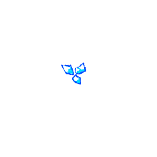
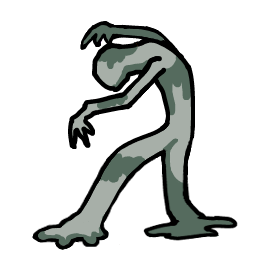

# Plan spell hitstun integration

[Back to archive index](README.md)

Chat ID: `01a1a20e-3fc5-77f3-87c9-effc68c50a22`  
Conversation: 2026-11-03 23:36:47+08:00 to 2026-11-05 04:04:41+08:00  
Timezone: Asia/Singapore (UTC+08:00)  
Exported: 2026-11-15 18:57:04+08:00  
Messages: 37 user, 63 assistant; 27 recorded edit operations.

This file preserves user and assistant messages, including progress updates and code examples. Tool inputs and saved outputs are expandable beside the messages where they occurred. Instructions, internal reasoning, token telemetry, and empty UI context records are excluded. Any truncation already present in a tool result is preserved; it is not reconstructed.

## Contents

- [Recorded code changes](#recorded-code-changes)
- [Recovered Git changes](#recovered-git-changes)
- [Conversation](#conversation)
- [Source records](#source-records)

## Recorded code changes

These are the per-operation diffs saved by the editor, in completion order. They preserve intermediate edits, later corrections, deletions, and new files. They are historical changes, not a patch against today's HEAD. Raw patch requests and failed attempts remain with the tool records in the transcript.

### Edit 1 — 2026-11-04 00:41:12+08:00

Completed/recorded: 2026-11-04 00:41:12+08:00  
Status: `completed`  
Source thread: `01a1a20e-3fc5-77f3-87c9-effc68c50a22`  
Record ID: `exec-be267a0f-ed9f-41ac-bbbc-e2b2dde71939`

#### `objects/obj_enemy_parent/Step_1.gml`

Operation: update; repository.

```diff
@@ -11,3 +11,3 @@
 	if (attack_sprite != undefined) sprite_index = attack_sprite;
-	if (ready_to_attack && stun_timer <= 0) {
+	if (ready_to_attack && stun_timer <= 0 && hitstun_timer <= 0) {
 		ready_to_attack = false
@@ -37,2 +37,2 @@
 	}
-}
\ No newline at end of file
+}
```

#### `scripts/EnemyHelper/EnemyHelper.gml`

Operation: update; repository.

```diff
@@ -419,4 +419,4 @@
 	var _scaled_duration = _hitstun_duration * array_length(_spell.effects);
-	var _frames = round(_seconds * TARGET_ROOM_SPEED);
-	_target.hitstun_timer = max(_enemy.hitstun_timer, _frames);
+	var _frames = max(0, round(_scaled_duration));
+	_target.hitstun_timer = max(_target.hitstun_timer, _frames);
 }
```

#### `scripts/FormGlyphs/FormGlyphs.gml`

Operation: update; repository.

```diff
@@ -60,3 +60,2 @@
 		if (!spell_deliver(spell, target, _col, enemy_lane(target), spell.area ? 1 : 0)) return;
-		enemy_apply_hitstun(spell, target);
 		if (spell.pierce-- <= 0) {
@@ -170,3 +169,2 @@
 				spell_deliver(spell, _target, floor((_target.x - GRID_X0) / TILE_W), enemy_lane(_target));
-				enemy_apply_hitstun(spell, _target);
 			}
```

#### `scripts/SpellExecution/SpellExecution.gml`

Operation: update; repository.

```diff
@@ -200,2 +200,23 @@
 
+// Impact feedback is independent of effect damage, delays and reaction bursts.
+function spell_apply_impact_hitstun(_spell, _target, _col, _lane, _radius, _force_area) {
+	var _hits = _spell.hit_state;
+	if (!variable_struct_exists(_hits, "hitstun_epoch") || _hits.hitstun_epoch != _hits.epoch) {
+		_hits.hitstun_epoch = _hits.epoch;
+		_hits.hitstun_targets = {};
+	}
+	var _area = _force_area || _spell.area || _spell.compiled.form_id == "strike" || _spell.compiled.form_id == "rune";
+	var _targets = _area
+		? enemies_in_region_list(_col - _radius, _col + _radius, _lane - _radius, _lane + _radius)
+		: [ _target ];
+	for (var i = 0; i < array_length(_targets); i++) {
+		var _enemy = _targets[i];
+		if (!enemy_can_receive_spell(_enemy, _spell.compiled) || _enemy.hp <= 0) continue;
+		var _key = string(enemy_get_lineage(_enemy).id);
+		if (variable_struct_exists(_hits.hitstun_targets, _key)) continue;
+		_hits.hitstun_targets[$ _key] = true;
+		enemy_apply_hitstun(_spell, _enemy);
+	}
+}
+
 // A delivery starts all Effects in written order. Delay schedules activation;
@@ -209,2 +230,3 @@
 	}
+	spell_apply_impact_hitstun(_spell, _target, _col, _lane, _radius, _force_area);
 	var _delivery = spell_new_delivery(_spell);
```


### Edit 2 — 2026-11-04 00:41:18+08:00

Completed/recorded: 2026-11-04 00:41:18+08:00  
Status: `completed`  
Source thread: `01a1a20e-3fc5-77f3-87c9-effc68c50a22`  
Record ID: `exec-a1b4099a-181d-4de5-ae71-35ffc0a61901`

#### `scripts/SpellExecution/SpellExecution.gml`

Operation: update; repository.

```diff
@@ -207,3 +207,4 @@
 	}
-	var _area = _force_area || _spell.area || _spell.compiled.form_id == "strike" || _spell.compiled.form_id == "rune";
+	var _area = _force_area || (_spell.area && !_spell.form.is_channel)
+		|| _spell.compiled.form_id == "strike" || _spell.compiled.form_id == "rune";
 	var _targets = _area
```


### Edit 3 — 2026-11-04 00:43:44+08:00

Completed/recorded: 2026-11-04 00:43:44+08:00  
Status: `completed`  
Source thread: `01a1a20e-3fc5-77f3-87c9-effc68c50a22`  
Record ID: `exec-018e6c4c-b8c6-47d8-9c55-335b8e3d1ab2`

#### `tools/execution-test-context.cjs`

Operation: update; repository.

```diff
@@ -43,3 +43,3 @@
     ctx.global.lane_top=[0,100,200];
-    load(ctx,'scripts/EnemyHelper/EnemyHelper.gml',['enemy_get_lineage','enemy_bind_lineage','enemy_update_movement']);
+    load(ctx,'scripts/EnemyHelper/EnemyHelper.gml',['enemy_get_lineage','enemy_bind_lineage','enemy_update_movement','enemy_apply_hitstun']);
     load(ctx,'scripts/SpellCatalogScripts/SpellCatalogScripts.gml',['apply_effect_group','spell_snapshot','spell_effect_colour','cast_spell','rune_trim_to_limit']);
@@ -65,3 +65,3 @@
         const e={x:col*100+50,y:lane*100,lane,hp:100000,base_speed:1,my_speed:1,is_targetable:true,
-            burn_timer:0,burn_dmg:0,slow_timer:0,slow_amt:0,frost_stacks:0,stun_timer:0,stun_immune_timer:0,hex_timer:0,pull:undefined,...extra};
+            burn_timer:0,burn_dmg:0,slow_timer:0,slow_amt:0,frost_stacks:0,stun_timer:0,stun_immune_timer:0,hitstun_timer:0,hex_timer:0,pull:undefined,...extra};
         enemies.push(e);ctx.enemy_get_lineage(e);return e;
```

#### `tools/test-impact-hitstun.cjs`

Operation: add; repository.

```diff
const assert = require('node:assert/strict');
const {makeExecutionContext} = require('./execution-test-context.cjs');
const fx = effect => ({effect, mods: []});

// Projectile applies on contact, including non-damaging payloads and blast victims.
for (const mods of [[], ['pierce'], ['area', 'pierce']]) {
    const h = makeExecutionContext();
    const a = h.enemy(2), b = h.enemy(3), outside = h.enemy(6);
    const hidden = h.enemy(2, 0, {is_targetable: false});
    const s = h.spell('projectile', [fx('fire'), fx('ice')], mods);
    h.ctx.forms.projectile.on_hit(s, a);
    assert.equal(a.hitstun_timer, 10);
    assert.equal(b.hitstun_timer, mods.includes('area') ? 10 : 0);
    assert.equal(outside.hitstun_timer, 0);
    assert.equal(hidden.hitstun_timer, 0);
    a.hitstun_timer = 1;
    h.ctx.forms.projectile.on_hit(s, a);
    assert.equal(a.hitstun_timer, 1, 'Repeated overlap must not refresh');
    if (mods.includes('pierce') && !mods.includes('area')) {
        h.ctx.forms.projectile.on_hit(s, b);
        assert.equal(b.hitstun_timer, 10);
    }
}

// Beam selects targets per lane/pierce, refreshing only when a new tick hits.
for (const mods of [[], ['pierce'], ['area'], ['area', 'pierce']]) {
    const h = makeExecutionContext();
    const a = h.enemy(2), b = h.enemy(3), adjacent = h.enemy(2, 1);
    const s = h.spell('beam', [fx('harm')], mods);
    Object.assign(s, {tick: 0, lane: 0, beam_lanes: []});
    h.ctx.forms.beam.on_step(s);
    assert.equal(a.hitstun_timer, 5);
    assert.equal(b.hitstun_timer, mods.includes('pierce') ? 5 : 0);
    assert.equal(adjacent.hitstun_timer, mods.includes('area') ? 5 : 0);
    a.hitstun_timer = 1;
    h.ctx.forms.beam.on_step(s);
    assert.equal(a.hitstun_timer, 1, 'Between-tick frames must not refresh');
    s.tick = 14;
    h.ctx.forms.beam.on_step(s);
    assert.equal(a.hitstun_timer, 5, 'Next tick must refresh');
}
console.log('Impact hitstun checks passed: Projectile/Beam, area, pierce, eligibility and repeat timing.');
```


### Edit 4 — 2026-11-04 02:17:59+08:00

Completed/recorded: 2026-11-04 02:17:59+08:00  
Status: `completed`  
Source thread: `01a1a20e-3fc5-77f3-87c9-effc68c50a22`  
Record ID: `exec-1f10e7cd-3c1a-4bc9-bc9a-82276d37286f`

#### `objects/obj_mole/Create_0.gml`

Operation: update; repository.

```diff
@@ -74,2 +74,3 @@
 emerged = false;
+emerging = false;
 
```

#### `objects/obj_mole/Other_7.gml`

Operation: add; repository.

```diff
/// @description Finish emerging once, then use the normal animation
if (emerging && sprite_index == emerge_sprite) {
	emerging = false;
	walk_side_sprite = normal_sprite;
	sprite_index = normal_sprite;
	image_index = 0;
	image_speed = 1;
}
```

#### `objects/obj_mole/Step_0.gml`

Operation: add; repository.

```diff
/// @description Mole movement and animation
event_inherited();

// The parent ties animation to movement speed; surfaced moles animate at rest.
if (emerged) {
	my_speed = 0;
	path_speed = 0;
	sprite_index = emerging ? emerge_sprite : normal_sprite;
	image_speed = 1;
}
```

#### `objects/obj_mole/Step_1.gml`

Operation: update; repository.

```diff
@@ -2,3 +2,7 @@
 
-event_inherited();
+// Attacks begin only after the emerging animation has finished.
+if (emerged) {
+	if (!emerging) event_inherited();
+	exit;
+}
 
@@ -17,3 +21,8 @@
 		emerged = true;
+		emerging = true;
+		is_stop_reached = true;
 		walk_side_sprite = emerge_sprite;
+		sprite_index = emerge_sprite;
+		image_index = 0;
+		image_speed = 1;
 		is_targetable = emerged;
@@ -27,2 +36,2 @@
 }
-	
\ No newline at end of file
+	
```

#### `objects/obj_mole/obj_mole.yy`

Operation: update; repository.

```diff
@@ -4,2 +4,4 @@
   "eventList":[
+    {"$GMEvent":"v1","%Name":"","collisionObjectId":null,"eventNum":0,"eventType":3,"isDnD":false,"name":"","resourceType":"GMEvent","resourceVersion":"2.0",},
+    {"$GMEvent":"v1","%Name":"","collisionObjectId":null,"eventNum":7,"eventType":7,"isDnD":false,"name":"","resourceType":"GMEvent","resourceVersion":"2.0",},
     {"$GMEvent":"v1","%Name":"","collisionObjectId":null,"eventNum":0,"eventType":0,"isDnD":false,"name":"","resourceType":"GMEvent","resourceVersion":"2.0",},
@@ -43,2 +45,2 @@
   "visible":true,
-}
\ No newline at end of file
+}
```


### Edit 5 — 2026-11-04 02:18:17+08:00

Completed/recorded: 2026-11-04 02:18:17+08:00  
Status: `completed`  
Source thread: `01a1a20e-3fc5-77f3-87c9-effc68c50a22`  
Record ID: `exec-11f63c09-e96a-403f-88d8-68fa1162bb7f`

#### `tools/test-mole-marker.cjs`

Operation: update; repository.

```diff
@@ -5,6 +5,6 @@
 const h=makeEnemyContext(),ctx=h.ctx;
-Object.assign(ctx,{obj_mole:'mole',path_exists:p=>p===1,path_get_x:(p,t)=>1000-800*t,path_get_y:()=>432});
+Object.assign(ctx,{obj_mole:'mole',obj_rock:'rock',place_meeting:()=>false,event_inherited:()=>{},path_exists:p=>p===1,path_get_x:(p,t)=>1000-800*t,path_get_y:()=>432});
 load(ctx,'scripts/EnemyHelper/EnemyHelper.gml',['enemy_initialize_mole_marker']);
 const e=h.enemy(2,0,{object_index:'mole',pos_to_stop:0.4,path_position:0.5,path_speed:1,emerged:false,ready_to_attack:false,
- attack_delay:3,alarm:[1],walk_side_sprite:0,normal_sprite:1,base_speed:1,my_speed:1,emergence_marker:undefined});
+ attack_delay:3,alarm:[1],walk_side_sprite:0,normal_sprite:1,emerge_sprite:2,emerging:false,base_pos_to_stop:0.4,base_speed:1,my_speed:1,emergence_marker:undefined});
 ctx.enemy_initialize_mole_marker(e,1);assert.equal(e.emergence_marker.x,680);assert.equal(e.emergence_marker.y,432);
@@ -13,2 +13,19 @@
 assert.equal(e.is_targetable,true);assert.equal(e.path_position,0.4);assert.equal(e.path_speed,0);
+assert.equal(e.emerging,true);assert.equal(e.sprite_index,2);assert.equal(e.image_index,0);assert.equal(e.is_stop_reached,true);
+const runEvent=file=>vm.runInContext('(function(){with(actor){'+read(file).replace(/\bexit;/g,'return;')+'}})()',ctx);
+let inherited=0;
+ctx.event_inherited=()=>{inherited++;e.image_speed=0;e.path_speed=2;};
+runEvent('objects/obj_mole/Step_0.gml');
+assert.equal(e.path_speed,0);assert.equal(e.image_speed,1);assert.equal(e.sprite_index,2);
+runEvent('objects/obj_mole/Step_1.gml');
+assert.equal(inherited,1,'No parent attacks while emerging');
+runEvent('objects/obj_mole/Other_7.gml');
+assert.equal(e.emerging,false);assert.equal(e.sprite_index,1);assert.equal(e.walk_side_sprite,1);assert.equal(e.image_index,0);
+e.image_index=0.5;
+runEvent('objects/obj_mole/Other_7.gml');
+assert.equal(e.image_index,0.5,'Normal animation must not restart');
+runEvent('objects/obj_mole/Step_0.gml');
+assert.equal(e.path_speed,0);assert.equal(e.image_speed,1);assert.equal(e.sprite_index,1);
+runEvent('objects/obj_mole/Step_1.gml');
+assert.equal(inherited,3,'Parent attacks resume after emerging');
 const ordinary=h.enemy();ctx.enemy_initialize_mole_marker(ordinary,1);assert.equal(ordinary.emergence_marker,undefined);
```


### Edit 6 — 2026-11-04 02:18:25+08:00

Completed/recorded: 2026-11-04 02:18:25+08:00  
Status: `completed`  
Source thread: `01a1a20e-3fc5-77f3-87c9-effc68c50a22`  
Record ID: `exec-8433c8cd-b009-4ca7-973a-97b95df70d93`

#### `tools/test-mole-marker.cjs`

Operation: update; repository.

```diff
@@ -7,3 +7,3 @@
 load(ctx,'scripts/EnemyHelper/EnemyHelper.gml',['enemy_initialize_mole_marker']);
-const e=h.enemy(2,0,{object_index:'mole',pos_to_stop:0.4,path_position:0.5,path_speed:1,emerged:false,ready_to_attack:false,
+const e=h.enemy(2,0,{object_index:'mole',pos_to_stop:0.4,path_index:1,path_position:0.5,path_speed:1,emerged:false,ready_to_attack:false,
  attack_delay:3,alarm:[1],walk_side_sprite:0,normal_sprite:1,emerge_sprite:2,emerging:false,base_pos_to_stop:0.4,base_speed:1,my_speed:1,emergence_marker:undefined});
```


### Edit 7 — 2026-11-04 02:18:33+08:00

Completed/recorded: 2026-11-04 02:18:33+08:00  
Status: `completed`  
Source thread: `01a1a20e-3fc5-77f3-87c9-effc68c50a22`  
Record ID: `exec-c742fac3-cc1e-4da7-ba28-cbf026035c70`

#### `tools/test-mole-marker.cjs`

Operation: update; repository.

```diff
@@ -8,3 +8,3 @@
 const e=h.enemy(2,0,{object_index:'mole',pos_to_stop:0.4,path_index:1,path_position:0.5,path_speed:1,emerged:false,ready_to_attack:false,
- attack_delay:3,alarm:[1],walk_side_sprite:0,normal_sprite:1,emerge_sprite:2,emerging:false,base_pos_to_stop:0.4,base_speed:1,my_speed:1,emergence_marker:undefined});
+ attack_delay:3,alarm:[1],walk_side_sprite:0,normal_sprite:1,emerge_sprite:2,emerging:false,sprite_index:0,image_index:0,image_speed:1,is_stop_reached:false,base_pos_to_stop:0.4,base_speed:1,my_speed:1,emergence_marker:undefined});
 ctx.enemy_initialize_mole_marker(e,1);assert.equal(e.emergence_marker.x,680);assert.equal(e.emergence_marker.y,432);
```


### Edit 8 — 2026-11-04 22:59:59+08:00

Completed/recorded: 2026-11-04 22:59:59+08:00  
Status: `completed`  
Source thread: `01a1a20e-3fc5-77f3-87c9-effc68c50a22`  
Record ID: `exec-71e5f111-55a5-4ead-a0d5-528f15a1545c`

#### `objects/obj_enemy_parent/Draw_0.gml`

Operation: update; repository.

```diff
@@ -24,3 +24,3 @@
 	var _status = _statuses[i];
-	if (combat_status_active(id, _status.key)) {
+	if (_status.key != "frost" && combat_status_active(id, _status.key)) {
 		draw_sprite_ext(sprite_index, image_index, x, y, image_xscale, image_yscale, image_angle, _status.colour, 0.3);
@@ -28 +28,2 @@
 }
+enemy_draw_frost(id);
```

#### `scripts/EnemyHelper/EnemyHelper.gml`

Operation: update; repository.

```diff
@@ -82,2 +82,3 @@
 function combat_status_clear(_subject, _key) {
+	if (_key == "frost") combat_status_set(_subject, "frost_visual", undefined);
 	var _defs = combat_status_definitions();
```

#### `scripts/MutationScripts/MutationScripts.gml`

Operation: update; repository.

```diff
@@ -129,2 +129,57 @@
 
+// Visual progress follows combat time, independent of the enemy's animation.
+function enemy_frost_visual(_enemy, _clock) {
+	var _stacks = combat_status_frost_stacks(_enemy);
+	if (_stacks <= 0 || _enemy.hp <= 0) {
+		_enemy.frost_visual = undefined;
+		return undefined;
+	}
+	if (!variable_instance_exists(_enemy, "frost_visual") || !is_struct(_enemy.frost_visual)) {
+		_enemy.frost_visual = {phase: 0, since: _clock, sprite: spr_frost_1_1, frame: 0};
+	}
+	var _visual = _enemy.frost_visual;
+	var _sprites = [spr_frost_1_1, spr_frost_1_2, spr_frost_2, spr_frost_3];
+	// Finish each buildup before progressing, even if stacks arrive together.
+	while (true) {
+		var _sprite = _sprites[_visual.phase];
+		var _rate = max(0.0001, sprite_get_speed(_sprite));
+		if (sprite_get_speed_type(_sprite) == spritespeed_framespergameframe) _rate *= TARGET_ROOM_SPEED;
+		var _duration = sprite_get_number(_sprite) * TARGET_ROOM_SPEED / _rate;
+		var _elapsed = max(0, _clock - _visual.since);
+		if (_visual.phase == 1 && _stacks > 1) {
+			_visual.phase = 2;
+			_visual.since = _clock;
+			continue;
+		}
+		if (_elapsed >= _duration && (_visual.phase == 0 || (_visual.phase == 2 && _stacks >= 3))) {
+			_visual.phase += 1;
+			_visual.since += _duration;
+			continue;
+		}
+		_visual.sprite = _sprite;
+		var _frame = floor(_elapsed * _rate / TARGET_ROOM_SPEED);
+		_visual.frame = (_visual.phase == 1) ? _frame mod sprite_get_number(_sprite)
+			: min(_frame, sprite_get_number(_sprite) - 1);
+		return _visual;
+	}
+}
+
+function enemy_draw_frost(_enemy) {
+	var _execution = combat_execution_state();
+	var _clock = is_struct(_execution) ? _execution.clock : 0;
+	var _visual = enemy_frost_visual(_enemy, _clock);
+	if (!is_struct(_visual)) return;
+	var _bounds = enemy_visual_bounds(_enemy);
+	// Use a common canvas anchor and scale so the ice grows without jumping.
+	var _reference = spr_frost_3;
+	var _scale = _bounds.width * 1.15 / max(1, sprite_get_bbox_right(_reference) - sprite_get_bbox_left(_reference) + 1);
+	var _anchor_x = (sprite_get_bbox_left(_reference) + sprite_get_bbox_right(_reference)) / 2;
+	var _anchor_y = sprite_get_bbox_bottom(_reference);
+	var _sprite = _visual.sprite;
+	draw_sprite_ext(_sprite, _visual.frame,
+		_bounds.x - (_anchor_x - sprite_get_xoffset(_sprite)) * _scale,
+		_bounds.y + _bounds.height / 2 - (_anchor_y - sprite_get_yoffset(_sprite)) * _scale,
+		_scale, _scale, 0, c_white, _enemy.image_alpha);
+}
+
 function enemy_draw_ward(_enemy) {
```


### Edit 9 — 2026-11-04 23:00:18+08:00

Completed/recorded: 2026-11-04 23:00:18+08:00  
Status: `completed`  
Source thread: `01a1a20e-3fc5-77f3-87c9-effc68c50a22`  
Record ID: `exec-10b435e6-c1c0-4040-a4a1-c270f07689aa`

#### `tools/test-frost-animation.cjs`

Operation: add; repository.

```diff
const assert = require('node:assert/strict');
const {makeExecutionContext} = require('./execution-test-context.cjs');
const {load} = require('./gml-test-utils.cjs');
const h = makeExecutionContext(), c = h.ctx;
Object.assign(c, {spr_frost_1_1:0, spr_frost_1_2:1, spr_frost_2:2, spr_frost_3:3,
    spritespeed_framespergameframe:1,
    sprite_get_number:s=>[3,5,4,3][s], sprite_get_speed:s=>[8,8,5,5][s], sprite_get_speed_type:()=>0});
load(c, 'scripts/MutationScripts/MutationScripts.gml', ['enemy_frost_visual']);
const e = h.enemy();
const apply = ()=>c.combat_status_apply(e, 'frost', 180, 0.2);
const frame = clock=>c.enemy_frost_visual(e, clock);
assert.equal(frame(0), undefined);
apply();
assert.equal(frame(0).sprite, 0);
assert.equal(frame(15).frame, 2);
assert.equal(frame(23).sprite, 1);
assert.equal(frame(61).sprite, 1);
const since = e.frost_visual.since;
c.combat_status_apply(e, 'frost', 180, 0); // Advance to tier 2.
assert.equal(frame(62).sprite, 2);
assert.equal(frame(110).frame, 3);
assert.equal(frame(150).frame, 3, 'Tier 2 holds its completed frame');
apply();
assert.equal(frame(151).sprite, 3);
assert.equal(frame(200).frame, 2);
const finalSince = e.frost_visual.since;
apply();
assert.equal(frame(201).since, finalSince, 'Refreshing max stacks does not restart');
assert.equal(frame(201).frame, frame(201).frame, 'Paused clock preserves progress');
c.combat_status_clear(e, 'frost');
assert.equal(e.frost_visual, undefined);
apply();
assert.equal(frame(202).sprite, 0, 'Reapplication restarts buildup');
apply(); apply();
assert.equal(frame(203).sprite, 0, 'Rapid stacks finish initial buildup');
assert.equal(frame(225).sprite, 2);
assert.equal(frame(273).sprite, 3);
c.combat_status_advance(e, 180, false);
assert.equal(frame(274), undefined, 'Expiry removes the overlay');
assert.ok(since > 0);
console.log('Frost animation checks passed: buildup, sparkle loop, tier transitions/holds, refresh, rapid stacks, clear and expiry.');
```


### Edit 10 — 2026-11-04 23:00:29+08:00

Completed/recorded: 2026-11-04 23:00:29+08:00  
Status: `completed`  
Source thread: `01a1a20e-3fc5-77f3-87c9-effc68c50a22`  
Record ID: `exec-22b02f41-3b7f-482e-a4c8-513176220422`

#### `scripts/MutationScripts/MutationScripts.gml`

Operation: update; repository.

```diff
@@ -154,4 +154,5 @@
 		if (_elapsed >= _duration && (_visual.phase == 0 || (_visual.phase == 2 && _stacks >= 3))) {
+			var _next_since = (_visual.phase == 2) ? _clock : _visual.since + _duration;
 			_visual.phase += 1;
-			_visual.since += _duration;
+			_visual.since = _next_since;
 			continue;
```

#### `tools/test-frost-animation.cjs`

Operation: update; repository.

```diff
@@ -24,2 +24,3 @@
 assert.equal(frame(151).sprite, 3);
+assert.equal(frame(151).frame, 0, 'A new tier starts its transition after a long hold');
 assert.equal(frame(200).frame, 2);
@@ -28,3 +29,4 @@
 assert.equal(frame(201).since, finalSince, 'Refreshing max stacks does not restart');
-assert.equal(frame(201).frame, frame(201).frame, 'Paused clock preserves progress');
+const pausedFrame = frame(201).frame;
+assert.equal(frame(201).frame, pausedFrame, 'Paused clock preserves progress');
 c.combat_status_clear(e, 'frost');
```


### Edit 11 — 2026-11-04 23:58:23+08:00

Completed/recorded: 2026-11-04 23:58:23+08:00  
Status: `completed`  
Source thread: `01a1a20e-3fc5-77f3-87c9-effc68c50a22`  
Record ID: `exec-3c41a370-de0e-4359-87f7-7065a5119877`

#### `scripts/EnemyVisualScripts/EnemyVisualScripts.gml`

Operation: update; repository.

```diff
@@ -57,3 +57,3 @@
 function enemy_draw_fire(_enemy) {
-	if (_enemy.hp <= hp || _enemy.burn_timer <= 0) {
+	if (_enemy.hp <= 0 || _enemy.burn_timer <= 0) {
 		_enemy.fire_visual = undefined;
@@ -65,3 +65,3 @@
 	
-	if (!is_struct(_enemy.fire_visual)) _enemy.fire_visual = {since: _clock};
+	if (!variable_instance_exists(_enemy, "fire_visual") || !is_struct(_enemy.fire_visual)) _enemy.fire_visual = {since: _clock};
 	var _elapsed = _clock - _enemy.fire_visual.since;
@@ -86,4 +86,4 @@
 	 var _bounds = enemy_visual_bounds(_enemy);
-    var _width = sprite_get_bbox_right(_sprite)
-        - sprite_get_bbox_left(_sprite) + 1;
+    var _width = sprite_get_bbox_right(spr_fire_2)
+        - sprite_get_bbox_left(spr_fire_2) + 1;
     var _scale = _bounds.width * 1.15 / max(1, _width);
@@ -105,3 +105,3 @@
 function enemy_draw_stun(_enemy) {
-	if (_enemy.hp <= hp || _enemy.stun_timer <= 0) {
+	if (_enemy.hp <= 0 || _enemy.stun_timer <= 0) {
 		_enemy.stun_visual = undefined;
@@ -113,3 +113,3 @@
 	
-	if (!is_struct(_enemy.stun_visual)) _enemy.stun_visual = {since: _clock};
+	if (!variable_instance_exists(_enemy, "stun_visual") || !is_struct(_enemy.stun_visual)) _enemy.stun_visual = {since: _clock};
 	var _elapsed = _clock - _enemy.stun_visual.since;
@@ -134,4 +134,4 @@
 	 var _bounds = enemy_visual_bounds(_enemy);
-    var _width = sprite_get_bbox_right(_sprite)
-        - sprite_get_bbox_left(_sprite) + 1;
+    var _width = sprite_get_bbox_right(spr_stun_2)
+        - sprite_get_bbox_left(spr_stun_2) + 1;
     var _scale = _bounds.width * 1.15 / max(1, _width);
@@ -153,3 +153,3 @@
 function enemy_draw_charged(_enemy) {
-	if (_enemy.hp <= hp || _enemy.stun_immune_timer <= 0) {
+	if (_enemy.hp <= 0 || !combat_status_charged(_enemy)) {
 		_enemy.charged_visual = undefined;
@@ -161,11 +161,7 @@
 	
-	if (!is_struct(_enemy.charged_visual)) _enemy.charged_visual = {since: _clock};
+	if (!variable_instance_exists(_enemy, "charged_visual") || !is_struct(_enemy.charged_visual)) _enemy.charged_visual = {since: _clock};
 	var _elapsed = _clock - _enemy.charged_visual.since;
-	var _start_frames = sprite_get_number(spr_charged);
-	var _start_rate = sprite_get_speed(spr_charged);
-	var _start_duration = _start_frames * TARGET_ROOM_SPEED / _start_rate;
-	
 	var _sprite = spr_charged;
 	var _frame = floor(
-		(_elapsed - _start_duration)
+		_elapsed
 		* sprite_get_speed(_sprite) / TARGET_ROOM_SPEED
```


### Edit 12 — 2026-11-04 23:58:52+08:00

Completed/recorded: 2026-11-04 23:58:52+08:00  
Status: `completed`  
Source thread: `01a1a20e-3fc5-77f3-87c9-effc68c50a22`  
Record ID: `exec-aca0fcfd-4cf8-40bd-91ff-62bf584970ee`

#### `tools/test-status-visuals.cjs`

Operation: add; repository.

```diff
const assert = require('node:assert/strict');
const {makeExecutionContext} = require('./execution-test-context.cjs');
const {load, read} = require('./gml-test-utils.cjs');
const h = makeExecutionContext(), c = h.ctx;
const sprites = {};
for (const name of ['spr_fire_1', 'spr_fire_2', 'spr_stun_1', 'spr_stun_2', 'spr_charged']) {
    sprites[name] = JSON.parse(read(`sprites/${name}/${name}.yy`).replace(/,\s*([}\]])/g, '$1'));
    c[name] = name;
    assert.equal(sprites[name].sequence.playbackSpeedType, 0, 'Draw functions expect FPS sprites');
}
const calls = [];
Object.assign(c, {
    sprite_get_number:s=>sprites[s].frames.length,
    sprite_get_speed:s=>sprites[s].sequence.playbackSpeed,
    sprite_get_bbox_left:s=>sprites[s].bbox_left,
    sprite_get_bbox_right:s=>sprites[s].bbox_right,
    sprite_get_bbox_bottom:s=>sprites[s].bbox_bottom,
    sprite_get_xoffset:s=>sprites[s].sequence.xorigin,
    sprite_get_yoffset:s=>sprites[s].sequence.yorigin,
    enemy_visual_bounds:()=>({x:100, y:100, width:80, height:120}),
    draw_sprite_ext:(...args)=>calls.push(args), c_white:0xffffff
});
load(c, 'scripts/EnemyVisualScripts/EnemyVisualScripts.gml', ['enemy_draw_fire', 'enemy_draw_stun', 'enemy_draw_charged']);
const e = h.enemy(2, 0, {image_alpha:0.75});
function draw(name, clock) {
    c.manager.combat_execution.clock = clock;
    calls.length = 0;
    c[`enemy_draw_${name}`](e);
    for (const call of calls) {
        assert.ok(call.slice(1).every(Number.isFinite), 'Draw arguments must be finite');
        assert.ok(call[1] >= 0 && call[1] < sprites[call[0]].frames.length);
        assert.equal(call[8], 0.75);
    }
    return calls[0];
}
for (const name of ['fire', 'stun', 'charged']) assert.equal(draw(name, 0), undefined);
for (const [name, timer] of [['fire', 'burn_timer'], ['stun', 'stun_timer']]) {
    e[timer] = 180;
    const start = draw(name, 0);
    assert.equal(start[0], `spr_${name}_1`);
    assert.equal(start[1], 0);
    assert.equal(draw(name, 11)[0], `spr_${name}_1`);
    const loop = draw(name, 12);
    assert.equal(loop[0], `spr_${name}_2`);
    assert.equal(loop[1], 0);
    assert.equal(loop[4], start[4], 'Start and loop use the same scale');
    assert.equal(draw(name, 24)[1], 1);
    assert.deepEqual(draw(name, 24), draw(name, 24), 'Paused clock freezes drawing');
    e[timer] = 300;
    assert.equal(draw(name, 36)[1], 2, 'Duration refresh preserves animation');
    const count = sprites[`spr_${name}_2`].frames.length;
    assert.equal(draw(name, 12 + count * 12)[1], 0, 'Loop wraps');
    e[timer] = 0;
    assert.equal(draw(name, 100), undefined);
    assert.equal(e[`${name}_visual`], undefined);
    e[timer] = 180;
    assert.equal(draw(name, 101)[0], `spr_${name}_1`, 'Reapplication restarts');
    e.hp = 0;
    assert.equal(draw(name, 102), undefined);
    e.hp = 1000; e[timer] = 0;
}
e.stun_timer = 10;
e.stun_immune_timer = 20;
assert.equal(draw('charged', 0), undefined, 'Charged must not draw during stun');
e.stun_immune_timer = 0;
c.enemy_advance_lightning(e, 10);
assert.equal(draw('stun', 10), undefined);
assert.equal(draw('charged', 10)[1], 0);
assert.equal(draw('charged', 22)[1], 1);
assert.equal(draw('charged', 94)[1], 0);
c.combat_status_consume_charge(e);
assert.equal(draw('charged', 95), undefined);
assert.equal(e.charged_visual, undefined);
assert.ok(read('objects/obj_enemy_parent/Draw_0.gml').includes('enemy_draw_charged(id)'));
console.log('Status visual checks passed: actual sprite assets, startup, loops, stable scale, pause/refresh, reapplication, death and Stun-to-Charged transition.');
```


### Edit 13 — 2026-11-05 02:55:31+08:00

Completed/recorded: 2026-11-05 02:55:31+08:00  
Status: `completed`  
Source thread: `01a1a20e-3fc5-77f3-87c9-effc68c50a22`  
Record ID: `exec-59c90e9f-6c3d-4f3c-baad-ced0ee5e16ea`

#### `scripts/EffectGlyphs/EffectGlyphs.gml`

Operation: update; repository.

```diff
@@ -151,2 +151,4 @@
 		var pos = enemy_get_leftpoint(target, _sprite, "center", 0);
+		// The helper anchors the artwork's left edge; center Snap on the victim.
+		pos.x -= (sprite_get_bbox_right(_sprite) - sprite_get_bbox_left(_sprite)) * pos.scale / 2;
 		combat_spawn_vfx(_sprite, pos.x, pos.y, pos.scale, pos.scale);
```

#### `scripts/GlyphVisualScripts/GlyphVisualScripts.gml`

Operation: update; repository.

```diff
@@ -25,3 +25,3 @@
 		if (_frame >= sprite_get_number(_vfx.sprite)) {
-			array_delete(_state.visuals, i, i);
+			array_delete(_state.visuals, i, 1);
 			continue;
@@ -35,2 +35,2 @@
 	}
-}
\ No newline at end of file
+}
```


### Edit 14 — 2026-11-05 02:55:32+08:00

Completed/recorded: 2026-11-05 02:55:32+08:00  
Status: `completed`  
Source thread: `01a1a20e-3fc5-77f3-87c9-effc68c50a22`  
Record ID: `exec-665a224e-7afd-4877-b4b2-4a9b1b7e9c55`

#### `tools/test-snap-visual.cjs`

Operation: add; repository.

```diff
const assert = require('node:assert/strict');
const {makeExecutionContext, callback} = require('./execution-test-context.cjs');
const {load, read} = require('./gml-test-utils.cjs');
const h = makeExecutionContext(), c = h.ctx, sprites = {}, calls = [];
for (const name of ['spr_snap_1', 'spr_snap_2', 'spr_snap_3']) {
    c[name] = name;
    sprites[name] = JSON.parse(read(`sprites/${name}/${name}.yy`).replace(/,\s*([}\]])/g, '$1'));
}
Object.assign(c, {
    effect_sprites:['spr_snap_1','spr_snap_2','spr_snap_3'],
    sprite_get_number:s=>sprites[s].frames.length,
    sprite_get_speed:s=>sprites[s].sequence.playbackSpeed,
    sprite_get_bbox_left:s=>sprites[s].bbox_left,
    sprite_get_bbox_right:s=>sprites[s].bbox_right,
    sprite_get_bbox_top:s=>sprites[s].bbox_top,
    sprite_get_bbox_bottom:s=>sprites[s].bbox_bottom,
    sprite_get_xoffset:s=>sprites[s].sequence.xorigin,
    sprite_get_yoffset:s=>sprites[s].sequence.yorigin,
    enemy_visual_bounds:()=>({x:250,y:120,width:80,height:100}),
    draw_sprite_ext:(...args)=>calls.push(args),
    array_delete:(a,i,n)=>a.splice(i,n), c_white:0xffffff
});
load(c,'scripts/GlyphVisualScripts/GlyphVisualScripts.gml',['combat_spawn_vfx','combat_draw_vfx']);
load(c,'scripts/EnemyVisualScripts/EnemyVisualScripts.gml',['enemy_get_leftpoint']);
const snap = callback(c,'scripts/EffectGlyphs/EffectGlyphs.gml','Elem_Snap','on_hit');
const state = c.manager.combat_execution;
for (let stacks=0; stacks<=3; stacks++) {
    state.visuals=[];state.clock=0;
    const enemy=h.enemy();
    for(let i=0;i<stacks;i++) c.combat_status_apply(enemy,'frost',180,0.2);
    const spell=h.spell('projectile',[{effect:'snap',mods:[]}]);
    snap(spell,enemy,spell.effects[0]);
    assert.equal(state.visuals.length,stacks?1:0);
    if(!stacks) continue;
    const v=state.visuals[0], data=sprites[v.sprite];
    assert.equal(v.sprite,`spr_snap_${stacks}`);
    assert.equal(v.x+(data.bbox_left+data.bbox_right)/2*v.xs,250);
    assert.equal(v.y+(data.bbox_top+data.bbox_bottom)/2*v.ys,120);
    const lifetime=data.frames.length*12;
    for(let t=0;t<lifetime;t++) {
        state.clock=t;calls.length=0;c.combat_draw_vfx();
        assert.equal(calls.length,1);
        assert.equal(calls[0][1],Math.floor(t/12));
    }
    state.clock=lifetime;c.combat_draw_vfx();
    assert.equal(state.visuals.length,0,'Expired index zero must be removed');
}
state.visuals=[];state.clock=0;
c.combat_spawn_vfx('spr_snap_2',0,0,1,1);
c.combat_spawn_vfx('spr_snap_1',0,0,1,1);
c.combat_spawn_vfx('spr_snap_1',0,0,1,1);
state.clock=40;c.combat_spawn_vfx('spr_snap_3',0,0,1,1);
const survivor=state.visuals[3];
state.clock=50;c.combat_draw_vfx();
assert.equal(state.visuals.length,2);
assert.equal(state.visuals[1],survivor,'Expiry must preserve newer effects');
console.log('Snap visual checks passed: 0-3 stacks, centering, all animation frames, completion and overlapping VFX cleanup.');
```


### Edit 15 — 2026-11-05 02:55:38+08:00

Completed/recorded: 2026-11-05 02:55:38+08:00  
Status: `completed`  
Source thread: `01a1a20e-3fc5-77f3-87c9-effc68c50a22`  
Record ID: `exec-34447fa2-aca9-469e-8263-bce309760417`

#### `tools/test-snap-visual.cjs`

Operation: update; repository.

```diff
@@ -36,4 +36,4 @@
     assert.equal(v.sprite,`spr_snap_${stacks}`);
-    assert.equal(v.x+(data.bbox_left+data.bbox_right)/2*v.xs,250);
-    assert.equal(v.y+(data.bbox_top+data.bbox_bottom)/2*v.ys,120);
+    assert.ok(Math.abs(v.x+(data.bbox_left+data.bbox_right)/2*v.xs-250)<1e-8);
+    assert.ok(Math.abs(v.y+(data.bbox_top+data.bbox_bottom)/2*v.ys-120)<1e-8);
     const lifetime=data.frames.length*12;
```


### Edit 16 — 2026-11-05 02:59:29+08:00

Completed/recorded: 2026-11-05 02:59:29+08:00  
Status: `completed`  
Source thread: `01a1a20e-3fc5-77f3-87c9-effc68c50a22`  
Record ID: `exec-cd338544-a16a-45ed-9c68-194bbcee84e4`

#### `scripts/EffectGlyphs/EffectGlyphs.gml`

Operation: update; repository.

```diff
@@ -146,6 +146,4 @@
 		if (_stacks <= 0) return;
-		var _sprite = effect_sprites[_stacks - 1];
+		var _sprite = fx.effect.effect_sprites[_stacks - 1];
 		var _damage = fx.params.base_damage * fx.params.damage_per_stack_mult * _stacks * fx.effect_multiplier * spell_damage_scale(spell);
-		spell_direct_damage(spell, target, _damage);
-		combat_status_clear(target, "frost");
 		var pos = enemy_get_leftpoint(target, _sprite, "center", 0);
@@ -154,2 +152,7 @@
 		combat_spawn_vfx(_sprite, pos.x, pos.y, pos.scale, pos.scale);
+		show_debug_message("Snap VFX queued: " + sprite_get_name(_sprite)
+			+ " stacks=" + string(_stacks) + " x=" + string(pos.x)
+			+ " y=" + string(pos.y) + " scale=" + string(pos.scale));
+		spell_direct_damage(spell, target, _damage);
+		combat_status_clear(target, "frost");
 		
```

#### `scripts/GlyphVisualScripts/GlyphVisualScripts.gml`

Operation: update; repository.

```diff
@@ -19,2 +19,9 @@
 		var _vfx = _state.visuals[i];
+		if ((_vfx.sprite == spr_snap_1 || _vfx.sprite == spr_snap_2 || _vfx.sprite == spr_snap_3)
+			&& !variable_struct_exists(_vfx, "draw_logged")) {
+			show_debug_message("Snap VFX drawing: " + sprite_get_name(_vfx.sprite)
+				+ " age=" + string(_state.clock - _vfx.born)
+				+ " frames=" + string(sprite_get_number(_vfx.sprite)));
+			_vfx.draw_logged = true;
+		}
 		var _frame = floor(
```

#### `tools/test-snap-visual.cjs`

Operation: update; repository.

```diff
@@ -22,2 +22,3 @@
 });
+c.sprite_get_name=s=>s;
 load(c,'scripts/GlyphVisualScripts/GlyphVisualScripts.gml',['combat_spawn_vfx','combat_draw_vfx']);
@@ -31,2 +32,3 @@
     const spell=h.spell('projectile',[{effect:'snap',mods:[]}]);
+    spell.effects[0].effect.effect_sprites=c.effect_sprites;
     snap(spell,enemy,spell.effects[0]);
```


### Edit 17 — 2026-11-05 03:01:32+08:00

Completed/recorded: 2026-11-05 03:01:32+08:00  
Status: `completed`  
Source thread: `01a1a20e-3fc5-77f3-87c9-effc68c50a22`  
Record ID: `exec-01e0c28c-5b9c-42ec-aa39-a3ca7100577c`

#### `scripts/EffectGlyphs/EffectGlyphs.gml`

Operation: update; repository.

```diff
@@ -152,5 +152,2 @@
 		combat_spawn_vfx(_sprite, pos.x, pos.y, pos.scale, pos.scale);
-		show_debug_message("Snap VFX queued: " + sprite_get_name(_sprite)
-			+ " stacks=" + string(_stacks) + " x=" + string(pos.x)
-			+ " y=" + string(pos.y) + " scale=" + string(pos.scale));
 		combat_status_clear(target, "frost");
```

#### `scripts/EnemyVisualScripts/EnemyVisualScripts.gml`

Operation: update; repository.

```diff
@@ -232,3 +232,5 @@
         - sprite_get_bbox_left(_sprite) + 1;
-	if (_scale == 0) _scale = _scale = max(_bounds.width * 1.15 / max(1, _width), 0.9);
+	if (_scale == 0) {
+		_scale = max(_bounds.width * 1.15 / max(1, _width), 0.9);
+	}
 
@@ -252,3 +254,3 @@
 				- (_bottom_y - sprite_get_yoffset(_sprite)) * _scale;
-	        return {x: _left, _bottom, scale: _scale};
+	        return {x: _left, y: _bottom, scale: _scale};
 	    default:
```

#### `scripts/GlyphVisualScripts/GlyphVisualScripts.gml`

Operation: update; repository.

```diff
@@ -19,9 +19,2 @@
 		var _vfx = _state.visuals[i];
-		if ((_vfx.sprite == spr_snap_1 || _vfx.sprite == spr_snap_2 || _vfx.sprite == spr_snap_3)
-			&& !variable_struct_exists(_vfx, "draw_logged")) {
-			show_debug_message("Snap VFX drawing: " + sprite_get_name(_vfx.sprite)
-				+ " age=" + string(_state.clock - _vfx.born)
-				+ " frames=" + string(sprite_get_number(_vfx.sprite)));
-			_vfx.draw_logged = true;
-		}
 		var _frame = floor(
```

#### `tools/test-snap-visual.cjs`

Operation: update; repository.

```diff
@@ -37,2 +37,4 @@
     const v=state.visuals[0], data=sprites[v.sprite];
+    assert.ok(Number.isFinite(v.xs) && v.xs >= 0.9, 'Automatic scale must be visible');
+    assert.equal(v.ys,v.xs);
     assert.equal(v.sprite,`spr_snap_${stacks}`);
```


### Edit 18 — 2026-11-05 03:10:46+08:00

Completed/recorded: 2026-11-05 03:10:46+08:00  
Status: `completed`  
Source thread: `01a1a20e-3fc5-77f3-87c9-effc68c50a22`  
Record ID: `exec-37ceeef7-fbf3-48bd-a03d-04c1baf406c0`

#### `scripts/EnemyVisualScripts/EnemyVisualScripts.gml`

Operation: update; repository.

```diff
@@ -49,3 +49,2 @@
 	var _scale = max(_bounds.width * 1.15 / max(1, _width), 0.9);
-	show_debug_message(_scale);
 	var _anchor_x = (sprite_get_bbox_left(_reference) + sprite_get_bbox_right(_reference)) / 2;
@@ -57,3 +56,3 @@
 		_bounds.x - (_anchor_x - sprite_get_xoffset(_sprite)) * _scale,
-		_bounds.y + _bounds.height / 2 - (_anchor_y - sprite_get_yoffset(_sprite)) * _scale,
+		_bounds.y - (_anchor_y - sprite_get_yoffset(_sprite)) * _scale,
 		_scale, _scale, 0, c_white, _enemy.image_alpha);
```


### Edit 19 — 2026-11-05 03:12:07+08:00

Completed/recorded: 2026-11-05 03:12:07+08:00  
Status: `completed`  
Source thread: `01a1a20e-3fc5-77f3-87c9-effc68c50a22`  
Record ID: `exec-62689c11-b3bb-414c-a693-994cbac0ed9a`

#### `scripts/EnemyVisualScripts/EnemyVisualScripts.gml`

Operation: update; repository.

```diff
@@ -48,3 +48,9 @@
        - sprite_get_bbox_left(_reference) + 1;
-	var _scale = max(_bounds.width * 1.15 / max(1, _width), 0.9);
+	var _height = sprite_get_bbox_bottom(_reference)
+		- sprite_get_bbox_top(_reference) + 1;
+	// Fit both dimensions so long bodies/tails cannot inflate the overlay.
+	var _scale = max(min(
+		_bounds.width / max(1, _width),
+		_bounds.height / max(1, _height)
+	) * 1.15, 0.9);
 	var _anchor_x = (sprite_get_bbox_left(_reference) + sprite_get_bbox_right(_reference)) / 2;
```


### Edit 20 — 2026-11-05 03:14:12+08:00

Completed/recorded: 2026-11-05 03:14:12+08:00  
Status: `completed`  
Source thread: `01a1a20e-3fc5-77f3-87c9-effc68c50a22`  
Record ID: `exec-131a3c58-53c2-47b1-80ad-42ec4d8c54a5`

#### `objects/obj_enemy_parent/Create_0.gml`

Operation: update; repository.

```diff
@@ -116,2 +116,3 @@
 ward_visible_since = -1;
+frost_visual_scale = 1;
 
```

#### `objects/obj_mook/Create_0.gml`

Operation: update; repository.

```diff
@@ -7,2 +7,4 @@
 name = "mook";
+// Fit Frost to the torso rather than the spread of the arms and feet.
+frost_visual_scale = tune_enemy(name, "frost_visual_scale", 0.6);
 
```

#### `scripts/EnemyVisualScripts/EnemyVisualScripts.gml`

Operation: update; repository.

```diff
@@ -55,2 +55,3 @@
 	) * 1.15, 0.9);
+	_scale *= _enemy.frost_visual_scale;
 	var _anchor_x = (sprite_get_bbox_left(_reference) + sprite_get_bbox_right(_reference)) / 2;
```


### Edit 21 — 2026-11-05 03:29:10+08:00

Completed/recorded: 2026-11-05 03:29:10+08:00  
Status: `completed`  
Source thread: `01a1a20e-3fc5-77f3-87c9-effc68c50a22`  
Record ID: `exec-4c3caff6-6d33-464f-a601-e25ea24bc04e`

#### `scripts/SpellExecution/SpellExecution.gml`

Operation: update; repository.

```diff
@@ -63,2 +63,9 @@
 		var _targets = spell_reaction_targets(_spell, _burst.x, _burst.y, _radius);
+		// One centered visual per emission, independent of the number of victims.
+		var _sprite = (_burst.kind == "combust") ? spr_combust : spr_discharge;
+		var _center_x = (sprite_get_bbox_left(_sprite) + sprite_get_bbox_right(_sprite)) / 2;
+		var _center_y = (sprite_get_bbox_top(_sprite) + sprite_get_bbox_bottom(_sprite)) / 2;
+		combat_spawn_vfx(_sprite,
+			_burst.x - (_center_x - sprite_get_xoffset(_sprite)),
+			_burst.y - (_center_y - sprite_get_yoffset(_sprite)), 1, 1);
 		for (var i = 0; i < array_length(_targets); i++) {
@@ -67,3 +74,2 @@
 			if (_burst.kind == "combust") {
-				combat_spawn_vfx(spr_combust, _burst.x, _burst.y, 1, 1);
 				spell_direct_damage(_spell, _target, _fx.params.base_damage * _fx.params.explosion_damage_mult * _fx.effect_multiplier * spell_damage_scale(_spell), false);
@@ -74,3 +80,2 @@
 				spell_discharge_enqueue(_scope, _fx, _target, _burst.reaction);
-				combat_spawn_vfx(spr_discharge, _burst.x, _burst.y, 1, 1);
 				spell_direct_damage(_spell, _target, _fx.params.base_damage * _fx.params.damage_mult * _fx.effect_multiplier * spell_damage_scale(_spell));
```


### Edit 22 — 2026-11-05 03:29:10+08:00

Completed/recorded: 2026-11-05 03:29:10+08:00  
Status: `completed`  
Source thread: `01a1a20e-3fc5-77f3-87c9-effc68c50a22`  
Record ID: `exec-6b751611-949a-4156-bf22-73ed7050304f`

#### `tools/test-burst-visuals.cjs`

Operation: add; repository.

```diff
const assert = require('node:assert/strict');
const vm = require('node:vm');
const {load, read} = require('./gml-test-utils.cjs');
const sprites = {};
for (const name of ['spr_discharge','spr_combust']) {
    sprites[name] = JSON.parse(read(`sprites/${name}/${name}.yy`).replace(/,\s*([}\]])/g,'$1'));
}
for (const kind of ['discharge','combust']) for (const count of [0,1,3]) {
    const calls = [];
    const c = vm.createContext({
        spr_discharge:'spr_discharge',spr_combust:'spr_combust',
        sprite_get_bbox_left:s=>sprites[s].bbox_left,
        sprite_get_bbox_right:s=>sprites[s].bbox_right,
        sprite_get_bbox_top:s=>sprites[s].bbox_top,
        sprite_get_bbox_bottom:s=>sprites[s].bbox_bottom,
        sprite_get_xoffset:s=>sprites[s].sequence.xorigin,
        sprite_get_yoffset:s=>sprites[s].sequence.yorigin,
        array_length:a=>a.length,instance_exists:()=>true,
        combat_status_consume_charge:()=>{},
        spell_reaction_targets:()=>Array.from({length:count},()=>({hp:100})),
        spell_reaction_claim_hit:()=>true,spell_discharge_enqueue:()=>{},
        spell_direct_damage:()=>{},combat_status_apply:()=>{},spell_damage_scale:()=>1,
        combat_spawn_vfx:(...args)=>calls.push(args),TARGET_ROOM_SPEED:60
    });
    load(c,'scripts/SpellExecution/SpellExecution.gml',['spell_drain_bursts']);
    c.spell_drain_bursts({}, {processing:false,cursor:0,queue:[{kind,x:500,y:300,source:{},fx:{params:{},effect_multiplier:1}}]});
    assert.equal(calls.length,1,'One visual per emitter, regardless of victim count');
    const [sprite,x,y] = calls[0], s = sprites[sprite];
    assert.equal(x+(s.bbox_left+s.bbox_right)/2-s.sequence.xorigin,500);
    assert.equal(y+(s.bbox_top+s.bbox_bottom)/2-s.sequence.yorigin,300);
}
console.log('Burst visual checks passed: centered artwork and one visual per Combust/Discharge emission.');
```


### Edit 23 — 2026-11-05 03:42:47+08:00

Completed/recorded: 2026-11-05 03:42:47+08:00  
Status: `completed`  
Source thread: `01a1a815-1d37-79b0-a136-43d01a94d8d3`  
Record ID: `exec-fbf703f4-6a4d-4213-b9eb-e984b29e0a8b`

#### `objects/Player/Draw_64.gml`

Operation: update; repository.

```diff
@@ -72,5 +72,7 @@
 		draw_set_font(fnt_Arcane);
-        draw_text_ext(_x2 + 4, _y2 + 22, string(i + 1) + " " + _spell_name, 18, 112);
-        draw_text_ext(_x2 + 4, _y2 + 40, "cost: " + string(spell_cost(_l)), 18, 112);
-        // swap for glyph icons later
+        var _label = string(i + 1) + " " + _spell_name;
+        var _label_scale = min(0.55, 112 / max(1, string_width(_label)));
+        draw_text_transformed(_x2 + 4, _y2 + 2, _label, _label_scale, _label_scale, 0);
+        draw_spell_slot_diagram(_l, _x2 + 60, _y2 + 61, 82);
+        draw_text_transformed(_x2 + 4, _y2 + 98, "cost: " + string(spell_cost(_l)), 0.5, 0.5, 0);
     }
@@ -79,5 +81,5 @@
 		draw_set_color(c_gray);
-		draw_rectangle(_x2 + 4, _y2 + 62, _x2 + 66, _y2 + 66, false);
+        draw_rectangle(_x2 + 4, _y2 + 112, _x2 + 116, _y2 + 116, false);
 		draw_set_color(c_aqua);
-		draw_rectangle(_x2 + 4, _y2 + 62, _x2 + 4 + 62 * _progress, _y2 + 66, false);
+        draw_rectangle(_x2 + 4, _y2 + 112, _x2 + 4 + 112 * _progress, _y2 + 116, false);
 	}
```

#### `scripts/SpellbookHelperScripts/SpellbookHelperScripts.gml`

Operation: update; repository.

```diff
@@ -338,2 +338,31 @@
 // Draws one glyph with its modifier satellites. Returns what was hovered/clicked.
+// Fit visible glyph artwork into a square, independent of sprite padding/origin.
+function draw_spell_slot_glyph(_sprite, _x, _y, _size) {
+    if (_sprite == undefined || _sprite < 0) return;
+    var _left = sprite_get_bbox_left(_sprite), _right = sprite_get_bbox_right(_sprite);
+    var _top = sprite_get_bbox_top(_sprite), _bottom = sprite_get_bbox_bottom(_sprite);
+    var _scale = _size / max(1, max(_right - _left + 1, _bottom - _top + 1));
+    draw_sprite_ext(_sprite, 0,
+        _x - ((_left + _right) / 2 - sprite_get_xoffset(_sprite)) * _scale,
+        _y - ((_top + _bottom) / 2 - sprite_get_yoffset(_sprite)) * _scale,
+        _scale, _scale, 0, c_white, 1);
+}
+
+// Compact spell diagram: form in the center, only effects on the outer ring.
+function draw_spell_slot_diagram(_spell, _x, _y, _size) {
+    if (!is_struct(_spell) || _spell.form == undefined) return;
+    var _form = global.spell_glyphs.form[$ _spell.form];
+    draw_spell_slot_glyph(_form.icon, _x, _y, _size * 0.32);
+    var _count = array_length(_spell.effects);
+    var _radius = _size * 0.34;
+    // Also shrink unusually long effect lists to keep neighboring glyphs apart.
+    var _effect_size = min(_size * 0.23, 2 * _radius * sin(degtorad(180 / max(2, _count))) * 0.7);
+    for (var i = 0; i < _count; i++) {
+        var _angle = 90 + i * 360 / _count;
+        var _effect = global.spell_glyphs.effect[$ _spell.effects[i].effect];
+        draw_spell_slot_glyph(_effect.icon,
+            _x + lengthdir_x(_radius, _angle), _y + lengthdir_y(_radius, _angle), _effect_size);
+    }
+}
+
 function draw_glyph_group(_x, _y, _r, _glyph, _mod_ids, _base, _spread, _selected, _mouse = undefined) {
```


### Edit 24 — 2026-11-05 03:43:09+08:00

Completed/recorded: 2026-11-05 03:43:09+08:00  
Status: `completed`  
Source thread: `01a1a815-1d37-79b0-a136-43d01a94d8d3`  
Record ID: `exec-4362b1c7-10d4-4a6c-aa32-806143075c46`

#### `tools/test-spell-slot-diagram.cjs`

Operation: add; repository.

```diff
const assert = require('node:assert/strict');
const vm = require('node:vm');
const {load} = require('./gml-test-utils.cjs');
const calls=[];
const c=vm.createContext({
    global:{spell_glyphs:{form:{projectile:{icon:1}},effect:{fire:{icon:2},ice:{icon:3}}}},
    is_struct:x=>!!x&&typeof x==='object',array_length:a=>a.length,
    min:Math.min,max:Math.max,sin:Math.sin,degtorad:x=>x*Math.PI/180,
    lengthdir_x:(r,a)=>r*Math.cos(a*Math.PI/180),lengthdir_y:(r,a)=>-r*Math.sin(a*Math.PI/180),
    sprite_get_bbox_left:()=>10,sprite_get_bbox_right:()=>89,
    sprite_get_bbox_top:()=>20,sprite_get_bbox_bottom:()=>79,
    sprite_get_xoffset:()=>0,sprite_get_yoffset:()=>0,
    draw_sprite_ext:(...args)=>calls.push(args),c_white:0xffffff
});
load(c,'scripts/SpellbookHelperScripts/SpellbookHelperScripts.gml',['draw_spell_slot_glyph','draw_spell_slot_diagram']);
for(const count of [0,1,2,3,6,12]) {
    calls.length=0;
    c.draw_spell_slot_diagram({form:'projectile',form_mods:['area'],effects:Array.from({length:count},(_,i)=>({effect:i%2?'ice':'fire',mods:['amplify']}))},60,61,82);
    assert.equal(calls.length,count+1,'Draw form/effect occurrences only');
    const centers=calls.map(call=>({x:call[2]+49.5*call[4],y:call[3]+49.5*call[5]}));
    assert.equal(centers[0].x,60);assert.equal(centers[0].y,61);
    for(let i=0;i<calls.length;i++) {
        const call=calls[i];
        assert.equal(call[6],0,'Glyph artwork stays upright');
        assert.ok(call[2]+10*call[4]>=19 && call[2]+89*call[4]<=101);
        assert.ok(call[3]+20*call[5]>=20 && call[3]+79*call[5]<=102);
        if(i) {
            assert.ok(call[4]<calls[0][4]);
            assert.ok(Math.abs(Math.hypot(centers[i].x-60,centers[i].y-61)-82*0.34)<1e-8);
            const expected=90+(i-1)*360/count;
            assert.ok(Math.abs(centers[i].x-(60+82*0.34*Math.cos(expected*Math.PI/180)))<1e-8);
        }
    }
}
console.log('Spell slot diagram checks passed: centered form, evenly spaced upright effects, smaller sizes, slot bounds and omitted modifiers.');
```

#### `tools/test-spell-slot-progression.cjs`

Operation: update; repository.

```diff
@@ -107,2 +107,4 @@
         draw_text_ext:(x,y,text)=>labels.push(String(text)),
+        draw_text_transformed:(x,y,text)=>labels.push(String(text)),string_width:s=>s.length*12,
+        draw_spell_slot_diagram:noop,
     });
```


### Edit 25 — 2026-11-05 03:47:01+08:00

Completed/recorded: 2026-11-05 03:47:01+08:00  
Status: `completed`  
Source thread: `01a1a815-1d37-79b0-a136-43d01a94d8d3`  
Record ID: `exec-a5811b10-7526-4a11-8d4c-d37714d41d24`

#### `objects/Player/Draw_64.gml`

Operation: update; repository.

```diff
@@ -75,4 +75,4 @@
         draw_text_transformed(_x2 + 4, _y2 + 2, _label, _label_scale, _label_scale, 0);
-        draw_spell_slot_diagram(_l, _x2 + 60, _y2 + 61, 82);
-        draw_text_transformed(_x2 + 4, _y2 + 98, "cost: " + string(spell_cost(_l)), 0.5, 0.5, 0);
+        draw_spell_slot_diagram(_l, _x2 + 60, _y2 + 55, 90);
+        draw_text_transformed(_x2 + 4, _y2 + 96, "cost: " + string(spell_cost(_l)), 0.7, 0.7, 0);
     }
@@ -81,5 +81,5 @@
 		draw_set_color(c_gray);
-        draw_rectangle(_x2 + 4, _y2 + 112, _x2 + 116, _y2 + 116, false);
+        draw_rectangle(_x2 + 4, _y2 + 116, _x2 + 116, _y2 + 119, false);
 		draw_set_color(c_aqua);
-        draw_rectangle(_x2 + 4, _y2 + 112, _x2 + 4 + 112 * _progress, _y2 + 116, false);
+        draw_rectangle(_x2 + 4, _y2 + 116, _x2 + 4 + 112 * _progress, _y2 + 119, false);
 	}
```


### Edit 26 — 2026-11-05 04:04:19+08:00

Completed/recorded: 2026-11-05 04:04:19+08:00  
Status: `completed`  
Source thread: `01a1a815-1d37-79b0-a136-43d01a94d8d3`  
Record ID: `exec-7613a1ca-6f79-4a5e-acb0-b90d023eb594`

#### `objects/obj_spellbook/Create_0.gml`

Operation: update; repository.

```diff
@@ -10,2 +10,4 @@
 enemy_view = 0;
+enemy_preview_view = -1;
+enemy_preview_since = current_time;
 
```

#### `objects/obj_spellbook/Draw_0.gml`

Operation: update; repository.

```diff
@@ -257,5 +257,9 @@
 	var _info = global.enemy_info[$ object_get_name(_entry.enemy)];
-	var _mut = (_entry.mutation != undefined) ? global.mutations[$ _entry.mutation] : undefined;
+	var _mut = mutation_description(_entry.mutation);
+    if (enemy_preview_view != enemy_view) {
+        enemy_preview_view = enemy_view;
+        enemy_preview_since = current_time;
+    }
     if (_info != undefined) {
-        if (_info.icon != undefined) draw_sprite_ext(_info.icon, 0, 1714, 400, 0.75, 0.75, 0, (_mut != undefined) ? _mut.tint : c_white, 1);   // centered origin assumed
+        if (_info.icon != undefined) draw_enemy_mutation_preview(_entry, _info.icon, 1714, 350, (current_time - enemy_preview_since) / 1000);
         draw_set_halign(fa_center);
```

#### `scripts/EnemyVisualScripts/EnemyVisualScripts.gml`

Operation: update; repository.

```diff
@@ -1 +1,48 @@
+// Menu preview uses elapsed seconds because the combat clock stops in the spellbook.
+function draw_enemy_mutation_preview(_entry, _sprite, _x, _y, _seconds) {
+	var _keys = normalize_mutation_keys(_entry.mutation);
+	var _width = max(1, sprite_get_bbox_right(_sprite) - sprite_get_bbox_left(_sprite) + 1);
+	var _height = max(1, sprite_get_bbox_bottom(_sprite) - sprite_get_bbox_top(_sprite) + 1);
+	var _scale = min(0.75, min(180 / _width, 180 / _height));
+	var _cx = (sprite_get_bbox_left(_sprite) + sprite_get_bbox_right(_sprite)) / 2;
+	var _cy = (sprite_get_bbox_top(_sprite) + sprite_get_bbox_bottom(_sprite)) / 2;
+	var _tint = array_contains(_keys, "skeletal") ? c_gray : c_white;
+	var _rate = sprite_get_speed(_sprite);
+	if (sprite_get_speed_type(_sprite) == spritespeed_framespergameframe) _rate *= TARGET_ROOM_SPEED;
+	var _frame = floor(_seconds * _rate) mod max(1, sprite_get_number(_sprite));
+	draw_sprite_ext(_sprite, _frame,
+		_x - (_cx - sprite_get_xoffset(_sprite)) * _scale,
+		_y - (_cy - sprite_get_yoffset(_sprite)) * _scale,
+		_scale, _scale, 0, _tint, 1);
+	var _wide = _entry.enemy == obj_siege_beast || _entry.enemy == obj_carrion;
+	var _ward = -1;
+	if (array_contains(_keys, "fire-warded")) _ward = _wide ? spr_ward_fire_wide : spr_ward_fire_narrow;
+	if (array_contains(_keys, "frost-warded")) _ward = _wide ? spr_ward_frost_wide : spr_ward_frost_narrow;
+	if (array_contains(_keys, "lightning-warded")) _ward = _wide ? spr_ward_lightning_wide : spr_ward_lightning_narrow;
+	if (_ward >= 0) {
+		var _ward_rate = sprite_get_speed(_ward);
+		if (sprite_get_speed_type(_ward) == spritespeed_framespergameframe) _ward_rate *= TARGET_ROOM_SPEED;
+		var _elapsed = _seconds * _ward_rate;
+		var _count = sprite_get_number(_ward);
+		var _ward_frame = (_elapsed < 1 || _count <= 1) ? 0 : 1 + (floor(_elapsed - 1) mod (_count - 1));
+		var _ward_scale = _width * _scale * 1.15 / max(1, sprite_get_bbox_right(_ward) - sprite_get_bbox_left(_ward) + 1);
+		var _ward_cx = (sprite_get_bbox_left(_ward) + sprite_get_bbox_right(_ward)) / 2;
+		var _ward_cy = (sprite_get_bbox_top(_ward) + sprite_get_bbox_bottom(_ward)) / 2;
+		draw_sprite_ext(_ward, _ward_frame,
+			_x - (_ward_cx - sprite_get_xoffset(_ward)) * _ward_scale,
+			_y - (_ward_cy - sprite_get_yoffset(_ward)) * _ward_scale,
+			_ward_scale, _ward_scale, 0, c_white, 1);
+	}
+	if (array_contains(_keys, "banneret")) {
+		var _banner = spr_banneret_speed;
+		var _banner_scale = _height * _scale / max(1, sprite_get_bbox_bottom(_banner) - sprite_get_bbox_top(_banner) + 1);
+		var _banner_cx = (sprite_get_bbox_left(_banner) + sprite_get_bbox_right(_banner)) / 2;
+		var _banner_cy = (sprite_get_bbox_top(_banner) + sprite_get_bbox_bottom(_banner)) / 2;
+		draw_sprite_ext(_banner, 0,
+			_x + _width * _scale * 0.3 - (_banner_cx - sprite_get_xoffset(_banner)) * _banner_scale,
+			_y - _height * _scale * 0.15 - (_banner_cy - sprite_get_yoffset(_banner)) * _banner_scale + sin(_seconds * 3) * 3,
+			_banner_scale, _banner_scale, 0, c_white, 1);
+	}
+}
+
 // Visual progress follows combat time, independent of the enemy's animation.
```


### Edit 27 — 2026-11-05 04:04:39+08:00

Completed/recorded: 2026-11-05 04:04:39+08:00  
Status: `completed`  
Source thread: `01a1a815-1d37-79b0-a136-43d01a94d8d3`  
Record ID: `exec-42fdffb2-fbbb-4217-bf9a-d6db46675d9d`

#### `tools/test-crystal-mutations.cjs`

Operation: add; repository.

```diff
const assert=require('node:assert/strict');
const vm=require('node:vm');
const {load}=require('./gml-test-utils.cjs');
const calls=[];
const c=vm.createContext({
    normalize_mutation_keys:x=>x===undefined?[]:Array.isArray(x)?x:[x],
    array_contains:(a,x)=>a.includes(x),min:Math.min,max:Math.max,floor:Math.floor,sin:Math.sin,
    obj_siege_beast:10,obj_carrion:11,c_gray:123,c_white:456,TARGET_ROOM_SPEED:60,
    spritespeed_framespergameframe:1,sprite_get_speed_type:()=>0,
    sprite_get_speed:()=>5,sprite_get_number:()=>8,
    sprite_get_bbox_left:()=>20,sprite_get_bbox_right:()=>119,
    sprite_get_bbox_top:()=>30,sprite_get_bbox_bottom:()=>149,
    sprite_get_xoffset:()=>0,sprite_get_yoffset:()=>0,
    spr_ward_fire_wide:1,spr_ward_fire_narrow:2,spr_ward_frost_wide:3,spr_ward_frost_narrow:4,
    spr_ward_lightning_wide:5,spr_ward_lightning_narrow:6,spr_banneret_speed:7,
    draw_sprite_ext:(...args)=>calls.push(args)
});
load(c,'scripts/EnemyVisualScripts/EnemyVisualScripts.gml',['draw_enemy_mutation_preview']);
for(const [key,narrow,wide]of [['fire-warded',2,1],['frost-warded',4,3],['lightning-warded',6,5]]) {
    for(const enemy of [0,10,11]) {
        calls.length=0;
        const entry={enemy,mutation:[key,'skeletal','banneret']};
        c.draw_enemy_mutation_preview(entry,99,500,300,0);
        assert.equal(calls.length,3);
        assert.equal(calls[0][7],123,'Skeletal tint survives combined mutations');
        assert.equal(calls[1][0],enemy===0?narrow:wide);
        assert.equal(calls[1][1],0);
        assert.equal(calls[1][2]+69.5*calls[1][4],500);
        assert.equal(calls[1][3]+89.5*calls[1][5],300);
        const bannerY=calls[2][3];calls.length=0;
        c.draw_enemy_mutation_preview(entry,99,500,300,0.4);
        assert.equal(calls[1][1],2,'Ward progresses using menu time');
        assert.notEqual(calls[2][3],bannerY,'Banner animates');
        calls.length=0;c.draw_enemy_mutation_preview(entry,99,500,300,1.6);
        assert.equal(calls[1][1],1,'Ward loops without replaying its appearance');
    }
}
calls.length=0;c.draw_enemy_mutation_preview({enemy:0},99,500,300,1);
assert.equal(calls.length,1,'Ordinary enemies have no mutation overlays');
console.log('Crystal ball checks passed: three animated wards, wide variants, combined mutations, Skeletal tint and Banneret movement.');
```


### Repository files involved

- `objects/Player/Draw_64.gml`
- `objects/obj_enemy_parent/Create_0.gml`
- `objects/obj_enemy_parent/Draw_0.gml`
- `objects/obj_enemy_parent/Step_1.gml`
- `objects/obj_mole/Create_0.gml`
- `objects/obj_mole/Other_7.gml`
- `objects/obj_mole/Step_0.gml`
- `objects/obj_mole/Step_1.gml`
- `objects/obj_mole/obj_mole.yy`
- `objects/obj_mook/Create_0.gml`
- `objects/obj_spellbook/Create_0.gml`
- `objects/obj_spellbook/Draw_0.gml`
- `scripts/EffectGlyphs/EffectGlyphs.gml`
- `scripts/EnemyHelper/EnemyHelper.gml`
- `scripts/EnemyVisualScripts/EnemyVisualScripts.gml`
- `scripts/FormGlyphs/FormGlyphs.gml`
- `scripts/GlyphVisualScripts/GlyphVisualScripts.gml`
- `scripts/MutationScripts/MutationScripts.gml`
- `scripts/SpellCatalogScripts/SpellCatalogScripts.gml`
- `scripts/SpellExecution/SpellExecution.gml`
- `scripts/SpellbookHelperScripts/SpellbookHelperScripts.gml`
- `tools/execution-test-context.cjs`
- `tools/test-beam-tuning.cjs`
- `tools/test-burst-visuals.cjs`
- `tools/test-chain-integration.cjs`
- `tools/test-crystal-mutations.cjs`
- `tools/test-delay.cjs`
- `tools/test-fire-ice-lifecycle.cjs`
- `tools/test-frost-animation.cjs`
- `tools/test-gamemaker-assets.cjs`
- `tools/test-impact-hitstun.cjs`
- `tools/test-mole-marker.cjs`
- `tools/test-pierce.cjs`
- `tools/test-snap-visual.cjs`
- `tools/test-spell-slot-diagram.cjs`
- `tools/test-spell-slot-progression.cjs`
- `tools/test-status-lifecycle.cjs`
- `tools/test-status-visuals.cjs`

## Recovered Git changes

Edit attribution comes from the recorded diffs above. Git commits below are supporting repository history: a matching commit can also contain manual edits or work from other conversations. Matching uses literal added/deleted lines and a bounded later commit date. When a matching block appears in another object/event file involved in the chat, both paths are shown; dates alone are never treated as proof.

### `84f79d3b3ebc` — Add hitstun mechanic and animate walking for enemies in commit

<details>
<summary>Show recovered Git changes</summary>

Contains text matching recorded edits.

| Edit | Recorded file | Git file | Matching distinct lines |
| --- | --- | --- | --- |
| 1 | `objects/obj_enemy_parent/Step_1.gml` | `objects/obj_enemy_parent/Step_1.gml` | 2/2 |
| 1 | `scripts/SpellExecution/SpellExecution.gml` | `scripts/SpellExecution/SpellExecution.gml` | 16/17 |
| 2 | `scripts/SpellExecution/SpellExecution.gml` | `scripts/SpellExecution/SpellExecution.gml` | 2/3 |
| 3 | `tools/execution-test-context.cjs` | `tools/execution-test-context.cjs` | 4/4 |

Commit diff restricted to files edited in this chat (including shell edits).

```diff
commit 84f79d3b3ebcf757a91c7c4dd083359c2169891a
Author:     Paulifyer <ethansoh0308@gmail.com>
AuthorDate: Wed Nov 4 01:09:50 2026 +0800
Commit:     Paulifyer <ethansoh0308@gmail.com>
CommitDate: Wed Nov 4 01:09:50 2026 +0800

    Add hitstun mechanic and animate walking for enemies in commit
    
    brute
    swarmer
    ranger
    mook
---
 objects/obj_enemy_parent/Create_0.gml     | 11 ++++++++
 objects/obj_enemy_parent/Step_1.gml       | 21 ++++++++------
 objects/obj_mole/Step_1.gml               | 46 ++-----------------------------
 objects/obj_mook/Create_0.gml             |  2 ++
 scripts/EnemyHelper/EnemyHelper.gml       | 40 +++++++++++++++++++++++++--
 scripts/FormGlyphs/FormGlyphs.gml         |  4 ++-
 scripts/SpellExecution/SpellExecution.gml | 23 ++++++++++++++++
 tools/execution-test-context.cjs          |  4 +--
 tools/test-impact-hitstun.cjs             | 42 ++++++++++++++++++++++++++++
 9 files changed, 136 insertions(+), 57 deletions(-)

diff --git a/objects/obj_enemy_parent/Create_0.gml b/objects/obj_enemy_parent/Create_0.gml
index 41c804e..83f010c 100644
--- a/objects/obj_enemy_parent/Create_0.gml
+++ b/objects/obj_enemy_parent/Create_0.gml
@@ -47,6 +47,9 @@ y_previous = y;
 // This variable holds the speed the enemy should move at when moving vertically
 v_speed = my_speed * 0.6;
 
+// This variable is used to check if the enemy is ranged or not
+is_ranged = false;
+
 // This variable holds the sprite to use when the enemy is moving sideways
 walk_side_sprite = spr_zombie_walk_side;
 
@@ -81,6 +84,10 @@ hex_timer = 0;
 
 // how long the stun_immue_timer is
 stun_immune_timer = 0;
+
+// Hit stun timer
+hitstun_timer = 0;
+
 // Registry initialization also covers newly registered status fields.
 combat_status_initialize(self);
 
@@ -132,8 +139,12 @@ rock = noone;
 
 detection_dist = 16;
 
+pos_to_stop = 0.95;
+
 is_stop_reached = false;
 
+is_attack_possible = false;
+
 
 
 
diff --git a/objects/obj_enemy_parent/Step_1.gml b/objects/obj_enemy_parent/Step_1.gml
index d4e7c3d..f5b4d29 100644
--- a/objects/obj_enemy_parent/Step_1.gml
+++ b/objects/obj_enemy_parent/Step_1.gml
@@ -6,16 +6,21 @@
 rock = enemy_detect_obstacle(id, detection_dist);
 is_blocked = rock != noone && is_targetable;
 
-if (path_position >= 1 || is_blocked)
+if (path_position >= pos_to_stop || is_blocked)
 {
 	if (attack_sprite != undefined) sprite_index = attack_sprite;
-	if (ready_to_attack && stun_timer <= 0) {
-		if (is_blocked) {
-			rock.hp -= damage_dealt;
+	if (ready_to_attack && stun_timer <= 0 && hitstun_timer <= 0) {
+		ready_to_attack = false
+		is_stop_reached = path_position >= pos_to_stop;
+		if (is_ranged) {
+			enemy_shoot_prj(x, y, depth, damage_dealt, obj_arrow);
 		} else {
-			reduce_village_hp(damage_dealt);
+			if (is_blocked) {
+				rock.hp -= damage_dealt;
+			} else {
+				reduce_village_hp(damage_dealt);
+			}
 		}
-		ready_to_attack = false;
 		switch (object_index) {
 			case obj_mook:
 				audio_play_sound(choose(snd_zombie_groan_01, snd_zombie_groan_02, snd_zombie_groan_03), 10, false);
@@ -27,7 +32,7 @@ if (path_position >= 1 || is_blocked)
 				break;
 		}
 	}
-	if (!ready_to_attack && stun_timer <= 0 && alarm[0] <= 0) {
+	if (!ready_to_attack && stun_timer <= 0 && hitstun_timer <= 0 && alarm[0] <= 0) {
 		alarm[0] = TARGET_ROOM_SPEED * attack_delay * (1 + slow_amt);
 	}
-}
\ No newline at end of file
+}
diff --git a/objects/obj_mole/Step_1.gml b/objects/obj_mole/Step_1.gml
index 8350db5..fe66816 100644
--- a/objects/obj_mole/Step_1.gml
+++ b/objects/obj_mole/Step_1.gml
@@ -1,8 +1,6 @@
 /// @description Enemy Mole
 
-rock = enemy_detect_obstacle(id, detection_dist);
-is_blocked = rock != noone && is_targetable; // Can only e blocked if targettable/emerged
-
+event_inherited();
 
 // This is to prevent the mole from emerging on a rock
 if (pull == undefined && place_meeting(path_get_x(path_index, pos_to_stop), y, obj_rock)) {
@@ -24,45 +22,5 @@ if (path_position >= pos_to_stop || is_blocked)
 			emergence_marker.active = false;
 		}
 	}
-	my_speed = 0;
-	is_stop_reached = path_position >= pos_to_stop;
-	is_targetable = true;
-	walk_side_sprite = normal_sprite;
-	if (ready_to_attack && stun_timer <= 0) {
-		ready_to_attack = false;
-		var _arrow = instance_create_depth(x, y - 100, depth, obj_arrow)
-		with (_arrow) {
-			// Set image_angle using point_direction to get the direction to the target 
-			// We are offsetting the target's y value because we don't want to shoot at the target's feet
-			image_angle = point_direction(x, y, -x, y);
-			
-			// Set the direction to be the same as the image_angle
-			direction = image_angle;
-			
-			// Create a layer for our arrow fire sequence so it will be at the right depth
-			var _layer = layer_create(-(y + 105));
-			
-			// Create a sequence on that layer
-			var _seq = layer_sequence_create(_layer, x, y, seq_arrow_fire);
-			
-			//Set the sequence's angle to be the same as the arrows
-			layer_sequence_angle(_seq, image_angle);
-			
-			damage = other.damage_dealt;
-		}
-
-		switch (object_index) {
-			case obj_mook:
-				audio_play_sound(choose(snd_zombie_groan_01, snd_zombie_groan_02, snd_zombie_groan_03), 10, false);
-				break;
-			case obj_brute:
-				audio_play_sound(choose(snd_frankenstein_groan_01, snd_frankenstein_groan_02, snd_frankenstein_groan_03), 10, false);				
-				break;
-			default:
-				break;
-		}
-	}
-	if (!ready_to_attack && stun_timer <= 0 && alarm[0] <= 0) {
-		alarm[0] = TARGET_ROOM_SPEED * attack_delay * (1 + slow_amt);
-	}
 }
+	
\ No newline at end of file
diff --git a/objects/obj_mook/Create_0.gml b/objects/obj_mook/Create_0.gml
index 81f9144..69282f3 100644
--- a/objects/obj_mook/Create_0.gml
+++ b/objects/obj_mook/Create_0.gml
@@ -31,6 +31,8 @@ v_speed = my_speed * 0.6;
 // This variable holds the sprite to use when the enemy is moving sideways
 walk_side_sprite = spr_enemy_mook;
 
+mask_index = spr_enemy_mook_old;
+
 // This variable holds the sprite to use when the enemy is moving up
 walk_up_sprite = spr_zombie_walk_up;
 
diff --git a/scripts/EnemyHelper/EnemyHelper.gml b/scripts/EnemyHelper/EnemyHelper.gml
index 0a481ee..c7369f8 100644
--- a/scripts/EnemyHelper/EnemyHelper.gml
+++ b/scripts/EnemyHelper/EnemyHelper.gml
@@ -271,16 +271,19 @@ function enemy_advance_lightning(_state, _frames) {
 function enemy_update_movement(_enemy, _multiplier = 1) {
 	var _slow = (_enemy.slow_timer > 0) ? clamp(_enemy.slow_amt, 0, 0.6) : 0;
 	var _screeching = variable_instance_exists(_enemy, "screech_timer") && _enemy.screech_timer > 0;
+	var _hitstun = _enemy.hitstun_timer > 0;
 	_enemy.my_speed = (
 		(_screeching) || 
 		(_enemy.is_blocked) ||
-		(_enemy.is_stop_reached)
+		(_enemy.is_stop_reached) ||
+		(_hitstun)
 	) ? 0 : max(0, _enemy.base_speed * _multiplier * enemy_banner_speed(_enemy) * (1 - _slow));
 	_enemy.path_speed = (
 		_enemy.stun_timer > 0 ||
 		_enemy.is_blocked ||
 		_enemy.pull != undefined || 
-		_enemy.force_push != undefined
+		_enemy.force_push != undefined ||
+		_hitstun
 	) ? 0 : _enemy.my_speed;
 }
 
@@ -386,3 +389,36 @@ function enemy_detect_obstacle(_enemy, _detection_dist) {
 	var _rock = instance_place(_check_x, _check_y, obj_rock);
 	return _rock
 }
+
+
+function enemy_shoot_prj(_x, _y, _depth, _damage_dealt, _prj) {
+	var _arrow = instance_create_depth(_x, _y - 100, _depth, _prj)
+	with (_arrow) {
+		// Set image_angle using point_direction to get the direction to the target 
+		// We are offsetting the target's y value because we don't want to shoot at the target's feet
+		image_angle = point_direction(x, y, -x, y);
+			
+		// Set the direction to be the same as the image_angle
+		direction = image_angle;
+			
+		// Create a layer for our arrow fire sequence so it will be at the right depth
+		var _layer = layer_create(-(y + 105));
+			
+		// Create a sequence on that layer
+		var _seq = layer_sequence_create(_layer, x, y, seq_arrow_fire);
+			
+		//Set the sequence's angle to be the same as the arrows
+		layer_sequence_angle(_seq, image_angle);
+			
+		damage = _damage_dealt;
+	}
+}
+
+function enemy_apply_hitstun(_spell, _target) {
+	var _hitstun_duration = tune_value("combat", "base_hitstun_duration", 0.08) * TARGET_ROOM_SPEED;
+	var _scaled_duration = _hitstun_duration * array_length(_spell.effects);
+	var _frames = max(0, round(_scaled_duration));
+	_target.hitstun_timer = max(_target.hitstun_timer, _frames);
+}
+
+
diff --git a/scripts/FormGlyphs/FormGlyphs.gml b/scripts/FormGlyphs/FormGlyphs.gml
index 7f52598..572e1a8 100644
--- a/scripts/FormGlyphs/FormGlyphs.gml
+++ b/scripts/FormGlyphs/FormGlyphs.gml
@@ -165,7 +165,9 @@ function Form_Beam() : FormGlyph("Beam", BEAM_COST) constructor {
 		spell_chain_reserve_roots(spell, _direct_targets);
 		for (var i = 0; i < array_length(_direct_targets); i++) {
 			var _target = _direct_targets[i];
-			if (instance_exists(_target)) spell_deliver(spell, _target, floor((_target.x - GRID_X0) / TILE_W), enemy_lane(_target));
+			if (instance_exists(_target)) {
+				spell_deliver(spell, _target, floor((_target.x - GRID_X0) / TILE_W), enemy_lane(_target));
+			}
 		}
 	};
 	on_draw = function(spell) {
diff --git a/scripts/SpellExecution/SpellExecution.gml b/scripts/SpellExecution/SpellExecution.gml
index 8b1d9e6..f6a2fce 100644
--- a/scripts/SpellExecution/SpellExecution.gml
+++ b/scripts/SpellExecution/SpellExecution.gml
@@ -198,6 +198,28 @@ function combat_flush_lineage(_lineage) {
 	if (is_struct(_state)) combat_execution_flush(_state, _lineage);
 }
 
+// Impact feedback is independent of effect damage, delays and reaction bursts.
+function spell_apply_impact_hitstun(_spell, _target, _col, _lane, _radius, _force_area) {
+	var _hits = _spell.hit_state;
+	if (!variable_struct_exists(_hits, "hitstun_epoch") || _hits.hitstun_epoch != _hits.epoch) {
+		_hits.hitstun_epoch = _hits.epoch;
+		_hits.hitstun_targets = {};
+	}
+	var _area = _force_area || (_spell.area && !_spell.form.is_channel)
+		|| _spell.compiled.form_id == "strike" || _spell.compiled.form_id == "rune";
+	var _targets = _area
+		? enemies_in_region_list(_col - _radius, _col + _radius, _lane - _radius, _lane + _radius)
+		: [ _target ];
+	for (var i = 0; i < array_length(_targets); i++) {
+		var _enemy = _targets[i];
+		if (!enemy_can_receive_spell(_enemy, _spell.compiled) || _enemy.hp <= 0) continue;
+		var _key = string(enemy_get_lineage(_enemy).id);
+		if (variable_struct_exists(_hits.hitstun_targets, _key)) continue;
+		_hits.hitstun_targets[$ _key] = true;
+		enemy_apply_hitstun(_spell, _enemy);
+	}
+}
+
 // A delivery starts all Effects in written order. Delay schedules activation;
 // it never waits implicitly for Pull movement to finish.
 function spell_deliver_payload(_spell, _target, _col, _lane, _radius = 0, _force_area = false) {
@@ -207,6 +229,7 @@ function spell_deliver_payload(_spell, _target, _col, _lane, _radius = 0, _force
 		if (!enemy_can_receive_spell(_target, _spell.compiled) || spell_contacted(_spell, _target)) return false;
 		spell_record_contact(_spell, _target);
 	}
+	spell_apply_impact_hitstun(_spell, _target, _col, _lane, _radius, _force_area);
 	var _delivery = spell_new_delivery(_spell);
 	var _snapshot = spell_snapshot(_spell);
 	var _scopes = {};
diff --git a/tools/execution-test-context.cjs b/tools/execution-test-context.cjs
index cc29fc8..ca1e9a3 100644
--- a/tools/execution-test-context.cjs
+++ b/tools/execution-test-context.cjs
@@ -41,7 +41,7 @@ function makeExecutionContext() {
         enemy_overlaps_region:(e,a,b,l1,l2)=>Math.floor(e.x/100)>=a&&Math.floor(e.x/100)<=b&&e.lane>=l1&&e.lane<=l2,
     });
     ctx.global.lane_top=[0,100,200];
-    load(ctx,'scripts/EnemyHelper/EnemyHelper.gml',['enemy_get_lineage','enemy_bind_lineage','enemy_update_movement']);
+    load(ctx,'scripts/EnemyHelper/EnemyHelper.gml',['enemy_get_lineage','enemy_bind_lineage','enemy_update_movement','enemy_apply_hitstun']);
     load(ctx,'scripts/SpellCatalogScripts/SpellCatalogScripts.gml',['apply_effect_group','spell_snapshot','spell_effect_colour','cast_spell','rune_trim_to_limit']);
     const execution=read('scripts/SpellExecution/SpellExecution.gml');
     const names=[...execution.matchAll(/function (\w+)\(/g)].map(m=>m[1]);
@@ -63,7 +63,7 @@ function makeExecutionContext() {
     }
     function enemy(col=2,lane=0,extra={}) {
         const e={x:col*100+50,y:lane*100,lane,hp:100000,base_speed:1,my_speed:1,is_targetable:true,
-            burn_timer:0,burn_dmg:0,slow_timer:0,slow_amt:0,frost_stacks:0,stun_timer:0,stun_immune_timer:0,hex_timer:0,pull:undefined,...extra};
+            burn_timer:0,burn_dmg:0,slow_timer:0,slow_amt:0,frost_stacks:0,stun_timer:0,stun_immune_timer:0,hitstun_timer:0,hex_timer:0,pull:undefined,...extra};
         enemies.push(e);ctx.enemy_get_lineage(e);return e;
     }
     function spell(form,effects,mods=[]) {
diff --git a/tools/test-impact-hitstun.cjs b/tools/test-impact-hitstun.cjs
new file mode 100644
index 0000000..4e59c2e
--- /dev/null
+++ b/tools/test-impact-hitstun.cjs
@@ -0,0 +1,42 @@
+const assert = require('node:assert/strict');
+const {makeExecutionContext} = require('./execution-test-context.cjs');
+const fx = effect => ({effect, mods: []});
+
+// Projectile applies on contact, including non-damaging payloads and blast victims.
+for (const mods of [[], ['pierce'], ['area', 'pierce']]) {
+    const h = makeExecutionContext();
+    const a = h.enemy(2), b = h.enemy(3), outside = h.enemy(6);
+    const hidden = h.enemy(2, 0, {is_targetable: false});
+    const s = h.spell('projectile', [fx('fire'), fx('ice')], mods);
+    h.ctx.forms.projectile.on_hit(s, a);
+    assert.equal(a.hitstun_timer, 10);
+    assert.equal(b.hitstun_timer, mods.includes('area') ? 10 : 0);
+    assert.equal(outside.hitstun_timer, 0);
+    assert.equal(hidden.hitstun_timer, 0);
+    a.hitstun_timer = 1;
+    h.ctx.forms.projectile.on_hit(s, a);
+    assert.equal(a.hitstun_timer, 1, 'Repeated overlap must not refresh');
+    if (mods.includes('pierce') && !mods.includes('area')) {
+        h.ctx.forms.projectile.on_hit(s, b);
+        assert.equal(b.hitstun_timer, 10);
+    }
+}
+
+// Beam selects targets per lane/pierce, refreshing only when a new tick hits.
+for (const mods of [[], ['pierce'], ['area'], ['area', 'pierce']]) {
+    const h = makeExecutionContext();
+    const a = h.enemy(2), b = h.enemy(3), adjacent = h.enemy(2, 1);
+    const s = h.spell('beam', [fx('harm')], mods);
+    Object.assign(s, {tick: 0, lane: 0, beam_lanes: []});
+    h.ctx.forms.beam.on_step(s);
+    assert.equal(a.hitstun_timer, 5);
+    assert.equal(b.hitstun_timer, mods.includes('pierce') ? 5 : 0);
+    assert.equal(adjacent.hitstun_timer, mods.includes('area') ? 5 : 0);
+    a.hitstun_timer = 1;
+    h.ctx.forms.beam.on_step(s);
+    assert.equal(a.hitstun_timer, 1, 'Between-tick frames must not refresh');
+    s.tick = 14;
+    h.ctx.forms.beam.on_step(s);
+    assert.equal(a.hitstun_timer, 5, 'Next tick must refresh');
+}
+console.log('Impact hitstun checks passed: Projectile/Beam, area, pierce, eligibility and repeat timing.');
```

</details>

### `87f78e1676f2` — Animate Mole emerging

<details>
<summary>Show recovered Git changes</summary>

Contains text matching recorded edits.

| Edit | Recorded file | Git file | Matching distinct lines |
| --- | --- | --- | --- |
| 4 | `objects/obj_mole/Step_1.gml` | `objects/obj_mole/Step_1.gml` | 8/8 |
| 4 | `objects/obj_mole/obj_mole.yy` | `objects/obj_mole/obj_mole.yy` | 2/2 |
| 5 | `tools/test-mole-marker.cjs` | `tools/test-mole-marker.cjs` | 17/18 |
| 6 | `tools/test-mole-marker.cjs` | `tools/test-mole-marker.cjs` | 2/2 |

Commit diff restricted to files edited in this chat (including shell edits).

```diff
commit 87f78e1676f2f245bc9e7ffd7c9e06ee83e573ff
Author:     Paulifyer <ethansoh0308@gmail.com>
AuthorDate: Wed Nov 4 02:25:45 2026 +0800
Commit:     Paulifyer <ethansoh0308@gmail.com>
CommitDate: Wed Nov 4 02:25:45 2026 +0800

    Animate Mole emerging
---
 objects/obj_mole/Create_0.gml     |  6 ++++++
 objects/obj_mole/Other_7.gml      |  8 ++++++++
 objects/obj_mole/Step_0.gml       | 10 ++++++++++
 objects/obj_mole/Step_1.gml       | 15 +++++++++++++--
 objects/obj_mole/obj_mole.yy      |  2 ++
 scripts/FormGlyphs/FormGlyphs.gml |  1 +
 tools/test-mole-marker.cjs        | 23 ++++++++++++++++++++---
 7 files changed, 60 insertions(+), 5 deletions(-)

diff --git a/objects/obj_mole/Create_0.gml b/objects/obj_mole/Create_0.gml
index 65d2098..f7c506b 100644
--- a/objects/obj_mole/Create_0.gml
+++ b/objects/obj_mole/Create_0.gml
@@ -24,6 +24,8 @@ base_speed = base_speed * spd_mult;
 // This variable holds the current speed for the enemy
 my_speed = base_speed;
 
+is_ranged = true;
+
 // This variable holds the speed the enemy should move at when moving vertically
 v_speed = my_speed * 0.6;
 
@@ -33,6 +35,9 @@ burrow_sprite = spr_enemy_moleburrowing;
 // This variable holds the normal sprite when targettable
 normal_sprite = spr_enemy_mole;
 
+// This variable holds the emerge sprite when emerging
+emerge_sprite = spr_enemy_mole_emerge;
+
 // This variable holds the sprite to use when the enemy is moving sideways
 walk_side_sprite = burrow_sprite;
 
@@ -69,6 +74,7 @@ is_stop_reached = false;
 
 emergence_marker = undefined;
 emerged = false;
+emerging = false;
 
 is_targetable = false;
 
diff --git a/objects/obj_mole/Other_7.gml b/objects/obj_mole/Other_7.gml
new file mode 100644
index 0000000..77fb53a
--- /dev/null
+++ b/objects/obj_mole/Other_7.gml
@@ -0,0 +1,8 @@
+/// @description Finish emerging once, then use the normal animation
+if (emerging && sprite_index == emerge_sprite) {
+	emerging = false;
+	walk_side_sprite = normal_sprite;
+	sprite_index = normal_sprite;
+	image_index = 0;
+	image_speed = 1;
+}
diff --git a/objects/obj_mole/Step_0.gml b/objects/obj_mole/Step_0.gml
new file mode 100644
index 0000000..7293843
--- /dev/null
+++ b/objects/obj_mole/Step_0.gml
@@ -0,0 +1,10 @@
+/// @description Mole movement and animation
+event_inherited();
+
+// The parent ties animation to movement speed; surfaced moles animate at rest.
+if (emerged) {
+	my_speed = 0;
+	path_speed = 0;
+	sprite_index = emerging ? emerge_sprite : normal_sprite;
+	image_speed = 1;
+}
diff --git a/objects/obj_mole/Step_1.gml b/objects/obj_mole/Step_1.gml
index fe66816..999ce6f 100644
--- a/objects/obj_mole/Step_1.gml
+++ b/objects/obj_mole/Step_1.gml
@@ -1,6 +1,10 @@
 /// @description Enemy Mole
 
-event_inherited();
+// Attacks begin only after the emerging animation has finished.
+if (emerged) {
+	if (!emerging) event_inherited();
+	exit;
+}
 
 // This is to prevent the mole from emerging on a rock
 if (pull == undefined && place_meeting(path_get_x(path_index, pos_to_stop), y, obj_rock)) {
@@ -15,6 +19,13 @@ if (path_position >= pos_to_stop || is_blocked)
 {
 	if (!emerged) {
 		emerged = true;
+		emerging = true;
+		is_stop_reached = true;
+		walk_side_sprite = emerge_sprite;
+		sprite_index = emerge_sprite;
+		image_index = 0;
+		image_speed = 1;
+		is_targetable = emerged;
 		path_position = pos_to_stop;
 		path_speed = 0;
 		if (is_struct(emergence_marker)) {
@@ -23,4 +34,4 @@ if (path_position >= pos_to_stop || is_blocked)
 		}
 	}
 }
-	
\ No newline at end of file
+	
diff --git a/objects/obj_mole/obj_mole.yy b/objects/obj_mole/obj_mole.yy
index 7bd83de..46c2f37 100644
--- a/objects/obj_mole/obj_mole.yy
+++ b/objects/obj_mole/obj_mole.yy
@@ -2,6 +2,8 @@
   "$GMObject":"",
   "%Name":"obj_mole",
   "eventList":[
+    {"$GMEvent":"v1","%Name":"","collisionObjectId":null,"eventNum":0,"eventType":3,"isDnD":false,"name":"","resourceType":"GMEvent","resourceVersion":"2.0",},
+    {"$GMEvent":"v1","%Name":"","collisionObjectId":null,"eventNum":7,"eventType":7,"isDnD":false,"name":"","resourceType":"GMEvent","resourceVersion":"2.0",},
     {"$GMEvent":"v1","%Name":"","collisionObjectId":null,"eventNum":0,"eventType":0,"isDnD":false,"name":"","resourceType":"GMEvent","resourceVersion":"2.0",},
     {"$GMEvent":"v1","%Name":"","collisionObjectId":null,"eventNum":1,"eventType":3,"isDnD":false,"name":"","resourceType":"GMEvent","resourceVersion":"2.0",},
     {"$GMEvent":"v1","%Name":"","collisionObjectId":null,"eventNum":0,"eventType":8,"isDnD":false,"name":"","resourceType":"GMEvent","resourceVersion":"2.0",},
diff --git a/scripts/FormGlyphs/FormGlyphs.gml b/scripts/FormGlyphs/FormGlyphs.gml
index 572e1a8..e51a981 100644
--- a/scripts/FormGlyphs/FormGlyphs.gml
+++ b/scripts/FormGlyphs/FormGlyphs.gml
@@ -173,6 +173,7 @@ function Form_Beam() : FormGlyph("Beam", BEAM_COST) constructor {
 	on_draw = function(spell) {
 		for (var i = 0; i < array_length(spell.beam_lanes); i++) {
 			var _b = spell.beam_lanes[i];
+			draw_spell_sprite_ext(spr_beamhead, floor(spell.beam_frame), spell.x, global.lane_top[_b.lane] + TILE_H, 1, 1, 0, spell.col, 0.5);
 			draw_spell_sprite_ext(sprite, floor(spell.beam_frame), spell.x, global.lane_top[_b.lane] + TILE_H,
 				_b.len / sprite_get_width(sprite), 1, 0, spell.col, 0.5);
 		}
diff --git a/tools/test-mole-marker.cjs b/tools/test-mole-marker.cjs
index cbf2bd8..7055766 100644
--- a/tools/test-mole-marker.cjs
+++ b/tools/test-mole-marker.cjs
@@ -3,13 +3,30 @@ const vm=require('node:vm');
 const {read,load}=require('./gml-test-utils.cjs');
 const {makeEnemyContext}=require('./enemy-test-context.cjs');
 const h=makeEnemyContext(),ctx=h.ctx;
-Object.assign(ctx,{obj_mole:'mole',path_exists:p=>p===1,path_get_x:(p,t)=>1000-800*t,path_get_y:()=>432});
+Object.assign(ctx,{obj_mole:'mole',obj_rock:'rock',place_meeting:()=>false,event_inherited:()=>{},path_exists:p=>p===1,path_get_x:(p,t)=>1000-800*t,path_get_y:()=>432});
 load(ctx,'scripts/EnemyHelper/EnemyHelper.gml',['enemy_initialize_mole_marker']);
-const e=h.enemy(2,0,{object_index:'mole',pos_to_stop:0.4,path_position:0.5,path_speed:1,emerged:false,ready_to_attack:false,
- attack_delay:3,alarm:[1],walk_side_sprite:0,normal_sprite:1,base_speed:1,my_speed:1,emergence_marker:undefined});
+const e=h.enemy(2,0,{object_index:'mole',pos_to_stop:0.4,path_index:1,path_position:0.5,path_speed:1,emerged:false,ready_to_attack:false,
+ attack_delay:3,alarm:[1],walk_side_sprite:0,normal_sprite:1,emerge_sprite:2,emerging:false,sprite_index:0,image_index:0,image_speed:1,is_stop_reached:false,base_pos_to_stop:0.4,base_speed:1,my_speed:1,emergence_marker:undefined});
 ctx.enemy_initialize_mole_marker(e,1);assert.equal(e.emergence_marker.x,680);assert.equal(e.emergence_marker.y,432);
 ctx.actor=e;vm.runInContext('(function(){with(actor){'+read('objects/obj_mole/Step_1.gml')+'}})()',ctx);
 assert.equal(e.emerged,true);assert.equal(e.emergence_marker.active,false);assert.equal(e.x,680);assert.equal(e.y,432);
 assert.equal(e.is_targetable,true);assert.equal(e.path_position,0.4);assert.equal(e.path_speed,0);
+assert.equal(e.emerging,true);assert.equal(e.sprite_index,2);assert.equal(e.image_index,0);assert.equal(e.is_stop_reached,true);
+const runEvent=file=>vm.runInContext('(function(){with(actor){'+read(file).replace(/\bexit;/g,'return;')+'}})()',ctx);
+let inherited=0;
+ctx.event_inherited=()=>{inherited++;e.image_speed=0;e.path_speed=2;};
+runEvent('objects/obj_mole/Step_0.gml');
+assert.equal(e.path_speed,0);assert.equal(e.image_speed,1);assert.equal(e.sprite_index,2);
+runEvent('objects/obj_mole/Step_1.gml');
+assert.equal(inherited,1,'No parent attacks while emerging');
+runEvent('objects/obj_mole/Other_7.gml');
+assert.equal(e.emerging,false);assert.equal(e.sprite_index,1);assert.equal(e.walk_side_sprite,1);assert.equal(e.image_index,0);
+e.image_index=0.5;
+runEvent('objects/obj_mole/Other_7.gml');
+assert.equal(e.image_index,0.5,'Normal animation must not restart');
+runEvent('objects/obj_mole/Step_0.gml');
+assert.equal(e.path_speed,0);assert.equal(e.image_speed,1);assert.equal(e.sprite_index,1);
+runEvent('objects/obj_mole/Step_1.gml');
+assert.equal(inherited,3,'Parent attacks resume after emerging');
 const ordinary=h.enemy();ctx.enemy_initialize_mole_marker(ordinary,1);assert.equal(ordinary.emergence_marker,undefined);
 console.log('Mole marker checks passed: assigned-path destination, exact emergence, marker removal and other enemies unchanged.');
```

</details>

### `54f747c6388a` — Add animation for status effects

<details>
<summary>Show recovered Git changes</summary>

Contains text matching recorded edits.

| Edit | Recorded file | Git file | Matching distinct lines |
| --- | --- | --- | --- |
| 8 | `objects/obj_enemy_parent/Draw_0.gml` | `objects/obj_enemy_parent/Draw_0.gml` | 2/3 |
| 8 | `scripts/EnemyHelper/EnemyHelper.gml` | `scripts/EnemyHelper/EnemyHelper.gml` | 1/1 |
| 10 | `tools/test-frost-animation.cjs` | `tools/test-frost-animation.cjs` | 3/4 |
| 11 | `scripts/EnemyVisualScripts/EnemyVisualScripts.gml` | `scripts/EnemyVisualScripts/EnemyVisualScripts.gml` | 10/22 |

Commit diff restricted to files edited in this chat (including shell edits).

```diff
commit 54f747c6388ae718d35ec2899c803a0d302fc02c
Author:     Paulifyer <ethansoh0308@gmail.com>
AuthorDate: Thu Nov 5 00:06:06 2026 +0800
Commit:     Paulifyer <ethansoh0308@gmail.com>
CommitDate: Thu Nov 5 00:06:06 2026 +0800

    Add animation for status effects
---
 objects/obj_enemy_parent/Draw_0.gml               |   6 +-
 scripts/EnemyHelper/EnemyHelper.gml               |   1 +
 scripts/EnemyVisualScripts/EnemyVisualScripts.gml | 190 ++++++++++++++++++++++
 tools/test-frost-animation.cjs                    |  43 +++++
 tools/test-status-visuals.cjs                     |  75 +++++++++
 5 files changed, 314 insertions(+), 1 deletion(-)

diff --git a/objects/obj_enemy_parent/Draw_0.gml b/objects/obj_enemy_parent/Draw_0.gml
index 3bde3b0..6425868 100644
--- a/objects/obj_enemy_parent/Draw_0.gml
+++ b/objects/obj_enemy_parent/Draw_0.gml
@@ -22,7 +22,11 @@ var _statuses = combat_status_definitions();
 enemy_draw_ward(id);
 for (var i = 0; i < array_length(_statuses); i++) {
 	var _status = _statuses[i];
-	if (combat_status_active(id, _status.key)) {
+	if (_status.key == "hex" && combat_status_active(id, _status.key)) {
 		draw_sprite_ext(sprite_index, image_index, x, y, image_xscale, image_yscale, image_angle, _status.colour, 0.3);
 	}
 }
+enemy_draw_frost(id);
+enemy_draw_fire(id);
+enemy_draw_stun(id);
+enemy_draw_charged(id);
diff --git a/scripts/EnemyHelper/EnemyHelper.gml b/scripts/EnemyHelper/EnemyHelper.gml
index c7369f8..a8f781c 100644
--- a/scripts/EnemyHelper/EnemyHelper.gml
+++ b/scripts/EnemyHelper/EnemyHelper.gml
@@ -80,6 +80,7 @@ function combat_status_frost_stacks(_subject) {
 }
 
 function combat_status_clear(_subject, _key) {
+	if (_key == "frost") combat_status_set(_subject, "frost_visual", undefined);
 	var _defs = combat_status_definitions();
 	for (var i = 0; i < array_length(_defs); i++) {
 		if (_defs[i].key != _key) continue;
diff --git a/scripts/EnemyVisualScripts/EnemyVisualScripts.gml b/scripts/EnemyVisualScripts/EnemyVisualScripts.gml
new file mode 100644
index 0000000..f2ea6a8
--- /dev/null
+++ b/scripts/EnemyVisualScripts/EnemyVisualScripts.gml
@@ -0,0 +1,190 @@
+// Visual progress follows combat time, independent of the enemy's animation.
+function enemy_frost_visual(_enemy, _clock) {
+	var _stacks = combat_status_frost_stacks(_enemy);
+	if (_stacks <= 0 || _enemy.hp <= 0) {
+		_enemy.frost_visual = undefined;
+		return undefined;
+	}
+	if (!variable_instance_exists(_enemy, "frost_visual") || !is_struct(_enemy.frost_visual)) {
+		_enemy.frost_visual = {phase: 0, since: _clock, sprite: spr_frost_1_1, frame: 0};
+	}
+	var _visual = _enemy.frost_visual;
+	var _sprites = [spr_frost_1_1, spr_frost_1_2, spr_frost_2, spr_frost_3];
+	// Finish each buildup before progressing, even if stacks arrive together.
+	while (true) {
+		var _sprite = _sprites[_visual.phase];
+		var _rate = max(0.0001, sprite_get_speed(_sprite));
+		if (sprite_get_speed_type(_sprite) == spritespeed_framespergameframe) _rate *= TARGET_ROOM_SPEED;
+		var _duration = sprite_get_number(_sprite) * TARGET_ROOM_SPEED / _rate;
+		var _elapsed = max(0, _clock - _visual.since);
+		if (_visual.phase == 1 && _stacks > 1) {
+			_visual.phase = 2;
+			_visual.since = _clock;
+			continue;
+		}
+		if (_elapsed >= _duration && (_visual.phase == 0 || (_visual.phase == 2 && _stacks >= 3))) {
+			var _next_since = (_visual.phase == 2) ? _clock : _visual.since + _duration;
+			_visual.phase += 1;
+			_visual.since = _next_since;
+			continue;
+		}
+		_visual.sprite = _sprite;
+		var _frame = floor(_elapsed * _rate / TARGET_ROOM_SPEED);
+		_visual.frame = (_visual.phase == 1) ? _frame mod sprite_get_number(_sprite)
+			: min(_frame, sprite_get_number(_sprite) - 1);
+		return _visual;
+	}
+}
+
+function enemy_draw_frost(_enemy) {
+	var _execution = combat_execution_state();
+	var _clock = is_struct(_execution) ? _execution.clock : 0;
+	var _visual = enemy_frost_visual(_enemy, _clock);
+	if (!is_struct(_visual)) return;
+	var _bounds = enemy_visual_bounds(_enemy);
+	// Use a common canvas anchor and scale so the ice grows without jumping.
+	var _reference = spr_frost_3;
+	var _scale = _bounds.width * 1.15 / max(1, sprite_get_bbox_right(_reference) - sprite_get_bbox_left(_reference) + 1);
+	var _anchor_x = (sprite_get_bbox_left(_reference) + sprite_get_bbox_right(_reference)) / 2;
+	var _anchor_y = sprite_get_bbox_bottom(_reference);
+	var _sprite = _visual.sprite;
+	draw_sprite_ext(_sprite, _visual.frame,
+		_bounds.x - (_anchor_x - sprite_get_xoffset(_sprite)) * _scale,
+		_bounds.y + _bounds.height / 2 - (_anchor_y - sprite_get_yoffset(_sprite)) * _scale,
+		_scale, _scale, 0, c_white, _enemy.image_alpha);
+}
+
+function enemy_draw_fire(_enemy) {
+	if (_enemy.hp <= 0 || _enemy.burn_timer <= 0) {
+		_enemy.fire_visual = undefined;
+		return undefined;
+	}
+	var _execution = combat_execution_state();
+	if (!is_struct(_execution)) return;
+	var _clock = _execution.clock;
+	
+	if (!variable_instance_exists(_enemy, "fire_visual") || !is_struct(_enemy.fire_visual)) _enemy.fire_visual = {since: _clock};
+	var _elapsed = _clock - _enemy.fire_visual.since;
+	var _start_frames = sprite_get_number(spr_fire_1);
+	var _start_rate = sprite_get_speed(spr_fire_1);
+	var _start_duration = _start_frames * TARGET_ROOM_SPEED / _start_rate;
+	
+	var _sprite;
+	var _frame;
+	
+	if (_elapsed < _start_duration) {
+		_sprite = spr_fire_1;
+		_frame = floor(_elapsed * _start_rate / TARGET_ROOM_SPEED);
+	} else {
+		_sprite = spr_fire_2;
+		_frame = floor(
+			(_elapsed - _start_duration)
+			* sprite_get_speed(_sprite) / TARGET_ROOM_SPEED
+		) % sprite_get_number(_sprite);
+	}
+	
+	 var _bounds = enemy_visual_bounds(_enemy);
+    var _width = sprite_get_bbox_right(spr_fire_2)
+        - sprite_get_bbox_left(spr_fire_2) + 1;
+    var _scale = _bounds.width * 1.15 / max(1, _width);
+
+    var _center_x = (
+        sprite_get_bbox_left(_sprite) + sprite_get_bbox_right(_sprite)
+    ) / 2;
+    var _bottom = sprite_get_bbox_bottom(_sprite);
+
+    draw_sprite_ext(
+        _sprite, _frame,
+        _bounds.x - (_center_x - sprite_get_xoffset(_sprite)) * _scale,
+        _bounds.y + _bounds.height / 2
+            - (_bottom - sprite_get_yoffset(_sprite)) * _scale,
+        _scale, _scale, 0, c_white, _enemy.image_alpha
+    );
+}
+
+function enemy_draw_stun(_enemy) {
+	if (_enemy.hp <= 0 || _enemy.stun_timer <= 0) {
+		_enemy.stun_visual = undefined;
+		return undefined;
+	}
+	var _execution = combat_execution_state();
+	if (!is_struct(_execution)) return;
+	var _clock = _execution.clock;
+	
+	if (!variable_instance_exists(_enemy, "stun_visual") || !is_struct(_enemy.stun_visual)) _enemy.stun_visual = {since: _clock};
+	var _elapsed = _clock - _enemy.stun_visual.since;
+	var _start_frames = sprite_get_number(spr_stun_1);
+	var _start_rate = sprite_get_speed(spr_stun_1);
+	var _start_duration = _start_frames * TARGET_ROOM_SPEED / _start_rate;
+	
+	var _sprite;
+	var _frame;
+	
+	if (_elapsed < _start_duration) {
+		_sprite = spr_stun_1;
+		_frame = floor(_elapsed * _start_rate / TARGET_ROOM_SPEED);
+	} else {
+		_sprite = spr_stun_2;
+		_frame = floor(
+			(_elapsed - _start_duration)
+			* sprite_get_speed(_sprite) / TARGET_ROOM_SPEED
+		) % sprite_get_number(_sprite);
+	}
+	
+	 var _bounds = enemy_visual_bounds(_enemy);
+    var _width = sprite_get_bbox_right(spr_stun_2)
+        - sprite_get_bbox_left(spr_stun_2) + 1;
+    var _scale = _bounds.width * 1.15 / max(1, _width);
+
+    var _center_x = (
+        sprite_get_bbox_left(_sprite) + sprite_get_bbox_right(_sprite)
+    ) / 2;
+	var _top = sprite_get_bbox_top(_sprite);
+    var _draw_y =  _bounds.y - _bounds.height / 2
+		- (_top - sprite_get_yoffset(_sprite)) * _scale;
+
+    draw_sprite_ext(
+        _sprite, _frame,
+        _bounds.x - (_center_x - sprite_get_xoffset(_sprite)) * _scale,
+        _draw_y - 25,
+        _scale, _scale, 0, c_white, _enemy.image_alpha
+    );
+}
+	
+function enemy_draw_charged(_enemy) {
+	if (_enemy.hp <= 0 || !combat_status_charged(_enemy)) {
+		_enemy.charged_visual = undefined;
+		return undefined;
+	}
+	var _execution = combat_execution_state();
+	if (!is_struct(_execution)) return;
+	var _clock = _execution.clock;
+	
+	if (!variable_instance_exists(_enemy, "charged_visual") || !is_struct(_enemy.charged_visual)) _enemy.charged_visual = {since: _clock};
+	var _elapsed = _clock - _enemy.charged_visual.since;
+	var _sprite = spr_charged;
+	var _frame = floor(
+		_elapsed
+		* sprite_get_speed(_sprite) / TARGET_ROOM_SPEED
+	) % sprite_get_number(_sprite);
+	
+	var _bounds = enemy_visual_bounds(_enemy);
+    var _width = sprite_get_bbox_right(_sprite)
+        - sprite_get_bbox_left(_sprite) + 1;
+    var _scale = _bounds.width * 1.15 / max(1, _width);
+
+    var _center_x = (
+        sprite_get_bbox_left(_sprite) + sprite_get_bbox_right(_sprite)
+    ) / 2;
+	var _center_y = (
+		sprite_get_bbox_top(_sprite) + sprite_get_bbox_bottom(_sprite)
+	) / 2;
+
+    draw_sprite_ext(
+        _sprite, _frame,
+        _bounds.x - (_center_x - sprite_get_xoffset(_sprite)) * _scale,
+        _bounds.y - (_center_y - sprite_get_yoffset(_sprite)) * _scale,
+        _scale, _scale, 0, c_white, _enemy.image_alpha
+    );
+}
+
diff --git a/tools/test-frost-animation.cjs b/tools/test-frost-animation.cjs
new file mode 100644
index 0000000..6913c26
--- /dev/null
+++ b/tools/test-frost-animation.cjs
@@ -0,0 +1,43 @@
+const assert = require('node:assert/strict');
+const {makeExecutionContext} = require('./execution-test-context.cjs');
+const {load} = require('./gml-test-utils.cjs');
+const h = makeExecutionContext(), c = h.ctx;
+Object.assign(c, {spr_frost_1_1:0, spr_frost_1_2:1, spr_frost_2:2, spr_frost_3:3,
+    spritespeed_framespergameframe:1,
+    sprite_get_number:s=>[3,5,4,3][s], sprite_get_speed:s=>[8,8,5,5][s], sprite_get_speed_type:()=>0});
+load(c, 'scripts/MutationScripts/MutationScripts.gml', ['enemy_frost_visual']);
+const e = h.enemy();
+const apply = ()=>c.combat_status_apply(e, 'frost', 180, 0.2);
+const frame = clock=>c.enemy_frost_visual(e, clock);
+assert.equal(frame(0), undefined);
+apply();
+assert.equal(frame(0).sprite, 0);
+assert.equal(frame(15).frame, 2);
+assert.equal(frame(23).sprite, 1);
+assert.equal(frame(61).sprite, 1);
+const since = e.frost_visual.since;
+c.combat_status_apply(e, 'frost', 180, 0); // Advance to tier 2.
+assert.equal(frame(62).sprite, 2);
+assert.equal(frame(110).frame, 3);
+assert.equal(frame(150).frame, 3, 'Tier 2 holds its completed frame');
+apply();
+assert.equal(frame(151).sprite, 3);
+assert.equal(frame(151).frame, 0, 'A new tier starts its transition after a long hold');
+assert.equal(frame(200).frame, 2);
+const finalSince = e.frost_visual.since;
+apply();
+assert.equal(frame(201).since, finalSince, 'Refreshing max stacks does not restart');
+const pausedFrame = frame(201).frame;
+assert.equal(frame(201).frame, pausedFrame, 'Paused clock preserves progress');
+c.combat_status_clear(e, 'frost');
+assert.equal(e.frost_visual, undefined);
+apply();
+assert.equal(frame(202).sprite, 0, 'Reapplication restarts buildup');
+apply(); apply();
+assert.equal(frame(203).sprite, 0, 'Rapid stacks finish initial buildup');
+assert.equal(frame(225).sprite, 2);
+assert.equal(frame(273).sprite, 3);
+c.combat_status_advance(e, 180, false);
+assert.equal(frame(274), undefined, 'Expiry removes the overlay');
+assert.ok(since > 0);
+console.log('Frost animation checks passed: buildup, sparkle loop, tier transitions/holds, refresh, rapid stacks, clear and expiry.');
diff --git a/tools/test-status-visuals.cjs b/tools/test-status-visuals.cjs
new file mode 100644
index 0000000..26af738
--- /dev/null
+++ b/tools/test-status-visuals.cjs
@@ -0,0 +1,75 @@
+const assert = require('node:assert/strict');
+const {makeExecutionContext} = require('./execution-test-context.cjs');
+const {load, read} = require('./gml-test-utils.cjs');
+const h = makeExecutionContext(), c = h.ctx;
+const sprites = {};
+for (const name of ['spr_fire_1', 'spr_fire_2', 'spr_stun_1', 'spr_stun_2', 'spr_charged']) {
+    sprites[name] = JSON.parse(read(`sprites/${name}/${name}.yy`).replace(/,\s*([}\]])/g, '$1'));
+    c[name] = name;
+    assert.equal(sprites[name].sequence.playbackSpeedType, 0, 'Draw functions expect FPS sprites');
+}
+const calls = [];
+Object.assign(c, {
+    sprite_get_number:s=>sprites[s].frames.length,
+    sprite_get_speed:s=>sprites[s].sequence.playbackSpeed,
+    sprite_get_bbox_left:s=>sprites[s].bbox_left,
+    sprite_get_bbox_right:s=>sprites[s].bbox_right,
+    sprite_get_bbox_bottom:s=>sprites[s].bbox_bottom,
+    sprite_get_xoffset:s=>sprites[s].sequence.xorigin,
+    sprite_get_yoffset:s=>sprites[s].sequence.yorigin,
+    enemy_visual_bounds:()=>({x:100, y:100, width:80, height:120}),
+    draw_sprite_ext:(...args)=>calls.push(args), c_white:0xffffff
+});
+load(c, 'scripts/EnemyVisualScripts/EnemyVisualScripts.gml', ['enemy_draw_fire', 'enemy_draw_stun', 'enemy_draw_charged']);
+const e = h.enemy(2, 0, {image_alpha:0.75});
+function draw(name, clock) {
+    c.manager.combat_execution.clock = clock;
+    calls.length = 0;
+    c[`enemy_draw_${name}`](e);
+    for (const call of calls) {
+        assert.ok(call.slice(1).every(Number.isFinite), 'Draw arguments must be finite');
+        assert.ok(call[1] >= 0 && call[1] < sprites[call[0]].frames.length);
+        assert.equal(call[8], 0.75);
+    }
+    return calls[0];
+}
+for (const name of ['fire', 'stun', 'charged']) assert.equal(draw(name, 0), undefined);
+for (const [name, timer] of [['fire', 'burn_timer'], ['stun', 'stun_timer']]) {
+    e[timer] = 180;
+    const start = draw(name, 0);
+    assert.equal(start[0], `spr_${name}_1`);
+    assert.equal(start[1], 0);
+    assert.equal(draw(name, 11)[0], `spr_${name}_1`);
+    const loop = draw(name, 12);
+    assert.equal(loop[0], `spr_${name}_2`);
+    assert.equal(loop[1], 0);
+    assert.equal(loop[4], start[4], 'Start and loop use the same scale');
+    assert.equal(draw(name, 24)[1], 1);
+    assert.deepEqual(draw(name, 24), draw(name, 24), 'Paused clock freezes drawing');
+    e[timer] = 300;
+    assert.equal(draw(name, 36)[1], 2, 'Duration refresh preserves animation');
+    const count = sprites[`spr_${name}_2`].frames.length;
+    assert.equal(draw(name, 12 + count * 12)[1], 0, 'Loop wraps');
+    e[timer] = 0;
+    assert.equal(draw(name, 100), undefined);
+    assert.equal(e[`${name}_visual`], undefined);
+    e[timer] = 180;
+    assert.equal(draw(name, 101)[0], `spr_${name}_1`, 'Reapplication restarts');
+    e.hp = 0;
+    assert.equal(draw(name, 102), undefined);
+    e.hp = 1000; e[timer] = 0;
+}
+e.stun_timer = 10;
+e.stun_immune_timer = 20;
+assert.equal(draw('charged', 0), undefined, 'Charged must not draw during stun');
+e.stun_immune_timer = 0;
+c.enemy_advance_lightning(e, 10);
+assert.equal(draw('stun', 10), undefined);
+assert.equal(draw('charged', 10)[1], 0);
+assert.equal(draw('charged', 22)[1], 1);
+assert.equal(draw('charged', 94)[1], 0);
+c.combat_status_consume_charge(e);
+assert.equal(draw('charged', 95), undefined);
+assert.equal(e.charged_visual, undefined);
+assert.ok(read('objects/obj_enemy_parent/Draw_0.gml').includes('enemy_draw_charged(id)'));
+console.log('Status visual checks passed: actual sprite assets, startup, loops, stable scale, pause/refresh, reapplication, death and Stun-to-Charged transition.');
```

</details>

### `e8d9b7a1e5f7` — Add rest of spell vfx

<details>
<summary>Show recovered Git changes</summary>

Contains text matching recorded edits.

| Edit | Recorded file | Git file | Matching distinct lines |
| --- | --- | --- | --- |
| 13 | `scripts/EffectGlyphs/EffectGlyphs.gml` | `scripts/EffectGlyphs/EffectGlyphs.gml` | 1/1 |
| 16 | `tools/test-snap-visual.cjs` | `tools/test-snap-visual.cjs` | 2/2 |
| 17 | `tools/test-snap-visual.cjs` | `tools/test-snap-visual.cjs` | 2/2 |
| 18 | `scripts/EnemyVisualScripts/EnemyVisualScripts.gml` | `scripts/EnemyVisualScripts/EnemyVisualScripts.gml` | 2/3 |
| 19 | `scripts/EnemyVisualScripts/EnemyVisualScripts.gml` | `scripts/EnemyVisualScripts/EnemyVisualScripts.gml` | 6/7 |
| 20 | `objects/obj_mook/Create_0.gml` | `objects/obj_mook/Create_0.gml` | 1/1 |
| 20 | `scripts/EnemyVisualScripts/EnemyVisualScripts.gml` | `scripts/EnemyVisualScripts/EnemyVisualScripts.gml` | 1/1 |

Commit diff restricted to files edited in this chat (including shell edits).

```diff
commit e8d9b7a1e5f7d2060d083c7181dd1cc93a861b32
Author:     Paulifyer <ethansoh0308@gmail.com>
AuthorDate: Thu Nov 5 03:39:43 2026 +0800
Commit:     Paulifyer <ethansoh0308@gmail.com>
CommitDate: Thu Nov 5 03:39:43 2026 +0800

    Add rest of spell vfx
---
 objects/obj_enemy_parent/Create_0.gml             |  3 ++
 objects/obj_enemy_parent/Step_1.gml               |  2 +-
 objects/obj_mole/Create_0.gml                     |  2 +
 objects/obj_mook/Create_0.gml                     |  2 +
 scripts/EffectGlyphs/EffectGlyphs.gml             | 24 +++++++--
 scripts/EnemyVisualScripts/EnemyVisualScripts.gml | 52 +++++++++++++++++--
 scripts/GlyphVisualScripts/GlyphVisualScripts.gml | 36 +++++++++++++
 scripts/SpellExecution/SpellExecution.gml         | 17 ++++++-
 tools/test-burst-visuals.cjs                      | 32 ++++++++++++
 tools/test-snap-visual.cjs                        | 61 +++++++++++++++++++++++
 10 files changed, 219 insertions(+), 12 deletions(-)

diff --git a/objects/obj_enemy_parent/Create_0.gml b/objects/obj_enemy_parent/Create_0.gml
index c8bf341..2238330 100644
--- a/objects/obj_enemy_parent/Create_0.gml
+++ b/objects/obj_enemy_parent/Create_0.gml
@@ -114,6 +114,7 @@ is_bonepile = false;
 death_notified = false;
 ward_variant = "narrow";
 ward_visible_since = -1;
+frost_visual_scale = 1;
 
 // Stable identity used by the room's scheduled enemy-following work.
 combat_lineage = undefined;
@@ -143,6 +144,8 @@ detection_dist = 16;
 
 pos_to_stop = 0.95;
 
+range_obj = obj_arrow;
+
 is_stop_reached = false;
 
 is_attack_possible = false;
diff --git a/objects/obj_enemy_parent/Step_1.gml b/objects/obj_enemy_parent/Step_1.gml
index f5b4d29..a5864cc 100644
--- a/objects/obj_enemy_parent/Step_1.gml
+++ b/objects/obj_enemy_parent/Step_1.gml
@@ -13,7 +13,7 @@ if (path_position >= pos_to_stop || is_blocked)
 		ready_to_attack = false
 		is_stop_reached = path_position >= pos_to_stop;
 		if (is_ranged) {
-			enemy_shoot_prj(x, y, depth, damage_dealt, obj_arrow);
+			enemy_shoot_prj(x, y, depth, damage_dealt, range_obj);
 		} else {
 			if (is_blocked) {
 				rock.hp -= damage_dealt;
diff --git a/objects/obj_mole/Create_0.gml b/objects/obj_mole/Create_0.gml
index bacb506..260301e 100644
--- a/objects/obj_mole/Create_0.gml
+++ b/objects/obj_mole/Create_0.gml
@@ -72,6 +72,8 @@ base_pos_to_stop = 1 - (0.9 - random(0.4));
 
 pos_to_stop = base_pos_to_stop;
 
+range_obj = obj_mole_arrow;
+
 is_stop_reached = false;
 
 emergence_marker = undefined;
diff --git a/objects/obj_mook/Create_0.gml b/objects/obj_mook/Create_0.gml
index 69282f3..f142478 100644
--- a/objects/obj_mook/Create_0.gml
+++ b/objects/obj_mook/Create_0.gml
@@ -5,6 +5,8 @@ event_inherited();
 
 // This variable stores the name of the enemy as a string for tune
 name = "mook";
+// Fit Frost to the torso rather than the spread of the arms and feet.
+frost_visual_scale = tune_enemy(name, "frost_visual_scale", 0.6);
 
 hit_w = 128;
 
diff --git a/scripts/EffectGlyphs/EffectGlyphs.gml b/scripts/EffectGlyphs/EffectGlyphs.gml
index 47d4a9c..0973da6 100644
--- a/scripts/EffectGlyphs/EffectGlyphs.gml
+++ b/scripts/EffectGlyphs/EffectGlyphs.gml
@@ -79,6 +79,8 @@ function Elem_Harm() : EffectGlyph("Harm", HARM_COST) constructor {
 		if (spell.form.is_channel) {
 			_dmg *= spell.compiled.beam_damage_multiplier_per_tick;
 		}
+		var pos = enemy_get_leftpoint(target, spr_harm, "center", 0.5);
+		combat_spawn_vfx(spr_harm, target.x, target.y, 0.5, 0.5);
 		spell_direct_damage(spell, target, _dmg);
 	}
 }
@@ -95,10 +97,13 @@ function Elem_Pull() : EffectGlyph("Pull", PULL_COST) constructor {
         var _ty = global.lane_top[lane] + LANE_H / 2;          // the enemy path
         var _list = enemies_in_region_list(col - 1, col + 1, lane - 1, lane + 1);
 		
-		 for (var i = 0; i < array_length(_list); i++) {
+		combat_spawn_vfx(spr_pull, _tx, _ty, 5, 5);
+		
+		for (var i = 0; i < array_length(_list); i++) {
 			if (!enemy_can_receive_spell(_list[i], spell.compiled)) continue;
             // small random offset so pulled enemies don't stack on one pixel
             var _a = random(360), _r = random(28);
+			
             enemy_begin_pull(_list[i], _tx + lengthdir_x(_r, _a), _ty + lengthdir_y(_r, _a),
                              lane, round(fx.params.pull_sec * TARGET_ROOM_SPEED),
                              round(fx.params.hold_sec * TARGET_ROOM_SPEED));
@@ -134,13 +139,20 @@ function Elem_Snap() : EffectGlyph("Snap", 15) constructor {
 	icon = spr_glyph_snap;
 	col = c_teal;
 	cost = tune_params("effects", "snap", "cost", 15);
+	effect_sprites = [spr_snap_1, spr_snap_2, spr_snap_3];
 	desc = "Deals damage per Frost stack, then consumes all Frost. No Frost means no damage.";
 	on_hit = function(spell, target, fx) {
 		var _stacks = combat_status_frost_stacks(target);
 		if (_stacks <= 0) return;
+		var _sprite = fx.effect.effect_sprites[_stacks - 1];
 		var _damage = fx.params.base_damage * fx.params.damage_per_stack_mult * _stacks * fx.effect_multiplier * spell_damage_scale(spell);
-		spell_direct_damage(spell, target, _damage);
+		var pos = enemy_get_leftpoint(target, _sprite, "center", 0);
+		// The helper anchors the artwork's left edge; center Snap on the victim.
+		pos.x -= (sprite_get_bbox_right(_sprite) - sprite_get_bbox_left(_sprite)) * pos.scale / 2;
+		combat_spawn_vfx(_sprite, pos.x, pos.y, pos.scale, pos.scale);
 		combat_status_clear(target, "frost");
+		spell_direct_damage(spell, target, _damage);
+		
 		enemy_update_movement(target);
 	};
 }
@@ -165,7 +177,9 @@ function Elem_Force() : EffectGlyph("Force", 10) constructor {
 		var _duration = tune_params("effects", "force", "duration", 0.1);
 
 	    var _distance = TILE_W * _push_mult * fx.effect_multiplier;
-
+		
+		var pos = enemy_get_leftpoint(target, spr_force, "center", 1.3)
+		combat_spawn_vfx(spr_force, pos.x, pos.y, 1.3, 1.3);
 	    target.force_push = {
 	        start: target.path_position,
 	        finish: max(0, target.path_position - _distance / _length),
@@ -194,8 +208,8 @@ function Elem_Earth() : EffectGlyph("Earth", 20) constructor {
 		instance_create_layer(_xy.x, _xy.y, "Instances", obj_rock, {
 			hp: _hp,
 			lifetime: _duration * TARGET_ROOM_SPEED,
-			image_xscale: 0.25,
-			image_yscale: 0.25
+			image_xscale: 0.75,
+			image_yscale: 1
 		})
 	}
 }
diff --git a/scripts/EnemyVisualScripts/EnemyVisualScripts.gml b/scripts/EnemyVisualScripts/EnemyVisualScripts.gml
index 590ee06..f842a38 100644
--- a/scripts/EnemyVisualScripts/EnemyVisualScripts.gml
+++ b/scripts/EnemyVisualScripts/EnemyVisualScripts.gml
@@ -44,14 +44,24 @@ function enemy_draw_frost(_enemy) {
 	var _bounds = enemy_visual_bounds(_enemy);
 	// Use a common canvas anchor and scale so the ice grows without jumping.
 	var _reference = spr_frost_3;
-	var _scale = _bounds.width * 1.15 / max(1, sprite_get_bbox_right(_reference) - sprite_get_bbox_left(_reference) + 1);
-	_scale = max(_scale, 0.9)
+	var _width = sprite_get_bbox_right(_reference)
+       - sprite_get_bbox_left(_reference) + 1;
+	var _height = sprite_get_bbox_bottom(_reference)
+		- sprite_get_bbox_top(_reference) + 1;
+	// Fit both dimensions so long bodies/tails cannot inflate the overlay.
+	var _scale = max(min(
+		_bounds.width / max(1, _width),
+		_bounds.height / max(1, _height)
+	) * 1.15, 0.9);
+	_scale *= _enemy.frost_visual_scale;
 	var _anchor_x = (sprite_get_bbox_left(_reference) + sprite_get_bbox_right(_reference)) / 2;
-	var _anchor_y = sprite_get_bbox_bottom(_reference);
+	var _anchor_y =  (
+		sprite_get_bbox_top(_reference) + sprite_get_bbox_bottom(_reference)
+	) / 2;
 	var _sprite = _visual.sprite;
 	draw_sprite_ext(_sprite, _visual.frame,
 		_bounds.x - (_anchor_x - sprite_get_xoffset(_sprite)) * _scale,
-		_bounds.y + _bounds.height / 2 - (_anchor_y - sprite_get_yoffset(_sprite)) * _scale,
+		_bounds.y - (_anchor_y - sprite_get_yoffset(_sprite)) * _scale,
 		_scale, _scale, 0, c_white, _enemy.image_alpha);
 }
 
@@ -132,7 +142,7 @@ function enemy_draw_stun(_enemy) {
 		) % sprite_get_number(_sprite);
 	}
 	
-	 var _bounds = enemy_visual_bounds(_enemy);
+	var _bounds = enemy_visual_bounds(_enemy);
     var _width = sprite_get_bbox_right(spr_stun_2)
         - sprite_get_bbox_left(spr_stun_2) + 1;
     var _scale = max(_bounds.width * 1.15 / max(1, _width), 0.9);
@@ -226,4 +236,36 @@ function enemy_draw_hex(_enemy) {
 	shader_reset();
 }
 
+function enemy_get_leftpoint(_enemy, _sprite, _pos, _scale) {
+	var _bounds = enemy_visual_bounds(_enemy);
+    var _width = sprite_get_bbox_right(_sprite)
+        - sprite_get_bbox_left(_sprite) + 1;
+	if (_scale == 0) {
+		_scale = max(_bounds.width * 1.15 / max(1, _width), 0.9) * _enemy.frost_visual_scale;
+	}
+
+    var _left_x = sprite_get_bbox_left(_sprite);
+	var _left = _bounds.x - (_left_x - sprite_get_xoffset(_sprite)) * _scale;
+	
+	switch (_pos) {
+	    case "top":
+			var _top = _bounds.y - _bounds.height / 2
+				- (sprite_get_bbox_top(_sprite) - sprite_get_yoffset(_sprite)) * _scale;
+			return {x: _left, y: _top, scale: _scale};
+		case "center":
+			var _center_y = (
+				sprite_get_bbox_top(_sprite) + sprite_get_bbox_bottom(_sprite)
+			) / 2;
+			var _center = _bounds.y - (_center_y - sprite_get_yoffset(_sprite)) * _scale;
+	        return {x: _left, y: _center, scale: _scale};
+		case "bottom":
+			var _bottom_y = sprite_get_bbox_bottom(_sprite);
+			var _bottom = _bounds.y + _bounds.height / 2
+				- (_bottom_y - sprite_get_yoffset(_sprite)) * _scale;
+	        return {x: _left, y: _bottom, scale: _scale};
+	    default:
+	        return {x: 0, y: 0, scale: 0};
+	}
+}
+
 
diff --git a/scripts/GlyphVisualScripts/GlyphVisualScripts.gml b/scripts/GlyphVisualScripts/GlyphVisualScripts.gml
new file mode 100644
index 0000000..6d3e42b
--- /dev/null
+++ b/scripts/GlyphVisualScripts/GlyphVisualScripts.gml
@@ -0,0 +1,36 @@
+
+function combat_spawn_vfx(_sprite, _x, _y, _xs, _ys) {
+	var _state = combat_execution_state();
+	
+	array_push(_state.visuals, {
+		sprite: _sprite,
+		x: _x,
+		y: _y,
+		xs: _xs,
+		ys: _ys,
+		born: _state.clock
+	});
+}
+
+function combat_draw_vfx() {
+	var _state = combat_execution_state();
+	
+	for (var i = array_length(_state.visuals) - 1; i>= 0; i--) {
+		var _vfx = _state.visuals[i];
+		var _frame = floor(
+			(_state.clock - _vfx.born)
+			* sprite_get_speed(_vfx.sprite) / TARGET_ROOM_SPEED
+		);
+		
+		if (_frame >= sprite_get_number(_vfx.sprite)) {
+			array_delete(_state.visuals, i, 1);
+			continue;
+		}
+		
+		draw_sprite_ext(
+			_vfx.sprite, _frame,
+			_vfx.x, _vfx.y,
+			_vfx.xs, _vfx.ys, 0, c_white, 1
+		);
+	}
+}
diff --git a/scripts/SpellExecution/SpellExecution.gml b/scripts/SpellExecution/SpellExecution.gml
index f6a2fce..1c0b000 100644
--- a/scripts/SpellExecution/SpellExecution.gml
+++ b/scripts/SpellExecution/SpellExecution.gml
@@ -1,6 +1,6 @@
 // A room-owned clock and queue. Begin Step advances time; End Step drains due work.
 function combat_execution_create() {
-	return {clock: 0, events: [], processing: false, chain_links: []};
+	return {clock: 0, events: [], processing: false, chain_links: [], visuals: []};
 }
 
 function spell_damage_scale(_spell) {
@@ -61,6 +61,21 @@ function spell_drain_bursts(_spell, _scope) {
 		if (_burst.kind == "discharge" && instance_exists(_burst.source)) combat_status_consume_charge(_burst.source);
 		var _radius = _fx.area ? _fx.params.area_radius_tiles : _fx.params.radius_tiles;
 		var _targets = spell_reaction_targets(_spell, _burst.x, _burst.y, _radius);
+		// One centered visual per emission, independent of the number of victims.
+		var _sprite;
+		var _scale;
+		if (_burst.kind == "combust") {
+			_sprite = spr_combust;
+			_scale = 2.5;
+		} else {
+			_sprite = spr_discharge;
+			_scale = 1.5;
+		}
+		var _center_x = (sprite_get_bbox_left(_sprite) + sprite_get_bbox_right(_sprite)) / 2;
+		var _center_y = (sprite_get_bbox_top(_sprite) + sprite_get_bbox_bottom(_sprite)) / 2;
+		combat_spawn_vfx(_sprite,
+			_burst.x - (_center_x - sprite_get_xoffset(_sprite)),
+			_burst.y - (_center_y - sprite_get_yoffset(_sprite)), _scale, _scale);
 		for (var i = 0; i < array_length(_targets); i++) {
 			var _target = _targets[i];
 			if (!instance_exists(_target) || _target.hp <= 0) continue;
diff --git a/tools/test-burst-visuals.cjs b/tools/test-burst-visuals.cjs
new file mode 100644
index 0000000..3f1390b
--- /dev/null
+++ b/tools/test-burst-visuals.cjs
@@ -0,0 +1,32 @@
+const assert = require('node:assert/strict');
+const vm = require('node:vm');
+const {load, read} = require('./gml-test-utils.cjs');
+const sprites = {};
+for (const name of ['spr_discharge','spr_combust']) {
+    sprites[name] = JSON.parse(read(`sprites/${name}/${name}.yy`).replace(/,\s*([}\]])/g,'$1'));
+}
+for (const kind of ['discharge','combust']) for (const count of [0,1,3]) {
+    const calls = [];
+    const c = vm.createContext({
+        spr_discharge:'spr_discharge',spr_combust:'spr_combust',
+        sprite_get_bbox_left:s=>sprites[s].bbox_left,
+        sprite_get_bbox_right:s=>sprites[s].bbox_right,
+        sprite_get_bbox_top:s=>sprites[s].bbox_top,
+        sprite_get_bbox_bottom:s=>sprites[s].bbox_bottom,
+        sprite_get_xoffset:s=>sprites[s].sequence.xorigin,
+        sprite_get_yoffset:s=>sprites[s].sequence.yorigin,
+        array_length:a=>a.length,instance_exists:()=>true,
+        combat_status_consume_charge:()=>{},
+        spell_reaction_targets:()=>Array.from({length:count},()=>({hp:100})),
+        spell_reaction_claim_hit:()=>true,spell_discharge_enqueue:()=>{},
+        spell_direct_damage:()=>{},combat_status_apply:()=>{},spell_damage_scale:()=>1,
+        combat_spawn_vfx:(...args)=>calls.push(args),TARGET_ROOM_SPEED:60
+    });
+    load(c,'scripts/SpellExecution/SpellExecution.gml',['spell_drain_bursts']);
+    c.spell_drain_bursts({}, {processing:false,cursor:0,queue:[{kind,x:500,y:300,source:{},fx:{params:{},effect_multiplier:1}}]});
+    assert.equal(calls.length,1,'One visual per emitter, regardless of victim count');
+    const [sprite,x,y] = calls[0], s = sprites[sprite];
+    assert.equal(x+(s.bbox_left+s.bbox_right)/2-s.sequence.xorigin,500);
+    assert.equal(y+(s.bbox_top+s.bbox_bottom)/2-s.sequence.yorigin,300);
+}
+console.log('Burst visual checks passed: centered artwork and one visual per Combust/Discharge emission.');
diff --git a/tools/test-snap-visual.cjs b/tools/test-snap-visual.cjs
new file mode 100644
index 0000000..7b1383f
--- /dev/null
+++ b/tools/test-snap-visual.cjs
@@ -0,0 +1,61 @@
+const assert = require('node:assert/strict');
+const {makeExecutionContext, callback} = require('./execution-test-context.cjs');
+const {load, read} = require('./gml-test-utils.cjs');
+const h = makeExecutionContext(), c = h.ctx, sprites = {}, calls = [];
+for (const name of ['spr_snap_1', 'spr_snap_2', 'spr_snap_3']) {
+    c[name] = name;
+    sprites[name] = JSON.parse(read(`sprites/${name}/${name}.yy`).replace(/,\s*([}\]])/g, '$1'));
+}
+Object.assign(c, {
+    effect_sprites:['spr_snap_1','spr_snap_2','spr_snap_3'],
+    sprite_get_number:s=>sprites[s].frames.length,
+    sprite_get_speed:s=>sprites[s].sequence.playbackSpeed,
+    sprite_get_bbox_left:s=>sprites[s].bbox_left,
+    sprite_get_bbox_right:s=>sprites[s].bbox_right,
+    sprite_get_bbox_top:s=>sprites[s].bbox_top,
+    sprite_get_bbox_bottom:s=>sprites[s].bbox_bottom,
+    sprite_get_xoffset:s=>sprites[s].sequence.xorigin,
+    sprite_get_yoffset:s=>sprites[s].sequence.yorigin,
+    enemy_visual_bounds:()=>({x:250,y:120,width:80,height:100}),
+    draw_sprite_ext:(...args)=>calls.push(args),
+    array_delete:(a,i,n)=>a.splice(i,n), c_white:0xffffff
+});
+c.sprite_get_name=s=>s;
+load(c,'scripts/GlyphVisualScripts/GlyphVisualScripts.gml',['combat_spawn_vfx','combat_draw_vfx']);
+load(c,'scripts/EnemyVisualScripts/EnemyVisualScripts.gml',['enemy_get_leftpoint']);
+const snap = callback(c,'scripts/EffectGlyphs/EffectGlyphs.gml','Elem_Snap','on_hit');
+const state = c.manager.combat_execution;
+for (let stacks=0; stacks<=3; stacks++) {
+    state.visuals=[];state.clock=0;
+    const enemy=h.enemy();
+    for(let i=0;i<stacks;i++) c.combat_status_apply(enemy,'frost',180,0.2);
+    const spell=h.spell('projectile',[{effect:'snap',mods:[]}]);
+    spell.effects[0].effect.effect_sprites=c.effect_sprites;
+    snap(spell,enemy,spell.effects[0]);
+    assert.equal(state.visuals.length,stacks?1:0);
+    if(!stacks) continue;
+    const v=state.visuals[0], data=sprites[v.sprite];
+    assert.ok(Number.isFinite(v.xs) && v.xs >= 0.9, 'Automatic scale must be visible');
+    assert.equal(v.ys,v.xs);
+    assert.equal(v.sprite,`spr_snap_${stacks}`);
+    assert.ok(Math.abs(v.x+(data.bbox_left+data.bbox_right)/2*v.xs-250)<1e-8);
+    assert.ok(Math.abs(v.y+(data.bbox_top+data.bbox_bottom)/2*v.ys-120)<1e-8);
+    const lifetime=data.frames.length*12;
+    for(let t=0;t<lifetime;t++) {
+        state.clock=t;calls.length=0;c.combat_draw_vfx();
+        assert.equal(calls.length,1);
+        assert.equal(calls[0][1],Math.floor(t/12));
+    }
+    state.clock=lifetime;c.combat_draw_vfx();
+    assert.equal(state.visuals.length,0,'Expired index zero must be removed');
+}
+state.visuals=[];state.clock=0;
+c.combat_spawn_vfx('spr_snap_2',0,0,1,1);
+c.combat_spawn_vfx('spr_snap_1',0,0,1,1);
+c.combat_spawn_vfx('spr_snap_1',0,0,1,1);
+state.clock=40;c.combat_spawn_vfx('spr_snap_3',0,0,1,1);
+const survivor=state.visuals[3];
+state.clock=50;c.combat_draw_vfx();
+assert.equal(state.visuals.length,2);
+assert.equal(state.visuals[1],survivor,'Expiry must preserve newer effects');
+console.log('Snap visual checks passed: 0-3 stacks, centering, all animation frames, completion and overlapping VFX cleanup.');
```

</details>

### `62013c68151c` — Add spell icon

<details>
<summary>Show recovered Git changes</summary>

Contains text matching recorded edits.

| Edit | Recorded file | Git file | Matching distinct lines |
| --- | --- | --- | --- |
| 23 | `scripts/SpellbookHelperScripts/SpellbookHelperScripts.gml` | `scripts/SpellbookHelperScripts/SpellbookHelperScripts.gml` | 21/21 |
| 24 | `tools/test-spell-slot-progression.cjs` | `tools/test-spell-slot-progression.cjs` | 2/2 |

Commit diff restricted to files edited in this chat (including shell edits).

```diff
commit 62013c68151c7d7aabfde7e85589804e51e326e7
Author:     Paulifyer <ethansoh0308@gmail.com>
AuthorDate: Thu Nov 5 03:59:29 2026 +0800
Commit:     Paulifyer <ethansoh0308@gmail.com>
CommitDate: Thu Nov 5 03:59:29 2026 +0800

    Add spell icon
---
 objects/Player/Draw_64.gml                         | 17 ++++++-----
 objects/obj_enemy_parent/Create_0.gml              |  3 ++
 .../SpellbookHelperScripts.gml                     | 29 ++++++++++++++++++
 tools/test-spell-slot-diagram.cjs                  | 35 ++++++++++++++++++++++
 tools/test-spell-slot-progression.cjs              |  2 ++
 5 files changed, 79 insertions(+), 7 deletions(-)

diff --git a/objects/Player/Draw_64.gml b/objects/Player/Draw_64.gml
index 9ca40aa..fdd26d6 100644
--- a/objects/Player/Draw_64.gml
+++ b/objects/Player/Draw_64.gml
@@ -69,17 +69,20 @@ for (var i = 0; i < SPELL_SLOTS; i++) {
     }
     if (_l != undefined && _l.form != undefined) {
 		var _spell_name = (_l.name == "" || _l.name == undefined) ? _l.form : _l.name;
-		draw_set_font(fnt_Arcane);
-        draw_text_ext(_x2 + 4, _y2 + 22, string(i + 1) + " " + _spell_name, 18, 112);
-        draw_text_ext(_x2 + 4, _y2 + 40, "cost: " + string(spell_cost(_l)), 18, 112);
-        // swap for glyph icons later
-    }
+        draw_set_font(fnt_Arcane_Bold);
+		var _label = string(i + 1) + " " + _spell_name;
+        var _label_scale = min(0.55, 112 / max(1, string_width(_label)));
+        draw_text_transformed(_x2 + 4, _y2 + 8, _label, _label_scale, _label_scale, 0);
+        draw_spell_slot_diagram(_l, _x2 + 60, _y2 + 55, 90);
+        draw_text_transformed(_x2 + 4, _y2 + 108, "cost: " + string(spell_cost(_l)), _label_scale, _label_scale, 0);
+		draw_set_font(-1);
+	}
 	if (spell_cooldowns[i] > 0 && spell_cooldown_max[i] > 0) {
 		var _progress = 1 - spell_cooldowns[i] / spell_cooldown_max[i];
 		draw_set_color(c_gray);
-		draw_rectangle(_x2 + 4, _y2 + 62, _x2 + 66, _y2 + 66, false);
+        draw_rectangle(_x2 + 4, _y2 + 116, _x2 + 116, _y2 + 119, false);
 		draw_set_color(c_aqua);
-		draw_rectangle(_x2 + 4, _y2 + 62, _x2 + 4 + 62 * _progress, _y2 + 66, false);
+        draw_rectangle(_x2 + 4, _y2 + 116, _x2 + 4 + 112 * _progress, _y2 + 119, false);
 	}
 }
 
diff --git a/objects/obj_enemy_parent/Create_0.gml b/objects/obj_enemy_parent/Create_0.gml
index 2238330..33dc909 100644
--- a/objects/obj_enemy_parent/Create_0.gml
+++ b/objects/obj_enemy_parent/Create_0.gml
@@ -150,6 +150,9 @@ is_stop_reached = false;
 
 is_attack_possible = false;
 
+is_dying = false;
+fade_speed = 0.05;
+
 
 
 
diff --git a/scripts/SpellbookHelperScripts/SpellbookHelperScripts.gml b/scripts/SpellbookHelperScripts/SpellbookHelperScripts.gml
index cab3b1b..27fb977 100644
--- a/scripts/SpellbookHelperScripts/SpellbookHelperScripts.gml
+++ b/scripts/SpellbookHelperScripts/SpellbookHelperScripts.gml
@@ -336,6 +336,35 @@ function gui_circle_button(_x, _y, _r, _icon, _label, _active, _enabled = true,
 }
 
 // Draws one glyph with its modifier satellites. Returns what was hovered/clicked.
+// Fit visible glyph artwork into a square, independent of sprite padding/origin.
+function draw_spell_slot_glyph(_sprite, _x, _y, _size) {
+    if (_sprite == undefined || _sprite < 0) return;
+    var _left = sprite_get_bbox_left(_sprite), _right = sprite_get_bbox_right(_sprite);
+    var _top = sprite_get_bbox_top(_sprite), _bottom = sprite_get_bbox_bottom(_sprite);
+    var _scale = _size / max(1, max(_right - _left + 1, _bottom - _top + 1));
+    draw_sprite_ext(_sprite, 0,
+        _x - ((_left + _right) / 2 - sprite_get_xoffset(_sprite)) * _scale,
+        _y - ((_top + _bottom) / 2 - sprite_get_yoffset(_sprite)) * _scale,
+        _scale, _scale, 0, c_white, 1);
+}
+
+// Compact spell diagram: form in the center, only effects on the outer ring.
+function draw_spell_slot_diagram(_spell, _x, _y, _size) {
+    if (!is_struct(_spell) || _spell.form == undefined) return;
+    var _form = global.spell_glyphs.form[$ _spell.form];
+    draw_spell_slot_glyph(_form.icon, _x, _y, _size * 0.32);
+    var _count = array_length(_spell.effects);
+    var _radius = _size * 0.34;
+    // Also shrink unusually long effect lists to keep neighboring glyphs apart.
+    var _effect_size = min(_size * 0.23, 2 * _radius * sin(degtorad(180 / max(2, _count))) * 0.7);
+    for (var i = 0; i < _count; i++) {
+        var _angle = 90 + i * 360 / _count;
+        var _effect = global.spell_glyphs.effect[$ _spell.effects[i].effect];
+        draw_spell_slot_glyph(_effect.icon,
+            _x + lengthdir_x(_radius, _angle), _y + lengthdir_y(_radius, _angle), _effect_size);
+    }
+}
+
 function draw_glyph_group(_x, _y, _r, _glyph, _mod_ids, _base, _spread, _selected, _mouse = undefined) {
     var _out = { main: undefined, mod_r: -1, hover: "" };
     var _n = array_length(_mod_ids);
diff --git a/tools/test-spell-slot-diagram.cjs b/tools/test-spell-slot-diagram.cjs
new file mode 100644
index 0000000..b24e5ef
--- /dev/null
+++ b/tools/test-spell-slot-diagram.cjs
@@ -0,0 +1,35 @@
+const assert = require('node:assert/strict');
+const vm = require('node:vm');
+const {load} = require('./gml-test-utils.cjs');
+const calls=[];
+const c=vm.createContext({
+    global:{spell_glyphs:{form:{projectile:{icon:1}},effect:{fire:{icon:2},ice:{icon:3}}}},
+    is_struct:x=>!!x&&typeof x==='object',array_length:a=>a.length,
+    min:Math.min,max:Math.max,sin:Math.sin,degtorad:x=>x*Math.PI/180,
+    lengthdir_x:(r,a)=>r*Math.cos(a*Math.PI/180),lengthdir_y:(r,a)=>-r*Math.sin(a*Math.PI/180),
+    sprite_get_bbox_left:()=>10,sprite_get_bbox_right:()=>89,
+    sprite_get_bbox_top:()=>20,sprite_get_bbox_bottom:()=>79,
+    sprite_get_xoffset:()=>0,sprite_get_yoffset:()=>0,
+    draw_sprite_ext:(...args)=>calls.push(args),c_white:0xffffff
+});
+load(c,'scripts/SpellbookHelperScripts/SpellbookHelperScripts.gml',['draw_spell_slot_glyph','draw_spell_slot_diagram']);
+for(const count of [0,1,2,3,6,12]) {
+    calls.length=0;
+    c.draw_spell_slot_diagram({form:'projectile',form_mods:['area'],effects:Array.from({length:count},(_,i)=>({effect:i%2?'ice':'fire',mods:['amplify']}))},60,61,82);
+    assert.equal(calls.length,count+1,'Draw form/effect occurrences only');
+    const centers=calls.map(call=>({x:call[2]+49.5*call[4],y:call[3]+49.5*call[5]}));
+    assert.equal(centers[0].x,60);assert.equal(centers[0].y,61);
+    for(let i=0;i<calls.length;i++) {
+        const call=calls[i];
+        assert.equal(call[6],0,'Glyph artwork stays upright');
+        assert.ok(call[2]+10*call[4]>=19 && call[2]+89*call[4]<=101);
+        assert.ok(call[3]+20*call[5]>=20 && call[3]+79*call[5]<=102);
+        if(i) {
+            assert.ok(call[4]<calls[0][4]);
+            assert.ok(Math.abs(Math.hypot(centers[i].x-60,centers[i].y-61)-82*0.34)<1e-8);
+            const expected=90+(i-1)*360/count;
+            assert.ok(Math.abs(centers[i].x-(60+82*0.34*Math.cos(expected*Math.PI/180)))<1e-8);
+        }
+    }
+}
+console.log('Spell slot diagram checks passed: centered form, evenly spaced upright effects, smaller sizes, slot bounds and omitted modifiers.');
diff --git a/tools/test-spell-slot-progression.cjs b/tools/test-spell-slot-progression.cjs
index e16fde4..0074c6a 100644
--- a/tools/test-spell-slot-progression.cjs
+++ b/tools/test-spell-slot-progression.cjs
@@ -105,6 +105,8 @@ for(const count of [2,3,4]) {
         draw_set_alpha:noop,draw_rectangle:noop,draw_set_colour:noop,draw_set_color:noop,
         draw_set_halign:noop,draw_set_font:noop,draw_text:(x,y,text)=>labels.push(String(text)),
         draw_text_ext:(x,y,text)=>labels.push(String(text)),
+        draw_text_transformed:(x,y,text)=>labels.push(String(text)),string_width:s=>s.length*12,
+        draw_spell_slot_diagram:noop,
     });
     h.p.mana_display=100;
     const hud=read('objects/Player/Draw_64.gml').replace('current_time div 500','Math.floor(current_time / 500)').replace(/\bmod\b/g,'%');
```

</details>

### `bca57bab05a0` — Add new ui elements

<details>
<summary>Show recovered Git changes</summary>

Contains text matching recorded edits.

| Edit | Recorded file | Git file | Matching distinct lines |
| --- | --- | --- | --- |
| 26 | `objects/obj_spellbook/Create_0.gml` | `objects/obj_spellbook/Create_0.gml` | 2/2 |
| 26 | `objects/obj_spellbook/Draw_0.gml` | `objects/obj_spellbook/Draw_0.gml` | 7/7 |
| 26 | `scripts/EnemyVisualScripts/EnemyVisualScripts.gml` | `scripts/EnemyVisualScripts/EnemyVisualScripts.gml` | 42/42 |

Commit diff restricted to files edited in this chat (including shell edits).

```diff
commit bca57bab05a0ed72af68d4696f28042e3cd10991
Author:     Paulifyer <ethansoh0308@gmail.com>
AuthorDate: Thu Nov 5 04:41:59 2026 +0800
Commit:     Paulifyer <ethansoh0308@gmail.com>
CommitDate: Thu Nov 5 04:41:59 2026 +0800

    Add new ui elements
---
 objects/Player/Draw_64.gml                        |  2 -
 objects/obj_spellbook/Create_0.gml                |  2 +
 objects/obj_spellbook/Draw_0.gml                  |  9 ++++-
 scripts/EnemyVisualScripts/EnemyVisualScripts.gml | 47 +++++++++++++++++++++++
 tools/test-crystal-mutations.cjs                  | 40 +++++++++++++++++++
 5 files changed, 96 insertions(+), 4 deletions(-)

diff --git a/objects/Player/Draw_64.gml b/objects/Player/Draw_64.gml
index fdd26d6..98eaccf 100644
--- a/objects/Player/Draw_64.gml
+++ b/objects/Player/Draw_64.gml
@@ -52,8 +52,6 @@ draw_set_colour(c_white);
 draw_set_alpha(1);
 
 // Caster Draw GUI
-
-
 for (var i = 0; i < SPELL_SLOTS; i++) {
     var _x2 = 300 + i * 130, _y2 = display_get_gui_height() - 260;
     var _l = global.spellbook[i];
diff --git a/objects/obj_spellbook/Create_0.gml b/objects/obj_spellbook/Create_0.gml
index de72ae6..4fb14c0 100644
--- a/objects/obj_spellbook/Create_0.gml
+++ b/objects/obj_spellbook/Create_0.gml
@@ -8,6 +8,8 @@ naming = false;
 close_requested = false;
 hover_text = "";
 enemy_view = 0;
+enemy_preview_view = -1;
+enemy_preview_since = current_time;
 
 column_keys   = ["form", "effect", "modifier"];
 column_titles = ["Form", "Effect", "Modifier"];
diff --git a/objects/obj_spellbook/Draw_0.gml b/objects/obj_spellbook/Draw_0.gml
index 56f21c9..c630593 100644
--- a/objects/obj_spellbook/Draw_0.gml
+++ b/objects/obj_spellbook/Draw_0.gml
@@ -89,6 +89,7 @@ draw_set_font(fnt_Arcane_More_Bold);
 draw_text_ext(850, craft_cy - 245, "Crafting:", 200, 200);
 draw_set_font(fnt_Arcane);
 draw_sprite_ext(crafting_interface_hexagram, 0, craft_cx, craft_cy, 1, 1, 0, c_white, 1);
+draw_sprite_ext(spr_ui_hexagram_border1, 0, craft_cx, craft_cy, 1.5, 1.5, 0, c_white, 0.5);
 if (_has_form) {
     var _fg = draw_glyph_group(craft_cx, craft_cy, 45, global.spell_glyphs.form[$ _spell.form],
                                _spell.form_mods, 90, 120, active_group == -1, _mouse);
@@ -255,9 +256,13 @@ var _n = array_length(enemies_in_level);
 if (_n > 0) {
     var _entry = enemies_in_level[enemy_view];
 	var _info = global.enemy_info[$ object_get_name(_entry.enemy)];
-	var _mut = (_entry.mutation != undefined) ? global.mutations[$ _entry.mutation] : undefined;
+	var _mut = mutation_description(_entry.mutation);
+    if (enemy_preview_view != enemy_view) {
+        enemy_preview_view = enemy_view;
+        enemy_preview_since = current_time;
+    }
     if (_info != undefined) {
-        if (_info.icon != undefined) draw_sprite_ext(_info.icon, 0, 1714, 400, 0.75, 0.75, 0, (_mut != undefined) ? _mut.tint : c_white, 1);   // centered origin assumed
+        if (_info.icon != undefined) draw_enemy_mutation_preview(_entry, _info.icon, 1714, 350, (current_time - enemy_preview_since) / 1000);
         draw_set_halign(fa_center);
 		draw_set_colour(#FFFFE3);
 		draw_set_font(fnt_Arcane_Bold);
diff --git a/scripts/EnemyVisualScripts/EnemyVisualScripts.gml b/scripts/EnemyVisualScripts/EnemyVisualScripts.gml
index f842a38..c5d2acd 100644
--- a/scripts/EnemyVisualScripts/EnemyVisualScripts.gml
+++ b/scripts/EnemyVisualScripts/EnemyVisualScripts.gml
@@ -1,3 +1,50 @@
+// Menu preview uses elapsed seconds because the combat clock stops in the spellbook.
+function draw_enemy_mutation_preview(_entry, _sprite, _x, _y, _seconds) {
+	var _keys = normalize_mutation_keys(_entry.mutation);
+	var _width = max(1, sprite_get_bbox_right(_sprite) - sprite_get_bbox_left(_sprite) + 1);
+	var _height = max(1, sprite_get_bbox_bottom(_sprite) - sprite_get_bbox_top(_sprite) + 1);
+	var _scale = min(0.75, min(180 / _width, 180 / _height));
+	var _cx = (sprite_get_bbox_left(_sprite) + sprite_get_bbox_right(_sprite)) / 2;
+	var _cy = (sprite_get_bbox_top(_sprite) + sprite_get_bbox_bottom(_sprite)) / 2;
+	var _tint = array_contains(_keys, "skeletal") ? c_gray : c_white;
+	var _rate = sprite_get_speed(_sprite);
+	if (sprite_get_speed_type(_sprite) == spritespeed_framespergameframe) _rate *= TARGET_ROOM_SPEED;
+	var _frame = floor(_seconds * _rate) mod max(1, sprite_get_number(_sprite));
+	draw_sprite_ext(_sprite, _frame,
+		_x - (_cx - sprite_get_xoffset(_sprite)) * _scale,
+		_y - (_cy - sprite_get_yoffset(_sprite)) * _scale,
+		_scale, _scale, 0, _tint, 1);
+	var _wide = _entry.enemy == obj_siege_beast || _entry.enemy == obj_carrion;
+	var _ward = -1;
+	if (array_contains(_keys, "fire-warded")) _ward = _wide ? spr_ward_fire_wide : spr_ward_fire_narrow;
+	if (array_contains(_keys, "frost-warded")) _ward = _wide ? spr_ward_frost_wide : spr_ward_frost_narrow;
+	if (array_contains(_keys, "lightning-warded")) _ward = _wide ? spr_ward_lightning_wide : spr_ward_lightning_narrow;
+	if (_ward >= 0) {
+		var _ward_rate = sprite_get_speed(_ward);
+		if (sprite_get_speed_type(_ward) == spritespeed_framespergameframe) _ward_rate *= TARGET_ROOM_SPEED;
+		var _elapsed = _seconds * _ward_rate;
+		var _count = sprite_get_number(_ward);
+		var _ward_frame = (_elapsed < 1 || _count <= 1) ? 0 : 1 + (floor(_elapsed - 1) mod (_count - 1));
+		var _ward_scale = _width * _scale * 1.15 / max(1, sprite_get_bbox_right(_ward) - sprite_get_bbox_left(_ward) + 1);
+		var _ward_cx = (sprite_get_bbox_left(_ward) + sprite_get_bbox_right(_ward)) / 2;
+		var _ward_cy = (sprite_get_bbox_top(_ward) + sprite_get_bbox_bottom(_ward)) / 2;
+		draw_sprite_ext(_ward, _ward_frame,
+			_x - (_ward_cx - sprite_get_xoffset(_ward)) * _ward_scale,
+			_y - (_ward_cy - sprite_get_yoffset(_ward)) * _ward_scale,
+			_ward_scale, _ward_scale, 0, c_white, 1);
+	}
+	if (array_contains(_keys, "banneret")) {
+		var _banner = spr_banneret_speed;
+		var _banner_scale = _height * _scale / max(1, sprite_get_bbox_bottom(_banner) - sprite_get_bbox_top(_banner) + 1);
+		var _banner_cx = (sprite_get_bbox_left(_banner) + sprite_get_bbox_right(_banner)) / 2;
+		var _banner_cy = (sprite_get_bbox_top(_banner) + sprite_get_bbox_bottom(_banner)) / 2;
+		draw_sprite_ext(_banner, 0,
+			_x + _width * _scale * 0.3 - (_banner_cx - sprite_get_xoffset(_banner)) * _banner_scale,
+			_y - _height * _scale * 0.15 - (_banner_cy - sprite_get_yoffset(_banner)) * _banner_scale + sin(_seconds * 3) * 3,
+			_banner_scale, _banner_scale, 0, c_white, 1);
+	}
+}
+
 // Visual progress follows combat time, independent of the enemy's animation.
 function enemy_frost_visual(_enemy, _clock) {
 	var _stacks = combat_status_frost_stacks(_enemy);
diff --git a/tools/test-crystal-mutations.cjs b/tools/test-crystal-mutations.cjs
new file mode 100644
index 0000000..e188ddd
--- /dev/null
+++ b/tools/test-crystal-mutations.cjs
@@ -0,0 +1,40 @@
+const assert=require('node:assert/strict');
+const vm=require('node:vm');
+const {load}=require('./gml-test-utils.cjs');
+const calls=[];
+const c=vm.createContext({
+    normalize_mutation_keys:x=>x===undefined?[]:Array.isArray(x)?x:[x],
+    array_contains:(a,x)=>a.includes(x),min:Math.min,max:Math.max,floor:Math.floor,sin:Math.sin,
+    obj_siege_beast:10,obj_carrion:11,c_gray:123,c_white:456,TARGET_ROOM_SPEED:60,
+    spritespeed_framespergameframe:1,sprite_get_speed_type:()=>0,
+    sprite_get_speed:()=>5,sprite_get_number:()=>8,
+    sprite_get_bbox_left:()=>20,sprite_get_bbox_right:()=>119,
+    sprite_get_bbox_top:()=>30,sprite_get_bbox_bottom:()=>149,
+    sprite_get_xoffset:()=>0,sprite_get_yoffset:()=>0,
+    spr_ward_fire_wide:1,spr_ward_fire_narrow:2,spr_ward_frost_wide:3,spr_ward_frost_narrow:4,
+    spr_ward_lightning_wide:5,spr_ward_lightning_narrow:6,spr_banneret_speed:7,
+    draw_sprite_ext:(...args)=>calls.push(args)
+});
+load(c,'scripts/EnemyVisualScripts/EnemyVisualScripts.gml',['draw_enemy_mutation_preview']);
+for(const [key,narrow,wide]of [['fire-warded',2,1],['frost-warded',4,3],['lightning-warded',6,5]]) {
+    for(const enemy of [0,10,11]) {
+        calls.length=0;
+        const entry={enemy,mutation:[key,'skeletal','banneret']};
+        c.draw_enemy_mutation_preview(entry,99,500,300,0);
+        assert.equal(calls.length,3);
+        assert.equal(calls[0][7],123,'Skeletal tint survives combined mutations');
+        assert.equal(calls[1][0],enemy===0?narrow:wide);
+        assert.equal(calls[1][1],0);
+        assert.equal(calls[1][2]+69.5*calls[1][4],500);
+        assert.equal(calls[1][3]+89.5*calls[1][5],300);
+        const bannerY=calls[2][3];calls.length=0;
+        c.draw_enemy_mutation_preview(entry,99,500,300,0.4);
+        assert.equal(calls[1][1],2,'Ward progresses using menu time');
+        assert.notEqual(calls[2][3],bannerY,'Banner animates');
+        calls.length=0;c.draw_enemy_mutation_preview(entry,99,500,300,1.6);
+        assert.equal(calls[1][1],1,'Ward loops without replaying its appearance');
+    }
+}
+calls.length=0;c.draw_enemy_mutation_preview({enemy:0},99,500,300,1);
+assert.equal(calls.length,1,'Ordinary enemies have no mutation overlays');
+console.log('Crystal ball checks passed: three animated wards, wide variants, combined mutations, Skeletal tint and Banneret movement.');
```

</details>

## Conversation

### message 1 — User

2026-11-03 23:36:47+08:00

# Context from my IDE setup:

## Active file: scripts/SpellCatalogScripts/SpellCatalogScripts.gml

## Open tabs:
- SpellCatalogScripts.gml: scripts/SpellCatalogScripts/SpellCatalogScripts.gml
- GameplayScripts.gml: scripts/GameplayScripts/GameplayScripts.gml
- SpellExecution.gml: scripts/SpellExecution/SpellExecution.gml
- tune.json: datafiles/tune.json

## My request:
I want to implement a hitstun on my spells and I was thinking if I should hook it onto my enemy's stun logic?


### message 2 — Assistant — progress update

2026-11-03 23:36:48+08:00

I’ll check how spell hits and enemy stun currently work, then see whether they should share the same logic.

<details>
<summary>Tool 1: exec — 2026-11-03 23:36:48+08:00</summary>

Time: 2026-11-03 23:36:48+08:00  
Call ID: `call_EJUvNu5QjtfNj8GeNHpUoUBc`

Input:

```javascript
text(await tools.exec_command({cmd:"Get-ChildItem -Path . -Filter AGENTS.md -Recurse | Select-Object -ExpandProperty FullName; rg -n \"stun|hitstun|hit_stun\" scripts objects; Get-Content scripts/SpellExecution/SpellExecution.gml","max_output_tokens":6500}));
```

Recorded output:

```text
Script completed
Wall time 2.2 seconds
Output:


scripts\EnemyCatalog\EnemyCatalog.gml:41:		obj_siege_beast : { name: "Siege Beast", icon: spr_enemy_siegebeast, notes: "Will charge at you unless stunned by lightning" },
scripts\EnemyHelper\EnemyHelper.gml:2:// Advance the same stun/charged clock for live enemies and skeletal spawn gaps.
scripts\EnemyHelper\EnemyHelper.gml:11:			{key: "lightning", timer: "stun_timer", fields: ["stun_timer", "stun_immune_timer"], colour: c_yellow},
scripts\EnemyHelper\EnemyHelper.gml:39:		if (_key == "lightning" && combat_status_get(_subject, "stun_immune_timer") > 0) return true;
scripts\EnemyHelper\EnemyHelper.gml:63:				_enemy.stun_timer = _frames;
scripts\EnemyHelper\EnemyHelper.gml:64:				if (_frames > 0) enemy_interrupt_charge(_enemy, "stun");
scripts\EnemyHelper\EnemyHelper.gml:92:	return combat_status_get(_subject, "stun_timer") <= 0 && combat_status_get(_subject, "stun_immune_timer") > 0;
scripts\EnemyHelper\EnemyHelper.gml:97:	combat_status_set(_subject, "stun_immune_timer", 0);
scripts\EnemyHelper\EnemyHelper.gml:167:	if (_enemy.stun_timer > 0) { enemy_interrupt_charge(_enemy, "stun"); return; }
scripts\EnemyHelper\EnemyHelper.gml:260:	var _stun = max(0, _state.stun_timer);
scripts\EnemyHelper\EnemyHelper.gml:261:	_state.stun_timer = max(0, _stun - _frames);
scripts\EnemyHelper\EnemyHelper.gml:262:	if (_stun > 0 && _stun <= _frames) {
scripts\EnemyHelper\EnemyHelper.gml:263:		var _charged = round(tune_params("effects", "lightning", "stun_immune_duration", 3) * TARGET_ROOM_SPEED);
scripts\EnemyHelper\EnemyHelper.gml:264:		_state.stun_immune_timer = max(0, _charged - (_frames - _stun));
scripts\EnemyHelper\EnemyHelper.gml:266:		_state.stun_immune_timer = max(0, _state.stun_immune_timer - _frames);
scripts\EnemyHelper\EnemyHelper.gml:280:		_enemy.stun_timer > 0 ||
objects\obj_spell_test_driver\Create_0.gml:69:			_actor.stun_immune_timer = 180;
objects\obj_spell_test_driver\Create_0.gml:72:				_neighbor.stun_immune_timer = 180;
objects\obj_spell_test_driver\Create_0.gml:153:			description = "Siege: uninterrupted arrival deals one doubled hit. T stuns tracked beast and permanently interrupts charge.";
objects\obj_enemy_parent\Step_1.gml:12:	if (ready_to_attack && stun_timer <= 0) {
objects\obj_enemy_parent\Step_1.gml:35:	if (!ready_to_attack && stun_timer <= 0 && alarm[0] <= 0) {
objects\obj_enemy_parent\Create_0.gml:79:// how long they are stunned for
objects\obj_enemy_parent\Create_0.gml:80:stun_timer = 0;
objects\obj_enemy_parent\Create_0.gml:85:// how long the stun_immue_timer is
objects\obj_enemy_parent\Create_0.gml:86:stun_immune_timer = 0;
objects\obj_siege_beast\Step_0.gml:5:if (stun_timer > 0) enemy_interrupt_charge(id, "stun");
objects\obj_siege_beast\Step_0.gml:10:if (stun_timer > 0) enemy_interrupt_charge(id, "stun");
objects\obj_revive_manager\Alarm_1.gml:34:	path_start(other.e_path_index, (stun_timer > 0) ? 0 : my_speed, path_action_stop, true);
// A room-owned clock and queue. Begin Step advances time; End Step drains due work.
function combat_execution_create() {
	return {clock: 0, events: [], processing: false, chain_links: []};
}

function spell_damage_scale(_spell) {
	return _spell.form.is_channel ? _spell.compiled.beam_damage_multiplier_per_tick : 1;
}

function spell_direct_damage(_spell, _enemy, _amount, _allow_combust = true) {
	if (_enemy.hp <= 0) return;
	var _burning = combat_status_active(_enemy, "burn");
	deal_damage(_enemy, _amount);
	if (!_allow_combust || !_burning || _enemy.hp > 0) return;
	if (!is_struct(_spell) || !variable_struct_exists(_spell, "execution_scope")) return;
	var _scope = _spell.execution_scope;
	if (!is_struct(_scope) || _scope.combust == undefined) return;
	var _eligible = (_scope.combust.target_policy == "entity" && !_scope.force_area)
		? (_scope.lineage == enemy_get_lineage(_enemy))
		: enemy_overlaps_region(_enemy, _scope.col - _scope.radius, _scope.col + _scope.radius, _scope.lane - _scope.radius, _scope.lane + _scope.radius);
	if (!_eligible) return;
	var _key = string(enemy_get_lineage(_enemy).id);
	if (variable_struct_exists(_scope.exploded, _key)) return;
	_scope.exploded[$ _key] = true;
	array_push(_scope.queue, {kind: "combust", fx: _scope.combust, x: _enemy.x, y: _enemy.y});
	spell_drain_bursts(_spell, _scope);
}

// Each Delay boundary owns a separate immediate execution context.
function spell_execution_scope_create(_spell, _segment, _target, _col, _lane, _radius, _shared_reactions = undefined, _force_area = false) {
	var _combust = undefined;
	for (var i = 0; i < array_length(_spell.effects); i++) {
		var _fx = _spell.effects[i];
		if (_fx.execution_segment == _segment && _fx.id == "combust") _combust = _fx;
	}
	return {id: combat_next_id(), combust: _combust, force_area: _force_area,
		lineage: instance_exists(_target) ? enemy_get_lineage(_target) : undefined,
		col: _col, lane: _lane, radius: _radius, exploded: {}, reactions: (_shared_reactions == undefined) ? {} : _shared_reactions, queue: [], cursor: 0, processing: false};
}

function spell_discharge_enqueue(_scope, _fx, _source, _reaction) {
	if (!combat_status_charged(_source) || !spell_reaction_claim_emitter(_reaction, _source)) return;
	array_push(_scope.queue, {kind: "discharge", fx: _fx, source: _source, x: _source.x, y: _source.y, reaction: _reaction});
}

function spell_discharge(_spell, _target, _fx) {
	if (_target.hp <= 0 || !combat_status_charged(_target)) return;
	var _scope = _spell.execution_scope;
	var _key = string(_fx.index);
	if (!variable_struct_exists(_scope.reactions, _key)) _scope.reactions[$ _key] = spell_reaction_create();
	spell_discharge_enqueue(_scope, _fx, _target, _scope.reactions[$ _key]);
	spell_drain_bursts(_spell, _scope);
}

function spell_drain_bursts(_spell, _scope) {
	if (_scope.processing) return;
	_scope.processing = true;
	while (_scope.cursor < array_length(_scope.queue)) {
		var _burst = _scope.queue[_scope.cursor++];
		var _fx = _burst.fx;
		if (_burst.kind == "discharge" && instance_exists(_burst.source)) combat_status_consume_charge(_burst.source);
		var _radius = _fx.area ? _fx.params.area_radius_tiles : _fx.params.radius_tiles;
		var _targets = spell_reaction_targets(_spell, _burst.x, _burst.y, _radius);
		for (var i = 0; i < array_length(_targets); i++) {
			var _target = _targets[i];
			if (!instance_exists(_target) || _target.hp <= 0) continue;
			if (_burst.kind == "combust") {
				spell_direct_damage(_spell, _target, _fx.params.base_damage * _fx.params.explosion_damage_mult * _fx.effect_multiplier * spell_damage_scale(_spell), false);
				combat_status_apply(_target, "burn", _fx.params.burn_duration * TARGET_ROOM_SPEED, _fx.params.base_damage * _fx.params.burn_damage_mult * _fx.effect_multiplier);
			} else if (_burst.kind == "discharge") {
				if (!spell_reaction_claim_hit(_burst.reaction, _target, _fx.params.max_hits_per_enemy)) continue;
				// Reserve a charged victim's emission before lethal damage can remove it.
				spell_discharge_enqueue(_scope, _fx, _target, _burst.reaction);
				spell_direct_damage(_spell, _target, _fx.params.base_damage * _fx.params.damage_mult * _fx.effect_multiplier * spell_damage_scale(_spell));
			}
		}
	}
	_scope.queue = []; _scope.cursor = 0; _scope.processing = false;
}

// Mutable reaction state belongs to one effect occurrence, not the glyph singleton.
function spell_reaction_create() {
	return {id: combat_next_id(), emitted: {}, hits: {}};
}

function spell_reaction_claim_emitter(_reaction, _enemy) {
	var _key = string(enemy_get_lineage(_enemy).id);
	if (variable_struct_exists(_reaction.emitted, _key)) return false;
	_reaction.emitted[$ _key] = true;
	return true;
}

function spell_reaction_claim_hit(_reaction, _enemy, _limit) {
	var _key = string(enemy_get_lineage(_enemy).id);
	var _count = variable_struct_exists(_reaction.hits, _key) ? _reaction.hits[$ _key] : 0;
	if (_count >= _limit) return false;
	_reaction.hits[$ _key] = _count + 1;
	return true;
}

function spell_reaction_targets(_spell, _x, _y, _radius) {
	var _tile = world_to_grid(_x, _y);
	if (_tile == undefined) return [];
	var _candidates = enemies_in_region_list(_tile.col - _radius, _tile.col + _radius, _tile.lane - _radius, _tile.lane + _radius);
	var _targets = [];
	for (var i = 0; i < array_length(_candidates); i++) {
		var _enemy = _candidates[i];
		if (_enemy.hp > 0 && enemy_can_receive_spell(_enemy, _spell.compiled)) array_push(_targets, _enemy);
	}
	return _targets;
}

function combat_execution_state() {
	var _manager = instance_find(obj_gameplay_manager, 0);
	return instance_exists(_manager) ? _manager.combat_execution : undefined;
}

function spell_contacted(_spell, _enemy) {
	return array_contains(_spell.hit_state.contacts, enemy_get_lineage(_enemy).id);
}

function enemy_can_receive_spell(_enemy, _compiled) {
	if (!instance_exists(_enemy) || !_enemy.is_targetable) return false;
	if (_compiled.form_id == "rune" && _enemy.object_index == obj_swarmer) return false;
	if (_compiled.form_id == "rune" && variable_instance_exists(_enemy, "is_rune_immune") && _enemy.is_rune_immune) return false;
	return true;
}

function spell_record_contact(_spell, _enemy) {
	var _id = enemy_get_lineage(_enemy).id;
	if (!array_contains(_spell.hit_state.contacts, _id)) array_push(_spell.hit_state.contacts, _id);
}

function spell_apply_once(_event, _enemy) {
	if (!enemy_can_receive_spell(_enemy, _event.spell.compiled)) return;
	var _lineage = enemy_get_lineage(_enemy);
	var _key = string(_event.fx.index) + ":" + string(_event.epoch) + ":" + string(_lineage.id);
	if (variable_struct_exists(_event.spell.hit_state.applications, _key)) return;
	_event.spell.hit_state.applications[$ _key] = true;
	// An old delayed Beam tick must not claim a contact in the current tick.
	if (!_event.spell.form.is_channel || _event.epoch == _event.spell.hit_state.epoch) spell_record_contact(_event.spell, _enemy);
	apply_effect_group(_event.spell, _enemy, _event.fx);
}

function combat_execute_event(_event) {
	_event.spell.execution_scope = _event.scope;
	switch (_event.policy) {
		case "location":
			_event.fx.effect.on_impact(_event.spell, _event.fx, _event.col, _event.lane);
			break;
		case "area":
			var _r = _event.radius;
			var _targets = enemies_in_region_list(_event.col - _r, _event.col + _r, _event.lane - _r, _event.lane + _r);
			for (var i = 0; i < array_length(_targets); i++) spell_apply_once(_event, _targets[i]);
			break;
		case "entity":
			if (_event.lineage.alive && !_event.lineage.gap) spell_apply_once(_event, _event.lineage.target);
			break;
	}
}

function combat_event_before(_a, _b) {
	return (_a.due == _b.due) ? _a.order - _b.order : _a.due - _b.due;
}

// A lineage flush runs gap-overdue work when the pile first becomes available.
function combat_execution_flush(_state, _lineage = undefined) {
	if (_state.processing) return;
	_state.processing = true;
	while (true) {
		var _ready = [];
		var _waiting = [];
		for (var i = 0; i < array_length(_state.events); i++) {
			var _event = _state.events[i];
			if (_event.policy == "entity" && !_event.lineage.alive) continue;
			var _eligible = _event.due <= _state.clock;
			if (_lineage != undefined && _event.lineage != _lineage) _eligible = false;
			if (_event.policy == "entity" && (_event.lineage.gap || !instance_exists(_event.lineage.target))) _eligible = false;
			if (_eligible) array_push(_ready, _event); else array_push(_waiting, _event);
		}
		_state.events = _waiting;
		if (array_length(_ready) == 0) break;
		array_sort(_ready, combat_event_before);
		for (var i = 0; i < array_length(_ready); i++) {
			var _event = _ready[i];
			if (_event.policy == "entity") {
				if (!_event.lineage.alive) continue;
				if (_event.lineage.gap) { array_push(_state.events, _event); continue; }
			}
			combat_execute_event(_event);
		}
	}
	_state.processing = false;
}

function combat_flush_lineage(_lineage) {
	var _state = combat_execution_state();
	if (is_struct(_state)) combat_execution_flush(_state, _lineage);
}

// A delivery starts all Effects in written order. Delay schedules activation;
// it never waits implicitly for Pull movement to finish.
function spell_deliver_payload(_spell, _target, _col, _lane, _radius = 0, _force_area = false) {
	var _state = combat_execution_state();
	if (!is_struct(_state)) return false;
	if (instance_exists(_target)) {
		if (!enemy_can_receive_spell(_target, _spell.compiled) || spell_contacted(_spell, _target)) return false;
		spell_record_contact(_spell, _target);
	}
	var _delivery = spell_new_delivery(_spell);
	var _snapshot = spell_snapshot(_spell);
	var _scopes = {};
	var _shared_reactions = undefined;
	if (_spell.form.is_channel) {
		var _has_epoch = is_struct(_spell) ? variable_struct_exists(_spell, "reaction_epoch") : variable_instance_exists(_spell, "reaction_epoch");
		if (!_has_epoch || _spell.reaction_epoch != _spell.hit_state.epoch) {
			_spell.reaction_epoch = _spell.hit_state.epoch;
			_spell.discharge_reactions = {};
		}
		_shared_reactions = _spell.discharge_reactions;
	}
	for (var e = 0; e < array_length(_spell.effects); e++) {
		var _fx = _spell.effects[e];
		var _segment_key = string(_fx.execution_segment);
		if (!variable_struct_exists(_scopes, _segment_key))
			_scopes[$ _segment_key] = spell_execution_scope_create(_spell, _fx.execution_segment, _target, _col, _lane, _radius, _shared_reactions, _force_area);
		var _policy = (_force_area && _fx.target_policy != "location") ? "area" : _fx.target_policy;
		var _lineage = (_policy == "entity" && instance_exists(_target)) ? enemy_get_lineage(_target) : undefined;
		if (_policy == "entity" && _lineage == undefined) continue;
		var _event = {
			due: _state.clock + max(0, round(_fx.delay * TARGET_ROOM_SPEED)), 
			order: combat_next_id(),
			cast_id: _delivery.cast_id, 
			delivery_id: _delivery.id, 
			fx: _fx, 
			policy: _policy,
			lineage: _lineage, 
			col: _col, 
			lane: _lane, 
			radius: _radius,
			epoch: _spell.hit_state.epoch, 
			spell: _snapshot, 
			scope: _scopes[$ _segment_key]};
		array_push(_state.events, _event);
	}
	combat_execution_flush(_state);
	return true;
}

function spell_chain_state(_spell) {
	var _hits = _spell.hit_state;
	if (!variable_struct_exists(_hits, "chain") || _hits.chain.epoch != _hits.epoch)
		_hits.chain = {epoch: _hits.epoch, visited: {}, reserved_roots: {}};
	return _hits.chain;
}

function spell_chain_fresh(_spell, _enemy) {
	if (!enemy_can_receive_spell(_enemy, _spell.compiled) || _enemy.hp <= 0 || spell_contacted(_spell, _enemy)) return false;
	return !variable_struct_exists(spell_chain_state(_spell).visited, string(enemy_get_lineage(_enemy).id));
}

function spell_chain_nearest(_spell, _candidates, _x, _y, _exclude_roots = true) {
	var _best = noone, _distance = 0, _best_id = 0;
	var _state = spell_chain_state(_spell);
	for (var i = 0; i < array_length(_candidates); i++) {
		var _enemy = _candidates[i];
		if (!spell_chain_fresh(_spell, _enemy)) continue;
		var _id = enemy_get_lineage(_enemy).id;
		if (_exclude_roots && variable_struct_exists(_state.reserved_roots, string(_id))) continue;
		var _dx = _enemy.x - _x, _dy = _enemy.y - _y;
		var _d = _dx * _dx + _dy * _dy;
		if (_best == noone || _d < _distance || (_d == _distance && _id < _best_id)) {
			_best = _enemy; _distance = _d; _best_id = _id;
		}
	}
	return _best;
}

function spell_chain_visit_region(_spell, _col, _lane, _radius) {
	var _state = spell_chain_state(_spell);
	var _targets = enemies_in_region_list(_col - _radius, _col + _radius, _lane - _radius, _lane + _radius);
	for (var i = 0; i < array_length(_targets); i++) {
		var _enemy = _targets[i];
		if (enemy_can_receive_spell(_enemy, _spell.compiled) && _enemy.hp > 0)
			_state.visited[$ string(enemy_get_lineage(_enemy).id)] = true;
	}
}

// Reserve Beam's primary hits before traversal, so earlier chains cannot steal later roots.
function spell_chain_reserve_roots(_spell, _targets) {
	if (_spell.compiled.chain_hops <= 0) return;
	var _state = spell_chain_state(_spell);
	for (var i = 0; i < array_length(_targets); i++)
		_state.reserved_roots[$ string(enemy_get_lineage(_targets[i]).id)] = true;
}

function spell_chain_add_link(_spell, _x1, _y1, _x2, _y2) {
	var _state = combat_execution_state();
	if (!is_struct(_state) || _spell.compiled.chain_visual_frames <= 0) return;
	if (!variable_struct_exists(_state, "chain_links")) _state.chain_links = [];
	array_push(_state.chain_links, {x1: _x1, y1: _y1, x2: _x2, y2: _y2, colour: _spell.col,
		born: _state.clock, duration: _spell.compiled.chain_visual_frames});
}

function spell_chain_prune_links(_state) {
	if (!variable_struct_exists(_state, "chain_links")) return;
	var _active = [];
	for (var i = 0; i < array_length(_state.chain_links); i++) {
		var _link = _state.chain_links[i];
		if (_state.clock - _link.born < _link.duration) array_push(_active, _link);
	}
	_state.chain_links = _active;
}

function spell_chain_draw_links(_state) {
	if (!is_struct(_state) || !variable_struct_exists(_state, "chain_links")) return;
	var _sprite = spr_beam;
	var _rate = sprite_get_speed(_sprite);
	if (sprite_get_speed_type(_sprite) == spritespeed_framespersecond) _rate /= game_get_speed(gamespeed_fps);
	for (var i = 0; i < array_length(_state.chain_links); i++) {
		var _link = _state.chain_links[i];
		var _age = max(0, _state.clock - _link.born);
		if (_age >= _link.duration) continue;
		var _angle = point_direction(_link.x1, _link.y1, _link.x2, _link.y2);
		var _scale = point_distance(_link.x1, _link.y1, _link.x2, _link.y2) / sprite_get_width(_sprite);
		var _offset = sprite_get_yoffset(_sprite) - sprite_get_height(_sprite) / 2;
		var _x = _link.x1 + lengthdir_x(sprite_get_xoffset(_sprite) * _scale, _angle) + lengthdir_x(_offset, _angle - 90);
		var _y = _link.y1 + lengthdir_y(sprite_get_xoffset(_sprite) * _scale, _angle) + lengthdir_y(_offset, _angle - 90);
		var _frame = floor(_age * _rate) mod sprite_get_number(_sprite);
		draw_spell_sprite_ext(_sprite, _frame, _x, _y, _scale, 1, _angle, _link.colour, 0.5 * (1 - _age / _link.duration));
	}
}

function spell_deliver(_spell, _target, _col, _lane, _radius = 0) {
	if (_spell.compiled.chain_hops <= 0) return spell_deliver_payload(_spell, _target, _col, _lane, _radius);
	var _execution = combat_execution_state();
	if (!is_struct(_execution)) return false;
	var _seed = _target;
	if (instance_exists(_seed)) {
		if (!spell_chain_fresh(_spell, _seed)) return false;
	} else {
		var _candidates = enemies_in_region_list(_col - _radius, _col + _radius, _lane - _radius, _lane + _radius);
		_seed = spell_chain_nearest(_spell, _candidates, GRID_X0 + (_col + 0.5) * TILE_W, global.lane_top[_lane] + LANE_H / 2, false);
	}
	// A location-only effect may still execute in an empty tile; it has no chain root.
	if (!instance_exists(_seed)) return spell_deliver_payload(_spell, _target, _col, _lane, _radius);
	var _last_x = _seed.x, _last_y = _seed.y;
	var _state = spell_chain_state(_spell);
	_state.visited[$ string(enemy_get_lineage(_seed).id)] = true;
	if (_spell.compiled.form_id == "strike" || _spell.compiled.form_id == "rune" || (_spell.area && !_spell.form.is_channel))
		spell_chain_visit_region(_spell, _col, _lane, _radius);
	if (!spell_deliver_payload(_spell, _target, _col, _lane, _radius)) return false;
	for (var h = 0; h < _spell.compiled.chain_hops; h++) {
		var _near = spell_reaction_targets(_spell, _last_x, _last_y, _spell.compiled.chain_range_radius);
		var _next = spell_chain_nearest(_spell, _near, _last_x, _last_y);
		if (!instance_exists(_next)) break;
		var _x = _next.x, _y = _next.y, _tile = world_to_grid(_x, _y);
		if (_tile == undefined) break;
		_state.visited[$ string(enemy_get_lineage(_next).id)] = true;
		var _r = _spell.area ? 1 : 0;
		if (_spell.area || _spell.compiled.form_id == "strike" || _spell.compiled.form_id == "rune")
			spell_chain_visit_region(_spell, _tile.col, _tile.lane, _r);
		spell_chain_add_link(_spell, _last_x, _last_y, _x, _y);
		spell_deliver_payload(_spell, _next, _tile.col, _tile.lane, _r, _spell.form.is_channel && _spell.area);
		_last_x = _x; _last_y = _y;
	}
	return true;
}

[Recorded exit code: 0]
```

</details>

<details>
<summary>Tool 2: exec — 2026-11-03 23:36:55+08:00</summary>

Time: 2026-11-03 23:36:55+08:00  
Call ID: `call_tj9wuKcItaMxT21tWHo9j79t`

Input:

```javascript
text(await tools.exec_command({cmd:"Get-Content scripts/EnemyHelper/EnemyHelper.gml | Select-Object -First 110; Get-Content scripts/EnemyHelper/EnemyHelper.gml | Select-Object -Skip 235 -First 95; Get-Content objects/obj_enemy_parent/Step_0.gml; Get-Content objects/obj_enemy_parent/Step_1.gml; rg -n \"function deal_damage|spell_direct_damage|lightning|combat_status_tick\" scripts/GameplayScripts/GameplayScripts.gml scripts/SpellCatalogScripts/SpellCatalogScripts.gml scripts/EnemyHelper/EnemyHelper.gml","max_output_tokens":4200}));
```

Recorded output:

```text
Script completed
Wall time 1.3 seconds
Output:


// Advance the same stun/charged clock for live enemies and skeletal spawn gaps.
// Registry owns expiry, counting, display and transfer metadata. Legacy fields remain
// adapters for enemy abilities; there is no second copy of the status state.
function combat_status_definitions() {
	// Keep cached data separate from the globally named accessor function.
	if (!variable_global_exists("combat_status_registry") || !is_array(global.combat_status_registry)) {
		global.combat_status_registry = [
			{key: "burn", timer: "burn_timer", fields: ["burn_timer", "burn_dmg"], colour: c_red},
			{key: "frost", timer: "slow_timer", fields: ["slow_timer", "slow_amt", "frost_stacks"], colour: c_teal},
			{key: "lightning", timer: "stun_timer", fields: ["stun_timer", "stun_immune_timer"], colour: c_yellow},
			{key: "hex", timer: "hex_timer", fields: ["hex_timer"], colour: c_fuchsia}
		];
	}
	return global.combat_status_registry;
}

function combat_status_get(_subject, _field) {
	return is_struct(_subject) ? _subject[$ _field] : variable_instance_get(_subject, _field);
}

function combat_status_initialize(_subject) {
	var _defs = combat_status_definitions();
	for (var i = 0; i < array_length(_defs); i++) {
		for (var j = 0; j < array_length(_defs[i].fields); j++) combat_status_set(_subject, _defs[i].fields[j], 0);
	}
}

function combat_status_set(_subject, _field, _value) {
	if (is_struct(_subject)) _subject[$ _field] = _value;
	else variable_instance_set(_subject, _field, _value);
}

function combat_status_active(_subject, _key) {
	var _defs = combat_status_definitions();
	for (var i = 0; i < array_length(_defs); i++) {
		var _def = _defs[i];
		if (_def.key != _key) continue;
		if (_key == "lightning" && combat_status_get(_subject, "stun_immune_timer") > 0) return true;
		return combat_status_get(_subject, _def.timer) > 0;
	}
	return false;
}

function combat_status_count(_subject) {
	var _count = 0;
	var _defs = combat_status_definitions();
	for (var i = 0; i < array_length(_defs); i++) if (combat_status_active(_subject, _defs[i].key)) _count++;
	return _count;
}

function combat_status_apply(_enemy, _key, _frames, _strength = 0) {
	_frames = max(0, round(_frames));
	switch (_key) {
		case "burn": _enemy.burn_timer = _frames; _enemy.burn_dmg = _strength; break;
		case "frost":
			_enemy.frost_stacks = min(3, combat_status_frost_stacks(_enemy) + 1);
			_enemy.slow_amt = clamp(_enemy.frost_stacks * _strength, 0, 0.6);
			_enemy.slow_timer = _frames;
			break;
		case "lightning":
			if (!combat_status_active(_enemy, "lightning")) {
				_enemy.stun_timer = _frames;
				if (_frames > 0) enemy_interrupt_charge(_enemy, "stun");
			}
			break;
		case "hex": _enemy.hex_timer = _frames; break;
	}
}

function combat_status_frost_stacks(_subject) {
	if (!combat_status_active(_subject, "frost")) return 0;
	var _stacks = combat_status_get(_subject, "frost_stacks");
	// Compatibility for older snapshots/fixtures that only stored slow intensity.
	if (_stacks == undefined) {
		var _per_stack = max(0.0001, tune_params("effects", "ice", "slow_amt_per_stack", 0.2));
		_stacks = round(combat_status_get(_subject, "slow_amt") / _per_stack);
	}
	return clamp(_stacks, 0, 3);
}

function combat_status_clear(_subject, _key) {
	var _defs = combat_status_definitions();
	for (var i = 0; i < array_length(_defs); i++) {
		if (_defs[i].key != _key) continue;
		for (var j = 0; j < array_length(_defs[i].fields); j++)
			combat_status_set(_subject, _defs[i].fields[j], 0);
	}
}

function combat_status_charged(_subject) {
	return combat_status_get(_subject, "stun_timer") <= 0 && combat_status_get(_subject, "stun_immune_timer") > 0;
}

function combat_status_consume_charge(_subject) {
	if (!combat_status_charged(_subject)) return false;
	combat_status_set(_subject, "stun_immune_timer", 0);
	return true;
}

function combat_status_capture(_subject) {
	var _state = {};
	var _defs = combat_status_definitions();
	for (var i = 0; i < array_length(_defs); i++) {
		var _fields = _defs[i].fields;
		for (var j = 0; j < array_length(_fields); j++) {
			var _field = _fields[j];
			var _value = combat_status_get(_subject, _field);
			if (_field == "frost_stacks" && _value == undefined) _value = combat_status_frost_stacks(_subject);
			_state[$ _field] = (_value == undefined) ? 0 : max(0, _value);
		if (_carrion == _enemy || _carrion.hp <= 0) continue;
		if (!carrion_death_in_range(_carrion, _enemy, _radius)) continue;
		var _hp = tune_value("enemies", "base_hp", BASE_HP) * _carrion.hp_gain_per_death_mult;
		_carrion.max_hp += _hp;
		var _heal = _carrion.max_hp * _carrion.heal_on_nearby_death_pct / 100;
		_carrion.hp = min(_carrion.max_hp, _carrion.hp + _hp + _heal);
		_carrion.nearby_deaths += 1;
		if (!_carrion.frenzied && _carrion.nearby_deaths >= _carrion.deaths_to_frenzy) {
			carrion_begin_frenzy(_carrion);
		}
		_carrion.image_xscale += 0.1; _carrion.image_yscale += 0.1; _carrion.hit_w += 12;
		enemy_update_movement(_carrion);
		instance_create_depth(_enemy.x, _enemy.y - 30, _enemy.depth - 1, obj_siphon, {target: _carrion});
	}
}

function enemy_bind_lineage(_enemy, _lineage) {
	_enemy.combat_lineage = _lineage;
	_lineage.target = _enemy;
	_lineage.gap = false;
}

function enemy_advance_lightning(_state, _frames) {
	_frames = max(0, _frames);
	var _stun = max(0, _state.stun_timer);
	_state.stun_timer = max(0, _stun - _frames);
	if (_stun > 0 && _stun <= _frames) {
		var _charged = round(tune_params("effects", "lightning", "stun_immune_duration", 3) * TARGET_ROOM_SPEED);
		_state.stun_immune_timer = max(0, _charged - (_frames - _stun));
	} else {
		_state.stun_immune_timer = max(0, _state.stun_immune_timer - _frames);
	}
}

// Resolve speed once after status updates; Stun/Pull control actual path movement.
function enemy_update_movement(_enemy, _multiplier = 1) {
	var _slow = (_enemy.slow_timer > 0) ? clamp(_enemy.slow_amt, 0, 0.6) : 0;
	var _screeching = variable_instance_exists(_enemy, "screech_timer") && _enemy.screech_timer > 0;
	_enemy.my_speed = (
		(_screeching) || 
		(_enemy.is_blocked) ||
		(_enemy.is_stop_reached)
	) ? 0 : max(0, _enemy.base_speed * _multiplier * enemy_banner_speed(_enemy) * (1 - _slow));
	_enemy.path_speed = (
		_enemy.stun_timer > 0 ||
		_enemy.is_blocked ||
		_enemy.pull != undefined || 
		_enemy.force_push != undefined
	) ? 0 : _enemy.my_speed;
}

// Displacement effects (including future Force) must check the live charge state.
function enemy_can_be_displaced(_enemy) {
	return !(variable_instance_exists(_enemy, "charge_active") && _enemy.charge_active);
}

function enemy_begin_pull(_e, _x, _y, _lane, _frames, _hold) {
	if (_e.pull != undefined || _e.is_pull_immune || !enemy_can_be_displaced(_e)) return;
	_e.push = undefined; // Allow pull to cancel a push
	var _path = _e.wave_owner.level_paths[_lane];
	var _start_x = path_get_point_x(_path, 0);
	var _end_x = path_get_point_x(_path, path_get_number(_path) - 1);

	// Normalize your X position to a 0-1 range
	var _path_pos = (_x - _start_x) / (_end_x - _start_x);

	// Clamp the value between 0 and 1 so it doesn't break out of the path bounds
	var _pth_pos = clamp(_path_pos, 0, 1);
	
	_e.pull = {
		sx: _e.x,
		sy: _e.y,
		tx: _x,
		ty: _y,
		t: 0, 
		dur: max(1, _frames), 
		hold: _hold, 
		lane: _lane,
		xs: _e.image_xscale,
		ys: _e.image_yscale,
		pth_index: _e.path_index,
		pth_pos: _e.path_position
	};
	with (_e) path_end(); // Stops path movement to freely move the enemy
}

function enemy_update_pull(_e) {
	var _p = _e.pull;
	_p.t++;
	
	if (_p.t <= _p.dur) {
		var _k = _p.t / _p.dur; // accelerates inward like suction
		var _ease = _k * _k;
		var _dx = _p.sx - _p.tx, _dy = _p.sy - _p.ty;
		var _r = point_distance(0, 0, _dx, _dy) * (1 - _ease); // spiral as it closes in
/// @description Enemy Parent

// Set the sprite to the sideways sprite
sprite_index = walk_side_sprite;
	
// Ensures pull is set correctly
if (pull != undefined) enemy_update_pull(id);

// Ensures Force is executed correctly
if (force_push != undefined) enemy_update_force(id);

combat_status_advance(id, 1);
if (mutation != undefined) mutation.on_step(id);

enemy_update_movement(id);

// Save it's current x and y
x_previous = x;
y_previous = y;

// Set image_speed as the ratio between my_speed and base_speed
image_speed = my_speed / base_speed; 
/// @description Enemy Parent

// Check if the enemies position on the path is greater than or equal to 1
// which means that it is at the end of the path

rock = enemy_detect_obstacle(id, detection_dist);
is_blocked = rock != noone && is_targetable;

if (path_position >= pos_to_stop || is_blocked)
{
	if (attack_sprite != undefined) sprite_index = attack_sprite;
	if (ready_to_attack && stun_timer <= 0) {
		ready_to_attack = false
		is_stop_reached = path_position >= pos_to_stop;
		if (is_ranged) {
			enemy_shoot_prj(x, y, depth, damage_dealt, obj_arrow);
		} else {
			if (is_blocked) {
				rock.hp -= damage_dealt;
			} else {
				reduce_village_hp(damage_dealt);
			}
		}
		switch (object_index) {
			case obj_mook:
				audio_play_sound(choose(snd_zombie_groan_01, snd_zombie_groan_02, snd_zombie_groan_03), 10, false);
				break;
			case obj_brute:
				audio_play_sound(choose(snd_frankenstein_groan_01, snd_frankenstein_groan_02, snd_frankenstein_groan_03), 10, false);				
				break;
			default:
				break;
		}
	}
	if (!ready_to_attack && stun_timer <= 0 && alarm[0] <= 0) {
		alarm[0] = TARGET_ROOM_SPEED * attack_delay * (1 + slow_amt);
	}
}
scripts/SpellCatalogScripts/SpellCatalogScripts.gml:14:		lightning : new Elem_Lightning(),
scripts/SpellCatalogScripts/SpellCatalogScripts.gml:38:	effect	:	["fire", "ice", "lightning", "harm", "pull", "hex", "snap", "combust", "discharge", "force", "earth"],
scripts/SpellCatalogScripts/SpellCatalogScripts.gml:122:	switch (_id) { case "fire": case "ice": _duration = 3; break; case "lightning": _duration = 1; break; case "hex": _duration = 5; break; }
scripts/EnemyHelper/EnemyHelper.gml:11:			{key: "lightning", timer: "stun_timer", fields: ["stun_timer", "stun_immune_timer"], colour: c_yellow},
scripts/EnemyHelper/EnemyHelper.gml:39:		if (_key == "lightning" && combat_status_get(_subject, "stun_immune_timer") > 0) return true;
scripts/EnemyHelper/EnemyHelper.gml:61:		case "lightning":
scripts/EnemyHelper/EnemyHelper.gml:62:			if (!combat_status_active(_enemy, "lightning")) {
scripts/EnemyHelper/EnemyHelper.gml:135:		if (_def.key == "lightning") { enemy_advance_lightning(_subject, _frames); continue; }
scripts/EnemyHelper/EnemyHelper.gml:258:function enemy_advance_lightning(_state, _frames) {
scripts/EnemyHelper/EnemyHelper.gml:263:		var _charged = round(tune_params("effects", "lightning", "stun_immune_duration", 3) * TARGET_ROOM_SPEED);
scripts/GameplayScripts/GameplayScripts.gml:120:function deal_damage(_id, _amount)

[Recorded exit code: 0]
```

</details>

### message 3 — Assistant

2026-11-03 23:37:00+08:00

Yes—reuse the enemy’s movement and attack blocking logic, but give hitstun its own timer.

Your existing `stun_timer` belongs to Lightning: when it expires, it starts `stun_immune_timer`, which also represents the charged state used by Discharge. Using it for ordinary spell hits would trigger those mechanics.

I’d implement it like this:

- Add `hitstun_timer` to enemies and decrease it each step.
- Add an `enemy_is_stunned()` helper that checks either timer, then use it for movement and attack checks.
- Apply hitstun through `spell_direct_damage()` so direct spell damage and bursts share the behavior, while burn damage stays separate.
- Refresh with `max(current_timer, new_duration)` rather than adding durations.

Start around **0.08–0.12 seconds**, configurable in `tune.json`. Beam will need a refresh limit or cooldown to prevent continuous hits from locking enemies in place.

One design choice matters: Lightning currently permanently interrupts Siege Beast charges. I’d keep that exclusive to Lightning unless you want every spell hit to cancel a charge.

No files changed yet.

### message 4 — User

2026-11-03 23:38:40+08:00

# Context from my IDE setup:

## Active file: datafiles/tune.json

## Open tabs:
- tune.json: datafiles/tune.json
- SpellCatalogScripts.gml: scripts/SpellCatalogScripts/SpellCatalogScripts.gml
- GameplayScripts.gml: scripts/GameplayScripts/GameplayScripts.gml
- SpellExecution.gml: scripts/SpellExecution/SpellExecution.gml

## My request:
I was thinking of tuning it based on damage done vs base damage with a multiplier


### message 5 — Assistant

2026-11-03 23:38:41+08:00

Yes—that gives heavier hits longer hitstun, with a multiplier controlling the overall feel:

```gml
var _ratio = _damage_dealt / _base_damage;
var _seconds = clamp(_ratio * _hitstun_multiplier, 0, _hitstun_max);
var _frames = round(_seconds * TARGET_ROOM_SPEED);

_enemy.hitstun_timer = max(_enemy.hitstun_timer, _frames);
```

For example, with a multiplier of `0.1`:

| Damage / base damage | Hitstun |
|---|---:|
| 0.5× | 0.05 seconds |
| 1× | 0.10 seconds |
| 2× | 0.20 seconds |

I’d use a **shared reference base damage** from tuning. Dividing by each spell’s own base damage would give weak and strong spells the same hitstun at their normal damage.

Use damage after combat modifiers, before limiting it to the enemy’s remaining HP. Keep a maximum duration, and apply this to direct hits rather than burn ticks. Beam’s reduced damage per tick would naturally produce shorter hitstun, though repeated refreshes still need checking.

### message 6 — User

2026-11-03 23:40:12+08:00

# Context from my IDE setup:

## Active file: datafiles/tune.json

## Open tabs:
- tune.json: datafiles/tune.json
- SpellCatalogScripts.gml: scripts/SpellCatalogScripts/SpellCatalogScripts.gml
- GameplayScripts.gml: scripts/GameplayScripts/GameplayScripts.gml
- SpellExecution.gml: scripts/SpellExecution/SpellExecution.gml

## My request:
I was thinking about how it would interact with fire damage, im unsure if fire damage should also have hit stun


### message 7 — Assistant

2026-11-03 23:40:13+08:00

I’d give **Fire’s initial hit hitstun**, but let **burn ticks deal damage without hitstun**.

That keeps the impact feeling responsive while burn remains damage over time. If every burn tick staggers enemies, burn duration and tick frequency also become crowd control stats—and several burning enemies could stay stalled for a long time.

Your damage-based formula still works: calculate hitstun from the initial hit’s damage, excluding the future burn damage.

Later, you could make burn stagger an explicit upgrade, with its own cooldown. That gives it a clear identity and makes it easier to balance.

### message 8 — User

2026-11-03 23:51:08+08:00

# Context from my IDE setup:

## Active file: scripts/SpellCatalogScripts/SpellCatalogScripts.gml

## Open tabs:
- SpellCatalogScripts.gml: scripts/SpellCatalogScripts/SpellCatalogScripts.gml
- tune.json: datafiles/tune.json
- GameplayScripts.gml: scripts/GameplayScripts/GameplayScripts.gml
- SpellExecution.gml: scripts/SpellExecution/SpellExecution.gml

## My request:
How about spells which dont deal any direct damage, wouldnt those spells also having some kind of hitstun also help for the tactileness of the spell?


### message 9 — Assistant

2026-11-03 23:51:10+08:00

Yes—a brief stagger can make a utility spell feel like it connected, even when it deals no damage.

I’d separate **impact hitstun** from **damage-scaled hitstun**, then take the larger:

```gml
hitstun_seconds = min(hitstun_max,
    max(impact_hitstun, damage_dealt / base_damage * hitstun_multiplier));
```

Each effect can tune `impact_hitstun`:

- **Damaging hits:** a small minimum, with damage scaling above it.
- **Hex or other debuffs:** a brief stagger to sell the application.
- **Pull and Force:** little or none, since displacement already communicates impact.
- **Burn ticks:** zero.
- **Lightning:** its existing stun provides the response.

Apply that minimum once per impact on each enemy, rather than once per effect in a combined spell. That keeps adding glyphs from accidentally stacking stagger.

For utility spells, I’d start around **0.05–0.08 seconds**, paired with a flash, sound, or animation reaction. Those cues can add tactility without needing a longer gameplay interruption.

### message 10 — User

2026-11-04 00:40:38+08:00

# Context from my IDE setup:

## Active file: datafiles/tune.json

## Open tabs:
- tune.json: datafiles/tune.json
- FormGlyphs.gml: scripts/FormGlyphs/FormGlyphs.gml
- SpellCatalogScripts.gml: scripts/SpellCatalogScripts/SpellCatalogScripts.gml
- GameplayScripts.gml: scripts/GameplayScripts/GameplayScripts.gml
- SpellExecution.gml: scripts/SpellExecution/SpellExecution.gml

## My request:
Ive decided against implementing hitstun based on damage due to the inconsistent behaviour due to my damage logic with effects like harm, combust, etc. so hit stun is now only on impact of spell. Im having an issue finding the right place to apply the hitstun using the enemy_apply_hitstun function as for strike and rune which hits every enemy in the tile


### message 11 — Assistant — progress update

2026-11-04 00:40:39+08:00

I’ll trace how Strike and Rune apply their effects and check where `enemy_apply_hitstun` fits so it reaches every enemy hit.

<details>
<summary>Tool 3: exec — 2026-11-04 00:40:39+08:00</summary>

Time: 2026-11-04 00:40:39+08:00  
Call ID: `call_TGk6qWhGdRXoxuu7fy0kkvOo`

Input:

```javascript
text(await tools.exec_command({cmd:"rg -n \"enemy_apply_hitstun|hitstun|function spell_apply_once|function spell_deliver_payload\" scripts objects; Get-Content scripts/FormGlyphs/FormGlyphs.gml; Get-Content scripts/SpellExecution/SpellExecution.gml | Select-Object -Skip 135 -First 165; rg --files -g AGENTS.md","max_output_tokens":6500}));
```

Recorded output:

```text
Script completed
Wall time 2.7 seconds
Output:


objects\obj_enemy_parent\Create_0.gml:89:hitstun_timer = 0;
objects\obj_enemy_parent\Step_0.gml:12:if (hitstun_timer > 0) {
objects\obj_enemy_parent\Step_0.gml:13:	hitstun_timer--;	
scripts\SpellExecution\SpellExecution.gml:134:function spell_apply_once(_event, _enemy) {
scripts\SpellExecution\SpellExecution.gml:203:function spell_deliver_payload(_spell, _target, _col, _lane, _radius = 0, _force_area = false) {
objects\obj_enemy_parent\Step_1.gml:35:	if (!ready_to_attack && stun_timer <= 0 && hitstun_timer <= 0 && alarm[0] <= 0) {
scripts\EnemyHelper\EnemyHelper.gml:274:	var _hitstun = _enemy.hitstun_timer > 0;
scripts\EnemyHelper\EnemyHelper.gml:279:		(_hitstun)
scripts\EnemyHelper\EnemyHelper.gml:286:		_hitstun
scripts\EnemyHelper\EnemyHelper.gml:417:function enemy_apply_hitstun(_spell, _target) {
scripts\EnemyHelper\EnemyHelper.gml:418:	var _hitstun_duration = tune_value("combat", "base_hitstun_duration", 0.08) * TARGET_ROOM_SPEED;
scripts\EnemyHelper\EnemyHelper.gml:419:	var _scaled_duration = _hitstun_duration * array_length(_spell.effects);
scripts\EnemyHelper\EnemyHelper.gml:421:	_target.hitstun_timer = max(_enemy.hitstun_timer, _frames);
scripts\FormGlyphs\FormGlyphs.gml:61:		enemy_apply_hitstun(spell, target);
scripts\FormGlyphs\FormGlyphs.gml:171:				enemy_apply_hitstun(spell, _target);
/**
	This file contains the interfaces for each glyphs and their implementation
	Some are unfinished...
*/

#macro PROJECTILE_COST	5
#macro PROJECTILE_SPD	15
#macro STRIKE_COST		15
#macro BEAM_COST		5
#macro RUNE_COST		15

#macro BASE_DAMAGE 100

function FormGlyph(_name, _cost) constructor {
	name = _name;
	cost = _cost;
	is_channel = false;
	uses_mask = false;
	sprite = undefined;
	icon = undefined;
	desc = "";
	on_cast = function(spell) {};
	on_step = function(spell) {};
	on_hit = function(spell, target) {};
	on_draw = function(spell) {
		if (sprite != undefined) {
			var _size_modifier = 0;
			if (spell.area) _size_modifier = 0.25;
			else _size_modifier = 0;
			draw_spell_sprite_ext(sprite, 0, spell.x, spell.y, 1, 0.5 + _size_modifier, spell.dir, spell.col, 1);
		}
	}
}

function Form_Projectile() : FormGlyph("Projectile", PROJECTILE_COST) constructor {
	icon = spr_glyph_projectile;
	sprite = spr_projectile;
	uses_mask = true;
	desc = "Launch an orb of arcane energy"
	cost = tune_params("forms", "projectile", "cost", PROJECTILE_COST);
	on_cast = function(spell) {
		spell.spd = tune_params("forms", "projectile", "spd", PROJECTILE_SPD);
		// Animation belongs to each cast, since the form is shared by spells.
		spell.projectile_state = "start";
		spell.projectile_sprite = spr_projectile_start;
		spell.projectile_frame = 0;
		spell.lifetime = TARGET_ROOM_SPEED * 5;
		var _lane = spell.target_row div ROWS_PER_LANE;
		spell.x = GRID_X0;
		spell.y = global.lane_top[_lane];
		spell.dir = 0;
	};
	on_hit = function(spell, target) {
		// Overlap events repeat each frame, including for enemies hit by an earlier blast.
		// Only a new, targetable contact consumes one penetration.
		if (!instance_exists(target) || !target.is_targetable) return;
		if (spell_contacted(spell, target)) return;
		if (spell.projectile_state == "end") return;
		var _col = floor((target.x - GRID_X0) / TILE_W);
		if (!spell_deliver(spell, target, _col, enemy_lane(target), spell.area ? 1 : 0)) return;
		enemy_apply_hitstun(spell, target);
		if (spell.pierce-- <= 0) {
			spell.projectile_state = "end";
			spell.projectile_sprite = spr_projectile_end;
			spell.projectile_frame = 0;
			spell.spd = 0;
			// Let the complete impact animation outlive the flight timer.
			spell.lifetime = -1;
		}
	}
	on_step = function(spell) { 
		var _sprite = spell.projectile_sprite;
		var _rate = sprite_get_speed(_sprite);
		if (sprite_get_speed_type(_sprite) == spritespeed_framespersecond) {
			_rate /= game_get_speed(gamespeed_fps);
		}
		spell.projectile_frame += _rate;
		var _frames = sprite_get_number(_sprite);
		if (spell.projectile_frame >= _frames) {
			switch (spell.projectile_state) {
				case "start":
					spell.projectile_state = "mid";
					spell.projectile_sprite = spr_projectile_mid;
					spell.projectile_frame = 0;
					break;
				case "mid":
					spell.projectile_frame = spell.projectile_frame mod _frames;
					break;
				case "end":
					instance_destroy(spell);
					return;
			}
		}
		if (spell.projectile_state != "end") {
			spell.x += lengthdir_x(spell.spd, spell.dir);
			spell.y += lengthdir_y(spell.spd, spell.dir);
		}
	};
	on_draw = function(spell) {
		var _yscale = spell.area ? 2.0 : 1.5;
		draw_spell_sprite_ext(spell.projectile_sprite, floor(spell.projectile_frame),
			spell.x, spell.y, 2.0, 1.5, spell.dir, spell.col, 1.0);
	};
}

function Form_Beam() : FormGlyph("Beam", BEAM_COST) constructor {
	icon = spr_glyph_beam;
	sprite = spr_beam;
	cost = tune_params("forms", "beam", "cost", BEAM_COST);
	desc = "Blast a beam of lightning which stops at the nearest enemy";
	is_channel = true;
	on_cast = function(spell) {
		spell.spd = 0;
		spell.lifetime = TARGET_ROOM_SPEED * 3;
		var _lane = spell.target_row div ROWS_PER_LANE;
		spell.lane = _lane;
		spell.x = GRID_X0;
		spell.y = global.lane_top[_lane] + TILE_H;
		spell.dir = 0;
		spell.beam_len = 0;
		spell.beam_frame = 0;
		spell.tick = 0;
	}
	on_step = function(spell) {
		// Each channel loops independently at the sprite's configured speed.
		var _rate = sprite_get_speed(sprite);
		if (sprite_get_speed_type(sprite) == spritespeed_framespersecond) {
			_rate /= game_get_speed(gamespeed_fps);
		}
		spell.beam_frame = (spell.beam_frame + _rate) mod sprite_get_number(sprite);

		// Handles AOE Modifier
		var _first = spell.area ? spell.lane - 1 : spell.lane;
		var _last  = spell.area ? spell.lane + 1 : spell.lane;
		_first = max(_first, 0);
		_last  = min(_last, LANE_COUNT - 1);

		spell.tick += 1;
		if (floor(spell.tick * spell.compiled.beam_ticks_per_second / TARGET_ROOM_SPEED)
		> floor((spell.tick - 1) * spell.compiled.beam_ticks_per_second / TARGET_ROOM_SPEED)) {
			spell.hit_state.contacts = [];
			spell.hit_state.epoch += 1;
		}

		spell.beam_lanes = [];
		var _direct_targets = [];
		for (var l = _first; l <= _last; l++) { // iterate from 1st lane to last lane
			var _end = GRID_X0 + GRID_COLS * TILE_W; // End of Lane
			var _targets = [];
			for (var i = 0; i < instance_number(obj_enemy_parent); i++) {
				var _enemy = instance_find(obj_enemy_parent, i);
				if (!_enemy.is_targetable || enemy_lane(_enemy) != l) continue;
				if (_enemy.x < spell.x || _enemy.x > _end) continue;
				array_push(_targets, _enemy);
			}
			array_sort(_targets, function(_a, _b) { return _a.x - _b.x; });
			// Pierce adds targets after the first, independently for each affected lane.
			var _hit_count = min(array_length(_targets), 1 + max(0, floor(spell.pierce)));
			if (_hit_count > 0) _end = _targets[_hit_count - 1].x;
			var _len = max(0, _end - spell.x);
			array_push(spell.beam_lanes, { lane: l, len: _len });
			for (var i = 0; i < _hit_count; i++) {
				array_push(_direct_targets, _targets[i]);
			}
		}
		spell_chain_reserve_roots(spell, _direct_targets);
		for (var i = 0; i < array_length(_direct_targets); i++) {
			var _target = _direct_targets[i];
			if (instance_exists(_target)) {
				spell_deliver(spell, _target, floor((_target.x - GRID_X0) / TILE_W), enemy_lane(_target));
				enemy_apply_hitstun(spell, _target);
			}
		}
	};
	on_draw = function(spell) {
		for (var i = 0; i < array_length(spell.beam_lanes); i++) {
			var _b = spell.beam_lanes[i];
			draw_spell_sprite_ext(sprite, floor(spell.beam_frame), spell.x, global.lane_top[_b.lane] + TILE_H,
				_b.len / sprite_get_width(sprite), 1, 0, spell.col, 0.5);
		}
	};
}

function Form_Strike() : FormGlyph("Strike", STRIKE_COST) constructor {
	icon = spr_glyph_strike;
	sprite = spr_strike
	cost = tune_params("forms", "strike", "cost", STRIKE_COST);
	desc = "Infuse a bolt of lightning to damage a tile"
	on_cast = function(spell) {
		var _p = grid_to_world_center(spell.target_col, spell.target_row);
		spell.target_x = _p.x;
		spell.target_y = _p.y;
		spell.x = _p.x;
		spell.y = _p.y - 400;
		spell.spd = 400 / spell.compiled.strike_cast_frames;
		spell.strike_elapsed = 0;
		spell.dir = 270; // straight down
		spell.landed = false;
		// Lifetime is decremented before on_step; leave a frame for the impact.
		spell.lifetime = max(TARGET_ROOM_SPEED * 2, spell.compiled.strike_cast_frames + 1);
		spell.strike_state = "start";
		spell.strike_sprite = spr_strike_start;
		spell.strike_frame = 0;
	};
	on_step = function(spell) {
		var _sprite = spell.strike_sprite;
		var _rate = sprite_get_speed(_sprite);
		if (sprite_get_speed_type(_sprite) == spritespeed_framespersecond) {
			_rate /= game_get_speed(gamespeed_fps);
		}
		spell.strike_frame += _rate;
		var _frames = sprite_get_number(_sprite);
		if (spell.strike_frame >= _frames) {
			switch (spell.strike_state) {
				case "start":
					spell.strike_state = "mid";
					spell.strike_sprite = spr_strike_mid;
					spell.strike_frame = 0;
					break;
				case "mid":
					spell.strike_frame = spell.strike_frame mod _frames;
					break;
				case "end":
					instance_destroy(spell);
					return;
			}
		}

		if (spell.landed) exit;
		spell.strike_elapsed++;
		spell.y = min(spell.y + spell.spd, spell.target_y);
		// Count frames explicitly to avoid a floating-point extra frame on arrival.
		if (spell.strike_elapsed >= spell.compiled.strike_cast_frames) {
			spell.y = spell.target_y;
			spell.landed = true;
			spell.lifetime = TARGET_ROOM_SPEED * 0.3; //Impact frames
			spell.strike_state = "end";
			spell.strike_sprite = spr_strike_end;
			spell.strike_frame = 0;
			
			var _c = spell.target_col;
			var _l = spell.target_row div ROWS_PER_LANE;
			spell_deliver(spell, noone, _c, _l, spell.area ? 1 : 0);
		}	
	};
	on_draw = function(spell) {
		var _size_multiplier = 1;
		if (spell.area) _size_multiplier = 3;
		if (!spell.landed) { // Draws target indicator
			var _x_offs = 40 * _size_multiplier; var _y_offs = 15 * _size_multiplier;
			draw_set_alpha(0.3);
			draw_ellipse(spell.target_x - _x_offs, spell.target_y - _y_offs, spell.target_x + _x_offs, spell.target_y + _y_offs, false);
			draw_set_alpha(1); draw_set_color(c_red);
		}
		var scale = 1 * _size_multiplier;
		draw_spell_sprite_ext(spell.strike_sprite, floor(spell.strike_frame), spell.x, spell.y + 10, scale, scale, 0, spell.col, 1);
	};
}

function Form_Rune() : FormGlyph("Rune", RUNE_COST) constructor {
	icon = spr_glyph_rune;
	sprite = spr_vfx_rune_arming;
	cost = tune_params("forms", "rune", "cost", RUNE_COST);
	arming_time = tune_params("forms", "rune", "arm_time", 3) * TARGET_ROOM_SPEED;
	max_charges = 1;
	desc = "Place a rune holding a spell which triggers and hit the tile that it is placed on"
	on_cast = function(spell) {
		var _p = grid_to_world_center(spell.target_col, spell.target_row);
		var _lane = spell.target_row div ROWS_PER_LANE;
		spell.lane = _lane;
		spell.x = GRID_X0 + spell.target_col * TILE_W + TILE_W / 2;
		spell.y = global.lane_top[_lane] + LANE_H / 2;
		spell.lifetime = TARGET_ROOM_SPEED * 120;
		spell.arm_timer = arming_time;
		spell.armed = false;
		spell.charges = max_charges
		spell.trigger_cd = 0;
		spell.image_xscale = 0.5
	};
	on_step = function(spell) {
		if (!spell.armed && --spell.arm_timer <= 0) {
			spell.armed = true;
			spell.mask_index = spr_vfx_rune_complete;
		}
	};
	on_hit = function(spell, target) {
		if (!spell.armed) return;
		if (enemy_lane(target) != spell.lane) return; //ignore sprites poking from neighbouring lanes
		var _c = spell.target_col;
		var _l = spell.lane;
		if (spell_deliver(spell, target, _c, _l, spell.area ? 1 : 0)) spell.charges--;
		if (spell.charges <= 0) instance_destroy(spell);
	};
	on_draw = function(spell) {
		var _sprite = spell.armed ? spr_vfx_rune_complete : spr_vfx_rune_arming;
		var _size_multiplier = 1;
		var scale = 0.5 * _size_multiplier;
		draw_spell_sprite_ext(_sprite, 0, spell.x, spell.y, scale, scale, 0, spell.col, 1);
	};
}


	var _lineage = enemy_get_lineage(_enemy);
	var _key = string(_event.fx.index) + ":" + string(_event.epoch) + ":" + string(_lineage.id);
	if (variable_struct_exists(_event.spell.hit_state.applications, _key)) return;
	_event.spell.hit_state.applications[$ _key] = true;
	// An old delayed Beam tick must not claim a contact in the current tick.
	if (!_event.spell.form.is_channel || _event.epoch == _event.spell.hit_state.epoch) spell_record_contact(_event.spell, _enemy);
	apply_effect_group(_event.spell, _enemy, _event.fx);
}

function combat_execute_event(_event) {
	_event.spell.execution_scope = _event.scope;
	switch (_event.policy) {
		case "location":
			_event.fx.effect.on_impact(_event.spell, _event.fx, _event.col, _event.lane);
			break;
		case "area":
			var _r = _event.radius;
			var _targets = enemies_in_region_list(_event.col - _r, _event.col + _r, _event.lane - _r, _event.lane + _r);
			for (var i = 0; i < array_length(_targets); i++) spell_apply_once(_event, _targets[i]);
			break;
		case "entity":
			if (_event.lineage.alive && !_event.lineage.gap) spell_apply_once(_event, _event.lineage.target);
			break;
	}
}

function combat_event_before(_a, _b) {
	return (_a.due == _b.due) ? _a.order - _b.order : _a.due - _b.due;
}

// A lineage flush runs gap-overdue work when the pile first becomes available.
function combat_execution_flush(_state, _lineage = undefined) {
	if (_state.processing) return;
	_state.processing = true;
	while (true) {
		var _ready = [];
		var _waiting = [];
		for (var i = 0; i < array_length(_state.events); i++) {
			var _event = _state.events[i];
			if (_event.policy == "entity" && !_event.lineage.alive) continue;
			var _eligible = _event.due <= _state.clock;
			if (_lineage != undefined && _event.lineage != _lineage) _eligible = false;
			if (_event.policy == "entity" && (_event.lineage.gap || !instance_exists(_event.lineage.target))) _eligible = false;
			if (_eligible) array_push(_ready, _event); else array_push(_waiting, _event);
		}
		_state.events = _waiting;
		if (array_length(_ready) == 0) break;
		array_sort(_ready, combat_event_before);
		for (var i = 0; i < array_length(_ready); i++) {
			var _event = _ready[i];
			if (_event.policy == "entity") {
				if (!_event.lineage.alive) continue;
				if (_event.lineage.gap) { array_push(_state.events, _event); continue; }
			}
			combat_execute_event(_event);
		}
	}
	_state.processing = false;
}

function combat_flush_lineage(_lineage) {
	var _state = combat_execution_state();
	if (is_struct(_state)) combat_execution_flush(_state, _lineage);
}

// A delivery starts all Effects in written order. Delay schedules activation;
// it never waits implicitly for Pull movement to finish.
function spell_deliver_payload(_spell, _target, _col, _lane, _radius = 0, _force_area = false) {
	var _state = combat_execution_state();
	if (!is_struct(_state)) return false;
	if (instance_exists(_target)) {
		if (!enemy_can_receive_spell(_target, _spell.compiled) || spell_contacted(_spell, _target)) return false;
		spell_record_contact(_spell, _target);
	}
	var _delivery = spell_new_delivery(_spell);
	var _snapshot = spell_snapshot(_spell);
	var _scopes = {};
	var _shared_reactions = undefined;
	if (_spell.form.is_channel) {
		var _has_epoch = is_struct(_spell) ? variable_struct_exists(_spell, "reaction_epoch") : variable_instance_exists(_spell, "reaction_epoch");
		if (!_has_epoch || _spell.reaction_epoch != _spell.hit_state.epoch) {
			_spell.reaction_epoch = _spell.hit_state.epoch;
			_spell.discharge_reactions = {};
		}
		_shared_reactions = _spell.discharge_reactions;
	}
	for (var e = 0; e < array_length(_spell.effects); e++) {
		var _fx = _spell.effects[e];
		var _segment_key = string(_fx.execution_segment);
		if (!variable_struct_exists(_scopes, _segment_key))
			_scopes[$ _segment_key] = spell_execution_scope_create(_spell, _fx.execution_segment, _target, _col, _lane, _radius, _shared_reactions, _force_area);
		var _policy = (_force_area && _fx.target_policy != "location") ? "area" : _fx.target_policy;
		var _lineage = (_policy == "entity" && instance_exists(_target)) ? enemy_get_lineage(_target) : undefined;
		if (_policy == "entity" && _lineage == undefined) continue;
		var _event = {
			due: _state.clock + max(0, round(_fx.delay * TARGET_ROOM_SPEED)), 
			order: combat_next_id(),
			cast_id: _delivery.cast_id, 
			delivery_id: _delivery.id, 
			fx: _fx, 
			policy: _policy,
			lineage: _lineage, 
			col: _col, 
			lane: _lane, 
			radius: _radius,
			epoch: _spell.hit_state.epoch, 
			spell: _snapshot, 
			scope: _scopes[$ _segment_key]};
		array_push(_state.events, _event);
	}
	combat_execution_flush(_state);
	return true;
}

function spell_chain_state(_spell) {
	var _hits = _spell.hit_state;
	if (!variable_struct_exists(_hits, "chain") || _hits.chain.epoch != _hits.epoch)
		_hits.chain = {epoch: _hits.epoch, visited: {}, reserved_roots: {}};
	return _hits.chain;
}

function spell_chain_fresh(_spell, _enemy) {
	if (!enemy_can_receive_spell(_enemy, _spell.compiled) || _enemy.hp <= 0 || spell_contacted(_spell, _enemy)) return false;
	return !variable_struct_exists(spell_chain_state(_spell).visited, string(enemy_get_lineage(_enemy).id));
}

function spell_chain_nearest(_spell, _candidates, _x, _y, _exclude_roots = true) {
	var _best = noone, _distance = 0, _best_id = 0;
	var _state = spell_chain_state(_spell);
	for (var i = 0; i < array_length(_candidates); i++) {
		var _enemy = _candidates[i];
		if (!spell_chain_fresh(_spell, _enemy)) continue;
		var _id = enemy_get_lineage(_enemy).id;
		if (_exclude_roots && variable_struct_exists(_state.reserved_roots, string(_id))) continue;
		var _dx = _enemy.x - _x, _dy = _enemy.y - _y;
		var _d = _dx * _dx + _dy * _dy;
		if (_best == noone || _d < _distance || (_d == _distance && _id < _best_id)) {
			_best = _enemy; _distance = _d; _best_id = _id;
		}
	}
	return _best;
}

function spell_chain_visit_region(_spell, _col, _lane, _radius) {
	var _state = spell_chain_state(_spell);
	var _targets = enemies_in_region_list(_col - _radius, _col + _radius, _lane - _radius, _lane + _radius);
	for (var i = 0; i < array_length(_targets); i++) {
		var _enemy = _targets[i];
		if (enemy_can_receive_spell(_enemy, _spell.compiled) && _enemy.hp > 0)
			_state.visited[$ string(enemy_get_lineage(_enemy).id)] = true;
	}
}

// Reserve Beam's primary hits before traversal, so earlier chains cannot steal later roots.
function spell_chain_reserve_roots(_spell, _targets) {
	if (_spell.compiled.chain_hops <= 0) return;
	var _state = spell_chain_state(_spell);
	for (var i = 0; i < array_length(_targets); i++)
		_state.reserved_roots[$ string(enemy_get_lineage(_targets[i]).id)] = true;
}

function spell_chain_add_link(_spell, _x1, _y1, _x2, _y2) {
	var _state = combat_execution_state();
	if (!is_struct(_state) || _spell.compiled.chain_visual_frames <= 0) return;
	if (!variable_struct_exists(_state, "chain_links")) _state.chain_links = [];

[Recorded exit code: 1]
```

</details>

<details>
<summary>Tool 4: exec — 2026-11-04 00:40:46+08:00</summary>

Time: 2026-11-04 00:40:46+08:00  
Call ID: `call_pdVNzrCPXMzyvaOvxKyKTudg`

Input:

```javascript
text(await tools.exec_command({cmd:"Get-Content scripts/EnemyHelper/EnemyHelper.gml | Select-Object -Skip 410 -First 25; rg -n \"target_policy|function spell_snapshot|hit_state\" scripts/SpellCatalogScripts/SpellCatalogScripts.gml scripts/SpellCompiler/SpellCompiler.gml scripts -g '*.gml' | Select-Object -First 65; Get-Content objects/obj_enemy_parent/Step_1.gml | Select-Object -First 18; git status --short","max_output_tokens":2500}));
```

Recorded output:

```text
Script completed
Wall time 1.3 seconds
Output:


		layer_sequence_angle(_seq, image_angle);
			
		damage = _damage_dealt;
	}
}

function enemy_apply_hitstun(_spell, _target) {
	var _hitstun_duration = tune_value("combat", "base_hitstun_duration", 0.08) * TARGET_ROOM_SPEED;
	var _scaled_duration = _hitstun_duration * array_length(_spell.effects);
	var _frames = round(_seconds * TARGET_ROOM_SPEED);
	_target.hitstun_timer = max(_enemy.hitstun_timer, _frames);
}


rg: scripts/SpellCompiler/SpellCompiler.gml: The system cannot find the path specified. (os error 3)
scripts/SpellCatalogScripts/SpellCatalogScripts.gml:79:function spell_snapshot(_spell) {
scripts/SpellCatalogScripts/SpellCatalogScripts.gml:84:		hit_state: _spell.hit_state
scripts/SpellCatalogScripts/SpellCatalogScripts.gml:272:		_fx.target_policy = (_fx.effect[$ "delivery_kind"] == "location") ? "location" :
scripts\FormGlyphs\FormGlyphs.gml:141:			spell.hit_state.contacts = [];
scripts\FormGlyphs\FormGlyphs.gml:142:			spell.hit_state.epoch += 1;
scripts\SpellCatalogScripts\SpellCatalogScripts.gml:79:function spell_snapshot(_spell) {
scripts\SpellCatalogScripts\SpellCatalogScripts.gml:84:		hit_state: _spell.hit_state
scripts\SpellCatalogScripts\SpellCatalogScripts.gml:272:		_fx.target_policy = (_fx.effect[$ "delivery_kind"] == "location") ? "location" :
scripts\SpellExecution\SpellExecution.gml:18:	var _eligible = (_scope.combust.target_policy == "entity" && !_scope.force_area)
scripts\SpellExecution\SpellExecution.gml:119:	return array_contains(_spell.hit_state.contacts, enemy_get_lineage(_enemy).id);
scripts\SpellExecution\SpellExecution.gml:131:	if (!array_contains(_spell.hit_state.contacts, _id)) array_push(_spell.hit_state.contacts, _id);
scripts\SpellExecution\SpellExecution.gml:138:	if (variable_struct_exists(_event.spell.hit_state.applications, _key)) return;
scripts\SpellExecution\SpellExecution.gml:139:	_event.spell.hit_state.applications[$ _key] = true;
scripts\SpellExecution\SpellExecution.gml:141:	if (!_event.spell.form.is_channel || _event.epoch == _event.spell.hit_state.epoch) spell_record_contact(_event.spell, _enemy);
scripts\SpellExecution\SpellExecution.gml:216:		if (!_has_epoch || _spell.reaction_epoch != _spell.hit_state.epoch) {
scripts\SpellExecution\SpellExecution.gml:217:			_spell.reaction_epoch = _spell.hit_state.epoch;
scripts\SpellExecution\SpellExecution.gml:227:		var _policy = (_force_area && _fx.target_policy != "location") ? "area" : _fx.target_policy;
scripts\SpellExecution\SpellExecution.gml:241:			epoch: _spell.hit_state.epoch, 
scripts\SpellExecution\SpellExecution.gml:251:	var _hits = _spell.hit_state;
/// @description Enemy Parent

// Check if the enemies position on the path is greater than or equal to 1
// which means that it is at the end of the path

rock = enemy_detect_obstacle(id, detection_dist);
is_blocked = rock != noone && is_targetable;

if (path_position >= pos_to_stop || is_blocked)
{
	if (attack_sprite != undefined) sprite_index = attack_sprite;
	if (ready_to_attack && stun_timer <= 0) {
		ready_to_attack = false
		is_stop_reached = path_position >= pos_to_stop;
		if (is_ranged) {
			enemy_shoot_prj(x, y, depth, damage_dealt, obj_arrow);
		} else {
			if (is_blocked) {
 M datafiles/tune.json
 M objects/obj_enemy_parent/Create_0.gml
 M objects/obj_enemy_parent/Step_0.gml
 M objects/obj_enemy_parent/Step_1.gml
 M objects/obj_mole/Step_1.gml
 M objects/obj_ranger/Create_0.gml
 M objects/obj_ranger/Step_1.gml
 M scripts/EnemyHelper/EnemyHelper.gml
 M scripts/FormGlyphs/FormGlyphs.gml
 M sequences/seq_game_hud/seq_game_hud.yy

[Recorded exit code: 0]
```

</details>

### message 12 — Assistant — progress update

2026-11-04 00:40:52+08:00

`spell_deliver_payload()` is the shared impact point: it has the target tile and radius for Strike and Rune, and the individual target for Projectile and Beam. I’ll apply hitstun there, once per enemy per impact cycle, before effects run. This also fixes Beam currently refreshing hitstun every frame, plus two undefined variables in the helper.

<details>
<summary>Tool 5: exec — 2026-11-04 00:40:52+08:00</summary>

Time: 2026-11-04 00:40:52+08:00  
Call ID: `call_CBg4puYFFjSNpg9iKr9K2FB5`

Input:

```javascript
text(await tools.apply_patch("*** Begin Patch\n*** Update File: C:/Users/ethan/GameMakerProjects/Spell/scripts/SpellExecution/SpellExecution.gml\n@@\n-// A delivery starts all Effects in written order. Delay schedules activation;\n+// Impact feedback is independent of effect damage, delays and reaction bursts.\n+function spell_apply_impact_hitstun(_spell, _target, _col, _lane, _radius, _force_area) {\n+\tvar _hits = _spell.hit_state;\n+\tif (!variable_struct_exists(_hits, \"hitstun_epoch\") || _hits.hitstun_epoch != _hits.epoch) {\n+\t\t_hits.hitstun_epoch = _hits.epoch;\n+\t\t_hits.hitstun_targets = {};\n+\t}\n+\tvar _area = _force_area || _spell.area || _spell.compiled.form_id == \"strike\" || _spell.compiled.form_id == \"rune\";\n+\tvar _targets = _area\n+\t\t? enemies_in_region_list(_col - _radius, _col + _radius, _lane - _radius, _lane + _radius)\n+\t\t: [ _target ];\n+\tfor (var i = 0; i < array_length(_targets); i++) {\n+\t\tvar _enemy = _targets[i];\n+\t\tif (!enemy_can_receive_spell(_enemy, _spell.compiled) || _enemy.hp <= 0) continue;\n+\t\tvar _key = string(enemy_get_lineage(_enemy).id);\n+\t\tif (variable_struct_exists(_hits.hitstun_targets, _key)) continue;\n+\t\t_hits.hitstun_targets[$ _key] = true;\n+\t\tenemy_apply_hitstun(_spell, _enemy);\n+\t}\n+}\n+\n+// A delivery starts all Effects in written order. Delay schedules activation;\n@@\n \t\tspell_record_contact(_spell, _target);\n \t}\n+\tspell_apply_impact_hitstun(_spell, _target, _col, _lane, _radius, _force_area);\n \tvar _delivery = spell_new_delivery(_spell);\n*** Update File: C:/Users/ethan/GameMakerProjects/Spell/scripts/FormGlyphs/FormGlyphs.gml\n@@\n-\t\tenemy_apply_hitstun(spell, target);\n@@\n-\t\t\t\tenemy_apply_hitstun(spell, _target);\n*** Update File: C:/Users/ethan/GameMakerProjects/Spell/scripts/EnemyHelper/EnemyHelper.gml\n@@\n-\tvar _frames = round(_seconds * TARGET_ROOM_SPEED);\n-\t_target.hitstun_timer = max(_enemy.hitstun_timer, _frames);\n+\tvar _frames = max(0, round(_scaled_duration));\n+\t_target.hitstun_timer = max(_target.hitstun_timer, _frames);\n*** Update File: C:/Users/ethan/GameMakerProjects/Spell/objects/obj_enemy_parent/Step_1.gml\n@@\n-\tif (ready_to_attack && stun_timer <= 0) {\n+\tif (ready_to_attack && stun_timer <= 0 && hitstun_timer <= 0) {\n*** End Patch"));
text(await tools.exec_command({cmd:"git diff --check; git diff --stat; Get-Content scripts/SpellCatalogScripts/SpellCatalogScripts.gml | Select-Object -Skip 268 -First 10; rg -n \"enemy_apply_hitstun|spell_apply_impact_hitstun\" scripts","max_output_tokens":1000}));
```

Recorded output:

```text
Script completed
Wall time 2.3 seconds
Output:


{}

Warning: truncated output (original token count: 1046)
Total output lines: 58

warning: in the working copy of 'objects/obj_enemy_parent/Create_0.gml', CRLF will be replaced by LF the next time Git touches it
warning: in the working copy of 'objects/obj_enemy_parent/Step_0.gml', CRLF will be replaced by LF the next time Git touches it
warning: in the working copy of 'objects/obj_enemy_parent/Step_1.gml', CRLF will be replaced by LF the next time Git touches it
warning: in the working copy of 'objects/obj_mole/Step_1.gml', CRLF will be replaced by LF the next time Git touches it
warning: in the working copy of 'objects/obj_ranger/Create_0.gml', CRLF will be replaced by LF the next time Git touches it
warning: in the working copy of 'scripts/EnemyHelper/EnemyHelper.gml', CRLF will be replaced by LF the next time Git touches it
warning: in the working copy of 'scripts/FormGlyphs/FormGlyphs.gml', CRLF will be replaced by LF the next time Git touches it
objects/obj_enemy_parent/Step_0.gml:13: trailing whitespace.
+	hitstun_timer--;	
objects/obj_mole/Step_1.gml:26: trailing whitespace.
+	
objects/obj_mole/Step_1.gml:26: new blank line at EOF.
scripts/EnemyHelper/EnemyHelper.gml:397: trailing whitespace.
+		// Set image_angle using point_direction to get the direction to the target 
scripts/EnemyHelper/EnemyHelper.gml:400: trailing whitespace.
+			
scripts/EnemyHelper/EnemyHelper.gml:403: trailing whitespace.
+			
scripts/EnemyHelper/EnemyHelper.gml:406: trailing whitespace.
+			
scripts/EnemyHelper/EnemyHelper.gml:409: trailing whitespace.
+			
scripts/EnemyHelper/EnemyHelper.gml:412: trailing whitespace.
+			
scripts/EnemyHelper/EnemyHelper.gml:423: new blank line at EOF.
warning: in the working copy of 'objects/obj_enemy_parent/Create_0.gml', CRLF will be replaced by LF the next time Git touches it
warning: in the working copy of 'objects/obj_enemy_parent/Step_0.gml', CRLF will be replaced by LF the next time Git touches it
warning: in the working copy of 'objects/obj_enemy_parent/Step_1.gml', CRLF will be replaced by LF the next time Git touches …46 tokens truncated…gml', CRLF will be replaced by LF the next time Git touches it
warning: in the working copy of 'scripts/EnemyHelper/EnemyHelper.gml', CRLF will be replaced by LF the next time Git touches it
warning: in the working copy of 'scripts/FormGlyphs/FormGlyphs.gml', CRLF will be replaced by LF the next time Git touches it
 datafiles/tune.json                       |  3 ++-
 objects/obj_enemy_parent/Create_0.gml     | 11 +++++++++++
 objects/obj_enemy_parent/Step_0.gml       |  5 +++++
 objects/obj_enemy_parent/Step_1.gml       | 21 +++++++++++++--------
 objects/obj_mole/Step_1.gml               | 46 ++--------------------------------------------
 objects/obj_ranger/Create_0.gml           |  5 ++++-
 objects/obj_ranger/Step_1.gml             | 48 +-----------------------------------------------
 scripts/EnemyHelper/EnemyHelper.gml       | 40 ++++++++++++++++++++++++++++++++++++++--
 scripts/FormGlyphs/FormGlyphs.gml         |  4 +++-
 scripts/SpellExecution/SpellExecution.gml | 22 ++++++++++++++++++++++
 sequences/seq_game_hud/seq_game_hud.yy    |  4 ++--
 11 files changed, 103 insertions(+), 106 deletions(-)
		_fx.execution_segment = _segment;
		_delay += _fx.delay_after;
		if (array_contains(_loadout.effects[e].mods, "delay")) _segment++;
		_fx.target_policy = (_fx.effect[$ "delivery_kind"] == "location") ? "location" :
			((_compiled.form_id == "strike" || _compiled.form_id == "rune" || _compiled.area) && _compiled.form_id != "beam" ? "area" : "entity");
	}
	return _compiled;
}

function cast_spell(_caster, _loadout, _col, _row) {
scripts\EnemyHelper\EnemyHelper.gml:417:function enemy_apply_hitstun(_spell, _target) {
scripts\SpellExecution\SpellExecution.gml:202:function spell_apply_impact_hitstun(_spell, _target, _col, _lane, _radius, _force_area) {
scripts\SpellExecution\SpellExecution.gml:218:		enemy_apply_hitstun(_spell, _enemy);
scripts\SpellExecution\SpellExecution.gml:231:	spell_apply_impact_hitstun(_spell, _target, _col, _lane, _radius, _force_area);

[Recorded exit code: 0]
```

</details>

<details>
<summary>Tool 6: exec — 2026-11-04 00:41:14+08:00</summary>

Time: 2026-11-04 00:41:14+08:00  
Call ID: `call_Wkbi4dVNJCgLNCz8laB7VRNI`

Input:

```javascript
text(await tools.apply_patch("*** Begin Patch\n*** Update File: C:/Users/ethan/GameMakerProjects/Spell/scripts/SpellExecution/SpellExecution.gml\n@@\n-\tvar _area = _force_area || _spell.area || _spell.compiled.form_id == \"strike\" || _spell.compiled.form_id == \"rune\";\n+\tvar _area = _force_area || (_spell.area && !_spell.form.is_channel)\n+\t\t|| _spell.compiled.form_id == \"strike\" || _spell.compiled.form_id == \"rune\";\n*** End Patch"));
```

Recorded output:

```text
Script completed
Wall time 0.2 seconds
Output:


{}
```

</details>

### message 13 — Assistant

2026-11-04 00:41:19+08:00

I moved hitstun into [`spell_deliver_payload()`](C:/Users/ethan/GameMakerProjects/Spell/scripts/SpellExecution/SpellExecution.gml:224), before effects execute.

It now:

- Applies to every eligible enemy in Strike/Rune’s impact region.
- Handles Projectile, Beam, area impacts, and chains.
- Applies once per enemy per cast—or per Beam tick.
- Stays independent of damage, burn ticks, and delayed effects.

I also fixed undefined variables in `enemy_apply_hitstun()` and made the parent attack check respect hitstun. Your duration scaling by effect count is preserved.

I haven’t run GameMaker; verify with several enemies sharing a Strike/Rune tile.

### message 14 — User

2026-11-04 00:43:09+08:00

# Context from my IDE setup:

## Open tabs:
- tune.json: datafiles/tune.json
- FormGlyphs.gml: scripts/FormGlyphs/FormGlyphs.gml
- SpellCatalogScripts.gml: scripts/SpellCatalogScripts/SpellCatalogScripts.gml
- GameplayScripts.gml: scripts/GameplayScripts/GameplayScripts.gml
- SpellExecution.gml: scripts/SpellExecution/SpellExecution.gml

## My request:
Could you verify if its working correctly for projectile and beam?


### message 15 — Assistant — progress update

2026-11-04 00:43:10+08:00

I’ll trace Projectile and Beam through the shared impact logic, checking target selection, repeat hits, and Beam tick timing.

<details>
<summary>Tool 7: exec — 2026-11-04 00:43:10+08:00</summary>

Time: 2026-11-04 00:43:10+08:00  
Call ID: `call_u52QpBviQjVcrSJOPqyNqJYq`

Input:

```javascript
text(await tools.exec_command({cmd:"Get-Content scripts/SpellExecution/SpellExecution.gml | Select-Object -Skip 195 -First 100; Get-Content scripts/FormGlyphs/FormGlyphs.gml | Select-Object -First 180; Get-Content scripts/EnemyHelper/EnemyHelper.gml | Select-Object -Skip 415 -First 20; Get-Content objects/obj_enemy_parent/Step_0.gml; rg -n \"hit_state|beam_ticks|base_hitstun|beam_damage\" scripts/SpellCatalogScripts/SpellCatalogScripts.gml objects datafiles/tune.json; rg --files -g '*test*' -g '*Test*' -g AGENTS.md","max_output_tokens":4800}));
```

Recorded output:

```text
Script completed
Wall time 1.4 seconds
Output:


function combat_flush_lineage(_lineage) {
	var _state = combat_execution_state();
	if (is_struct(_state)) combat_execution_flush(_state, _lineage);
}

// Impact feedback is independent of effect damage, delays and reaction bursts.
function spell_apply_impact_hitstun(_spell, _target, _col, _lane, _radius, _force_area) {
	var _hits = _spell.hit_state;
	if (!variable_struct_exists(_hits, "hitstun_epoch") || _hits.hitstun_epoch != _hits.epoch) {
		_hits.hitstun_epoch = _hits.epoch;
		_hits.hitstun_targets = {};
	}
	var _area = _force_area || (_spell.area && !_spell.form.is_channel)
		|| _spell.compiled.form_id == "strike" || _spell.compiled.form_id == "rune";
	var _targets = _area
		? enemies_in_region_list(_col - _radius, _col + _radius, _lane - _radius, _lane + _radius)
		: [ _target ];
	for (var i = 0; i < array_length(_targets); i++) {
		var _enemy = _targets[i];
		if (!enemy_can_receive_spell(_enemy, _spell.compiled) || _enemy.hp <= 0) continue;
		var _key = string(enemy_get_lineage(_enemy).id);
		if (variable_struct_exists(_hits.hitstun_targets, _key)) continue;
		_hits.hitstun_targets[$ _key] = true;
		enemy_apply_hitstun(_spell, _enemy);
	}
}

// A delivery starts all Effects in written order. Delay schedules activation;
// it never waits implicitly for Pull movement to finish.
function spell_deliver_payload(_spell, _target, _col, _lane, _radius = 0, _force_area = false) {
	var _state = combat_execution_state();
	if (!is_struct(_state)) return false;
	if (instance_exists(_target)) {
		if (!enemy_can_receive_spell(_target, _spell.compiled) || spell_contacted(_spell, _target)) return false;
		spell_record_contact(_spell, _target);
	}
	spell_apply_impact_hitstun(_spell, _target, _col, _lane, _radius, _force_area);
	var _delivery = spell_new_delivery(_spell);
	var _snapshot = spell_snapshot(_spell);
	var _scopes = {};
	var _shared_reactions = undefined;
	if (_spell.form.is_channel) {
		var _has_epoch = is_struct(_spell) ? variable_struct_exists(_spell, "reaction_epoch") : variable_instance_exists(_spell, "reaction_epoch");
		if (!_has_epoch || _spell.reaction_epoch != _spell.hit_state.epoch) {
			_spell.reaction_epoch = _spell.hit_state.epoch;
			_spell.discharge_reactions = {};
		}
		_shared_reactions = _spell.discharge_reactions;
	}
	for (var e = 0; e < array_length(_spell.effects); e++) {
		var _fx = _spell.effects[e];
		var _segment_key = string(_fx.execution_segment);
		if (!variable_struct_exists(_scopes, _segment_key))
			_scopes[$ _segment_key] = spell_execution_scope_create(_spell, _fx.execution_segment, _target, _col, _lane, _radius, _shared_reactions, _force_area);
		var _policy = (_force_area && _fx.target_policy != "location") ? "area" : _fx.target_policy;
		var _lineage = (_policy == "entity" && instance_exists(_target)) ? enemy_get_lineage(_target) : undefined;
		if (_policy == "entity" && _lineage == undefined) continue;
		var _event = {
			due: _state.clock + max(0, round(_fx.delay * TARGET_ROOM_SPEED)), 
			order: combat_next_id(),
			cast_id: _delivery.cast_id, 
			delivery_id: _delivery.id, 
			fx: _fx, 
			policy: _policy,
			lineage: _lineage, 
			col: _col, 
			lane: _lane, 
			radius: _radius,
			epoch: _spell.hit_state.epoch, 
			spell: _snapshot, 
			scope: _scopes[$ _segment_key]};
		array_push(_state.events, _event);
	}
	combat_execution_flush(_state);
	return true;
}

function spell_chain_state(_spell) {
	var _hits = _spell.hit_state;
	if (!variable_struct_exists(_hits, "chain") || _hits.chain.epoch != _hits.epoch)
		_hits.chain = {epoch: _hits.epoch, visited: {}, reserved_roots: {}};
	return _hits.chain;
}

function spell_chain_fresh(_spell, _enemy) {
	if (!enemy_can_receive_spell(_enemy, _spell.compiled) || _enemy.hp <= 0 || spell_contacted(_spell, _enemy)) return false;
	return !variable_struct_exists(spell_chain_state(_spell).visited, string(enemy_get_lineage(_enemy).id));
}

function spell_chain_nearest(_spell, _candidates, _x, _y, _exclude_roots = true) {
	var _best = noone, _distance = 0, _best_id = 0;
	var _state = spell_chain_state(_spell);
	for (var i = 0; i < array_length(_candidates); i++) {
		var _enemy = _candidates[i];
		if (!spell_chain_fresh(_spell, _enemy)) continue;
		var _id = enemy_get_lineage(_enemy).id;
		if (_exclude_roots && variable_struct_exists(_state.reserved_roots, string(_id))) continue;
		var _dx = _enemy.x - _x, _dy = _enemy.y - _y;
		var _d = _dx * _dx + _dy * _dy;
		if (_best == noone || _d < _distance || (_d == _distance && _id < _best_id)) {
/**
	This file contains the interfaces for each glyphs and their implementation
	Some are unfinished...
*/

#macro PROJECTILE_COST	5
#macro PROJECTILE_SPD	15
#macro STRIKE_COST		15
#macro BEAM_COST		5
#macro RUNE_COST		15

#macro BASE_DAMAGE 100

function FormGlyph(_name, _cost) constructor {
	name = _name;
	cost = _cost;
	is_channel = false;
	uses_mask = false;
	sprite = undefined;
	icon = undefined;
	desc = "";
	on_cast = function(spell) {};
	on_step = function(spell) {};
	on_hit = function(spell, target) {};
	on_draw = function(spell) {
		if (sprite != undefined) {
			var _size_modifier = 0;
			if (spell.area) _size_modifier = 0.25;
			else _size_modifier = 0;
			draw_spell_sprite_ext(sprite, 0, spell.x, spell.y, 1, 0.5 + _size_modifier, spell.dir, spell.col, 1);
		}
	}
}

function Form_Projectile() : FormGlyph("Projectile", PROJECTILE_COST) constructor {
	icon = spr_glyph_projectile;
	sprite = spr_projectile;
	uses_mask = true;
	desc = "Launch an orb of arcane energy"
	cost = tune_params("forms", "projectile", "cost", PROJECTILE_COST);
	on_cast = function(spell) {
		spell.spd = tune_params("forms", "projectile", "spd", PROJECTILE_SPD);
		// Animation belongs to each cast, since the form is shared by spells.
		spell.projectile_state = "start";
		spell.projectile_sprite = spr_projectile_start;
		spell.projectile_frame = 0;
		spell.lifetime = TARGET_ROOM_SPEED * 5;
		var _lane = spell.target_row div ROWS_PER_LANE;
		spell.x = GRID_X0;
		spell.y = global.lane_top[_lane];
		spell.dir = 0;
	};
	on_hit = function(spell, target) {
		// Overlap events repeat each frame, including for enemies hit by an earlier blast.
		// Only a new, targetable contact consumes one penetration.
		if (!instance_exists(target) || !target.is_targetable) return;
		if (spell_contacted(spell, target)) return;
		if (spell.projectile_state == "end") return;
		var _col = floor((target.x - GRID_X0) / TILE_W);
		if (!spell_deliver(spell, target, _col, enemy_lane(target), spell.area ? 1 : 0)) return;
		if (spell.pierce-- <= 0) {
			spell.projectile_state = "end";
			spell.projectile_sprite = spr_projectile_end;
			spell.projectile_frame = 0;
			spell.spd = 0;
			// Let the complete impact animation outlive the flight timer.
			spell.lifetime = -1;
		}
	}
	on_step = function(spell) { 
		var _sprite = spell.projectile_sprite;
		var _rate = sprite_get_speed(_sprite);
		if (sprite_get_speed_type(_sprite) == spritespeed_framespersecond) {
			_rate /= game_get_speed(gamespeed_fps);
		}
		spell.projectile_frame += _rate;
		var _frames = sprite_get_number(_sprite);
		if (spell.projectile_frame >= _frames) {
			switch (spell.projectile_state) {
				case "start":
					spell.projectile_state = "mid";
					spell.projectile_sprite = spr_projectile_mid;
					spell.projectile_frame = 0;
					break;
				case "mid":
					spell.projectile_frame = spell.projectile_frame mod _frames;
					break;
				case "end":
					instance_destroy(spell);
					return;
			}
		}
		if (spell.projectile_state != "end") {
			spell.x += lengthdir_x(spell.spd, spell.dir);
			spell.y += lengthdir_y(spell.spd, spell.dir);
		}
	};
	on_draw = function(spell) {
		var _yscale = spell.area ? 2.0 : 1.5;
		draw_spell_sprite_ext(spell.projectile_sprite, floor(spell.projectile_frame),
			spell.x, spell.y, 2.0, 1.5, spell.dir, spell.col, 1.0);
	};
}

function Form_Beam() : FormGlyph("Beam", BEAM_COST) constructor {
	icon = spr_glyph_beam;
	sprite = spr_beam;
	cost = tune_params("forms", "beam", "cost", BEAM_COST);
	desc = "Blast a beam of lightning which stops at the nearest enemy";
	is_channel = true;
	on_cast = function(spell) {
		spell.spd = 0;
		spell.lifetime = TARGET_ROOM_SPEED * 3;
		var _lane = spell.target_row div ROWS_PER_LANE;
		spell.lane = _lane;
		spell.x = GRID_X0;
		spell.y = global.lane_top[_lane] + TILE_H;
		spell.dir = 0;
		spell.beam_len = 0;
		spell.beam_frame = 0;
		spell.tick = 0;
	}
	on_step = function(spell) {
		// Each channel loops independently at the sprite's configured speed.
		var _rate = sprite_get_speed(sprite);
		if (sprite_get_speed_type(sprite) == spritespeed_framespersecond) {
			_rate /= game_get_speed(gamespeed_fps);
		}
		spell.beam_frame = (spell.beam_frame + _rate) mod sprite_get_number(sprite);

		// Handles AOE Modifier
		var _first = spell.area ? spell.lane - 1 : spell.lane;
		var _last  = spell.area ? spell.lane + 1 : spell.lane;
		_first = max(_first, 0);
		_last  = min(_last, LANE_COUNT - 1);

		spell.tick += 1;
		if (floor(spell.tick * spell.compiled.beam_ticks_per_second / TARGET_ROOM_SPEED)
		> floor((spell.tick - 1) * spell.compiled.beam_ticks_per_second / TARGET_ROOM_SPEED)) {
			spell.hit_state.contacts = [];
			spell.hit_state.epoch += 1;
		}

		spell.beam_lanes = [];
		var _direct_targets = [];
		for (var l = _first; l <= _last; l++) { // iterate from 1st lane to last lane
			var _end = GRID_X0 + GRID_COLS * TILE_W; // End of Lane
			var _targets = [];
			for (var i = 0; i < instance_number(obj_enemy_parent); i++) {
				var _enemy = instance_find(obj_enemy_parent, i);
				if (!_enemy.is_targetable || enemy_lane(_enemy) != l) continue;
				if (_enemy.x < spell.x || _enemy.x > _end) continue;
				array_push(_targets, _enemy);
			}
			array_sort(_targets, function(_a, _b) { return _a.x - _b.x; });
			// Pierce adds targets after the first, independently for each affected lane.
			var _hit_count = min(array_length(_targets), 1 + max(0, floor(spell.pierce)));
			if (_hit_count > 0) _end = _targets[_hit_count - 1].x;
			var _len = max(0, _end - spell.x);
			array_push(spell.beam_lanes, { lane: l, len: _len });
			for (var i = 0; i < _hit_count; i++) {
				array_push(_direct_targets, _targets[i]);
			}
		}
		spell_chain_reserve_roots(spell, _direct_targets);
		for (var i = 0; i < array_length(_direct_targets); i++) {
			var _target = _direct_targets[i];
			if (instance_exists(_target)) {
				spell_deliver(spell, _target, floor((_target.x - GRID_X0) / TILE_W), enemy_lane(_target));
			}
		}
	};
	on_draw = function(spell) {
		for (var i = 0; i < array_length(spell.beam_lanes); i++) {
			var _b = spell.beam_lanes[i];
			draw_spell_sprite_ext(sprite, floor(spell.beam_frame), spell.x, global.lane_top[_b.lane] + TILE_H,
				_b.len / sprite_get_width(sprite), 1, 0, spell.col, 0.5);
		}
	};
}

function enemy_apply_hitstun(_spell, _target) {
	var _hitstun_duration = tune_value("combat", "base_hitstun_duration", 0.08) * TARGET_ROOM_SPEED;
	var _scaled_duration = _hitstun_duration * array_length(_spell.effects);
	var _frames = max(0, round(_scaled_duration));
	_target.hitstun_timer = max(_target.hitstun_timer, _frames);
}


/// @description Enemy Parent

// Set the sprite to the sideways sprite
sprite_index = walk_side_sprite;
	
// Ensures pull is set correctly
if (pull != undefined) enemy_update_pull(id);

// Ensures Force is executed correctly
if (force_push != undefined) enemy_update_force(id);

if (hitstun_timer > 0) {
	hitstun_timer--;	
}


combat_status_advance(id, 1);
if (mutation != undefined) mutation.on_step(id);

enemy_update_movement(id);

// Save it's current x and y
x_previous = x;
y_previous = y;

// Set image_speed as the ratio between my_speed and base_speed
image_speed = my_speed / base_speed; 
datafiles/tune.json:20:        "base_hitstun_duration": 0.08
scripts/SpellCatalogScripts/SpellCatalogScripts.gml:84:		hit_state: _spell.hit_state
scripts/SpellCatalogScripts/SpellCatalogScripts.gml:245:		_compiled.beam_ticks_per_second = _ticks_per_second;
scripts/SpellCatalogScripts/SpellCatalogScripts.gml:246:		_compiled.beam_damage_multiplier_per_tick = _damage_multiplier;
objects\obj_spell_test_driver\Step_0.gml:31:	plan.hit_state.contacts = []; plan.hit_state.epoch += 1;
objects\obj_spell_test_driver\Create_0.gml:15:		hit_state: {contacts: [], applications: {}, epoch: 0}};
objects\obj_spells\Create_0.gml:9:hit_state = {contacts: [], applications: {}, epoch: 0};
tools\test-tower-targeting.cjs
tools\test-swarmer-rune-immunity.cjs
tools\test-strike-tuning.cjs
tools\test-status-lifecycle.cjs
tools\test-status-interactions.cjs
tools\test-spell-timing-costs.cjs
tools\test-spell-slot-progression.cjs
tools\test-spell-execution.cjs
tools\test-spell-editor.cjs
tools\test-spell-cooldown-penalties.cjs
tools\test-spell-construction.cjs
tools\test-spell-compilation.cjs
tools\test-snap.cjs
tools\test-skeletal-status.cjs
tools\test-siege-displacement.cjs
tools\test-siege-beast.cjs
tools\test-rune-placement.cjs
tools\test-pierce.cjs
tools\test-payoff-primitives.cjs
tools\test-payoff-integration.cjs
tools\test-payoff-glyph-assets.cjs
tools\test-mole-marker.cjs
tools\test-mana-preview.cjs
tools\test-glyph-restrictions.cjs
tools\test-glyph-progression.cjs
tools\test-glyph-limits.cjs
tools\test-glyph-compatibility.cjs
tools\test-gamemaker-assets.cjs
tools\test-form-interaction-cost.cjs
tools\test-fire-ice-lifecycle.cjs
tools\test-enemy-wards.cjs
tools\test-enemy-visual-assets.cjs
tools\test-enemy-mutations.cjs
tools\test-enemy-banner.cjs
tools\test-discharge.cjs
tools\test-delay.cjs
tools\test-construction-regression.cjs
tools\test-combust.cjs
tools\test-combat-identities.cjs
tools\test-chain.cjs
tools\test-chain-visuals.cjs
tools\test-chain-integration.cjs
tools\test-carrion-growth.cjs
tools\test-carrion-frenzy-assets.cjs
tools\test-beam-tuning.cjs
tools\payoff-test-context.cjs
tools\gml-test-utils.cjs
tools\execution-test-context.cjs
tools\enemy-test-context.cjs
tools\construction-test-context.cjs
objects\obj_spell_test_enemy\obj_spell_test_enemy.yy
objects\obj_spell_test_driver\obj_spell_test_driver.yy
rooms\rm_spell_interaction_test\rm_spell_interaction_test.yy

[Recorded exit code: 0]
```

</details>

<details>
<summary>Tool 8: exec — 2026-11-04 00:43:17+08:00</summary>

Time: 2026-11-04 00:43:17+08:00  
Call ID: `call_YIvLblDfO4GBGNBGCwNqpmpi`

Input:

```javascript
text(await tools.exec_command({cmd:"Get-Content tools/execution-test-context.cjs | Select-Object -First 160; Get-Content tools/test-beam-tuning.cjs | Select-Object -First 95; Get-Content tools/test-pierce.cjs | Select-Object -First 60; Get-Content tools/gml-test-utils.cjs | Select-Object -First 90","max_output_tokens":3500}));
```

Recorded output:

```text
Script completed
Wall time 1.2 seconds
Output:


const vm=require('node:vm');
const {read,extract,load,loadStatuses}=require('./gml-test-utils.cjs');
const {makeContext}=require('./construction-test-context.cjs');
function callback(ctx,file,name,event) {
    const body=extract(read(file),name);
    const part=body.slice(body.indexOf(`${event} = function`)).replace('function(','function callback(');
    return vm.runInContext(`(${extract(part,'callback').replace(/([\w.]+) div (\w+)/g,'Math.floor($1 / $2)').replace(/\bexit;/g,'return;')})`,ctx);
}
function makeExecutionContext() {
    const ctx=makeContext(30);loadStatuses(ctx);
    const enemies=[],spells=[],log=[];
    ctx.enemy_apply_mutations=(e,keys)=>{e.mutation_keys=keys;e.mutation=undefined;};
    ctx.mutation_description=()=>undefined;
    ctx.enemy_initialize_mole_marker=()=>{};
    Object.assign(ctx,{
        variable_instance_exists:(o,k)=>Object.hasOwn(o,k),array_sort:(a,f)=>a.sort(f),
        noone:null,obj_enemy_parent:'enemy',obj_gameplay_manager:'manager',obj_spells:'spell',
        obj_swarmer:'swarmer',
        GRID_X0:0,GRID_COLS:20,TILE_W:100,LANE_H:100,LANE_COUNT:3,ROWS_PER_LANE:1,TILE_H:50,
        BASE_DAMAGE:100,FIRE_MULT:0.4,FIRE_DURATION:3,FROST_DURATION:3,FROST_SLOW:0.2,LIGHTNING_DURATION:1,HEX_DURATION:5,
        max:Math.max,min:Math.min,floor:Math.floor,round:Math.round,
        tune_value:(_,__,fallback)=>fallback,show_debug_message(){},random:()=>0,
        lengthdir_x:(r,a)=>r*Math.cos(a*Math.PI/180),lengthdir_y:(r,a)=>-r*Math.sin(a*Math.PI/180),
        pull_sec:0.4,hold_sec:0.2,
        enemy_lane:e=>e.lane,
        instance_exists:o=>!!o&&!o.destroyed,
        instance_number:type=>(type==='spell'?spells:enemies).filter(o=>!o.destroyed).length,
        instance_find:(type,i)=>type==='manager'?ctx.manager:(type==='spell'?spells:enemies).filter(o=>!o.destroyed)[i],
        instance_destroy:o=>{o.destroyed=true;if(o.combat_lineage&&!o.combat_lineage.gap){o.combat_lineage.alive=false;o.combat_lineage.target=null;}},
        enemies_in_region_list:(a,b,c,d)=>enemies.filter(e=>!e.destroyed&&Math.floor(e.x/100)>=a&&Math.floor(e.x/100)<=b&&e.lane>=c&&e.lane<=d),
        enemy_begin_pull:(e,x,y,lane,frames,hold)=>{if(!e.pull)e.pull={tx:x,ty:y,lane,frames,hold};},
        json_stringify:JSON.stringify,Form_Beam:function(){},
        deal_damage:(e,amount)=>{e.hp-=amount;},
        spr_vfx_rune_complete:1,PROJECTILE_SPD:15,
        sprite:1,spr_projectile_start:'projectile_start',spr_projectile_mid:'projectile_mid',spr_projectile_end:'projectile_end',
        spr_strike_start:'strike_start',spr_strike_mid:'strike_mid',spr_strike_end:'strike_end',
        sprite_get_speed:()=>60,sprite_get_speed_type:()=>0,sprite_get_number:()=>4,
        spritespeed_framespersecond:0,gamespeed_fps:0,game_get_speed:()=>60,
        grid_to_world_center:(col,row)=>({x:(col+0.5)*100,y:(row+0.5)*50}),
        world_to_grid:(x,y)=>({col:Math.floor(x/100),lane:Math.floor(y/100)}),
        enemy_overlaps_region:(e,a,b,l1,l2)=>Math.floor(e.x/100)>=a&&Math.floor(e.x/100)<=b&&e.lane>=l1&&e.lane<=l2,
    });
    ctx.global.lane_top=[0,100,200];
    load(ctx,'scripts/EnemyHelper/EnemyHelper.gml',['enemy_get_lineage','enemy_bind_lineage','enemy_update_movement']);
    load(ctx,'scripts/SpellCatalogScripts/SpellCatalogScripts.gml',['apply_effect_group','spell_snapshot','spell_effect_colour','cast_spell','rune_trim_to_limit']);
    const execution=read('scripts/SpellExecution/SpellExecution.gml');
    const names=[...execution.matchAll(/function (\w+)\(/g)].map(m=>m[1]);
    load(ctx,'scripts/SpellExecution/SpellExecution.gml',names);
    ctx.manager={combat_execution:ctx.combat_execution_create()};
    ctx.forms={};
    for(const [id,name] of Object.entries({projectile:'Projectile',beam:'Beam',strike:'Strike',rune:'Rune'})) {
        const form=ctx.global.spell_glyphs.form[id];form.name=name;form.is_channel=id==='beam';
        for(const event of ['on_cast','on_step','on_hit']) {
            const body=extract(read('scripts/FormGlyphs/FormGlyphs.gml'),`Form_${name}`);
            if(body.includes(`${event} = function`))form[event]=callback(ctx,'scripts/FormGlyphs/FormGlyphs.gml',`Form_${name}`,event);
        }
        ctx.forms[id]=form;
    }
    for(const [id,name]of Object.entries({harm:'Harm',fire:'Fire',ice:'Ice',lightning:'Lightning',hex:'Hex',pull:'Pull',snap:'Snap',combust:'Combust',discharge:'Discharge'})) {
        const fx=ctx.global.spell_glyphs.effect[id];fx.on_cast=()=>{};
        fx.on_hit=(spell,e,group)=>{log.push(id);if(id!=='pull')callback(ctx,'scripts/EffectGlyphs/EffectGlyphs.gml',`Elem_${name}`,'on_hit')(spell,e,group);};
        fx.on_impact=(spell,group,col,lane)=>{log.push(id);if(id==='pull')callback(ctx,'scripts/EffectGlyphs/EffectGlyphs.gml','Elem_Pull','on_impact')(spell,group,col,lane);};
    }
    function enemy(col=2,lane=0,extra={}) {
        const e={x:col*100+50,y:lane*100,lane,hp:100000,base_speed:1,my_speed:1,is_targetable:true,
            burn_timer:0,burn_dmg:0,slow_timer:0,slow_amt:0,frost_stacks:0,stun_timer:0,stun_immune_timer:0,hex_timer:0,pull:undefined,...extra};
        enemies.push(e);ctx.enemy_get_lineage(e);return e;
    }
    function spell(form,effects,mods=[]) {
        const compiled=ctx.compile_spell({form,form_mods:mods,effects});
        const s={compiled,form:compiled.form,effects:compiled.effects,form_mods:compiled.form_mods,
            area:compiled.area,pierce:compiled.pierce,cast_id:ctx.combat_next_id(),delivery_index:0,
            hit_state:{contacts:[],applications:{},epoch:0},x:0,y:0,col:0,target_col:2,target_row:0,caster:{},
            projectile_state:'mid',projectile_sprite:'projectile_mid',projectile_frame:0,beam_frame:0};
        spells.push(s);return s;
    }
    function tick(n=1,paused=false){for(let i=0;i<n;i++)if(!paused){ctx.manager.combat_execution.clock++;ctx.combat_execution_flush(ctx.manager.combat_execution);}}
    function finishPull(e){if(e.pull){Object.assign(e,{x:e.pull.tx,y:e.pull.ty,lane:e.pull.lane,pull:undefined});}}
    return {ctx,enemies,spells,log,enemy,spell,tick,finishPull};
}
module.exports={makeExecutionContext,callback};
const assert = require('node:assert/strict');
const {makeExecutionContext} = require('./execution-test-context.cjs');

const h = makeExecutionContext();
const originalTune = h.ctx.tune_params;
h.ctx.tune_params = (group, id, key, fallback) => {
    if (group === 'forms' && id === 'beam' && key === 'ticks_per_second') return 3;
    if (group === 'forms' && id === 'beam' && key === 'damage_multiplier_per_tick') return 0.4;
    return originalTune(group, id, key, fallback);
};
const enemy = h.enemy(2);
const spell = h.spell('beam', [{effect: 'harm', mods: []}]);
Object.assign(spell, {tick: 0, lane: 0, beam_lanes: []});
assert.equal(spell.compiled.beam_ticks_per_second, 3);
assert.equal(spell.compiled.beam_damage_multiplier_per_tick, 0.4);

// Compiled tuning remains fixed for this cast even if the global values change.
h.ctx.tune_params = originalTune;
h.ctx.forms.beam.on_step(spell);
assert.equal(enemy.hp, 99960);
for (let i = 0; i < 18; i++) h.ctx.forms.beam.on_step(spell);
assert.equal(enemy.hp, 99960);
h.ctx.forms.beam.on_step(spell);
assert.equal(enemy.hp, 99920);

const defaultPlan = h.ctx.compile_spell({form: 'beam', form_mods: [], effects: [{effect: 'harm', mods: []}]});
assert.equal(defaultPlan.beam_ticks_per_second, 4);
assert.equal(defaultPlan.beam_damage_multiplier_per_tick, 0.25);
h.ctx.tune_params = (group, id, key, fallback) => key === 'ticks_per_second' ? 0 : originalTune(group, id, key, fallback);
assert.throws(() => h.ctx.compile_spell({form: 'beam', form_mods: [], effects: [{effect: 'harm', mods: []}]}), /ticks_per_second/);
console.log('Beam tuning checks passed: custom timing/damage, captured values, defaults and invalid rate.');
const assert=require('node:assert/strict');
const {makeExecutionContext}=require('./execution-test-context.cjs');
const vm=require('node:vm');
const {read}=require('./gml-test-utils.cjs');
const fx=effect=>({effect,mods:[]});
// Exercise the collision event itself, including concrete handles passed to methods.
for(const effects of [['fire'],['ice'],['fire','ice'],['ice','fire']]) {
    const h=makeExecutionContext();
    const s=h.spell('projectile',effects.map(fx));
    const target=h.enemy();
    target.id=target;
    let calls=0;
    h.ctx.id=s;
    h.ctx.self={}; // A scope reference must not escape into delivery methods.
    h.ctx.other={id:target,is_targetable:true};
    h.ctx.form={on_hit:(spell,enemy)=>{
        calls++;
        assert.equal(spell,s);
        assert.equal(enemy,target);
        h.ctx.forms.projectile.on_hit(spell,enemy);
    }};
    vm.runInContext(`(function(){${read('objects/obj_spells/Collision_obj_enemy_parent.gml').replace(/\bexit;/g,'return;')}})()`,h.ctx);
    assert.equal(calls,1);
    assert.equal(s.projectile_state,'end');
    for(let i=0;i<4;i++)h.ctx.forms.projectile.on_step(s);
    assert.equal(s.destroyed,true);
    assert.equal(target.hp,100000); // Status delivery requires no direct Harm damage.
    assert.equal(target.burn_timer,effects.includes('fire')?180:0);
    assert.equal(target.burn_dmg,effects.includes('fire')?40:0);
    assert.equal(target.slow_timer,effects.includes('ice')?180:0);
    assert.equal(target.slow_amt,effects.includes('ice')?0.2:0);
    assert.equal(h.ctx.manager.combat_execution.events.length,0);
}
let h=makeExecutionContext();
let s=h.spell('projectile',[fx('fire'),fx('ice')],['pierce']);
const a=h.enemy(1),b=h.enemy(2),c=h.enemy(3);
h.ctx.forms.projectile.on_hit(s,a);
for(let i=0;i<20;i++)h.ctx.forms.projectile.on_hit(s,a);
assert.equal(s.pierce,1);assert.equal(s.destroyed,undefined);assert.equal(h.log.length,2);
h.ctx.forms.projectile.on_hit(s,b);assert.equal(s.destroyed,undefined);
h.ctx.forms.projectile.on_hit(s,c);assert.equal(s.projectile_state,'end');
assert.deepEqual(h.log,['fire','ice','fire','ice','fire','ice']);
h=makeExecutionContext();s=h.spell('projectile',[fx('harm')],['area','pierce']);
const near=h.enemy(2),blastVictim=h.enemy(3);
h.ctx.forms.projectile.on_hit(s,near);h.ctx.forms.projectile.on_hit(s,blastVictim);
assert.equal(s.pierce,1);assert.equal(h.log.length,2);
const hidden=h.enemy(4,0,{is_targetable:false});h.ctx.forms.projectile.on_hit(s,hidden);assert.equal(s.pierce,1);
h=makeExecutionContext();s=h.spell('projectile',[fx('harm')]);h.ctx.forms.projectile.on_hit(s,h.enemy());
assert.equal(s.projectile_state,'end');
h=makeExecutionContext();
const distant=h.enemy(4),first=h.enemy(1),third=h.enemy(3),second=h.enemy(2);
h.enemy(0,1);s=h.spell('beam',[fx('harm')],['pierce']);
Object.assign(s,{tick:0,lane:0,beam_lanes:[]});
h.ctx.forms.beam.on_step(s);
assert.equal(first.hp,99975);assert.equal(second.hp,99975);assert.equal(third.hp,99975);assert.equal(distant.hp,100000);
assert.equal(s.beam_lanes[0].len,350);
h.ctx.forms.beam.on_step(s);assert.equal(h.log.length,3);
s.tick=14;h.ctx.forms.beam.on_step(s);assert.equal(h.log.length,6);
console.log('Pierce checks passed: Fire+Ice overlap, Area contacts, hidden targets, no-Pierce and finite per-tick Beam penetration.');
const fs = require('node:fs');
const path = require('node:path');
const vm = require('node:vm');
const assert = require('node:assert/strict');
const read = p => fs.readFileSync(path.join(__dirname, '..', p), 'utf8');
function extract(source, name) {
    const start = source.indexOf(`function ${name}(`);
    assert.ok(start >= 0, name);
    let end = source.indexOf('{', start) + 1, depth = 1;
    while (depth) {
        if (source[end] === '{') depth++;
        if (source[end] === '}') depth--;
        end++;
        assert.ok(end <= source.length, `Unclosed function ${name}`);
    }
    return source.slice(start, end).replace(/\[\$\s*([^\]]+)\]/g, '[$1]').replace(/\bmod\b/g,'%').replace(/([\w.]+) div (\w+)/g,'Math.floor($1 / $2)');
}
function load(ctx, file, names) {
    for (const name of names) vm.runInContext(extract(read(file), name), ctx);
}
function loadStatuses(ctx) {
    if (!ctx.global) ctx.global={};
    const defaults={is_struct:x=>!!x&&typeof x==='object',is_array:Array.isArray,variable_global_exists:k=>Object.hasOwn(ctx.global,k),
        array_length:a=>a.length,clamp:(v,a,b)=>Math.max(a,Math.min(b,v)),max:Math.max,min:Math.min,round:Math.round,
        c_red:1,c_teal:2,c_yellow:3,c_fuchsia:4,TARGET_ROOM_SPEED:60,tune_params:(_,__,___,v)=>v,
        variable_instance_exists:(o,k)=>Object.hasOwn(o,k)};
    for(const [k,v] of Object.entries(defaults))if(ctx[k]===undefined)ctx[k]=v;
    load(ctx,'scripts/EnemyHelper/EnemyHelper.gml',['combat_status_definitions','combat_status_get','combat_status_set','combat_status_initialize','combat_status_active','combat_status_count','combat_status_apply','combat_status_frost_stacks','combat_status_clear','combat_status_charged','combat_status_consume_charge','combat_status_capture','combat_status_restore','combat_status_advance','enemy_advance_lightning','enemy_interrupt_charge']);
}
module.exports = {read, extract, load, loadStatuses};

[Recorded exit code: 0]
```

</details>

<details>
<summary>Tool 9: exec — 2026-11-04 00:43:21+08:00</summary>

Time: 2026-11-04 00:43:21+08:00  
Call ID: `call_7sBOENwHKJUcIJj7pLCnEM9k`

Input:

```javascript
text(await tools.apply_patch("*** Begin Patch\n*** Update File: C:/Users/ethan/GameMakerProjects/Spell/tools/execution-test-context.cjs\n@@\n-    load(ctx,'scripts/EnemyHelper/EnemyHelper.gml',['enemy_get_lineage','enemy_bind_lineage','enemy_update_movement']);\n+    load(ctx,'scripts/EnemyHelper/EnemyHelper.gml',['enemy_get_lineage','enemy_bind_lineage','enemy_update_movement','enemy_apply_hitstun']);\n@@\n-            burn_timer:0,burn_dmg:0,slow_timer:0,slow_amt:0,frost_stacks:0,stun_timer:0,stun_immune_timer:0,hex_timer:0,pull:undefined,...extra};\n+            burn_timer:0,burn_dmg:0,slow_timer:0,slow_amt:0,frost_stacks:0,stun_timer:0,stun_immune_timer:0,hitstun_timer:0,hex_timer:0,pull:undefined,...extra};\n*** Add File: C:/Users/ethan/GameMakerProjects/Spell/tools/test-impact-hitstun.cjs\n+const assert = require('node:assert/strict');\n+const {makeExecutionContext} = require('./execution-test-context.cjs');\n+const fx = effect => ({effect, mods: []});\n+\n+// Projectile applies on contact, including non-damaging payloads and blast victims.\n+for (const mods of [[], ['pierce'], ['area', 'pierce']]) {\n+    const h = makeExecutionContext();\n+    const a = h.enemy(2), b = h.enemy(3), outside = h.enemy(6);\n+    const hidden = h.enemy(2, 0, {is_targetable: false});\n+    const s = h.spell('projectile', [fx('fire'), fx('ice')], mods);\n+    h.ctx.forms.projectile.on_hit(s, a);\n+    assert.equal(a.hitstun_timer, 10);\n+    assert.equal(b.hitstun_timer, mods.includes('area') ? 10 : 0);\n+    assert.equal(outside.hitstun_timer, 0);\n+    assert.equal(hidden.hitstun_timer, 0);\n+    a.hitstun_timer = 1;\n+    h.ctx.forms.projectile.on_hit(s, a);\n+    assert.equal(a.hitstun_timer, 1, 'Repeated overlap must not refresh');\n+    if (mods.includes('pierce') && !mods.includes('area')) {\n+        h.ctx.forms.projectile.on_hit(s, b);\n+        assert.equal(b.hitstun_timer, 10);\n+    }\n+}\n+\n+// Beam selects targets per lane/pierce, refreshing only when a new tick hits.\n+for (const mods of [[], ['pierce'], ['area'], ['area', 'pierce']]) {\n+    const h = makeExecutionContext();\n+    const a = h.enemy(2), b = h.enemy(3), adjacent = h.enemy(2, 1);\n+    const s = h.spell('beam', [fx('harm')], mods);\n+    Object.assign(s, {tick: 0, lane: 0, beam_lanes: []});\n+    h.ctx.forms.beam.on_step(s);\n+    assert.equal(a.hitstun_timer, 5);\n+    assert.equal(b.hitstun_timer, mods.includes('pierce') ? 5 : 0);\n+    assert.equal(adjacent.hitstun_timer, mods.includes('area') ? 5 : 0);\n+    a.hitstun_timer = 1;\n+    h.ctx.forms.beam.on_step(s);\n+    assert.equal(a.hitstun_timer, 1, 'Between-tick frames must not refresh');\n+    s.tick = 14;\n+    h.ctx.forms.beam.on_step(s);\n+    assert.equal(a.hitstun_timer, 5, 'Next tick must refresh');\n+}\n+console.log('Impact hitstun checks passed: Projectile/Beam, area, pierce, eligibility and repeat timing.');\n*** End Patch"));
text(await tools.exec_command({cmd:"node tools/test-impact-hitstun.cjs; node tools/test-pierce.cjs; node tools/test-beam-tuning.cjs; node tools/test-chain-integration.cjs; node tools/test-delay.cjs","max_output_tokens":1200}));
```

Recorded output:

```text
Script completed
Wall time 4.1 seconds
Output:


{}

Impact hitstun checks passed: Projectile/Beam, area, pierce, eligibility and repeat timing.
Pierce checks passed: Fire+Ice overlap, Area contacts, hidden targets, no-Pierce and finite per-tick Beam penetration.
Beam tuning checks passed: custom timing/damage, captured values, defaults and invalid rate.
node:assert:126
  throw new AssertionError(obj);
  ^

AssertionError [ERR_ASSERTION]: Expected "actual" to be strictly unequal to: null
    at Object.<anonymous> (C:\Users\ethan\GameMakerProjects\Spell\tools\test-chain-integration.cjs:58:24)
    at Module._compile (node:internal/modules/cjs/loader:1376:14)
    at Module._extensions..js (node:internal/modules/cjs/loader:1435:10)
    at Module.load (node:internal/modules/cjs/loader:1207:32)
    at Module._load (node:internal/modules/cjs/loader:1023:12)
    at Function.executeUserEntryPoint [as runMain] (node:internal/modules/run_main:135:12)
    at node:internal/main/run_main_module:28:49 {
  generatedMessage: true,
  code: 'ERR_ASSERTION',
  actual: null,
  expected: null,
  operator: 'notStrictEqual'
}

Node.js v20.11.1
Delay checks passed: cumulative/stacked timing, stable order, pause, cost and repeated-effect boundaries.

[Recorded exit code: 0]
```

</details>

<details>
<summary>Tool 10: exec — 2026-11-04 00:43:48+08:00</summary>

Time: 2026-11-04 00:43:48+08:00  
Call ID: `call_FVeOKEtJENdbWYPx7xT6vsS7`

Input:

```javascript
text(await tools.exec_command({cmd:"Get-Content tools/test-chain-integration.cjs | Select-Object -Skip 43 -First 23; Get-Content scripts/EnemyHelper/EnemyHelper.gml | Select-Object -Skip 268 -First 25; Get-Content tools/test-chain-integration.cjs | Select-Object -First 15","max_output_tokens":900}));
```

Recorded output:

```text
Script completed
Wall time 1.2 seconds
Output:


Warning: truncated output (original token count: 1000)
Total output lines: 63

}
// Real numeric/array JSON settings are read correctly and costs use the configured normal glyph prices.
const tuning=JSON.parse(read('datafiles/tune.json'));c.global.tuning=tuning;
load(c,'scripts/TuneScript/TuneScript.gml',['tune_setting','tune_params','tune_value']);
for(const id of ['projectile'])c.global.spell_glyphs.form[id].cost=tuning.forms[id].cost;
c.global.spell_glyphs.effect.harm.cost=tuning.effects.harm.cost;
for(const id of ['pierce','chain','area'])c.global.spell_glyphs.modifier[id].cost=tuning.modifiers[id].cost;
const priced=h.spell('projectile',[fx()],['pierce','chain','area']);
assert.equal(priced.compiled.cost,15+10+15+20+25+30);
assert.equal(priced.compiled.form_modifier_penalty,30);
const pricedLoadout={form:'projectile',form_mods:['pierce','chain','area'],effects:[fx()]};
const caster={mana:114,mana_exhausted:false,x:0,y:0};
c.instance_create_layer=(x,y,layer,obj,properties)=>properties;
assert.equal(c.cast_spell(caster,pricedLoadout,2,0).spell,null);assert.equal(caster.mana,114);
caster.mana=115;assert.notEqual(c.cast_spell(caster,pricedLoadout,2,0).spell,null);assert.equal(caster.mana,0);assert.equal(caster.mana_exhausted,true);
// Colour helper is exactly the former ordered half-blend, shared by actual casts and native tests.
const mixes=[];c.c_white=99;c.merge_colour=(a,b,t)=>{mixes.push([a,b,t]);return a+b;};
load(c,'scripts/SpellCatalogScripts/SpellCatalogScripts.gml',['spell_effect_colour']);
assert.equal(c.spell_effect_colour([]),99);
assert.equal(c.spell_effect_colour([{effect:{col:1}},{effect:{col:2}},{effect:{col:4}}]),7);
assert.deepEqual(mixes,[[1,2,0.5],[3,4,0.5]]);
assert.ok(JSON.parse(read('datafiles/level.json')).rm_level_5.unlocked_glyphs.some(g=>g.type==='modifier'&&g.id==='chain'));
console.log('Chain in…100 tokens truncated…hing = variable_instance_exists(_enemy, "screech_timer") && _enemy.screech_timer > 0;
	var _hitstun = _enemy.hitstun_timer > 0;
	_enemy.my_speed = (
		(_screeching) || 
		(_enemy.is_blocked) ||
		(_enemy.is_stop_reached) ||
		(_hitstun)
	) ? 0 : max(0, _enemy.base_speed * _multiplier * enemy_banner_speed(_enemy) * (1 - _slow));
	_enemy.path_speed = (
		_enemy.stun_timer > 0 ||
		_enemy.is_blocked ||
		_enemy.pull != undefined || 
		_enemy.force_push != undefined ||
		_hitstun
	) ? 0 : _enemy.my_speed;
}

// Displacement effects (including future Force) must check the live charge state.
function enemy_can_be_displaced(_enemy) {
	return !(variable_instance_exists(_enemy, "charge_active") && _enemy.charge_active);
}
const assert=require('node:assert/strict');
const {makePayoffContext}=require('./payoff-test-context.cjs');
const {load,read}=require('./gml-test-utils.cjs');
const fx=(effect='harm',mods=[])=>({effect,mods});
// Every Form reuses the same effect sequence and only its own original damage scaling.
for(const form of ['projectile','strike','rune','beam']) {
    const h=makePayoffContext(),c=h.ctx,a=h.enemy(2,0,{dmg_reduction:0}),b=h.enemy(3,0,{dmg_reduction:0});
    const s=h.spell(form,[fx('ice'),fx('snap'),fx('fire'),fx('combust')],['chain']);
    c.spell_deliver(s,form==='strike'||form==='rune'?null:a,2,0);
    const scale=form==='beam'?0.25:1;
    for(const e of [a,b]){assert.equal(e.hp,100000-220*scale);assert.equal(e.frost_stacks,0);assert.equal(e.burn_timer,180);}
}
// Beam's widened primary lanes stay intact; its chained AoE is a local burst around each hop.
let h=makePayoffContext(),c=h.ctx,s=h.spell('beam',[fx()],['area','chain']);
Object.assign(s,{tick:0,lane:0,beam_lanes:[]});let root=h.enemy(2,0,{dmg_reduction:0});

[Recorded exit code: 0]
```

</details>

### message 16 — Assistant

2026-11-04 00:43:53+08:00

Projectile and Beam pass the automated hitstun checks:

- **Projectile:** stuns on first contact; repeated overlaps don’t refresh it. Area and Pierce targets receive hitstun correctly.
- **Beam:** stuns once per target per tick, without refreshing between ticks. Area lanes and Pierce targets work correctly.

I updated the test harness to use the actual hitstun helper. Pierce, Beam tuning, and Delay regression tests also pass.

One broader Chain test failed on a mana-cost assertion, outside hitstun behavior. These checks execute translated GML; in-game timing and feel still need a GameMaker playtest.

### message 17 — User

2026-11-04 02:17:13+08:00

# Context from my IDE setup:

## Active file: datafiles/level.json

## Open tabs:
- level.json: datafiles/level.json
- tune.json: datafiles/tune.json
- SpellCatalogScripts.gml: scripts/SpellCatalogScripts/SpellCatalogScripts.gml
- Create_0.gml: objects/Player/Create_0.gml
- FormGlyphs.gml: scripts/FormGlyphs/FormGlyphs.gml

## My request:
Could you help me animate my mole enemy to transition from its emerging sprite when it reaches its position to stop and stop moving, then into its normal sprite?


### message 18 — Assistant — progress update

2026-11-04 02:17:15+08:00

I’ll check the mole’s movement and sprites, then add the emerging animation when it reaches its stopping position, followed by its normal sprite.

<details>
<summary>Tool 11: exec — 2026-11-04 02:17:15+08:00</summary>

Time: 2026-11-04 02:17:15+08:00  
Call ID: `call_2fPyv8c9PgTBmlJJ7qJRpVPf`

Input:

```javascript
text(await tools.exec_command({cmd:"Get-Content objects/obj_mole/Create_0.gml; Get-Content objects/obj_mole/Step_0.gml; Get-Content objects/obj_mole/Step_1.gml; Get-Content objects/obj_mole/obj_mole.yy; rg -n \"mole|emerg\" scripts/Enemy*/*.gml objects/obj_mole sprites -g '*.yy' -g '*.gml'; Get-Content objects/obj_enemy_parent/Create_0.gml | Select-Object -First 110; rg --files objects/obj_mole; Get-Content tools/test-mole-marker.cjs | Select-Object -First 95","max_output_tokens":3800}));
```

Recorded output:

```text
Script completed
Wall time 2.8 seconds
Output:


Warning: truncated output (original token count: 4046)
Total output lines: 347

/// @description Mole

// Inherit the parent event
event_inherited();

// This variable stores the name of the enemy as a string for tune
name = "mole";

hit_w = 72;

// This variable stores the enemies max health and is used to scale the health bar
var hp_mult = tune_enemy(name, "hp_mult", 1);
max_hp = max_hp * hp_mult;

// Set the enemies hp to its max hp
hp = max_hp;

// This variable stores the amount of money the player will get when they defeat it
my_value = 3;

// This variable holds the base speed for the enemy
var spd_mult = tune_enemy(name, "spd_mult", 1.8);
base_speed = base_speed * spd_mult;
// This variable holds the current speed for the enemy
my_speed = base_speed;

// This variable holds the speed the enemy should move at when moving vertically
v_speed = my_speed * 0.6;

// This variable holds the burrowing sprite
burrow_sprite = spr_enemy_moleburrowing;

// This variable holds the normal sprite when targettable
normal_sprite = spr_enemy_mole;

// This variable holds the emerge sprite when emerging
emerge_sprite = spr_enemy_mole_emerge;

// This variable holds the sprite to use when the enemy is moving sideways
walk_side_sprite = burrow_sprite;

// This variable holds the sprite to use when the enemy is moving up
walk_up_sprite = spr_zombie_walk_up;

// This variable holds the sprite to use when the enemy is moving down
walk_down_sprite = spr_zombie_walk_down;

// The defeated enemy to spawn if the enemy is moving sideways
defeat_side_object = obj_zombie_defeat_side;

// The defeated enemy to spawn if the enemy is moving down
defeat_down_object = obj_zombie_defeat_down;

// This variable is updated to match the health bar offset to the zombies height
health_offset_y = -170;

// This variable shows that the enemy is ready to attack
ready_to_attack = false;

// This variable is the damage this enemy does each attack
damage_dealt = tune_enemy(name, "attack_dmg", 1);

// This variable is the delay in seconds between this enemy's attacks
attack_delay = tune_enemy(name, "attack_delay", 2);

// Range Selector
base_pos_to_stop = 1 - (0.9 - random(0.4));

pos_to_stop = base_pos_to_stop;

is_stop_reached = false;

emergence_marker = undefined;
emerged = false;

is_targetable = false;

// Trail to draw during burrowing
trail_points = [];
trail_last_x = x;
trail_last_y = y;
trail_spacing = 10;
trail_max = 6;


Get-Content : Cannot find path 'C:\Users\ethan\GameMakerProjects\Spell\objects\obj_mole\Step_0.gml' because it does 
not exist.
At line:2 char:44
+ ... bj_mole/Create_0.gml; Get-Content objects/obj_mole/Step_0.gml; Get-Co ...
+                           ~~~~~~~~~~~~~~~~~~~~~~~~~~~~~~~~~~~~~~~
    + CategoryInfo          : ObjectNotFound: (C:\Users\ethan\...mole\Step_0.gml:String) [Get-Content], ItemNotFoundEx 
   ception
    + FullyQualifiedErrorId : PathNotFound,Microsoft.PowerShell.Commands.GetContentCommand
 
/// @description Enemy Mole

event_inherited();

// This is to prevent the mole from emerging on a rock
if (pull == undefined && place_meeting(path_get_x(path_index, pos_to_stop), y, obj_rock)) {
	pos_to_stop -= 1/13;
} else {
	pos_to_stop = base_pos_to_stop;
}

// Check if the enemies position on the path is greater than or equal to 1
// which means that it is at the end of the path
if (path_position >= pos_to_stop || is_blocked)
{
	if (!emerged) {
		emerged = true;
		walk_side_sprite = emerge_sprite;
		is_targetable = emerged;
		path_position = pos_to_stop;
		path_speed = 0;
		if (is_struct(emergence_marker)) {
			x = emergence_marker.x; y = emergence_marker.y;
			emergence_marker.active = false;
		}
	}
}
	
{
  "$GMObject":"",
  "%Name":"obj_mole",
  "eventList":[
    {"$GMEvent":"v1","%Name":"","collisionObjectId":null,"eventNum":0,"eventType":0,"isDnD":false,"name":"","resourceType":"GMEvent","resourceVersion":"2.0",},
    {"$GMEvent":"v1","%Name":"","collisionObjectId":null,"eventNum":1,"eventType":3,"isDnD":false,"name":"","resourceType":"GMEvent","resourceVersion":"2.0",},
    {"$GMEvent":"v1","%Name":"","collisionObjectId":null,"eventNum":0,"eventType":8,"isDnD":false,"name":"","resourceType":"GMEvent","resourceVersion":"2.0",},
    {"$GMEvent":"v1","%Name":"","collisionObjectId":null,"eventNum":2,"eventType":3,"isDnD":false,"name":"","resourceType":"GMEvent","resourceVersion":"2.0",},
  ],
  "managed":true,
  "name":"obj_mole",
  "overriddenProperties":[],
  "parent":{
    "name":"Enemies",
    "path":"folders/Objects/Enemies.yy",
  },
  "parentObjectId":{
    "name":"obj_enemy_parent",
    "path":"objects/obj_enemy_parent/obj_enemy_parent.yy",
  },
  "persistent":false,
  "physicsAngularDamping":0.1,
  "physicsDensity":0.5,
  "physicsFriction":0.2,
  "physicsGroup":1,
  "physicsKinematic":false,
  "physicsLinearDamping":0.1,
  "physicsObject":false,
  "physicsRestitution":0.1,
  "physicsSensor":false,
  "physicsShape":1,
  "physicsShapePoints":[],
  "physicsStartAwake":true,
  "properties":[],
  "resourceType":"GMObject",
  "resourceVersion":"2.0",
  "solid":false,
  "spriteId":{
    "name":"spr_enemy_mole",
    "path":"sprites/spr_enemy_mole/spr_enemy_mole.yy",
  },
  "spriteMaskId":null,
  "visible":true,
}
rg: scripts/Enemy*/*.gml: The filename, directory name, or volume label syntax is incorrect. (os error 123)
objects/obj_mole\Step_1.gml:5:// This is to prevent the mole from emerging on a rock
objects/obj_mole\Step_1.gml:16:	if (!emerged) {
objects/obj_mole\Step_1.gml:17:		emerged = true;
objects/obj_mole\Step_1.gml:18:		walk_side_sprite = emerge_sprite;
objects/obj_mole\Step_1.gml:19:		is_targetable = emerged;
objects/obj_mole\Step_1.gml:22:		if (is_struct(emergence_marker)) {
objects/obj_mole\Step_1.gml:23:			x = emergence_marker.x; y = emergence_marker.y;
objects/obj_mole\Step_1.gml:24:			emergence_marker.active = false;
objects/obj_mole\obj_mole.yy:3:  "%Name":"obj_mole",
objects/obj_mole\obj_mole.yy:11:  "name":"obj_mole",
objects/obj_mole\obj_mole.yy:39:    "name":"spr_enemy_mole",
objects/obj_mole\obj_mole.yy:40:    "path":"sprites/spr_enemy_mole/spr_enemy_mole.yy",
objects/obj_mole\Draw_0.gml:1:if (hp > 0 && is_struct(emergence_marker) && emergence_marker.active) {
objects/obj_mole\Draw_0.gml:3:	var _mx = emergence_marker.x, _my = emergence_marker.y;
objects/obj_mole\Create_0.gml:7:name = "mole";
objects/obj_mole\Create_0.gml:31:burrow_sprite = spr_enemy_moleburrowing;
objects/obj_mole\Create_0.gml:34:normal_sprite = spr_enemy_mole;
objects/obj_mole\Create_0.gml:36:// This variable holds the emerge sprite when emerging
objects/obj_mole\Create_0.gml:37:emerge_sprite = spr_enemy_mole_emerge;
objects/obj_mole\Create_0.gml:73:emergence_marker = undefined;
objects/obj_mole\Create_0.gml:74:emerged = false;
sprites\spr_enemy_mole_emerge\spr_enemy_mole_emerge.yy:3:  "%Name":"spr_enemy_mole_emerge",
sprites\spr_enemy_mole_emerge\spr_enemy_mole_emerge.yy:27:  "name":"spr_enemy_mole_emerge",
sprites\spr_enemy_mole_emerge\spr_enemy_mole_emerge.yy:39:    "%Name":"spr_enemy_mole_emerge",
sprites\spr_enemy_mole_emerge\spr_enemy_mole_emerge.yy:63:    "name":"spr_enemy_mole_emerge",
sprites\spr_enemy_mole_emerge\spr_enemy_mole_emerge.yy:75:                "0":{"$SpriteFrameKeyframe":"","Id":{"name":"341b4308-a034-49b1-ac4f-855423ca0440","path":"sprites/spr_enemy_mole_emerge/spr_enemy_mole_emerge.yy",},"resourceType":"SpriteFrameKeyframe","resourceVersion":"2.0",},
sprites\spr_enemy_mole_emerge\spr_enemy_mole_emerge.yy:78:                "0":{"$SpriteFrameKeyf…246 tokens truncated…eburrowing\spr_enemy_moleburrowing.yy:41:    "%Name":"spr_enemy_moleburrowing",
sprites\spr_enemy_moleburrowing\spr_enemy_moleburrowing.yy:65:    "name":"spr_enemy_moleburrowing",
sprites\spr_enemy_moleburrowing\spr_enemy_moleburrowing.yy:77:                "0":{"$SpriteFrameKeyframe":"","Id":{"name":"878e0cd3-8053-4616-b0f5-a96a9c8af75f","path":"sprites/spr_enemy_moleburrowing/spr_enemy_moleburrowing.yy",},"resourceType":"SpriteFrameKeyframe","resourceVersion":"2.0",},
sprites\spr_enemy_moleburrowing\spr_enemy_moleburrowing.yy:80:                "0":{"$SpriteFrameKeyframe":"","Id":{"name":"9d9352d9-7cb6-45b9-a64a-62a352a89115","path":"sprites/spr_enemy_moleburrowing/spr_enemy_moleburrowing.yy",},"resourceType":"SpriteFrameKeyframe","resourceVersion":"2.0",},
sprites\spr_enemy_moleburrowing\spr_enemy_moleburrowing.yy:83:                "0":{"$SpriteFrameKeyframe":"","Id":{"name":"45a24514-5612-4373-8c07-905e798322f9","path":"sprites/spr_enemy_moleburrowing/spr_enemy_moleburrowing.yy",},"resourceType":"SpriteFrameKeyframe","resourceVersion":"2.0",},
sprites\spr_enemy_moleburrowing\spr_enemy_moleburrowing.yy:86:                "0":{"$SpriteFrameKeyframe":"","Id":{"name":"5beba122-ec0b-47b3-b6d9-77720dc48ae7","path":"sprites/spr_enemy_moleburrowing/spr_enemy_moleburrowing.yy",},"resourceType":"SpriteFrameKeyframe","resourceVersion":"2.0",},
sprites\spr_enemy_moleburrowing\spr_enemy_moleburrowing.yy:89:                "0":{"$SpriteFrameKeyframe":"","Id":{"name":"d09de477-8abe-45b7-968d-28690957b506","path":"sprites/spr_enemy_moleburrowing/spr_enemy_moleburrowing.yy",},"resourceType":"SpriteFrameKeyframe","resourceVersion":"2.0",},
sprites\spr_enemy_moleburrowing\spr_enemy_moleburrowing.yy:92:                "0":{"$SpriteFrameKeyframe":"","Id":{"name":"c4f02c6b-1211-4797-b820-064b63f607e6","path":"sprites/spr_enemy_moleburrowing/spr_enemy_moleburrowing.yy",},"resourceType":"SpriteFrameKeyframe","resourceVersion":"2.0",},
sprites\spr_enemy_moleburrowing_old\spr_enemy_moleburrowing_old.yy:3:  "%Name":"spr_enemy_moleburrowing_old",
sprites\spr_enemy_moleburrowing_old\spr_enemy_moleburrowing_old.yy:24:  "name":"spr_enemy_moleburrowing_old",
sprites\spr_enemy_moleburrowing_old\spr_enemy_moleburrowing_old.yy:36:    "%Name":"spr_enemy_moleburrowing_old",
sprites\spr_enemy_moleburrowing_old\spr_enemy_moleburrowing_old.yy:60:    "name":"spr_enemy_moleburrowing_old",
sprites\spr_enemy_moleburrowing_old\spr_enemy_moleburrowing_old.yy:72:                "0":{"$SpriteFrameKeyframe":"","Id":{"name":"423d730b-1d15-41ab-bc7c-2cf83fff443a","path":"sprites/spr_enemy_moleburrowing_old/spr_enemy_moleburrowing_old.yy",},"resourceType":"SpriteFrameKeyframe","resourceVersion":"2.0",},
sprites\spr_enemy_mole\spr_enemy_mole.yy:3:  "%Name":"spr_enemy_mole",
sprites\spr_enemy_mole\spr_enemy_mole.yy:24:  "name":"spr_enemy_mole",
sprites\spr_enemy_mole\spr_enemy_mole.yy:36:    "%Name":"spr_enemy_mole",
sprites\spr_enemy_mole\spr_enemy_mole.yy:60:    "name":"spr_enemy_mole",
sprites\spr_enemy_mole\spr_enemy_mole.yy:72:                "0":{"$SpriteFrameKeyframe":"","Id":{"name":"413906b8-a982-4142-99b4-72d94994e315","path":"sprites/spr_enemy_mole/spr_enemy_mole.yy",},"resourceType":"SpriteFrameKeyframe","resourceVersion":"2.0",},
/// @description Enemy Parent

/*
	This is the enemy parent. We set up some default variables here,
	but many of them will be overridden in the child's create event.
*/

#macro BASE_HP 150
#macro BASE_SPEED 1

// This variable stores the enemies max health and is used to scale the health bar
max_hp = tune_value("enemies", "base_hp", BASE_HP);

// Set the enemies hp to its max hp
hp = max_hp;

// Sets the object health bar to the enemy hp variable as a value between 0 and 100
health_bar = (hp / max_hp) * 100;

// These variables store the offset positions for the enemy healthbars
health_offset_x = -40;
health_offset_y = 0;

// This variable stores the amount of money the player will get when they defeat it
my_value = 2;

// This variable holds the base speed of an enemy
base_speed = tune_value("enemies", "base_speed", BASE_SPEED);

// This variable holds the speed for the enemy
my_speed = base_speed;

// Set animation speed
image_speed = 1;

// This variable is used for the enemy's hit flash.
// It is set to 1 when the enemy is hit by something
flash_alpha = 0;

// This variable store the color of the enemy's hit flash
flash_color = c_white;

// These variables hold the enemy's past x and y position which are used to get the enemies direction
x_previous = x;
y_previous = y;

// This variable holds the speed the enemy should move at when moving vertically
v_speed = my_speed * 0.6;

// This variable is used to check if the enemy is ranged or not
is_ranged = false;

// This variable holds the sprite to use when the enemy is moving sideways
walk_side_sprite = spr_zombie_walk_side;

attack_sprite = undefined;

// The defeated enemy to spawn if the enemy is moving sideways
defeat_side_object = obj_zombie_defeat_side;

// The defeated enemy to spawn if the enemy is moving down
defeat_down_object = obj_zombie_defeat_down;

image_xscale = 0.6;
image_yscale = 0.6;

// how much dmg 1 tick of burn does
burn_dmg = 0;

// how long burn status lasts
burn_timer = 0;

// how slowed they are (usually from frost)
slow_amt = 0;

// how long they are slowed for
slow_timer = 0;

// how long they are stunned for
stun_timer = 0;

// How long Hex amplifies damage taken.
hex_timer = 0;

// how long the stun_immue_timer is
stun_immune_timer = 0;

// Hit stun timer
hitstun_timer = 0;

// Registry initialization also covers newly registered status fields.
combat_status_initialize(self);

ready_to_attack = true;
damage_dealt = 0;
attack_delay = 0;

//damage reduction percentage from mutations
dmg_reduction = 0;


// Assigned by a wave manager after this Create event when the enemy is spawned.
wave_owner = noone;

// Description for Crystal Ball
notes = "";

//mutation_key
mutation = undefined;
mutation_keys = [];
objects/obj_mole\Create_0.gml
objects/obj_mole\Draw_0.gml
objects/obj_mole\Step_2.gml
objects/obj_mole\Step_1.gml
objects/obj_mole\obj_mole.yy
const assert=require('node:assert/strict');
const vm=require('node:vm');
const {read,load}=require('./gml-test-utils.cjs');
const {makeEnemyContext}=require('./enemy-test-context.cjs');
const h=makeEnemyContext(),ctx=h.ctx;
Object.assign(ctx,{obj_mole:'mole',path_exists:p=>p===1,path_get_x:(p,t)=>1000-800*t,path_get_y:()=>432});
load(ctx,'scripts/EnemyHelper/EnemyHelper.gml',['enemy_initialize_mole_marker']);
const e=h.enemy(2,0,{object_index:'mole',pos_to_stop:0.4,path_position:0.5,path_speed:1,emerged:false,ready_to_attack:false,
 attack_delay:3,alarm:[1],walk_side_sprite:0,normal_sprite:1,base_speed:1,my_speed:1,emergence_marker:undefined});
ctx.enemy_initialize_mole_marker(e,1);assert.equal(e.emergence_marker.x,680);assert.equal(e.emergence_marker.y,432);
ctx.actor=e;vm.runInContext('(function(){with(actor){'+read('objects/obj_mole/Step_1.gml')+'}})()',ctx);
assert.equal(e.emerged,true);assert.equal(e.emergence_marker.active,false);assert.equal(e.x,680);assert.equal(e.y,432);
assert.equal(e.is_targetable,true);assert.equal(e.path_position,0.4);assert.equal(e.path_speed,0);
const ordinary=h.enemy();ctx.enemy_initialize_mole_marker(ordinary,1);assert.equal(ordinary.emergence_marker,undefined);
console.log('Mole marker checks passed: assigned-path destination, exact emergence, marker removal and other enemies unchanged.');

[Recorded exit code: 0]
```

</details>

<details>
<summary>Tool 12: exec — 2026-11-04 02:17:24+08:00</summary>

Time: 2026-11-04 02:17:24+08:00  
Call ID: `call_OvZyNRkpSGiGOlwiwELtVqnO`

Input:

```javascript
text(await tools.exec_command({cmd:"Get-Content objects/obj_mole/Step_2.gml; Get-Content objects/obj_enemy_parent/Step_2.gml | Select-Object -First 80; Get-Content objects/obj_enemy_parent/Step_1.gml | Select-Object -First 65; rg -n 'playbackSpeed|length' sprites/spr_enemy_mole_emerge/spr_enemy_mole_emerge.yy; rg -n 'event_inherited|place_meeting|path_get|image|alarm' tools/enemy-test-context.cjs; Get-Content objects/obj_mole/Draw_0.gml | Select-Object -Last 20; rg -n \"enemy_initialize_mole_marker\" scripts/EnemyHelper/EnemyHelper.gml","max_output_tokens":1500}));
```

Recorded output:

```text
Script completed
Wall time 1.2 seconds
Output:


/// @description Enemy Mole

if (path_position < pos_to_stop) {
    if (point_distance(x, y, trail_last_x, trail_last_y) >= trail_spacing) {
        array_insert(trail_points, 0, {
            x: trail_last_x,
            y: trail_last_y
        });

        trail_last_x = x;
        trail_last_y = y;

        if (array_length(trail_points) > trail_max) {
            array_pop(trail_points);
        }
    }
} else {
    trail_points = [];
}

event_inherited();
/// @description Enemy Parent

// Set depth based on its y value
depth = -y;

// This is how we control the hit flash
// Check if flash_alpha is greater than zero
if (flash_alpha > 0) 
{
	// Reduce the flash
	flash_alpha -= 0.05;
}

// Updates health bar value from hp values as a number between 0 and 100
health_bar = (hp / max_hp) * 100;

// Check if this enemies hp is less than or equal to zero
if (hp <= 0) 
{
	enemy_notify_combat_death(id);
	// Give the player some money for destroying the enemey.
	// We do this here, rather than in the destroy event, because we don't want
	// to give any money anytime the enemy is destroyed, only when the enemy is killed.
	adjust_money(my_value);
	if (mutation != undefined) mutation.on_death(id);
	// Destroy this enemy
	instance_destroy(id);
}
/// @description Enemy Parent

// Check if the enemies position on the path is greater than or equal to 1
// which means that it is at the end of the path

rock = enemy_detect_obstacle(id, detection_dist);
is_blocked = rock != noone && is_targetable;

if (path_position >= pos_to_stop || is_blocked)
{
	if (attack_sprite != undefined) sprite_index = attack_sprite;
	if (ready_to_attack && stun_timer <= 0 && hitstun_timer <= 0) {
		ready_to_attack = false
		is_stop_reached = path_position >= pos_to_stop;
		if (is_ranged) {
			enemy_shoot_prj(x, y, depth, damage_dealt, obj_arrow);
		} else {
			if (is_blocked) {
				rock.hp -= damage_dealt;
			} else {
				reduce_village_hp(damage_dealt);
			}
		}
		switch (object_index) {
			case obj_mook:
				audio_play_sound(choose(snd_zombie_groan_01, snd_zombie_groan_02, snd_zombie_groan_03), 10, false);
				break;
			case obj_brute:
				audio_play_sound(choose(snd_frankenstein_groan_01, snd_frankenstein_groan_02, snd_frankenstein_groan_03), 10, false);				
				break;
			default:
				break;
		}
	}
	if (!ready_to_attack && stun_timer <= 0 && hitstun_timer <= 0 && alarm[0] <= 0) {
		alarm[0] = TARGET_ROOM_SPEED * attack_delay * (1 + slow_amt);
	}
}
55:    "length":4.0,
65:    "playbackSpeed":5.0,
66:    "playbackSpeedType":0,
	draw_set_alpha(1); draw_set_color(c_white);
}

// trail_points: newest position first
for (var i = array_length(trail_points) - 1; i >= 0; i--) {
    var _p = trail_points[i];
    var _phase = current_time * 0.012 - i * 0.8;
    var _size = image_xscale * power(0.8, i + 1);
    var _pulse = sin(_phase);

    draw_sprite_ext(
        burrow_sprite, 0,
        _p.x, _p.y + _pulse * 2,
        _size * (1 + _pulse * 0.08),
        _size * (1 - _pulse * 0.12),
        0, image_blend, image_alpha
    );
}

event_inherited();
189:function enemy_initialize_mole_marker(_enemy, _path) {

[Recorded exit code: 0]
```

</details>

<details>
<summary>Tool 13: exec — 2026-11-04 02:17:31+08:00</summary>

Time: 2026-11-04 02:17:31+08:00  
Call ID: `call_hj8t651G6tupyXIeIg9VZOjj`

Input:

```javascript
text(await tools.exec_command({cmd:"rg -n 'is_blocked' objects/obj_enemy_parent/Create_0.gml; Get-Content tools/enemy-test-context.cjs | Select-Object -First 60; Get-Content scripts/EnemyHelper/EnemyHelper.gml | Select-Object -Skip 189 -First 16","max_output_tokens":1000}));
```

Recorded output:

```text
Script completed
Wall time 1.3 seconds
Output:


136:is_blocked = false;
const {makeExecutionContext}=require('./execution-test-context.cjs');
const {load}=require('./gml-test-utils.cjs');
function makeEnemyContext(){
 const h=makeExecutionContext(),ctx=h.ctx;
 Object.assign(ctx,{is_array:Array.isArray,is_string:x=>typeof x==='string',string_pos:(needle,s)=>s.indexOf(needle)+1,c_white:0xffffff,c_gray:0x888888});
 ctx.global.mutations={skeletal:{cost:1},banneret:{cost:3},'fire-warded':{cost:1},'frost-warded':{cost:1},'lightning-warded':{cost:1}};
 for(const [key,m]of Object.entries(ctx.global.mutations))Object.assign(m,{name:key,on_spawn(){},on_step(){},on_death(){}});
 load(ctx,'scripts/MutationScripts/MutationScripts.gml',['normalize_mutation_keys','mutation_total_cost','enemy_has_mutation','enemy_apply_mutations']);
 Object.assign(ctx,{world_to_grid:(x,y)=>({col:Math.floor(x/100),lane:Math.floor(y/100)}),
  enemy_overlaps_region:(e,a,b,c,d)=>Math.floor(e.x/100)>=a&&Math.floor(e.x/100)<=b&&e.lane>=c&&e.lane<=d});
 // Engine constructor binding is represented here; normalization/cost/hook calls are actual GML.
 ctx.EnemyMutationSet=function(keys){this.keys=Array.from(keys);this.tint=this.keys.includes('skeletal')?ctx.c_gray:ctx.c_white;
  this.on_spawn=e=>{for(const k of this.keys)ctx.global.mutations[k].on_spawn(e);};};
 return h;
}
module.exports={makeEnemyContext};
	if (_enemy.object_index != obj_mole || !path_exists(_path)) return;
	_enemy.emergence_marker = {x: path_get_x(_path, _enemy.pos_to_stop), y: path_get_y(_path, _enemy.pos_to_stop), active: true};
}

// Distances use columns and lanes. Radius one deliberately includes diagonals.
function carrion_death_in_range(_source, _target, _radius) {
	var _from = world_to_grid(_source.x, _source.y);
	var _to = world_to_grid(_target.x, _target.y);
	if (_from == undefined || _to == undefined) return false;
	var _dx = abs(_from.col - _to.col);
	var _dy = abs(_from.lane - _to.lane);
	if (_radius == 1) return _dx <= 1 && _dy <= 1;
	return _dx * _dx + _dy * _dy <= _radius * _radius;
}

function carrion_begin_frenzy(_enemy) {

[Recorded exit code: 0]
```

</details>

### message 19 — Assistant — progress update

2026-11-04 02:17:39+08:00

The parent movement code sets animation speed to zero when the mole stops, which freezes the emerge sprite. I’ll give the mole its own animation handling while stopped and switch to the normal sprite when the emerge animation finishes. It will become targetable as it surfaces and start attacking after the transition.

<details>
<summary>Tool 14: exec — 2026-11-04 02:17:39+08:00</summary>

Time: 2026-11-04 02:17:39+08:00  
Call ID: `call_BqPVUF1Pkkd2ZsBZlpU8DxNf`

Input:

```javascript
text(await tools.apply_patch("*** Begin Patch\n*** Update File: C:/Users/ethan/GameMakerProjects/Spell/objects/obj_mole/Create_0.gml\n@@\n emerged = false;\n+emerging = false;\n*** Update File: C:/Users/ethan/GameMakerProjects/Spell/objects/obj_mole/Step_1.gml\n@@\n-event_inherited();\n+// Attacks begin only after the emerging animation has finished.\n+if (emerged) {\n+\tif (!emerging) event_inherited();\n+\texit;\n+}\n@@\n \t\temerged = true;\n+\t\temerging = true;\n+\t\tis_stop_reached = true;\n \t\twalk_side_sprite = emerge_sprite;\n+\t\tsprite_index = emerge_sprite;\n+\t\timage_index = 0;\n+\t\timage_speed = 1;\n*** Add File: C:/Users/ethan/GameMakerProjects/Spell/objects/obj_mole/Step_0.gml\n+/// @description Mole movement and animation\n+event_inherited();\n+\n+// The parent ties animation to movement speed; surfaced moles animate at rest.\n+if (emerged) {\n+\tmy_speed = 0;\n+\tpath_speed = 0;\n+\tsprite_index = emerging ? emerge_sprite : normal_sprite;\n+\timage_speed = 1;\n+}\n*** Add File: C:/Users/ethan/GameMakerProjects/Spell/objects/obj_mole/Other_7.gml\n+/// @description Finish emerging once, then use the normal animation\n+if (emerging && sprite_index == emerge_sprite) {\n+\temerging = false;\n+\twalk_side_sprite = normal_sprite;\n+\tsprite_index = normal_sprite;\n+\timage_index = 0;\n+\timage_speed = 1;\n+}\n*** Update File: C:/Users/ethan/GameMakerProjects/Spell/objects/obj_mole/obj_mole.yy\n@@\n   \"eventList\":[\n+    {\"$GMEvent\":\"v1\",\"%Name\":\"\",\"collisionObjectId\":null,\"eventNum\":0,\"eventType\":3,\"isDnD\":false,\"name\":\"\",\"resourceType\":\"GMEvent\",\"resourceVersion\":\"2.0\",},\n+    {\"$GMEvent\":\"v1\",\"%Name\":\"\",\"collisionObjectId\":null,\"eventNum\":7,\"eventType\":7,\"isDnD\":false,\"name\":\"\",\"resourceType\":\"GMEvent\",\"resourceVersion\":\"2.0\",},\n*** End Patch"));
text(await tools.exec_command({cmd:"node tools/test-mole-marker.cjs; node tools/test-gamemaker-assets.cjs","max_output_tokens":1000}));
```

Recorded output:

```text
Script completed
Wall time 2.4 seconds
Output:


{}

evalmachine.<anonymous>:10
if (pull == undefined && place_meeting(path_get_x(path_index, pos_to_stop), y, obj_rock)) {
         ^

ReferenceError: place_meeting is not defined
    at evalmachine.<anonymous>:10:10
    at evalmachine.<anonymous>:38:4
    at Script.runInContext (node:vm:133:12)
    at Object.runInContext (node:vm:287:6)
    at Object.<anonymous> (C:\Users\ethan\GameMakerProjects\Spell\tools\test-mole-marker.cjs:11:16)
    at Module._compile (node:internal/modules/cjs/loader:1376:14)
    at Module._extensions..js (node:internal/modules/cjs/loader:1435:10)
    at Module.load (node:internal/modules/cjs/loader:1207:32)
    at Module._load (node:internal/modules/cjs/loader:1023:12)
    at Function.executeUserEntryPoint [as runMain] (node:internal/modules/run_main:135:12)

Node.js v20.11.1
GameMaker asset checks passed: registered scripts/test room, event files, default starting room and obsolete-path removal.

[Recorded exit code: 0]
```

</details>

<details>
<summary>Tool 15: exec — 2026-11-04 02:18:02+08:00</summary>

Time: 2026-11-04 02:18:02+08:00  
Call ID: `call_Enh3dM3LoQsnXRYkmVSdkhKv`

Input:

```javascript
text(await tools.apply_patch("*** Begin Patch\n*** Update File: C:/Users/ethan/GameMakerProjects/Spell/tools/test-mole-marker.cjs\n@@\n-Object.assign(ctx,{obj_mole:'mole',path_exists:p=>p===1,path_get_x:(p,t)=>1000-800*t,path_get_y:()=>432});\n+Object.assign(ctx,{obj_mole:'mole',obj_rock:'rock',place_meeting:()=>false,event_inherited:()=>{},path_exists:p=>p===1,path_get_x:(p,t)=>1000-800*t,path_get_y:()=>432});\n@@\n- attack_delay:3,alarm:[1],walk_side_sprite:0,normal_sprite:1,base_speed:1,my_speed:1,emergence_marker:undefined});\n+ attack_delay:3,alarm:[1],walk_side_sprite:0,normal_sprite:1,emerge_sprite:2,emerging:false,base_pos_to_stop:0.4,base_speed:1,my_speed:1,emergence_marker:undefined});\n@@\n assert.equal(e.is_targetable,true);assert.equal(e.path_position,0.4);assert.equal(e.path_speed,0);\n+assert.equal(e.emerging,true);assert.equal(e.sprite_index,2);assert.equal(e.image_index,0);assert.equal(e.is_stop_reached,true);\n+const runEvent=file=>vm.runInContext('(function(){with(actor){'+read(file).replace(/\\bexit;/g,'return;')+'}})()',ctx);\n+let inherited=0;\n+ctx.event_inherited=()=>{inherited++;e.image_speed=0;e.path_speed=2;};\n+runEvent('objects/obj_mole/Step_0.gml');\n+assert.equal(e.path_speed,0);assert.equal(e.image_speed,1);assert.equal(e.sprite_index,2);\n+runEvent('objects/obj_mole/Step_1.gml');\n+assert.equal(inherited,1,'No parent attacks while emerging');\n+runEvent('objects/obj_mole/Other_7.gml');\n+assert.equal(e.emerging,false);assert.equal(e.sprite_index,1);assert.equal(e.walk_side_sprite,1);assert.equal(e.image_index,0);\n+e.image_index=0.5;\n+runEvent('objects/obj_mole/Other_7.gml');\n+assert.equal(e.image_index,0.5,'Normal animation must not restart');\n+runEvent('objects/obj_mole/Step_0.gml');\n+assert.equal(e.path_speed,0);assert.equal(e.image_speed,1);assert.equal(e.sprite_index,1);\n+runEvent('objects/obj_mole/Step_1.gml');\n+assert.equal(inherited,3,'Parent attacks resume after emerging');\n*** End Patch"));
text(await tools.exec_command({cmd:"node tools/test-mole-marker.cjs; node tools/test-gamemaker-assets.cjs","max_output_tokens":400}));
```

Recorded output:

```text
Script completed
Wall time 1.9 seconds
Output:


{}

evalmachine.<anonymous>:10
if (pull == undefined && place_meeting(path_get_x(path_index, pos_to_stop), y, obj_rock)) {
                                                  ^

ReferenceError: path_index is not defined
    at evalmachine.<anonymous>:10:51
    at evalmachine.<anonymous>:38:4
    at Script.runInContext (node:vm:133:12)
    at Object.runInContext (node:vm:287:6)
    at Object.<anonymous> (C:\Users\ethan\GameMakerProjects\Spell\tools\test-mole-marker.cjs:11:16)
    at Module._compile (node:internal/modules/cjs/loader:1376:14)
    at Module._extensions..js (node:internal/modules/cjs/loader:1435:10)
    at Module.load (node:internal/modules/cjs/loader:1207:32)
    at Module._load (node:internal/modules/cjs/loader:1023:12)
    at Function.executeUserEntryPoint [as runMain] (node:internal/modules/run_main:135:12)

Node.js v20.11.1
GameMaker asset checks passed: registered scripts/test room, event files, default starting room and obsolete-path removal.

[Recorded exit code: 0]
```

</details>

<details>
<summary>Tool 16: exec — 2026-11-04 02:18:19+08:00</summary>

Time: 2026-11-04 02:18:19+08:00  
Call ID: `call_p4CgWaSx9Y1QyN58kkbMfG10`

Input:

```javascript
text(await tools.apply_patch("*** Begin Patch\n*** Update File: C:/Users/ethan/GameMakerProjects/Spell/tools/test-mole-marker.cjs\n@@\n-const e=h.enemy(2,0,{object_index:'mole',pos_to_stop:0.4,path_position:0.5,path_speed:1,emerged:false,ready_to_attack:false,\n+const e=h.enemy(2,0,{object_index:'mole',pos_to_stop:0.4,path_index:1,path_position:0.5,path_speed:1,emerged:false,ready_to_attack:false,\n*** End Patch"));
text(await tools.exec_command({cmd:"node tools/test-mole-marker.cjs","max_output_tokens":400}));
```

Recorded output:

```text
Script completed
Wall time 1.4 seconds
Output:


{}

node:assert:126
  throw new AssertionError(obj);
  ^

AssertionError [ERR_ASSERTION]: Expected values to be strictly equal:

undefined !== 2

    at Object.<anonymous> (C:\Users\ethan\GameMakerProjects\Spell\tools\test-mole-marker.cjs:14:38)
    at Module._compile (node:internal/modules/cjs/loader:1376:14)
    at Module._extensions..js (node:internal/modules/cjs/loader:1435:10)
    at Module.load (node:internal/modules/cjs/loader:1207:32)
    at Module._load (node:internal/modules/cjs/loader:1023:12)
    at Function.executeUserEntryPoint [as runMain] (node:internal/modules/run_main:135:12)
    at node:internal/main/run_main_module:28:49 {
  generatedMessage: true,
  code: 'ERR_ASSERTION',
  actual: undefined,
  expected: 2,
  operator: 'strictEqual'
}

Node.js v20.11.1

[Recorded exit code: 1]
```

</details>

<details>
<summary>Tool 17: exec — 2026-11-04 02:18:27+08:00</summary>

Time: 2026-11-04 02:18:27+08:00  
Call ID: `call_uyxPpD5RHnPNEzCMd6wmrxiq`

Input:

```javascript
text(await tools.apply_patch("*** Begin Patch\n*** Update File: C:/Users/ethan/GameMakerProjects/Spell/tools/test-mole-marker.cjs\n@@\n- attack_delay:3,alarm:[1],walk_side_sprite:0,normal_sprite:1,emerge_sprite:2,emerging:false,base_pos_to_stop:0.4,base_speed:1,my_speed:1,emergence_marker:undefined});\n+ attack_delay:3,alarm:[1],walk_side_sprite:0,normal_sprite:1,emerge_sprite:2,emerging:false,sprite_index:0,image_index:0,image_speed:1,is_stop_reached:false,base_pos_to_stop:0.4,base_speed:1,my_speed:1,emergence_marker:undefined});\n*** End Patch"));
text(await tools.exec_command({cmd:"node tools/test-mole-marker.cjs","max_output_tokens":300}));
```

Recorded output:

```text
Script completed
Wall time 1.3 seconds
Output:


{}

Mole marker checks passed: assigned-path destination, exact emergence, marker removal and other enemies unchanged.

[Recorded exit code: 0]
```

</details>

### message 20 — Assistant

2026-11-04 02:18:35+08:00

Implemented the mole’s transition:

- Stops at its emergence position.
- Plays the emerging sprite once, starting from frame zero.
- Switches to its normal sprite afterward.
- Animates while stationary and starts attacking after emerging.

Mole transition and GameMaker asset checks pass. The visual timing still needs an in-game playtest.

### message 21 — User

2026-11-04 19:20:24+08:00

# Context from my IDE setup:

## Open tabs:
- level.json: datafiles/level.json
- tune.json: datafiles/tune.json
- SpellCatalogScripts.gml: scripts/SpellCatalogScripts/SpellCatalogScripts.gml
- Create_0.gml: objects/Player/Create_0.gml
- FormGlyphs.gml: scripts/FormGlyphs/FormGlyphs.gml

## My request:
Could you help me trace through the code and find out the logic which animates the warded mutation on enemies?


### message 22 — Assistant — progress update

2026-11-04 19:20:26+08:00

I’ll trace how ward mutations are assigned and drawn, including what controls their animation.

<details>
<summary>Tool 18: exec — 2026-11-04 19:20:26+08:00</summary>

Time: 2026-11-04 19:20:26+08:00  
Call ID: `call_h69VJHhFOUzJ1DrsXLCnokls`

Input:

```javascript
text(await tools.exec_command({cmd:"rg -n \"ward|warded\" scripts/MutationScripts objects/obj_enemy_parent scripts/Enemy* tools/test-enemy-wards.cjs; Get-Content scripts/MutationScripts/MutationScripts.gml","max_output_tokens":6200}));
```

Recorded output:

```text
Script completed
Wall time 1.7 seconds
Output:


rg: scripts/Enemy*: The filename, directory name, or volume label syntax is incorrect. (os error 123)
scripts/MutationScripts\MutationScripts.gml:26:	var _keys = []; var _wards = 0;
scripts/MutationScripts\MutationScripts.gml:31:		if (string_pos("-warded", _key) > 0) _wards++;
scripts/MutationScripts\MutationScripts.gml:32:		if (_wards > 1) throw "An enemy may have at most one elemental ward";
scripts/MutationScripts\MutationScripts.gml:92:function FrostWardedMut() : EnemyMutation("frost-warded", "Frost-Warded", WARDED_COST) constructor {}
scripts/MutationScripts\MutationScripts.gml:93:function FireWardedMut() : EnemyMutation("fire-warded", "Fire-Warded", WARDED_COST) constructor {}
scripts/MutationScripts\MutationScripts.gml:94:function LightningWardedMut() : EnemyMutation("lightning-warded", "Lightning-Warded", WARDED_COST) constructor {}
scripts/MutationScripts\MutationScripts.gml:97:function enemy_ward_key(_enemy) {
scripts/MutationScripts\MutationScripts.gml:98:	var _keys = ["fire-warded", "frost-warded", "lightning-warded"];
scripts/MutationScripts\MutationScripts.gml:103:function enemy_ward_active(_enemy) {
scripts/MutationScripts\MutationScripts.gml:104:	var _key = enemy_ward_key(_enemy);
scripts/MutationScripts\MutationScripts.gml:106:	var _status = (_key == "fire-warded") ? "burn" : ((_key == "frost-warded") ? "frost" : "lightning");
scripts/MutationScripts\MutationScripts.gml:110:function enemy_ward_sprite(_enemy) {
scripts/MutationScripts\MutationScripts.gml:111:	var _wide = _enemy.ward_variant == "wide";
scripts/MutationScripts\MutationScripts.gml:112:	switch (enemy_ward_key(_enemy)) {
scripts/MutationScripts\MutationScripts.gml:113:		case "fire-warded": return _wide ? spr_ward_fire_wide : spr_ward_fire_narrow;
scripts/MutationScripts\MutationScripts.gml:114:		case "frost-warded": return _wide ? spr_ward_frost_wide : spr_ward_frost_narrow;
scripts/MutationScripts\MutationScripts.gml:115:		case "lightning-warded": return _wide ? spr_ward_lightning_wide : spr_ward_lightning_narrow;
scripts/MutationScripts\MutationScripts.gml:130:function enemy_draw_ward(_enemy) {
scripts/MutationScripts\MutationScripts.gml:131:	if (!enemy_ward_active(_enemy)) { _enemy.ward_visible_since = -1; return; }
scripts/MutationScripts\MutationScripts.gml:132:	var _sprite = enemy_ward_sprite(_enemy);
scripts/MutationScripts\MutationScripts.gml:136:	if (_enemy.ward_visible_since < 0) _enemy.ward_visible_since = _clock;
scripts/MutationScripts\MutationScripts.gml:137:	var _elapsed = (_clock - _enemy.ward_visible_since) * sprite_get_speed(_sprite) / TARGET_ROOM_SPEED;
scripts/MutationScripts\MutationScripts.gml:138:	// The supplied references use frame 1 as appearance, then loop frames 2 onward.
tools/test-enemy-wards.cjs:5:load(ctx,'scripts/MutationScripts/MutationScripts.gml',['enemy_ward_key','enemy_ward_active']);
tools/test-enemy-wards.cjs:9:for(const [ward,status]of [['fire-warded','burn'],['frost-warded','frost'],['lightning-warded','lightning']]){
tools/test-enemy-wards.cjs:10: ctx.combat_status_initialize(e);e.mutation_keys=[ward];e.hp=1000;
tools/test-enemy-wards.cjs:11: assert.equal(ctx.enemy_ward_active(e),true);ctx.deal_damage(e,100);assert.equal(e.hp,950);
tools/test-enemy-wards.cjs:12: ctx.combat_status_apply(e,status,10,0.2);assert.equal(ctx.enemy_ward_active(e),false);
tools/test-enemy-wards.cjs:14: if(status==='lightning'){ctx.enemy_advance_lightning(e,10);assert.equal(ctx.enemy_ward_active(e),false);ctx.enemy_advance_lightning(e,180);}
tools/test-enemy-wards.cjs:16: assert.equal(ctx.enemy_ward_active(e),true);
tools/test-enemy-wards.cjs:19:e.mutation_keys=['fire-warded'];ctx.combat_status_initialize(e);e.hp=1000;
tools/test-enemy-wards.cjs:20:ctx.spell_deliver(fire,e,2,0);assert.equal(e.hp,900); // Fire removes ward before Harm
objects/obj_enemy_parent\Draw_0.gml:22:enemy_draw_ward(id);
objects/obj_enemy_parent\Create_0.gml:113:ward_variant = "narrow";
objects/obj_enemy_parent\Create_0.gml:114:ward_visible_since = -1;
#macro WARDED_COST		1
#macro SKELETAL_COST	1
#macro BANNERET_COST	3


//dictionary holding mutation stucts
function init_mutations() {
	global.mutations = {};
	var _mut = new FrostWardedMut();
	register_mutation(_mut.key, _mut);
	_mut = new FireWardedMut();
	register_mutation(_mut.key, _mut);
	_mut = new LightningWardedMut();
	register_mutation(_mut.key, _mut);
	_mut = new SkeletalMut();
	register_mutation(_mut.key, _mut);
	_mut = new BanneretMut();
	register_mutation(_mut.key, _mut);
}

function normalize_mutation_keys(_setting) {
	if (_setting == undefined) return [];
	if (is_string(_setting) && _setting == "none") return [];
	var _input = is_array(_setting) ? _setting : [_setting];
	var _keys = []; var _wards = 0;
	for (var i = 0; i < array_length(_input); i++) {
		var _key = _input[i];
		if (!is_string(_key) || !variable_struct_exists(global.mutations, _key)) throw "Unknown mutation: " + string(_key);
		if (array_contains(_keys, _key)) throw "Duplicate mutation: " + _key;
		if (string_pos("-warded", _key) > 0) _wards++;
		if (_wards > 1) throw "An enemy may have at most one elemental ward";
		array_push(_keys, _key);
	}
	return _keys;
}

function mutation_total_cost(_setting) {
	var _keys = normalize_mutation_keys(_setting); var _cost = 0;
	for (var i = 0; i < array_length(_keys); i++) _cost += global.mutations[$ _keys[i]].cost;
	return _cost;
}

function enemy_has_mutation(_enemy, _key) {
	return variable_instance_exists(_enemy, "mutation_keys") && array_contains(_enemy.mutation_keys, _key);
}

function EnemyMutationSet(_setting) constructor {
	keys = normalize_mutation_keys(_setting); name = ""; cost = mutation_total_cost(keys);
	tint = array_contains(keys, "skeletal") ? c_gray : c_white;
	for (var i = 0; i < array_length(keys); i++) {
		if (i > 0) name += " "; name += global.mutations[$ keys[i]].name;
	}
	on_spawn = function(enemy) { for (var i = 0; i < array_length(keys); i++) global.mutations[$ keys[i]].on_spawn(enemy); };
	on_step = function(enemy) { for (var i = 0; i < array_length(keys); i++) global.mutations[$ keys[i]].on_step(enemy); };
	on_death = function(enemy) { for (var i = 0; i < array_length(keys); i++) global.mutations[$ keys[i]].on_death(enemy); };
}

function enemy_apply_mutations(_enemy, _setting) {
	_enemy.mutation_keys = normalize_mutation_keys(_setting);
	_enemy.mutation = undefined; _enemy.image_blend = c_white;
	if (array_length(_enemy.mutation_keys) == 0) return;
	_enemy.mutation = new EnemyMutationSet(_enemy.mutation_keys);
	_enemy.image_blend = _enemy.mutation.tint;
	_enemy.mutation.on_spawn(_enemy);
}

function mutation_description(_setting) {
	var _keys = normalize_mutation_keys(_setting);
	return array_length(_keys) > 0 ? new EnemyMutationSet(_keys) : undefined;
}


///@description This adds mutations to the global mutations struct
///@param {string} _key		the stuct parameter for the mutation
///@param {Struct.EnemyMutation} _m		The mutation object being registered
function register_mutation(_key, _m) { global.mutations[$ _key] = _m; }

///@description The template for mutation objects to be applied onto enemies
///@param {String}	_key		For struct access to global.mutations
///@param {String}	_name		Name of the mutation
///@param {Real}	_cost		Cost of the mutation on the wave budget
function EnemyMutation(_key, _name, _cost) constructor {
	key = _key; name = _name; cost = _cost;
	tint = c_white;
	on_spawn = function(enemy) {};
	on_step = function(enemy) {};
	on_damaged = function(enemy) {};
	on_death = function(enemy) {};
}

function FrostWardedMut() : EnemyMutation("frost-warded", "Frost-Warded", WARDED_COST) constructor {}
function FireWardedMut() : EnemyMutation("fire-warded", "Fire-Warded", WARDED_COST) constructor {}
function LightningWardedMut() : EnemyMutation("lightning-warded", "Lightning-Warded", WARDED_COST) constructor {}

// One predicate drives both protection and the visible shield.
function enemy_ward_key(_enemy) {
	var _keys = ["fire-warded", "frost-warded", "lightning-warded"];
	for (var i = 0; i < array_length(_keys); i++) if (enemy_has_mutation(_enemy, _keys[i])) return _keys[i];
	return "";
}

function enemy_ward_active(_enemy) {
	var _key = enemy_ward_key(_enemy);
	if (_key == "" || _enemy.hp <= 0) return false;
	var _status = (_key == "fire-warded") ? "burn" : ((_key == "frost-warded") ? "frost" : "lightning");
	return !combat_status_active(_enemy, _status);
}

function enemy_ward_sprite(_enemy) {
	var _wide = _enemy.ward_variant == "wide";
	switch (enemy_ward_key(_enemy)) {
		case "fire-warded": return _wide ? spr_ward_fire_wide : spr_ward_fire_narrow;
		case "frost-warded": return _wide ? spr_ward_frost_wide : spr_ward_frost_narrow;
		case "lightning-warded": return _wide ? spr_ward_lightning_wide : spr_ward_lightning_narrow;
	}
	return -1;
}

function enemy_visual_bounds(_enemy) {
	var _sprite = _enemy.sprite_index;
	return {
		x: _enemy.x + ((sprite_get_bbox_left(_sprite) + sprite_get_bbox_right(_sprite)) / 2 - sprite_get_xoffset(_sprite)) * _enemy.image_xscale,
		y: _enemy.y + ((sprite_get_bbox_top(_sprite) + sprite_get_bbox_bottom(_sprite)) / 2 - sprite_get_yoffset(_sprite)) * _enemy.image_yscale,
		width: max(1, (sprite_get_bbox_right(_sprite) - sprite_get_bbox_left(_sprite) + 1) * abs(_enemy.image_xscale)),
		height: max(1, (sprite_get_bbox_bottom(_sprite) - sprite_get_bbox_top(_sprite) + 1) * abs(_enemy.image_yscale))
	};
}

function enemy_draw_ward(_enemy) {
	if (!enemy_ward_active(_enemy)) { _enemy.ward_visible_since = -1; return; }
	var _sprite = enemy_ward_sprite(_enemy);
	if (_sprite < 0) return;
	var _execution = combat_execution_state();
	var _clock = is_struct(_execution) ? _execution.clock : 0;
	if (_enemy.ward_visible_since < 0) _enemy.ward_visible_since = _clock;
	var _elapsed = (_clock - _enemy.ward_visible_since) * sprite_get_speed(_sprite) / TARGET_ROOM_SPEED;
	// The supplied references use frame 1 as appearance, then loop frames 2 onward.
	var _frame = (_elapsed < 1) ? 0 : 1 + (floor(_elapsed - 1) mod (sprite_get_number(_sprite) - 1));
	var _bounds = enemy_visual_bounds(_enemy);
	var _scale = _bounds.width * 1.15 / max(1, sprite_get_bbox_right(_sprite) - sprite_get_bbox_left(_sprite) + 1);
	draw_sprite_ext(_sprite, _frame, _bounds.x, _bounds.y, _scale, _scale, 0, c_white, 1);
}

// Status state is independent from scheduled work; the room queue follows lineage.
function enemy_capture_status(_enemy) { return combat_status_capture(_enemy); }
function enemy_age_status(_state, _frames) { combat_status_advance(_state, _frames, false); }
function enemy_restore_status(_enemy, _state) {
	combat_status_restore(_enemy, _state);
	_enemy.my_speed = _enemy.base_speed * (1 - _enemy.slow_amt);
}

function SkeletalMut() : EnemyMutation("skeletal", "Skeletal", SKELETAL_COST) constructor {
	tint = c_gray;
	on_death = function(enemy) {
		var _retained = [];
		for (var i = 0; i < array_length(enemy.mutation_keys); i++) if (enemy.mutation_keys[i] != "skeletal") array_push(_retained, enemy.mutation_keys[i]);
		var _lineage = enemy_get_lineage(enemy);
		_lineage.gap = true;
		_lineage.target = noone;
		var _pth_index = enemy.path_index;
		var _pth_pos = enemy.path_position;
		if (enemy.pull != undefined) {
			_pth_index = enemy.pull.pth_index;
			_pth_pos = enemy.pull.pth_pos;
		}
		var _e_struct = {
			revived_mutations: _retained,
			lineage: _lineage,
			e_path_index : _pth_index,
			e_path_position : _pth_pos,
			ex : enemy.x,
			ey : enemy.y,
			held_enemy : enemy.object_index,
			status_state : enemy_capture_status(enemy),
			wave_owner : enemy.wave_owner
		};
		var _rev_mngr = instance_create_layer(1024, 1024, "Instances", obj_revive_manager, _e_struct) //location is arbitrary, obj is invisible with no collision
	};
}

function BanneretMut() : EnemyMutation("banneret", "Banneret", BANNERET_COST) constructor {
}

function enemy_is_bonepile(_enemy) {
	return variable_instance_exists(_enemy, "is_bonepile") && _enemy.is_bonepile;
}

function enemy_banner_source_active(_enemy) {
	return _enemy.hp > 0 && _enemy.is_targetable && !enemy_is_bonepile(_enemy) && enemy_has_mutation(_enemy, "banneret");
}

function enemy_banner_speed(_target) {
	if (_target.hp <= 0 || enemy_is_bonepile(_target)) return 1;
	var _best = 1;
	var _radius = max(0, floor(tune_params("mutations", "banneret", "radius_tiles", 1)));
	for (var i = 0; i < instance_number(obj_enemy_parent); i++) {
		var _source = instance_find(obj_enemy_parent, i);
		if (_source == _target || !enemy_banner_source_active(_source)) continue;
		var _tile = world_to_grid(_source.x, _source.y);
		if (_tile == undefined) continue;
		if (enemy_overlaps_region(_target, _tile.col - _radius, _tile.col + _radius, _tile.lane - _radius, _tile.lane + _radius))
			_best = max(_best, tune_params("mutations", "banneret", "speed_mult", 1.3));
	}
	return _best;
}

function enemy_draw_banner(_enemy) {
	if (!enemy_banner_source_active(_enemy)) return;
	var _bounds = enemy_visual_bounds(_enemy);
	var _height = sprite_get_bbox_bottom(spr_banneret_speed) - sprite_get_bbox_top(spr_banneret_speed) + 1;
	var _scale = _bounds.height * 1.15 / max(1, _height);
	draw_sprite_ext(spr_banneret_speed, 0, _bounds.x + _bounds.width * 0.3, _bounds.y - _bounds.height * 0.15, _scale, _scale, 0, c_white, 1);
}

function NoneMut() : EnemyMutation("None", "none", 0) constructor {
}

[Recorded exit code: 0]
```

</details>

<details>
<summary>Tool 19: exec — 2026-11-04 19:20:31+08:00</summary>

Time: 2026-11-04 19:20:31+08:00  
Call ID: `call_Y1FyYRAHnnY5c9nBfN8n0hiE`

Input:

```javascript
text(await tools.exec_command({cmd:"Get-Content objects/obj_enemy_parent/Draw_0.gml | Select-Object -First 35; rg -n \"ward_variant|combat_execution.clock|\\.clock \\+=\" objects scripts; rg -n 'playbackSpeed|playbackSpeedType|length' sprites/spr_ward*/**/*.yy sprites/spr_ward*/*.yy; rg -n 'playbackSpeed|playbackSpeedType|length' sprites -g 'spr_ward*.yy'","max_output_tokens":1200}));
```

Recorded output:

```text
Script completed
Wall time 1.8 seconds
Output:


/// @description Enemy Parent

// Draw the enemy itself
enemy_draw_banner(id);
draw_self();
//draw_rectangle(bbox_left, bbox_top, bbox_right, bbox_bottom, true); // For debugging hit boxes

// Check if flash_alpha is greater than zero (which means the enemy has been hit and we should draw the hit flash)
if (flash_alpha > 0) 
{
	// Set the shader to our custom hit flash shader
	shader_set(sh_hit_flash);
	
	// Draw the sprite using the built-in GameMaker function and our flash color and alpha
	draw_sprite_ext(sprite_index, image_index, x, y, image_xscale, image_yscale, image_angle, flash_color, flash_alpha);
	
	// Reset the shader back to the basic shader
	shader_reset();
}

var _statuses = combat_status_definitions();
enemy_draw_ward(id);
for (var i = 0; i < array_length(_statuses); i++) {
	var _status = _statuses[i];
	if (combat_status_active(id, _status.key)) {
		draw_sprite_ext(sprite_index, image_index, x, y, image_xscale, image_yscale, image_angle, _status.colour, 0.3);
	}
}
objects\obj_carrion\Create_0.gml:8:ward_variant = "wide";
objects\obj_enemy_parent\Create_0.gml:113:ward_variant = "narrow";
objects\obj_gameplay_manager\Step_1.gml:2:if (!paused && !game_over) combat_execution.clock += 1;
scripts\MutationScripts\MutationScripts.gml:111:	var _wide = _enemy.ward_variant == "wide";
objects\obj_spell_test_driver\Step_0.gml:30:if (!paused && next_beam_tick >= 0 && combat_execution.clock >= next_beam_tick) {
objects\obj_spell_test_driver\Draw_64.gml:6:draw_text(40, 160, "Clock: " + string(combat_execution.clock) + "  Queued: " + string(array_length(combat_execution.events)) + "  Paused: " + string(paused));
objects\obj_siege_beast\Create_0.gml:8:ward_variant = "wide";
rg: sprites/spr_ward*/**/*.yy: The filename, directory name, or volume label syntax is incorrect. (os error 123)
rg: sprites/spr_ward*/*.yy: The filename, directory name, or volume label syntax is incorrect. (os error 123)
sprites\spr_ward_lightning_narrow\spr_ward_lightning_narrow.yy:78:    "length":8.0,
sprites\spr_ward_lightning_narrow\spr_ward_lightning_narrow.yy:88:    "playbackSpeed":5.0,
sprites\spr_ward_lightning_narrow\spr_ward_lightning_narrow.yy:89:    "playbackSpeedType":0,
sprites\spr_ward_fire_narrow\spr_ward_fire_narrow.yy:78:    "length":8.0,
sprites\spr_ward_fire_narrow\spr_ward_fire_narrow.yy:88:    "playbackSpeed":5.0,
sprites\spr_ward_fire_narrow\spr_ward_fire_narrow.yy:89:    "playbackSpeedType":0,
sprites\spr_ward_frost_narrow\spr_ward_frost_narrow.yy:78:    "length":8.0,
sprites\spr_ward_frost_narrow\spr_ward_frost_narrow.yy:88:    "playbackSpeed":5.0,
sprites\spr_ward_frost_narrow\spr_ward_frost_narrow.yy:89:    "playbackSpeedType":0,
sprites\spr_ward_fire_wide\spr_ward_fire_wide.yy:77:    "length":7.0,
sprites\spr_ward_fire_wide\spr_ward_fire_wide.yy:87:    "playbackSpeed":5.0,
sprites\spr_ward_fire_wide\spr_ward_fire_wide.yy:88:    "playbackSpeedType":0,
sprites\spr_ward_lightning_wide\spr_ward_lightning_wide.yy:77:    "length":7.0,
sprites\spr_ward_lightning_wide\spr_ward_lightning_wide.yy:87:    "playbackSpeed":5.0,
sprites\spr_ward_lightning_wide\spr_ward_lightning_wide.yy:88:    "playbackSpeedType":0,
sprites\spr_ward_frost_wide\spr_ward_frost_wide.yy:77:    "length":7.0,
sprites\spr_ward_frost_wide\spr_ward_frost_wide.yy:87:    "playbackSpeed":5.0,
sprites\spr_ward_frost_wide\spr_ward_frost_wide.yy:88:    "playbackSpeedType":0,

[Recorded exit code: 0]
```

</details>

### message 23 — Assistant

2026-11-04 19:20:37+08:00

The ward animation is controlled by [`enemy_draw_ward()` in MutationScripts.gml](C:/Users/ethan/GameMakerProjects/Spell/scripts/MutationScripts/MutationScripts.gml:130).

The flow is:

1. The enemy parent’s [Draw event](C:/Users/ethan/GameMakerProjects/Spell/objects/obj_enemy_parent/Draw_0.gml:22) calls `enemy_draw_ward(id)` each frame.
2. `enemy_ward_active()` checks whether the enemy has a ward and lacks its matching status: burn disables Fire Ward, frost disables Frost Ward, and Lightning’s stun/charged state disables Lightning Ward.
3. `enemy_ward_sprite()` selects the element’s sprite and its narrow/wide variant. Siege Beast and Carrion use wide; other enemies default to narrow.
4. The animation frame is calculated manually:

```gml
var _elapsed = (_clock - _enemy.ward_visible_since)
    * sprite_get_speed(_sprite) / TARGET_ROOM_SPEED;

var _frame = (_elapsed < 1) ? 0
    : 1 + (floor(_elapsed - 1) mod (sprite_get_number(_sprite) - 1));
```

This **shows frame 0 once, then loops frames 1 onward**. All six ward sprites currently run at **5 FPS**.

The animation uses the combat clock, so it pauses with gameplay and runs independently of the enemy’s `image_speed`. When the ward becomes inactive, `ward_visible_since` resets to `-1`, making the appearance frame replay when it returns.

Finally, `enemy_visual_bounds()` centers the ward on the enemy’s current sprite, and the draw code scales it to **115% of the enemy’s bounding-box width**.

No files changed.

### message 24 — User

2026-11-04 22:18:15+08:00

# Context from my IDE setup:

## Active file: datafiles/level.json

## Open tabs:
- level.json: datafiles/level.json

## My request:
what would be the best way to animate my status effect sprites?


### message 25 — Assistant

2026-11-04 22:18:17+08:00

I’d use **separate animated overlays drawn on each enemy**, with their frames driven by the combat clock—similar to your wards. That lets status animations keep playing while the enemy is stationary or stunned, and pause with gameplay.

Give each status an entry in `combat_status_definitions()` containing its sprite and animation settings:

```gml
{
    key: "burn",
    timer: "burn_timer",
    // Existing fields...
    sprite: spr_status_burn,
    fps: 8,
    loop_start: 0
}
```

Then have one shared `enemy_draw_status_effects()` function:

- Check which statuses are active.
- Calculate their animation frames.
- Position and scale their sprites around the enemy.
- Draw them in a consistent order.

For animation timing, store a **start clock per status on each enemy**. Set it when the status first becomes active; refreshing its duration should usually continue the current animation. Clear it when the status expires.

You can support both patterns with `loop_start`:

- `0`: loop the entire sprite.
- `1` or higher: play the opening frames once, then loop the remaining frames.

For positioning, I’d use flames around the body, frost near the feet, lightning around the silhouette, and Hex above the head. Giving them distinct positions keeps multiple statuses readable.

Your current status registry and `enemy_visual_bounds()` already provide a good foundation. I’d extend those and share the frame-calculation helper with wards.

### message 26 — User

2026-11-04 22:24:56+08:00

# Context from my IDE setup:

## Active file: datafiles/level.json

## Open tabs:
- level.json: datafiles/level.json

## My request:
What about stacking statuses like frost/ice


### message 27 — Assistant

2026-11-04 22:24:57+08:00

For Frost, I’d use **one overlay whose intensity reflects the stack count**, rather than drawing a separate sprite for every stack.

Your current maximum is three stacks, so each can have a clear visual:

| Stacks | Appearance |
|---|---|
| 1 | Light frost around the feet |
| 2 | More ice spreading up the body |
| 3 | Heavy ice coverage, while keeping the enemy recognizable |

If you have the art, use three animated sprites with matching frame counts and playback speeds. When stacks change, switch sprites but **preserve the animation’s progress** so it doesn’t restart every hit.

A brief flash or ice burst when a stack is added will make the increase noticeable. Refreshing Frost at three stacks can trigger a smaller pulse without restarting the overlay.

In your code, `combat_status_frost_stacks()` can select the visual tier, while `slow_timer` controls whether it’s visible. That keeps the displayed ice tied directly to the gameplay state.

### message 28 — User

2026-11-04 22:59:16+08:00

# Context from my IDE setup:

## Active file: datafiles/level.json

## Open tabs:
- level.json: datafiles/level.json

## My request:
Could you do that for frost? Right now I have 4 sprites for frost, one with the start of the frost buildup, then the full tier 1 with a sparkle effect, then the transition to full tier 2 with the last frame being the full tier 2 frost and same for tier 3 as tier 2


### message 29 — Assistant — progress update

2026-11-04 22:59:18+08:00

I’ll find the four Frost sprites and hook them up to the stack count: play the buildup and tier transitions once, loop tier 1’s sparkle, and hold the finished frames for tiers 2 and 3.

<details>
<summary>Tool 20: exec — 2026-11-04 22:59:18+08:00</summary>

Time: 2026-11-04 22:59:18+08:00  
Call ID: `call_lNClphDCSRPHIrTKD76PURWz`

Input:

```javascript
text(await tools.exec_command({cmd:"rg --files sprites | rg -i 'frost|ice'; Get-Content scripts/EnemyHelper/EnemyHelper.gml | Select-Object -First 155; Get-Content objects/obj_enemy_parent/Draw_0.gml; rg -n 'clock|fps' scripts/MutationScripts/MutationScripts.gml; rg --files -g AGENTS.md","max_output_tokens":3400}));
```

Recorded output:

```text
Script completed
Wall time 2.3 seconds
Output:


sprites\spr_frost_1_1\spr_frost_1_1.yy
sprites\spr_frost_1_1\layers\81aa26ab-9bde-44cf-8d40-602243d8abe5\b347cfa3-7184-4cc1-9025-af6d512ec9e2.png
sprites\spr_frost_1_1\layers\80d9699c-6baa-4814-a428-67d05c432513\b347cfa3-7184-4cc1-9025-af6d512ec9e2.png
sprites\spr_frost_1_1\layers\1e1d7987-dc30-43fa-8d58-5aa9dd7e0af8\b347cfa3-7184-4cc1-9025-af6d512ec9e2.png
sprites\spr_frost_1_1\81aa26ab-9bde-44cf-8d40-602243d8abe5.png
sprites\spr_frost_1_1\80d9699c-6baa-4814-a428-67d05c432513.png
sprites\spr_frost_1_1\1e1d7987-dc30-43fa-8d58-5aa9dd7e0af8.png
sprites\spr_frost_3\spr_frost_3.yy
sprites\spr_frost_3\layers\cc60aed4-7ad0-49ab-a021-5d44c16daed0\bb7e2387-0ed0-44e7-a712-31d8a1e1c1b7.png
sprites\spr_frost_3\layers\8bbafa13-85ab-4dbb-b6a9-b2068ea54e4d\bb7e2387-0ed0-44e7-a712-31d8a1e1c1b7.png
sprites\spr_frost_3\layers\79d72f21-750c-4a21-823c-bdef5cbc43aa\bb7e2387-0ed0-44e7-a712-31d8a1e1c1b7.png
sprites\spr_frost_3\cc60aed4-7ad0-49ab-a021-5d44c16daed0.png
sprites\spr_frost_3\8bbafa13-85ab-4dbb-b6a9-b2068ea54e4d.png
sprites\spr_frost_3\79d72f21-750c-4a21-823c-bdef5cbc43aa.png
sprites\spr_frost_2\spr_frost_2.yy
sprites\spr_frost_2\layers\b3cfe618-d3f9-44ea-8132-d616dd2ec4a2\d2b11dfb-81bf-49ea-b956-7a1419f72f71.png
sprites\spr_frost_2\layers\752b81cf-b491-4f7f-ba42-c614f14c01a2\d2b11dfb-81bf-49ea-b956-7a1419f72f71.png
sprites\spr_frost_2\layers\6c27f77d-2eef-48ba-894f-4bf046b82018\d2b11dfb-81bf-49ea-b956-7a1419f72f71.png
sprites\spr_frost_2\layers\2877b978-5cff-4bbf-a46b-11e1a9bab1d4\d2b11dfb-81bf-49ea-b956-7a1419f72f71.png
sprites\spr_frost_2\b3cfe618-d3f9-44ea-8132-d616dd2ec4a2.png
sprites\spr_frost_2\752b81cf-b491-4f7f-ba42-c614f14c01a2.png
sprites\spr_frost_2\6c27f77d-2eef-48ba-894f-4bf046b82018.png
sprites\spr_frost_2\2877b978-5cff-4bbf-a46b-11e1a9bab1d4.png
sprites\spr_frost_1_2\spr_frost_1_2.yy
sprites\spr_glyph_frost\spr_glyph_frost.yy
sprites\spr_frost_1_2\3d383f68-1c90-41f9-afd5-eda450201521.png
sprites\spr_frost_1_2\26d7e9ae-10cf-43c9-88ac-dc0f17b40ceb.png
sprites\spr_frost_1_2\1910c4f5-2712-441b-b8c9-93e4d768a9df.png
sprites\spr_frost_1_2\0f443854-48a9-4af7-8d53-fef2acf9da7f.png
sprites\spr_frost_1_2\6ef4fbc7-c609-4076-86fe-329139957afc.png
sprites\spr_glyph_frost\layers\8d6ca615-5976-419f-b5a2-14690fdd6a2d\0e5f4092-e57e-4a71-8f3c-08c50f8b333d.png
sprites\spr_glyph_frost\8d6ca615-5976-419f-b5a2-14690fdd6a2d.png
sprites\spr_frost_1_2\layers\0f443854-48a9-4af7-8d53-fef2acf9da7f\b347cfa3-7184-4cc1-9025-af6d512ec9e2.png
sprites\spr_frost_1_2\layers\26d7e9ae-10cf-43c9-88ac-dc0f17b40ceb\b347cfa3-7184-4cc1-9025-af6d512ec9e2.png
sprites\spr_frost_1_2\layers\6ef4fbc7-c609-4076-86fe-329139957afc\b347cfa3-7184-4cc1-9025-af6d512ec9e2.png
sprites\spr_frost_1_2\layers\3d383f68-1c90-41f9-afd5-eda450201521\b347cfa3-7184-4cc1-9025-af6d512ec9e2.png
sprites\spr_frost_1_2\layers\1910c4f5-2712-441b-b8c9-93e4d768a9df\b347cfa3-7184-4cc1-9025-af6d512ec9e2.png
sprites\spr_ward_frost_wide\spr_ward_frost_wide.yy
sprites\spr_ward_frost_wide\a19cf1d0-0fcc-4182-8880-0f0836365b1f.png
sprites\spr_ward_frost_wide\6de976c5-edc4-4449-b118-de1d9c55fc1b.png
sprites\spr_ward_frost_wide\5ecc43c2-1639-4cb4-b795-8584a9a49848.png
sprites\spr_ward_frost_wide\layers\fb4049f0-af9f-4878-9a51-1aae439e73e2\2a941aca-0ab4-4f00-8bb4-2bdd101e7e24.png
sprites\spr_ward_frost_wide\layers\dd698123-6d7e-4424-be14-a52ff7a20160\2a941aca-0ab4-4f00-8bb4-2bdd101e7e24.png
sprites\spr_ward_frost_narrow\spr_ward_frost_narrow.yy
sprites\spr_ward_frost_narrow\68b311e9-65a5-481b-94f0-f8b6e9128a81.png
sprites\spr_ward_frost_narrow\42732b48-6a21-4110-9909-a950f953f1b3.png
sprites\spr_ward_frost_narrow\0668c110-a5a5-4164-9b06-e41ff406dc17.png
sprites\spr_ward_frost_narrow\061458b7-e842-47ad-91a3-ecd55f78a9a5.png
sprites\spr_ward_frost_narrow\cacd9dff-313b-4a97-b0c1-7dc1b9776c29.png
sprites\spr_ward_frost_narrow\96088b2f-3fc9-44ac-b595-d9de336cf945.png
sprites\spr_ward_frost_narrow\f937d43c-ef51-4425-a53b-2d6ac1be65c3.png
sprites\spr_ward_frost_narrow\fc88a101-8839-4107-8d2e-1ef7d5d20b65.png
sprites\spr_ward_frost_wide\fb4049f0-af9f-4878-9a51-1aae439e73e2.png
sprites\spr_ward_frost_wide\dd698123-6d7e-4424-be14-a52ff7a20160.png
sprites\spr_ward_frost_wide\dc13d63e-33ea-4581-9cc3-edb16d3d34c6.png
sprites\spr_ward_frost_wide\aeb58af2-d40a-46c3-a854-1cd5fa93fade.png
sprites\spr_ward_frost_wide\layers\dc13d63e-33ea-4581-9cc3-edb16d3d34c6\2a941aca-0ab4-4f00-8bb4-2bdd101e7e24.png
sprites\spr_ward_frost_wide\layers\6de976c5-edc4-4449-b118-de1d9c55fc1b\2a941aca-0ab4-4f00-8bb4-2bdd101e7e24.png
sprites\spr_ward_frost_wide\layers\aeb58af2-d40a-46c3-a854-1cd5fa93fade\2a941aca-0ab4-4f00-8bb4-2bdd101e7e24.png
sprites\spr_ward_frost_narrow\layers\fc88a101-8839-4107-8d2e-1ef7d5d20b65\f2a17b23-a500-4953-b07e-73b9e3582f16.png
sprites\spr_ward_frost_wide\layers\5ecc43c2-1639-4cb4-b795-8584a9a49848\2a941aca-0ab4-4f00-8bb4-2bdd101e7e24.png
sprites\spr_ward_frost_narrow\layers\68b311e9-65a5-481b-94f0-f8b6e9128a81\f2a17b23-a500-4953-b07e-73b9e3582f16.png
sprites\spr_ward_frost_narrow\layers\cacd9dff-313b-4a97-b0c1-7dc1b9776c29\f2a17b23-a500-4953-b07e-73b9e3582f16.png
sprites\spr_ward_frost_narrow\layers\0668c110-a5a5-4164-9b06-e41ff406dc17\f2a17b23-a500-4953-b07e-73b9e3582f16.png
sprites\spr_ward_frost_narrow\layers\42732b48-6a21-4110-9909-a950f953f1b3\f2a17b23-a500-4953-b07e-73b9e3582f16.png
sprites\spr_ward_frost_wide\layers\a19cf1d0-0fcc-4182-8880-0f0836365b1f\2a941aca-0ab4-4f00-8bb4-2bdd101e7e24.png
sprites\spr_ward_frost_narrow\layers\061458b7-e842-47ad-91a3-ecd55f78a9a5\f2a17b23-a500-4953-b07e-73b9e3582f16.png
sprites\spr_ward_frost_narrow\layers\96088b2f-3fc9-44ac-b595-d9de336cf945\f2a17b23-a500-4953-b07e-73b9e3582f16.png
sprites\spr_ward_frost_narrow\layers\f937d43c-ef51-4425-a53b-2d6ac1be65c3\f2a17b23-a500-4953-b07e-73b9e3582f16.png

// Advance the same stun/charged clock for live enemies and skeletal spawn gaps.
// Registry owns expiry, counting, display and transfer metadata. Legacy fields remain
// adapters for enemy abilities; there is no second copy of the status state.
function combat_status_definitions() {
	// Keep cached data separate from the globally named accessor function.
	if (!variable_global_exists("combat_status_registry") || !is_array(global.combat_status_registry)) {
		global.combat_status_registry = [
			{key: "burn", timer: "burn_timer", fields: ["burn_timer", "burn_dmg"], colour: c_red},
			{key: "frost", timer: "slow_timer", fields: ["slow_timer", "slow_amt", "frost_stacks"], colour: c_teal},
			{key: "lightning", timer: "stun_timer", fields: ["stun_timer", "stun_immune_timer"], colour: c_yellow},
			{key: "hex", timer: "hex_timer", fields: ["hex_timer"], colour: c_fuchsia}
		];
	}
	return global.combat_status_registry;
}

function combat_status_get(_subject, _field) {
	return is_struct(_subject) ? _subject[$ _field] : variable_instance_get(_subject, _field);
}

function combat_status_initialize(_subject) {
	var _defs = combat_status_definitions();
	for (var i = 0; i < array_length(_defs); i++) {
		for (var j = 0; j < array_length(_defs[i].fields); j++) combat_status_set(_subject, _defs[i].fields[j], 0);
	}
}

function combat_status_set(_subject, _field, _value) {
	if (is_struct(_subject)) _subject[$ _field] = _value;
	else variable_instance_set(_subject, _field, _value);
}

function combat_status_active(_subject, _key) {
	var _defs = combat_status_definitions();
	for (var i = 0; i < array_length(_defs); i++) {
		var _def = _defs[i];
		if (_def.key != _key) continue;
		if (_key == "lightning" && combat_status_get(_subject, "stun_immune_timer") > 0) return true;
		return combat_status_get(_subject, _def.timer) > 0;
	}
	return false;
}

function combat_status_count(_subject) {
	var _count = 0;
	var _defs = combat_status_definitions();
	for (var i = 0; i < array_length(_defs); i++) if (combat_status_active(_subject, _defs[i].key)) _count++;
	return _count;
}

function combat_status_apply(_enemy, _key, _frames, _strength = 0) {
	_frames = max(0, round(_frames));
	switch (_key) {
		case "burn": _enemy.burn_timer = _frames; _enemy.burn_dmg = _strength; break;
		case "frost":
			_enemy.frost_stacks = min(3, combat_status_frost_stacks(_enemy) + 1);
			_enemy.slow_amt = clamp(_enemy.frost_stacks * _strength, 0, 0.6);
			_enemy.slow_timer = _frames;
			break;
		case "lightning":
			if (!combat_status_active(_enemy, "lightning")) {
				_enemy.stun_timer = _frames;
				if (_frames > 0) enemy_interrupt_charge(_enemy, "stun");
			}
			break;
		case "hex": _enemy.hex_timer = _frames; break;
	}
}

function combat_status_frost_stacks(_subject) {
	if (!combat_status_active(_subject, "frost")) return 0;
	var _stacks = combat_status_get(_subject, "frost_stacks");
	// Compatibility for older snapshots/fixtures that only stored slow intensity.
	if (_stacks == undefined) {
		var _per_stack = max(0.0001, tune_params("effects", "ice", "slow_amt_per_stack", 0.2));
		_stacks = round(combat_status_get(_subject, "slow_amt") / _per_stack);
	}
	return clamp(_stacks, 0, 3);
}

function combat_status_clear(_subject, _key) {
	var _defs = combat_status_definitions();
	for (var i = 0; i < array_length(_defs); i++) {
		if (_defs[i].key != _key) continue;
		for (var j = 0; j < array_length(_defs[i].fields); j++)
			combat_status_set(_subject, _defs[i].fields[j], 0);
	}
}

function combat_status_charged(_subject) {
	return combat_status_get(_subject, "stun_timer") <= 0 && combat_status_get(_subject, "stun_immune_timer") > 0;
}

function combat_status_consume_charge(_subject) {
	if (!combat_status_charged(_subject)) return false;
	combat_status_set(_subject, "stun_immune_timer", 0);
	return true;
}

function combat_status_capture(_subject) {
	var _state = {};
	var _defs = combat_status_definitions();
	for (var i = 0; i < array_length(_defs); i++) {
		var _fields = _defs[i].fields;
		for (var j = 0; j < array_length(_fields); j++) {
			var _field = _fields[j];
			var _value = combat_status_get(_subject, _field);
			if (_field == "frost_stacks" && _value == undefined) _value = combat_status_frost_stacks(_subject);
			_state[$ _field] = (_value == undefined) ? 0 : max(0, _value);
		}
	}
	return _state;
}

function combat_status_restore(_subject, _state) {
	var _defs = combat_status_definitions();
	for (var i = 0; i < array_length(_defs); i++) {
		var _fields = _defs[i].fields;
		for (var j = 0; j < array_length(_fields); j++) {
			var _field = _fields[j];
			var _value = _state[$ _field];
			if (_field == "frost_stacks" && _value == undefined) _value = combat_status_frost_stacks(_state);
			combat_status_set(_subject, _field, (_value == undefined) ? 0 : _value);
		}
	}
	if (!combat_status_active(_subject, "frost")) combat_status_clear(_subject, "frost");
}

function combat_status_advance(_subject, _frames, _live = true) {
	_frames = max(0, round(_frames));
	var _defs = combat_status_definitions();
	for (var i = 0; i < array_length(_defs); i++) {
		var _def = _defs[i];
		if (_def.key == "lightning") { enemy_advance_lightning(_subject, _frames); continue; }
		var _before = max(0, combat_status_get(_subject, _def.timer));
		if (_def.key == "burn" && _live) {
			for (var t = 1; t <= min(_frames, _before); t++) {
				if ((_before - t) mod TARGET_ROOM_SPEED == 0) deal_damage(_subject, _subject.burn_dmg);
			}
		}
		combat_status_set(_subject, _def.timer, max(0, _before - _frames));
	}
	if (!combat_status_active(_subject, "frost")) combat_status_clear(_subject, "frost");
}

function enemy_get_lineage(_enemy) {
	if (!variable_instance_exists(_enemy, "combat_lineage") || _enemy.combat_lineage == undefined) {
		_enemy.combat_lineage = {id: combat_next_id(), target: _enemy, alive: true, gap: false};
	}
	return _enemy.combat_lineage;
}

// Barricades can call this same hook when Earth/obstacle delivery is implemented.
function enemy_interrupt_charge(_enemy, _reason) {
/// @description Enemy Parent

// Draw the enemy itself
enemy_draw_banner(id);
draw_self();
//draw_rectangle(bbox_left, bbox_top, bbox_right, bbox_bottom, true); // For debugging hit boxes

// Check if flash_alpha is greater than zero (which means the enemy has been hit and we should draw the hit flash)
if (flash_alpha > 0) 
{
	// Set the shader to our custom hit flash shader
	shader_set(sh_hit_flash);
	
	// Draw the sprite using the built-in GameMaker function and our flash color and alpha
	draw_sprite_ext(sprite_index, image_index, x, y, image_xscale, image_yscale, image_angle, flash_color, flash_alpha);
	
	// Reset the shader back to the basic shader
	shader_reset();
}

var _statuses = combat_status_definitions();
enemy_draw_ward(id);
for (var i = 0; i < array_length(_statuses); i++) {
	var _status = _statuses[i];
	if (combat_status_active(id, _status.key)) {
		draw_sprite_ext(sprite_index, image_index, x, y, image_xscale, image_yscale, image_angle, _status.colour, 0.3);
	}
}
135:	var _clock = is_struct(_execution) ? _execution.clock : 0;
136:	if (_enemy.ward_visible_since < 0) _enemy.ward_visible_since = _clock;
137:	var _elapsed = (_clock - _enemy.ward_visible_since) * sprite_get_speed(_sprite) / TARGET_ROOM_SPEED;

[Recorded exit code: 1]
```

</details>

<details>
<summary>Tool 21: exec — 2026-11-04 22:59:26+08:00</summary>

Time: 2026-11-04 22:59:26+08:00  
Call ID: `call_CuscmuEFwKKBZLxprgctN3C3`

Input:

```javascript
text(await tools.exec_command({cmd:"rg -n 'bbox_|origin|xorigin|yorigin|playbackSpeed|length|width|height' sprites -g 'spr_frost*.yy'; git status --short; rg -n 'spr_frost' Spell.yyp","max_output_tokens":1200}));
```

Recorded output:

```text
Script completed
Wall time 1.3 seconds
Output:


sprites\spr_frost_1_2\spr_frost_1_2.yy:5:  "bbox_bottom":141,
sprites\spr_frost_1_2\spr_frost_1_2.yy:6:  "bbox_left":103,
sprites\spr_frost_1_2\spr_frost_1_2.yy:7:  "bbox_right":144,
sprites\spr_frost_1_2\spr_frost_1_2.yy:8:  "bbox_top":93,
sprites\spr_frost_1_2\spr_frost_1_2.yy:23:  "height":264,
sprites\spr_frost_1_2\spr_frost_1_2.yy:30:  "origin":0,
sprites\spr_frost_1_2\spr_frost_1_2.yy:56:    "length":5.0,
sprites\spr_frost_1_2\spr_frost_1_2.yy:66:    "playbackSpeed":8.0,
sprites\spr_frost_1_2\spr_frost_1_2.yy:67:    "playbackSpeedType":0,
sprites\spr_frost_1_2\spr_frost_1_2.yy:94:    "xorigin":0,
sprites\spr_frost_1_2\spr_frost_1_2.yy:95:    "yorigin":0,
sprites\spr_frost_1_2\spr_frost_1_2.yy:105:  "width":264,
sprites\spr_frost_1_1\spr_frost_1_1.yy:5:  "bbox_bottom":139,
sprites\spr_frost_1_1\spr_frost_1_1.yy:6:  "bbox_left":106,
sprites\spr_frost_1_1\spr_frost_1_1.yy:7:  "bbox_right":139,
sprites\spr_frost_1_1\spr_frost_1_1.yy:8:  "bbox_top":107,
sprites\spr_frost_1_1\spr_frost_1_1.yy:21:  "height":264,
sprites\spr_frost_1_1\spr_frost_1_1.yy:28:  "origin":0,
sprites\spr_frost_1_1\spr_frost_1_1.yy:54:    "length":3.0,
sprites\spr_frost_1_1\spr_frost_1_1.yy:64:    "playbackSpeed":8.0,
sprites\spr_frost_1_1\spr_frost_1_1.yy:65:    "playbackSpeedType":0,
sprites\spr_frost_1_1\spr_frost_1_1.yy:86:    "xorigin":0,
sprites\spr_frost_1_1\spr_frost_1_1.yy:87:    "yorigin":0,
sprites\spr_frost_1_1\spr_frost_1_1.yy:97:  "width":264,
sprites\spr_frost_3\spr_frost_3.yy:5:  "bbox_bottom":156,
sprites\spr_frost_3\spr_frost_3.yy:6:  "bbox_left":91,
sprites\spr_frost_3\spr_frost_3.yy:7:  "bbox_right":159,
sprites\spr_frost_3\spr_frost_3.yy:8:  "bbox_top":86,
sprites\spr_frost_3\spr_frost_3.yy:21:  "height":264,
sprites\spr_frost_3\spr_frost_3.yy:28:  "origin":0,
sprites\spr_frost_3\spr_frost_3.yy:54:    "length":3.0,
sprites\spr_frost_3\spr_frost_3.yy:64:    "playbackSpeed":5.0,
sprites\spr_frost_3\spr_frost_3.yy:65:    "playbackSpeedType":0,
sprites\spr_frost_3\spr_frost_3.yy:86:    "xorigin":0,
sprites\spr_frost_3\spr_frost_3.yy:87:    "yorigin":0,
sprites\spr_frost_3\spr_frost_3.yy:97:  "width":264,
sprites\spr_frost_2\spr_frost_2.yy:5:  "bbox_bottom":146,
sprites\spr_frost_2\spr_frost_2.yy:6:  "bbox_left":100,
sprites\spr_frost_2\spr_frost_2.yy:7:  "bbox_right":150,
sprites\spr_frost_2\spr_frost_2.yy:8:  "bbox_top":96,
sprites\spr_frost_2\spr_frost_2.yy:22:  "height":264,
sprites\spr_frost_2\spr_frost_2.yy:29:  "origin":0,
sprites\spr_frost_2\spr_frost_2.yy:55:    "length":4.0,
sprites\spr_frost_2\spr_frost_2.yy:65:    "playbackSpeed":5.0,
sprites\spr_frost_2\spr_frost_2.yy:66:    "playbackSpeedType":0,
sprites\spr_frost_2\spr_frost_2.yy:90:    "xorigin":0,
sprites\spr_frost_2\spr_frost_2.yy:91:    "yorigin":0,
sprites\spr_frost_2\spr_frost_2.yy:101:  "width":264,
 M Spell.yyp
?? sprites/spr_charged/
?? sprites/spr_fire_1/
?? sprites/spr_fire_2/
?? sprites/spr_frost_1_1/
?? sprites/spr_frost_1_2/
?? sprites/spr_frost_2/
?? sprites/spr_frost_3/
?? sprites/spr_stun_1/
?? sprites/spr_stun_2/
330:    {"id":{"name":"spr_frost_1_1","path":"sprites/spr_frost_1_1/spr_frost_1_1.yy",},},
331:    {"id":{"name":"spr_frost_1_2","path":"sprites/spr_frost_1_2/spr_frost_1_2.yy",},},
332:    {"id":{"name":"spr_frost_2","path":"sprites/spr_frost_2/spr_frost_2.yy",},},
333:    {"id":{"name":"spr_frost_3","path":"sprites/spr_frost_3/spr_frost_3.yy",},},

[Recorded exit code: 0]
```

</details>

<details>
<summary>Tool 22: exec — 2026-11-04 22:59:34+08:00</summary>

Time: 2026-11-04 22:59:34+08:00  
Call ID: `call_pTZnsOWaCKiILoOeUrsCaGSZ`

Input:

```javascript
text(await tools.apply_patch("*** Begin Patch\n*** Update File: C:/Users/ethan/GameMakerProjects/Spell/scripts/EnemyHelper/EnemyHelper.gml\n@@\n function combat_status_clear(_subject, _key) {\n+\tif (_key == \"frost\") combat_status_set(_subject, \"frost_visual\", undefined);\n*** Update File: C:/Users/ethan/GameMakerProjects/Spell/objects/obj_enemy_parent/Draw_0.gml\n@@\n-\tif (combat_status_active(id, _status.key)) {\n+\tif (_status.key != \"frost\" && combat_status_active(id, _status.key)) {\n@@\n }\n+enemy_draw_frost(id);\n*** Update File: C:/Users/ethan/GameMakerProjects/Spell/scripts/MutationScripts/MutationScripts.gml\n@@\n-function enemy_draw_ward(_enemy) {\n+// Visual progress follows combat time, independent of the enemy's animation.\n+function enemy_frost_visual(_enemy, _clock) {\n+\tvar _stacks = combat_status_frost_stacks(_enemy);\n+\tif (_stacks <= 0 || _enemy.hp <= 0) {\n+\t\t_enemy.frost_visual = undefined;\n+\t\treturn undefined;\n+\t}\n+\tif (!variable_instance_exists(_enemy, \"frost_visual\") || !is_struct(_enemy.frost_visual)) {\n+\t\t_enemy.frost_visual = {phase: 0, since: _clock, sprite: spr_frost_1_1, frame: 0};\n+\t}\n+\tvar _visual = _enemy.frost_visual;\n+\tvar _sprites = [spr_frost_1_1, spr_frost_1_2, spr_frost_2, spr_frost_3];\n+\t// Finish each buildup before progressing, even if stacks arrive together.\n+\twhile (true) {\n+\t\tvar _sprite = _sprites[_visual.phase];\n+\t\tvar _rate = max(0.0001, sprite_get_speed(_sprite));\n+\t\tif (sprite_get_speed_type(_sprite) == spritespeed_framespergameframe) _rate *= TARGET_ROOM_SPEED;\n+\t\tvar _duration = sprite_get_number(_sprite) * TARGET_ROOM_SPEED / _rate;\n+\t\tvar _elapsed = max(0, _clock - _visual.since);\n+\t\tif (_visual.phase == 1 && _stacks > 1) {\n+\t\t\t_visual.phase = 2;\n+\t\t\t_visual.since = _clock;\n+\t\t\tcontinue;\n+\t\t}\n+\t\tif (_elapsed >= _duration && (_visual.phase == 0 || (_visual.phase == 2 && _stacks >= 3))) {\n+\t\t\t_visual.phase += 1;\n+\t\t\t_visual.since += _duration;\n+\t\t\tcontinue;\n+\t\t}\n+\t\t_visual.sprite = _sprite;\n+\t\tvar _frame = floor(_elapsed * _rate / TARGET_ROOM_SPEED);\n+\t\t_visual.frame = (_visual.phase == 1) ? _frame mod sprite_get_number(_sprite)\n+\t\t\t: min(_frame, sprite_get_number(_sprite) - 1);\n+\t\treturn _visual;\n+\t}\n+}\n+\n+function enemy_draw_frost(_enemy) {\n+\tvar _execution = combat_execution_state();\n+\tvar _clock = is_struct(_execution) ? _execution.clock : 0;\n+\tvar _visual = enemy_frost_visual(_enemy, _clock);\n+\tif (!is_struct(_visual)) return;\n+\tvar _bounds = enemy_visual_bounds(_enemy);\n+\t// Use a common canvas anchor and scale so the ice grows without jumping.\n+\tvar _reference = spr_frost_3;\n+\tvar _scale = _bounds.width * 1.15 / max(1, sprite_get_bbox_right(_reference) - sprite_get_bbox_left(_reference) + 1);\n+\tvar _anchor_x = (sprite_get_bbox_left(_reference) + sprite_get_bbox_right(_reference)) / 2;\n+\tvar _anchor_y = sprite_get_bbox_bottom(_reference);\n+\tvar _sprite = _visual.sprite;\n+\tdraw_sprite_ext(_sprite, _visual.frame,\n+\t\t_bounds.x - (_anchor_x - sprite_get_xoffset(_sprite)) * _scale,\n+\t\t_bounds.y + _bounds.height / 2 - (_anchor_y - sprite_get_yoffset(_sprite)) * _scale,\n+\t\t_scale, _scale, 0, c_white, _enemy.image_alpha);\n+}\n+\n+function enemy_draw_ward(_enemy) {\n*** End Patch"));
```

Recorded output:

```text
Script completed
Wall time 0.6 seconds
Output:


{}
```

</details>

### message 30 — Assistant — progress update

2026-11-04 23:00:00+08:00

I found all four sprites. Frost now uses the buildup, tier 1 sparkle loop, and tier 2/3 transitions in sequence—even if stacks arrive quickly. The overlay uses a shared position and scale so the ice grows without shifting, and refreshing the duration won’t restart it.

<details>
<summary>Tool 23: exec — 2026-11-04 23:00:00+08:00</summary>

Time: 2026-11-04 23:00:00+08:00  
Call ID: `call_um1Sd5Y1dh9lIJ30ffuiwtaU`

Input:

```javascript
text(await tools.apply_patch("*** Begin Patch\n*** Add File: C:/Users/ethan/GameMakerProjects/Spell/tools/test-frost-animation.cjs\n+const assert = require('node:assert/strict');\n+const {makeExecutionContext} = require('./execution-test-context.cjs');\n+const {load} = require('./gml-test-utils.cjs');\n+const h = makeExecutionContext(), c = h.ctx;\n+Object.assign(c, {spr_frost_1_1:0, spr_frost_1_2:1, spr_frost_2:2, spr_frost_3:3,\n+    spritespeed_framespergameframe:1,\n+    sprite_get_number:s=>[3,5,4,3][s], sprite_get_speed:s=>[8,8,5,5][s], sprite_get_speed_type:()=>0});\n+load(c, 'scripts/MutationScripts/MutationScripts.gml', ['enemy_frost_visual']);\n+const e = h.enemy();\n+const apply = ()=>c.combat_status_apply(e, 'frost', 180, 0.2);\n+const frame = clock=>c.enemy_frost_visual(e, clock);\n+assert.equal(frame(0), undefined);\n+apply();\n+assert.equal(frame(0).sprite, 0);\n+assert.equal(frame(15).frame, 2);\n+assert.equal(frame(23).sprite, 1);\n+assert.equal(frame(61).sprite, 1);\n+const since = e.frost_visual.since;\n+c.combat_status_apply(e, 'frost', 180, 0); // Advance to tier 2.\n+assert.equal(frame(62).sprite, 2);\n+assert.equal(frame(110).frame, 3);\n+assert.equal(frame(150).frame, 3, 'Tier 2 holds its completed frame');\n+apply();\n+assert.equal(frame(151).sprite, 3);\n+assert.equal(frame(200).frame, 2);\n+const finalSince = e.frost_visual.since;\n+apply();\n+assert.equal(frame(201).since, finalSince, 'Refreshing max stacks does not restart');\n+assert.equal(frame(201).frame, frame(201).frame, 'Paused clock preserves progress');\n+c.combat_status_clear(e, 'frost');\n+assert.equal(e.frost_visual, undefined);\n+apply();\n+assert.equal(frame(202).sprite, 0, 'Reapplication restarts buildup');\n+apply(); apply();\n+assert.equal(frame(203).sprite, 0, 'Rapid stacks finish initial buildup');\n+assert.equal(frame(225).sprite, 2);\n+assert.equal(frame(273).sprite, 3);\n+c.combat_status_advance(e, 180, false);\n+assert.equal(frame(274), undefined, 'Expiry removes the overlay');\n+assert.ok(since > 0);\n+console.log('Frost animation checks passed: buildup, sparkle loop, tier transitions/holds, refresh, rapid stacks, clear and expiry.');\n*** End Patch"));
text(await tools.exec_command({cmd:"node tools/test-frost-animation.cjs; node tools/test-fire-ice-lifecycle.cjs; node tools/test-status-lifecycle.cjs; node tools/test-gamemaker-assets.cjs","max_output_tokens":800}));
```

Recorded output:

```text
Script completed
Wall time 1.5 seconds
Output:


{}

Frost animation checks passed: buildup, sparkle loop, tier transitions/holds, refresh, rapid stacks, clear and expiry.
node:assert:126
  throw new AssertionError(obj);
  ^

AssertionError [ERR_ASSERTION]: Expected values to be strictly equal:

0 !== 0.8

    at Object.<anonymous> (C:\Users\ethan\GameMakerProjects\Spell\tools\test-fire-ice-lifecycle.cjs:30:44)
    at Module._compile (node:internal/modules/cjs/loader:1376:14)
    at Module._extensions..js (node:internal/modules/cjs/loader:1435:10)
    at Module.load (node:internal/modules/cjs/loader:1207:32)
    at Module._load (node:internal/modules/cjs/loader:1023:12)
    at Function.executeUserEntryPoint [as runMain] (node:internal/modules/run_main:135:12)
    at node:internal/main/run_main_module:28:49 {
  generatedMessage: true,
  code: 'ERR_ASSERTION',
  actual: 0,
  expected: 0.8,
  operator: 'strictEqual'
}

Node.js v20.11.1
Status lifecycle checks passed: apply, refresh, cap, inspect, expiry and registry-driven transfer.
GameMaker asset checks passed: registered scripts/test room, event files, default starting room and obsolete-path removal.

[Recorded exit code: 0]
```

</details>

<details>
<summary>Tool 24: exec — 2026-11-04 23:00:20+08:00</summary>

Time: 2026-11-04 23:00:20+08:00  
Call ID: `call_w9XkyGj8jj5Io7hajQ4Ke2i3`

Input:

```javascript
text(await tools.apply_patch("*** Begin Patch\n*** Update File: C:/Users/ethan/GameMakerProjects/Spell/scripts/MutationScripts/MutationScripts.gml\n@@\n \t\tif (_elapsed >= _duration && (_visual.phase == 0 || (_visual.phase == 2 && _stacks >= 3))) {\n+\t\t\tvar _next_since = (_visual.phase == 2) ? _clock : _visual.since + _duration;\n \t\t\t_visual.phase += 1;\n-\t\t\t_visual.since += _duration;\n+\t\t\t_visual.since = _next_since;\n*** Update File: C:/Users/ethan/GameMakerProjects/Spell/tools/test-frost-animation.cjs\n@@\n assert.equal(frame(151).sprite, 3);\n+assert.equal(frame(151).frame, 0, 'A new tier starts its transition after a long hold');\n@@\n-assert.equal(frame(201).frame, frame(201).frame, 'Paused clock preserves progress');\n+const pausedFrame = frame(201).frame;\n+assert.equal(frame(201).frame, pausedFrame, 'Paused clock preserves progress');\n*** End Patch"));
text(await tools.exec_command({cmd:"Get-Content tools/test-fire-ice-lifecycle.cjs | Select-Object -Skip 23 -First 11; node tools/test-frost-animation.cjs","max_output_tokens":400}));
```

Recorded output:

```text
Script completed
Wall time 1.4 seconds
Output:


{}

        assert.equal(e.burn_timer,180); assert.equal(e.burn_dmg,40);
        assert.equal(e.slow_timer,180); assert.equal(e.slow_amt,0.2);
        assert.equal(c.combat_status_active(e,'burn'),true);
        assert.equal(c.combat_status_active(e,'frost'),true);
        assert.equal(c.combat_status_count(e),2); // same predicates used by enemy Draw
        load(c,'scripts/EnemyHelper/EnemyHelper.gml',['enemy_update_movement']);
        c.enemy_update_movement(e); assert.equal(e.path_speed,0.8);
        const initialHp=e.hp;
        for(let frame=1;frame<=180;frame++) {
            c.combat_status_advance(e,1);
            c.enemy_update_movement(e);
Frost animation checks passed: buildup, sparkle loop, tier transitions/holds, refresh, rapid stacks, clear and expiry.

[Recorded exit code: 0]
```

</details>

### message 31 — Assistant

2026-11-04 23:00:31+08:00

Implemented Frost’s four-sprite sequence:

- Buildup plays once, then tier 1’s sparkle loops.
- Tier 2 and 3 transitions play once and hold their final frames.
- Rapid stacks finish each buildup in order.
- Duration refreshes preserve animation progress; expiry or clearing removes the overlay.
- Animation follows combat time, so pausing freezes it.

Frost animation, status lifecycle, and asset checks pass. An existing Fire/Ice test fails because it expects movement during hitstun. In-game placement and timing still need a visual check.

### message 32 — User

2026-11-04 23:28:43+08:00

# Context from my IDE setup:

## Open tabs:
- level.json: datafiles/level.json

## My request:
how would I do this for fire and stun which both have a single start frame sprite and then a looping sprite


### message 33 — Assistant

2026-11-04 23:28:44+08:00

Use two phases for each effect: **start**, then **loop**.

Your sprites map naturally:

| Status | Play once | Loop afterward |
|---|---|---|
| Burn | `spr_fire_1` | `spr_fire_2` |
| Lightning stun | `spr_stun_1` | `spr_stun_2` |

Track the combat clock when the status activates. Display the start sprite for its duration, then calculate the looping frame:

```gml
var _start_duration = sprite_get_number(_start_sprite)
    * TARGET_ROOM_SPEED / sprite_get_speed(_start_sprite);

var _elapsed = _clock - _visual.since;

if (_elapsed < _start_duration) {
    _sprite = _start_sprite;
    _frame = floor(_elapsed * sprite_get_speed(_sprite) / TARGET_ROOM_SPEED);
} else {
    _sprite = _loop_sprite;
    _frame = floor((_elapsed - _start_duration)
        * sprite_get_speed(_sprite) / TARGET_ROOM_SPEED)
        mod sprite_get_number(_sprite);
}
```

For a single start frame at **8 FPS**, that frame stays visible for **0.125 seconds** before the loop begins.

Use one shared helper for both effects. Give each enemy separate Burn and Stun visual state, preserve it when duration refreshes, and reset it when the effect ends.

For Lightning, show the stun animation only while **`stun_timer > 0`**. `combat_status_active(enemy, "lightning")` also includes the charged period after stun ends, so it would leave the stun visual running too long.

### message 34 — User

2026-11-04 23:34:53+08:00

# Context from my IDE setup:

## Open tabs:
- level.json: datafiles/level.json

## My request:
Would I be able to reuse the frost_visual function to do this? by passing in an array of sprites?


### message 35 — Assistant

2026-11-04 23:34:53+08:00

Yes—extract its animation handling into a shared helper. **An array of sprites plus playback rules** would cover all three effects.

A sprite array alone doesn’t say which sprites loop or hold. Describe each phase instead:

```gml
// Fire
[
    {sprite: spr_fire_1, mode: "once"},
    {sprite: spr_fire_2, mode: "loop"}
]
```

Frost needs an additional rule for progressing based on stacks:

```gml
[
    {sprite: spr_frost_1_1, mode: "once"},
    {sprite: spr_frost_1_2, mode: "loop", advance_at_stack: 2},
    {sprite: spr_frost_2, mode: "hold", advance_at_stack: 3},
    {sprite: spr_frost_3, mode: "hold"}
]
```

Then split the responsibilities:

- **Shared animation helper:** takes visual state, phase definitions, combat clock, and stack count; returns the sprite and frame.
- **Status-specific wrapper:** checks whether the effect is active, resets state when it ends, and positions the overlay.

Your existing `enemy_frost_visual()` would become a small wrapper around that helper. Fire and Stun could use the same helper with two phases and no stack requirements.

Keep each enemy’s visual state separate for each status, so Fire and Frost can animate simultaneously.

### message 36 — User

2026-11-04 23:35:38+08:00

# Context from my IDE setup:

## Open tabs:
- level.json: datafiles/level.json

## My request:
how would I construct a visual for stun and fire?


### message 37 — Assistant

2026-11-04 23:35:38+08:00

Construct Fire and Stun as two-phase definitions:

```gml
fire_visual_phases = [
    {sprite: spr_fire_1, mode: "once"},
    {sprite: spr_fire_2, mode: "loop"}
];

stun_visual_phases = [
    {sprite: spr_stun_1, mode: "once"},
    {sprite: spr_stun_2, mode: "loop"}
];
```

Store these definitions once, since all enemies can share them. Each enemy needs its own progress state, initialized in its Create event:

```gml
fire_visual = undefined;
stun_visual = undefined;
```

When an effect activates, construct its state:

```gml
fire_visual = {phase: 0, since: _clock};
```

A wrapper would check the status and pass that state to the shared helper:

```gml
function enemy_fire_visual(_enemy, _clock, _phases) {
    if (_enemy.hp <= 0 || _enemy.burn_timer <= 0) {
        _enemy.fire_visual = undefined;
        return undefined;
    }

    if (!is_struct(_enemy.fire_visual)) {
        _enemy.fire_visual = {phase: 0, since: _clock};
    }

    return status_visual_update(
        _enemy.fire_visual, _phases, _clock, 1
    );
}
```

Stun follows the same pattern using `stun_visual` and **`stun_timer > 0`**. That keeps its animation limited to Lightning’s actual stun period.

Here, `status_visual_update()` is the proposed shared helper—it still needs to be extracted from `enemy_frost_visual()`. It would advance `"once"` phases, repeat `"loop"` phases, and return the current sprite/frame for drawing.

### message 38 — User

2026-11-04 23:39:18+08:00

# Context from my IDE setup:

## Open tabs:
- level.json: datafiles/level.json

## My request:
instead of the wrapper method how about a standalone one since I dont have that many statuses to visualize


### message 39 — Assistant

2026-11-04 23:39:19+08:00

Yes—one standalone function per status is reasonable for this number of effects. Each function can handle activation, animation, and drawing together.

For example:

```gml
function enemy_draw_fire(_enemy) {
    if (_enemy.hp <= 0 || _enemy.burn_timer <= 0) {
        _enemy.fire_visual = undefined;
        return;
    }

    var _execution = combat_execution_state();
    if (!is_struct(_execution)) return;
    var _clock = _execution.clock;

    if (!is_struct(_enemy.fire_visual)) {
        _enemy.fire_visual = {since: _clock};
    }

    var _elapsed = _clock - _enemy.fire_visual.since;
    var _start_frames = sprite_get_number(spr_fire_1);
    var _start_rate = sprite_get_speed(spr_fire_1);
    var _start_duration = _start_frames * TARGET_ROOM_SPEED / _start_rate;

    var _sprite;
    var _frame;

    if (_elapsed < _start_duration) {
        _sprite = spr_fire_1;
        _frame = floor(_elapsed * _start_rate / TARGET_ROOM_SPEED);
    } else {
        _sprite = spr_fire_2;
        _frame = floor(
            (_elapsed - _start_duration)
            * sprite_get_speed(_sprite) / TARGET_ROOM_SPEED
        ) mod sprite_get_number(_sprite);
    }

    // Position the overlay around the enemy's visible body.
    var _bounds = enemy_visual_bounds(_enemy);
    var _width = sprite_get_bbox_right(_sprite)
        - sprite_get_bbox_left(_sprite) + 1;
    var _scale = _bounds.width * 1.15 / max(1, _width);

    var _center_x = (
        sprite_get_bbox_left(_sprite) + sprite_get_bbox_right(_sprite)
    ) / 2;
    var _bottom = sprite_get_bbox_bottom(_sprite);

    draw_sprite_ext(
        _sprite, _frame,
        _bounds.x - (_center_x - sprite_get_xoffset(_sprite)) * _scale,
        _bounds.y + _bounds.height / 2
            - (_bottom - sprite_get_yoffset(_sprite)) * _scale,
        _scale, _scale, 0, c_white, _enemy.image_alpha
    );
}
```

Initialize `fire_visual = undefined` in the enemy parent’s Create event, then call `enemy_draw_fire(id)` in its Draw event.

For Stun, use the same structure with `stun_visual`, `stun_timer`, `spr_stun_1`, and `spr_stun_2`. You can adjust its placement above the head instead of at the feet.

This assumes the sprites use **frames per second** playback. For consistent sizing between the start and loop sprites, use the loop sprite’s bounds as the scale reference for both phases.

### message 40 — User

2026-11-04 23:46:26+08:00

# Context from my IDE setup:

## Open tabs:
- level.json: datafiles/level.json

## My request:
Actually when the status is drawn, why are you offsetting the sprite that way?


### message 41 — Assistant

2026-11-04 23:46:27+08:00

The offsets align the **visible artwork** with the enemy, regardless of the sprite’s origin or transparent padding.

In that code:

```gml
_bounds.x - (_center_x - sprite_get_xoffset(_sprite)) * _scale
```

places the effect’s visible horizontal center at the enemy’s center.

```gml
_bounds.y + _bounds.height / 2
    - (_bottom - sprite_get_yoffset(_sprite)) * _scale
```

places the effect’s visible bottom at the enemy’s feet.

`draw_sprite_ext()` positions the sprite by its **origin**, so these calculations compensate for where that origin sits relative to the artwork.

You can simplify this by setting your effect sprites’ origins at the **bottom center of the artwork**, consistently across both sprites. Then drawing at the enemy’s feet becomes:

```gml
draw_sprite_ext(
    _sprite, _frame,
    _bounds.x, _bounds.y + _bounds.height / 2,
    _scale, _scale, 0, c_white, _enemy.image_alpha
);
```

For Stun above the head, you’d choose a different anchor. The offset is a placement choice; it isn’t needed for the animation itself.

### message 42 — User

2026-11-04 23:57:55+08:00

# Context from my IDE setup:

## Open tabs:
- level.json: datafiles/level.json

## My request:
Could you verify for me if the draw for fire, stun and charged are working?


### message 43 — Assistant — progress update

2026-11-04 23:57:56+08:00

I’ll check Fire, Stun, and Charged from their status conditions through animation timing and drawing.

<details>
<summary>Tool 25: exec — 2026-11-04 23:57:56+08:00</summary>

Time: 2026-11-04 23:57:56+08:00  
Call ID: `call_xelDc1twBUlTMAAE3Kq4KD4Z`

Input:

```javascript
text(await tools.exec_command({cmd:"rg -n 'draw_fire|draw_stun|draw_charged|fire_visual|stun_visual|charged_visual' scripts objects; Get-Content objects/obj_enemy_parent/Draw_0.gml; rg -n 'function enemy_draw|function enemy_.*visual' scripts/MutationScripts/MutationScripts.gml; rg --files -g AGENTS.md","max_output_tokens":2200}));
```

Recorded output:

```text
Script completed
Wall time 1.1 seconds
Output:


objects\obj_enemy_parent\Draw_0.gml:30:enemy_draw_fire(id);
objects\obj_enemy_parent\Draw_0.gml:31:enemy_draw_stun(id);
objects\obj_enemy_parent\Draw_0.gml:32:enemy_draw_charged(id);
scripts\EnemyVisualScripts\EnemyVisualScripts.gml:57:function enemy_draw_fire(_enemy) {
scripts\EnemyVisualScripts\EnemyVisualScripts.gml:59:		_enemy.fire_visual = undefined;
scripts\EnemyVisualScripts\EnemyVisualScripts.gml:66:	if (!is_struct(_enemy.fire_visual)) _enemy.fire_visual = {since: _clock};
scripts\EnemyVisualScripts\EnemyVisualScripts.gml:67:	var _elapsed = _clock - _enemy.fire_visual.since;
scripts\EnemyVisualScripts\EnemyVisualScripts.gml:105:function enemy_draw_stun(_enemy) {
scripts\EnemyVisualScripts\EnemyVisualScripts.gml:107:		_enemy.stun_visual = undefined;
scripts\EnemyVisualScripts\EnemyVisualScripts.gml:114:	if (!is_struct(_enemy.stun_visual)) _enemy.stun_visual = {since: _clock};
scripts\EnemyVisualScripts\EnemyVisualScripts.gml:115:	var _elapsed = _clock - _enemy.stun_visual.since;
scripts\EnemyVisualScripts\EnemyVisualScripts.gml:153:function enemy_draw_charged(_enemy) {
scripts\EnemyVisualScripts\EnemyVisualScripts.gml:155:		_enemy.charged_visual = undefined;
scripts\EnemyVisualScripts\EnemyVisualScripts.gml:162:	if (!is_struct(_enemy.charged_visual)) _enemy.charged_visual = {since: _clock};
scripts\EnemyVisualScripts\EnemyVisualScripts.gml:163:	var _elapsed = _clock - _enemy.charged_visual.since;
/// @description Enemy Parent

// Draw the enemy itself
enemy_draw_banner(id);
draw_self();
//draw_rectangle(bbox_left, bbox_top, bbox_right, bbox_bottom, true); // For debugging hit boxes

// Check if flash_alpha is greater than zero (which means the enemy has been hit and we should draw the hit flash)
if (flash_alpha > 0) 
{
	// Set the shader to our custom hit flash shader
	shader_set(sh_hit_flash);
	
	// Draw the sprite using the built-in GameMaker function and our flash color and alpha
	draw_sprite_ext(sprite_index, image_index, x, y, image_xscale, image_yscale, image_angle, flash_color, flash_alpha);
	
	// Reset the shader back to the basic shader
	shader_reset();
}

var _statuses = combat_status_definitions();
enemy_draw_ward(id);
for (var i = 0; i < array_length(_statuses); i++) {
	var _status = _statuses[i];
	if (_status.key == "hex" && combat_status_active(id, _status.key)) {
		draw_sprite_ext(sprite_index, image_index, x, y, image_xscale, image_yscale, image_angle, _status.colour, 0.3);
	}
}
enemy_draw_frost(id);
enemy_draw_fire(id);
enemy_draw_stun(id);
enemy_draw_charged(id);
120:function enemy_visual_bounds(_enemy) {
130:function enemy_draw_ward(_enemy) {
208:function enemy_draw_banner(_enemy) {

[Recorded exit code: 1]
```

</details>

<details>
<summary>Tool 26: exec — 2026-11-04 23:58:01+08:00</summary>

Time: 2026-11-04 23:58:01+08:00  
Call ID: `call_JwKbnUEcELk5CgRMJ9WH3BiK`

Input:

```javascript
text(await tools.exec_command({cmd:"Get-Content scripts/EnemyVisualScripts/EnemyVisualScripts.gml; rg -n 'visual|ward_' objects/obj_enemy_parent/Create_0.gml; rg -n 'playbackSpeed|playbackSpeedType|bbox_|origin|length' sprites -g 'spr_fire*.yy' -g 'spr_stun*.yy' -g 'spr_charged.yy'; git status --short","max_output_tokens":4600}));
```

Recorded output:

```text
Script completed
Wall time 1.1 seconds
Output:


// Visual progress follows combat time, independent of the enemy's animation.
function enemy_frost_visual(_enemy, _clock) {
	var _stacks = combat_status_frost_stacks(_enemy);
	if (_stacks <= 0 || _enemy.hp <= 0) {
		_enemy.frost_visual = undefined;
		return undefined;
	}
	if (!variable_instance_exists(_enemy, "frost_visual") || !is_struct(_enemy.frost_visual)) {
		_enemy.frost_visual = {phase: 0, since: _clock, sprite: spr_frost_1_1, frame: 0};
	}
	var _visual = _enemy.frost_visual;
	var _sprites = [spr_frost_1_1, spr_frost_1_2, spr_frost_2, spr_frost_3];
	// Finish each buildup before progressing, even if stacks arrive together.
	while (true) {
		var _sprite = _sprites[_visual.phase];
		var _rate = max(0.0001, sprite_get_speed(_sprite));
		if (sprite_get_speed_type(_sprite) == spritespeed_framespergameframe) _rate *= TARGET_ROOM_SPEED;
		var _duration = sprite_get_number(_sprite) * TARGET_ROOM_SPEED / _rate;
		var _elapsed = max(0, _clock - _visual.since);
		if (_visual.phase == 1 && _stacks > 1) {
			_visual.phase = 2;
			_visual.since = _clock;
			continue;
		}
		if (_elapsed >= _duration && (_visual.phase == 0 || (_visual.phase == 2 && _stacks >= 3))) {
			var _next_since = (_visual.phase == 2) ? _clock : _visual.since + _duration;
			_visual.phase += 1;
			_visual.since = _next_since;
			continue;
		}
		_visual.sprite = _sprite;
		var _frame = floor(_elapsed * _rate / TARGET_ROOM_SPEED);
		_visual.frame = (_visual.phase == 1) ? _frame mod sprite_get_number(_sprite)
			: min(_frame, sprite_get_number(_sprite) - 1);
		return _visual;
	}
}

function enemy_draw_frost(_enemy) {
	var _execution = combat_execution_state();
	var _clock = is_struct(_execution) ? _execution.clock : 0;
	var _visual = enemy_frost_visual(_enemy, _clock);
	if (!is_struct(_visual)) return;
	var _bounds = enemy_visual_bounds(_enemy);
	// Use a common canvas anchor and scale so the ice grows without jumping.
	var _reference = spr_frost_3;
	var _scale = _bounds.width * 1.15 / max(1, sprite_get_bbox_right(_reference) - sprite_get_bbox_left(_reference) + 1);
	var _anchor_x = (sprite_get_bbox_left(_reference) + sprite_get_bbox_right(_reference)) / 2;
	var _anchor_y = sprite_get_bbox_bottom(_reference);
	var _sprite = _visual.sprite;
	draw_sprite_ext(_sprite, _visual.frame,
		_bounds.x - (_anchor_x - sprite_get_xoffset(_sprite)) * _scale,
		_bounds.y + _bounds.height / 2 - (_anchor_y - sprite_get_yoffset(_sprite)) * _scale,
		_scale, _scale, 0, c_white, _enemy.image_alpha);
}

function enemy_draw_fire(_enemy) {
	if (_enemy.hp <= hp || _enemy.burn_timer <= 0) {
		_enemy.fire_visual = undefined;
		return undefined;
	}
	var _execution = combat_execution_state();
	if (!is_struct(_execution)) return;
	var _clock = _execution.clock;
	
	if (!is_struct(_enemy.fire_visual)) _enemy.fire_visual = {since: _clock};
	var _elapsed = _clock - _enemy.fire_visual.since;
	var _start_frames = sprite_get_number(spr_fire_1);
	var _start_rate = sprite_get_speed(spr_fire_1);
	var _start_duration = _start_frames * TARGET_ROOM_SPEED / _start_rate;
	
	var _sprite;
	var _frame;
	
	if (_elapsed < _start_duration) {
		_sprite = spr_fire_1;
		_frame = floor(_elapsed * _start_rate / TARGET_ROOM_SPEED);
	} else {
		_sprite = spr_fire_2;
		_frame = floor(
			(_elapsed - _start_duration)
			* sprite_get_speed(_sprite) / TARGET_ROOM_SPEED
		) % sprite_get_number(_sprite);
	}
	
	 var _bounds = enemy_visual_bounds(_enemy);
    var _width = sprite_get_bbox_right(_sprite)
        - sprite_get_bbox_left(_sprite) + 1;
    var _scale = _bounds.width * 1.15 / max(1, _width);

    var _center_x = (
        sprite_get_bbox_left(_sprite) + sprite_get_bbox_right(_sprite)
    ) / 2;
    var _bottom = sprite_get_bbox_bottom(_sprite);

    draw_sprite_ext(
        _sprite, _frame,
        _bounds.x - (_center_x - sprite_get_xoffset(_sprite)) * _scale,
        _bounds.y + _bounds.height / 2
            - (_bottom - sprite_get_yoffset(_sprite)) * _scale,
        _scale, _scale, 0, c_white, _enemy.image_alpha
    );
}

function enemy_draw_stun(_enemy) {
	if (_enemy.hp <= hp || _enemy.stun_timer <= 0) {
		_enemy.stun_visual = undefined;
		return undefined;
	}
	var _execution = combat_execution_state();
	if (!is_struct(_execution)) return;
	var _clock = _execution.clock;
	
	if (!is_struct(_enemy.stun_visual)) _enemy.stun_visual = {since: _clock};
	var _elapsed = _clock - _enemy.stun_visual.since;
	var _start_frames = sprite_get_number(spr_stun_1);
	var _start_rate = sprite_get_speed(spr_stun_1);
	var _start_duration = _start_frames * TARGET_ROOM_SPEED / _start_rate;
	
	var _sprite;
	var _frame;
	
	if (_elapsed < _start_duration) {
		_sprite = spr_stun_1;
		_frame = floor(_elapsed * _start_rate / TARGET_ROOM_SPEED);
	} else {
		_sprite = spr_stun_2;
		_frame = floor(
			(_elapsed - _start_duration)
			* sprite_get_speed(_sprite) / TARGET_ROOM_SPEED
		) % sprite_get_number(_sprite);
	}
	
	 var _bounds = enemy_visual_bounds(_enemy);
    var _width = sprite_get_bbox_right(_sprite)
        - sprite_get_bbox_left(_sprite) + 1;
    var _scale = _bounds.width * 1.15 / max(1, _width);

    var _center_x = (
        sprite_get_bbox_left(_sprite) + sprite_get_bbox_right(_sprite)
    ) / 2;
    var _bottom = sprite_get_bbox_bottom(_sprite);

    draw_sprite_ext(
        _sprite, _frame,
        _bounds.x - (_center_x - sprite_get_xoffset(_sprite)) * _scale,
        _bounds.y + _bounds.height / 2
            - (_bottom - sprite_get_yoffset(_sprite)) * _scale,
        _scale, _scale, 0, c_white, _enemy.image_alpha
    );
}
	
function enemy_draw_charged(_enemy) {
	if (_enemy.hp <= hp || _enemy.stun_immune_timer <= 0) {
		_enemy.charged_visual = undefined;
		return undefined;
	}
	var _execution = combat_execution_state();
	if (!is_struct(_execution)) return;
	var _clock = _execution.clock;
	
	if (!is_struct(_enemy.charged_visual)) _enemy.charged_visual = {since: _clock};
	var _elapsed = _clock - _enemy.charged_visual.since;
	var _start_frames = sprite_get_number(spr_charged);
	var _start_rate = sprite_get_speed(spr_charged);
	var _start_duration = _start_frames * TARGET_ROOM_SPEED / _start_rate;
	
	var _sprite = spr_charged;
	var _frame = floor(
		(_elapsed - _start_duration)
		* sprite_get_speed(_sprite) / TARGET_ROOM_SPEED
	) % sprite_get_number(_sprite);
	
	var _bounds = enemy_visual_bounds(_enemy);
    var _width = sprite_get_bbox_right(_sprite)
        - sprite_get_bbox_left(_sprite) + 1;
    var _scale = _bounds.width * 1.15 / max(1, _width);

    var _center_x = (
        sprite_get_bbox_left(_sprite) + sprite_get_bbox_right(_sprite)
    ) / 2;
    var _bottom = sprite_get_bbox_bottom(_sprite);

    draw_sprite_ext(
        _sprite, _frame,
        _bounds.x - (_center_x - sprite_get_xoffset(_sprite)) * _scale,
        _bounds.y + _bounds.height / 2
            - (_bottom - sprite_get_yoffset(_sprite)) * _scale,
        _scale, _scale, 0, c_white, _enemy.image_alpha
    );
}

115:ward_variant = "narrow";
116:ward_visible_since = -1;
sprites\spr_charged\spr_charged.yy:5:  "bbox_bottom":190,
sprites\spr_charged\spr_charged.yy:6:  "bbox_left":73,
sprites\spr_charged\spr_charged.yy:7:  "bbox_right":187,
sprites\spr_charged\spr_charged.yy:8:  "bbox_top":75,
sprites\spr_charged\spr_charged.yy:32:  "origin":0,
sprites\spr_charged\spr_charged.yy:58:    "length":7.0,
sprites\spr_charged\spr_charged.yy:68:    "playbackSpeed":5.0,
sprites\spr_charged\spr_charged.yy:69:    "playbackSpeedType":0,
sprites\spr_charged\spr_charged.yy:102:    "xorigin":0,
sprites\spr_charged\spr_charged.yy:103:    "yorigin":0,
sprites\spr_fire_2\spr_fire_2.yy:5:  "bbox_bottom":38,
sprites\spr_fire_2\spr_fire_2.yy:6:  "bbox_left":0,
sprites\spr_fire_2\spr_fire_2.yy:7:  "bbox_right":87,
sprites\spr_fire_2\spr_fire_2.yy:8:  "bbox_top":0,
sprites\spr_fire_2\spr_fire_2.yy:29:  "origin":9,
sprites\spr_fire_2\spr_fire_2.yy:55:    "length":4.0,
sprites\spr_fire_2\spr_fire_2.yy:65:    "playbackSpeed":5.0,
sprites\spr_fire_2\spr_fire_2.yy:66:    "playbackSpeedType":0,
sprites\spr_fire_2\spr_fire_2.yy:90:    "xorigin":43,
sprites\spr_fire_2\spr_fire_2.yy:91:    "yorigin":33,
sprites\spr_fire_1\spr_fire_1.yy:5:  "bbox_bottom":5,
sprites\spr_fire_1\spr_fire_1.yy:6:  "bbox_left":0,
sprites\spr_fire_1\spr_fire_1.yy:7:  "bbox_right":83,
sprites\spr_fire_1\spr_fire_1.yy:8:  "bbox_top":0,
sprites\spr_fire_1\spr_fire_1.yy:45:  "origin":4,
sprites\spr_fire_1\spr_fire_1.yy:71:    "length":1.0,
sprites\spr_fire_1\spr_fire_1.yy:81:    "playbackSpeed":5.0,
sprites\spr_fire_1\spr_fire_1.yy:82:    "playbackSpeedType":0,
sprites\spr_fire_1\spr_fire_1.yy:97:    "xorigin":42,
sprites\spr_fire_1\spr_fire_1.yy:98:    "yorigin":3,
sprites\spr_stun_2\spr_stun_2.yy:5:  "bbox_bottom":157,
sprites\spr_stun_2\spr_stun_2.yy:6:  "bbox_left":71,
sprites\spr_stun_2\spr_stun_2.yy:7:  "bbox_right":195,
sprites\spr_stun_2\spr_stun_2.yy:8:  "bbox_top":103,
sprites\spr_stun_2\spr_stun_2.yy:30:  "origin":4,
sprites\spr_stun_2\spr_stun_2.yy:56:    "length":5.0,
sprites\spr_stun_2\spr_stun_2.yy:66:    "playbackSpeed":5.0,
sprites\spr_stun_2\spr_stun_2.yy:67:    "playbackSpeedType":0,
sprites\spr_stun_2\spr_stun_2.yy:94:    "xorigin":132,
sprites\spr_stun_2\spr_stun_2.yy:95:    "yorigin":132,
sprites\spr_stun_1\spr_stun_1.yy:5:  "bbox_bottom":148,
sprites\spr_stun_1\spr_stun_1.yy:6:  "bbox_left":72,
sprites\spr_stun_1\spr_stun_1.yy:7:  "bbox_right":191,
sprites\spr_stun_1\spr_stun_1.yy:8:  "bbox_top":113,
sprites\spr_stun_1\spr_stun_1.yy:26:  "origin":4,
sprites\spr_stun_1\spr_stun_1.yy:52:    "length":1.0,
sprites\spr_stun_1\spr_stun_1.yy:62:    "playbackSpeed":5.0,
sprites\spr_stun_1\spr_stun_1.yy:63:    "playbackSpeedType":0,
sprites\spr_stun_1\spr_stun_1.yy:78:    "xorigin":132,
sprites\spr_stun_1\spr_stun_1.yy:79:    "yorigin":132,
 M Spell.yyp
 M objects/obj_enemy_parent/Draw_0.gml
 M scripts/EnemyHelper/EnemyHelper.gml
?? scripts/EnemyVisualScripts/
?? sprites/spr_charged/
?? sprites/spr_fire_1/
?? sprites/spr_fire_2/
?? sprites/spr_frost_1_1/
?? sprites/spr_frost_1_2/
?? sprites/spr_frost_2/
?? sprites/spr_frost_3/
?? sprites/spr_stun_1/
?? sprites/spr_stun_2/
?? tools/test-frost-animation.cjs

[Recorded exit code: 0]
```

</details>

### message 44 — Assistant — progress update

2026-11-04 23:58:06+08:00

I found three issues: all three draw functions compare the enemy’s HP against `hp` instead of zero, their visual state isn’t initialized before reading it, and Charged subtracts a start duration despite having no start phase. I’ll fix those and test the draw calls, frame progression, and Stun-to-Charged transition.

<details>
<summary>Tool 27: exec — 2026-11-04 23:58:06+08:00</summary>

Time: 2026-11-04 23:58:06+08:00  
Call ID: `call_Wd17fiqHwfr7KWFL4B0BkiRH`

Input:

```javascript
text(await tools.apply_patch("*** Begin Patch\n*** Update File: C:/Users/ethan/GameMakerProjects/Spell/scripts/EnemyVisualScripts/EnemyVisualScripts.gml\n@@\n-\tif (_enemy.hp <= hp || _enemy.burn_timer <= 0) {\n+\tif (_enemy.hp <= 0 || _enemy.burn_timer <= 0) {\n@@\n-\tif (!is_struct(_enemy.fire_visual)) _enemy.fire_visual = {since: _clock};\n+\tif (!variable_instance_exists(_enemy, \"fire_visual\") || !is_struct(_enemy.fire_visual)) _enemy.fire_visual = {since: _clock};\n@@\n-    var _width = sprite_get_bbox_right(_sprite)\n-        - sprite_get_bbox_left(_sprite) + 1;\n+    var _width = sprite_get_bbox_right(spr_fire_2)\n+        - sprite_get_bbox_left(spr_fire_2) + 1;\n@@\n-\tif (_enemy.hp <= hp || _enemy.stun_timer <= 0) {\n+\tif (_enemy.hp <= 0 || _enemy.stun_timer <= 0) {\n@@\n-\tif (!is_struct(_enemy.stun_visual)) _enemy.stun_visual = {since: _clock};\n+\tif (!variable_instance_exists(_enemy, \"stun_visual\") || !is_struct(_enemy.stun_visual)) _enemy.stun_visual = {since: _clock};\n@@\n-    var _width = sprite_get_bbox_right(_sprite)\n-        - sprite_get_bbox_left(_sprite) + 1;\n+    var _width = sprite_get_bbox_right(spr_stun_2)\n+        - sprite_get_bbox_left(spr_stun_2) + 1;\n@@\n-\tif (_enemy.hp <= hp || _enemy.stun_immune_timer <= 0) {\n+\tif (_enemy.hp <= 0 || !combat_status_charged(_enemy)) {\n@@\n-\tif (!is_struct(_enemy.charged_visual)) _enemy.charged_visual = {since: _clock};\n+\tif (!variable_instance_exists(_enemy, \"charged_visual\") || !is_struct(_enemy.charged_visual)) _enemy.charged_visual = {since: _clock};\n@@\n-\tvar _start_frames = sprite_get_number(spr_charged);\n-\tvar _start_rate = sprite_get_speed(spr_charged);\n-\tvar _start_duration = _start_frames * TARGET_ROOM_SPEED / _start_rate;\n-\t\n \tvar _sprite = spr_charged;\n \tvar _frame = floor(\n-\t\t(_elapsed - _start_duration)\n+\t\t_elapsed\n*** End Patch"));
```

Recorded output:

```text
Script completed
Wall time 0.2 seconds
Output:


{}
```

</details>

<details>
<summary>Tool 28: exec — 2026-11-04 23:58:24+08:00</summary>

Time: 2026-11-04 23:58:24+08:00  
Call ID: `call_NKACR8lRwcmQ4Y0vykf9NRab`

Input:

```javascript
text(await tools.apply_patch("*** Begin Patch\n*** Add File: C:/Users/ethan/GameMakerProjects/Spell/tools/test-status-visuals.cjs\n+const assert = require('node:assert/strict');\n+const {makeExecutionContext} = require('./execution-test-context.cjs');\n+const {load, read} = require('./gml-test-utils.cjs');\n+const h = makeExecutionContext(), c = h.ctx;\n+const sprites = {};\n+for (const name of ['spr_fire_1', 'spr_fire_2', 'spr_stun_1', 'spr_stun_2', 'spr_charged']) {\n+    sprites[name] = JSON.parse(read(`sprites/${name}/${name}.yy`).replace(/,\\s*([}\\]])/g, '$1'));\n+    c[name] = name;\n+    assert.equal(sprites[name].sequence.playbackSpeedType, 0, 'Draw functions expect FPS sprites');\n+}\n+const calls = [];\n+Object.assign(c, {\n+    sprite_get_number:s=>sprites[s].frames.length,\n+    sprite_get_speed:s=>sprites[s].sequence.playbackSpeed,\n+    sprite_get_bbox_left:s=>sprites[s].bbox_left,\n+    sprite_get_bbox_right:s=>sprites[s].bbox_right,\n+    sprite_get_bbox_bottom:s=>sprites[s].bbox_bottom,\n+    sprite_get_xoffset:s=>sprites[s].sequence.xorigin,\n+    sprite_get_yoffset:s=>sprites[s].sequence.yorigin,\n+    enemy_visual_bounds:()=>({x:100, y:100, width:80, height:120}),\n+    draw_sprite_ext:(...args)=>calls.push(args), c_white:0xffffff\n+});\n+load(c, 'scripts/EnemyVisualScripts/EnemyVisualScripts.gml', ['enemy_draw_fire', 'enemy_draw_stun', 'enemy_draw_charged']);\n+const e = h.enemy(2, 0, {image_alpha:0.75});\n+function draw(name, clock) {\n+    c.manager.combat_execution.clock = clock;\n+    calls.length = 0;\n+    c[`enemy_draw_${name}`](e);\n+    for (const call of calls) {\n+        assert.ok(call.slice(1).every(Number.isFinite), 'Draw arguments must be finite');\n+        assert.ok(call[1] >= 0 && call[1] < sprites[call[0]].frames.length);\n+        assert.equal(call[8], 0.75);\n+    }\n+    return calls[0];\n+}\n+for (const name of ['fire', 'stun', 'charged']) assert.equal(draw(name, 0), undefined);\n+for (const [name, timer] of [['fire', 'burn_timer'], ['stun', 'stun_timer']]) {\n+    e[timer] = 180;\n+    const start = draw(name, 0);\n+    assert.equal(start[0], `spr_${name}_1`);\n+    assert.equal(start[1], 0);\n+    assert.equal(draw(name, 11)[0], `spr_${name}_1`);\n+    const loop = draw(name, 12);\n+    assert.equal(loop[0], `spr_${name}_2`);\n+    assert.equal(loop[1], 0);\n+    assert.equal(loop[4], start[4], 'Start and loop use the same scale');\n+    assert.equal(draw(name, 24)[1], 1);\n+    assert.deepEqual(draw(name, 24), draw(name, 24), 'Paused clock freezes drawing');\n+    e[timer] = 300;\n+    assert.equal(draw(name, 36)[1], 2, 'Duration refresh preserves animation');\n+    const count = sprites[`spr_${name}_2`].frames.length;\n+    assert.equal(draw(name, 12 + count * 12)[1], 0, 'Loop wraps');\n+    e[timer] = 0;\n+    assert.equal(draw(name, 100), undefined);\n+    assert.equal(e[`${name}_visual`], undefined);\n+    e[timer] = 180;\n+    assert.equal(draw(name, 101)[0], `spr_${name}_1`, 'Reapplication restarts');\n+    e.hp = 0;\n+    assert.equal(draw(name, 102), undefined);\n+    e.hp = 1000; e[timer] = 0;\n+}\n+e.stun_timer = 10;\n+e.stun_immune_timer = 20;\n+assert.equal(draw('charged', 0), undefined, 'Charged must not draw during stun');\n+e.stun_immune_timer = 0;\n+c.enemy_advance_lightning(e, 10);\n+assert.equal(draw('stun', 10), undefined);\n+assert.equal(draw('charged', 10)[1], 0);\n+assert.equal(draw('charged', 22)[1], 1);\n+assert.equal(draw('charged', 94)[1], 0);\n+c.combat_status_consume_charge(e);\n+assert.equal(draw('charged', 95), undefined);\n+assert.equal(e.charged_visual, undefined);\n+assert.ok(read('objects/obj_enemy_parent/Draw_0.gml').includes('enemy_draw_charged(id)'));\n+console.log('Status visual checks passed: actual sprite assets, startup, loops, stable scale, pause/refresh, reapplication, death and Stun-to-Charged transition.');\n*** End Patch"));
text(await tools.exec_command({cmd:"node tools/test-status-visuals.cjs","max_output_tokens":1000}));
```

Recorded output:

```text
Script completed
Wall time 1.2 seconds
Output:


{}

Status visual checks passed: actual sprite assets, startup, loops, stable scale, pause/refresh, reapplication, death and Stun-to-Charged transition.

[Recorded exit code: 0]
```

</details>

<details>
<summary>Tool 29: exec — 2026-11-04 23:58:54+08:00</summary>

Time: 2026-11-04 23:58:54+08:00  
Call ID: `call_r8fd0ZtVPXcItdJCwEi8jT4I`

Input:

```javascript
text(await tools.exec_command({cmd:"node tools/test-gamemaker-assets.cjs; rg -n 'EnemyVisualScripts' Spell.yyp; git diff -- scripts/EnemyVisualScripts/EnemyVisualScripts.gml; rg -n 'function enemy_draw_(fire|stun|charged)' scripts/EnemyVisualScripts/EnemyVisualScripts.gml","max_output_tokens":450}));
```

Recorded output:

```text
Script completed
Wall time 1.1 seconds
Output:


GameMaker asset checks passed: registered scripts/test room, event files, default starting room and obsolete-path removal.
182:    {"id":{"name":"EnemyVisualScripts","path":"scripts/EnemyVisualScripts/EnemyVisualScripts.yy",},},
57:function enemy_draw_fire(_enemy) {
105:function enemy_draw_stun(_enemy) {
153:function enemy_draw_charged(_enemy) {

[Recorded exit code: 0]
```

</details>

### message 45 — Assistant

2026-11-04 23:58:59+08:00

Found and fixed issues in [EnemyVisualScripts.gml](C:/Users/ethan/GameMakerProjects/Spell/scripts/EnemyVisualScripts/EnemyVisualScripts.gml:57):

- All three used `hp` instead of `0` in the death check, preventing drawing.
- Added safe initialization of each visual’s state.
- Fixed Charged’s negative starting frames.
- Charged now appears only after stun ends.
- Fire and Stun keep the same scale between startup and loop sprites.

Automated draw tests and asset checks pass, including looping, pause, refresh, and Stun → Charged.

All three currently align to the enemy’s feet. Placement still needs an in-game visual check.

### message 46 — User

2026-11-04 23:59:36+08:00

# Context from my IDE setup:

## Open tabs:
- level.json: datafiles/level.json

## My request:
how do you make it align to their center?


### message 47 — Assistant

2026-11-04 23:59:38+08:00

Use the effect’s vertical center instead of its bottom, and align it to `_bounds.y`:

```gml
var _center_y = (
    sprite_get_bbox_top(_sprite) + sprite_get_bbox_bottom(_sprite)
) / 2;

draw_sprite_ext(
    _sprite, _frame,
    _bounds.x - (_center_x - sprite_get_xoffset(_sprite)) * _scale,
    _bounds.y - (_center_y - sprite_get_yoffset(_sprite)) * _scale,
    _scale, _scale, 0, c_white, _enemy.image_alpha
);
```

Replace the `_bottom` calculation and draw call in each function. This centers the effect’s visible artwork on the enemy’s visible body, accounting for sprite origins and transparent padding.

### message 48 — User

2026-11-05 00:03:09+08:00

# Context from my IDE setup:

## Open tabs:
- level.json: datafiles/level.json

## My request:
would top just be __top = sprite_get_bbox_top?


### message 49 — Assistant

2026-11-05 00:03:09+08:00

Yes—for the effect’s top edge:

```gml
var _top = sprite_get_bbox_top(_sprite);
```

To align it with the **enemy’s top edge**, use:

```gml
var _draw_y = _bounds.y - _bounds.height / 2
    - (_top - sprite_get_yoffset(_sprite)) * _scale;
```

Pass `_draw_y` as the Y position in `draw_sprite_ext()`. This aligns the visible tops while accounting for the effect sprite’s origin.

### message 50 — User

2026-11-05 00:35:01+08:00

# Context from my IDE setup:

## Open tabs:
- level.json: datafiles/level.json

## My request:
Next thing I want to visualize are each individual effects which are executed, where exactly are they executed?


### message 51 — Assistant — progress update

2026-11-05 00:35:02+08:00

I’ll trace the effect execution paths and identify where visuals could trigger for individual effects, area effects, and reactions.

<details>
<summary>Tool 30: exec — 2026-11-05 00:35:02+08:00</summary>

Time: 2026-11-05 00:35:02+08:00  
Call ID: `call_jV8vw1okJ3My9veQNnKCP856`

Input:

```javascript
text(await tools.exec_command({cmd:"rg -n 'function apply_effect_group|on_hit\\(|on_impact\\(|function spell_direct_damage|function spell_drain_bursts|function combat_execute_event|function spell_apply_once|function spell_deliver_payload' scripts/SpellExecution/SpellExecution.gml scripts/SpellCatalogScripts/SpellCatalogScripts.gml scripts/EffectGlyphs/EffectGlyphs.gml; Get-Content scripts/SpellCatalogScripts/SpellCatalogScripts.gml | Select-Object -First 105; Get-Content scripts/SpellExecution/SpellExecution.gml | Select-Object -Skip 130 -First 40; Get-Content scripts/EffectGlyphs/EffectGlyphs.gml | Select-Object -First 200","max_output_tokens":3900}));
```

Recorded output:

```text
Script completed
Wall time 1.2 seconds
Output:


scripts/SpellCatalogScripts/SpellCatalogScripts.gml:72:function apply_effect_group(_spell, _target, _fx) {
scripts/SpellCatalogScripts/SpellCatalogScripts.gml:73:	_fx.effect.on_hit(_spell, _target, _fx);
scripts/SpellCatalogScripts/SpellCatalogScripts.gml:75:		if (_fx.mods[i].on_hit != undefined) _fx.mods[i].on_hit(_spell, _target, _fx);
scripts/SpellExecution/SpellExecution.gml:10:function spell_direct_damage(_spell, _enemy, _amount, _allow_combust = true) {
scripts/SpellExecution/SpellExecution.gml:55:function spell_drain_bursts(_spell, _scope) {
scripts/SpellExecution/SpellExecution.gml:134:function spell_apply_once(_event, _enemy) {
scripts/SpellExecution/SpellExecution.gml:145:function combat_execute_event(_event) {
scripts/SpellExecution/SpellExecution.gml:149:			_event.fx.effect.on_impact(_event.spell, _event.fx, _event.col, _event.lane);
scripts/SpellExecution/SpellExecution.gml:225:function spell_deliver_payload(_spell, _target, _col, _lane, _radius = 0, _force_area = false) {

// This function call ensures that tuning data is loaded before starting

global.spell_glyphs = {
	form : {
		projectile : new Form_Projectile(),
		beam : new Form_Beam(),
		strike: new Form_Strike(),
		rune: new Form_Rune(),
	},
	effect : {
		fire : new Elem_Fire(),
		ice : new Elem_Ice(),
		lightning : new Elem_Lightning(),
		hex : new Elem_Hex(),
		harm: new Elem_Harm(),
		pull: new Elem_Pull(),
		snap: new Elem_Snap(),
		combust: new Elem_Combust(),
		discharge: new Elem_Discharge(),
		force: new Elem_Force(),
		earth: new Elem_Earth(),
		none : new Elem_None()
	},
	modifier : {
		area : new Mod_Area(),
		amplify : new Mod_Amplify(),
		pierce : new Mod_Pierce(),
		chain: new Mod_Chain(),
		extend_time : new Mod_Extend_Time(),
		delay: new Mod_Delay(),
		none : new Mod_None()
	}
};

global.glyph_order = {
	form	:	["projectile", "beam", "strike", "rune"],
	effect	:	["fire", "ice", "lightning", "harm", "pull", "hex", "snap", "combust", "discharge", "force", "earth"],
	modifier:	["area", "amplify", "pierce", "extend_time", "delay", "chain"]
};

function validate_glyphs() {
    var _need = {
        form:     ["name", "cost", "icon", "desc", "on_cast", "on_step", "on_hit", "on_draw"],
        effect:  ["name", "cost", "icon", "desc", "col", "on_cast", "on_hit"],
        modifier: ["name", "cost", "icon", "desc", "scope", "on_cast"]
    };
    var _types = ["form", "effect", "modifier"];
    for (var t = 0; t < 3; t++) {
        var _ids = variable_struct_get_names(global.spell_glyphs[$ _types[t]]);
        for (var i = 0; i < array_length(_ids); i++) {
            var _g = global.spell_glyphs[$ _types[t]][$ _ids[i]];
            for (var k = 0; k < array_length(_need[$ _types[t]]); k++)
                if (!variable_struct_exists(_g, _need[$ _types[t]][k]))
                    show_error(_types[t] + " '" + _ids[i] + "' is missing " + _need[$ _types[t]][k], false);
        }
    }
}

// IDs distinguish casts, deliveries and scheduled applications.
function combat_next_id() {
	if (!variable_global_exists("combat_id")) global.combat_id = 0;
	global.combat_id += 1;
	return global.combat_id;
}

function spell_new_delivery(_spell) {
	_spell.delivery_index += 1;
	return {cast_id: _spell.cast_id, id: combat_next_id(), index: _spell.delivery_index};
}

function apply_effect_group(_spell, _target, _fx) {
	_fx.effect.on_hit(_spell, _target, _fx);
	for (var i = 0; i < array_length(_fx.mods); i++)
		if (_fx.mods[i].on_hit != undefined) _fx.mods[i].on_hit(_spell, _target, _fx);
}

// Snapshots retain immutable compiled values and shared cast hit records, never a projectile.
function spell_snapshot(_spell) {
	return {
		cast_id: _spell.cast_id, caster: _spell.caster,
		compiled: _spell.compiled, form: _spell.compiled.form, col: _spell.col,
		x: _spell.x, y: _spell.y, target_col: _spell.target_col, target_row: _spell.target_row,
		hit_state: _spell.hit_state
	};
}

// Recolour pre-coloured VFX without multiplying away their shading.
function draw_spell_sprite_ext(_sprite, _frame, _x, _y, _xs, _ys, _angle, _colour, _alpha) {
	if (shader_is_compiled(sh_spell_recolour)) {
		shader_set(sh_spell_recolour);
		draw_sprite_ext(_sprite, _frame, _x, _y, _xs, _ys, _angle, _colour, _alpha);
		shader_reset();
	} else {
		// Preserve the original artwork if this device cannot run the shader.
		draw_sprite_ext(_sprite, _frame, _x, _y, _xs, _ys, _angle, c_white, _alpha);
	}
}

function spell_effect_colour(_effects) {
	if (array_length(_effects) == 0) return c_white;
	var _colour = _effects[0].effect.col;
	for (var i = 1; i < array_length(_effects); i++)
		_colour = merge_colour(_colour, _effects[i].effect.col, 0.5);
	return _colour;
	if (!array_contains(_spell.hit_state.contacts, _id)) array_push(_spell.hit_state.contacts, _id);
}

function spell_apply_once(_event, _enemy) {
	if (!enemy_can_receive_spell(_enemy, _event.spell.compiled)) return;
	var _lineage = enemy_get_lineage(_enemy);
	var _key = string(_event.fx.index) + ":" + string(_event.epoch) + ":" + string(_lineage.id);
	if (variable_struct_exists(_event.spell.hit_state.applications, _key)) return;
	_event.spell.hit_state.applications[$ _key] = true;
	// An old delayed Beam tick must not claim a contact in the current tick.
	if (!_event.spell.form.is_channel || _event.epoch == _event.spell.hit_state.epoch) spell_record_contact(_event.spell, _enemy);
	apply_effect_group(_event.spell, _enemy, _event.fx);
}

function combat_execute_event(_event) {
	_event.spell.execution_scope = _event.scope;
	switch (_event.policy) {
		case "location":
			_event.fx.effect.on_impact(_event.spell, _event.fx, _event.col, _event.lane);
			break;
		case "area":
			var _r = _event.radius;
			var _targets = enemies_in_region_list(_event.col - _r, _event.col + _r, _event.lane - _r, _event.lane + _r);
			for (var i = 0; i < array_length(_targets); i++) spell_apply_once(_event, _targets[i]);
			break;
		case "entity":
			if (_event.lineage.alive && !_event.lineage.gap) spell_apply_once(_event, _event.lineage.target);
			break;
	}
}

function combat_event_before(_a, _b) {
	return (_a.due == _b.due) ? _a.order - _b.order : _a.due - _b.due;
}

// A lineage flush runs gap-overdue work when the pile first becomes available.
function combat_execution_flush(_state, _lineage = undefined) {
	if (_state.processing) return;
	_state.processing = true;
	while (true) {
#macro HARM_COST			10
#macro FIRE_COST			10
#macro FIRE_MULT			0.4
#macro FIRE_DURATION		3
#macro LIGHTNING_COST		10
#macro LIGHTNING_DURATION	1
#macro FROST_COST			10
#macro FROST_SLOW			0.2
#macro FROST_DURATION		3
#macro PULL_COST			25
#macro HEX_COST 20
#macro HEX_DURATION 5
#macro HEX_DAMAGE_PER_STATUS 0.1

function EffectGlyph(_name, _cost) constructor {
	name = _name; cost = _cost;
	icon = undefined;
	col = c_white
	desc = "";
	allowed_forms = undefined;
	delivery_kind = "target";
	on_cast = function(spell, fx) {};
	on_hit = function(spell, target, fx) {};
	on_impact = function(spell, fx, col, lane) {};
}

function Elem_Fire() : EffectGlyph("Fire", FIRE_COST) constructor {
	icon = spr_glyph_fire;
	col = c_red
	cost = tune_params("effects", "fire", "cost", FIRE_COST);
	desc = "Infuse the spell with fire, leaving enemies burning taking damage over time";
	on_hit = function(spell, target, fx) {
		var _base_dmg = fx.params.base_damage;
		var _fire_dmg_mult = fx.params.fire_mult;
		var _duration = fx.params.duration;
		combat_status_apply(target, "burn", TARGET_ROOM_SPEED * (_duration + fx.duration), _base_dmg * _fire_dmg_mult * fx.effect_multiplier);
	};
}

function Elem_Ice() : EffectGlyph("Ice", FROST_COST) constructor {
	icon = spr_glyph_frost;
	col = c_teal;
	cost = tune_params("effects", "ice", "cost", FROST_COST);
	desc = "Infuse the spell with frost, frosting and slowing enemies down"
	on_hit = function(spell, target, fx) {
		var _duration = fx.params.duration;
		var slow_amt = fx.params.slow_per_stack;
		combat_status_apply(target, "frost", TARGET_ROOM_SPEED * (_duration + fx.duration), slow_amt);
	};
}

function Elem_Lightning() : EffectGlyph("Lightning", LIGHTNING_COST) constructor {
	icon = spr_glyph_lightning;
	col = c_yellow;
	cost = tune_params("effects", "lightning", "cost", LIGHTNING_COST);
	on_hit = function(spell, target, fx) {
		var _duration = fx.params.duration;
		combat_status_apply(target, "lightning", TARGET_ROOM_SPEED * (_duration + fx.duration));
	};
}

function Elem_Hex() : EffectGlyph("Hex", HEX_COST) constructor {
	icon = spr_glyph_hex;
	col = c_fuchsia;
	desc = "Increases damage taken by 10% per active status, including Hex.";
	cost = tune_params("effects", "hex", "cost", HEX_COST);
	on_hit = function(spell, target, fx) {
		var _duration = fx.params.duration;
		combat_status_apply(target, "hex", TARGET_ROOM_SPEED * (_duration + fx.duration));
	};
}

function Elem_Harm() : EffectGlyph("Harm", HARM_COST) constructor {
	icon = spr_glyph_harm;
	col = c_purple;
	cost = tune_params("effects", "harm", "cost", HARM_COST);
	on_hit = function(spell, target, fx) {
		var _dmg = fx.params.base_damage * fx.effect_multiplier;
		if (spell.form.is_channel) {
			_dmg *= spell.compiled.beam_damage_multiplier_per_tick;
		}
		spell_direct_damage(spell, target, _dmg);
	}
}

function Elem_Pull() : EffectGlyph("Pull", PULL_COST) constructor {
	icon = spr_glyph_pull;
	col = c_ltgray;
	allowed_forms = ["projectile", "strike", "rune"];
	delivery_kind = "location";
	desc = "Pulls enemies in a 3x3 area. Form AoE does not enlarge Pull.";
	
	on_impact = function(spell, fx, col, lane) {
		var _tx = GRID_X0 + col * TILE_W + TILE_W / 2;
        var _ty = global.lane_top[lane] + LANE_H / 2;          // the enemy path
        var _list = enemies_in_region_list(col - 1, col + 1, lane - 1, lane + 1);
		
		 for (var i = 0; i < array_length(_list); i++) {
			if (!enemy_can_receive_spell(_list[i], spell.compiled)) continue;
            // small random offset so pulled enemies don't stack on one pixel
            var _a = random(360), _r = random(28);
            enemy_begin_pull(_list[i], _tx + lengthdir_x(_r, _a), _ty + lengthdir_y(_r, _a),
                             lane, round(fx.params.pull_sec * TARGET_ROOM_SPEED),
                             round(fx.params.hold_sec * TARGET_ROOM_SPEED));
        }
	} 
}

function Elem_None() : EffectGlyph("none", 0) constructor {
}

function Elem_Combust() : EffectGlyph("Combust", 15) constructor {
	icon = spr_glyph_combust;
	col = c_orange;
	cost = tune_params("effects", "combust", "cost", 15);
	desc = "Damages burning enemies. A direct kill in this immediate spell sequence causes an explosion and spreads Burn.";
	on_hit = function(spell, target, fx) {
		if (!combat_status_active(target, "burn")) return;
		spell_direct_damage(spell, target, fx.params.base_damage * fx.params.damage_mult * fx.effect_multiplier * spell_damage_scale(spell));
	};
}

function Elem_Discharge() : EffectGlyph("Discharge", 20) constructor {
	icon = spr_glyph_discharge;
	col = c_yellow;
	cost = tune_params("effects", "discharge", "cost", 20);
	desc = "Charged enemies emit area damage and consume Charged. Nearby charged enemies react; each enemy takes at most three burst hits per reaction.";
	on_hit = function(spell, target, fx) {
		spell_discharge(spell, target, fx);
	};
}

function Elem_Snap() : EffectGlyph("Snap", 15) constructor {
	icon = spr_glyph_snap;
	col = c_teal;
	cost = tune_params("effects", "snap", "cost", 15);
	desc = "Deals damage per Frost stack, then consumes all Frost. No Frost means no damage.";
	on_hit = function(spell, target, fx) {
		var _stacks = combat_status_frost_stacks(target);
		if (_stacks <= 0) return;
		var _damage = fx.params.base_damage * fx.params.damage_per_stack_mult * _stacks * fx.effect_multiplier * spell_damage_scale(spell);
		spell_direct_damage(spell, target, _damage);
		combat_status_clear(target, "frost");
		enemy_update_movement(target);
	};
}

function Elem_Force() : EffectGlyph("Force", 10) constructor {
	icon = spr_glyph_force;
	col = c_silver;
	allowed_forms = ["projectile", "strike", "rune"];
	cost = tune_params("effects", "force", "cost", 10);
	desc = "Forces back enemies by 1 tile";
	on_hit = function(spell, target, fx) {
	    if (!enemy_can_be_displaced(target)) return;
	    if (target.pull != undefined) return;
	    if (target.force_push != undefined) return;

	    var _path = target.path_index;
	    if (_path < 0) return;

	    var _length = path_get_length(_path);
	    if (_length <= 0) return;
		var _push_mult = tune_params("effects", "force", "push_mult", 1);
		var _duration = tune_params("effects", "force", "duration", 0.1);

	    var _distance = TILE_W * _push_mult * fx.effect_multiplier;

	    target.force_push = {
	        start: target.path_position,
	        finish: max(0, target.path_position - _distance / _length),
	        elapsed: 0,
	        duration: max(1, round(_duration * TARGET_ROOM_SPEED))
	    };

	    target.path_speed = 0;
	};
}

function Elem_Earth() : EffectGlyph("Earth", 20) constructor {
	icon = spr_glyph_earth;
	col = #331C00;
	delivery_kind = "location";
	allowed_forms = ["projectile", "strike", "rune"];
	cost = tune_params("effects", "earth", "cost", 20);
	desc = "Create a barrier of earth to stop enemies from attacking";
	on_impact = function(spell, fx, col, lane) {
		if (spell.compiled.form_id == "projectile") col -= 1;
		col = clamp(col, 0, GRID_COLS - 1);
		if (lane < 0 || lane >= LANE_COUNT) return;
		var _xy = grid_to_world_center(col, lane * ROWS_PER_LANE);
		var _hp = tune_params("effects", "earth", "hp", 20);
		var _duration = tune_params("effects", "earth", "duration", 20);
		instance_create_layer(_xy.x, _xy.y, "Instances", obj_rock, {
			hp: _hp,
			lifetime: _duration * TARGET_ROOM_SPEED,
			image_xscale: 0.25,
			image_yscale: 0.25
		})
	}

[Recorded exit code: 0]
```

</details>

### message 52 — Assistant

2026-11-05 00:35:09+08:00

Individual effects execute in their **`on_hit` or `on_impact` callbacks** in [EffectGlyphs.gml](C:/Users/ethan/GameMakerProjects/Spell/scripts/EffectGlyphs/EffectGlyphs.gml:28).

The execution path is:

```text
Spell impacts
→ spell_deliver_payload() queues effects with their delays
→ combat_execute_event() runs each due effect
    → entity/area: spell_apply_once() → apply_effect_group() → on_hit()
    → location: on_impact()
```

The useful visual trigger points are:

| What you’re visualizing | Where to trigger it |
|---|---|
| Effect applied to an enemy | Its `on_hit()` callback |
| Pull or Earth at a tile | Its `on_impact()` callback |
| Combust explosion or Discharge emission | `spell_drain_bursts()` in [SpellExecution.gml](C:/Users/ethan/GameMakerProjects/Spell/scripts/SpellExecution/SpellExecution.gml:55) |

For example, **Snap’s visual belongs after its Frost check**:

```gml
var _stacks = combat_status_frost_stacks(target);
if (_stacks <= 0) return;

// Spawn Snap visual here.
```

That ensures it only appears when Snap activates. The same principle applies to Combust’s burning check and Force’s displacement checks. Adding visuals universally in `apply_effect_group()` would also show them for effects whose conditions failed.

Spawn a separate visual instance at execution time and let its Draw event animate it. This respects Delay and lets the visual finish after the projectile—or the enemy—has disappeared.

### message 53 — User

2026-11-05 01:33:15+08:00

# Context from my IDE setup:

## Active file: datafiles/level.json

## Open tabs:
- level.json: datafiles/level.json

## My request:
but if its an on_hit, and the on_hit is called in a collision event, wouldnt the draw be blocked?


### message 54 — Assistant

2026-11-05 01:33:17+08:00

No—the Collision event doesn’t block drawing. It runs the hit logic, then GameMaker continues through the frame and runs Draw events.

The distinction is **spawning a visual versus drawing it immediately**:

```gml
// Inside on_hit:
instance_create_depth(
    target.x, target.y, target.depth - 1,
    obj_snap_vfx
);
```

That creates a visual instance. Its own Draw event displays it, and it can continue animating over subsequent frames.

Calling `draw_sprite_ext()` directly inside `on_hit()` won’t give you a persistent animation. Keep drawing in the visual object’s Draw event.

Also, your `on_hit()` callbacks aren’t always called directly from collisions: Strike and Beam deliver from Step events, and delayed effects execute through the combat queue. Spawning a visual works from all those paths.

### message 55 — User

2026-11-05 01:37:36+08:00

# Context from my IDE setup:

## Active file: datafiles/level.json

## Open tabs:
- level.json: datafiles/level.json

## My request:
For direct hits glyphs like force, harm, I was thinking of using a helper function that would draw the vfx sprite right on the enemy or where the spell is whichever looks better. But how would I increment the animation's image index until the animation ends without a step event?


### message 56 — Assistant

2026-11-05 01:37:37+08:00

Use the **combat clock to calculate the frame**, instead of incrementing an `image_index`. You still need to store each active VFX somewhere and draw it every frame.

Your gameplay manager’s `combat_execution` struct is a suitable owner:

```gml
// Add when creating combat_execution:
visuals: []
```

A helper called from Harm or Force’s `on_hit()` can register a visual:

```gml
function combat_spawn_vfx(_sprite, _x, _y) {
    var _state = combat_execution_state();

    array_push(_state.visuals, {
        sprite: _sprite,
        x: _x,
        y: _y,
        born: _state.clock
    });
}
```

Then call a drawing function from the manager’s Draw event:

```gml
function combat_draw_vfx() {
    var _state = combat_execution_state();

    for (var i = array_length(_state.visuals) - 1; i >= 0; i--) {
        var _vfx = _state.visuals[i];
        var _frame = floor(
            (_state.clock - _vfx.born)
            * sprite_get_speed(_vfx.sprite) / TARGET_ROOM_SPEED
        );

        if (_frame >= sprite_get_number(_vfx.sprite)) {
            array_delete(_state.visuals, i, 1);
            continue;
        }

        draw_sprite_ext(
            _vfx.sprite, _frame,
            _vfx.x, _vfx.y,
            1, 1, 0, c_white, 1
        );
    }
}
```

This assumes the sprites use **frames per second** playback. Animation pauses automatically when the combat clock stops.

For Harm, capture the enemy’s position when hit. For Force, choose whether to leave the impact at that position or store an enemy reference and follow it during the push. A fixed position also lets the visual finish if the enemy dies.

### message 57 — User

2026-11-05 01:40:44+08:00

# Context from my IDE setup:

## Active file: datafiles/level.json

## Open tabs:
- level.json: datafiles/level.json

## My request:
is it normal to spawn visuals from the gameplay manager or some kind of manager object?


### message 58 — Assistant

2026-11-05 01:40:45+08:00

Yes—having a gameplay manager own temporary combat visuals is a common approach.

Your manager already owns the combat clock and execution queue, so storing short-lived hit effects there fits naturally. The spell requests a visual; the manager tracks its lifetime and draws it.

Both approaches are reasonable:

- **Manager-owned records:** useful for simple sprite animations like Harm impacts, sparks, and bursts.
- **Separate VFX objects:** useful when effects need their own movement, collisions, depth, or more complex behavior.

For your current hit effects, I’d use manager-owned records. Keep their helper functions in a dedicated script so the gameplay manager’s events stay small.

One consideration is **draw depth**: every effect drawn by the manager shares its place in the draw order. If each visual must appear immediately in front of its particular enemy, separate VFX objects make that easier.

### message 59 — User

2026-11-05 02:54:37+08:00

# Context from my IDE setup:

## Active file: datafiles/level.json

## Open tabs:
- level.json: datafiles/level.json

## My request:
Could you help me debug snap, the animation isnt playing correctly


### message 60 — Assistant — progress update

2026-11-05 02:54:38+08:00

I’ll trace where Snap creates its visual and how its animation frames advance, then fix what’s causing it to play incorrectly.

<details>
<summary>Tool 31: exec — 2026-11-05 02:54:38+08:00</summary>

Time: 2026-11-05 02:54:38+08:00  
Call ID: `call_cBd5TiKkLrfsRmM3wgvmsUIM`

Input:

```javascript
text(await tools.exec_command({cmd:"rg -n 'snap|vfx|visuals' scripts/EffectGlyphs scripts/SpellExecution scripts/EnemyVisualScripts objects/obj_gameplay_manager; rg --files | rg 'AGENTS.md|[Ss]nap|[Vv][Ff][Xx]'; Get-Content scripts/EnemyVisualScripts/EnemyVisualScripts.gml | Select-Object -Last 110","max_output_tokens":3600}));
```

Recorded output:

```text
Script completed
Wall time 2.4 seconds
Output:


scripts/EffectGlyphs\EffectGlyphs.gml:83:		combat_spawn_vfx(spr_harm, target.x, target.y, 0.5, 0.5);
scripts/EffectGlyphs\EffectGlyphs.gml:100:		combat_spawn_vfx(spr_pull, _tx, _ty, 5, 5);
scripts/EffectGlyphs\EffectGlyphs.gml:139:	icon = spr_glyph_snap;
scripts/EffectGlyphs\EffectGlyphs.gml:141:	cost = tune_params("effects", "snap", "cost", 15);
scripts/EffectGlyphs\EffectGlyphs.gml:142:	effect_sprites = [spr_snap_1, spr_snap_2, spr_snap_3];
scripts/EffectGlyphs\EffectGlyphs.gml:152:		combat_spawn_vfx(_sprite, pos.x, pos.y, pos.scale, pos.scale);
scripts/EffectGlyphs\EffectGlyphs.gml:180:		combat_spawn_vfx(spr_force, pos.x, pos.y, 1.3, 1.3);
scripts/SpellExecution\SpellExecution.gml:3:	return {clock: 0, events: [], processing: false, chain_links: [], visuals: []};
scripts/SpellExecution\SpellExecution.gml:234:	var _snapshot = spell_snapshot(_spell);
scripts/SpellExecution\SpellExecution.gml:265:			spell: _snapshot, 
objects/obj_gameplay_manager\Draw_0.gml:2:combat_draw_vfx();
tools\test-snap.cjs
tools\asset-sources\payoff-glyphs\spr_glyph_snap.png
tools\asset-sources\enemy-modifiers\lightning-wide-spr_vfx_lightningwardwide7.png
tools\asset-sources\enemy-modifiers\lightning-wide-spr_vfx_lightningwardwide6.png
tools\asset-sources\enemy-modifiers\lightning-wide-spr_vfx_lightningwardwide5.png
tools\asset-sources\enemy-modifiers\lightning-wide-spr_vfx_lightningwardwide4.png
tools\asset-sources\enemy-modifiers\lightning-wide-spr_vfx_lightningwardwide3.png
tools\asset-sources\enemy-modifiers\lightning-wide-spr_vfx_lightningwardwide2.png
tools\asset-sources\enemy-modifiers\lightning-wide-spr_vfx_lightningwardwide1.png
tools\asset-sources\enemy-modifiers\lightning-narrow-spr_vfx_lightningwardnarrow8.png
tools\asset-sources\enemy-modifiers\lightning-narrow-spr_vfx_lightningwardnarrow7.png
tools\asset-sources\enemy-modifiers\lightning-narrow-spr_vfx_lightningwardnarrow6.png
tools\asset-sources\enemy-modifiers\lightning-narrow-spr_vfx_lightningwardnarrow5.png
tools\asset-sources\enemy-modifiers\lightning-narrow-spr_vfx_lightningwardnarrow4.png
tools\asset-sources\enemy-modifiers\lightning-narrow-spr_vfx_lightningwardnarrow3.png
tools\asset-sources\enemy-modifiers\lightning-narrow-spr_vfx_lightningwardnarrow2.png
tools\asset-sources\enemy-modifiers\lightning-narrow-spr_vfx_lightningwardnarrow1.png
tools\asset-sources\enemy-modifiers\frost-wide-spr_vfx_frostwardwide7.png
tools\asset-sources\enemy-modifiers\frost-wide-spr_vfx_frostwardwide6.png
tools\asset-sources\enemy-modifiers\frost-wide-spr_vfx_frostwardwide5.png
tools\asset-sources\enemy-modifiers\frost-wide-spr_vfx_frostwardwide4.png
tools\asset-sources\enemy-modifiers\frost-wide-spr_vfx_frostwardwide3.png
tools\asset-sources\enemy-modifiers\frost-wide-spr_vfx_frostwardwide2.png
tools\asset-sources\enemy-modifiers\frost-wide-spr_vfx_frostwardwide1.png
tools\asset-sources\enemy-modifiers\frost-narrow-spr_vfx_frostwardnarrow8.png
tools\asset-sources\enemy-modifiers\frost-narrow-spr_vfx_frostwardnarrow7.png
tools\asset-sources\enemy-modifiers\frost-narrow-spr_vfx_frostwardnarrow6.png
tools\asset-sources\enemy-modifiers\frost-narrow-spr_vfx_frostwardnarrow5.png
tools\asset-sources\enemy-modifiers\frost-narrow-spr_vfx_frostwardnarrow4.png
tools\asset-sources\enemy-modifiers\frost-narrow-spr_vfx_frostwardnarrow3.png
tools\asset-sources\enemy-modifiers\frost-narrow-spr_vfx_frostwardnarrow2.png
tools\asset-sources\enemy-modifiers\frost-narrow-spr_vfx_frostwardnarrow1.png
tools\asset-sources\enemy-modifiers\fire-wide-spr_vfx_firewardwide7.png
tools\asset-sources\enemy-modifiers\fire-wide-spr_vfx_firewardwide6.png
tools\asset-sources\enemy-modifiers\fire-wide-spr_vfx_firewardwide5.png
tools\asset-sources\enemy-modifiers\fire-wide-spr_vfx_firewardwide4.png
tools\asset-sources\enemy-modifiers\fire-wide-spr_vfx_firewardwide3.png
tools\asset-sources\enemy-modifiers\fire-wide-spr_vfx_firewardwide2.png
tools\asset-sources\enemy-modifiers\fire-wide-spr_vfx_firewardwide1.png
tools\asset-sources\enemy-modifiers\fire-narrow-spr_vfx_firewardnarrow8.png
tools\asset-sources\enemy-modifiers\fire-narrow-spr_vfx_firewardnarrow7.png
tools\asset-sources\enemy-modifiers\fire-narrow-spr_vfx_firewardnarrow6.png
tools\asset-sources\enemy-modifiers\fire-narrow-spr_vfx_firewardnarrow5.png
tools\asset-sources\enemy-modifiers\fire-narrow-spr_vfx_firewardnarrow4.png
tools\asset-sources\enemy-modifiers\fire-narrow-spr_vfx_firewardnarrow3.png
tools\asset-sources\enemy-modifiers\fire-narrow-spr_vfx_firewardnarrow2.png
tools\asset-sources\enemy-modifiers\fire-narrow-spr_vfx_firewardnarrow1.png
sprites\spr_glyph_snap\spr_glyph_snap.yy
sprites\spr_glyph_snap\layers\572e8595-5bbd-4f2c-922c-729f938e5092\3c748c85-1bb3-4ca7-b313-34d32be86f3e.png
sprites\spr_glyph_snap\572e8595-5bbd-4f2c-922c-729f938e5092.png
sprites\spr_snap_2\spr_snap_2.yy
sprites\spr_snap_2\layers\c8798a96-3644-4a32-addb-95ef7fffdb01\7cc88681-fd73-4aac-ba09-e406d1bae5fa.png
sprites\spr_snap_2\layers\c223a1d3-9490-4616-a8a9-f869378c88bc\7cc88681-fd73-4aac-ba09-e406d1bae5fa.png
sprites\spr_snap_2\layers\7ecdeb90-4d25-4890-bbbb-5f09563c965d\7cc88681-fd73-4aac-ba09-e406d1bae5fa.png
sprites\spr_snap_2\layers\25eb54a7-c6fe-41d7-93ae-c9e45ffe5fc7\7cc88681-fd73-4aac-ba09-e406d1bae5fa.png
sprites\spr_snap_2\layers\16ea3b88-690b-4dbe-a8bd-59e0140ad143\7cc88681-fd73-4aac-ba09-e406d1bae5fa.png
sprites\spr_snap_2\c8798a96-3644-4a32-addb-95ef7fffdb01.png
sprites\spr_snap_2\c223a1d3-9490-4616-a8a9-f869378c88bc.png
sprites\spr_snap_2\7ecdeb90-4d25-4890-bbbb-5f09563c965d.png
sprites\spr_snap_2\25eb54a7-c6fe-41d7-93ae-c9e45ffe5fc7.png
sprites\spr_snap_2\16ea3b88-690b-4dbe-a8bd-59e0140ad143.png
sprites\spr_snap_1\spr_snap_1.yy
sprites\spr_snap_1\layers\b2542feb-4253-4923-a96d-a8816f10bddb\9bfa8531-5993-4569-a2ec-1f9dbff8759c.png
sprites\spr_snap_1\layers\9534f002-5c67-495f-8b96-342ccecedb7f\9bfa8531-5993-4569-a2ec-1f9dbff8759c.png
sprites\spr_snap_3\spr_snap_3.yy
sprites\spr_snap_1\layers\362049f0-3e11-4805-b8ed-1e9ec6959863\9bfa8531-5993-4569-a2ec-1f9dbff8759c.png
sprites\spr_snap_1\layers\1cacfdee-c6d2-4746-84cc-299179e49b6a\9bfa8531-5993-4569-a2ec-1f9dbff8759c.png
sprites\spr_snap_1\b2542feb-4253-4923-a96d-a8816f10bddb.png
sprites\spr_snap_1\9534f002-5c67-495f-8b96-342ccecedb7f.png
sprites\spr_snap_1\362049f0-3e11-4805-b8ed-1e9ec6959863.png
sprites\spr_snap_1\1cacfdee-c6d2-4746-84cc-299179e49b6a.png
sprites\spr_snap_3\layers\f970954f-2eab-444f-8218-f0cc05a1d810\225d8bea-e8aa-486d-b10c-7a3f97b6de89.png
sprites\spr_snap_3\layers\e3bd10ab-dd20-4133-85b8-7b28fa3ccb2b\225d8bea-e8aa-486d-b10c-7a3f97b6de89.png
sprites\spr_snap_3\layers\d53cbe12-a0ab-4dce-ad7b-7a6fbe92dae7\225d8bea-e8aa-486d-b10c-7a3f97b6de89.png
sprites\spr_snap_3\layers\734b6df4-cf33-4c0f-9db8-d5ebc84c94d9\225d8bea-e8aa-486d-b10c-7a3f97b6de89.png
sprites\spr_snap_3\layers\5c432eab-6369-4b62-9f26-a216ea8ff947\225d8bea-e8aa-486d-b10c-7a3f97b6de89.png
sprites\spr_snap_3\f970954f-2eab-444f-8218-f0cc05a1d810.png
sprites\spr_snap_3\e3bd10ab-dd20-4133-85b8-7b28fa3ccb2b.png
sprites\spr_snap_3\d53cbe12-a0ab-4dce-ad7b-7a6fbe92dae7.png
sprites\spr_snap_3\734b6df4-cf33-4c0f-9db8-d5ebc84c94d9.png
sprites\spr_snap_3\5c432eab-6369-4b62-9f26-a216ea8ff947.png
sprites\spr_vfx_rune_complete\spr_vfx_rune_complete.yy
sprites\spr_vfx_rune_complete\layers\17d18748-2a9b-4151-b6f6-86edcd47514d\37080edb-8f29-4deb-bfed-2364a3e4b601.png
sprites\spr_vfx_rune_complete\17d18748-2a9b-4151-b6f6-86edcd47514d.png
sprites\spr_vfx_rune_arming\spr_vfx_rune_arming.yy
sprites\spr_vfx_rune_arming\layers\b86386cc-ad6a-426b-8f73-45dfd31b9502\7c6d1785-4035-4e1a-941d-af15f0833737.png
sprites\spr_vfx_rune_arming\b86386cc-ad6a-426b-8f73-45dfd31b9502.png
sprites\spr_vfx_rune_oneuseleft\db894669-193e-4b43-bc0d-4b7d8fec0d84.png
sprites\spr_vfx_rune_oneuseleft\spr_vfx_rune_oneuseleft.yy
sprites\spr_vfx_rune_oneuseleft\layers\db894669-193e-4b43-bc0d-4b7d8fec0d84\c7d4f9b1-a9d5-4bc9-826e-b5629a50bd60.png
        _draw_y - 25,
        _scale, _scale, 0, c_white, _enemy.image_alpha
    );
}
	
function enemy_draw_charged(_enemy) {
	if (_enemy.hp <= 0 || !combat_status_charged(_enemy)) {
		_enemy.charged_visual = undefined;
		return undefined;
	}
	var _execution = combat_execution_state();
	if (!is_struct(_execution)) return;
	var _clock = _execution.clock;
	
	if (!variable_instance_exists(_enemy, "charged_visual") || !is_struct(_enemy.charged_visual)) _enemy.charged_visual = {since: _clock};
	var _elapsed = _clock - _enemy.charged_visual.since;
	var _sprite = spr_charged;
	var _frame = floor(
		_elapsed
		* sprite_get_speed(_sprite) / TARGET_ROOM_SPEED
	) % sprite_get_number(_sprite);
	
	var _bounds = enemy_visual_bounds(_enemy);
    var _width = sprite_get_bbox_right(_sprite)
        - sprite_get_bbox_left(_sprite) + 1;
    var _scale = max(_bounds.width * 1.15 / max(1, _width), 0.9);

    var _center_x = (
        sprite_get_bbox_left(_sprite) + sprite_get_bbox_right(_sprite)
    ) / 2;
	var _center_y = (
		sprite_get_bbox_top(_sprite) + sprite_get_bbox_bottom(_sprite)
	) / 2;

    draw_sprite_ext(
        _sprite, _frame,
        _bounds.x - (_center_x - sprite_get_xoffset(_sprite)) * _scale,
        _bounds.y - (_center_y - sprite_get_yoffset(_sprite)) * _scale,
        _scale, _scale, 0, c_white, _enemy.image_alpha
    );
}

function enemy_draw_hex(_enemy) {
	if (_enemy.hp <= 0 || _enemy.hex_timer <= 0) {
		_enemy.hex_visual = undefined;
		return undefined;
	}
	var _execution = combat_execution_state();
	if (!is_struct(_execution)) return;
	var _clock = _execution.clock;
	
	if (!variable_instance_exists(_enemy, "charged_visual") || !is_struct(_enemy.hex_visual)) _enemy.hex_visual = {since: _clock};
	var _elapsed = _clock - _enemy.hex_visual.since;
	var _sprite = spr_hex;
	var _frame = floor(
		_elapsed
		* sprite_get_speed(_sprite) / TARGET_ROOM_SPEED
	) % sprite_get_number(_sprite);
	
	var _bounds = enemy_visual_bounds(_enemy);
    var _width = sprite_get_bbox_right(_sprite)
        - sprite_get_bbox_left(_sprite) + 1;
    var _scale = max(_bounds.width * 1.15 / max(1, _width), 0.9);
    var _center_x = (
        sprite_get_bbox_left(_sprite) + sprite_get_bbox_right(_sprite)
    ) / 2;
	var _center_y = (
		sprite_get_bbox_top(_sprite) + sprite_get_bbox_bottom(_sprite)
	) / 2;
	shader_set(shd_purple_swap);
    draw_sprite_ext(
        _sprite, _frame,
        _bounds.x - (_center_x - sprite_get_xoffset(_sprite)) * _scale,
        _bounds.y - (_center_y - sprite_get_yoffset(_sprite)) * _scale,
        _scale, _scale, 0, c_white, _enemy.image_alpha
    );
	shader_reset();
}

function enemy_get_leftpoint(_enemy, _sprite, _pos, _scale) {
	var _bounds = enemy_visual_bounds(_enemy);
    var _width = sprite_get_bbox_right(_sprite)
        - sprite_get_bbox_left(_sprite) + 1;
	if (_scale == 0) _scale = _scale = max(_bounds.width * 1.15 / max(1, _width), 0.9);

    var _left_x = sprite_get_bbox_left(_sprite);
	var _left = _bounds.x - (_left_x - sprite_get_xoffset(_sprite)) * _scale;
	
	switch (_pos) {
	    case "top":
			var _top = _bounds.y - _bounds.height / 2
				- (sprite_get_bbox_top(_sprite) - sprite_get_yoffset(_sprite)) * _scale;
			return {x: _left, y: _top, scale: _scale};
		case "center":
			var _center_y = (
				sprite_get_bbox_top(_sprite) + sprite_get_bbox_bottom(_sprite)
			) / 2;
			var _center = _bounds.y - (_center_y - sprite_get_yoffset(_sprite)) * _scale;
	        return {x: _left, y: _center, scale: _scale};
		case "bottom":
			var _bottom_y = sprite_get_bbox_bottom(_sprite);
			var _bottom = _bounds.y + _bounds.height / 2
				- (_bottom_y - sprite_get_yoffset(_sprite)) * _scale;
	        return {x: _left, _bottom, scale: _scale};
	    default:
	        return {x: 0, y: 0, scale: 0};
	}
}


[Recorded exit code: 0]
```

</details>

<details>
<summary>Tool 32: exec — 2026-11-05 02:54:47+08:00</summary>

Time: 2026-11-05 02:54:47+08:00  
Call ID: `call_Z4Rp4952xldirwDn7u5vQ3ZM`

Input:

```javascript
text(await tools.exec_command({cmd:"rg -n 'function combat_.*vfx' scripts; Get-Content scripts/EffectGlyphs/EffectGlyphs.gml | Select-Object -Skip 135 -First 25; Get-Content scripts/CombatVisualScripts/CombatVisualScripts.gml; rg -n 'playbackSpeed|length|bbox_|origin' sprites -g 'spr_snap*.yy'; Get-Content tools/test-snap.cjs | Select-Object -First 65; Get-Content objects/obj_gameplay_manager/Draw_0.gml; git status --short","max_output_tokens":2000}));
```

Recorded output:

```text
Script completed
Wall time 1.2 seconds
Output:


scripts\GlyphVisualScripts\GlyphVisualScripts.gml:2:function combat_spawn_vfx(_sprite, _x, _y, _xs, _ys) {
scripts\GlyphVisualScripts\GlyphVisualScripts.gml:15:function combat_draw_vfx() {
}

function Elem_Snap() : EffectGlyph("Snap", 15) constructor {
	icon = spr_glyph_snap;
	col = c_teal;
	cost = tune_params("effects", "snap", "cost", 15);
	effect_sprites = [spr_snap_1, spr_snap_2, spr_snap_3];
	desc = "Deals damage per Frost stack, then consumes all Frost. No Frost means no damage.";
	on_hit = function(spell, target, fx) {
		var _stacks = combat_status_frost_stacks(target);
		if (_stacks <= 0) return;
		var _sprite = effect_sprites[_stacks - 1];
		var _damage = fx.params.base_damage * fx.params.damage_per_stack_mult * _stacks * fx.effect_multiplier * spell_damage_scale(spell);
		spell_direct_damage(spell, target, _damage);
		combat_status_clear(target, "frost");
		var pos = enemy_get_leftpoint(target, _sprite, "center", 0);
		combat_spawn_vfx(_sprite, pos.x, pos.y, pos.scale, pos.scale);
		
		enemy_update_movement(target);
	};
}

function Elem_Force() : EffectGlyph("Force", 10) constructor {
	icon = spr_glyph_force;
	col = c_silver;
Get-Content : Cannot find path 
'C:\Users\ethan\GameMakerProjects\Spell\scripts\CombatVisualScripts\CombatVisualScripts.gml' because it does not exist.
At line:2 char:127
+ ...  -First 25; Get-Content scripts/CombatVisualScripts/CombatVisualScrip ...
+                 ~~~~~~~~~~~~~~~~~~~~~~~~~~~~~~~~~~~~~~~~~~~~~~~~~~~~~~~~~
    + CategoryInfo          : ObjectNotFound: (C:\Users\ethan\...sualScripts.gml:String) [Get-Content], ItemNotFoundEx 
   ception
    + FullyQualifiedErrorId : PathNotFound,Microsoft.PowerShell.Commands.GetContentCommand
 
sprites\spr_snap_3\spr_snap_3.yy:5:  "bbox_bottom":162,
sprites\spr_snap_3\spr_snap_3.yy:6:  "bbox_left":86,
sprites\spr_snap_3\spr_snap_3.yy:7:  "bbox_right":163,
sprites\spr_snap_3\spr_snap_3.yy:8:  "bbox_top":79,
sprites\spr_snap_3\spr_snap_3.yy:30:  "origin":0,
sprites\spr_snap_3\spr_snap_3.yy:56:    "length":5.0,
sprites\spr_snap_3\spr_snap_3.yy:66:    "playbackSpeed":5.0,
sprites\spr_snap_3\spr_snap_3.yy:67:    "playbackSpeedType":0,
sprites\spr_snap_3\spr_snap_3.yy:94:    "xorigin":0,
sprites\spr_snap_3\spr_snap_3.yy:95:    "yorigin":0,
sprites\spr_snap_1\spr_snap_1.yy:5:  "bbox_bottom":142,
sprites\spr_snap_1\spr_snap_1.yy:6:  "bbox_left":103,
sprites\spr_snap_1\spr_snap_1.yy:7:  "bbox_right":146,
sprites\spr_snap_1\spr_snap_1.yy:8:  "bbox_top":105,
sprites\spr_snap_1\spr_snap_1.yy:29:  "origin":0,
sprites\spr_snap_1\spr_snap_1.yy:55:    "length":4.0,
sprites\spr_snap_1\spr_snap_1.yy:65:    "playbackSpeed":5.0,
sprites\spr_snap_1\spr_snap_1.yy:66:    "playbackSpeedType":0,
sprites\spr_snap_1\spr_snap_1.yy:90:    "xorigin":0,
sprites\spr_snap_1\spr_snap_1.yy:91:    "yorigin":0,
sprites\spr_snap_2\spr_snap_2.yy:5:  "bbox_bottom":149,
sprites\spr_snap_2\spr_snap_2.yy:6:  "bbox_left":98,
sprites\spr_snap_2\spr_snap_2.yy:7:  "bbox_right":152,
sprites\spr_snap_2\spr_snap_2.yy:8:  "bbox_top":94,
sprites\spr_snap_2\spr_snap_2.yy:30:  "origin":0,
sprites\spr_snap_2\spr_snap_2.yy:56:    "length":5.0,
sprites\spr_snap_2\spr_snap_2.yy:66:    "playbackSpeed":5.0,
sprites\spr_snap_2\spr_snap_2.yy:67:    "playbackSpeedType":0,
sprites\spr_snap_2\spr_snap_2.yy:94:    "xorigin":0,
sprites\spr_snap_2\spr_snap_2.yy:95:    "yorigin":0,
const assert=require('node:assert/strict');
const {makePayoffContext}=require('./payoff-test-context.cjs');
const fx=(effect,mods=[])=>({effect,mods});
for(const stacks of [0,1,2,3]) {
    const h=makePayoffContext(),c=h.ctx,e=h.enemy(2,0,{dmg_reduction:0});
    for(let i=0;i<stacks;i++)c.combat_status_apply(e,'frost',180,0.2);
    const s=h.spell('projectile',[fx('snap')]);c.spell_deliver(s,e,2,0);
    assert.equal(e.hp,100000-stacks*120);assert.equal(e.slow_amt,0);assert.equal(c.combat_status_count(e),0);
    assert.equal(e.path_speed,stacks?1:undefined);
}
let h=makePayoffContext(),c=h.ctx,e=h.enemy(2,0,{dmg_reduction:0,hex_timer:60});
c.combat_status_apply(e,'frost',180,0.2);
c.enemy_ward_active=t=>!c.combat_status_active(t,'frost');
c.spell_deliver(h.spell('projectile',[fx('snap',['amplify'])]),e,2,0);
assert.equal(e.hp,100000-288); // 120 * 2 * 1.2 Hex, ward absent until after damage
assert.equal(c.enemy_ward_active(e),true);assert.equal(c.combat_status_count(e),1);
h=makePayoffContext();c=h.ctx;e=h.enemy(2,0,{dmg_reduction:0});
c.combat_status_apply(e,'frost',180,0.2);
const delayed=h.spell('projectile',[fx('harm',['delay']),fx('snap')]);
c.tune_params=(_,id,key,fallback)=>id==='snap'&&key==='damage_per_stack_mult'?5:fallback;
c.spell_deliver(delayed,e,2,0);h.tick(60);assert.equal(e.hp,100000-100-120); // captured 1.2
h=makePayoffContext();c=h.ctx;e=h.enemy(2,0,{dmg_reduction:0});c.combat_status_apply(e,'frost',180,0.2);
c.spell_deliver(h.spell('beam',[fx('snap')]),e,2,0);assert.equal(e.hp,100000-30);
console.log('Snap checks passed: 0-3 stacks, consumption, movement, ward/Hex ordering, Amplify, captured tuning, Delay and Beam scaling.');

combat_draw_vfx();
 M Spell.yyp
 M objects/obj_enemy_parent/Create_0.gml
 M objects/obj_enemy_parent/Step_1.gml
 M objects/obj_gameplay_manager/Create_0.gml
 M objects/obj_gameplay_manager/obj_gameplay_manager.yy
 M objects/obj_mole/Create_0.gml
 M objects/obj_rock/obj_rock.yy
 M rooms/rm_level_1/rm_level_1.yy
 M rooms/rm_level_2/rm_level_2.yy
 M rooms/rm_level_3/rm_level_3.yy
 M rooms/rm_level_4/rm_level_4.yy
 M rooms/rm_level_5/rm_level_5.yy
 M rooms/rm_level_6/rm_level_6.yy
 M rooms/rm_level_7/rm_level_7.yy
 M rooms/rm_level_8/rm_level_8.yy
 M scripts/EffectGlyphs/EffectGlyphs.gml
 M scripts/EnemyVisualScripts/EnemyVisualScripts.gml
 M scripts/SpellExecution/SpellExecution.gml
 M sequences/seq_game_hud/seq_game_hud.yy
?? objects/obj_gameplay_manager/Draw_0.gml
?? objects/obj_mole_arrow/
?? objects/obj_rock/Create_0.gml
?? objects/obj_rock/Draw_0.gml
?? objects/obj_rock/Draw_64.gml
?? scripts/GlyphVisualScripts/
?? sprites/spr_combust/
?? sprites/spr_delay/
?? sprites/spr_discharge/
?? sprites/spr_earth/
?? sprites/spr_force/
?? sprites/spr_harm/
?? sprites/spr_mole_arrow/
?? sprites/spr_pull/
?? sprites/spr_snap_1/
?? sprites/spr_snap_2/
?? sprites/spr_snap_3/

[Recorded exit code: 0]
```

</details>

<details>
<summary>Tool 33: exec — 2026-11-05 02:54:52+08:00</summary>

Time: 2026-11-05 02:54:52+08:00  
Call ID: `call_9jm31bU4wR44xEOAXOwR1e3g`

Input:

```javascript
text(await tools.exec_command({cmd:"Get-Content scripts/GlyphVisualScripts/GlyphVisualScripts.gml; Get-Content objects/obj_gameplay_manager/Create_0.gml | Select-Object -First 35; Get-Content tools/payoff-test-context.cjs | Select-Object -First 70; Get-Content scripts/SpellCatalogScripts/SpellCatalogScripts.gml | Select-Object -Skip 70 -First 8","max_output_tokens":1300}));
```

Recorded output:

```text
Script completed
Wall time 1.1 seconds
Output:


function combat_spawn_vfx(_sprite, _x, _y, _xs, _ys) {
	var _state = combat_execution_state();
	
	array_push(_state.visuals, {
		sprite: _sprite,
		x: _x,
		y: _y,
		xs: _xs,
		ys: _ys,
		born: _state.clock
	});
}

function combat_draw_vfx() {
	var _state = combat_execution_state();
	
	for (var i = array_length(_state.visuals) - 1; i>= 0; i--) {
		var _vfx = _state.visuals[i];
		var _frame = floor(
			(_state.clock - _vfx.born)
			* sprite_get_speed(_vfx.sprite) / TARGET_ROOM_SPEED
		);
		
		if (_frame >= sprite_get_number(_vfx.sprite)) {
			array_delete(_state.visuals, i, i);
			continue;
		}
		
		draw_sprite_ext(
			_vfx.sprite, _frame,
			_vfx.x, _vfx.y,
			_vfx.xs, _vfx.ys, 0, c_white, 1
		);
	}
}
/// @description Gameplay Manager

// The room's JSON defines cumulative unlocks, including when entered directly.
unlock_glyphs_through_level(room);

// This validates the glyphs in the global spell glyphs array
validate_glyphs();

// This variable stores the amount of money currently available to spend
money = 150;

// This variable stores the amount of health the village has
village_hp = tune_value("defended_base", "hp", 30);

// This variable stores the money_flash_alpha number,
// and is how we animate the money text in the HUD.
money_flash_alpha = 0;

// This variable stores the color we want the money to flash in the hud
money_flash_color = #E5D110;

// This variable stores the village_flash_alpha number,
// and is how we animate the village hp text in the HUD.
village_flash_alpha = 0;

// This variable stores the color we want the village hp to flash in the hud
village_flash_color = c_red;

// This variable tells whether the game is currently paused.
paused = false;
// Room-owned execution state survives delivery-object destruction.
combat_execution = combat_execution_create();

// This variable stores the id of the pause sequence if one exists, otherwise it stores negative 1.
pause_sequence = -1;
const {makeExecutionContext,callback}=require('./execution-test-context.cjs');
const {load,read}=require('./gml-test-utils.cjs');
function makePayoffContext() {
    const h=makeExecutionContext(),c=h.ctx;
    for(const name of ['Snap','Combust','Discharge']) {
        if(!read('scripts/EffectGlyphs/EffectGlyphs.gml').includes(`function Elem_${name}(`))continue;
        c.global.spell_glyphs.effect[name.toLowerCase()]={cost:name==='Discharge'?20:15,delivery_kind:'target',
            on_hit:callback(c,'scripts/EffectGlyphs/EffectGlyphs.gml',`Elem_${name}`,'on_hit')};
    }
    Object.assign(c,{obj_mook:'mook',obj_brute:'brute',HEX_DAMAGE_PER_STATUS:0.1,audio_play_sound(){},
        enemy_overlaps_region:(e,a,b,l1,l2)=>Math.floor(e.x/100)>=a&&Math.floor(e.x/100)<=b&&e.lane>=l1&&e.lane<=l2,
        world_to_grid:(x,y)=>({col:Math.floor(x/100),lane:Math.floor(y/100)})});
    load(c,'scripts/GameplayScripts/GameplayScripts.gml',['deal_damage']);
    load(c,'scripts/EnemyHelper/EnemyHelper.gml',['enemy_update_movement']);
    return h;
}
module.exports={makePayoffContext};

function apply_effect_group(_spell, _target, _fx) {
	_fx.effect.on_hit(_spell, _target, _fx);
	for (var i = 0; i < array_length(_fx.mods); i++)
		if (_fx.mods[i].on_hit != undefined) _fx.mods[i].on_hit(_spell, _target, _fx);
}

// Snapshots retain immutable compiled values and shared cast hit records, never a projectile.

[Recorded exit code: 0]
```

</details>

### message 61 — Assistant — progress update

2026-11-05 02:54:57+08:00

The animation clock looks correct, but VFX cleanup has a bug: `array_delete(..., i, i)` uses the array index as the number of effects to delete. It can remove nearby animations early, and an expired effect at index zero never gets removed. I also found Snap’s visible left edge is placed at the enemy’s center, shifting it to the right. I’ll fix both.

<details>
<summary>Tool 34: exec — 2026-11-05 02:54:57+08:00</summary>

Time: 2026-11-05 02:54:57+08:00  
Call ID: `call_2E09SkgiFWEYS6cBrRJUQbmx`

Input:

```javascript
text(await tools.apply_patch("*** Begin Patch\n*** Update File: C:/Users/ethan/GameMakerProjects/Spell/scripts/GlyphVisualScripts/GlyphVisualScripts.gml\n@@\n-\t\t\tarray_delete(_state.visuals, i, i);\n+\t\t\tarray_delete(_state.visuals, i, 1);\n*** Update File: C:/Users/ethan/GameMakerProjects/Spell/scripts/EffectGlyphs/EffectGlyphs.gml\n@@\n \t\tvar pos = enemy_get_leftpoint(target, _sprite, \"center\", 0);\n+\t\t// The helper anchors the artwork's left edge; center Snap on the victim.\n+\t\tpos.x -= (sprite_get_bbox_right(_sprite) - sprite_get_bbox_left(_sprite)) * pos.scale / 2;\n*** End Patch"));
text(await tools.apply_patch("*** Begin Patch\n*** Add File: C:/Users/ethan/GameMakerProjects/Spell/tools/test-snap-visual.cjs\n+const assert = require('node:assert/strict');\n+const {makeExecutionContext, callback} = require('./execution-test-context.cjs');\n+const {load, read} = require('./gml-test-utils.cjs');\n+const h = makeExecutionContext(), c = h.ctx, sprites = {}, calls = [];\n+for (const name of ['spr_snap_1', 'spr_snap_2', 'spr_snap_3']) {\n+    c[name] = name;\n+    sprites[name] = JSON.parse(read(`sprites/${name}/${name}.yy`).replace(/,\\s*([}\\]])/g, '$1'));\n+}\n+Object.assign(c, {\n+    effect_sprites:['spr_snap_1','spr_snap_2','spr_snap_3'],\n+    sprite_get_number:s=>sprites[s].frames.length,\n+    sprite_get_speed:s=>sprites[s].sequence.playbackSpeed,\n+    sprite_get_bbox_left:s=>sprites[s].bbox_left,\n+    sprite_get_bbox_right:s=>sprites[s].bbox_right,\n+    sprite_get_bbox_top:s=>sprites[s].bbox_top,\n+    sprite_get_bbox_bottom:s=>sprites[s].bbox_bottom,\n+    sprite_get_xoffset:s=>sprites[s].sequence.xorigin,\n+    sprite_get_yoffset:s=>sprites[s].sequence.yorigin,\n+    enemy_visual_bounds:()=>({x:250,y:120,width:80,height:100}),\n+    draw_sprite_ext:(...args)=>calls.push(args),\n+    array_delete:(a,i,n)=>a.splice(i,n), c_white:0xffffff\n+});\n+load(c,'scripts/GlyphVisualScripts/GlyphVisualScripts.gml',['combat_spawn_vfx','combat_draw_vfx']);\n+load(c,'scripts/EnemyVisualScripts/EnemyVisualScripts.gml',['enemy_get_leftpoint']);\n+const snap = callback(c,'scripts/EffectGlyphs/EffectGlyphs.gml','Elem_Snap','on_hit');\n+const state = c.manager.combat_execution;\n+for (let stacks=0; stacks<=3; stacks++) {\n+    state.visuals=[];state.clock=0;\n+    const enemy=h.enemy();\n+    for(let i=0;i<stacks;i++) c.combat_status_apply(enemy,'frost',180,0.2);\n+    const spell=h.spell('projectile',[{effect:'snap',mods:[]}]);\n+    snap(spell,enemy,spell.effects[0]);\n+    assert.equal(state.visuals.length,stacks?1:0);\n+    if(!stacks) continue;\n+    const v=state.visuals[0], data=sprites[v.sprite];\n+    assert.equal(v.sprite,`spr_snap_${stacks}`);\n+    assert.equal(v.x+(data.bbox_left+data.bbox_right)/2*v.xs,250);\n+    assert.equal(v.y+(data.bbox_top+data.bbox_bottom)/2*v.ys,120);\n+    const lifetime=data.frames.length*12;\n+    for(let t=0;t<lifetime;t++) {\n+        state.clock=t;calls.length=0;c.combat_draw_vfx();\n+        assert.equal(calls.length,1);\n+        assert.equal(calls[0][1],Math.floor(t/12));\n+    }\n+    state.clock=lifetime;c.combat_draw_vfx();\n+    assert.equal(state.visuals.length,0,'Expired index zero must be removed');\n+}\n+state.visuals=[];state.clock=0;\n+c.combat_spawn_vfx('spr_snap_2',0,0,1,1);\n+c.combat_spawn_vfx('spr_snap_1',0,0,1,1);\n+c.combat_spawn_vfx('spr_snap_1',0,0,1,1);\n+state.clock=40;c.combat_spawn_vfx('spr_snap_3',0,0,1,1);\n+const survivor=state.visuals[3];\n+state.clock=50;c.combat_draw_vfx();\n+assert.equal(state.visuals.length,2);\n+assert.equal(state.visuals[1],survivor,'Expiry must preserve newer effects');\n+console.log('Snap visual checks passed: 0-3 stacks, centering, all animation frames, completion and overlapping VFX cleanup.');\n*** End Patch"));
text(await tools.exec_command({cmd:"node tools/test-snap-visual.cjs; node tools/test-gamemaker-assets.cjs","max_output_tokens":600}));
```

Recorded output:

```text
Script completed
Wall time 1.7 seconds
Output:


{}

{}

node:assert:126
  throw new AssertionError(obj);
  ^

AssertionError [ERR_ASSERTION]: Expected values to be strictly equal:
+ actual - expected

+ 249.99999999999997
- 250
    at Object.<anonymous> (C:\Users\ethan\GameMakerProjects\Spell\tools\test-snap-visual.cjs:37:12)
    at Module._compile (node:internal/modules/cjs/loader:1376:14)
    at Module._extensions..js (node:internal/modules/cjs/loader:1435:10)
    at Module.load (node:internal/modules/cjs/loader:1207:32)
    at Module._load (node:internal/modules/cjs/loader:1023:12)
    at Function.executeUserEntryPoint [as runMain] (node:internal/modules/run_main:135:12)
    at node:internal/main/run_main_module:28:49 {
  generatedMessage: true,
  code: 'ERR_ASSERTION',
  actual: 249.99999999999997,
  expected: 250,
  operator: 'strictEqual'
}

Node.js v20.11.1
GameMaker asset checks passed: registered scripts/test room, event files, default starting room and obsolete-path removal.

[Recorded exit code: 0]
```

</details>

<details>
<summary>Tool 35: exec — 2026-11-05 02:55:33+08:00</summary>

Time: 2026-11-05 02:55:33+08:00  
Call ID: `call_EwBUPj4v9gP7pJFWiR7RKg4w`

Input:

```javascript
text(await tools.apply_patch("*** Begin Patch\n*** Update File: C:/Users/ethan/GameMakerProjects/Spell/tools/test-snap-visual.cjs\n@@\n-    assert.equal(v.x+(data.bbox_left+data.bbox_right)/2*v.xs,250);\n-    assert.equal(v.y+(data.bbox_top+data.bbox_bottom)/2*v.ys,120);\n+    assert.ok(Math.abs(v.x+(data.bbox_left+data.bbox_right)/2*v.xs-250)<1e-8);\n+    assert.ok(Math.abs(v.y+(data.bbox_top+data.bbox_bottom)/2*v.ys-120)<1e-8);\n*** End Patch"));
text(await tools.exec_command({cmd:"node tools/test-snap-visual.cjs","max_output_tokens":400}));
```

Recorded output:

```text
Script completed
Wall time 1.3 seconds
Output:


{}

Snap visual checks passed: 0-3 stacks, centering, all animation frames, completion and overlapping VFX cleanup.

[Recorded exit code: 0]
```

</details>

### message 62 — Assistant

2026-11-05 02:55:40+08:00

Fixed two issues affecting Snap:

- **VFX cleanup deleted the wrong number of animations**, which could cut Snap short when effects overlap. It now removes exactly one expired effect.
- **Snap was shifted right** because its left edge aligned with the enemy’s center. It now centers on the enemy.

Tests pass for all three Frost tiers, every animation frame, completion, and overlapping effects.

The sprites currently play at **5 FPS**, making tier 1 last **0.8 seconds** and tiers 2–3 **1 second**. In-game appearance still needs a visual check.

### message 63 — User

2026-11-05 02:58:12+08:00

# Context from my IDE setup:

## Open tabs:
- level.json: datafiles/level.json

## My request:
The visuals arent playing at all?


### message 64 — Assistant — progress update

2026-11-05 02:58:13+08:00

I’ll check the live draw path and render order. The earlier tests verified animation frames, but didn’t establish that the effects are visible in the room.

<details>
<summary>Tool 36: exec — 2026-11-05 02:58:13+08:00</summary>

Time: 2026-11-05 02:58:13+08:00  
Call ID: `call_F9QjrL77FrZVbP1hmOZhEGsv`

Input:

```javascript
text(await tools.exec_command({cmd:"Get-Content objects/obj_gameplay_manager/obj_gameplay_manager.yy; Get-Content objects/obj_gameplay_manager/Draw_0.gml; rg -n 'depth|visible|draw_clear|draw_surface|application_surface|layer_' objects/obj_gameplay_manager objects/obj_camera objects/obj_game_manager objects -g 'Draw*.gml' -g 'Create_0.gml' | Select-Object -First 100; Get-Content scripts/GlyphVisualScripts/GlyphVisualScripts.gml; rg -n 'obj_gameplay_manager|Background|depth' rooms/rm_level_1/rm_level_1.yy | Select-Object -First 30; Get-Content scripts/EffectGlyphs/EffectGlyphs.gml | Select-Object -Skip 137 -First 23","max_output_tokens":2600}));
```

Recorded output:

```text
Script completed
Wall time 0.9 seconds
Output:


Warning: truncated output (original token count: 3203)
Total output lines: 136

{
  "$GMObject":"",
  "%Name":"obj_gameplay_manager",
  "eventList":[
    {"$GMEvent":"v1","%Name":"","collisionObjectId":null,"eventNum":73,"eventType":8,"isDnD":false,"name":"","resourceType":"GMEvent","resourceVersion":"2.0",},
    {"$GMEvent":"v1","%Name":"","collisionObjectId":null,"eventNum":1,"eventType":3,"isDnD":false,"name":"","resourceType":"GMEvent","resourceVersion":"2.0",},
    {"$GMEvent":"v1","%Name":"","collisionObjectId":null,"eventNum":2,"eventType":3,"isDnD":false,"name":"","resourceType":"GMEvent","resourceVersion":"2.0",},
    {"$GMEvent":"v1","%Name":"","collisionObjectId":null,"eventNum":0,"eventType":0,"isDnD":false,"name":"","resourceType":"GMEvent","resourceVersion":"2.0",},
    {"$GMEvent":"v1","%Name":"","collisionObjectId":null,"eventNum":0,"eventType":2,"isDnD":false,"name":"","resourceType":"GMEvent","resourceVersion":"2.0",},
    {"$GMEvent":"v1","%Name":"","collisionObjectId":null,"eventNum":0,"eventType":3,"isDnD":false,"name":"","resourceType":"GMEvent","resourceVersion":"2.0",},
    {"$GMEvent":"v1","%Name":"","collisionObjectId":null,"eventNum":1,"eventType":2,"isDnD":false,"name":"","resourceType":"GMEvent","resourceVersion":"2.0",},
    {"$GMEvent":"v1","%Name":"","collisionObjectId":null,"eventNum":0,"eventType":12,"isDnD":false,"name":"","resourceType":"GMEvent","resourceVersion":"2.0",},
    {"$GMEvent":"v1","%Name":"","collisionObjectId":null,"eventNum":0,"eventType":8,"isDnD":false,"name":"","resourceType":"GMEvent","resourceVersion":"2.0",},
  ],
  "managed":true,
  "name":"obj_gameplay_manager",
  "overriddenProperties":[],
  "parent":{
    "name":"Managers",
    "path":"folders/Objects/Managers.yy",
  },
  "parentObjectId":null,
  "persistent":false,
  "physicsAngularDamping":0.1,
  "physicsDensity":0.5,
  "physicsFriction":0.2,
  "physicsGroup":1,
  "physicsKinematic":false,
  "physicsLinearDamping":0.1,
  "physicsObject":false,
  "physicsRestitution":0.1,
  "physicsSensor":false,
  "physicsShape":1,
  "physicsShapePoints":[],
  "physicsStartAwake":true,
  "properties":[],
  "resourceType":"GMObject",
  "resourceVersion":"2.0",
  "solid":false,
  "spriteId":null,
  "spriteMaskId":null,
  "visible":true,
}

combat_draw_vfx();
rg: objects/obj_camera: The system cannot find the file specified. (os error 2)
rg: objects/obj_game_manager: The system cannot find the file specified. (os error 2)
objects\obj_arc_new\Create_0.gml:16:// These variables stores the target's x, y, and depth
objects\obj_arc_new\Create_0.gml:19:target_depth = depth;
objects\obj_animate_destroy_parent\Create_0.gml:6:// Set depth based on its y value
objects\obj_animate_destroy_parent\Create_0.gml:7:depth = -y;
objects\obj_environment_parent\Create_0.gml:5:	We need to control the depth of each instance of an object in the room
objects\obj_environment_parent\Create_0.gml:10:// Set the depth of the instance relative to is y position
objects\obj_environment_parent\Create_0.gml:11:depth = -y;
objects\obj_enemy_parent\Create_0.gml:116:ward_visible_since = -1;
objects\obj_hud_coins\Draw_64.gml:46:draw_text_transformed_outlined(x + 50, y + 42, string(get_player_mana()), _scale, _scale, 0, c_black, _mana_color);
objects\obj_hud_coins\Draw_64.gml:52:	draw_text_transformed_color(x + 50, y + 42, string(get_player_mana()), _scale, _scale, 0, _color, _color, _color, _color, _alpha);
objects\Player\Create_0.gml:15:var _player_tuning = global.tuning[$ "player"];
objects\Player\Create_0.gml:16:var _mana_increases = is_struct(_player_tuning) ? _player_tuning[$ "max_mana_increase_by_level"] : undefined;

function combat_spawn_vfx(_sprite, _x, _y, _xs, _ys) {
	var _state = combat_execution_state();
	
	array_push(_state.visuals, {
		sprite: _sprite,
		x: _x,
		y: _y,
		xs: _xs,
		ys: _ys,
		born: _state.clock
	});
}

function combat_draw_vfx() {
	var _state = combat_execution_state();
	
	for (var i = array_length(_state.visuals) - 1; i>= 0; i--) {
		var _vfx = _state.visuals[i];
		var _frame = floor(
			(_state.clock - _vfx.born)
			* sprite_get_speed(_vfx.sprite) / TARGET_ROOM_SPEED
		);
		
		if (_frame >= sprite_get_number(_vfx.sprite)) {
			array_delete(_state.visuals, i, 1);
			continue;
		}
		
		draw_sprite_ext(
			_vfx.sprite, _frame,
			_vfx.x, _vfx.y,
			_vfx.xs, _vfx.ys, 0, c_white, 1
		);
	}
}
70:      ],"depth":-5000,"effectEnabled":true,"effectType":null,"gridX":128,"gridY":72,"hierarchyFrozen":false,"inheritLayerDepth":false,"inheritLayerSettings":false,"inheritSubLayers":true,"inheritVisibility":true,"layers":[],"name":"HUD","properties":[],"resourceType":"GMRAssetLayer","resourceVersion":"2.0","userdefinedDepth":true,"visible":true,},
73:      ],"depth":-4900,"effectEnabled":true,"effectType":null,"gridX":20,"gridY":20,"hierarchyFrozen":false,"inheritLayerDepth":false,"inheritLayerSettings":false,"inheritSubLayers":true,"inheritVisibility":true,"layers":[],"name":"SequencesIcons","properties":[],"resourceType":"GMRAssetLayer","resourceVersion":"2.0","userdefinedDepth":false,"visible":true,},
74:    {"$GMRAssetLayer":"","%Name":"Sequences","assets":[],"depth":-4000,"effectEnabled":true,"effectType":nul…603 tokens truncated…sourceType":"GMRPathLayer","resourceVersion":"2.0","userdefinedDepth":false,"visible":true,},
80:    {"$GMRPathLayer":"","%Name":"Lane4","colour":4278190335,"depth":-3400,"effectEnabled":true,"effectType":null,"gridX":128,"gridY":72,"hierarchyFrozen":false,"inheritLayerDepth":false,"inheritLayerSettings":false,"inheritSubLayers":true,"inheritVisibility":true,"layers":[],"name":"Lane4","pathId":{"name":"Path4","path":"paths/Path4/Path4.yy",},"properties":[],"resourceType":"GMRPathLayer","resourceVersion":"2.0","userdefinedDepth":false,"visible":true,},
81:    {"$GMRPathLayer":"","%Name":"Lane3","colour":4278190335,"depth":-3300,"effectEnabled":true,"effectType":null,"gridX":128,"gridY":72,"hierarchyFrozen":false,"inheritLayerDepth":false,"inheritLayerSettings":false,"inheritSubLayers":true,"inheritVisibility":true,"layers":[],"name":"Lane3","pathId":{"name":"Path3","path":"paths/Path3/Path3.yy",},"properties":[],"resourceType":"GMRPathLayer","resourceVersion":"2.0","userdefinedDepth":false,"visible":true,},
82:    {"$GMRPathLayer":"","%Name":"Lane2","colour":4278190335,"depth":-3200,"effectEnabled":true,"effectType":null,"gridX":128,"gridY":72,"hierarchyFrozen":false,"inheritLayerDepth":false,"inheritLayerSettings":false,"inheritSubLayers":true,"inheritVisibility":true,"layers":[],"name":"Lane2","pathId":{"name":"Path2","path":"paths/Path2/Path2.yy",},"properties":[],"resourceType":"GMRPathLayer","resourceVersion":"2.0","userdefinedDepth":false,"visible":true,},
83:    {"$GMRPathLayer":"","%Name":"Lane1","colour":4278190335,"depth":-3100,"effectEnabled":true,"effectType":null,"gridX":128,"gridY":72,"hierarchyFrozen":false,"inheritLayerDepth":false,"inheritLayerSettings":false,"inheritSubLayers":true,"inheritVisibility":true,"layers":[],"name":"Lane1","pathId":{"name":"Path1","path":"paths/Path1/Path1.yy",},"properties":[],"resourceType":"GMRPathLayer","resourceVersion":"2.0","userdefinedDepth":false,"visible":true,},
84:    {"$GMRInstanceLayer":"","%Name":"ManagerInstances","depth":-3000,"effectEnabled":true,"effectType":null,"gridX":32,"gridY":32,"hierarchyFrozen":false,"inheritLayerDepth":false,"inheritLayerSettings":false,"inheritSubLayers":true,"inheritVisibility":true,"instances":[
85:        {"$GMRInstance":"v4","%Name":"inst_658F598A","colour":4294967295,"frozen":false,"hasCreationCode":false,"ignore":false,"imageIndex":0,"imageSpeed":1.0,"inheritCode":false,"inheritedItemId":null,"inheritItemSettings":false,"isDnd":false,"name":"inst_658F598A","objectId":{"name":"obj_gameplay_manager","path":"objects/obj_gameplay_manager/obj_gameplay_manager.yy",},"properties":[],"resourceType":"GMRInstance","resourceVersion":"2.0","rotation":0.0,"scaleX":1.0,"scaleY":1.0,"x":0.0,"y":-256.0,},
88:    {"$GMRInstanceLayer":"","%Name":"Instances","depth":0,"effectEnabled":true,"effectType":null,"gridX":128,"gridY":72,"hierarchyFrozen":false,"inheritLayerDepth":false,"inheritLayerSettings":false,"inheritSubLayers":true,"inheritVisibility":true,"instances":[
227:      ],"depth":100,"effectEnabled":true,"effectType":null,"gridX":128,"gridY":72,"hierarchyFrozen":false,"inheritLayerDepth":false,"inheritLayerSettings":false,"inheritSubLayers":true,"inheritVisibility":true,"layers":[],"name":"Road","properties":[],"resourceType":"GMRAssetLayer","resourceVersion":"2.0","userdefinedDepth":false,"visible":true,},
228:    {"$GMRBackgroundLayer":"","%Name":"Backgrounds","animationFPS":0.0,"animationSpeedType":0,"colour":4294967295,"depth":200,"effectEnabled":true,"effectType":null,"gridX":20,"gridY":20,"hierarchyFrozen":false,"hspeed":0.0,"htiled":false,"inheritLayerDepth":false,"inheritLayerSettings":false,"inheritSubLayers":true,"inheritVisibility":true,"layers":[],"name":"Backgrounds","properties":[],"resourceType":"GMRBackgroundLayer","resourceVersion":"2.0","spriteId":{"name":"spr_background_level","path":"sprites/spr_background_level/spr_background_level.yy",},"stretch":false,"userdefinedAnimFPS":false,"userdefinedDepth":false,"visible":true,"vspeed":0.0,"vtiled":false,"x":0,"y":0,},
264:    "clearViewBackground":false,
function Elem_Snap() : EffectGlyph("Snap", 15) constructor {
	icon = spr_glyph_snap;
	col = c_teal;
	cost = tune_params("effects", "snap", "cost", 15);
	effect_sprites = [spr_snap_1, spr_snap_2, spr_snap_3];
	desc = "Deals damage per Frost stack, then consumes all Frost. No Frost means no damage.";
	on_hit = function(spell, target, fx) {
		var _stacks = combat_status_frost_stacks(target);
		if (_stacks <= 0) return;
		var _sprite = effect_sprites[_stacks - 1];
		var _damage = fx.params.base_damage * fx.params.damage_per_stack_mult * _stacks * fx.effect_multiplier * spell_damage_scale(spell);
		spell_direct_damage(spell, target, _damage);
		combat_status_clear(target, "frost");
		var pos = enemy_get_leftpoint(target, _sprite, "center", 0);
		// The helper anchors the artwork's left edge; center Snap on the victim.
		pos.x -= (sprite_get_bbox_right(_sprite) - sprite_get_bbox_left(_sprite)) * pos.scale / 2;
		combat_spawn_vfx(_sprite, pos.x, pos.y, pos.scale, pos.scale);
		
		enemy_update_movement(target);
	};
}

function Elem_Force() : EffectGlyph("Force", 10) constructor {

[Recorded exit code: 0]
```

</details>

<details>
<summary>Tool 37: exec — 2026-11-05 02:58:20+08:00</summary>

Time: 2026-11-05 02:58:20+08:00  
Call ID: `call_9Sor01ey8u3DusOZEXdD80LD`

Input:

```javascript
text(await tools.exec_command({cmd:"Get-Content objects/obj_gameplay_manager/Draw_73.gml; rg -n 'visible\\s*=|instance_deactivate|gpu_set|draw_set_alpha|matrix_set|view_enabled|camera_' objects scripts | Select-Object -First 100; Get-Content sprites/spr_snap_1/spr_snap_1.yy | Select-Object -First 32; Get-Content objects/obj_gameplay_manager/Step_2.gml | Select-Object -First 55; rg -n 'depth|layer' objects/obj_gameplay_manager/*.gml","max_output_tokens":1900}));
```

Recorded output:

```text
Script completed
Wall time 0.9 seconds
Output:


// Combat clock drives both animation and fade, including while paused.
spell_chain_draw_links(combat_execution);
scripts\SpellbookHelperScripts\SpellbookHelperScripts.gml:315:    draw_set_alpha(_a);
scripts\SpellbookHelperScripts\SpellbookHelperScripts.gml:329:    draw_set_alpha(1);
scripts\FormGlyphs\FormGlyphs.gml:250:			draw_set_alpha(0.3);
scripts\FormGlyphs\FormGlyphs.gml:252:			draw_set_alpha(1); draw_set_color(c_red);
objects\obj_button_text_parent\Draw_64.gml:15:draw_set_alpha(image_alpha);
objects\obj_button_text_parent\Draw_64.gml:21:draw_set_alpha(1);
objects\Player\Draw_64.gml:9:	draw_set_alpha(0.3);
objects\Player\Draw_64.gml:11:	draw_set_alpha(1);
objects\Player\Draw_64.gml:23:draw_set_alpha(0.6);
objects\Player\Draw_64.gml:25:draw_set_alpha(1);
objects\Player\Draw_64.gml:33:draw_set_alpha(mana_exhausted ? 0.5 : 1);
objects\Player\Draw_64.gml:35:draw_set_alpha(1);
objects\Player\Draw_64.gml:46:	draw_set_alpha(0.5);
objects\Player\Draw_64.gml:52:draw_set_alpha(1);
objects\obj_mole\Draw_0.gml:2:	draw_set_color(c_orange); draw_set_alpha(0.75);
objects\obj_mole\Draw_0.gml:7:	draw_set_alpha(1); draw_set_color(c_white);
objects\obj_siphon\Draw_0.gml:2:draw_set_alpha(0.2)
objects\obj_siphon\Draw_0.gml:6:draw_set_alpha(0.9);
objects\obj_siphon\Draw_0.gml:9:draw_set_alpha(1);
objects\obj_spell_test_driver\Step_0.gml:17:	if (paused) { instance_deactivate_object(obj_enemy_parent); instance_deactivate_object(obj_revive_manager); }
scripts\GameplayScripts\GameplayScripts.gml:266:	instance_deactivate_all(true);
scripts\GameplayScripts\GameplayScripts.gml:298:			instance_deactivate_all(true);
objects\obj_spellbook\Draw_64.gml:73:    draw_set_alpha(0.4);
objects\obj_spellbook\Draw_64.gml:78:    draw_set_alpha(1);
objects\obj_spellbook\Draw_64.gml:110:        draw_set_alpha(0.4);
objects\obj_spellbook\Draw_64.gml:115:        draw_set_alpha(1);
objects\obj_spellbook\Draw_64.gml:237:    draw_set_alpha(0.45);
objects\obj_spellbook\Draw_64.gml:250:draw_set_alpha(1);
objects\obj_spellbook\Draw_0.gml:13:matrix_set(matrix_world, matrix_multiply(matrix_multiply(_local, _book), _saved_world));
objects\obj_spellbook\Draw_0.gml:100:    draw_set_alpha(0.4);
objects\obj_spellbook\Draw_0.gml:105:    draw_set_alpha(1);
objects\obj_spellbook\Draw_0.gml:137:        draw_set_alpha(0.4);
objects\obj_spellbook\Draw_0.gml:142:        draw_set_alpha(1);
objects\obj_spellbook\Draw_0.gml:288:    draw_set_alpha(0.45);
objects\obj_spellbook\Draw_0.gml:301:draw_set_alpha(1);
objects\obj_spellbook\Draw_0.gml:304:matrix_set(matrix_world, _saved_world);
{
  "$GMSprite":"v2",
  "%Name":"spr_snap_1",
  "bboxMode":0,
  "bbox_bottom":142,
  "bbox_left":103,
  "bbox_right":146,
  "bbox_top":105,
  "collisionKind":1,
  "collisionTolerance":0,
  "DynamicTexturePage":false,
  "edgeFiltering":false,
  "For3D":false,
  "frames":[
    {"$GMSpriteFrame":"v1","%Name":"362049f0-3e11-4805-b8ed-1e9ec6959863","name":"362049f0-3e11-4805-b8ed-1e9ec6959863","resourceType":"GMSpriteFrame","resourceVersion":"2.0",},
    {"$GMSpriteFrame":"v1","%Name":"b2542feb-4253-4923-a96d-a8816f10bddb","name":"b2542feb-4253-4923-a96d-a8816f10bddb","resourceType":"GMSpriteFrame","resourceVersion":"2.0",},
    {"$GMSpriteFrame":"v1","%Name":"9534f002-5c67-495f-8b96-342ccecedb7f","name":"9534f002-5c67-495f-8b96-342ccecedb7f","resourceType":"GMSpriteFrame","resourceVersion":"2.0",},
    {"$GMSpriteFrame":"v1","%Name":"1cacfdee-c6d2-4746-84cc-299179e49b6a","name":"1cacfdee-c6d2-4746-84cc-299179e49b6a","resourceType":"GMSpriteFrame","resourceVersion":"2.0",},
  ],
  "gridX":0,
  "gridY":0,
  "height":264,
  "HTile":false,
  "layers":[
    {"$GMImageLayer":"","%Name":"9bfa8531-5993-4569-a2ec-1f9dbff8759c","blendMode":0,"displayName":"default","isLocked":false,"name":"9bfa8531-5993-4569-a2ec-1f9dbff8759c","opacity":100.0,"resourceType":"GMImageLayer","resourceVersion":"2.0","visible":true,},
  ],
  "name":"spr_snap_1",
  "nineSlice":null,
  "origin":0,
  "parent":{
    "name":"Snap",
    "path":"folders/Sprites/VFX/Effects/Snap.yy",
if (!paused && !game_over) {
	combat_execution_flush(combat_execution);
	enemy_resolve_siege_attacks();
	spell_chain_prune_links(combat_execution);
}
rg: objects/obj_gameplay_manager/*.gml: IO error for operation on objects/obj_gameplay_manager/*.gml: The filename, directory name, or volume label syntax is incorrect. (os error 123)

[Recorded exit code: 1]
```

</details>

<details>
<summary>Tool 38: exec — 2026-11-05 02:58:26+08:00</summary>

Time: 2026-11-05 02:58:26+08:00  
Call ID: `call_jxBHZSqSb5rmFcuI7NOBcZqS`

Input:

```javascript
text(await tools.exec_command({cmd:"rg -n 'ManagerInstances|visible|depth' rooms/rm_level_1/rm_level_1.yy | Select-Object -Last 12; Get-Content scripts/SpellExecution/SpellExecution.gml | Select-Object -First 6; Get-Content scripts/GlyphVisualScripts/GlyphVisualScripts.yy; rg -n 'GlyphVisual|spr_snap_' Spell.yyp; Get-Content objects/obj_spellbook/Draw_0.gml | Select-Object -First 18; Get-Content objects/obj_gameplay_manager/Step_0.gml | Select-Object -First 35; rg -n 'visuals\\s*=|combat_execution\\s*=|depth\\s*=' objects/obj_gameplay_manager scripts/GlyphVisualScripts scripts/GameplayScripts","max_output_tokens":900}));
```

Recorded output:

```text
Script completed
Wall time 0.9 seconds
Output:


Warning: truncated output (original token count: 1465)
Total output lines: 89

88:    {"$GMRInstanceLayer":"","%Name":"Instances","depth":0,"effectEnabled":true,"effectType":null,"gridX":128,"gridY":72,"hierarchyFrozen":false,"inheritLayerDepth":false,"inheritLayerSettings":false,"inheritSubLayers":true,"inheritVisibility":true,"instances":[
143:      ],"layers":[],"name":"Instances","properties":[],"resourceType":"GMRInstanceLayer","resourceVersion":"2.0","userdefinedDepth":true,"visible":true,},
227:      ],"depth":100,"effectEnabled":true,"effectType":null,"gridX":128,"gridY":72,"hierarchyFrozen":false,"inheritLayerDepth":false,"inheritLayerSettings":false,"inheritSubLayers":true,"inheritVisibility":true,"layers":[],"name":"Road","properties":[],"resourceType":"GMRAssetLayer","resourceVersion":"2.0","userdefinedDepth":false,"visible":true,},
228:    {"$GMRBackgroundLayer":"","%Name":"Backgrounds","animationFPS":0.0,"animationSpeedType":0,"colour":4294967295,"depth":200,"effectEnabled":true,"effectType":null,"gridX":20,"gridY":20,"hierarchyFrozen":false,"hspeed":0.0,"htiled":false,"inheritLayerDepth":false,"inheritLayerSettings":false,"inheritSubLayers":true,"inheritVisibility":true,"layers":[],"name":"Backgrounds","properties":[],"resourceType":"GMRBackgroundLayer","resourceVersion":"2.0","spriteId":{"name":"spr_background_level","path":"sprites/spr_background_level/spr_background_level.yy",},"stretch":false,"userdefinedAnimFPS":false,"userdefinedDepth":false,"visible":true,"vspeed":0.0,"vtiled":false,"x":0,"y":0,},
253:    {"hborder":32,"hport":768,"hspeed":-1,"hview":768,"inherit":false,"objectId":null,"vborder":32,"visible":false,"vspeed":-1,"wport":1366,"wview":1366,"xport":0,"xview":0,"yport":0,"yview":0,},
254:    {"hborder":32,"hport":768,"hspeed":-1,"hview":768,"inherit":false,"objectId":null,"vborder":32,"visible":false,"vspeed":-…565 tokens truncated…rols selection of spells too

draw_self();
if (image_xscale == 0 || image_yscale == 0) exit;

// Existing layout coordinates are measured from the sprite's top-left corner.
var _origin_x = sprite_get_xoffset(sprite_index);
var _origin_y = sprite_get_yoffset(sprite_index);
var _saved_world = matrix_get(matrix_world);
var _local = matrix_build(-_origin_x, -_origin_y, 0, 0, 0, 0, 1, 1, 1);
var _book = matrix_build(x, y, 0, 0, 0, image_angle, image_xscale, image_yscale, 1);
matrix_set(matrix_world, matrix_multiply(matrix_multiply(_local, _book), _saved_world));

// Invert the book transform so drawing and hit detection stay aligned.
var _dx = mouse_x - x;
var _dy = mouse_y - y;
var _mx = (_dx * dcos(image_angle) - _dy * dsin(image_angle)) / image_xscale + _origin_x;
/// @description Gameplay Manager

// This is how we animate the village hp text in the HUD
// If village_flash_alpha is greater than zero
if (village_flash_alpha > 0)
{
	// Reduce the village_flash_alpha
	village_flash_alpha -= 0.03;
}

// This is how we animate the money text in the HUD
// If money_flash_alpha is greater than zero
if (money_flash_alpha > 0)
{
	// Reduce the money_flash_alpha
	money_flash_alpha -= 0.03;
}

// Check if the game is over, and if so, exit this event
if (game_over) exit;

// Check if the village's hp is less than zero
if (get_village_hp() <= 0) 
{
	// Use the custom game over function to turn off variables
	set_game_over();	
	
	// Create the game lost popup using a sequence
	layer_sequence_create("Sequences", 0, 0, seq_popup_game_lost);
	
	// Play the game over music
	audio_play_sound(snd_music_lose, 1, false);

} 
else if (waves_are_over())
objects/obj_gameplay_manager\Create_0.gml:32:combat_execution = combat_execution_create();

[Recorded exit code: 0]
```

</details>

<details>
<summary>Tool 39: request_user_input_async — 2026-11-05 02:58:35+08:00</summary>

Time: 2026-11-05 02:58:35+08:00  
Call ID: `call_A3Zx8Xrv4cTxoXC2lKodBd1R`

Input:

```text
{"questions":[{"title":"Are all temporary hit visuals missing (Harm, Pull, Force, and Snap), or only Snap?","options":["Only Snap","All temporary hit visuals"]}]}
```

Recorded output:

```text
{
  "accepted": true
}
```

</details>

<details>
<summary>Tool 40: exec — 2026-11-05 02:58:38+08:00</summary>

Time: 2026-11-05 02:58:38+08:00  
Call ID: `call_WcnZ3gT0yn5CtsqJX59uI6qJ`

Input:

```javascript
image((await tools.view_image({path:"C:/Users/ethan/GameMakerProjects/Spell/sprites/spr_snap_1/362049f0-3e11-4805-b8ed-1e9ec6959863.png"})).image_url);
text(await tools.exec_command({cmd:"rg -n 'visible|depth' objects/obj_gameplay_manager/Create_0.gml; rg -n 'effect_sprites|method\\(' scripts/SpellCatalogScripts/SpellCatalogScripts.gml; Get-Content objects/obj_gameplay_manager/obj_gameplay_manager.yy | Select-Object -Last 6; Get-Content rooms/rm_level_1/rm_level_1.yy | Select-Object -Skip 83 -First 5; Get-Content scripts/GameplayScripts/GameplayScripts.gml | Select-Object -Skip 120 -First 50","max_output_tokens":800}));
```

Recorded output:

```text
Script completed
Wall time 1.2 seconds
Output:




Warning: truncated output (original token count: 941)
Total output lines: 61

  "resourceVersion":"2.0",
  "solid":false,
  "spriteId":null,
  "spriteMaskId":null,
  "visible":true,
}
    {"$GMRInstanceLayer":"","%Name":"ManagerInstances","depth":-3000,"effectEnabled":true,"effectType":null,"gridX":32,"gridY":32,"hierarchyFrozen":false,"inheritLayerDepth":false,"inheritLayerSettings":false,"inheritSubLayers":true,"inheritVisibility":true,"instances":[
        {"$GMRInstance":"v4","%Name":"inst_658F598A","colour":4294967295,"frozen":false,"hasCreationCode":false,"ignore":false,"imageIndex":0,"imageSpeed":1.0,"inheritCode":false,"inheritedItemId":null,"inheritItemSettings":false,"isDnd":false,"name":"inst_658F598A","objectId":{"name":"obj_gameplay_manager","path":"objects/obj_gameplay_manager/obj_gameplay_manager.yy",},"properties":[],"resourceType":"GMRInstance","resourceVersion":"2.0","rotation":0.0,"scaleX":1.0,"scaleY":1.0,"x":0.0,"y":-256.0,},
        {"$GMRInstance":"v4","%Name":"inst_68CF61E4","colour":4294967295,"frozen":false,"hasCreationCode":false,"ignore":false,"imageIndex":0,"imageSpeed":1.0,"inheritCode":false,"inheritedItemId":null,"inheritItemSettings":false,"isDnd":false,"name":"inst_68CF61E4","objectId":{"name":"obj_wave_level_1","path":"objects/obj_wave_level_1/obj_wave_level_1.yy",},"properties":[],"resourceType":"GMRInstance","resourceVersion":"2.0","rotation":0.0,"scaleX":1.0,"scaleY":1.0,"x":20.0,"y":-256.0,},
      ],"layers":[],"name":"ManagerInstances","properties":[],"resourceType":"GMRInstanceLayer","resourceVersion":"2.0","userdefinedDepth":false,"visible":true,},
    {"$GMRInstanceLayer":"","%Name":"Instances","d…141 tokens truncated…

	// Charge protection stacks multiplicatively with Hex and mutation modifiers.
	var _charge_multiplier = 1;
	if (variable_instance_exists(_id, "charge_active") && _id.charge_active) {
		_charge_multiplier = _id.charge_dmg_taken_mult;
	}
	var _ward_multiplier = enemy_ward_active(_id) ? tune_params("mutations", "warded", "damage_mult", 0.5) : 1;
	_id.hp -= (_amount * _hex_multiplier * (1 - _id.dmg_reduction) * _ward_multiplier * _charge_multiplier);
	
	// Set the enemy flash_alpha to 1 so that the hit flash will activate
	_id.flash_alpha = 1;

	// Check if the enemy still has hp left
	if (_id.hp > 0)
	{
		// Check if the enemy is a zombie
		if (_id.object_index == obj_mook)
		{
			// If so, choose a zombie groan sound to play
			audio_play_sound(choose(snd_zombie_groan_01, snd_zombie_groan_02, snd_zombie_groan_03), 10, false);
		} 
		// Otherwise check if the enemy is a frankenstein
		else if (_id.object_index == obj_brute)
		{
			// If so, choose a frankenstein groan sound to play
			audio_play_sound(choose(snd_frankenstein_groan_01, snd_frankenstein_groan_02, snd_frankenstein_groan_03), 10, false);		
		}	
	}
}

/// @description Creates an icon for the popup menu
/// @param {num} _x
/// @param {num} _y
/// @param {layer_id} _layer
/// @param {inst_id} _id
/// @param {sprite} _spr
/// @param {sprite} _starting_sprite
/// @returns instance_id
function create_icon(_x, _y, _layer, _id, _spr, _starting_sprite)
{
	// Create an instance of obj_icon and save it's id to _inst
	// We are passing variables to this new instance using a struct

[Recorded exit code: 0]
```

</details>

### message 65 — User

2026-11-05 02:58:51+08:00

<send_user_message_question_reply>
[{"questionItemId":"[\"request_user_input_async\",\"call_A3Zx8Xrv4cTxoXC2lKodBd1R\",0]","question":"Are all temporary hit visuals missing (Harm, Pull, Force, and Snap), or only Snap?","answer":"Only Snap"}]
</send_user_message_question_reply>


<details>
<summary>Tool 41: request_user_input_async — 2026-11-05 02:58:52+08:00</summary>

Time: 2026-11-05 02:58:52+08:00  
Call ID: `call_MI53u2JgwVbiUj1JzqId0C9v`

Input:

```text
{"questions":[{"title":"When Snap hits a frosted enemy, does it consume the frost and deal damage even though its visual is missing?","options":["Yes, frost disappears and damage works","No, frost stays on the enemy","I'm not sure"]}]}
```

Recorded output:

```text
{
  "accepted": true
}
```

</details>

<details>
<summary>Tool 42: exec — 2026-11-05 02:58:57+08:00</summary>

Time: 2026-11-05 02:58:57+08:00  
Call ID: `call_5hZkMtCH11ZrjUTywOTVVem9`

Input:

```javascript
text(await tools.exec_command({cmd:"Get-Content scripts/SpellCatalogScripts/SpellCatalogScripts.gml | Select-Object -Skip 180 -First 98; Get-Content scripts/EnemyVisualScripts/EnemyVisualScripts.gml | Select-Object -Last 45; Get-Content scripts/EffectGlyphs/EffectGlyphs.gml | Select-Object -Skip 68 -First 20; rg -n 'spr_snap|effect_sprites' scripts objects; Get-Content objects/obj_enemy_parent/Step_2.gml | Select-Object -First 55","max_output_tokens":2000}));
```

Recorded output:

```text
Script running with cell ID 21
Wall time 0.3 seconds
Output:
```

</details>

### message 66 — User

2026-11-05 02:59:01+08:00

<send_user_message_question_reply>
[{"questionItemId":"[\"request_user_input_async\",\"call_MI53u2JgwVbiUj1JzqId0C9v\",0]","question":"When Snap hits a frosted enemy, does it consume the frost and deal damage even though its visual is missing?","answer":"Yes, frost disappears and damage works"}]
</send_user_message_question_reply>


<details>
<summary>Tool 43: wait — 2026-11-05 02:59:02+08:00</summary>

Time: 2026-11-05 02:59:02+08:00  
Call ID: `call_0Z8g59M17q0DCLBSCY3qg5om`

Input:

```text
{"cell_id":"21","max_tokens":2000}
```

Recorded output:

```text
Script completed
Wall time 0.0 seconds
Output:


Warning: truncated output (original token count: 2141)
Total output lines: 1

{"chunk_id":"2d1efc","wall_time_seconds":0.9159378,"exit_code":0,"original_token_count":1930,"output":"function compile_spell(_loadout) {\r\n\tif (_loadout == undefined || _loadout.form == undefined) return undefined;\r\n\tvar _g = global.spell_glyphs;\r\n\tvar _f = _g.form[$ _loadout.form];\r\n\tif (!is_struct(_f)) return undefined;\r\n\r\n\tvar _cost = _f.cost;\r\n\tvar _form_penalty = spell_form_modifier_penalty(_loadout.form_mods);\r\n\t_cost += _form_penalty;\r\n\r\n\tvar _fmods = [];\r\n\r\n\tfor (var i = 0; i < array_length(_loadout.form_mods); i++) {\r\n\t\tvar _m = _g.modifier[$ _loadout.form_mods[i]];\r\n\t\tif (!is_struct(_m)) return undefined;\r\n\t\tarray_push(_fmods, _m);\r\n\t\t_cost += _m.cost;\r\n\t}\r\n\r\n\tvar _effects = [];\r\n\tvar _cooldown_penalty = 0;\r\n\tfor (var e = 0; e < array_length(_loadout.effects); e++) {\r\n\t\tvar _el = _g.effect[$ _loadout.effects[e].effect];\r\n\t\tif (!is_struct(_el)) return undefined;\r\n\t\t_cost += _el.cost;\r\n\t\tvar _penalty = tune_setting(\"effects\", _loadout.effects[e].effect, \"cooldown_penalty\", 0);\r\n\t\tif (!is_real(_penalty) || _penalty < 0) throw \"Effect cooldown_penalty must be non-negative seconds\";\r\n\t\t_cooldown_penalty += _penalty;\r\n\r\n\t\tvar _mods = [];\r\n\t\tvar _amp_count = 0;\r\n\t\tfor (var i = 0; i < array_length(_loadout.effects[e].mods); i++) {\r\n\t\t\tvar _m = _g.modifier[$ _loadout.effects[e].mods[i]];\r\n\t\t\tif (!is_struct(_m)) return undefined;\r\n\t\t\tarray_push(_mods, _m);\r\n\t\t\t_cost += _m.cost;\r\n\t\t\tif (_loadout.effects[e].mods[i] == \"amplify\") {\r\n\t\t\t\tvar _amp_cost = tune_params(\"modifiers\", \"amplify\", \"cost_increase_per_stack\", 5);\r\n\t\t\t\t_cost += (_amp_count * _amp_cost);\r\n\t\t\t\t_amp_count++;\r\n\t\t\t}\r\n\t\t}\r\n\r\n\t\tarray_push(_effects, {index: e, id: _loadout.effects[e].effect, params: compile_effect_parameters(_loadout.effects[e].effect), effect: _el, mods: _mods, effect_multiplier: 1, area: false, duration: 0, delay: 0, delay_after: 0});\r\n\t}\r\n\tvar _compiled = {cost: _cost, cooldown_penalty: _cooldown_penalty, form: _f, form_id: _loadout.form,\r\n\r\n\t\tform_mods: _fmods, effects: _effects, area: false, pierce: 0, chain_hops: 0, form_modifier_penalty: _form_penalty};\r\n\r\n\tif (_loadout.form == \"strike\") {\r\n\t\tvar _cast_time = tune_params(\"forms\", \"strike\", \"cast_time\", 0.23);\r\n\t\tif (!is_real(_cast_time) || _cast_time <= 0)\r\n\t\t\tthrow \"forms.strike.cast_time must be a positive number of seconds\";\r\n\t\t_compiled.strike_cast_frames = max(1, round(_cast_time * TARGET_ROOM_SPEED));\r\n\t}\r\n\r\n\tif (_loadout.form == \"beam\") {\r\n\t\tvar _ticks_per_second = tune_params(\"forms\", \"beam\", \"ticks_per_second\", 4);\r\n\t\tvar _damage_multiplier = tune_params(\"forms\", \"beam\", \"damage_multiplier_per_tick\", 0.25);\r\n\t\tif (!is_real(_ticks_per_second) || _ticks_per_second <= 0\r\n\t\t|| _ticks_per_second > TARGET_ROOM_SPEED)\r\n\t\t\tthrow \"forms.beam.ticks_per_second must be greater than 0 and no more than room speed\";\r\n\t\tif (!is_real(_damage_multiplier) || _damage_multiplier < 0)\r\n\t\t\tthrow \"forms.beam.damage_multiplier_per_tick must be non-negative\";\r\n\t\t_compiled.beam_ticks_per_second = _ticks_per_second;\r\n\t\t_compiled.beam_damage_multiplier_per_tick = _damage_multiplier;\r\n\t}\r\n\tfor (var i = 0; i < array_length(_fmods); i++) {\r\n\t\tvar _fn = _fmods[i][$ \"on_cast\"];\r\n\t\tif (_fn != undefined) _fn(_compiled, undefined);\r\n\t}\r\n\tif (_compiled.chain_hops > 0) {\r\n\t\tvar _range = tune_setting(\"modifiers\", \"chain\", \"range_radius_tiles\", 2);\r\n\t\tvar _visual_time = tune_setting(\"modifiers\", \"chain\", \"visual_duration\", 0.15);\r\n\t\tif (!is_real(_range) || _range < 0 || floor(_range) != _range) throw \"chain.range_radius_tiles must be a non-negative integer\";\r\n\t\tif (!is_real(_visual_time) || _visual_time < 0) throw \"chain.visual_duration must be non-negative seconds\";\r\n\t\t_compiled.chain_range_…141 tokens truncated…"delay\")) _segment++;\r\n\t\t_fx.target_policy = (_fx.effect[$ \"delivery_kind\"] == \"location\") ? \"location\" :\r\n\t\t\t((_compiled.form_id == \"strike\" || _compiled.form_id == \"rune\" || _compiled.area) && _compiled.form_id != \"beam\" ? \"area\" : \"entity\");\r\n\t}\r\n\treturn _compiled;\r\n}\r\n\r\nfunction cast_spell(_caster, _loadout, _col, _row) {\r\n    ) / 2;\r\n\tvar _center_y = (\r\n\t\tsprite_get_bbox_top(_sprite) + sprite_get_bbox_bottom(_sprite)\r\n\t) / 2;\r\n\tshader_set(shd_purple_swap);\r\n    draw_sprite_ext(\r\n        _sprite, _frame,\r\n        _bounds.x - (_center_x - sprite_get_xoffset(_sprite)) * _scale,\r\n        _bounds.y - (_center_y - sprite_get_yoffset(_sprite)) * _scale,\r\n        _scale, _scale, 0, c_white, _enemy.image_alpha\r\n    );\r\n\tshader_reset();\r\n}\r\n\r\nfunction enemy_get_leftpoint(_enemy, _sprite, _pos, _scale) {\r\n\tvar _bounds = enemy_visual_bounds(_enemy);\r\n    var _width = sprite_get_bbox_right(_sprite)\r\n        - sprite_get_bbox_left(_sprite) + 1;\r\n\tif (_scale == 0) _scale = _scale = max(_bounds.width * 1.15 / max(1, _width), 0.9);\r\n\r\n    var _left_x = sprite_get_bbox_left(_sprite);\r\n\tvar _left = _bounds.x - (_left_x - sprite_get_xoffset(_sprite)) * _scale;\r\n\t\r\n\tswitch (_pos) {\r\n\t    case \"top\":\r\n\t\t\tvar _top = _bounds.y - _bounds.height / 2\r\n\t\t\t\t- (sprite_get_bbox_top(_sprite) - sprite_get_yoffset(_sprite)) * _scale;\r\n\t\t\treturn {x: _left, y: _top, scale: _scale};\r\n\t\tcase \"center\":\r\n\t\t\tvar _center_y = (\r\n\t\t\t\tsprite_get_bbox_top(_sprite) + sprite_get_bbox_bottom(_sprite)\r\n\t\t\t) / 2;\r\n\t\t\tvar _center = _bounds.y - (_center_y - sprite_get_yoffset(_sprite)) * _scale;\r\n\t        return {x: _left, y: _center, scale: _scale};\r\n\t\tcase \"bottom\":\r\n\t\t\tvar _bottom_y = sprite_get_bbox_bottom(_sprite);\r\n\t\t\tvar _bottom = _bounds.y + _bounds.height / 2\r\n\t\t\t\t- (_bottom_y - sprite_get_yoffset(_sprite)) * _scale;\r\n\t        return {x: _left, _bottom, scale: _scale};\r\n\t    default:\r\n\t        return {x: 0, y: 0, scale: 0};\r\n\t}\r\n}\r\n\r\n\r\n\t\tcombat_status_apply(target, \"hex\", TARGET_ROOM_SPEED * (_duration + fx.duration));\r\n\t};\r\n}\r\n\r\nfunction Elem_Harm() : EffectGlyph(\"Harm\", HARM_COST) constructor {\r\n\ticon = spr_glyph_harm;\r\n\tcol = c_purple;\r\n\tcost = tune_params(\"effects\", \"harm\", \"cost\", HARM_COST);\r\n\ton_hit = function(spell, target, fx) {\r\n\t\tvar _dmg = fx.params.base_damage * fx.effect_multiplier;\r\n\t\tif (spell.form.is_channel) {\r\n\t\t\t_dmg *= spell.compiled.beam_damage_multiplier_per_tick;\r\n\t\t}\r\n\t\tvar pos = enemy_get_leftpoint(target, spr_harm, \"center\", 0.5);\r\n\t\tcombat_spawn_vfx(spr_harm, target.x, target.y, 0.5, 0.5);\r\n\t\tspell_direct_damage(spell, target, _dmg);\r\n\t}\r\n}\r\n\r\nfunction Elem_Pull() : EffectGlyph(\"Pull\", PULL_COST) constructor {\r\nscripts\\EffectGlyphs\\EffectGlyphs.gml:142:\teffect_sprites = [spr_snap_1, spr_snap_2, spr_snap_3];\r\nscripts\\EffectGlyphs\\EffectGlyphs.gml:147:\t\tvar _sprite = effect_sprites[_stacks - 1];\r\n/// @description Enemy Parent\r\n\r\n// Set depth based on its y value\r\ndepth = -y;\r\n\r\n// This is how we control the hit flash\r\n// Check if flash_alpha is greater than zero\r\nif (flash_alpha > 0) \r\n{\r\n\t// Reduce the flash\r\n\tflash_alpha -= 0.05;\r\n}\r\n\r\n// Updates health bar value from hp values as a number between 0 and 100\r\nhealth_bar = (hp / max_hp) * 100;\r\n\r\n// Check if this enemies hp is less than or equal to zero\r\nif (hp <= 0) \r\n{\r\n\tenemy_notify_combat_death(id);\r\n\t// Give the player some money for destroying the enemey.\r\n\t// We do this here, rather than in the destroy event, because we don't want\r\n\t// to give any money anytime the enemy is destroyed, only when the enemy is killed.\r\n\tadjust_money(my_value);\r\n\tif (mutation != undefined) mutation.on_death(id);\r\n\t// Destroy this enemy\r\n\tinstance_destroy(id);\r\n}\r\n"}
```

</details>

### message 67 — Assistant — progress update

2026-11-05 02:59:04+08:00

Since Harm and Force appear, and Snap still deals damage and consumes Frost, the manager’s draw path is working. I haven’t found a confirmed cause for Snap’s missing visual yet. I’ll capture its position before damage runs and add Snap-only output messages showing whether it reaches the draw function and where it draws.

<details>
<summary>Tool 44: exec — 2026-11-05 02:59:04+08:00</summary>

Time: 2026-11-05 02:59:04+08:00  
Call ID: `call_vSGCsaD5g52UXNw9iDVyXrAX`

Input:

```javascript
text(await tools.apply_patch("*** Begin Patch\n*** Update File: C:/Users/ethan/GameMakerProjects/Spell/scripts/EffectGlyphs/EffectGlyphs.gml\n@@\n-\t\tvar _sprite = effect_sprites[_stacks - 1];\n+\t\tvar _sprite = fx.effect.effect_sprites[_stacks - 1];\n@@\n-\t\tspell_direct_damage(spell, target, _damage);\n-\t\tcombat_status_clear(target, \"frost\");\n \t\tvar pos = enemy_get_leftpoint(target, _sprite, \"center\", 0);\n@@\n \t\tcombat_spawn_vfx(_sprite, pos.x, pos.y, pos.scale, pos.scale);\n+\t\tshow_debug_message(\"Snap VFX queued: \" + sprite_get_name(_sprite)\n+\t\t\t+ \" stacks=\" + string(_stacks) + \" x=\" + string(pos.x)\n+\t\t\t+ \" y=\" + string(pos.y) + \" scale=\" + string(pos.scale));\n+\t\tspell_direct_damage(spell, target, _damage);\n+\t\tcombat_status_clear(target, \"frost\");\n*** Update File: C:/Users/ethan/GameMakerProjects/Spell/scripts/GlyphVisualScripts/GlyphVisualScripts.gml\n@@\n \t\tvar _vfx = _state.visuals[i];\n+\t\tif ((_vfx.sprite == spr_snap_1 || _vfx.sprite == spr_snap_2 || _vfx.sprite == spr_snap_3)\n+\t\t\t&& !variable_struct_exists(_vfx, \"draw_logged\")) {\n+\t\t\tshow_debug_message(\"Snap VFX drawing: \" + sprite_get_name(_vfx.sprite)\n+\t\t\t\t+ \" age=\" + string(_state.clock - _vfx.born)\n+\t\t\t\t+ \" frames=\" + string(sprite_get_number(_vfx.sprite)));\n+\t\t\t_vfx.draw_logged = true;\n+\t\t}\n*** Update File: C:/Users/ethan/GameMakerProjects/Spell/tools/test-snap-visual.cjs\n@@\n     array_delete:(a,i,n)=>a.splice(i,n), c_white:0xffffff\n });\n+c.sprite_get_name=s=>s;\n@@\n     const spell=h.spell('projectile',[{effect:'snap',mods:[]}]);\n+    spell.effects[0].effect.effect_sprites=c.effect_sprites;\n*** End Patch"));
text(await tools.exec_command({cmd:"node tools/test-snap-visual.cjs; node tools/test-gamemaker-assets.cjs","max_output_tokens":400}));
```

Recorded output:

```text
Script completed
Wall time 1.5 seconds
Output:


{}

Snap visual checks passed: 0-3 stacks, centering, all animation frames, completion and overlapping VFX cleanup.
GameMaker asset checks passed: registered scripts/test room, event files, default starting room and obsolete-path removal.

[Recorded exit code: 0]
```

</details>

### message 68 — Assistant

2026-11-05 02:59:31+08:00

The earlier tests didn’t confirm in-game visibility. Since other effects draw correctly, this is specific to Snap.

I moved Snap’s visual creation before damage and Frost removal, made its sprite lookup explicit, and added two Output messages:

- `Snap VFX queued: ...` — includes position and scale.
- `Snap VFX drawing: ...` — confirms the renderer receives it.

Tests pass, but the cause isn’t confirmed yet. Run an Ice → Snap hit and paste those Output lines; they’ll show whether it’s failing to spawn or drawing in the wrong place.

### message 69 — User

2026-11-05 03:01:11+08:00

# Context from my IDE setup:

## Open tabs:
- level.json: datafiles/level.json

## My request:
Snap VFX queued: spr_snap_1 stacks=1 x=125.00 y=872.40 scale=0
Snap VFX drawing: spr_snap_1 age=0 frames=4
Snap VFX queued: spr_snap_2 stacks=2 x=125.00 y=872.40 scale=0
Snap VFX drawing: spr_snap_2 age=0 frames=5
Snap VFX queued: spr_snap_3 stacks=3 x=1001.67 y=313.50 scale=0
Snap VFX drawing: spr_snap_3 age=0 frames=5


### message 70 — Assistant — progress update

2026-11-05 03:01:11+08:00

The logs confirm Snap reaches the renderer, but its scale is `0`, making it invisible. I’ll fix the automatic scale calculation and remove the temporary logging.

<details>
<summary>Tool 45: exec — 2026-11-05 03:01:11+08:00</summary>

Time: 2026-11-05 03:01:11+08:00  
Call ID: `call_Hb9HTEer8EkDRmFT1QqTEvIG`

Input:

```javascript
text(await tools.exec_command({cmd:"Get-Content scripts/EnemyVisualScripts/EnemyVisualScripts.gml | Select-Object -Last 45; Get-Content scripts/GlyphVisualScripts/GlyphVisualScripts.gml | Select-Object -First 55; Get-Content scripts/EffectGlyphs/EffectGlyphs.gml | Select-Object -Skip 140 -First 25","max_output_tokens":1500}));
```

Recorded output:

```text
Script completed
Wall time 1.0 seconds
Output:


    ) / 2;
	var _center_y = (
		sprite_get_bbox_top(_sprite) + sprite_get_bbox_bottom(_sprite)
	) / 2;
	shader_set(shd_purple_swap);
    draw_sprite_ext(
        _sprite, _frame,
        _bounds.x - (_center_x - sprite_get_xoffset(_sprite)) * _scale,
        _bounds.y - (_center_y - sprite_get_yoffset(_sprite)) * _scale,
        _scale, _scale, 0, c_white, _enemy.image_alpha
    );
	shader_reset();
}

function enemy_get_leftpoint(_enemy, _sprite, _pos, _scale) {
	var _bounds = enemy_visual_bounds(_enemy);
    var _width = sprite_get_bbox_right(_sprite)
        - sprite_get_bbox_left(_sprite) + 1;
	if (_scale == 0) _scale = _scale = max(_bounds.width * 1.15 / max(1, _width), 0.9);

    var _left_x = sprite_get_bbox_left(_sprite);
	var _left = _bounds.x - (_left_x - sprite_get_xoffset(_sprite)) * _scale;
	
	switch (_pos) {
	    case "top":
			var _top = _bounds.y - _bounds.height / 2
				- (sprite_get_bbox_top(_sprite) - sprite_get_yoffset(_sprite)) * _scale;
			return {x: _left, y: _top, scale: _scale};
		case "center":
			var _center_y = (
				sprite_get_bbox_top(_sprite) + sprite_get_bbox_bottom(_sprite)
			) / 2;
			var _center = _bounds.y - (_center_y - sprite_get_yoffset(_sprite)) * _scale;
	        return {x: _left, y: _center, scale: _scale};
		case "bottom":
			var _bottom_y = sprite_get_bbox_bottom(_sprite);
			var _bottom = _bounds.y + _bounds.height / 2
				- (_bottom_y - sprite_get_yoffset(_sprite)) * _scale;
	        return {x: _left, _bottom, scale: _scale};
	    default:
	        return {x: 0, y: 0, scale: 0};
	}
}


function combat_spawn_vfx(_sprite, _x, _y, _xs, _ys) {
	var _state = combat_execution_state();
	
	array_push(_state.visuals, {
		sprite: _sprite,
		x: _x,
		y: _y,
		xs: _xs,
		ys: _ys,
		born: _state.clock
	});
}

function combat_draw_vfx() {
	var _state = combat_execution_state();
	
	for (var i = array_length(_state.visuals) - 1; i>= 0; i--) {
		var _vfx = _state.visuals[i];
		if ((_vfx.sprite == spr_snap_1 || _vfx.sprite == spr_snap_2 || _vfx.sprite == spr_snap_3)
			&& !variable_struct_exists(_vfx, "draw_logged")) {
			show_debug_message("Snap VFX drawing: " + sprite_get_name(_vfx.sprite)
				+ " age=" + string(_state.clock - _vfx.born)
				+ " frames=" + string(sprite_get_number(_vfx.sprite)));
			_vfx.draw_logged = true;
		}
		var _frame = floor(
			(_state.clock - _vfx.born)
			* sprite_get_speed(_vfx.sprite) / TARGET_ROOM_SPEED
		);
		
		if (_frame >= sprite_get_number(_vfx.sprite)) {
			array_delete(_state.visuals, i, 1);
			continue;
		}
		
		draw_sprite_ext(
			_vfx.sprite, _frame,
			_vfx.x, _vfx.y,
			_vfx.xs, _vfx.ys, 0, c_white, 1
		);
	}
}
	cost = tune_params("effects", "snap", "cost", 15);
	effect_sprites = [spr_snap_1, spr_snap_2, spr_snap_3];
	desc = "Deals damage per Frost stack, then consumes all Frost. No Frost means no damage.";
	on_hit = function(spell, target, fx) {
		var _stacks = combat_status_frost_stacks(target);
		if (_stacks <= 0) return;
		var _sprite = fx.effect.effect_sprites[_stacks - 1];
		var _damage = fx.params.base_damage * fx.params.damage_per_stack_mult * _stacks * fx.effect_multiplier * spell_damage_scale(spell);
		var pos = enemy_get_leftpoint(target, _sprite, "center", 0);
		// The helper anchors the artwork's left edge; center Snap on the victim.
		pos.x -= (sprite_get_bbox_right(_sprite) - sprite_get_bbox_left(_sprite)) * pos.scale / 2;
		combat_spawn_vfx(_sprite, pos.x, pos.y, pos.scale, pos.scale);
		show_debug_message("Snap VFX queued: " + sprite_get_name(_sprite)
			+ " stacks=" + string(_stacks) + " x=" + string(pos.x)
			+ " y=" + string(pos.y) + " scale=" + string(pos.scale));
		combat_status_clear(target, "frost");
		spell_direct_damage(spell, target, _damage);
		
		enemy_update_movement(target);
	};
}

function Elem_Force() : EffectGlyph("Force", 10) constructor {
	icon = spr_glyph_force;
	col = c_silver;

[Recorded exit code: 0]
```

</details>

<details>
<summary>Tool 46: exec — 2026-11-05 03:01:18+08:00</summary>

Time: 2026-11-05 03:01:18+08:00  
Call ID: `call_MMooWiObqnVjJttDqHZWeNkM`

Input:

```javascript
text(await tools.apply_patch("*** Begin Patch\n*** Update File: C:/Users/ethan/GameMakerProjects/Spell/scripts/EnemyVisualScripts/EnemyVisualScripts.gml\n@@\n-\tif (_scale == 0) _scale = _scale = max(_bounds.width * 1.15 / max(1, _width), 0.9);\n+\tif (_scale == 0) {\n+\t\t_scale = max(_bounds.width * 1.15 / max(1, _width), 0.9);\n+\t}\n@@\n-\t        return {x: _left, _bottom, scale: _scale};\n+\t        return {x: _left, y: _bottom, scale: _scale};\n*** Update File: C:/Users/ethan/GameMakerProjects/Spell/scripts/EffectGlyphs/EffectGlyphs.gml\n@@\n-\t\tshow_debug_message(\"Snap VFX queued: \" + sprite_get_name(_sprite)\n-\t\t\t+ \" stacks=\" + string(_stacks) + \" x=\" + string(pos.x)\n-\t\t\t+ \" y=\" + string(pos.y) + \" scale=\" + string(pos.scale));\n*** Update File: C:/Users/ethan/GameMakerProjects/Spell/scripts/GlyphVisualScripts/GlyphVisualScripts.gml\n@@\n-\t\tif ((_vfx.sprite == spr_snap_1 || _vfx.sprite == spr_snap_2 || _vfx.sprite == spr_snap_3)\n-\t\t\t&& !variable_struct_exists(_vfx, \"draw_logged\")) {\n-\t\t\tshow_debug_message(\"Snap VFX drawing: \" + sprite_get_name(_vfx.sprite)\n-\t\t\t\t+ \" age=\" + string(_state.clock - _vfx.born)\n-\t\t\t\t+ \" frames=\" + string(sprite_get_number(_vfx.sprite)));\n-\t\t\t_vfx.draw_logged = true;\n-\t\t}\n*** Update File: C:/Users/ethan/GameMakerProjects/Spell/tools/test-snap-visual.cjs\n@@\n     const v=state.visuals[0], data=sprites[v.sprite];\n+    assert.ok(Number.isFinite(v.xs) && v.xs >= 0.9, 'Automatic scale must be visible');\n+    assert.equal(v.ys,v.xs);\n*** End Patch"));
text(await tools.exec_command({cmd:"node tools/test-snap-visual.cjs; node tools/test-gamemaker-assets.cjs","max_output_tokens":400}));
```

Recorded output:

```text
Script completed
Wall time 1.9 seconds
Output:


{}

Snap visual checks passed: 0-3 stacks, centering, all animation frames, completion and overlapping VFX cleanup.
GameMaker asset checks passed: registered scripts/test room, event files, default starting room and obsolete-path removal.

[Recorded exit code: 0]
```

</details>

### message 71 — Assistant

2026-11-05 03:01:35+08:00

The cause was `scale=0`. The helper contained:

```gml
_scale = _scale = max(...);
```

GML treats the second `=` as a comparison here, producing `false` (`0`). I replaced it with a single assignment and removed the temporary logs.

The JavaScript test harness interpreted that expression differently, which is why earlier tests missed it. Updated checks pass; run Snap again to confirm visibility in GameMaker.

### message 72 — User

2026-11-05 03:10:36+08:00

# Context from my IDE setup:

## Open tabs:
- level.json: datafiles/level.json

## My request:
Could you fix enemy_draw_frost, its drawing the effect on their feet?


### message 73 — Assistant — progress update

2026-11-05 03:10:37+08:00

I’ll center Frost on the enemy’s body while keeping its buildup and tier animations aligned.

<details>
<summary>Tool 47: exec — 2026-11-05 03:10:37+08:00</summary>

Time: 2026-11-05 03:10:37+08:00  
Call ID: `call_2vgYwx5GhvClgOV5KmdJhIKG`

Input:

```javascript
text(await tools.exec_command({cmd:"Get-Content scripts/EnemyVisualScripts/EnemyVisualScripts.gml | Select-Object -Skip 38 -First 22","max_output_tokens":500}));
```

Recorded output:

```text
Script completed
Wall time 0.9 seconds
Output:


function enemy_draw_frost(_enemy) {
	var _execution = combat_execution_state();
	var _clock = is_struct(_execution) ? _execution.clock : 0;
	var _visual = enemy_frost_visual(_enemy, _clock);
	if (!is_struct(_visual)) return;
	var _bounds = enemy_visual_bounds(_enemy);
	// Use a common canvas anchor and scale so the ice grows without jumping.
	var _reference = spr_frost_3;
	var _width = sprite_get_bbox_right(_reference)
       - sprite_get_bbox_left(_reference) + 1;
	var _scale = max(_bounds.width * 1.15 / max(1, _width), 0.9);
	show_debug_message(_scale);
	var _anchor_x = (sprite_get_bbox_left(_reference) + sprite_get_bbox_right(_reference)) / 2;
	var _anchor_y =  (
		sprite_get_bbox_top(_reference) + sprite_get_bbox_bottom(_reference)
	) / 2;
	var _sprite = _visual.sprite;
	draw_sprite_ext(_sprite, _visual.frame,
		_bounds.x - (_anchor_x - sprite_get_xoffset(_sprite)) * _scale,
		_bounds.y + _bounds.height / 2 - (_anchor_y - sprite_get_yoffset(_sprite)) * _scale,
		_scale, _scale, 0, c_white, _enemy.image_alpha);
}

[Recorded exit code: 0]
```

</details>

<details>
<summary>Tool 48: exec — 2026-11-05 03:10:42+08:00</summary>

Time: 2026-11-05 03:10:42+08:00  
Call ID: `call_t2Vj2Kw1MGlHRBnnCUBySpbR`

Input:

```javascript
text(await tools.apply_patch("*** Begin Patch\n*** Update File: C:/Users/ethan/GameMakerProjects/Spell/scripts/EnemyVisualScripts/EnemyVisualScripts.gml\n@@\n-\tshow_debug_message(_scale);\n@@\n-\t\t_bounds.y + _bounds.height / 2 - (_anchor_y - sprite_get_yoffset(_sprite)) * _scale,\n+\t\t_bounds.y - (_anchor_y - sprite_get_yoffset(_sprite)) * _scale,\n*** End Patch"));
text(await tools.exec_command({cmd:"Get-Content tools/test-frost-animation.cjs | Select-Object -First 15","max_output_tokens":350}));
```

Recorded output:

```text
Script completed
Wall time 1.3 seconds
Output:


{}

const assert = require('node:assert/strict');
const {makeExecutionContext} = require('./execution-test-context.cjs');
const {load} = require('./gml-test-utils.cjs');
const h = makeExecutionContext(), c = h.ctx;
Object.assign(c, {spr_frost_1_1:0, spr_frost_1_2:1, spr_frost_2:2, spr_frost_3:3,
    spritespeed_framespergameframe:1,
    sprite_get_number:s=>[3,5,4,3][s], sprite_get_speed:s=>[8,8,5,5][s], sprite_get_speed_type:()=>0});
load(c, 'scripts/MutationScripts/MutationScripts.gml', ['enemy_frost_visual']);
const e = h.enemy();
const apply = ()=>c.combat_status_apply(e, 'frost', 180, 0.2);
const frame = clock=>c.enemy_frost_visual(e, clock);
assert.equal(frame(0), undefined);
apply();
assert.equal(frame(0).sprite, 0);
assert.equal(frame(15).frame, 2);

[Recorded exit code: 0]
```

</details>

### message 74 — Assistant

2026-11-05 03:10:48+08:00

Fixed [enemy_draw_frost()](C:/Users/ethan/GameMakerProjects/Spell/scripts/EnemyVisualScripts/EnemyVisualScripts.gml:38). It now anchors Frost to the enemy’s body center instead of its feet, preserving alignment across tiers.

Also removed the scale debug message. In-game placement still needs a visual check.

### message 75 — User

2026-11-05 03:11:55+08:00

# Context from my IDE setup:

## Open tabs:
- level.json: datafiles/level.json

## My request:
The scale for some of my enemies seem messed up probably caused by the long widths of some of my sprites causing the frost effect to be overly large


### message 76 — Assistant — progress update

2026-11-05 03:11:55+08:00

I’ll check how Frost is sized and adjust it so wide enemy sprites don’t stretch the effect too large.

<details>
<summary>Tool 49: exec — 2026-11-05 03:11:55+08:00</summary>

Time: 2026-11-05 03:11:55+08:00  
Call ID: `call_e27YsVjmp4oGkhPueV98ToeY`

Input:

```javascript
text(await tools.exec_command({cmd:"Get-Content scripts/EnemyVisualScripts/EnemyVisualScripts.gml | Select-Object -Skip 38 -First 25; Get-Content scripts/MutationScripts/MutationScripts.gml | Select-Object -Skip 119 -First 12; rg -n 'hit_w|image_xscale|image_yscale' objects/obj_siege_beast/Create_0.gml objects/obj_carrion/Create_0.gml objects/obj_enemy_parent/Create_0.gml","max_output_tokens":650}));
```

Recorded output:

```text
Script completed
Wall time 1.0 seconds
Output:


function enemy_draw_frost(_enemy) {
	var _execution = combat_execution_state();
	var _clock = is_struct(_execution) ? _execution.clock : 0;
	var _visual = enemy_frost_visual(_enemy, _clock);
	if (!is_struct(_visual)) return;
	var _bounds = enemy_visual_bounds(_enemy);
	// Use a common canvas anchor and scale so the ice grows without jumping.
	var _reference = spr_frost_3;
	var _width = sprite_get_bbox_right(_reference)
       - sprite_get_bbox_left(_reference) + 1;
	var _scale = max(_bounds.width * 1.15 / max(1, _width), 0.9);
	var _anchor_x = (sprite_get_bbox_left(_reference) + sprite_get_bbox_right(_reference)) / 2;
	var _anchor_y =  (
		sprite_get_bbox_top(_reference) + sprite_get_bbox_bottom(_reference)
	) / 2;
	var _sprite = _visual.sprite;
	draw_sprite_ext(_sprite, _visual.frame,
		_bounds.x - (_anchor_x - sprite_get_xoffset(_sprite)) * _scale,
		_bounds.y - (_anchor_y - sprite_get_yoffset(_sprite)) * _scale,
		_scale, _scale, 0, c_white, _enemy.image_alpha);
}

function enemy_draw_fire(_enemy) {
	if (_enemy.hp <= 0 || _enemy.burn_timer <= 0) {
		_enemy.fire_visual = undefined;
function enemy_visual_bounds(_enemy) {
	var _sprite = _enemy.sprite_index;
	return {
		x: _enemy.x + ((sprite_get_bbox_left(_sprite) + sprite_get_bbox_right(_sprite)) / 2 - sprite_get_xoffset(_sprite)) * _enemy.image_xscale,
		y: _enemy.y + ((sprite_get_bbox_top(_sprite) + sprite_get_bbox_bottom(_sprite)) / 2 - sprite_get_yoffset(_sprite)) * _enemy.image_yscale,
		width: max(1, (sprite_get_bbox_right(_sprite) - sprite_get_bbox_left(_sprite) + 1) * abs(_enemy.image_xscale)),
		height: max(1, (sprite_get_bbox_bottom(_sprite) - sprite_get_bbox_top(_sprite) + 1) * abs(_enemy.image_yscale))
	};
}

function enemy_draw_ward(_enemy) {
	if (!enemy_ward_active(_enemy)) { _enemy.ward_visible_since = -1; return; }
objects/obj_carrion/Create_0.gml:20:hit_w = 48
objects/obj_enemy_parent/Create_0.gml:66:image_xscale = 0.6;
objects/obj_enemy_parent/Create_0.gml:67:image_yscale = 0.6;
objects/obj_enemy_parent/Create_0.gml:125:hit_w = 0;

[Recorded exit code: 0]
```

</details>

<details>
<summary>Tool 50: exec — 2026-11-05 03:12:01+08:00</summary>

Time: 2026-11-05 03:12:01+08:00  
Call ID: `call_rVqnXoxkI5NWi6XtkViLowFK`

Input:

```javascript
text(await tools.apply_patch("*** Begin Patch\n*** Update File: C:/Users/ethan/GameMakerProjects/Spell/scripts/EnemyVisualScripts/EnemyVisualScripts.gml\n@@\n \tvar _width = sprite_get_bbox_right(_reference)\n        - sprite_get_bbox_left(_reference) + 1;\n-\tvar _scale = max(_bounds.width * 1.15 / max(1, _width), 0.9);\n+\tvar _height = sprite_get_bbox_bottom(_reference)\n+\t\t- sprite_get_bbox_top(_reference) + 1;\n+\t// Fit both dimensions so long bodies/tails cannot inflate the overlay.\n+\tvar _scale = max(min(\n+\t\t_bounds.width / max(1, _width),\n+\t\t_bounds.height / max(1, _height)\n+\t) * 1.15, 0.9);\n*** End Patch"));
```

Recorded output:

```text
Script completed
Wall time 0.2 seconds
Output:


{}
```

</details>

### message 77 — Assistant

2026-11-05 03:12:08+08:00

Frost was scaled using only the enemy’s width, so long sprites produced oversized effects.

I changed it to fit both width and height, using whichever limits the size. It preserves the effect’s proportions, centered position, and minimum scale of `0.9`.

Wide enemies should now have smaller Frost overlays. In-game sizing still needs a visual check.

### message 78 — User

2026-11-05 03:13:44+08:00

# Context from my IDE setup:

## Open tabs:
- level.json: datafiles/level.json

## My request:
still seems too large on my mook enemy


### message 79 — Assistant — progress update

2026-11-05 03:13:45+08:00

I’ll check the mook’s dimensions against Frost’s minimum scale to see what’s keeping it too large.

<details>
<summary>Tool 51: exec — 2026-11-05 03:13:45+08:00</summary>

Time: 2026-11-05 03:13:45+08:00  
Call ID: `call_WZ8SixMyBIgjeKbUmLAo9Wb6`

Input:

```javascript
text(await tools.exec_command({cmd:"Get-Content objects/obj_mook/Create_0.gml | Select-Object -First 95; Get-Content scripts/EnemyVisualScripts/EnemyVisualScripts.gml | Select-Object -Skip 38 -First 34; rg -n 'bbox_|image_[xy]scale|walk_side_sprite' objects/obj_mook sprites/spr_enemy_mook sprites/spr_zombie_walk_side -g '*.gml' -g '*.yy'","max_output_tokens":1400}));
```

Recorded output:

```text
Script completed
Wall time 0.9 seconds
Output:


/// @description Mook

// Inherit the parent event
event_inherited();

// This variable stores the name of the enemy as a string for tune
name = "mook";

hit_w = 128;

// This variable stores the enemies max health and is used to scale the health bar
var hp_mult = tune_enemy(name, "hp_mult", 1);
max_hp = max_hp * hp_mult;

// Set the enemies hp to its max hp
hp = max_hp;

// This variable stores the amount of money the player will get when they defeat it
my_value = 3;

// This variable holds the base speed for the enemy
var spd_mult = tune_enemy(name, "spd_mult", 1.3);
base_speed = base_speed * spd_mult;

// This variable holds the current speed for the enemy
my_speed = base_speed;

// This variable holds the speed the enemy should move at when moving vertically
v_speed = my_speed * 0.6;

// This variable holds the sprite to use when the enemy is moving sideways
walk_side_sprite = spr_enemy_mook;

mask_index = spr_enemy_mook_old;

// This variable holds the sprite to use when the enemy is moving up
walk_up_sprite = spr_zombie_walk_up;

// This variable holds the sprite to use when the enemy is moving down
walk_down_sprite = spr_zombie_walk_down;

// The defeated enemy to spawn if the enemy is moving sideways
defeat_side_object = obj_zombie_defeat_side;

// The defeated enemy to spawn if the enemy is moving down
defeat_down_object = obj_zombie_defeat_down;

// This variable is updated to match the health bar offset to the zombies height
health_offset_y = -170;

// This variable shows that the enemy is ready to attack
ready_to_attack = false;

// This variable is the damage this enemy does each attack
damage_dealt = tune_enemy(name, "attack_dmg", 1);

// This variable is the delay in seconds between this enemy's attacks
attack_delay = tune_enemy(name, "attack_delay", 1);

function enemy_draw_frost(_enemy) {
	var _execution = combat_execution_state();
	var _clock = is_struct(_execution) ? _execution.clock : 0;
	var _visual = enemy_frost_visual(_enemy, _clock);
	if (!is_struct(_visual)) return;
	var _bounds = enemy_visual_bounds(_enemy);
	// Use a common canvas anchor and scale so the ice grows without jumping.
	var _reference = spr_frost_3;
	var _width = sprite_get_bbox_right(_reference)
       - sprite_get_bbox_left(_reference) + 1;
	var _height = sprite_get_bbox_bottom(_reference)
		- sprite_get_bbox_top(_reference) + 1;
	// Fit both dimensions so long bodies/tails cannot inflate the overlay.
	var _scale = max(min(
		_bounds.width / max(1, _width),
		_bounds.height / max(1, _height)
	) * 1.15, 0.9);
	var _anchor_x = (sprite_get_bbox_left(_reference) + sprite_get_bbox_right(_reference)) / 2;
	var _anchor_y =  (
		sprite_get_bbox_top(_reference) + sprite_get_bbox_bottom(_reference)
	) / 2;
	var _sprite = _visual.sprite;
	draw_sprite_ext(_sprite, _visual.frame,
		_bounds.x - (_anchor_x - sprite_get_xoffset(_sprite)) * _scale,
		_bounds.y - (_anchor_y - sprite_get_yoffset(_sprite)) * _scale,
		_scale, _scale, 0, c_white, _enemy.image_alpha);
}

function enemy_draw_fire(_enemy) {
	if (_enemy.hp <= 0 || _enemy.burn_timer <= 0) {
		_enemy.fire_visual = undefined;
		return undefined;
	}
	var _execution = combat_execution_state();
sprites/spr_enemy_mook\spr_enemy_mook.yy:5:  "bbox_bottom":251,
sprites/spr_enemy_mook\spr_enemy_mook.yy:6:  "bbox_left":32,
sprites/spr_enemy_mook\spr_enemy_mook.yy:7:  "bbox_right":252,
sprites/spr_enemy_mook\spr_enemy_mook.yy:8:  "bbox_top":21,
sprites/spr_zombie_walk_side\spr_zombie_walk_side.yy:5:  "bbox_bottom":150,
sprites/spr_zombie_walk_side\spr_zombie_walk_side.yy:6:  "bbox_left":11,
sprites/spr_zombie_walk_side\spr_zombie_walk_side.yy:7:  "bbox_right":56,
sprites/spr_zombie_walk_side\spr_zombie_walk_side.yy:8:  "bbox_top":40,
objects/obj_mook\Create_0.gml:32:walk_side_sprite = spr_enemy_mook;

[Recorded exit code: 0]
```

</details>

<details>
<summary>Tool 52: exec — 2026-11-05 03:13:53+08:00</summary>

Time: 2026-11-05 03:13:53+08:00  
Call ID: `call_TYCUv8EIGShxEm6oQR58jxAt`

Input:

```javascript
text(await tools.exec_command({cmd:"Get-Content sprites/spr_enemy_mook/spr_enemy_mook.yy | Select-Object -First 22; rg -n 'image_[xy]scale' objects/obj_enemy_parent/Create_0.gml; Get-Content sprites/spr_enemy_mook_old/spr_enemy_mook_old.yy | Select-Object -First 10","max_output_tokens":400}));
```

Recorded output:

```text
Script completed
Wall time 1.0 seconds
Output:


Warning: truncated output (original token count: 408)
Total output lines: 34

{
  "$GMSprite":"v2",
  "%Name":"spr_enemy_mook",
  "bboxMode":0,
  "bbox_bottom":251,
  "bbox_left":32,
  "bbox_right":252,
  "bbox_top":21,
  "collisionKind":1,
  "collisionTolerance":0,
  "DynamicTexturePage":false,
  "edgeFiltering":false,
  "For3D":false,
  "frames":[
    {"$GMSpriteFrame":"v1","%Name":"d792bda7-1f71-4d49-9a0d-8301a0d08d35","name":"d792bda7-1f71-4d49-9a0d-8301a0d08d35","resourceType":"GMSpriteFrame","resourceVersion":"2.0",},
    {"$GMSpriteFrame":"v1","%Name":"75f27af4-8fa0-4dca-8c4a-99554ff74228","name":"75f27af4-8fa0-4dca-8c4a-99554ff74228","resourceType":"GMSpriteFrame","resourceVersion":"2.0",},
    {"$GMSpriteFrame":"v1","%Name":"841fe811-91b5-4775-b7ce-018b06063412","name":"841fe811-91b5-4775-b7ce-018b06063412","resourceType":"GMSpriteFrame","re…8 tokens truncated…$GMSpriteFrame":"v1","%Name":"134ddaff-423f-4c33-949b-ef288fc3d723","name":"134ddaff-423f-4c33-949b-ef288fc3d723","resourceType":"GMSpriteFrame","resourceVersion":"2.0",},
    {"$GMSpriteFrame":"v1","%Name":"6d21c76c-bde7-4846-848f-f6b7ded0014a","name":"6d21c76c-bde7-4846-848f-f6b7ded0014a","resourceType":"GMSpriteFrame","resourceVersion":"2.0",},
    {"$GMSpriteFrame":"v1","%Name":"2d928d62-6b8d-4dbc-a302-a6787d614422","name":"2d928d62-6b8d-4dbc-a302-a6787d614422","resourceType":"GMSpriteFrame","resourceVersion":"2.0",},
  ],
  "gridX":0,
66:image_xscale = 0.6;
67:image_yscale = 0.6;
{
  "$GMSprite":"v2",
  "%Name":"spr_enemy_mook_old",
  "bboxMode":0,
  "bbox_bottom":244,
  "bbox_left":42,
  "bbox_right":252,
  "bbox_top":21,
  "collisionKind":1,
  "collisionTolerance":0,

[Recorded exit code: 0]
```

</details>

<details>
<summary>Tool 53: exec — 2026-11-05 03:13:58+08:00</summary>

Time: 2026-11-05 03:13:58+08:00  
Call ID: `call_gFItvXumHXAbRTrx4NUpHcsU`

Input:

```javascript
image((await tools.view_image({path:"C:/Users/ethan/GameMakerProjects/Spell/sprites/spr_enemy_mook/d792bda7-1f71-4d49-9a0d-8301a0d08d35.png"})).image_url);
```

Recorded output:

```text
Script completed
Wall time 0.0 seconds
Output:



```

</details>

### message 80 — Assistant — progress update

2026-11-05 03:14:03+08:00

The mook’s bounds include its outstretched arms and feet, so fitting Frost to those bounds still makes it too large for the torso. I’ll give it a smaller Frost multiplier, tunable independently of other enemies.

<details>
<summary>Tool 54: exec — 2026-11-05 03:14:03+08:00</summary>

Time: 2026-11-05 03:14:03+08:00  
Call ID: `call_4ynOuGRldGWMcHGz5GFXHBlw`

Input:

```javascript
text(await tools.apply_patch("*** Begin Patch\n*** Update File: C:/Users/ethan/GameMakerProjects/Spell/objects/obj_enemy_parent/Create_0.gml\n@@\n ward_visible_since = -1;\n+frost_visual_scale = 1;\n*** Update File: C:/Users/ethan/GameMakerProjects/Spell/objects/obj_mook/Create_0.gml\n@@\n name = \"mook\";\n+// Fit Frost to the torso rather than the spread of the arms and feet.\n+frost_visual_scale = tune_enemy(name, \"frost_visual_scale\", 0.6);\n*** Update File: C:/Users/ethan/GameMakerProjects/Spell/scripts/EnemyVisualScripts/EnemyVisualScripts.gml\n@@\n \t) * 1.15, 0.9);\n+\t_scale *= _enemy.frost_visual_scale;\n*** End Patch"));
```

Recorded output:

```text
Script completed
Wall time 0.5 seconds
Output:


{}
```

</details>

### message 81 — Assistant

2026-11-05 03:14:13+08:00

Reduced the mook’s Frost overlay to **60% of its previous size** so it fits the torso better.

You can tune it through `enemies.mook.frost_visual_scale` in `tune.json`; it defaults to `0.6`. Other enemies keep their current sizing. In-game placement still needs a visual check.

### message 82 — User

2026-11-05 03:21:54+08:00

# Context from my IDE setup:

## Open tabs:
- level.json: datafiles/level.json

## My request:
How do I visualize combust and discharge? Combust is something like doomshroom where it would have an explosion and damage enemies around the enemy that died while discharge has a chain like effect while the animation is a circular effect around the enemy


### message 83 — Assistant

2026-11-05 03:21:55+08:00

Both should spawn their visuals in **`spell_drain_bursts()`**, where each actual explosion or discharge emission is processed. Their `on_hit()` callbacks alone won’t capture all the secondary reactions.

For **Combust**, spawn one explosion at the dead enemy’s captured position:

```gml
// Inside the burst loop, before iterating over victims:
if (_burst.kind == "combust") {
    combat_spawn_vfx(
        spr_combust, _burst.x, _burst.y,
        _explosion_scale, _explosion_scale
    );
}
```

Size the explosion to represent its damage region. Spawn it **once per burst**, outside the victim loop—otherwise five victims would create five overlapping explosions. Your manager-owned VFX lets it finish after the source enemy disappears.

For **Discharge**, spawn one circular animation around **each charged enemy that emits**:

```gml
if (_burst.kind == "discharge") {
    combat_spawn_vfx(
        spr_discharge, _burst.x, _burst.y,
        _discharge_scale, _discharge_scale
    );
}
```

That gives you this visual sequence:

```text
Charged enemy A emits a circle
→ nearby charged enemy B receives damage and emits its own circle
→ nearby charged enemy C does the same
```

Non-charged victims take damage without emitting another circle.

You can add short lightning links from each emitter to its victims inside the victim loop. The **circles communicate the damage radius**, while the **links communicate the chain**.

One timing detail: your burst queue currently processes reactions immediately. All those circles will begin in the same frame. If you want a visibly traveling chain, add a small delay between generations to the visual playback; the damage can keep its current timing.

For both sprites, use a consistent center origin—or compensate for their artwork’s center when registering the VFX—so the explosion/circle lands on the emitter rather than being offset by transparent padding.

### message 84 — User

2026-11-05 03:28:39+08:00

# Context from my IDE setup:

## Open tabs:
- level.json: datafiles/level.json

## My request:
For discharge, the rings are getting spawned in the wrong location 1 diagonal down and right from the targetted location where no enemies are?


### message 85 — Assistant — progress update

2026-11-05 03:28:40+08:00

I’ll check the Discharge spawn coordinates and sprite origin. A down-right offset often means the sprite’s top-left origin is being placed at the enemy’s position.

<details>
<summary>Tool 55: exec — 2026-11-05 03:28:40+08:00</summary>

Time: 2026-11-05 03:28:40+08:00  
Call ID: `call_Llc5p8kQYCIcMByoxxjXvAzi`

Input:

```javascript
text(await tools.exec_command({cmd:"rg -n 'discharge|combat_spawn_vfx' scripts/SpellExecution/SpellExecution.gml; Get-Content scripts/SpellExecution/SpellExecution.gml | Select-Object -Skip 50 -First 48; rg -n 'bbox_|origin|width|height' sprites/spr_discharge/spr_discharge.yy; Get-Content scripts/GlyphVisualScripts/GlyphVisualScripts.gml | Select-Object -First 18","max_output_tokens":1500}));
```

Recorded output:

```text
Script completed
Wall time 0.9 seconds
Output:


41:function spell_discharge_enqueue(_scope, _fx, _source, _reaction) {
43:	array_push(_scope.queue, {kind: "discharge", fx: _fx, source: _source, x: _source.x, y: _source.y, reaction: _reaction});
46:function spell_discharge(_spell, _target, _fx) {
51:	spell_discharge_enqueue(_scope, _fx, _target, _scope.reactions[$ _key]);
61:		if (_burst.kind == "discharge" && instance_exists(_burst.source)) combat_status_consume_charge(_burst.source);
68:				combat_spawn_vfx(spr_combust, _burst.x, _burst.y, 1, 1);
71:			} else if (_burst.kind == "discharge") {
74:				spell_discharge_enqueue(_scope, _fx, _target, _burst.reaction);
75:				combat_spawn_vfx(spr_discharge, _burst.x, _burst.y, 1, 1);
243:			_spell.discharge_reactions = {};
245:		_shared_reactions = _spell.discharge_reactions;
	spell_discharge_enqueue(_scope, _fx, _target, _scope.reactions[$ _key]);
	spell_drain_bursts(_spell, _scope);
}

function spell_drain_bursts(_spell, _scope) {
	if (_scope.processing) return;
	_scope.processing = true;
	while (_scope.cursor < array_length(_scope.queue)) {
		var _burst = _scope.queue[_scope.cursor++];
		var _fx = _burst.fx;
		if (_burst.kind == "discharge" && instance_exists(_burst.source)) combat_status_consume_charge(_burst.source);
		var _radius = _fx.area ? _fx.params.area_radius_tiles : _fx.params.radius_tiles;
		var _targets = spell_reaction_targets(_spell, _burst.x, _burst.y, _radius);
		for (var i = 0; i < array_length(_targets); i++) {
			var _target = _targets[i];
			if (!instance_exists(_target) || _target.hp <= 0) continue;
			if (_burst.kind == "combust") {
				combat_spawn_vfx(spr_combust, _burst.x, _burst.y, 1, 1);
				spell_direct_damage(_spell, _target, _fx.params.base_damage * _fx.params.explosion_damage_mult * _fx.effect_multiplier * spell_damage_scale(_spell), false);
				combat_status_apply(_target, "burn", _fx.params.burn_duration * TARGET_ROOM_SPEED, _fx.params.base_damage * _fx.params.burn_damage_mult * _fx.effect_multiplier);
			} else if (_burst.kind == "discharge") {
				if (!spell_reaction_claim_hit(_burst.reaction, _target, _fx.params.max_hits_per_enemy)) continue;
				// Reserve a charged victim's emission before lethal damage can remove it.
				spell_discharge_enqueue(_scope, _fx, _target, _burst.reaction);
				combat_spawn_vfx(spr_discharge, _burst.x, _burst.y, 1, 1);
				spell_direct_damage(_spell, _target, _fx.params.base_damage * _fx.params.damage_mult * _fx.effect_multiplier * spell_damage_scale(_spell));
			}
		}
	}
	_scope.queue = []; _scope.cursor = 0; _scope.processing = false;
}

// Mutable reaction state belongs to one effect occurrence, not the glyph singleton.
function spell_reaction_create() {
	return {id: combat_next_id(), emitted: {}, hits: {}};
}

function spell_reaction_claim_emitter(_reaction, _enemy) {
	var _key = string(enemy_get_lineage(_enemy).id);
	if (variable_struct_exists(_reaction.emitted, _key)) return false;
	_reaction.emitted[$ _key] = true;
	return true;
}

function spell_reaction_claim_hit(_reaction, _enemy, _limit) {
	var _key = string(enemy_get_lineage(_enemy).id);
	var _count = variable_struct_exists(_reaction.hits, _key) ? _reaction.hits[$ _key] : 0;
	if (_count >= _limit) return false;
5:  "bbox_bottom":193,
6:  "bbox_left":33,
7:  "bbox_right":228,
8:  "bbox_top":119,
23:  "height":264,
30:  "origin":0,
94:    "xorigin":0,
95:    "yorigin":0,
105:  "width":264,

function combat_spawn_vfx(_sprite, _x, _y, _xs, _ys) {
	var _state = combat_execution_state();
	
	array_push(_state.visuals, {
		sprite: _sprite,
		x: _x,
		y: _y,
		xs: _xs,
		ys: _ys,
		born: _state.clock
	});
}

function combat_draw_vfx() {
	var _state = combat_execution_state();
	
	for (var i = array_length(_state.visuals) - 1; i>= 0; i--) {

[Recorded exit code: 0]
```

</details>

### message 86 — Assistant — progress update

2026-11-05 03:28:47+08:00

Discharge’s sprite has a top-left origin, so placing it at `_burst.x, _burst.y` shifts the visible ring down and right. It’s also spawning once per victim, creating overlapping rings at the same source. I’ll center the artwork and spawn one ring per emitter. Combust has the same per-victim placement issue, so I’ll fix that too.

<details>
<summary>Tool 56: exec — 2026-11-05 03:28:47+08:00</summary>

Time: 2026-11-05 03:28:47+08:00  
Call ID: `call_Sh5S0LAp7WPlaQjZcipVURJN`

Input:

```javascript
text(await tools.apply_patch("*** Begin Patch\n*** Update File: C:/Users/ethan/GameMakerProjects/Spell/scripts/SpellExecution/SpellExecution.gml\n@@\n \t\tvar _targets = spell_reaction_targets(_spell, _burst.x, _burst.y, _radius);\n+\t\t// One centered visual per emission, independent of the number of victims.\n+\t\tvar _sprite = (_burst.kind == \"combust\") ? spr_combust : spr_discharge;\n+\t\tvar _center_x = (sprite_get_bbox_left(_sprite) + sprite_get_bbox_right(_sprite)) / 2;\n+\t\tvar _center_y = (sprite_get_bbox_top(_sprite) + sprite_get_bbox_bottom(_sprite)) / 2;\n+\t\tcombat_spawn_vfx(_sprite,\n+\t\t\t_burst.x - (_center_x - sprite_get_xoffset(_sprite)),\n+\t\t\t_burst.y - (_center_y - sprite_get_yoffset(_sprite)), 1, 1);\n@@\n-\t\t\t\tcombat_spawn_vfx(spr_combust, _burst.x, _burst.y, 1, 1);\n@@\n-\t\t\t\tcombat_spawn_vfx(spr_discharge, _burst.x, _burst.y, 1, 1);\n*** End Patch"));
text(await tools.apply_patch("*** Begin Patch\n*** Add File: C:/Users/ethan/GameMakerProjects/Spell/tools/test-burst-visuals.cjs\n+const assert = require('node:assert/strict');\n+const vm = require('node:vm');\n+const {load, read} = require('./gml-test-utils.cjs');\n+const sprites = {};\n+for (const name of ['spr_discharge','spr_combust']) {\n+    sprites[name] = JSON.parse(read(`sprites/${name}/${name}.yy`).replace(/,\\s*([}\\]])/g,'$1'));\n+}\n+for (const kind of ['discharge','combust']) for (const count of [0,1,3]) {\n+    const calls = [];\n+    const c = vm.createContext({\n+        spr_discharge:'spr_discharge',spr_combust:'spr_combust',\n+        sprite_get_bbox_left:s=>sprites[s].bbox_left,\n+        sprite_get_bbox_right:s=>sprites[s].bbox_right,\n+        sprite_get_bbox_top:s=>sprites[s].bbox_top,\n+        sprite_get_bbox_bottom:s=>sprites[s].bbox_bottom,\n+        sprite_get_xoffset:s=>sprites[s].sequence.xorigin,\n+        sprite_get_yoffset:s=>sprites[s].sequence.yorigin,\n+        array_length:a=>a.length,instance_exists:()=>true,\n+        combat_status_consume_charge:()=>{},\n+        spell_reaction_targets:()=>Array.from({length:count},()=>({hp:100})),\n+        spell_reaction_claim_hit:()=>true,spell_discharge_enqueue:()=>{},\n+        spell_direct_damage:()=>{},combat_status_apply:()=>{},spell_damage_scale:()=>1,\n+        combat_spawn_vfx:(...args)=>calls.push(args),TARGET_ROOM_SPEED:60\n+    });\n+    load(c,'scripts/SpellExecution/SpellExecution.gml',['spell_drain_bursts']);\n+    c.spell_drain_bursts({}, {processing:false,cursor:0,queue:[{kind,x:500,y:300,source:{},fx:{params:{},effect_multiplier:1}}]});\n+    assert.equal(calls.length,1,'One visual per emitter, regardless of victim count');\n+    const [sprite,x,y] = calls[0], s = sprites[sprite];\n+    assert.equal(x+(s.bbox_left+s.bbox_right)/2-s.sequence.xorigin,500);\n+    assert.equal(y+(s.bbox_top+s.bbox_bottom)/2-s.sequence.yorigin,300);\n+}\n+console.log('Burst visual checks passed: centered artwork and one visual per Combust/Discharge emission.');\n*** End Patch"));
text(await tools.exec_command({cmd:"node tools/test-burst-visuals.cjs; node tools/test-gamemaker-assets.cjs","max_output_tokens":400}));
```

Recorded output:

```text
Script completed
Wall time 1.5 seconds
Output:


{}

{}

Burst visual checks passed: centered artwork and one visual per Combust/Discharge emission.
GameMaker asset checks passed: registered scripts/test room, event files, default starting room and obsolete-path removal.

[Recorded exit code: 0]
```

</details>

### message 87 — Assistant

2026-11-05 03:29:12+08:00

Fixed it. Discharge’s top-left sprite origin was being placed at the enemy’s position, shifting the ring down and right.

The code now centers the visible ring on the emitter and spawns **one ring per emission**, instead of one per victim. Applied the same correction to Combust.

Centering and burst-count tests pass; in-game placement still needs a visual check.

### message 88 — User

2026-11-05 03:41:31+08:00

# Context from my IDE setup:

## Open tabs:
- level.json: datafiles/level.json

## My request:
I want to make a way to visualize my spells which is a simplified version of the hexagram with modifiers removed, where it is essentially the form glyph in the center, with any effects glyphs placed around the form glyph equidistant from each effect in the same orientation.


### message 89 — Assistant — progress update

2026-11-05 03:41:31+08:00

I’ll check how the hexagram and glyph icons are drawn, then build a simplified version with the form in the center and evenly spaced effect glyphs around it.

### message 90 — User

2026-11-05 03:41:59+08:00

# Context from my IDE setup:

## Open tabs:
- level.json: datafiles/level.json
## My request:
I want to make a way to visualize my spells which is a simplified version of the hexagram with modifiers removed, where it is essentially the form glyph in the center, with any effects glyphs placed around the form glyph equidistant from each effect in the same orientation. Additionally, the effect glyphs should be slightly smaller than the form glyph and should fit inside the spell slots drawn by player


### message 91 — Assistant — progress update

2026-11-05 03:42:00+08:00

I’ll check how the player draws spell slots and how the existing hexagram positions glyphs, then add a compact version with the form in the center and smaller, evenly spaced effects around it.

<details>
<summary>Tool 57: exec — 2026-11-05 03:42:00+08:00</summary>

Time: 2026-11-05 03:42:00+08:00  
Call ID: `call_nDEUgDmCwkZ2A6ilK7lWGSFj`

Input:

```javascript
text(await tools.exec_command({cmd:"Get-Content objects/Player/Draw_64.gml; rg -n 'hexagram|draw_.*glyph|spell_slot|slot_' scripts/SpellbookHelperScripts scripts objects/Player -g '*.gml' | Select-Object -First 95; Get-Content objects/Player/Create_0.gml | Select-Object -First 100; rg --files -g AGENTS.md","max_output_tokens":4200}));
```

Recorded output:

```text
Script completed
Wall time 1.1 seconds
Output:


if (global.menu_lock) exit;

// Draws the hovered target tile
var _t = world_to_grid(mouse_x, mouse_y);
if (_t != undefined) {
	var _x1 = GRID_X0 + _t.col * TILE_W;
	var _y1 = global.lane_top[_t.lane] ;//+ ((_t.row mod ROWS_PER_LANE) * TILE_H);
	draw_set_alpha(0.3);
	draw_rectangle(_x1, _y1, _x1 + TILE_W, _y1 + LANE_H, false);
	draw_set_alpha(1);
}

// Draws the player's mana bar
mana_display = lerp(mana_display, mana, 0.15);

var _x = 30, _y = 170;
var _w = 24, _h = 300;
var _pct = clamp(mana_display / max_mana, 0, 1);

// Background of the Bar
draw_set_colour(c_black);
draw_set_alpha(0.6);
draw_rectangle(_x, _y, _x + _w, _y + _h, false);
draw_set_alpha(1);

// Fills the Mana Bar
if (mana_exhausted && (current_time div 500) mod 2 == 0) {
	draw_set_colour(c_red);
} else {
	draw_set_colour(c_aqua);
}
draw_set_alpha(mana_exhausted ? 0.5 : 1);
draw_rectangle(_x, _y + _h * (1 - _pct), _x + _w, _y + _h, false);
draw_set_alpha(1);

// Mana Bar Border
draw_set_colour(c_white);
draw_rectangle(_x, _y, _x + _w, _y + _h, true);

// Mana Value
draw_set_halign(fa_center);
draw_set_font(fnt_Arcane_Bold)
if (mana_exhausted) {
	draw_set_colour(c_red);
	draw_set_alpha(0.5);
}
draw_text(_x + _w / 2, _y + _h + 16, string(floor(mana)));
draw_set_font(-1);
draw_set_halign(fa_left);
draw_set_colour(c_white);
draw_set_alpha(1);

// Caster Draw GUI


for (var i = 0; i < SPELL_SLOTS; i++) {
    var _x2 = 300 + i * 130, _y2 = display_get_gui_height() - 260;
    var _l = global.spellbook[i];
    var _active = i == channel_slot || (i == cast_flash_slot && cast_flash_ticks > 0);
    draw_set_color(_active ? c_aqua : c_white);
    draw_rectangle(_x2, _y2, _x2 + 120, _y2 + 120, true);
    draw_set_color(c_white);
    if (!spell_slot_unlocked(i)) {
        draw_set_font(fnt_Arcane);
        draw_text(_x2 + 4, _y2 + 22, string(i + 1));
        draw_text(_x2 + 4, _y2 + 40, "Locked");
        continue;
    }
    if (_l != undefined && _l.form != undefined) {
		var _spell_name = (_l.name == "" || _l.name == undefined) ? _l.form : _l.name;
		draw_set_font(fnt_Arcane);
        draw_text_ext(_x2 + 4, _y2 + 22, string(i + 1) + " " + _spell_name, 18, 112);
        draw_text_ext(_x2 + 4, _y2 + 40, "cost: " + string(spell_cost(_l)), 18, 112);
        // swap for glyph icons later
    }
	if (spell_cooldowns[i] > 0 && spell_cooldown_max[i] > 0) {
		var _progress = 1 - spell_cooldowns[i] / spell_cooldown_max[i];
		draw_set_color(c_gray);
		draw_rectangle(_x2 + 4, _y2 + 62, _x2 + 66, _y2 + 66, false);
		draw_set_color(c_aqua);
		draw_rectangle(_x2 + 4, _y2 + 62, _x2 + 4 + 62 * _progress, _y2 + 66, false);
	}
}

draw_set_font(fnt_Arcane);
var _slot_keys = "1";
for (var i = 1; i < spell_slot_count(); i++) _slot_keys += "/" + string(i + 1);
draw_text(300, display_get_gui_height() - 95, "Hover a tile + press " + _slot_keys + " to cast");
draw_text(300, display_get_gui_height() - 115, "Press space to enter mana recovery");

draw_set_font(-1);
objects/Player\Draw_64.gml:64:    if (!spell_slot_unlocked(i)) {
objects/Player\Draw_64.gml:87:var _slot_keys = "1";
objects/Player\Draw_64.gml:88:for (var i = 1; i < spell_slot_count(); i++) _slot_keys += "/" + string(i + 1);
objects/Player\Draw_64.gml:89:draw_text(300, display_get_gui_height() - 95, "Hover a tile + press " + _slot_keys + " to cast");
objects/Player\Step_0.gml:41:		for (var k = 0; k < spell_slot_count(); k++) {
objects/Player\Step_0.gml:63:					var _slot_cooldowns = is_struct(_player_tuning) ? _player_tuning[$ "spell_cd_by_slot"] : undefined;
objects/Player\Step_0.gml:64:					if (is_array(_slot_cooldowns) && k < array_length(_slot_cooldowns) && is_real(_slot_cooldowns[k])) {
objects/Player\Step_0.gml:65:						_cooldown_seconds = _slot_cooldowns[k];
objects/Player\Step_0.gml:79:	var _release = !_input_enabled || !spell_slot_unlocked(channel_slot) || !keyboard_check(channel_key) || !instance_exists(channel);
objects/Player\Step_0.gml:108:			var _slot_cooldowns = is_struct(_player_tuning) ? _player_tuning[$ "spell_cd_by_slot"] : undefined;
objects/Player\Step_0.gml:109:			if (is_array(_slot_cooldowns) && _finished_channel_slot < array_length(_slot_cooldowns) && is_real(_slot_cooldowns[_finished_channel_slot])) {
objects/Player\Step_0.gml:110:				_cooldown_seconds = _slot_cooldowns[_finished_channel_slot];
scripts\LevelScript\LevelScript.gml:13:	var _spell_slots = _level_data[$ "spell_slots"];
scripts\LevelScript\LevelScript.gml:14:	if (!is_real(_spell_slots) || _spell_slots < 1 || _spell_slots > SPELL_SLOTS || floor(_spell_slots) != _spell_slots)
scripts\LevelScript\LevelScript.gml:15:		throw "spell_slots must be an integer from 1 to 4 in level.json";
scripts\LevelScript\LevelScript.gml:59:		spell_slots: _spell_slots,
scripts/SpellbookHelperScripts\SpellbookHelperScripts.gml:9:function spell_slot_count() {
scripts/SpellbookHelperScripts\SpellbookHelperScripts.gml:12:    return is_struct(_config) ? _config.spell_slots : SPELL_SLOTS;
scripts/SpellbookHelperScripts\SpellbookHelperScripts.gml:15:function spell_slot_unlocked(_slot) {
scripts/SpellbookHelperScripts\SpellbookHelperScripts.gml:16:    return _slot >= 0 && _slot < spell_slot_count();
scripts/SpellbookHelperScripts\SpellbookHelperScripts.gml:19:function spell_slot_unlock_level(_slot) {
scripts/SpellbookHelperScripts\SpellbookHelperScripts.gml:22:        if (is_struct(_config) && _slot < _config.spell_slots) return n + 1;
scripts/SpellbookHelperScripts\SpellbookHelperScripts.gml:41:    if (!spell_slot_unlocked(_i)) return undefined;
scripts/SpellbookHelperScripts\SpellbookHelperScripts.gml:270:    for (var i = 0; i < min(spell_slot_count(), array_length(global.spellbook)); i++) {
scripts/SpellbookHelperScripts\SpellbookHelperScripts.gml:280:    for (var i = 0; i < min(spell_slot_count(), array_length(global.spellbook)); i++) {
scripts/SpellbookHelperScripts\SpellbookHelperScripts.gml:339:function draw_glyph_group(_x, _y, _r, _glyph, _mod_ids, _base, _spread, _selected, _mouse = undefined) {
scripts\GameplayScripts\GameplayScripts.gml:346:function draw_unlocked_glyphs(glyph_icon_array) {
scripts\GameplayScripts\GameplayScripts.gml:357:			draw_text(x + _offs, y - 100, glyph_icon_array[i]);
scripts\GameplayScripts\GameplayScripts.gml:359:		} else draw_sprite_ext(glyph_icon_array[i], 0, x + _offs, y - 100, _s, _s, image_angle, image_blend, image_alpha);
scripts\SpellbookHelperScripts\SpellbookHelperScripts.gml:9:function spell_slot_count() {
scripts\SpellbookHelperScripts\SpellbookHelperScripts.gml:12:    return is_struct(_config) ? _config.spell_slots : SPELL_SLOTS;
scripts\SpellbookHelperScripts\SpellbookHelperScripts.gml:15:function spell_slot_unlocked(_slot) {
scripts\SpellbookHelperScripts\SpellbookHelperScripts.gml:16:    return _slot >= 0 && _slot < spell_slot_count();
scripts\SpellbookHelperScripts\SpellbookHelperScripts.gml:19:function spell_slot_unlock_level(_slot) {
scripts\SpellbookHelperScripts\SpellbookHelperScripts.gml:22:        if (is_struct(_config) && _slot < _config.spell_slots) return n + 1;
scripts\SpellbookHelperScripts\SpellbookHelperScripts.gml:41:    if (!spell_slot_unlocked(_i)) return undefined;
scripts\SpellbookHelperScripts\SpellbookHelperScripts.gml:270:    for (var i = 0; i < min(spell_slot_count(), array_length(global.spellbook)); i++) {
scripts\SpellbookHelperScripts\SpellbookHelperScripts.gml:280:    for (var i = 0; i < min(spell_slot_count(), array_length(global.spellbook)); i++) {
scripts\SpellbookHelperScripts\SpellbookHelperScripts.gml:339:function draw_glyph_group(_x, _y, _r, _glyph, _mod_ids, _base, _spread, _selected, _mouse = undefined) {
// Create 
#macro MAX_MANA				100
#macro MANA_REGEN_RATE		1
#macro MANA_EXHAUST_MULT	3
#macro SPELL_CD				0.8

channel = noone // Holds the spell being channeled
channel_key = -1; // Exact number-row or numpad key holding the channel
channel_slot = -1;
channel_cooldown_penalty = 0;
cast_flash_slot = -1;
cast_flash_ticks = 0;
cost = 0 // Holds the drain cost of the spell casted for channels
max_mana = tune_value("player", "max_mana", MAX_MANA);
var _player_tuning = global.tuning[$ "player"];
var _mana_increases = is_struct(_player_tuning) ? _player_tuning[$ "max_mana_increase_by_level"] : undefined;
if (is_array(_mana_increases)) {
	// Index 0 applies to level 1; add all increases through the current level.
	var _level_count = min(global.current_level + 1, array_length(_mana_increases));
	for (var _i = 0; _i < _level_count; _i++) {
		max_mana += _mana_increases[_i];
	}
}
mana = max_mana;
mana_display = mana;
mana_ticks = 6;
mana_regen_rate = tune_value("player", "mana_regen_rate", MANA_REGEN_RATE); // Percent of max mana regenerated every 6 frames
mana_exhausted_regen_multiplier = tune_value("player", "mana_exhaust_regen_mult", MANA_EXHAUST_MULT);
spell_cooldowns = array_create(SPELL_SLOTS, 0);
spell_cooldown_max = array_create(SPELL_SLOTS, 0);
mana_exhausted = false; // Locks spellcasting and boosts regeneration until mana is full

[Recorded exit code: 1]
```

</details>

<details>
<summary>Tool 58: exec — 2026-11-05 03:42:06+08:00</summary>

Time: 2026-11-05 03:42:06+08:00  
Call ID: `call_g20WCBuAk3fK208eCZNPIuv8`

Input:

```javascript
text(await tools.exec_command({cmd:"Get-Content scripts/SpellbookHelperScripts/SpellbookHelperScripts.gml | Select-Object -Skip 300 -First 85; rg -n 'lengthdir|draw_glyph_group|90|60' objects/obj_spellbook/Draw_0.gml | Select-Object -First 35; rg -n 'effect.*limit|max_effect|MAX_EFFECT' scripts/SpellbookHelperScripts/SpellbookHelperScripts.gml scripts/SpellCatalogScripts/SpellCatalogScripts.gml; Get-Content tools/test-spell-slot-progression.cjs | Select-Object -Last 18","max_output_tokens":1700}));
```

Recorded output:

```text
Script completed
Wall time 0.9 seconds
Output:


    draw_rectangle(_x, _y, _x + _w, _y + _h, true);
    draw_set_halign(fa_center); draw_set_valign(fa_middle);
    draw_text(_x + _w / 2, _y + _h / 2, _label);
    draw_set_halign(fa_left); draw_set_valign(fa_top);

    return _hover && mouse_check_button_pressed(mb_left);
}

function gui_circle_button(_x, _y, _r, _icon, _label, _active, _enabled = true, _mouse = undefined) {
    var _mx = (_mouse == undefined) ? device_mouse_x_to_gui(0) : _mouse.x;
    var _my = (_mouse == undefined) ? device_mouse_y_to_gui(0) : _mouse.y;
    var _hover = point_distance(_mx, _my, _x, _y) <= _r;
    var _a = _enabled ? 1 : 0.35;

    draw_set_alpha(_a);
    draw_set_color(_active ? c_aqua : (_hover && _enabled ? c_ltgray : c_white));
    draw_circle(_x, _y, _r, false);
    draw_set_color(c_black);
    draw_circle(_x, _y, _r, true);

    if (_icon != undefined) {
        var _s = (_r * 2) / sprite_get_width(_icon);
        draw_sprite_ext(_icon, 0, _x, _y, _s, _s, 0, c_white, _a);
    } else {
        draw_set_halign(fa_center); draw_set_valign(fa_middle);
        draw_text(_x, _y, _label);
        draw_set_halign(fa_left); draw_set_valign(fa_top);
    }
    draw_set_alpha(1);

    return {
        hover:    _hover,
        clicked:  _enabled && _hover && mouse_check_button_pressed(mb_left),
        rclicked: _enabled && _hover && mouse_check_button_pressed(mb_right)
    };
}

// Draws one glyph with its modifier satellites. Returns what was hovered/clicked.
function draw_glyph_group(_x, _y, _r, _glyph, _mod_ids, _base, _spread, _selected, _mouse = undefined) {
    var _out = { main: undefined, mod_r: -1, hover: "" };
    var _n = array_length(_mod_ids);
    var _px = [], _py = [];

    // connectors first, so circles sit on top
    draw_set_color(c_black);
    for (var k = 0; k < _n; k++) {
        var _spacing = min(_spread, 240 / max(1, _n - 1));
        var _a = _base + (k - (_n - 1) / 2) * _spacing;
        array_push(_px, _x + lengthdir_x(_r + 38, _a));
        array_push(_py, _y + lengthdir_y(_r + 38, _a));
        draw_line_width(_x, _y, _px[k], _py[k], 3);
    }

    if (_selected) {
        draw_set_color(c_aqua);
        draw_circle(_x, _y, _r + 7, true);
        draw_circle(_x, _y, _r + 8, true);
        draw_set_color(c_black);
    }

    for (var k = 0; k < _n; k++) {
        var _m = global.spell_glyphs.modifier[$ _mod_ids[k]];
        var _b = gui_circle_button(_px[k], _py[k], 24, _m.icon, _m.name, false, true, _mouse);
        if (_b.hover)    _out.hover = _m.name + "\n" + _m.desc + "\n(right-click to remove)";
        if (_b.rclicked) _out.mod_r = k;
    }

    _out.main = gui_circle_button(_x, _y, _r, _glyph.icon, _glyph.name, false, true, _mouse);
    if (_out.main.hover) _out.hover = _glyph.name + "\n" + _glyph.desc
                                    + "\n(click: select group, right-click: remove)";
    return _out;
}
93:    var _fg = draw_glyph_group(craft_cx, craft_cy, 45, global.spell_glyphs.form[$ _spell.form],
94:                               _spell.form_mods, 90, 120, active_group == -1, _mouse);
117:    var _ang = 90 + e * 360 / _effect_slots;
118:    var _gx = craft_cx + lengthdir_x(200, _ang);
119:    var _gy = craft_cy + lengthdir_y(200, _ang);
123:        var _gr = draw_glyph_group(_gx, _gy, 45, global.spell_glyphs.effect[$ _fx.effect],
173:draw_text(960, 110, "Glyphs: " + string(spell_glyph_count(_spell)) + " / " + string(spell_max_glyphs()));
174:draw_text(960, 144, string(_mana_preview.cost) + " / " + string(_max_mana) + " mana");
175:var _bar_x = 960, _bar_y = 179, _bar_w = 450, _bar_h = 22;
186:    draw_text(960, 210, "Spell is too expensive");
190:    draw_text(960, 210, _spell_message);
194:    draw_text_ext(960, 205, notice, 26, 500);
198:    draw_text(960, 210, "Needs a form to be usable");
207:draw_text(990, 808, _name + (naming && (current_time div 500) mod 2 == 0 ? "|" : ""));
217:draw_text_ext(850, 900, "Slots:", 200, 200);
224:    var _b = gui_circle_button(_slot_x[i], 990, 30, _ic, string(i + 1), i == sel, _unlocked, _mouse);
239:		draw_circle(_slot_x[i], 990, 30, true);
251:draw_text_ext(1672, 460, "Enemies", 120, 120);
278:draw_text_ext(1720, 660, "Description", 32, 220);
286:    draw_text(960, 1040, "Fix highlighted spell slots before starting");
scripts/SpellbookHelperScripts/SpellbookHelperScripts.gml:139:            var _effect_limit = modifier_limit_message(_fx.mods, _id, "max_per_effect");
scripts/SpellbookHelperScripts/SpellbookHelperScripts.gml:140:            if (_effect_limit != "") return _effect_limit;
    h=playerHarness(count,52);
    const labels=[],noop=()=>{};
    Object.assign(h.c,{
        world_to_grid:()=>undefined,display_get_gui_height:()=>1080,
        lerp:(a,b,t)=>a+(b-a)*t,floor:Math.floor,
        c_black:0,c_aqua:1,c_white:2,c_gray:3,c_red:4,fa_center:1,fa_left:0,fnt_Arcane:1,current_time:0,
        draw_set_alpha:noop,draw_rectangle:noop,draw_set_colour:noop,draw_set_color:noop,
        draw_set_halign:noop,draw_set_font:noop,draw_text:(x,y,text)=>labels.push(String(text)),
        draw_text_ext:(x,y,text)=>labels.push(String(text)),
    });
    h.p.mana_display=100;
    const hud=read('objects/Player/Draw_64.gml').replace('current_time div 500','Math.floor(current_time / 500)').replace(/\bmod\b/g,'%');
    vm.runInContext(`(function(){with(p){${hud}}})()`,h.c);
    assert.ok(labels.includes(`Hover a tile + press ${Array.from({length:count},(_,i)=>i+1).join('/')} to cast`));
    assert.equal(labels.filter(x=>x==='Locked').length,4-count);
    assert.equal(labels.includes('4 Slot 4'),count===4);
}
console.log('Spell slot checks passed: eight-level JSON progression, parsing, locks, retained spells, Start validation, fourth-slot keys, cooldown overrides/defaults and channel release.');

[Recorded exit code: 0]
```

</details>

### message 92 — Assistant — progress update

2026-11-05 03:42:19+08:00

The slots are 120 × 120 pixels. I’ll reserve space for the slot label, mana cost, and cooldown bar, with the glyph diagram between them. Effects will start at the top and follow the spellbook’s order around the ring; all glyph artwork will stay upright.

<details>
<summary>Tool 59: exec — 2026-11-05 03:42:19+08:00</summary>

Time: 2026-11-05 03:42:19+08:00  
Call ID: `call_BznNvm7YjGpcPmugkj8wlYjp`

Input:

```javascript
text(await tools.apply_patch("*** Begin Patch\n*** Update File: C:/Users/ethan/GameMakerProjects/Spell/scripts/SpellbookHelperScripts/SpellbookHelperScripts.gml\n@@\n-function draw_glyph_group(_x, _y, _r, _glyph, _mod_ids, _base, _spread, _selected, _mouse = undefined) {\n+// Fit visible glyph artwork into a square, independent of sprite padding/origin.\n+function draw_spell_slot_glyph(_sprite, _x, _y, _size) {\n+    if (_sprite == undefined || _sprite < 0) return;\n+    var _left = sprite_get_bbox_left(_sprite), _right = sprite_get_bbox_right(_sprite);\n+    var _top = sprite_get_bbox_top(_sprite), _bottom = sprite_get_bbox_bottom(_sprite);\n+    var _scale = _size / max(1, max(_right - _left + 1, _bottom - _top + 1));\n+    draw_sprite_ext(_sprite, 0,\n+        _x - ((_left + _right) / 2 - sprite_get_xoffset(_sprite)) * _scale,\n+        _y - ((_top + _bottom) / 2 - sprite_get_yoffset(_sprite)) * _scale,\n+        _scale, _scale, 0, c_white, 1);\n+}\n+\n+// Compact spell diagram: form in the center, only effects on the outer ring.\n+function draw_spell_slot_diagram(_spell, _x, _y, _size) {\n+    if (!is_struct(_spell) || _spell.form == undefined) return;\n+    var _form = global.spell_glyphs.form[$ _spell.form];\n+    draw_spell_slot_glyph(_form.icon, _x, _y, _size * 0.32);\n+    var _count = array_length(_spell.effects);\n+    var _radius = _size * 0.34;\n+    // Also shrink unusually long effect lists to keep neighboring glyphs apart.\n+    var _effect_size = min(_size * 0.23, 2 * _radius * sin(degtorad(180 / max(2, _count))) * 0.7);\n+    for (var i = 0; i < _count; i++) {\n+        var _angle = 90 + i * 360 / _count;\n+        var _effect = global.spell_glyphs.effect[$ _spell.effects[i].effect];\n+        draw_spell_slot_glyph(_effect.icon,\n+            _x + lengthdir_x(_radius, _angle), _y + lengthdir_y(_radius, _angle), _effect_size);\n+    }\n+}\n+\n+function draw_glyph_group(_x, _y, _r, _glyph, _mod_ids, _base, _spread, _selected, _mouse = undefined) {\n*** Update File: C:/Users/ethan/GameMakerProjects/Spell/objects/Player/Draw_64.gml\n@@\n-        draw_text_ext(_x2 + 4, _y2 + 22, string(i + 1) + \" \" + _spell_name, 18, 112);\n-        draw_text_ext(_x2 + 4, _y2 + 40, \"cost: \" + string(spell_cost(_l)), 18, 112);\n-        // swap for glyph icons later\n+        var _label = string(i + 1) + \" \" + _spell_name;\n+        var _label_scale = min(0.55, 112 / max(1, string_width(_label)));\n+        draw_text_transformed(_x2 + 4, _y2 + 2, _label, _label_scale, _label_scale, 0);\n+        draw_spell_slot_diagram(_l, _x2 + 60, _y2 + 61, 82);\n+        draw_text_transformed(_x2 + 4, _y2 + 98, \"cost: \" + string(spell_cost(_l)), 0.5, 0.5, 0);\n@@\n-        draw_rectangle(_x2 + 4, _y2 + 62, _x2 + 66, _y2 + 66, false);\n+        draw_rectangle(_x2 + 4, _y2 + 112, _x2 + 116, _y2 + 116, false);\n@@\n-        draw_rectangle(_x2 + 4, _y2 + 62, _x2 + 4 + 62 * _progress, _y2 + 66, false);\n+        draw_rectangle(_x2 + 4, _y2 + 112, _x2 + 4 + 112 * _progress, _y2 + 116, false);\n*** End Patch"));
```

Recorded output:

```text
Script completed
Wall time 0.3 seconds
Output:


{}
```

</details>

<details>
<summary>Tool 60: exec — 2026-11-05 03:42:49+08:00</summary>

Time: 2026-11-05 03:42:49+08:00  
Call ID: `call_gFMyepCwwtEKQNHAvJS2fCnP`

Input:

```javascript
text(await tools.apply_patch("*** Begin Patch\n*** Add File: C:/Users/ethan/GameMakerProjects/Spell/tools/test-spell-slot-diagram.cjs\n+const assert = require('node:assert/strict');\n+const vm = require('node:vm');\n+const {load} = require('./gml-test-utils.cjs');\n+const calls=[];\n+const c=vm.createContext({\n+    global:{spell_glyphs:{form:{projectile:{icon:1}},effect:{fire:{icon:2},ice:{icon:3}}}},\n+    is_struct:x=>!!x&&typeof x==='object',array_length:a=>a.length,\n+    min:Math.min,max:Math.max,sin:Math.sin,degtorad:x=>x*Math.PI/180,\n+    lengthdir_x:(r,a)=>r*Math.cos(a*Math.PI/180),lengthdir_y:(r,a)=>-r*Math.sin(a*Math.PI/180),\n+    sprite_get_bbox_left:()=>10,sprite_get_bbox_right:()=>89,\n+    sprite_get_bbox_top:()=>20,sprite_get_bbox_bottom:()=>79,\n+    sprite_get_xoffset:()=>0,sprite_get_yoffset:()=>0,\n+    draw_sprite_ext:(...args)=>calls.push(args),c_white:0xffffff\n+});\n+load(c,'scripts/SpellbookHelperScripts/SpellbookHelperScripts.gml',['draw_spell_slot_glyph','draw_spell_slot_diagram']);\n+for(const count of [0,1,2,3,6,12]) {\n+    calls.length=0;\n+    c.draw_spell_slot_diagram({form:'projectile',form_mods:['area'],effects:Array.from({length:count},(_,i)=>({effect:i%2?'ice':'fire',mods:['amplify']}))},60,61,82);\n+    assert.equal(calls.length,count+1,'Draw form/effect occurrences only');\n+    const centers=calls.map(call=>({x:call[2]+49.5*call[4],y:call[3]+49.5*call[5]}));\n+    assert.equal(centers[0].x,60);assert.equal(centers[0].y,61);\n+    for(let i=0;i<calls.length;i++) {\n+        const call=calls[i];\n+        assert.equal(call[6],0,'Glyph artwork stays upright');\n+        assert.ok(call[2]+10*call[4]>=19 && call[2]+89*call[4]<=101);\n+        assert.ok(call[3]+20*call[5]>=20 && call[3]+79*call[5]<=102);\n+        if(i) {\n+            assert.ok(call[4]<calls[0][4]);\n+            assert.ok(Math.abs(Math.hypot(centers[i].x-60,centers[i].y-61)-82*0.34)<1e-8);\n+            const expected=90+(i-1)*360/count;\n+            assert.ok(Math.abs(centers[i].x-(60+82*0.34*Math.cos(expected*Math.PI/180)))<1e-8);\n+        }\n+    }\n+}\n+console.log('Spell slot diagram checks passed: centered form, evenly spaced upright effects, smaller sizes, slot bounds and omitted modifiers.');\n*** Update File: C:/Users/ethan/GameMakerProjects/Spell/tools/test-spell-slot-progression.cjs\n@@\n-        draw_text_ext:(x,y,text)=>labels.push(String(text)),\n+        draw_text_ext:(x,y,text)=>labels.push(String(text)),\n+        draw_text_transformed:(x,y,text)=>labels.push(String(text)),string_width:s=>s.length*12,\n+        draw_spell_slot_diagram:noop,\n*** End Patch"));
text(await tools.exec_command({cmd:"node tools/test-spell-slot-diagram.cjs; node tools/test-spell-slot-progression.cjs; node tools/test-gamemaker-assets.cjs","max_output_tokens":900}));
```

Recorded output:

```text
Script completed
Wall time 1.4 seconds
Output:


{}

Spell slot diagram checks passed: centered form, evenly spaced upright effects, smaller sizes, slot bounds and omitted modifiers.
node:assert:126
  throw new AssertionError(obj);
  ^

AssertionError [ERR_ASSERTION]: Expected values to be strictly deep-equal:
+ actual - expected ... Lines skipped

  [
    2,
+   3,
-   2,
    3,
...
    4,
    4
  ]
    at Object.<anonymous> (C:\Users\ethan\GameMakerProjects\Spell\tools\test-spell-slot-progression.cjs:8:43)
    at Module._compile (node:internal/modules/cjs/loader:1376:14)
    at Module._extensions..js (node:internal/modules/cjs/loader:1435:10)
    at Module.load (node:internal/modules/cjs/loader:1207:32)
    at Module._load (node:internal/modules/cjs/loader:1023:12)
    at Function.executeUserEntryPoint [as runMain] (node:internal/modules/run_main:135:12)
    at node:internal/main/run_main_module:28:49 {
  generatedMessage: true,
  code: 'ERR_ASSERTION',
  actual: [
    2, 3, 3, 3,
    4, 4, 4, 4
  ],
  expected: [
    2, 2, 3, 3,
    4, 4, 4, 4
  ],
  operator: 'deepStrictEqual'
}

Node.js v20.11.1
GameMaker asset checks passed: registered scripts/test room, event files, default starting room and obsolete-path removal.

[Recorded exit code: 0]
```

</details>

### message 93 — Assistant

2026-11-05 03:43:11+08:00

Implemented compact spell diagrams in the player’s slots:

- Form glyph centered.
- Smaller effect glyphs evenly spaced around it, starting at the top.
- All glyphs upright; modifiers omitted.
- Labels, mana costs, and cooldown bars retained.

Layout and asset checks pass. The slot-progression test fails on an existing level-unlock expectation. In-game appearance still needs a visual check.

### message 94 — User

2026-11-05 03:46:40+08:00

# Context from my IDE setup:

## Open tabs:
- level.json: datafiles/level.json

## My request:
Maybe make it a bit larger with the text for the cost also larger


### message 95 — Assistant — progress update

2026-11-05 03:46:41+08:00

I’ll enlarge the glyph diagram and cost text while keeping them inside the slots.

<details>
<summary>Tool 61: exec — 2026-11-05 03:46:41+08:00</summary>

Time: 2026-11-05 03:46:41+08:00  
Call ID: `call_KlCjGmhEk1uceVKBY6RsTsmp`

Input:

```javascript
text(await tools.exec_command({cmd:"Get-Content objects/Player/Draw_64.gml | Select-Object -Skip 68 -First 25","max_output_tokens":500}));
```

Recorded output:

```text
Script completed
Wall time 0.9 seconds
Output:


    }
    if (_l != undefined && _l.form != undefined) {
		var _spell_name = (_l.name == "" || _l.name == undefined) ? _l.form : _l.name;
		draw_set_font(fnt_Arcane);
        var _label = string(i + 1) + " " + _spell_name;
        var _label_scale = min(0.55, 112 / max(1, string_width(_label)));
        draw_text_transformed(_x2 + 4, _y2 + 2, _label, _label_scale, _label_scale, 0);
        draw_spell_slot_diagram(_l, _x2 + 60, _y2 + 61, 82);
        draw_text_transformed(_x2 + 4, _y2 + 98, "cost: " + string(spell_cost(_l)), 0.5, 0.5, 0);
    }
	if (spell_cooldowns[i] > 0 && spell_cooldown_max[i] > 0) {
		var _progress = 1 - spell_cooldowns[i] / spell_cooldown_max[i];
		draw_set_color(c_gray);
        draw_rectangle(_x2 + 4, _y2 + 112, _x2 + 116, _y2 + 116, false);
		draw_set_color(c_aqua);
        draw_rectangle(_x2 + 4, _y2 + 112, _x2 + 4 + 112 * _progress, _y2 + 116, false);
	}
}

draw_set_font(fnt_Arcane);
var _slot_keys = "1";
for (var i = 1; i < spell_slot_count(); i++) _slot_keys += "/" + string(i + 1);
draw_text(300, display_get_gui_height() - 95, "Hover a tile + press " + _slot_keys + " to cast");
draw_text(300, display_get_gui_height() - 115, "Press space to enter mana recovery");


[Recorded exit code: 0]
```

</details>

<details>
<summary>Tool 62: exec — 2026-11-05 03:46:44+08:00</summary>

Time: 2026-11-05 03:46:44+08:00  
Call ID: `call_zgvoxgBBvVOT3oHW4LXRsC99`

Input:

```javascript
text(await tools.exec_command({cmd:"rg -n 'size|lineHeight' fonts/fnt_Arcane/fnt_Arcane.yy | Select-Object -First 4","max_output_tokens":100}));
```

Recorded output:

```text
Script completed
Wall time 0.9 seconds
Output:


2230:  "lineHeight":26,
2247:  "size":16.0,

[Recorded exit code: 0]
```

</details>

<details>
<summary>Tool 63: exec — 2026-11-05 03:46:51+08:00</summary>

Time: 2026-11-05 03:46:51+08:00  
Call ID: `call_QHse9azwdSDt8hJrBUXXlnHp`

Input:

```javascript
text(await tools.apply_patch("*** Begin Patch\n*** Update File: C:/Users/ethan/GameMakerProjects/Spell/objects/Player/Draw_64.gml\n@@\n-        draw_spell_slot_diagram(_l, _x2 + 60, _y2 + 61, 82);\n-        draw_text_transformed(_x2 + 4, _y2 + 98, \"cost: \" + string(spell_cost(_l)), 0.5, 0.5, 0);\n+        draw_spell_slot_diagram(_l, _x2 + 60, _y2 + 55, 90);\n+        draw_text_transformed(_x2 + 4, _y2 + 96, \"cost: \" + string(spell_cost(_l)), 0.7, 0.7, 0);\n@@\n-        draw_rectangle(_x2 + 4, _y2 + 112, _x2 + 116, _y2 + 116, false);\n+        draw_rectangle(_x2 + 4, _y2 + 116, _x2 + 116, _y2 + 119, false);\n@@\n-        draw_rectangle(_x2 + 4, _y2 + 112, _x2 + 4 + 112 * _progress, _y2 + 116, false);\n+        draw_rectangle(_x2 + 4, _y2 + 116, _x2 + 4 + 112 * _progress, _y2 + 119, false);\n*** End Patch"));
```

Recorded output:

```text
Script completed
Wall time 0.2 seconds
Output:


{}
```

</details>

### message 96 — Assistant

2026-11-05 03:47:02+08:00

Enlarged the glyph diagram by about **10%** and cost text by **40%**. Adjusted their positions and moved the cooldown bar down to keep everything inside the slots.

### message 97 — User

2026-11-05 04:03:23+08:00

# Context from my IDE setup:

## Open tabs:
- level.json: datafiles/level.json

## My request:
Could you help me animate the mutations of the enemy in the crystal ball?


### message 98 — Assistant — progress update

2026-11-05 04:03:25+08:00

I’ll trace how the crystal ball draws enemy previews, then add animated mutation visuals to match the enemies in gameplay.

<details>
<summary>Tool 64: exec — 2026-11-05 04:03:25+08:00</summary>

Time: 2026-11-05 04:03:25+08:00  
Call ID: `call_zRKB45Xb3NOyuGjF4jBjamB2`

Input:

```javascript
text(await tools.exec_command({cmd:"rg -n 'crystal|mutation|ward|banner|skeletal' objects/obj_spellbook/Draw_0.gml scripts -g '*.gml' | Select-Object -Last 65; rg --files objects | rg 'crystal|ball'; Get-Content objects/obj_spellbook/Draw_0.gml | Select-Object -Skip 240 -First 70; rg -n 'function enemy_draw_ward|function enemy_draw_banner|function enemy_visual_bounds' scripts/MutationScripts/MutationScripts.gml; rg -n 'crystal|enemy_preview|preview_enemy' objects scripts","max_output_tokens":2200}));
```

Recorded output:

```text
Script completed
Wall time 1.4 seconds
Output:


Warning: truncated output (original token count: 2619)
Total output lines: 132

scripts\MutationScripts\MutationScripts.gml:56:	on_death = function(enemy) { for (var i = 0; i < array_length(keys); i++) global.mutations[$ keys[i]].on_death(enemy); };
scripts\MutationScripts\MutationScripts.gml:59:function enemy_apply_mutations(_enemy, _setting) {
scripts\MutationScripts\MutationScripts.gml:60:	_enemy.mutation_keys = normalize_mutation_keys(_setting);
scripts\MutationScripts\MutationScripts.gml:61:	_enemy.mutation = undefined; _enemy.image_blend = c_white;
scripts\MutationScripts\MutationScripts.gml:62:	if (array_length(_enemy.mutation_keys) == 0) return;
scripts\MutationScripts\MutationScripts.gml:63:	_enemy.mutation = new EnemyMutationSet(_enemy.mutation_keys);
scripts\MutationScripts\MutationScripts.gml:64:	_enemy.image_blend = _enemy.mutation.tint;
scripts\MutationScripts\MutationScripts.gml:65:	_enemy.mutation.on_spawn(_enemy);
scripts\MutationScripts\MutationScripts.gml:68:function mutation_description(_setting) {
scripts\MutationScripts\MutationScripts.gml:69:	var _keys = normalize_mutation_keys(_setting);
scripts\MutationScripts\MutationScripts.gml:74:///@description This adds mutations to the global mutations struct
scripts\MutationScripts\MutationScripts.gml:75:///@param {string} _key		the stuct parameter for the mutation
scripts\MutationScripts\MutationScripts.gml:76:///@param {Struct.EnemyMutation} _m		The mutation object being registered
scripts\MutationScripts\MutationScripts.gml:77:function register_mutation(_key, _m) { global.mutations[$ _key] = _m; }
scripts\MutationScripts\MutationScripts.gml:79:///@description The template for mutation objects to be applied onto enemies
scripts\MutationScripts\MutationScripts.gml:80:///@param {String}	_key		For struct access to global.mutations
scripts\MutationScripts\MutationScripts.gml:81:///@param {String}	_name		Name of the mutation
scripts\MutationScripts\MutationScripts.gml:82:///@param {Real}	_cost		Cost of the mutation on the wave budget
scripts\MutationScripts\MutationScripts.gml:92:function FrostWardedMut() : EnemyMutation("frost-warded", "Frost-Warded", WARDED_COST) constructor {}
scripts\MutationScripts\MutationScripts.gml:93:function FireWardedMut() : EnemyMutation("fire-warded", "Fire-Warded", WARDED_COST) constructor {}
scripts\MutationScripts\MutationScripts.gml:94:function LightningWardedMut() : EnemyMutation("lightning-warded", "Lightning-Warded", WARDED_COST) constructor {}
scripts\MutationScripts\MutationScripts.gml:97:function enemy_ward_key(_enemy) {
scripts\MutationScripts\MutationScripts.gml:98:	var _keys = ["fire-warded", "frost-warded", "lightning-warded"];
scripts\MutationScripts\MutationScripts.gml:99:	for (var i = 0; i < array_length(_keys); i++) if (enemy_has_mutation(_enemy, _keys[i])) return _keys[i];
scripts\MutationScripts\MutationScripts.gml:103:function enemy_ward_active(_enemy) {
scripts\MutationScripts\MutationScripts.gml:104:	var _key = enemy_ward_key(_enemy);
scripts\MutationScripts\MutationScripts.gml:106:	var _status = (_key == "fire-warded") ? "burn" : ((_key == "frost-warded") ? "frost" : "lightning");
scripts\MutationScripts\MutationScripts.gml:110:function enemy_ward_sprite(_enemy) {
scripts\MutationScripts\MutationScripts.gml:111:	var _wide = _enemy.ward_variant == "wide";
scripts\MutationScripts\MutationScripts.gml:112:	switch (enemy_ward_key(_enemy)) {
scripts\MutationScripts\MutationScripts.gml:113:		case "fire-warded": return _wide ? spr_ward_fire_wide : spr_ward_fire_narrow;
scripts\MutationScripts\MutationScripts.gml:114:		case "frost-warded": return _wide ? spr_ward_frost_wide : spr_ward_frost_narrow;
scripts\MutationScripts\MutationScripts.gml:115:		case "lightning-warded": return _wide ? spr_ward_lightning_wide : spr_ward_lightning_narrow;
scripts\MutationScripts\MutationScripts.gml:130:function enemy_draw_ward(_enemy) {
scripts\MutationScripts\MutationScripts.gml:131:	if (!enemy_ward_active(_enemy)) { _enemy.ward_visible_since = -1; return; }
scripts\MutationScripts\MutationScripts.gml:132:	var _sprite = enemy_ward_sprite(_enemy);
scripts\MutationScripts\MutationScripts.gml:136:	if (_enemy.ward_visible_since < 0) _enemy.ward_visible_since = _clock;
scripts\MutationScripts\MutationScripts.gml:137:	var _elapsed = (_clock - _enemy.ward_visible_since) * sprite_get_speed(_sprite) / TARGET_ROOM_SPEED;
scripts\MutationScripts\MutationScripts.gml:138:	// The sup…419 tokens truncated…ite_get_bbox_top(spr_banneret_speed) + 1;
scripts\MutationScripts\MutationScripts.gml:213:	draw_sprite_ext(spr_banneret_speed, 0, _bounds.x + _bounds.width * 0.3, _bounds.y - _bounds.height * 0.15, _scale, _scale, 0, c_white, 1);
scripts\GameplayScripts\GameplayScripts.gml:130:	// Charge protection stacks multiplicatively with Hex and mutation modifiers.
scripts\GameplayScripts\GameplayScripts.gml:135:	var _ward_multiplier = enemy_ward_active(_id) ? tune_params("mutations", "warded", "damage_mult", 0.5) : 1;
scripts\GameplayScripts\GameplayScripts.gml:136:	_id.hp -= (_amount * _hex_multiplier * (1 - _id.dmg_reduction) * _ward_multiplier * _charge_multiplier);
scripts\WaveGeneration\WaveGeneration.gml:136:				array_push(_enemy_array, { enemy: _required_enemy.enemy_object, mutation: _required_enemy.mutation });
scripts\WaveGeneration\WaveGeneration.gml:157:			array_push(_enemy_array, { enemy: _selected_enemy.enemy_object, mutation: _selected_enemy.mutation });
scripts\WaveRuntime\WaveRuntime.gml:34:	layer_sequence_create("Sequences", 0, 0, seq_wave_start_banner);
scripts\WaveRuntime\WaveRuntime.gml:35:	_manager.alarm[1] = TARGET_ROOM_SPEED * 1.5; // animation duration of wave_start_banner
scripts\WaveValidation\WaveValidation.gml:106:		try { normalize_mutation_keys(_definition.mutation); }
scripts\WaveTypes\WaveTypes.gml:21:/// @param {string|array|undefined} _mutation A mutation key or list of keys from global.mutations
scripts\WaveTypes\WaveTypes.gml:22:function EnemyWaveDefinition(_enemy, _weight_setting, _min_setting, _max_setting, _mutation = undefined) constructor
scripts\WaveTypes\WaveTypes.gml:29:	mutation = _mutation;
scripts\WaveTypes\WaveTypes.gml:30:	cost += mutation_total_cost(_mutation);
	}
    if (_b.hover && _sp != undefined && _sp.name != "") hover_text = _sp.name;
    if (_b.hover && _sp != undefined && _sp.form != undefined && !is_spell_usable(_sp)) hover_text = spell_validation_message(_sp);
    if (_b.hover && _too_expensive) hover_text = "Spell " + string(i + 1) + " is too expensive. Reduce its mana cost.";
    if (_b.clicked) { sel = i; naming = false; active_group = -1; }
}

// ---- Crystal ball: enemies (click to cycle) ----
draw_set_colour(#FFFFE3);
draw_set_font(fnt_Arcane_Bold);
draw_text_ext(1672, 460, "Enemies", 120, 120);
draw_set_colour(c_white);
draw_set_font(fnt_Arcane);
var _n = array_length(enemies_in_level);
if (_n > 0) {
    var _entry = enemies_in_level[enemy_view];
	var _info = global.enemy_info[$ object_get_name(_entry.enemy)];
	var _mut = (_entry.mutation != undefined) ? global.mutations[$ _entry.mutation] : undefined;
    if (_info != undefined) {
        if (_info.icon != undefined) draw_sprite_ext(_info.icon, 0, 1714, 400, 0.75, 0.75, 0, (_mut != undefined) ? _mut.tint : c_white, 1);   // centered origin assumed
        draw_set_halign(fa_center);
		draw_set_colour(#FFFFE3);
		draw_set_font(fnt_Arcane_Bold);
        draw_text(1714, 520, ((_mut != undefined) ? _mut.name + " " : "") + _info.name);
        draw_set_colour(c_white);
		draw_set_font(fnt_Arcane);
		draw_set_halign(fa_left);
        if (point_distance(_mx, _my, 1714, 310) <= 143) {
            hover_text = _info.name + "\n" + _info.notes + "\n(click for next enemy)";
            if (mouse_check_button_pressed(mb_left)) enemy_view = (enemy_view + 1) mod _n;
        }
    }
}

// ---- Description scroll ----
draw_set_halign(fa_center);
draw_set_font(fnt_Arcane_Bold);
draw_text_ext(1720, 660, "Description", 32, 220);
draw_set_font(fnt_Arcane);
draw_set_halign(fa_left)
draw_text_ext(1610, 700, hover_text, 26, 220);

// ---- Start ----
if (_start_message != "") {
    draw_set_color(c_red);
    draw_text(960, 1040, "Fix highlighted spell slots before starting");
    draw_set_color(c_black);
    draw_set_alpha(0.45);
}
if (!close_requested && !naming && gui_button(1370, 950, 100, 70, "Start", false, _mouse)) {
    if (_start_message != "") {
        notice = _start_message;
        notice_timer = 120;
    } else {
        close_requested = true;
		start_next_wave();
		audio_play_sound(snd_button_click, 0, false);
        alarm[0] = 1;
    }
}
draw_set_alpha(1);

draw_set_color(c_white);
matrix_set(matrix_world, _saved_world);
120:function enemy_visual_bounds(_enemy) {
130:function enemy_draw_ward(_enemy) {
208:function enemy_draw_banner(_enemy) {

[Recorded exit code: 1]
```

</details>

<details>
<summary>Tool 65: exec — 2026-11-05 04:03:32+08:00</summary>

Time: 2026-11-05 04:03:32+08:00  
Call ID: `call_9mlFuwBI3Dt0WbK5y88Geejn`

Input:

```javascript
text(await tools.exec_command({cmd:"Get-Content scripts/EnemyCatalog/EnemyCatalog.gml | Select-Object -First 75; rg -n 'enemy_view|enemies_in_level' objects/obj_spellbook/Create_0.gml objects/obj_spellbook/Step_0.gml; Get-Content scripts/MutationScripts/MutationScripts.gml | Select-Object -Skip 130 -First 16; rg -n 'length|playbackSpeed' sprites/spr_banneret_speed/spr_banneret_speed.yy; Get-Content tools/test-enemy-visual-assets.cjs | Select-Object -First 22; Get-Content objects/obj_spellbook/Draw_64.gml | Select-Object -First 8","max_output_tokens":1500}));
```

Recorded output:

```text
Script completed
Wall time 1.0 seconds
Output:


function init_enemy_catalog() {
    if (!variable_global_exists("tuning")) load_tuning();
    global.EnemyCatalog = {
        MOOK: {
            object: obj_mook,
            cost: tune_enemy("mook", "spawn_weight", 1),
        },
        RANGER: {
            object: obj_ranger,
            cost: tune_enemy("ranger", "spawn_weight", 2),
        },

        BRUTE: {
            object: obj_brute,
            cost: tune_enemy("brute", "spawn_weight", 4),
        },
		SWARMER: {
			object: obj_swarmer,
			cost: tune_enemy("swarmer", "spawn_weight", 2)
		},
		SIEGE_BEAST: {
			object: obj_siege_beast,
			cost: tune_enemy("siege_beast", "spawn_weight", 10)
		},
		MOLE: {
			object: obj_mole,
			cost: tune_enemy("mole", "spawn_weight", 3)
		},
		CARRION: {
			object: obj_carrion,
			cost: tune_enemy("carrion", "spawn_weight", 7)
		}
    };
}

function init_enemy_info() {
	global.enemy_info = {
		obj_mook : { name: "Mook", icon: spr_enemy_mook_old, notes: "Weakling" },
		obj_brute : { name: "Brute", icon: spr_enemy_brute_old, notes: "Brutish undead, beefier and becomes faster when its in danger" },
		obj_ranger : { name: "Ranger", icon: spr_enemy_ranger_old, notes: "Pesky and annoying, will hit you from afar" },
		obj_siege_beast : { name: "Siege Beast", icon: spr_enemy_siegebeast, notes: "Will charge at you unless stunned by lightning" },
		obj_swarmer: { name: "Swarmer", icon: spr_enemy_swarmer_old, notes: "Spawns in swarms of 3, large bugs attracted by the scent of death" },
		obj_carrion: { name: "Carrion", icon: spr_enemy_carrionpreview, notes: "Grows and heals from nearby deaths. After enough deaths it screeches, then flies faster and becomes immune to Runes." },
		obj_mole: { name: "Mole", icon: spr_enemy_mole, notes: "Subterrainean creature attracted to the scent of death, has a devastating ranged attack as well. While burrowing it is untargettable" }
	};
}
objects/obj_spellbook/Create_0.gml:10:enemy_view = 0;
objects/obj_spellbook/Create_0.gml:20:enemies_in_level = [];
objects/obj_spellbook/Create_0.gml:24:        array_push(other.enemies_in_level, { enemy: _roster[i].enemy_object, mutation: _roster[i].mutation});
	if (!enemy_ward_active(_enemy)) { _enemy.ward_visible_since = -1; return; }
	var _sprite = enemy_ward_sprite(_enemy);
	if (_sprite < 0) return;
	var _execution = combat_execution_state();
	var _clock = is_struct(_execution) ? _execution.clock : 0;
	if (_enemy.ward_visible_since < 0) _enemy.ward_visible_since = _clock;
	var _elapsed = (_clock - _enemy.ward_visible_since) * sprite_get_speed(_sprite) / TARGET_ROOM_SPEED;
	// The supplied references use frame 1 as appearance, then loop frames 2 onward.
	var _frame = (_elapsed < 1) ? 0 : 1 + (floor(_elapsed - 1) mod (sprite_get_number(_sprite) - 1));
	var _bounds = enemy_visual_bounds(_enemy);
	var _scale = _bounds.width * 1.15 / max(1, sprite_get_bbox_right(_sprite) - sprite_get_bbox_left(_sprite) + 1);
	draw_sprite_ext(_sprite, _frame, _bounds.x, _bounds.y, _scale, _scale, 0, c_white, 1);
}

// Status state is independent from scheduled work; the room queue follows lineage.
function enemy_capture_status(_enemy) { return combat_status_capture(_enemy); }
71:    "length":1.0,
81:    "playbackSpeed":1.0,
82:    "playbackSpeedType":0,
const fs=require('node:fs'),path=require('node:path'),crypto=require('node:crypto'),assert=require('node:assert/strict');
const {read}=require('./gml-test-utils.cjs');
const manifest=JSON.parse(read('tools/asset-sources/enemy-modifiers/manifest.json'));
const summary=JSON.parse(read('tools/asset-sources/enemy-modifiers/imported.json'));
const root=path.join(__dirname,'..');const hash=p=>crypto.createHash('sha256').update(fs.readFileSync(path.join(root,p))).digest('hex');
for(const s of summary){const dir='sprites/'+s.name;const asset=JSON.parse(read(dir+'/'+s.name+'.yy').replace(/,\s*([}\]])/g,'$1'));
 assert.equal(asset.frames.length,s.frames);assert.equal(asset.sequence.length,s.frames);assert.equal(asset.sequence.playbackSpeed,s.fps);
 for(const axis of ['xorigin','yorigin']) {
  assert.ok(Number.isInteger(asset.sequence[axis]),s.name+': '+axis+' must be an integer for GameMaker');
 }
 const sources=manifest.filter(a=>s.name==='spr_banneret_speed'?a.group==='Banner':s.name==='spr_ward_'+a.group.toLowerCase().replace(' ','_')).filter(a=>a.name.endsWith('.png')).sort((a,b)=>a.name.localeCompare(b.name,undefined,{numeric:true}));
 assert.equal(sources.length,s.frames);
 for(let i=0;i<s.frames;i++){const frame=asset.frames[i].name;assert.equal(hash(dir+'/'+frame+'.png'),hash(sources[i].path));assert.equal(hash(dir+'/layers/'+frame+'/'+asset.layers[0].name+'.png'),hash(sources[i].path));}
}
assert.equal(summary.length,7);console.log('Enemy visual asset checks passed: six ward animations, banner, source hashes, frame order and playback metadata.');
/// @description Draws UI elements for spellbook
// Controls selection of spells too

var _mx = device_mouse_x_to_gui(0), _my = device_mouse_y_to_gui(0);
hover_text = "";
draw_sprite(spr_spell_crafting_gui, 0, 0, 0);
draw_set_color(c_black);
draw_set_font(fnt_Arcane);

[Recorded exit code: 0]
```

</details>

<details>
<summary>Tool 66: exec — 2026-11-05 04:03:38+08:00</summary>

Time: 2026-11-05 04:03:38+08:00  
Call ID: `call_2QgJR5CBV32afET6rgv7ZB6s`

Input:

```javascript
text(await tools.exec_command({cmd:"rg -n 'Crystal|_mut|1714|enemy_view' objects/obj_spellbook/Draw_64.gml; Get-Content objects/obj_spellbook/obj_spellbook.yy | Select-Object -First 24; Get-Content objects/obj_spellbook/Create_0.gml | Select-Object -First 32","max_output_tokens":650}));
```

Recorded output:

```text
Script completed
Wall time 1.0 seconds
Output:


Warning: truncated output (original token count: 676)
Total output lines: 61

210:// ---- Crystal ball: enemies (click to cycle) ----
213:    var _entry = enemies_in_level[enemy_view];
215:	var _mut = mutation_description(_entry.mutation);
217:        if (_info.icon != undefined) draw_sprite_ext(_info.icon, 0, 1714, 400, 0.75, 0.75, 0, (_mut != undefined) ? _mut.tint : c_white, 1);   // centered origin assumed
219:        draw_text(1714, 520, ((_mut != undefined) ? _mut.name + " " : "") + _info.name);
221:        if (point_distance(_mx, _my, 1714, 310) <= 143) {
223:            if (mouse_check_button_pressed(mb_left)) enemy_view = (enemy_view + 1) mod _n;
{
  "$GMObject":"",
  "%Name":"obj_spellbook",
  "eventList":[
    {"$GMEvent":"v1","%Name":"","collisionObjectId":null,"eventNum":0,"eventType":0,"isDnD":false,"name":"","resourceType":"GMEvent","resourceVersion":"2.0",},
    {"$GMEvent":"v1","%Name":"","collisionObjectId":null,"eventNum":0,"eventType":2,"isDnD":false,"name":"","resourceType":"GMEvent","resourceVersion":"2.0",},
    {"$GMEvent":"v1","%Name":"","collisionObjectId":null,"eventNum":0,"eventType":3,"isDnD":false,"name":"","resourceType":"GMEvent","resourceVersion":"2.0",},
    {"$GMEvent":"v1","%Name":"","collisionObjectId":null,"eventNum":0,"eventType":8,"isDnD":false,"name":"","resourceType":"GMEvent","resourceVersion":"2.0",},
  ]…26 tokens truncated…":"Spells",
    "path":"folders/Objects/Spells.yy",
  },
  "parentObjectId":null,
  "persistent":false,
  "physicsAngularDamping":0.1,
  "physicsDensity":0.5,
  "physicsFriction":0.2,
  "physicsGroup":1,
  "physicsKinematic":false,
  "physicsLinearDamping":0.1,
/// @description Spellbook

sel = 0; // Spellbook spell selector
display_set_gui_size(1920, 1080);   // so the wireframe's pixel coordinates line up

sel = 0;
naming = false;
close_requested = false;
hover_text = "";
enemy_view = 0;

column_keys   = ["form", "effect", "modifier"];
column_titles = ["Form", "Effect", "Modifier"];
glyph_row_y   = [235, 405, 835];     // palette rows, under each heading
active_group = -1;					 // -1 = form group, 0.. = effect index
notice = ""; notice_timer = 0;
craft_cx = 1142; craft_cy = 495;     // centre of the hexagram

// Unique enemies for this level, taken directly from its configured roster.
enemies_in_level = [];
with (obj_wave_manager) {
    var _roster = level_wave_config.enemy_roster;
    for (var i = 0; i < array_length(_roster); i++) {
        array_push(other.enemies_in_level, { enemy: _roster[i].enemy_object, mutation: _roster[i].mutation});
    }
}

sanitize_owned(); // Validate the spellbook and owned glyphs

global.menu_lock = true;

[Recorded exit code: 0]
```

</details>

### message 99 — Assistant — progress update

2026-11-05 04:03:43+08:00

The crystal ball currently draws a static enemy icon with only the mutation tint. I’ll add animated ward overlays, a gently moving Banneret banner, and support for combined mutations. The preview will use menu time so it keeps animating while combat is paused; Skeletal will retain its gray tint.

<details>
<summary>Tool 67: exec — 2026-11-05 04:03:43+08:00</summary>

Time: 2026-11-05 04:03:43+08:00  
Call ID: `call_sQzoxrhB3x4DI9obg871Mh9D`

Input:

```javascript
text(await tools.apply_patch("*** Begin Patch\n*** Update File: C:/Users/ethan/GameMakerProjects/Spell/objects/obj_spellbook/Create_0.gml\n@@\n enemy_view = 0;\n+enemy_preview_view = -1;\n+enemy_preview_since = current_time;\n*** Update File: C:/Users/ethan/GameMakerProjects/Spell/objects/obj_spellbook/Draw_0.gml\n@@\n-\tvar _mut = (_entry.mutation != undefined) ? global.mutations[$ _entry.mutation] : undefined;\n+\tvar _mut = mutation_description(_entry.mutation);\n+    if (enemy_preview_view != enemy_view) {\n+        enemy_preview_view = enemy_view;\n+        enemy_preview_since = current_time;\n+    }\n@@\n-        if (_info.icon != undefined) draw_sprite_ext(_info.icon, 0, 1714, 400, 0.75, 0.75, 0, (_mut != undefined) ? _mut.tint : c_white, 1);   // centered origin assumed\n+        if (_info.icon != undefined) draw_enemy_mutation_preview(_entry, _info.icon, 1714, 350, (current_time - enemy_preview_since) / 1000);\n*** Update File: C:/Users/ethan/GameMakerProjects/Spell/scripts/EnemyVisualScripts/EnemyVisualScripts.gml\n@@\n-// Visual progress follows combat time, independent of the enemy's animation.\n+// Menu preview uses elapsed seconds because the combat clock stops in the spellbook.\n+function draw_enemy_mutation_preview(_entry, _sprite, _x, _y, _seconds) {\n+\tvar _keys = normalize_mutation_keys(_entry.mutation);\n+\tvar _width = max(1, sprite_get_bbox_right(_sprite) - sprite_get_bbox_left(_sprite) + 1);\n+\tvar _height = max(1, sprite_get_bbox_bottom(_sprite) - sprite_get_bbox_top(_sprite) + 1);\n+\tvar _scale = min(0.75, min(180 / _width, 180 / _height));\n+\tvar _cx = (sprite_get_bbox_left(_sprite) + sprite_get_bbox_right(_sprite)) / 2;\n+\tvar _cy = (sprite_get_bbox_top(_sprite) + sprite_get_bbox_bottom(_sprite)) / 2;\n+\tvar _tint = array_contains(_keys, \"skeletal\") ? c_gray : c_white;\n+\tvar _rate = sprite_get_speed(_sprite);\n+\tif (sprite_get_speed_type(_sprite) == spritespeed_framespergameframe) _rate *= TARGET_ROOM_SPEED;\n+\tvar _frame = floor(_seconds * _rate) mod max(1, sprite_get_number(_sprite));\n+\tdraw_sprite_ext(_sprite, _frame,\n+\t\t_x - (_cx - sprite_get_xoffset(_sprite)) * _scale,\n+\t\t_y - (_cy - sprite_get_yoffset(_sprite)) * _scale,\n+\t\t_scale, _scale, 0, _tint, 1);\n+\tvar _wide = _entry.enemy == obj_siege_beast || _entry.enemy == obj_carrion;\n+\tvar _ward = -1;\n+\tif (array_contains(_keys, \"fire-warded\")) _ward = _wide ? spr_ward_fire_wide : spr_ward_fire_narrow;\n+\tif (array_contains(_keys, \"frost-warded\")) _ward = _wide ? spr_ward_frost_wide : spr_ward_frost_narrow;\n+\tif (array_contains(_keys, \"lightning-warded\")) _ward = _wide ? spr_ward_lightning_wide : spr_ward_lightning_narrow;\n+\tif (_ward >= 0) {\n+\t\tvar _ward_rate = sprite_get_speed(_ward);\n+\t\tif (sprite_get_speed_type(_ward) == spritespeed_framespergameframe) _ward_rate *= TARGET_ROOM_SPEED;\n+\t\tvar _elapsed = _seconds * _ward_rate;\n+\t\tvar _count = sprite_get_number(_ward);\n+\t\tvar _ward_frame = (_elapsed < 1 || _count <= 1) ? 0 : 1 + (floor(_elapsed - 1) mod (_count - 1));\n+\t\tvar _ward_scale = _width * _scale * 1.15 / max(1, sprite_get_bbox_right(_ward) - sprite_get_bbox_left(_ward) + 1);\n+\t\tvar _ward_cx = (sprite_get_bbox_left(_ward) + sprite_get_bbox_right(_ward)) / 2;\n+\t\tvar _ward_cy = (sprite_get_bbox_top(_ward) + sprite_get_bbox_bottom(_ward)) / 2;\n+\t\tdraw_sprite_ext(_ward, _ward_frame,\n+\t\t\t_x - (_ward_cx - sprite_get_xoffset(_ward)) * _ward_scale,\n+\t\t\t_y - (_ward_cy - sprite_get_yoffset(_ward)) * _ward_scale,\n+\t\t\t_ward_scale, _ward_scale, 0, c_white, 1);\n+\t}\n+\tif (array_contains(_keys, \"banneret\")) {\n+\t\tvar _banner = spr_banneret_speed;\n+\t\tvar _banner_scale = _height * _scale / max(1, sprite_get_bbox_bottom(_banner) - sprite_get_bbox_top(_banner) + 1);\n+\t\tvar _banner_cx = (sprite_get_bbox_left(_banner) + sprite_get_bbox_right(_banner)) / 2;\n+\t\tvar _banner_cy = (sprite_get_bbox_top(_banner) + sprite_get_bbox_bottom(_banner)) / 2;\n+\t\tdraw_sprite_ext(_banner, 0,\n+\t\t\t_x + _width * _scale * 0.3 - (_banner_cx - sprite_get_xoffset(_banner)) * _banner_scale,\n+\t\t\t_y - _height * _scale * 0.15 - (_banner_cy - sprite_get_yoffset(_banner)) * _banner_scale + sin(_seconds * 3) * 3,\n+\t\t\t_banner_scale, _banner_scale, 0, c_white, 1);\n+\t}\n+}\n+\n+// Visual progress follows combat time, independent of the enemy's animation.\n*** End Patch"));
```

Recorded output:

```text
Script completed
Wall time 0.5 seconds
Output:


{}
```

</details>

<details>
<summary>Tool 68: exec — 2026-11-05 04:04:20+08:00</summary>

Time: 2026-11-05 04:04:20+08:00  
Call ID: `call_aI2l1f8ZhSlh1CWOR7ufwHbP`

Input:

```javascript
text(await tools.apply_patch("*** Begin Patch\n*** Add File: C:/Users/ethan/GameMakerProjects/Spell/tools/test-crystal-mutations.cjs\n+const assert=require('node:assert/strict');\n+const vm=require('node:vm');\n+const {load}=require('./gml-test-utils.cjs');\n+const calls=[];\n+const c=vm.createContext({\n+    normalize_mutation_keys:x=>x===undefined?[]:Array.isArray(x)?x:[x],\n+    array_contains:(a,x)=>a.includes(x),min:Math.min,max:Math.max,floor:Math.floor,sin:Math.sin,\n+    obj_siege_beast:10,obj_carrion:11,c_gray:123,c_white:456,TARGET_ROOM_SPEED:60,\n+    spritespeed_framespergameframe:1,sprite_get_speed_type:()=>0,\n+    sprite_get_speed:()=>5,sprite_get_number:()=>8,\n+    sprite_get_bbox_left:()=>20,sprite_get_bbox_right:()=>119,\n+    sprite_get_bbox_top:()=>30,sprite_get_bbox_bottom:()=>149,\n+    sprite_get_xoffset:()=>0,sprite_get_yoffset:()=>0,\n+    spr_ward_fire_wide:1,spr_ward_fire_narrow:2,spr_ward_frost_wide:3,spr_ward_frost_narrow:4,\n+    spr_ward_lightning_wide:5,spr_ward_lightning_narrow:6,spr_banneret_speed:7,\n+    draw_sprite_ext:(...args)=>calls.push(args)\n+});\n+load(c,'scripts/EnemyVisualScripts/EnemyVisualScripts.gml',['draw_enemy_mutation_preview']);\n+for(const [key,narrow,wide]of [['fire-warded',2,1],['frost-warded',4,3],['lightning-warded',6,5]]) {\n+    for(const enemy of [0,10,11]) {\n+        calls.length=0;\n+        const entry={enemy,mutation:[key,'skeletal','banneret']};\n+        c.draw_enemy_mutation_preview(entry,99,500,300,0);\n+        assert.equal(calls.length,3);\n+        assert.equal(calls[0][7],123,'Skeletal tint survives combined mutations');\n+        assert.equal(calls[1][0],enemy===0?narrow:wide);\n+        assert.equal(calls[1][1],0);\n+        assert.equal(calls[1][2]+69.5*calls[1][4],500);\n+        assert.equal(calls[1][3]+89.5*calls[1][5],300);\n+        const bannerY=calls[2][3];calls.length=0;\n+        c.draw_enemy_mutation_preview(entry,99,500,300,0.4);\n+        assert.equal(calls[1][1],2,'Ward progresses using menu time');\n+        assert.notEqual(calls[2][3],bannerY,'Banner animates');\n+        calls.length=0;c.draw_enemy_mutation_preview(entry,99,500,300,1.6);\n+        assert.equal(calls[1][1],1,'Ward loops without replaying its appearance');\n+    }\n+}\n+calls.length=0;c.draw_enemy_mutation_preview({enemy:0},99,500,300,1);\n+assert.equal(calls.length,1,'Ordinary enemies have no mutation overlays');\n+console.log('Crystal ball checks passed: three animated wards, wide variants, combined mutations, Skeletal tint and Banneret movement.');\n*** End Patch"));
text(await tools.exec_command({cmd:"node tools/test-crystal-mutations.cjs; node tools/test-gamemaker-assets.cjs","max_output_tokens":400}));
```

Recorded output:

```text
Script completed
Wall time 1.2 seconds
Output:


{}

Crystal ball checks passed: three animated wards, wide variants, combined mutations, Skeletal tint and Banneret movement.
GameMaker asset checks passed: registered scripts/test room, event files, default starting room and obsolete-path removal.

[Recorded exit code: 0]
```

</details>

### message 100 — Assistant

2026-11-05 04:04:41+08:00

Added animated mutations to the crystal ball:

- Elemental wards play their appearance frame, then loop.
- Banneret displays a gently moving banner.
- Skeletal keeps its gray tint.
- Combined mutations display together.
- Switching enemies restarts the preview animation.

Previews animate while combat is paused and fit within the ball. Automated preview and asset checks pass; in-game appearance still needs checking.

## Source records

Rollout files:

- `rollout-2026-11-03T23-36-45-01a1a20e-3fc5-77f3-87c9-effc68c50a22.jsonl`
- `rollout-2026-11-05T03-41-58-01a1a20e-3fc5-77f3-87c9-effc68c50a22_01a1a815-1d37-79b0-a136-43d01a94d8d3.jsonl`

Structured edit diffs: local `thread_history_1.sqlite`, `thread_items` records with `item_type = fileChange`. Titles/workspace identity: local `state_5.sqlite`. Databases were opened read-only. Source hashes and the export scope are in [manifest.json](manifest.json).
